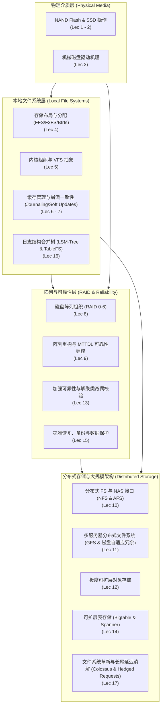

# 18-746 存储系统

## TL;DR

- **全栈存储工程闭环**：覆盖从底层单机物理介质（NAND 闪存与机械硬盘）、单机文件系统布局与崩溃一致性（FFS/F2FS/Btrfs/Soft Updates），到硬件冗余阵列（RAID/MTTDL/解聚类校验），直至现代大规模分布式存储（NFS/AFS/GFS/Bigtable/Spanner）的完整技术脉络。
- **软硬件协同设计哲学**：深入剖析介质的“不成文契约”（如 SSD 写前必擦与磨损均衡、HDD 寻道旋转与电梯调度），探讨上层系统如何利用不可变日志结构（LSM-Tree/LFS）和写时复制（COW）化解物理瓶颈。
- **高可靠与可扩展性权衡**：围绕数据中心真实故障模式（潜在扇区错误、长尾延迟、备份失败），建立马尔可夫可靠性分析模型与尾部对冲请求机制，实现工业级高可用与持久性保障。

## 课程介绍

### 先修课程

- 计算机体系结构与汇编基础（理解 CPU 缓存、总线、内存层次结构）
- 操作系统（掌握虚拟内存、并发与锁原语、进程与中断机制，建议修读 MIT 6.1810 / CSAPP）
- 熟练掌握 C / C++ 系统级编程与基本数据结构

### 官方对课程描述的翻译

> 存储系统是计算机系统中最迷人且最重要的组成部分之一。它们不仅往往决定了整个系统的综合性能，而且当其他计算组件发生故障时，系统恢复通常完全依赖于从受保护的存储中重新启动。实际上，存储系统守护着所有组织最核心的“皇冠明珠”：海量核心业务信息——从软件源代码、电子商务交易数据库，到驱动大数据分析与现代人工智能革命的海量日志与向量索引。在这一关键领域，行业对优秀系统工程师与突破性存储架构的需求持续爆发式增长。
>
> CMU 18-746（亦称 15-746）系统化讲授现代存储系统的设计、实现与评估。内容贯穿从单机硬件介质物理机理（NAND Flash 固态硬盘与机械硬盘），到管理这些介质并提供抽象接口的操作系统内核、本地文件系统与数据库存储引擎；再进一步跃升至通过网络将数千节点互联构成的大规模网络附加存储（NAS）、分布式文件系统与跨地域分布式表存储。在此过程中，课程深度研读数十篇存储领域的奠基论文与最新顶会成果（FAST、USENIX ATC、OSDI、SOSP），剖析经典工业系统案例，探索前沿存储介质与超大规模数据中心架构的发展趋势。

### 参考书籍与核心阅读材料

- **主修教材与经典专著**：
  - Remzi H. Arpaci-Dusseau and Andrea C. Arpaci-Dusseau, *Operating Systems: Three Easy Pieces (OSTEP)*（持久化、存储介质与分布式存储核心章节）
  - Marshall Kirk McKusick et al., *The Design and Implementation of the 4.4BSD Operating System*（UNIX 传统 FFS 与 VFS 架构）
  - Dominic Giampaolo, *Practical File System Design with the Be File System*（文件系统索引与日志机制设计经典）
  - Uresh Vahalia, *UNIX Internals: The New Frontiers*（内核缓存与元数据同步机制）
- **核心论文体系**：包含 FAST、OSDI、SOSP 历年关于 SSD 不成文契约、Soft Updates、RAID 可靠性模型、LSM-Tree、GFS、Bigtable、Spanner 与长尾延迟消解（The Tail at Scale）等里程碑论文。

## 课程知识体系

本课程将存储技术解构为四大演进模块：从底层物理介质特性出发，向上构建本地文件系统抽象，横向通过冗余编码构筑可靠阵列，最终拓展至跨机网络与超大规模分布式存储集群。

### 模块全景架构

存储系统从物理介质的微观电磁与电子特性，向上层层抽象为操作系统文件接口、容错磁盘阵列与全球级分布式表存储。整个知识演进分为四个核心层次：

1. **物理介质层（Lec 1 - 3）**：深入闪存芯片与机械磁盘的硬件内部物理机制，揭示读写不对称性与寻道开销等现实世界硬约束。
2. **本地文件系统层（Lec 4 - 7, 16）**：通过 Inode、位图与 B 树结构管理介质，结合内核 VFS 抽象与预写式日志（WAL）解决单机崩溃一致性。
3. **阵列与可靠性层（Lec 8, 9, 13, 15）**：利用条带化与奇偶校验冗余（RAID / 解聚类校验）抵御硬件损坏，建立生产环境失效率实证与灾难恢复模型。
4. **分布式存储与大规模架构（Lec 10 - 12, 14, 17）**：跨越网络边界，研究 NFS/AFS 状态取舍、GFS 追加语义、Spanner 全球时钟一致性与长尾延迟消解策略。

下述架构图系统呈现了本课程 17 门讲义之间的核心依赖与演进流向：

从介质层到分布式集群，各个模块之间形成了紧密的因果联系：
- 本地文件系统的布局与分配算法（Lec 4）必须深刻感知底层 SSD 的磨损均衡与 HDD 寻道开销（Lec 1-3）；
- 单机文件系统对崩溃恢复的探索（Lec 6-7）直接催生了预写式日志与 LSM 树（Lec 16）在大型分布式存储中的广泛复用；
- RAID 与解聚类校验（Lec 8, 9, 13）构成了现代数据中心底层可靠存储池的基础设施，使得上层分布式文件系统（Lec 11-12）能够专注于元数据解耦与横向扩展；
- 最终，跨节点的长尾延迟消除与一致性保障（Lec 14, 17）将整个存储技术栈推向现代工业级高可用的成熟形态。

### 讲义全景清单

| 讲次 | 讲义标题 | 核心主题与机制 | 核心研读材料 |
| :--- | :--- | :--- | :--- |
| **01** | [概述 & Flash SSD 操作 I](./lec1.md) | 闪存内部层次（Die/Plane/Block/Page）、FTL 映射池、擦除开销与磨损均衡 | Agrawal et al. (ATC'08) *Design Tradeoffs for SSD Performance*, OSTEP *Flash SSD* |
| **02** | [Flash SSD 操作 II](./lec2.md) | 固态硬盘不成文契约（对其、分组、局部性）、NVM+DRAM 混合主存、FairyWREN 缓存 | He et al. (EuroSys'17) *Unwritten Contract of SSDs*, Mogul (HotOS'09), McAllister (OSDI'24) |
| **03** | [磁盘驱动操作](./lec3.md) | HDD 物理构造、寻道与旋转延迟、磁道偏移与多区域记录、SPTF 与电梯调度算法 | OSTEP *Hard Disk Drives*, Ganger et al. (SIGMETRICS'94) *Disk Scheduling Algorithms* |
| **04** | [文件系统存储布局](./lec4.md) | Inode 索引不平衡树结构、FFS 柱面组、Btrfs 写时复制（COW）、F2FS 闪存感知与 TableFS | OSTEP *File System Implementation*, *F2FS* (FAST'15), *TableFS* (ATC'13) |
| **05** | [文件系统的内核组织](./lec5.md) | VFS 虚拟文件系统抽象、`vnode` 与 `vfsops` 操作向量、文件描述符表与跨进程共享 | *The Design and Implementation of the 4.4BSD OS*, *Practical File System Design with BeFS* |
| **06** | [文件系统缓存与一致性](./lec6.md) | 页缓存（Page Cache）、写回策略、崩溃一致性难题、Soft Updates 依赖图机制、Recon 运行时校验 | Ganger et al. (TOCS'00) *Soft Updates*, OSTEP *Crash Consistency*, *Recon* (FAST'12) |
| **07** | [崩溃恢复与日志机制](./lec7.md) | 预写式日志（Write-Ahead Logging, WAL）、元数据日志 vs 完整数据日志、检查点与崩溃恢复 | OSTEP *Journaling*, *BeFS* Chapter 7, Gray & Reuter *Transaction Processing* |
| **08** | [磁盘阵列组织](./lec8.md) | RAID 0/1/4/5/6 架构、奇偶校验计算、小写问题（Small Write Penalty）、生产环境闪存可靠性实证 | Patterson et al. (SIGMOD'88) *Case for RAID*, Schroeder et al. (FAST'16) *Flash Reliability* |
| **09** | [磁盘阵列系统与可靠性建模](./lec9.md) | 阵列重构瓶颈、MTTDL 马尔可夫可靠性建模批判、潜在扇区错误（LSE）与奇偶校验丢失防范 | Greenan et al. (FAST'10) *Mean Time to Meaningless*, Krioukov et al. (FAST'08) *Parity Lost* |
| **10** | [分布式文件系统与 NAS 接口](./lec10.md) | NFSv2/v3 无状态开放协议与幂等 RPC、AFS 客户端本地缓存与 Callback 回调、状态 vs 规模权衡 | OSTEP *Distributed Systems/NFS/AFS*, Howard et al. (TOCS'88) *Scale and Performance in AFS* |
| **11** | [多服务器分布式文件系统](./lec11.md) | GFS 架构与单 Master 内存索引设计、Chunk 租约机制、追加写入（Record Append）与 PACEMAKER | Ghemawat et al. (SOSP'03) *Google File System*, Kadekodi et al. (OSDI'20) *PACEMAKER* |
| **12** | [极度可扩展的存储](./lec12.md) | 分布式对象存储模型、控制面与数据面彻底解耦、一致性哈希与扁平对象命名空间 | Weil et al. (OSDI'06) *Ceph*, Calder et al. (SOSP'11) *Windows Azure Storage* |
| **13** | [加强可靠性技术](./lec13.md) | 解聚类奇偶校验（Declustered Parity）消除重构热点、Panasas 并行文件系统、Tiger 自适应冗余 | Holland & Gibson (ASPLOS'92) *Declustered Parity*, Welch et al. (FAST'08), Kadekodi (OSDI'22) |
| **14** | [可扩展表存储](./lec14.md) | Bigtable 稀疏多维分布式表、Tablet 分裂与 SSTable 存储、Spanner TrueTime 与全球外部一致性 | Chang et al. (OSDI'06) *Bigtable*, Corbett et al. (OSDI'12) *Spanner*, Burrows (OSDI'06) *Chubby* |
| **15** | [备份和数据保护](./lec15.md) | 灾难恢复规划、RPO 与 RTO 指标、快照机制、块级与内容寻址重复数据删除（Deduplication） | Keeton et al. (FAST'04) *Designing for Disasters*, Amvrosiadis et al. (ATC'16) *Backup Failures* |
| **16** | [LSM 树及其应用](./lec16.md) | 内存组件 $C_0$ 与磁盘组件 $C_1$ 滚动归并（Rolling Merge）、布隆过滤器、TableFS 与 DeltaFS 案例 | O'Neil et al. (Acta Inf'96) *The Log-Structured Merge-Tree*, Zheng et al. (ACM ToS'20) *DeltaFS* |
| **17** | [Google 文件系统革新与长尾控制](./lec17.md) | 从 GFS 到 Colossus 的演化动因、小文件与 Master 瓶颈、大规模分布式系统长尾延迟根因与对冲请求 | Dean & Barroso (CACM'13) *The Tail at Scale*, McKusick (ACM Queue'09) *GFS Evolution* |

## 官方资源与实验

- **官方课程主页**：
  - [CMU 18-746 Storage Systems (Fall 2022 Schedule)](https://course.ece.cmu.edu/~ece746/old/fall22/schedule.html)
  - [CMU 18-746 Storage Systems (Fall 2025 Reading List)](https://course.ece.cmu.edu/~ece746/readinglist.html)
- **实践项目实验**：
  - [CloudFS 设计与实现 (CMU Parallel Data Lab)](https://github.com/Guo-lab/CloudFS_Design)：设计并实现一个支持快照、分层缓存、本地 SSD 聚合与云对象存储（如 Amazon S3）对接的现代云原生文件系统。
  - [CloudFS 参考实现代码库](https://github.com/Ishant89/CloudFS)
