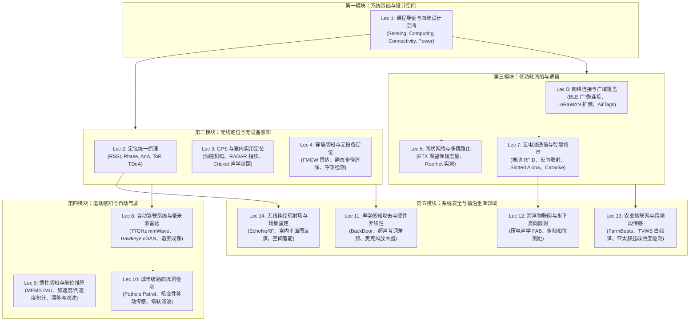

# 6.1820 移动和传感器计算

> MIT 6.1820 / MAS.453 · Mobile and Sensor Computing (IoT Systems)

## TL;DR

- 系统化剖析物联网系统（IoT）在传感、计算、通信与能量约束下的协同设计与权衡空间。
- 覆盖射频与声学测距、穿墙 FMCW 雷达、毫米波成像、惯性航位推算等物理世界数字化关键技术。
- 探讨 BLE、多跳网状网 ETX、无电池反向散射（RFID/PAB）以及微型传感器安全与隐私边界。
- 串联海洋探测、精准农业与无线 NeRF 场景重建，建立从底层物理信号到高层空间智能的完整系统链条。

## 课程介绍

### 先修课程

- [6.1800 计算机系统工程（Computer Systems Engineering）](../os/index.md) 或同等计算机系统与体系结构基础
- 基础概率论、线性代数与信号处理常识（傅里叶变换、频域分析与离散采样）

### 官方对课程描述的翻译

聚焦“物联网”（IoT）系统与技术，涵盖传感、计算与通信领域。深入探讨移动及传感器计算系统工程中的核心设计与实现问题，课程主题包括：无电池传感器、穿墙感知、机器人传感、生命体征传感（呼吸、心跳、情绪）、汽车与自动驾驶传感、海底物联网、传感器安全、定位技术（含 GPS 与室内 WiFi）、惯性传感（加速度计、陀螺仪、惯性测量单元、航位推算）、嵌入式与分布式系统架构、无线电信号传感、麦克风与摄像头传感、无线传感器网络、传感器移动库与 API 接口，以及应用案例分析。课程内容结合科研文献阅读、实验作业与重点学期项目。

### 参考书籍

本课程紧密结合顶级系统与移动计算学术会议（ACM SIGCOMM, MobiCom, MobiSys, USENIX NSDI）的前沿科研成果，无单一指定课本。推荐参考以下经典著作以筑牢物理层、网络层与信号处理基础：

- *Strapdown Inertial Navigation Technology* (2nd Edition), David H. Titterton & John L. Weston（惯性测量与捷联导航经典）
- *Computer Networks: A Systems Approach*, Larry L. Peterson & Bruce S. Davie（分布式与计算机网络系统视角）
- *Wireless Communications: Principles and Practice*, Theodore S. Rappaport（无线信道、衰落与电波传播原理）

## 课程知识体系

### 模块全景架构

本课程的知识图谱围绕“物理世界数字化”展开，整体划分为五大递进模块：从底层传感硬件受限的物理约束出发，逐步升维到射频与声学空间几何解算，再突破通信能耗壁垒构建自组网与零功耗反向散射，最终向自动驾驶、水下勘探、精准农业与神经辐射场等垂直场景提供空间智能支持。

五大模块具体涵盖以下核心认知路径：

1. **系统基础与四维权衡（Lec 1）**：建立感知任务与模态、计算范式、网络连接与能量预算四个相互牵制的系统维度。确立通信距离、数据速率与电池寿命构成的经典三角约束，为后续所有协议和系统设计提供评价基准。
2. **无线定位与无设备空间感知（Lec 2–4）**：剖析从标量信号到空间几何坐标的解算过程。系统对比 RSSI 衰减、载波相位周期、多天线到达角（AoA）、飞行时间（ToF）与时间差（TDoA）；深入 GPS 伪距解算、RADAR 经验指纹匹配与 Cricket 双模态测距；进一步推进至 FMCW 扫频雷达与差分多径滤除，实现无须随身佩戴终端的穿墙生命体征与人体轨迹感知。
3. **低功耗网络与零功耗反向散射（Lec 5–7）**：攻克野外与室内持续通信的能耗瓶颈。解析 BLE 毫秒级连接间隔与 0.1% 极低占空比工作机制；探讨 LoRaWAN 线性扩频增益与长距离广域覆盖；引入 ETX（期望传输次数）度量以克服传统跳数路由在无线多径过渡区易选弱链路的缺陷；最终延伸至无电池 RFID 与反向散射通信，学习 EPC Gen2 分时隙 Aloha 介质访问控制以及机会性复用城市既有 ETC 基础设施。
4. **运动估计与自动驾驶鲁棒感知（Lec 8–10）**：探索移动载体的高动态物理交互。剖析 77 GHz 毫米波雷达的全天候穿透特性与 cGAN 深度超分辨率重建；推导 MEMS 加速度计弹簧电容与陀螺仪科里奥利力学原理，量化航位推算的二次积分发散误差与多传感器卡尔曼滤波校准；研读 Pothole Patrol 级联特征滤波流水线与城市移动感知网络设计。
5. **系统安全前沿与垂直领域赋能（Lec 11–14）**：揭示传感器模拟硬件深层漏洞并拓展物联网极限场景。解析麦克风放大器平方非线性引发的双超声波互调差频攻击（BackDoor）；攻克海水导电屏蔽下的压电声学反向散射（PAB）与多频相位测距；探讨面向精准农业的电视白频谱（TVWS）穿透与气象预测占空比调度；终章跨入无线神经辐射场（EchoNeRF），探索仅凭 Wi-Fi 信号衰减反演室内建筑几何与三维场景重建。

### 讲义全景清单

| 讲次 | 核心主题 | 代表系统 / 文献来源 | 核心机制与突破 |
|:---|:---|:---|:---|
| [Lec 1](./lec1.md) | 课程介绍与核心思想 | 6.1820 导论与系统架构 | 感知、计算、通信与能量四维协同权衡空间 |
| [Lec 2](./lec2.md) | 物联网定位基础 | Fundamentals of Localization | 身份、RSSI、相位、AoA、ToF、TDoA 六类物理测距机制 |
| [Lec 3](./lec3.md) | GPS 与实用室内定位 | RADAR (INFOCOM'00) / Cricket (MobiCom'00) | GPS 伪距解算、Wi-Fi 强度指纹匹配、被动监听 RF/超声 ToF 测距 |
| [Lec 4](./lec4.md) | 穿墙感知与无设备定位 | WiTrack (NSDI'15) / WiVi | FMCW 扫频雷达、差分消除静态多径、双椭圆交点二维定位 |
| [Lec 5](./lec5.md) | 网络连接技术 | BLE 规范 / LoRaWAN / AirTags | 占空比压缩、扩频增益、去中心化众包定位与防跟踪安全 |
| [Lec 6](./lec6.md) | 网状网络与多跳路由 | ETX (MobiCom'03) / MIT Roofnet | 双向探测包统计、期望传输次数度量、自适应惩罚高丢包链路 |
| [Lec 7](./lec7.md) | 无电池通信与智慧城市 | EPC Gen2 / Hacking RFIDs / Caraoke (MobiSys'13) | 射频能量收集、微瓦级阻抗调制反向散射、ETC 路侧基建机会性复用 |
| [Lec 8](./lec8.md) | 自动驾驶系统与毫米波雷达 | Hawkeye (CVPR'20 / MobiCom'22) | 77 GHz 毫米波雷达全天候透雾感知、cGAN 端到端深度图超分辨率 |
| [Lec 9](./lec9.md) | 惯性感知与航位推算 | MEMS IMU 原理 / Strapdown Navigation | 弹簧质量块与科里奥利力、姿态旋转矩阵、二次积分漂移与卡尔曼滤波 |
| [Lec 10](./lec10.md) | 城市路面坑洞检测 | Pothole Patrol (MobiSys'08) | 机会性移动出租车感知、四级级联特征过滤、重度惩罚误报的优化目标 |
| [Lec 11](./lec11.md) | 声学感知攻击与硬件非线性 | BackDoor (MobiSys'17) | 模拟放大器非线性、双超声互调差频混叠、无声指令注入与干扰 |
| [Lec 12](./lec12.md) | 海洋物联网与水下反向散射 | PAB (SIGCOMM'19 / HotNets'20) | 压电声学反向散射、可编程阻抗频移 FDMA、声波多频相位解模糊测距 |
| [Lec 13](./lec13.md) | 农业物联网与跨频段传感 | FarmBeats (NSDI'17) / AgriTera (MobiCom'23) | TVWS 穿透树冠通信、天气感知自适应占空比、亚太赫兹无损水果测糖 |
| [Lec 14](./lec14.md) | 无线神经辐射场与场景重建 | EchoNeRF (arXiv:2505.22441) | 无线传播物理先验、两阶段 LoS/反射分治训练、Wi-Fi RSSI 反演平面图 |

## 官方资源

- **课程官方主页**：[MIT 6.1820 / MAS.453 (6mobile.github.io)](https://6mobile.github.io/)
- **实验与项目平台**：
  - [Lab 0: 开发环境设置与传感器 API 基础](https://6mobile.github.io/labs/lab0.html)
  - [Lab 1: 室内 Wi-Fi 信号强度与位置指纹采集](https://6mobile.github.io/labs/lab1.html)
  - [Lab 2: BLE 广播与移动追踪协议分析](https://6mobile.github.io/labs/lab2.html)
  - [Lab 3: 惯性传感器步数检测与室内航位推算](https://6mobile.github.io/labs/lab3.html)
- **学术会议前沿追踪**：
  - ACM SIGCOMM / USENIX NSDI（网络与分布式系统顶会）
  - ACM MobiCom / MobiSys（移动计算与无线感知顶会）
