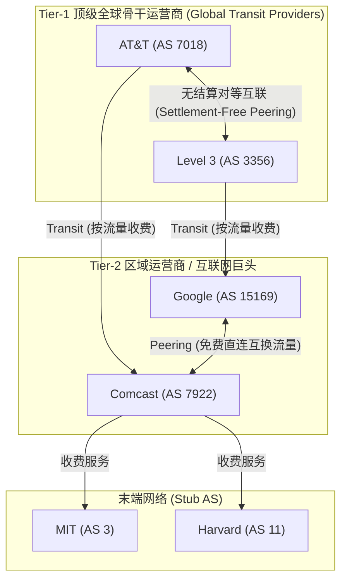
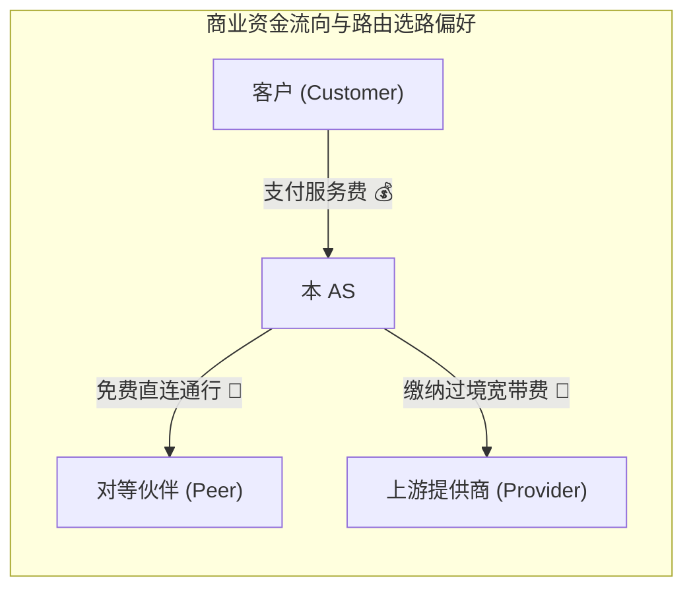
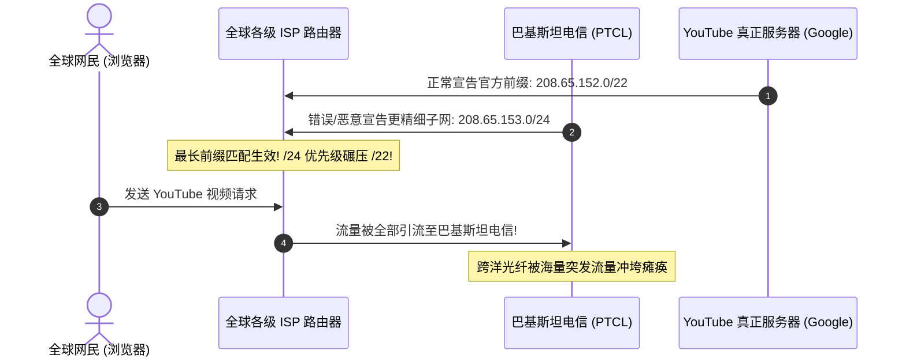
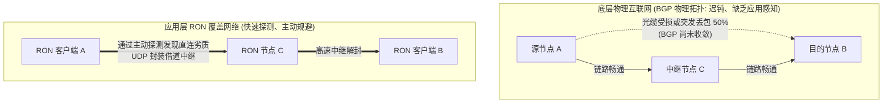

# Lec 10 BGP 与广域网策略路由

> 阅读资料：
> - 经典论文：[Resilient Overlay Networks (RON, SOSP 2001)](http://nms.lcs.mit.edu/papers/ron-sosp2001.pdf)
> - 推荐阅读：Lixin Gao & Jennifer Rexford《A Stable BGP Growth Model》（IEEE/ACM Trans. Networking）

## TL;DR

- **自治系统与策略路由**：全球互联网由数万个独立商业自治域（AS）去中心化组成；域间 BGP 协议以商业经济契约与策略控制取代纯粹的最短路径度量。
- **路径向量防环机制**：BGP 通告携带完整的 `AS-PATH` 路径序列，节点遇自身 ASN 即可即时判定环路并丢弃，彻底消除计数到无穷隐患。
- **Gao-Rexford 商业准则**：选路偏好遵循 $\text{Customer} \succ \text{Peer} \succ \text{Provider}$；Peer 与 Provider 路由绝不向其他 Peer/Provider 外传，数学上确保了分布式商业博弈的收敛性。
- **弹性覆盖网络（RON）**：针对底层 BGP 分钟级迟缓收敛与黑洞故障，RON 利用应用层主动探测与单跳中继路由，将网络自愈时间压制在 3 秒以内。

---

## 1. 现实互联网的组织边界：自治系统（AS）

在局域网与单一数据中心内部，链路状态（OSPF）或距离向量（RIP）假定全网路由器共享同一个目标——寻找数学上的最短路径。然而在跨越全球的广域互联网中，这一纯真假定瞬间瓦解：
1. **规模爆炸（Scalability）**：全球拥有数十亿终端与超百万条公网路由前缀，扁平的泛洪计算将瞬间耗尽路由器硬件算力与内存；
2. **拓扑机密（Confidentiality）**：电信运营商（如 AT&T, Verizon）将内部拓扑视为最高商业机密，绝不向竞争对手公开内部结构；
3. **商业利益驱动（Policy & Economics）**：跨洋光纤铺设成本极高，运营商绝不允许非签约实体免费借道过境。

为了化解技术与商业的矛盾，全球互联网被解耦为层次化体系结构：
- **域内路由（Intra-Domain Routing / IGP）**：在单个组织内部运行（如 OSPF, IS-IS），专注于物理性能与延迟优化。
- **域间路由（Inter-Domain Routing / EGP）**：在不同组织之间运行。**BGP（Border Gateway Protocol，边界网关协议）** 是全球唯一的域间路由协议标准。



::: definition 自治系统（Autonomous System, AS）
在单一技术管理机构管辖下的一组路由器的集合。每个 AS 拥有全网唯一的自治系统编号（ASN，由 IANA 分配），对外呈现统一的路由策略。
- **末端网络（Stub AS）**：仅作为流量源端或目的端，绝不提供中继过境服务（如 MIT, AS 3）。
- **多宿主网络（Multi-Homed AS）**：接入多个上游 ISP 以实现高可用冗余。
- **传输网络（Transit AS）与 Tier-1 骨干**：拥有全互联光纤核心网，直接为全球互联网提供中继转发。
:::

---

## 2. 路径向量机制（Path-Vector）与天然防环

BGP 在架构上既不采用链路状态（避免泄露全网拓扑机密与泛洪风暴），也不采用传统距离向量（避免盲目的数字开销导致计数到无穷），而是独创性地采用了**路径向量（Path-Vector）**模型。

### 2.1 逐跳追加与无环验证

当 BGP 边界路由器向外部邻居宣告可达的 IP 前缀（Prefix）时，必须附带一条完整的自治系统访问序列——`AS-PATH`：

```text
[ MIT: AS 3 ] 
      │ 宣告: 18.0.0.0/8, AS-PATH = [3]
      ▼
[ Comcast: AS 7922 ] 
      │ 追加自身 ASN: 18.0.0.0/8, AS-PATH = [7922, 3]
      ▼
[ AT&T: AS 7018 ] 
      │ 追加自身 ASN: 18.0.0.0/8, AS-PATH = [7018, 7922, 3]
      ▼
[ 欧洲某 ISP: AS 5400 ]
```

::: theorem 路径向量天然防环定理
当边界路由器收到一条 BGP 路由更新时，只需扫描该条目的 `AS-PATH` 列表：
1. **若包含本 AS 编号**：表明该路由已在拓扑中形成闭环，路由器**直接静默丢弃**该宣告；
2. **若不包含本 AS 编号**：将本 AS 编号推入列表头部，继续按策略向后传播。
该机制以 $O(1)$ 的查表复杂度在源头扑灭了环路形成，彻底清除了距离向量协议的计数到无穷绝症。
:::

---

## 3. 商业利益驱动的路由选择：Gao-Rexford 准则

现实世界中的 AS 之间主要存在两类神圣的商业契约：
1. **客户-提供商关系（Customer-Provider）**：客户向提供商支付巨额过境服务费（Transit Fee），提供商向客户提供通往全球互联网的完整路由。
2. **对等互联关系（Peer-to-Peer / Peering）**：两家规模相当的 AS（如 Google 与 Comcast）在互联网交换中心（IXP）建立直连。双方**免费互换流量（Settlement-Free）**，但仅限于双方自身及各自客户的内部流量。



### 3.1 Gao-Rexford 路由导出规则（Export Rules）

为了防止自身沦为替竞争对手无偿转发流量的“冤大头”，每个 AS 在对外广播路由时严格执行以下导出策略：

| 学习到的路由来源 | 允许向谁宣讲（Export） | 商业动机与因果解释 |
| :--- | :--- | :--- |
| **来自客户（Customer）** | **全世界**（其他客户、所有 Peer、所有 Provider） | 别人把流量导给我的客户，我可以按流量向客户收费赚钱。 |
| **来自对等伙伴（Peer）** | **仅向自己的客户宣讲** | 严禁外传给其他 Peer 或 Provider，否则本 AS 将被沦为两个外部实体的免费中继管道。 |
| **来自提供商（Provider）**| **仅向自己的客户宣讲** | 严禁外传给其他 Peer 或 Provider，否则本 AS 需同时向上游交费却毫无收益。 |

### 3.2 路由选路优先级（Import Policy / Local Preference）

当 BGP 路由器为同一个目的 IP 前缀收到多条不同路径时，首要准则绝不是“跳数最少”，而是基于 `Local_Pref` 属性的经济效益优先级：

$$\mathbf{Customer} \succ \mathbf{Peer} \succ \mathbf{Provider}$$

1. **首选客户路径（Customer Route）**：将流量推给客户，自身获得账单收益；
2. **次选对等路径（Peer Route）**：直连对等伙伴免费互换，无金钱支出；
3. **末选提供商路径（Provider Route）**：走上游提供商需按量结账，成本最高。

::: theorem Gao-Rexford 收敛性定理
若全网所有 AS 均遵循上述导出规则与选路偏好，且商业关系中不存在循环依赖（即不存在任何 AS 既是某节点的后代客户又是其祖先提供商），则无论网络拓扑如何复杂变动，全球 BGP 策略路由**在数学上必然收敛于无冲突稳定状态**，绝不会产生无限策略震荡。
:::

---

## 4. 现实世界的脆弱性：BGP 劫持与前缀匹配

BGP 在诞生初期假定所有参与实体均诚实守信，缺乏原生的密码学身份认证（Zero Authentication by Default）。

### 4.1 最长前缀匹配与劫持机制

BGP 诞生于互联网早期的“学术互信时代”，其核心协议中缺乏原生的公钥基础设施或密码学签名验证机制（Zero Authentication by Default）。任何一个加入 BGP 对等互联的自治域，在理论上都可以向全世界自由宣称自己拥有对任何 IP 前缀的可达性。

与此同时，所有商用路由器的底层硬件转发表（FIB）都死死遵循一条不可动摇的物理铁律——**最长前缀匹配优先（Longest Prefix Match, LPM）**。当路由表中同时存在多个能够覆盖目标 IP 的路由项时，硬件 TCAM 会无条件命中掩码最长、地址空间划分最精细的条目。

攻击者或遭遇配置疏忽的运营商，正是利用这一物理规则发起了破坏力极大的**前缀劫持（Prefix Hijacking）**：



由于 `/24` 比原生的 `/22` 拥有更长的前缀掩码，全球各级 ISP 路由器的硬件在数分钟内集体做出了“数学上完全正确、但业务上灾难性错误”的决策——撤销通往正版 YouTube 的宽泛路径，将全网海量视频请求强行倒灌至巴基斯坦电信。这不仅导致目标服务从全球视野中瞬间蒸发，更将攻击者自身的国际出口网线彻底冲垮。

除了造成全局流量黑洞（DoS）之外，恶意的 BGP 劫持还可以被用于构建无感知的隐蔽中间人攻击（MitM）：攻击者在拦截流量后，窃听未加密的敏感凭据，再通过备用隧道将流量悄悄送回真实目的地，使受害者与终端用户极难察觉。

在 2008 年经典的 YouTube 劫持事故中，巴基斯坦电信（PTCL）因配置失误向全球公网宣告了更精确的 `/24` 路由，瞬间将全球数亿访问 YouTube 的流量强行引流至其国内网线，引发全网大断网。
当前工业界正强力推进 **RPKI（资源公钥基础设施）**，通过数字证书强制校验 IP 前缀的宣告合法性。

---

## 5. 论文阅读：弹性覆盖网络（RON, SOSP 2001）

针对底层 BGP 协议在光缆中断或丢包震荡时收敛极其缓慢（往往需耗费 15 至 30 分钟）的致命缺陷，MIT 研究团队提出了 **RON（Resilient Overlay Networks）**。



### 5.1 RON 架构的核心设计
1. **端系统主动探测**：由几十个运行在终端服务器上的轻量节点构成覆盖网络，以秒级周期相互发送 UDP 探测包，实时测定真实延迟与丢包率；
2. **应用层单跳中继（1-Hop Indirect Routing）**：若发现直接路径不可用或性能严重恶化，节点 $A$ 将数据包封装进普通 UDP 隧道，转发给状态良好的中间节点 $C$，$C$ 再解封投递给 $B$；
3. **实证成果**：仅仅引入一层应用层中继跳跃，RON 便成功绕过了数千次底层 BGP 持续数十分钟的物理断网与性能黑洞，将故障自愈时间降至 **3 秒** 以内。

---

## 我的理解

::: insight 架构师见解：商业妥协与端到端覆盖的辩证共生
1. **技术纯洁性向商业博弈的低头**：BGP 可能是整个计算机体系结构中最“丑陋”却又最成功的妥协产物。从纯算法角度看，它充满了人为硬编码的政治、法律与商业规则，经常迫使数据包舍弃物理上最短的链路而绕道昂贵的长途线路。但正是这种对商业自治与机密边界的极致尊重，才使得成千上万家敌对的跨国公司愿意坐到同一张牌桌上，拼凑出人类历史上最庞大的协作奇迹。
2. **Underlay 与 Overlay 的分层制衡**：底层网络（Underlay）追求的是**海量连接与经济稳定**，因此 BGP 必须牺牲灵敏度以避免全网震荡；而高层应用（Overlay）追求的是**极致的用户体验与敏捷自愈**。从 RON 到现代软件定义广域网（SD-WAN）与云原生服务网格（Service Mesh），端系统通过在应用层重新握有选路权，完美印证了“智能在边缘”的端到端哲学——当底层基础设施因兼顾全局而变得迟钝时，端点应用可以用极小的开销实现自我救赎。
:::
