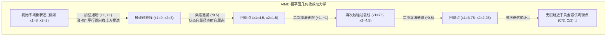
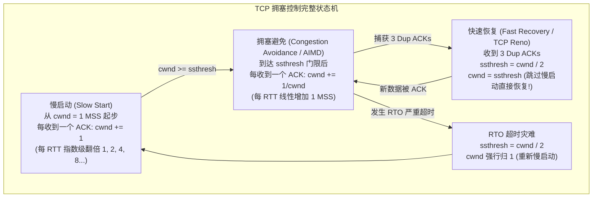

# Lec 11 传输层与 TCP 拥塞控制

> 阅读资料：
> - 奠基论文：[Congestion Avoidance and Control (Van Jacobson, SIGCOMM 1988)](https://ee.lbl.gov/papers/congavoid.pdf)
> - 经典推导：[Analysis of the Increase and Decrease Algorithms for Congestion Avoidance in Computer Networks (Chiu & Jain, 1989)](https://www.cs.princeton.edu/courses/archive/fall06/cos561/papers/chiu.pdf)

## TL;DR

- **可靠按序字节流**：TCP 在不可靠的尽力而为 IP 底座之上，基于序列号、累积确认（Cumulative ACK）与滑动窗口，构筑按序无差错的虚拟双工管道。
- **流量控制 vs 拥塞控制**：接收窗口 `rwnd` 保护接收端主机内存，拥塞窗口 `cwnd` 保护全网共享物理信道；发送上限严格为 $\min(cwnd, rwnd)$。
- **AIMD 几何收敛性**：加法递增沿 $45^\circ$ 平行推进效率线，乘法递减惩罚高占用大流、拉动状态向量射向原点，是唯一收敛至效率与公平最优点（$C/2, C/2$）的线性控制律。
- **快速重传与状态演进**：利用 3 次冗余确认（3 Dup-ACKs）精确判定丢包并即时重传，跳过漫长的 RTO 超时，结合慢启动与快速恢复平滑流水线吞吐。

---

## 1. 传输层核心职责与拥塞崩溃历史

IP 协议只负责将数据包从一台主机送达另一台主机（Host-to-Host）。然而在实际操作系统中，多款应用程序并发运行。传输层通过 **端口号（Port Number）** 实现了网络通信的端点多路复用与解复用（Multiplexing & Demultiplexing）。

更关键的使命在于对抗网络恶化。1986 年，互联网遭遇了著名的**拥塞崩溃（Congestion Collapse）**：伯克利骨干网的一条 $32\text{ kbps}$ 物理链路，其实际吞吐量因不可控的丢包重传断崖式暴跌至 $40\text{ bps}$（下挫 800 倍）。Van Jacobson 提出的 TCP 拥塞控制算法通过纯终端的分布式自适应节流，挽救了整个互联网。

::: definition 可靠传输协议的黄金契约
- **无差错（Error-Free）**：通过校验和检验并丢弃损坏的比特；
- **无丢失（No Loss）**：通过确认与重传机制补齐空中丢包；
- **无重复且保序（In-Order, No Duplication）**：字节流中每个字节只会被接收应用程序读取一次，且次序与发送顺序绝对一致。
:::

---

## 2. 滑动窗口与可靠字节流抽象

若采用最质朴的“停止-等待（Stop-and-Wait）”机制，每个数据包需经历一次完整的往返时间（RTT）才能发送下一个，物理光纤信道绝大多数时间处于闲置状态。

为榨干信道潜力，TCP 引入了流水线**滑动窗口（Sliding Window）**机制。发送端允许同时处于在途传输状态（In-Flight）的数据量上限，取决于物理链路的**带宽-时延积（Bandwidth-Delay Product, BDP）**：
$$\text{BDP} = \text{瓶颈链路带宽 } C \times \text{往返时间 } RTT$$

### 2.1 序列号与累积确认（Cumulative ACK）

- **序列号（Sequence Number）**：按字节为单位严格编号，标识该段报文的首字节在整个流中的偏移量，用来驱动重组与去重；
- **确认号（ACK Number）**：TCP 采用累积确认机制。确认号 $k$ 的严格数学语义是：**“序号 $< k$ 的所有字节均已按序无损接收，接收方期盼收到的下一个字节为 $k$”**。

### 2.2 乱序到达与空洞检测

当发送方发送了包 6 至 10，而包 7 在中途丢失、包 8 至 10 顺利抵达时，接收方绝不能对包 8 或 10 单独回复确认，必须持续向发送方回传 `ACK 7`：

这构成了后续快速重传算法的信号基石。

### 2.3 流量控制 vs 拥塞控制

| 维度 | 流量控制（Flow Control） | 拥塞控制（Congestion Control） |
| :--- | :--- | :--- |
| **防御对象** | **保护接收端**：防止对端应用读取得太慢导致接收缓冲区溢出 | **保护网络核心**：防止全网路由器队列满溢与丢包崩溃 |
| **决策来源** | 由接收端在 TCP 报文头部的 `rwnd`（Receive Window）显式声明 | 由发送端基于网络时钟与丢包反馈动态估算的 `cwnd`（Congestion Window） |
| **综合约束** | 发送端在任何时刻允许在途的未确认数据量：$W = \min(cwnd, rwnd)$ |

---

## 3. 自适应重传计时器：Jacobson RTO 算法

TCP 必须依赖超时计时器（RTO）在无应答时补发数据。但广域网 RTT 随突发流量剧烈波动，静态设置超时会导致过早早产重传或漫长卡死。

### 3.1 Jacobson 动态平滑算法

1. **计算平滑往返时间（SRTT）**（采用 EWMA 指数移动加权平均）：
   $$SRTT \leftarrow (1 - \alpha) \cdot SRTT + \alpha \cdot RTT_{\text{sample}} \quad (\alpha = 0.125)$$
2. **计算往返时间波动方差（RTTVAR）**：
   $$RTTVAR \leftarrow (1 - \beta) \cdot RTTVAR + \beta \cdot |SRTT - RTT_{\text{sample}}| \quad (\beta = 0.25)$$
3. **推导重传超时阈值（RTO）**：
   $$RTO = SRTT + 4 \times RTTVAR$$
   引入 $4$ 倍的方差置信区间，将网络偶发毛刺引起的虚假超时重传概率压制到统计极限。

### 3.2 快速重传（Fast Retransmit）：三次冗余确认的直觉

RTO 超时往往长达数百毫秒至数秒。若发送方连续收到 **3 个相同的重复确认（3 Duplicate ACKs）**，意味着后序已有 3 个更新的数据包顺利越过了拥塞点到达了接收端。
网络轻微乱序通常只会引发 1–2 个冗余 ACK；而出现 3 个 Dup-ACK 时，中间遗失的包死于队列丢弃的概率超 $99.9\%$。发送端不必等待 RTO 超时，**立刻对遗失报文触发快速重传（Fast Retransmit）**。

---

## 4. 拥塞控制数学精髓：AIMD 相平面几何收敛证明

网络核心是无状态黑盒，路由器不会主动通知剩余带宽。所有终端必须在完全缺乏中心调度的环境下，独立调整发送窗口。

1989 年，Chiu 与 Jain 利用二维相平面（Phase Plane）给出了严格的几何数学证明：**加法递增乘法递减（AIMD）是唯一能够同时收敛至高带宽效率与绝对公平性的线性控制律。**

### 4.1 相平面数学模型

为了在数学上严谨分析去中心化网络中多条流的资源分配动态，Chiu 与 Jain 将拥塞控制抽象为一个二维相平面（Phase Plane）动力学系统。假设两条独立的流（流 1 与流 2）通过瓶颈路由器竞争总量为 $C$ 的固定链路带宽，它们的即时传输速率分别记为 $x_1$ 与 $x_2$。

在以 $x_1$ 为横轴、$x_2$ 为纵轴的笛卡尔坐标系中，系统的状态可以完全由点 $(x_1, x_2)$ 的轨迹表征。整个空间被两条关键的几何约束直线所划分：

- **最高效率线（Efficiency Line）**：定义为 $x_1 + x_2 = C$（截距为 $C$、斜率为 $-1$ 的直线）。当状态点处于该线下方时，表明瓶颈链路带宽尚未被充分榨干，网络处于欠载状态；而一旦状态点越过该线，则表明两条流的总需求超过了物理容量，交换机缓冲区发生积压并诱发丢包。
- **绝对公平线（Fairness Line）**：定义为 $x_1 = x_2$（斜率为 $1$、穿过坐标原点的 $45^\circ$ 射线）。落在该射线上的任意点都意味着两条流分享到了完全相等的带宽资源。
- **全局最优目标点（Optimal Operating Point）**：效率线与公平线的唯一交点 $(x_1^*, x_2^*) = (C/2, C/2)$。任何优秀的分布式控制算法，其核心目标都是促使任意初始状态 $(x_1(0), x_2(0))$ 在有限轮迭代内自动收敛至该目标点附近。

在相平面中观察状态转移时，系统的运动轨迹呈现出惊人的几何美感：加法递增负责将状态点推向效率线，乘法递减负责将状态点旋转拉向公平线，二者交替循环形成了典型的锯齿形（Sawtooth）轨道。

### 4.2 为什么必须是“加法递增、乘法递减”？

- **加法递增（Additive Increase, $x_i \leftarrow x_i + \alpha$）**：
  两端同时增加常数 $\alpha$，位移向量斜率为 $\Delta x_2 / \Delta x_1 = \alpha / \alpha = 1$。位移轨迹严格平行于 $45^\circ$ 公平线，在试探可用带宽的同时绝不破坏既有公平度。
- **乘法递减（Multiplicative Decrease, $x_i \leftarrow \beta \cdot x_i, \beta \in (0, 1)$）**：
  若发生拥塞，按比例折半。占用 $80\%$ 的大流一次性被砍掉 $40\%$，而仅占 $20\%$ 的小流仅被扣除 $10\%$。**位移向量径直射向原点 $(0, 0)$，将状态点强行向 $45^\circ$ 公平线旋转拉拽！**
- 其它组合（AIAD, MIMD, MIAD）在几何上均会导致持续环路震荡或严重发散，无法兼顾公平与效率。

---

## 5. TCP 状态机演进：慢启动、拥塞避免与快速恢复

理论上的 AIMD 控制律必须落地为能够在操作系统内核中断与协议栈时钟驱动下稳定运行的状态机。Van Jacobson 在 1988 年提出的经典设计（TCP Tahoe）以及随后完善的 TCP Reno，通过三个相互衔接的运行阶段，将抽象的数学方程转化为高吞吐的工业实现。

在最初的 TCP Tahoe 算法中，一旦检测到丢包，系统便会极其悲观地将拥塞窗口 `cwnd` 彻底归 1，强迫连接重新经历慢启动。为了避免这一过度惩罚引发的吞吐量断崖式凹陷，TCP Reno 创新性地将“快速重传”与“快速恢复（Fast Recovery）”融合，形成了现代拥塞控制的基石状态机：

该状态机在各个工作区间的具体行为与转换条件如下：

1. **慢启动阶段（Slow Start）**：连接建立伊始，端点对网络容量完全一无所知。若直接采用线性加法递增，需要耗费数十个 RTT 才能填满高带宽管道。因此算法从 $1\text{ MSS}$ 起步，每收到一个合法 ACK 就将窗口递增 1（即每个 RTT 窗口翻倍：$1 \to 2 \to 4 \to 8\dots$），呈指数级急速爆炸式试探网络边界。当 `cwnd` 触碰到慢启动门限 `ssthresh` 时，算法判定网络已接近饱和，立即平滑切换至稳健的拥塞避免阶段。
2. **拥塞避免阶段（Congestion Avoidance）**：进入标准的加法递增阶段。每个 RTT 周期内，整条连接仅允许增加 1 个 MSS 的发送配额（实现上表现为每收到一个 ACK，窗口微增 $1 / cwnd$）。此时系统以克制而坚定的步频，平行于 $45^\circ$ 公平线向容量上限逼近。
3. **快速重传与快速恢复阶段（Fast Recovery）**：当且仅当由于收到 3 个冗余确认触发丢包判定时，Reno 深刻认识到网络核心并没有发生严重瘫痪（后序数据包依然在持续驱动对端回传 ACK，即端系统的“数据包时钟（Self-Clocking）”并未熄火）。此时算法仅将慢启动门限减半（`ssthresh = cwnd / 2`），并将当前窗口直接赋值为该门限，**彻底跳过归 1 的慢启动过程**，直接在半高水位线上继续执行加法递增。
4. **超时重置阶段（Timeout Reset）**：只有在发生严重的 RTO 超时时（表明空中飞行的数据包已被全部清空，ACK 反馈流彻底断流），系统才会判定遭遇了严重物理拥塞或链路切换，此时被迫将 `cwnd` 归零至 1，重新进入慢启动。

---

## 我的理解

::: insight 架构师见解：丢包驱动与现代 BBR 拥塞控制革命
1. **去中心化协同的系统美学**：AIMD 是分布式系统设计史上最优雅的博弈论杰作。在缺乏任何全局主脑调控的前提下，无数独立的终端仅凭借本地观察到的二元信号（丢包与否），就能自发收敛至全网资源的 Pareto 最优解。这种端点自律的负反馈机制，是互联网能够支撑全球数亿级并发的基础前提。
2. **丢包驱动模型的物理局限与 BBR 的范式跃迁**：传统 TCP（Tahoe/Reno/Cubic）将“丢包”等同于“网络拥塞”，在小缓冲区网络中极具成效。但进入现代高带宽浅队列与无线网络环境后，该假设彻底失效：无线电噪声导致的偶发误码丢包会诱发 TCP 灾难性腰斩窗口；而大缓冲区（Bufferbloat）又会导致数据在路由器中积压巨大延迟却不丢包。Google 提出的 BBR（Bottleneck Bandwidth and RTT）算法彻底抛弃了丢包驱动模型，转而通过交替测量最大瓶颈带宽 $BtlBw$ 与最小往返时间 $RTprop$，直接在物理极限（BDP 拐点）运行，完成了拥塞控制从“被动响应惩罚”到“主动容量测量”的代际飞跃。
:::
