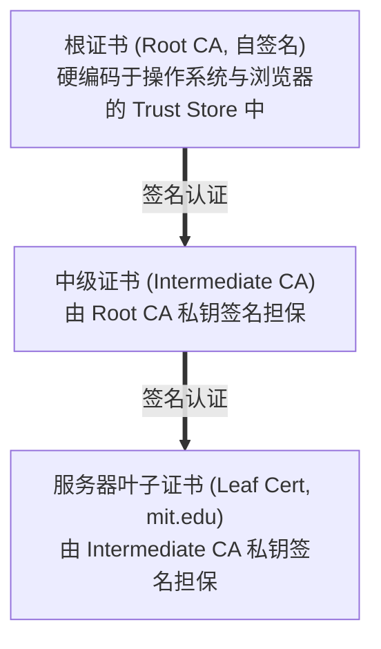
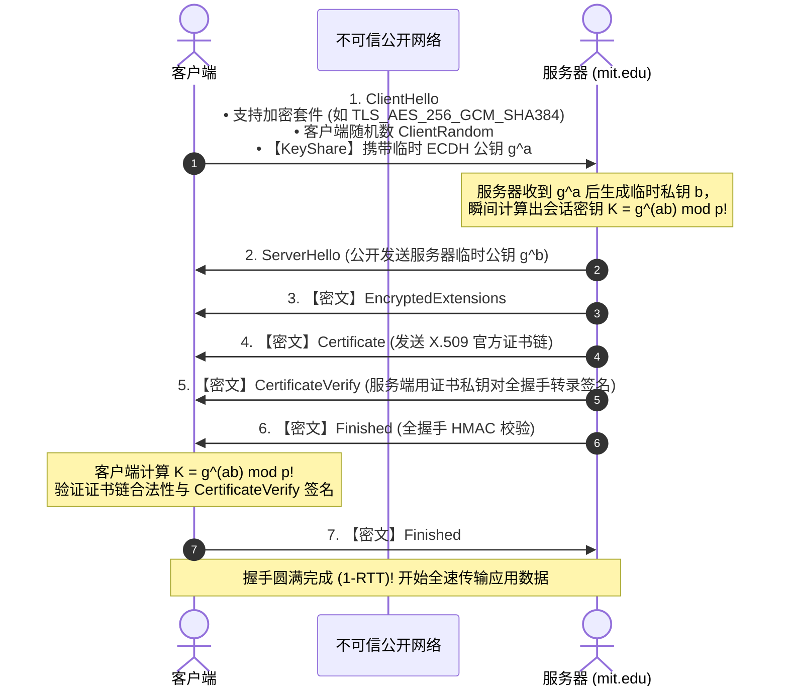

# Lec 23 安全通道与公钥基础设施

> 课程：MIT 6.1800 Computer Systems Engineering  
> 参考材料：Saltzer & Kaashoek 教材第 11 章（§11.3–11.5）、IETF RFC 8446 (TLS 1.3) 及官方授课大纲

## TL;DR

- **安全通道三大契约**：在不可靠且充满窃听篡改的公开网络中，必须同时捍卫机密性（Confidentiality）、完整性（Integrity）与端点真实性（Authenticity）。
- **混合加密工程实践**：以非对称算法协商临时对称密钥，利用硬件加速的对称 AEAD（如 AES-GCM）保障海量数据吞吐；纯 Diffie-Hellman 缺乏端点认证，易遭中间人（MitM）拦截。
- **PKI 证书链与前向保密**：依靠预埋根 CA 数字签名背书绑定公钥与域名；TLS 1.3 采用 1-RTT 极速握手并强制使用临时 ECDHE，实现单次会话私钥销毁的前向保密性（PFS）。

---

## 引入：公开网络下的威胁模型

到目前为止，我们主要处理对手在服务器本地访问数据的问题。从本讲开始，对手转移到了**网络内部**，能够直接观察、截获和注入网络流量。

即使传输的数据未被直接逆向，数据包的有效载荷大小、频率与通信模式也会出卖用户的隐私：


::: definition 安全通道威胁模型
- **策略目标**：提供机密性（攻击者无法获知消息明文）和完整性（攻击者无法篡改数据包而不被即刻察觉）。
- **对手能力**：完全掌控底层物理通信链路，可被动窃听流量、主动篡改或重放报文、以及伪造虚假源 IP 注入恶意数据包。
:::

---

## 消息机密性与混合密码系统

机密性通过密码学转换将明文变换为伪随机密文：

```js
encrypt(key, message) -> 密文
decrypt(key, 密文) -> message
```

性质：给定密文（ciphertext），在不知道密钥 $key$ 的情况下，计算上无法获取原始消息 $message$。


::: pitfall 加密不等于完整性
纯粹的加密（如某些分组密码模式）**只能提供机密性，绝不保证完整性**！攻击者即便无法解密消息，也可以通过翻转密文中的特定比特（Bit-Flipping Attack），导致解密后的明文按攻击者预期改变。因此，机密性必须与完整性认证绑定。
:::

### 对称加密 vs 非对称加密

1. **对称加密（Symmetric Cryptography）**：
   - 加密与解密使用同一把密钥（如 AES-256、ChaCha20）；
   - **优势**：依托 CPU 硬件指令（AES-NI），吞吐量极高（数 GB/s）；
   - **痛点**：全网 $N$ 个通信方需要维护 $O(N^2)$ 对密钥，面临**密钥分发难题（Key Distribution Problem）**。
2. **非对称加密（Asymmetric Cryptography / 公钥体系）**：
   - 密钥成对出现：公钥 $pk$ 彻底公开，私钥 $sk$ 本地严密保管；
   - **优势**：消除了预共享秘密的刚性要求；
   - **痛点**：计算复杂度高，性能比硬件对称加密慢 1000 倍以上。
3. **混合密码系统（Hybrid Cryptosystem）**：
   - 在连接初始阶段利用非对称算法在两端协商出一把临时的**对称会话密钥（Session Key）**；
   - 随后切换至对称加密传输海量数据，兼顾安全性与极致吞吐。

---

## 认证消息与完整性（MAC）

为了防范篡改，系统必须为消息附加认证标签：

::: definition 消息认证码（MAC / HMAC）
消息认证码是通信双方利用共享对称密钥 $K$ 对消息 $M$ 生成的防伪校验标签：
$$\text{MAC} = \text{HMAC}(K, M) = H\Big((K \oplus opad) \parallel H((K \oplus ipad) \parallel M)\Big)$$
接收方收到消息与 MAC 后，在本地重新计算比对。若中间人篡改了 $M$ 的任意比特，由于缺乏密钥 $K$，无法生成合法的 MAC，篡改行为被即刻识破。
:::

现代工业标准全面转向 **AEAD（Authenticated Encryption with Associated Data，如 AES-GCM）**，在单次硬件流水线中同时完成加密与认证标签计算。

---

## 迪菲-赫尔曼密钥协商（Diffie-Hellman Key Exchange）

在完全公开的信道中，双方如何在众目睽睽之下凭空协商出相同的共享秘密？

### 数学原理：离散对数难题

迪菲-赫尔曼算法的单向性完全根植于初等数论中有限域乘法群的算术不对称性。
通信双方首先公开商定两个公共参数：一个极大素数 $p$（在现代密码学中通常为 2048 位以上大素数），以及有限域 $\mathbb{Z}_p^*$ 上的一个本原元（生成元）$g$。任何攻击者或监听者都可以自由观察到 $p$ 和 $g$ 的数值。

协议的执行流程分为私钥选择、公钥推导与终极密钥合成三个严密步骤：

```text
Alice (本地私钥 a)                              Bob (本地私钥 b)
计算公钥: A = g^a mod p                        计算公钥: B = g^b mod p
         │                                              │
         ├─── 公开发送公钥 A ───────────────────────────>│
         │<─── 公开发送公钥 B ───────────────────────────┤
         │                                              │
计算共享秘密:                                   计算共享秘密:
S_A = B^a mod p = (g^b)^a mod p                 S_B = A^b mod p = (g^a)^b mod p
                = g^(ab) mod p                                  = g^(ab) mod p
```

#### 计算复杂度的非对称性分析

1. **正向计算极其迅捷**：
   对于合法参与者 Alice 而言，给定底数 $g$、素数 $p$ 以及随机挑选的私钥 $a$，通过**快速模幂算法（Repeated Squaring / 模重复平方律）**，仅需 $O(\log a)$ 次乘法运算即可在数微秒内完成公钥 $A = g^a \pmod p$ 的计算；
2. **逆向反解极其困难**：
   对于网络中间的窃听者 Eve，虽然她完整监听了公开参数 $p, g$ 以及双向公钥 $A, B$，但若想求得私钥 $a$，必须在有限域中求解**离散对数（Discrete Logarithm Problem, DLP）**。对于经过精心挑选的强素数，目前人类已知最快的数域筛法（General Number Field Sieve）在经典计算机上的渐进时间复杂度也是次指数级的，在现实时间尺度内根本无法暴力破解；
3. **代数对称性闭合**：
   Alice 与 Bob 最终独立计算出的数值在模算术指数律下严格相等：$(g^b)^a \equiv (g^a)^b \equiv g^{ab} \pmod p$。双方在没有向信道泄露哪怕一个比特私钥的前提下，安全生成了强随机的共享秘密 $S$。该秘密随后通过 HKDF 等单向密钥派生函数处理，直接作为对称加密算法的主密钥使用。

### 纯 Diffie-Hellman 的致命死穴：中间人攻击（MitM）

::: pitfall 纯 Diffie-Hellman 缺乏身份认证
若攻击者 Eve 能够控制链路，她可在中间截断公钥交换：
- Eve 与 Alice 协商密钥 $K_{AE} = g^{ae}$；
- Eve 与 Bob 协商密钥 $K_{EB} = g^{be}$；
Alice 以为自己在与 Bob 通信，实则双方都在与 Eve 独立加密通信，Eve 可解密篡改所有流量！  
**结论：任何密钥交换协议必须依赖可信身份认证机制。**
:::

---

## 公钥基础设施（PKI）与数字证书

为了证明“某个公钥确实属于目标实体”，系统引入了受信任的第三方——**证书颁发机构（Certificate Authority, CA）**。

### 数字证书（X.509）

CA 为实体签发数字证书，其本质是一份由 CA 私钥签名的数字身份证：

$$\text{Certificate} = \Big\{\text{Subject: mit.edu}, \text{PublicKey: } K_{\text{pub}}, \text{Validity}, \text{Issuer: DigiCert}\Big\}_{sk_{\text{CA}}}$$

任何持有 CA 公钥的人都可以验证证书签名，从而确认公钥归属。

### 树状信任链与根证书库



操作系统与浏览器出厂时预埋了受信任根 CA 的公钥库。当访问服务端时，服务端提供完整证书链，客户端递归向上验证至受信任根证书，粉碎了中间人伪造公钥的企图。

---

## 安全协议的设计陷阱与用例演进

在设计安全协议时，即使底层密码算法完备，协议交互逻辑的微小疏漏也会引发严重攻击。

### 攻击类型归纳
- **已知密钥攻击**：攻击者利用旧会话密钥破解后续通信；
- **重放攻击（Replay Attack）**：记录有效历史密文并在稍后重新注入；
- **冒充与中间人攻击（Impersonation / MitM）**：伪装通信参与方进行流量拦截与欺骗；
- **反射攻击（Reflection Attack）**：将一端发送的数据重放给发送方自身。

### 显式设计原则（Be Explicit Principle）

以一个错误的密钥交换协议为例：

1. Alice $\rightarrow$ CA: `{"请给我 Alice 和 Bob 的证书"}`
2. CA $\rightarrow$ Alice: `{"这里是证书：", {Alice, A_pub, T}_CApriv, {Bob, B_pub, T}_CApriv}`
3. Alice $\rightarrow$ Bob: `{"提议密钥：", {Alice, A_pub, T}_CApriv, {K_AB, T}_Apriv}^Bpub`
4. Alice $\Rightarrow$ Bob: `{"业务数据", T}^K_AB`

::: pitfall 违反显式原则的漏洞
注意消息 3 中 Alice 提议的共享密钥 `{K_AB, T}_Apriv`。该签名**只包含密钥和时间戳，未明确绑定 Bob 的身份标识**！  
恶意对手 Bob 收到该消息后，可以将其原封不动嵌套进自己发给 Charles 的消息中，声称自己是 Alice。Charles 验证 Alice 的签名通过，误以为在与 Alice 共享密钥，造成严重越权。  
**显式设计原则要求：所有签名与加密必须在语义中完整固化双方主体标识与上下文意图。**
:::

---

## 现代传输层安全标准：TLS 1.3 握手时序

现代互联网的基石协议 **TLS 1.3（RFC 8446）** 摒弃了老旧协议冗余，实现了 **1-RTT 单往返握手** 与全生命周期的高强度防护：



### TLS 1.3 极速握手的关键设计拆解

相较于早期版本需要 2 个完整的网络往返（2-RTT）才能建立加密通道，TLS 1.3 在体系结构上做出了三个颠覆性改进：

1. **预判式密钥共享（KeyShare）**：
   在老旧版本中，客户端首先发送支持的算法清单，服务器选定后再在第二个往返中交换密钥参数；TLS 1.3 中，客户端在第 1 步的 `ClientHello` 报文中便直接**乐观推测**常用曲线（如 X25519），并将自己的临时公钥 $g^a$ 随报文一并发出。服务端收到后能立即在本地计算出会话密钥，直接将握手延迟削减一半；
2. **握手元数据强制加密**：
   从第 3 步 `EncryptedExtensions` 开始，所有后续控制报文均已处于对称会话密钥的强力加密保护之下。包括服务端证书链在内的所有身份标识，网络监听者在物理光纤中再也无法看到明文，彻底封堵了基于服务端证书实施的流量指纹追踪；
3. **防篡改转录签名（Transcript Hash Signature）**：
   在第 5 步与第 6 步中，服务端使用长期私钥对**此前网络中交互的所有原始报文的累积加密哈希值**进行数字签名，客户端亦发送 `Finished` 校验。任何试图在握手早期降级加密套件或篡改随机数的中间人，都会导致双方转录哈希失配，从而被协议底层强制熔断。

::: insight 前向保密性（Perfect Forward Secrecy, PFS）
在 TLS 1.3 中，所有传统的静态 RSA 密钥交换被彻底废止，强制采用**临时椭圆曲线迪菲-赫尔曼（ECDHE）**。每次连接的私钥 $a, b$ 仅暂存于内存，**连接关闭后即刻销毁**。即使未来攻击者窃取了服务端的长期证书私钥，也因历史临时私钥的不可逆销毁，永远无法解密此前录制拦截的历史通信流量。
:::
