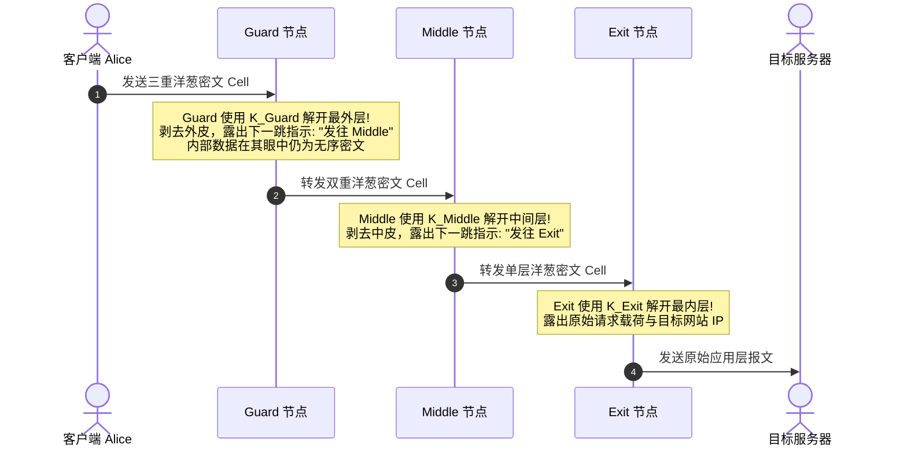
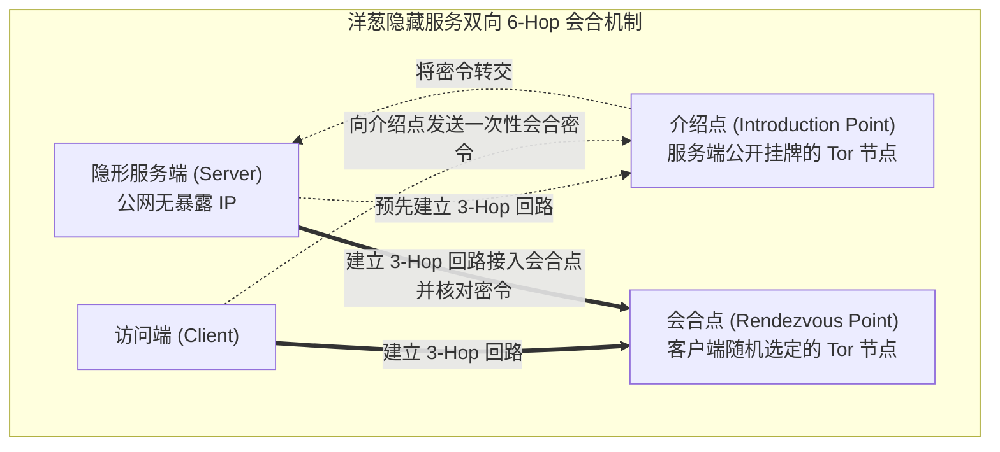
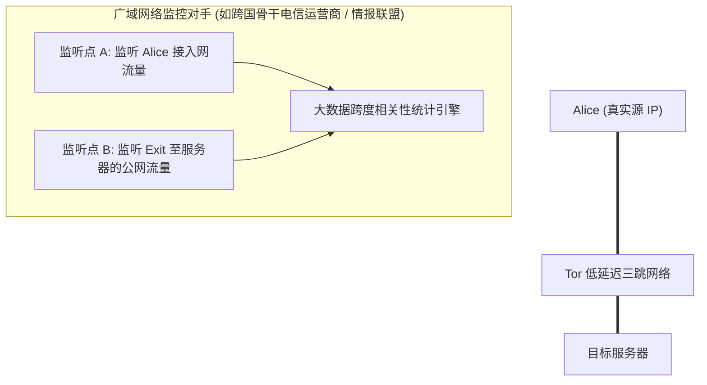

# Lec 24 洋葱路由与匿名网络

## TL;DR

- **元数据暴露危机**：端到端加密（如 TLS）仅能隐藏报文内容（Payload），但在物理层暴露通信双方 IP、包长及时间模式；匿名性的本质是“藏身于庞大且不可区分的人群之中”（匿名集 Anonymity Set）。
- **Tor 三跳洋葱回路**：客户端（Alice）通过 Guard、Middle、Exit 三级中继分别协商对称密钥，使用嵌套多层对称加密；各中继仅知晓前后相邻跳，全网无任何单一节点能同时关联通信源与终点。
- **低延迟的定时关联死穴**：Tor 为保障实时 Web 浏览放弃了高延迟批量混淆（Mix-Net）；拥有广域监听能力的攻击者可通过回路进出两端的流量突发与时间间隔统计分析（Timing Analysis）实施高精度去匿名。

---

## 0. 核心关切与思考题

公钥加密、对称加密、哈希函数和消息认证码（MAC）构成了现代安全系统的基石。在前面的课程中，我们讨论了如何提供机密性（Confidentiality）、完整性（Integrity）和真实性（Authenticity）。

本讲的主题转向更高维度的防御目标——**匿名性（Anonymity / 关系不可关联性）**，核心关注点包括：

1. **匿名数据包构造**：发送端 A 如何构造用于洋葱路由（Onion Routing）的数据包（加密层次、密钥协商与逐跳剥离流程）？
2. **威胁模型判定**：在给定的网络监听配置与各种加密手段下，哪些类型的对手能够推断出 A 正在与目标服务器 S 通信？
3. **假名 vs 真匿名**：比特币（Bitcoin）的公开账本与 Tor 的链路混淆在匿名属性上有何本质区别？
4. **低延迟网络的物理局限**：为何端到端加密无法阻断流量定时关联攻击（Timing Attacks）？

---

## 1. 匿名性的第一性原理：元数据与匿名集

### 元数据（Metadata）的现实威胁

哪怕所有数据包载荷均经过高强度加密，网络层的路由元数据仍会完全暴露：
- 谁在什么精确时间向哪个 IP 发送了数据；
- 数据交互的突发时长、总流量大小与交互频次；
- 通信实体的组织归属与物理地理位置。

通过对元数据的持续追踪，攻击者无需解密任何载荷，即可断定用户正在访问敏感医疗机构、与特定调查记者联络或进行商业并购磋商。

::: definition 匿名集（Anonymity Set）
匿名性在数学上定义为**在特定事件中，主体与其他所有不可区分的潜在主体构成的集合规模**。  
若匿名集规模为 $N$，且各实体在外部观察者眼中的行为概率分布均匀，则对手锁定真实通信源的先验概率为：
$$P(\text{Target}) = \frac{1}{N}$$
系统架构的目标，就是最大化匿名集 $N$，并迫使所有中继流量在统计学特征上完全同构。
:::

### 假名系统（Bitcoin）vs 真实匿名系统（Tor）

::: pitfall 比特币并非匿名，而是假名（Pseudonymous）
- **比特币模型**：用户以公钥哈希作为交易地址。虽然地址未直接绑定现实姓名，但**所有交易流向永久、公开、不可篡改地记录于全网账本**。通过图论聚类启发式算法（Clustering Heuristics）及法币出入金通道（KYC），分析机构可在几秒内将链上地址关联至真实身份；
- **Tor 模型**：追求**关系不可关联性（Relationship Unlinkability）**，即无论外部监听者如何穷举，均无法证明“源端 A 正在与目的端 B 通信”。
:::

---

## 2. 代理演进：从单点代理到高延迟混淆网（Mix-Net）

### 单点代理（VPN / Proxy）的信任崩溃

最简单的隐藏 IP 方案是通过第三方代理中继流量。然而单代理模式存在无法克服的单点风险：
1. **单一信任崩溃点**：用户必须无条件信任代理运营方不记录访问日志（No-Logs 承诺无法被技术证实）；
2. **物理侧信道关联**：网络监听者只需在代理机房入口与出口比对进出数据包的时间戳，即可瞬间建立因果关联。

### David Chaum 混淆网络（Mix-Net）

1981 年，David Chaum 提出了高强度的密码学混淆网络：
- 节点收集一批数据包（如 100 个），统一放入缓存区；
- 引入多层重加密并填充伪随机长度的填充字节；
- 将数据包乱序重新排列，批量转发出去。

::: theorem Mix-Net 的性能代价
Mix-Net 能够强力抵御流量时间分析，但其引入的**数秒乃至数分钟的批量缓存延迟**，彻底摧毁了交互式 Web 浏览（要求往返时延 $< 200\text{ ms}$）的可用性。人类需要一套低延迟、面向流媒体与网页浏览的实用匿名网络。
:::

---

## 3. Tor 体系结构与三跳回路（The 3-Hop Circuit）

Tor（The Onion Router）采用基于覆盖网络（Overlay Network）的低延迟设计，其核心纪律是：**全网无任何单一节点能同时知晓通信的起点与终点**。

### 三节点角色与知识隔离矩阵

| 节点类型 | 知道上一跳是谁？ | 知道下一跳是谁？ | 知晓 Alice 真实 IP？ | 知晓目标网站与内容？ |
| :--- | :---: | :---: | :---: | :---: |
| **入口守卫（Guard Relay）** | ✅ (Alice) | ✅ (Middle) | **✅ 是** | ❌ 否（仅见密文） |
| **中间中继（Middle Relay）** | ✅ (Guard) | ✅ (Exit) | ❌ 否 | ❌ 否（仅见密文） |
| **出口节点（Exit Relay）** | ✅ (Middle) | ✅ (Server) | ❌ 否 | **✅ 是**（见明文/TLS） |

::: pitfall 出口节点的明文嗅探风险
出口节点必须代表客户端向公网发起最终连接。若用户在 Tor 内部访问明文 HTTP 站点，**出口节点的操作者能够完整监听并篡改用户的所有明文账密与 Cookie**！因此，在 Tor 内部必须叠加端到端 TLS（HTTPS over Tor）。
:::

---

## 4. 逐层剥洋葱机制（Layered Peeling）推导

### 伸缩回路构建（Circuit Construction）

客户端 Alice 不会一次性向全网暴露完整路径，而是通过嵌套隧道逐步向前延伸：
1. Alice 与 Guard 节点通过单向认证的 Diffie-Hellman 协议协商临时对称密钥 $K_{\text{Guard}}$；
2. Alice 穿过已建立的 Guard 隧道，向 Middle 节点发送握手包，协商出第二把对称密钥 $K_{\text{Middle}}$；
3. Alice 穿过 Guard 与 Middle，与 Exit 节点完成握手，协商出第三把对称密钥 $K_{\text{Exit}}$。

### 嵌套加密封装与逐跳解密时序

数据包在洋葱网络中的流动遵循极其严密的代数封装逻辑。
为了防止报文长度泄露通信内容，Alice 将待发送的数据单元固定填充为 512 字节的标准单元块（Cells）。随后，Alice 在本地内存中依据链路逆序，执行反向的三重对称加密（通常采用支持流式处理的 AES-CTR 模式）：

$$\text{Cell} = E_{K_{\text{Guard}}}\Big(\text{Next: Middle} \parallel E_{K_{\text{Middle}}}\big(\text{Next: Exit} \parallel E_{K_{\text{Exit}}}(\text{Next: Server} \parallel \text{Payload})\big)\Big)$$

整个数据包在物理网络中穿行时，各中继节点如同剥洋葱一般逐层撕开保密外壳：

#### 逐跳转发的安全性质推导

1. **入口守卫节点（Guard）的处理**：
   Guard 接收到 Alice 发来的报文，使用自己持有的会话密钥 $K_{\text{Guard}}$ 解开最外层。解密后它获得了发往 Middle 节点的指令，但对于后续剥离出的双重密文，Guard 在数学上无法解读，因而它完全不知道通信的最终目的地到底是谁；
2. **中间中继节点（Middle）的处理**：
   Middle 收到 Guard 转发的报文，使用 $K_{\text{Middle}}$ 剥去第二层外皮。它获悉该报文需被送往 Exit 节点。在 Middle 眼中，前一跳是 Guard，后一跳是 Exit，它既不知道最初发起请求的客户端真实 IP，也不知道最终被访问的目标服务器是谁；
3. **出口节点（Exit）的处理**：
   Exit 节点使用 $K_{\text{Exit}}$ 剥掉最后一层加密，恢复出原始的应用层请求与目标服务器 IP。它负责向真实互联网发起原生 TCP 连接并获取响应。对于 Exit 而言，它只能看到请求来自 Middle 节点，完全无法追踪到隐藏在三跳之外的真实源端 Alice；
4. **反向响应的洋葱穿衣过程**：
   当目标服务器返回响应时，数据流沿着回路原路逆向返回。每经过一跳中继，节点都会使用对应的会话密钥为其套上一层加密“穿上一件衣服”；最终回到 Alice 本地后，Alice 依次使用三把密钥连解三层，毫发无损地恢复出原始网页。

任何单一中继即便被敌手物理攻破或被恶意运营，也只能得到局部的局部视图。只有 Guard 与 Exit 同时被同一个恶意攻击者控制并实施端到端流量分析时，匿名性才会面临瓦解。

---

## 5. 洋葱隐藏服务（Onion Services / .onion）

Tor 不仅支持客户端匿名，还通过**洋葱隐藏服务**提供服务端物理位置匿踪。隐藏服务的域名由其公钥的哈希直接计算而成（以 `.onion` 结尾）。这一机制使得服务器无需拥有固定公网 IP，亦无需向任何中心化 DNS 注册，即可向全网提供端到端强加密的匿名托管服务。

### 隐藏服务的建立与六跳握手全流程

洋葱服务的双向匿名通过经典的“会合点协议（Rendezvous Protocol）”完成，整个过程巧妙解耦了服务发现与真实物理连接：

1. **发布服务描述符**：
   服务端生成长期公私钥对，在 Tor 全网随机挑选数个普通中继作为自己的**介绍点（Introduction Points）**，并通过三跳回路与它们分别建立持久隧道。服务端将包含自己公钥与介绍点列表的服务描述符，发布到分布式的 Tor 目录 DHT（分布式哈希表）中；
2. **客户端选定会合点**：
   客户端在浏览器中输入 `.onion` 域名，从 DHT 下载该服务的描述符并获取介绍点列表。随后，客户端在 Tor 网络中随机挑选一个普通中继作为**会合点（Rendezvous Point, RP）**，建立一条 3 跳回路，并向会合点交付一个一次性的密码学识别凭证（Rendezvous Cookie）；
3. **通过介绍点传递密令**：
   客户端通过另一条 3 跳洋葱回路连接到服务端的某个介绍点，发送一条加密消息：“请让服务端带着密令 Rendezvous Cookie，前往指定的会合点与我会合”；
4. **服务端接入并完成盲拼缝合**：
   介绍点将消息转发给服务端，服务端确认请求合法后，通过一条专属于自己的 3 跳洋葱回路连接到指定的会合点，出示匹配的密令；
5. **双向 6-Hop 链路建立**：
   会合点确认双方持有的密令一致后，像拼接水管一样将客户端的 3 跳回路与服务端的 3 跳回路在内存中直接对接。**客户端不知服务器物理 IP，服务器不知客户端物理 IP，全链路共计 6 跳中继，在数学和拓扑上实现了绝对的双向物理盲通。**

---

## 6. 终极阿喀琉斯之踵：端到端流量定时关联攻击

Tor 在架构上追求低延迟交互，中继节点内部绝不刻意引入长周期缓存或虚假垃圾填充包（Dummy Traffic）。这一设计使 Tor 无法抵御**全局被动攻击者（Global Passive Adversary）**实施的定时关联攻击：

### 攻击的数学本质

人类操作（键盘击键、网页资源拉取）会诱发独特的**数据包突发时间间隔序列（Inter-packet Delay Fingerprint）**：
- 监听点 A 观测到 Alice 发送了具有特定微秒间隔模式的数据包突发序列 $[t_1, t_2, \dots, t_k]$；
- 经过三跳回路固定的传播与处理时延 $\Delta$ 后；
- 监听点 B 几乎在同一时刻（$t_i + \Delta$）观测到目的端接收到了完全相同的时间间隔指纹。

通过对两端时间序列进行**互相关函数（Cross-Correlation）计算**，攻击者在几秒至数十秒的流量样本内，即可在数学上以极高置信度推翻匿名假设，确认 Alice 与目标服务器的通信关系。

---

## 7. 核心匿名法则总结

::: insight 架构师见解：低延迟与强匿名的不可兼得
系统工程中不存在绝对安全的银弹。Tor 的核心权衡在于：**为了向普通大众提供可用的、低延迟的网页交互体验，在物理层面放弃了抵御全局流量定时分析的理论上限**。匿名系统不是魔法面具；防范本地监听与单点追踪的工程价值极其显著，但面对国家级全网流量测绘，唯有提高攻击者的跨域联合监听成本，才能在动态对抗中守护边缘自由。
:::
