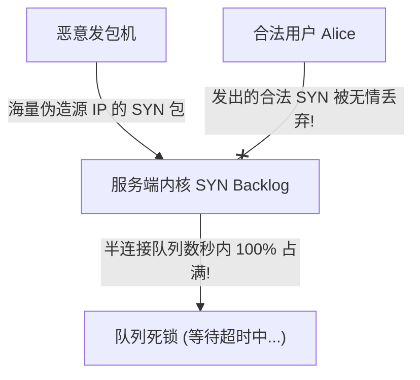
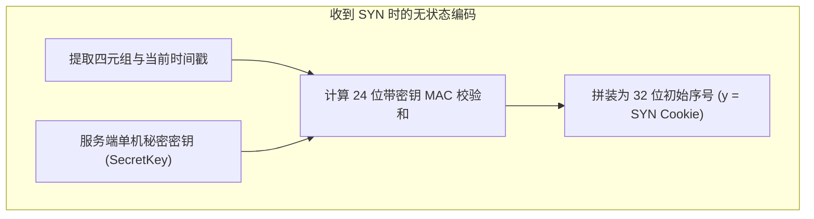
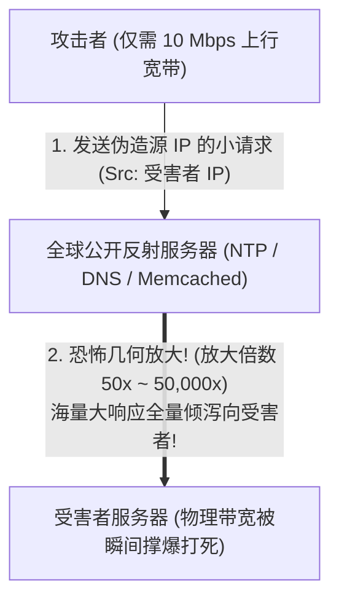
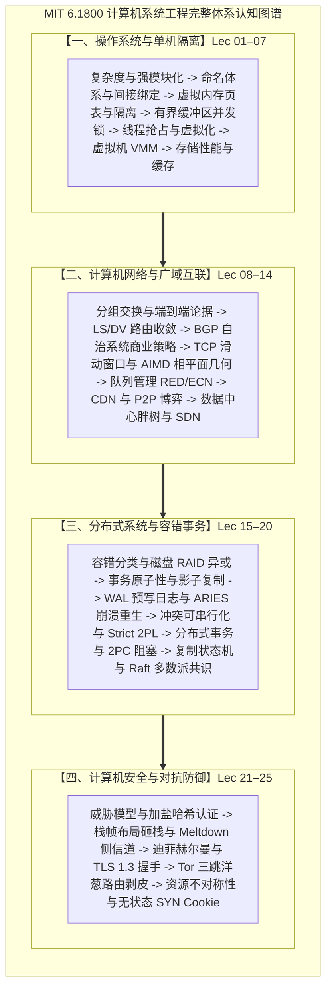

# Lec 25 网络攻击与防御：DoS 与 DDoS

> 课程：MIT 6.1800 Computer System Engineering  
> 参考材料：Daniel J. Bernstein《SYN Cookies》、IETF BCP 38 (RFC 2827) 及官方授课大纲

回想安全三大支柱（CIA）的最后一根神圣支柱——可用性！如果一个攻击者既不想偷窥你的银行密码（放弃 C），也不打算篡改你的存款账本（放弃 I），他的唯一目的就是极其纯粹的物理破坏：“我就是要让全世界所有的合法用户，彻底无法打开你的网站、无法调用你的 API、无法使用你的服务！”

这就是计算机网络中最狂暴、最野蛮的攻击形态——**拒绝服务攻击（Denial of Service, DoS）与分布式拒绝服务攻击（Distributed Denial of Service, DDoS）**。

## TL;DR

- **资源不对称性本质**：拒绝服务（DoS/DDoS）攻击的核心是利用微小的攻击成本（伪造小报文），迫使受害者消耗数十至数万倍的非对称系统资源（内核内存、计算算力或光纤带宽）。
- **无状态 SYN Cookie 破解连接洪泛**：针对 TCP 握手过早分配 TCB 结构体的致命缺陷，服务端将连接状态（时间戳、MSS 编码、四元组 MAC）编码进 32 位初始序号，实现收到合法三次握手 ACK 前**零内存分配**。
- **反射放大与 BCP 38 公地悲剧**：利用 UDP 无状态与伪造源 IP，黑客借由 NTP、DNS 与 Memcached 反射器实现高达数万倍的带宽放大；根本解法 BCP 38 入口过滤因跨运营商商业收益错位面临治理困境。

## 根源——资源不对称性

为什么少量的攻击者能够击垮拥有数千台服务器的大型企业？其底层核心法则只有一个词：**资源不对称性（Resource Asymmetry）**——攻击者付出的微小代价 （耗费 1 微秒 / 64 字节) <<<<<< 目标受害者承受的沉重代价 (耗费 500 毫秒 / 占用 4 KB 内存 / 阻塞光纤）。

黑客永远在寻找系统设计中的“**放大杆杆**”：

- 如果黑客发一个包只需要 $0.001$ 美分，但处理这个包需要服务器消耗价值 $1$ 美元的 CPU 计算或网络带宽；
- 攻击者就能用一台几十美元的廉价个人电脑，轻松拖垮价值千万美元的企业机房！


## 攻击手段

今天，我们将深入剖析两类最具代表性的资源耗尽战术：

1. 传输层状态不对称：SYN 洪水攻击（SYN Flood）
2. 网络层带宽不对称：UDP 反射放大攻击（Reflection & Amplification）


### 传输层状态击溃战：SYN 洪水攻击


## 拒绝服务攻击的核心物理力学

在前面的安全讨论中，攻击者的目标通常是窃听数据（破坏机密性）或篡改报文（破坏完整性）。而在拒绝服务攻击中，敌手的唯一诉求是**摧毁可用性（Availability）**：通过向受害系统施加极端过载，迫使服务耗尽关键资源，进而彻底瘫痪对合法用户的正常服务响应。

由单一主机发起的过载称为 **DoS（Denial of Service）**；而由全网数以万计被黑客攻陷的主机协同发起的流量海啸，则被称为 **DDoS（Distributed Denial of Service）**。

::: definition 资源不对称性（Resource Asymmetry）
拒绝服务攻击在工程上的可行性完全依赖于**攻击成本与防御开销的极端不对称**：
$$\text{Cost}_{\text{Attacker}} \ll \text{Cost}_{\text{Victim}}$$
攻击者只需发送极少量的伪造请求或廉价流量，便能触发受害端操作系统分配不可分页的核心内存（如 TCB 队列）、执行繁重的加密解密、或彻底占满物理出口带宽。
:::

---

## 僵尸网络（Botnets）

当今分布式网络攻击的物理基础是**僵尸网络（Botnet）**。僵尸网络由成千上万台被恶意软件攻陷的主机、物联网摄像头及家用路由器组成。攻击者通过命令与控制（C&C, Command & Control）服务器，向全网“肉鸡”下发统一的攻击协调指令。


攻击者通过租赁或控制大规模僵尸网络，能够瞬间聚合起高达数百 Gbps 乃至 Tbps 级别的物理攻击流量：


---

## 网络入侵检测系统（NIDS）及其工程困局

网络入侵检测系统（Network Intrusion Detection System, NIDS）部署于网络边界，对流经的数据包进行实时深度分析，主要分为两类技术路径：

1. **基于签名的入侵检测（Signature-based NIDS）**：  
   寻找已知的恶意攻击指纹（如特定的报文字节序列或蠕虫指令特征）。该方法规则精确、误报率低，但对于新型未记录的 0-day 漏洞和流量变种彻底失效；
2. **基于异常的入侵检测（Anomaly-based NIDS）**：  
   建立正常网络流量的基线行为模型（如使用统计学或机器学习模型），将偏离基线的行为标记为潜在攻击。此方法泛化能力强，但面临极高的误报率。

### 规则示例分析

一条典型的开源 Snort/Suricata 签名规则结构如下：

```css
alert tcp $EXTERNAL_NET any -> $HOME_NET 7597 
(msg:"MALWARE-BACKDOOR QAZ Worm Client Login access"; 
flow:to_server,established; content:"qazwsx.hsq"; 
metadata:ruleset community; reference:mcafee,98775; 
classtype:misc-activity; sid:108; rev:11;)
```

- `alert`：触发动作，表示匹配成功时记录并告警；
- `tcp $EXTERNAL_NET any -> $HOME_NET 7597`：定义流量方向与端口；
- `flow:to_server,established`：仅匹配已建立完成的有效 TCP 连接；
- `content:"qazwsx.hsq"`：核心特征载荷匹配字符串；
- `sid:108; rev:11;`：规则唯一编号与修订版本。

### NIDS 在现实中的系统级瓶颈

虽然签名匹配的概念直观，但在高速网络中实现全流量深度检测面临严峻的工程开销：

```python
# 最简模型：逐包单字匹配
for each packet:
    search packet for "root"
```

**问题 1：特征跨包分割**。攻击者可故意利用较小的 MSS，将恶意字符串拆分在两个连续的数据包中发送：

```python
# 改进模型：流式组装
stream = []
for each packet:
    add packet data to stream
    search stream for "root"
```

**问题 2：乱序与重传**。IP 网络中数据包可能无序到达，检测引擎必须完整重建 TCP 状态机，根据序列号重组字节流：

```text
stream = []
for each packet:
    get sequence number
    add to stream in the correct order
    search stream for "root"
```


为了抵御跨包规避，NIDS 必须在内存中为成千上万条活动流维护庞大的重组缓冲区。这本身就为攻击者制造了**针对 NIDS 的二次资源耗尽漏洞**：黑客只需发送大量不完整或故意乱序的幽灵连接，即可撑爆 NIDS 自身的内存状态。


---

## 传输层状态击溃：SYN 洪水攻击（SYN Flood Attack）

### 协议原罪：过早的状态分配

回顾 TCP 的经典三次握手：
1. 客户端发送 `SYN (seq=x)`；
2. 服务端回复 `SYN-ACK (seq=y, ack=x+1)`；
3. 客户端回复 `ACK (ack=y+1)`。

::: pitfall TCP 半连接队列状态陷阱
在收到第 1 个 `SYN` 报文时，服务端的操作系统内核**便立即在非分页内存中分配一个传输控制块（TCB，占用约 280~500 字节 DRAM）**，将其挂载进**半连接队列（SYN Backlog）**，并启动定时重传计时器等待第三次握手完成。
:::

### 攻击机制：虚假源 IP 与静默丢弃

黑客利用发包工具伪造成千上万个随机虚假源 IP，以极高频率向服务端喷射 `SYN` 报文，且**绝对不回复随后的第三次 ACK**。



操作系统的半连接队列通常仅有 1024 至 4096 个槽位。在短短数秒内，队列被虚假悬挂连接彻底耗尽。合法用户发出的正常连接建立请求因队列溢出而被系统直接丢弃，造成完全的拒绝服务。

---

## 密码学反制：无状态 SYN Cookie

1996 年，Daniel J. Bernstein 提出了划时代的系统级解决方案——**无状态 SYN Cookie**。

其核心哲学是一条彻底的颠覆法则：
**“在收到对端合法的第三次握手 ACK 之前，服务端内核绝对不分配任何半个字节的内存状态（Zero Memory Allocation）！”**



### 32 位初始序号的代数编码设计

服务端放弃使用随机数作为初始序列号（ISN），而是将连接的核心参数通过单向密码学哈希压缩进 32 位序号 $y$ 中：

$$y = \Big[\; \mathbf{Top\ 5\ 位}: \text{时间戳计数器 } t \pmod{32} \;\big|\; \mathbf{Mid\ 3\ 位}: \text{服务端 MSS 编码} \;\big|\; \mathbf{Low\ 24\ 位}: \text{加密 MAC 校验和} \;\Big]$$

其中底部的 24 位由带密钥哈希函数生成：
$$\text{MAC} = \text{Hash}\Big(\text{SrcIP} \parallel \text{DstIP} \parallel \text{SrcPort} \parallel \text{DstPort} \parallel t \parallel \text{SecretKey}\Big) \pmod{2^{24}}$$

```mermaid
sequenceDiagram
    autonumber
    actor Client as 客户端 (黑客 / 正常用户)
    participant Server as 启用 SYN Cookie 的服务端

    Client->>Server: 1. 发送 SYN
    Note over Server: 1. 提取四元组，算出 32 位序列号 y!<br>2. 回复 SYN-ACK (seq = y)!<br>3. ★ 清空局部变量，不保留任何内存状态 (内存开销为 0)!
    Server->>Client: 2. 发送 SYN-ACK (seq = y)

    Note over Client: 黑客: 保持沉默，永远不回 ACK。<br>服务端毫无内存损失，状态依然为 0!<br>----------------------------------------<br>合法用户: 必然遵守协议回复第三步 ACK!
    Client->>Server: 3. 发送 ACK (ack_seq = y + 1)
    
    Note over Server: 服务端收到 ACK:<br>1. 提取 ack_seq - 1 得到原始序列号 y;<br>2. 检查顶端 5 位时间戳: 验证连接未超时 (< 2 分钟);<br>3. 重新计算 MAC 对比低 24 位;<br>🎯 验证完全吻合! 此时此刻才真正分配 TCB 结构体!
```

::: theorem SYN Cookie 的零状态收益
- **对虚假 SYN 洪水免疫**：黑客发来的虚假握手请求只在 CPU 寄存器中完成了数十纳秒的哈希计算并抛出响应包，未在服务端内存中保留任何残留指针，半连接队列被彻底虚拟化；
- **自包含状态还原**：合法用户发回的 `ack_seq = y + 1` 将当初的加密状态完整带回，服务端通过二次校验以完全无状态的方式完成了双向所有权核验。
:::


## 网络层带宽海啸：UDP 反射放大攻击（Amplification Attacks）

即使服务端内部的内存与 CPU 状态被良好保护，但攻击者转向了更野蛮的维度——**打爆物理光纤带宽**！

如果一个企业的出口光纤带宽是 $10\text{ Gbps}$；黑客如果能在瞬间制造出 $100\text{ Gbps}$ 乃至 $1\text{ Tbps}$​ 的恐怖流量海啸灌进这条光纤，任何服务器内部的软件算法再优美，物理网线也会被瞬间挤爆，产生 100% 的物理丢包！


### IP 伪造（IP Spoofing）的结构性根源

UDP 协议是无连接的，通信双方无需握手验证。更关键的是，原生 IP 协议的路由器仅根据**目的 IP 地址（Destination IP）**查找转发表转发，**默认完全不校验源 IP 地址的真实性**。攻击者可在用户态套接字中将源 IP 篡改为受害服务器的 IP 地址！

### 反射与几何放大原理

攻击者挑选全网公开运行的无状态服务（反射器，如 DNS、NTP、Memcached）：



- **NTP 的 `monlist` 指令**：黑客发送一个 60 字节的小请求；NTP 服务器会返回最近访问过该服务器的 600 个 IP 列表，响应体高达数千字节！**放大倍数达 100 倍**！
- **Memcached 放大攻击（2018 年 GitHub 遭遇战）**：黑客先向公开的 Memcached 塞入一个 1 MB 的大键值，然后用 15 字节的 UDP 查询伪造发起读取，**放大倍数达到了骇人听闻的 51,000 倍**！
  黑客只需敲几行命令，全球无辜的反射器就沦为了他的放大火炮，瞬间制造出 $1.35\text{ Tbps}$ 的带宽海啸将 GitHub 瞬间轰下线！

### 5.3 治本之策与公地悲剧：BCP 38（入口过滤）

IETF 在 2000 年发布了 **BCP 38（RFC 2827）** 标准，要求所有接入网运营商在边缘路由器实施**源地址验证（Ingress Filtering）**：若发现接入链路发出的数据包源 IP 不属于本网合法分配的子网前缀，必须在物理接入点当场丢弃。

- 如果一台家用宽带路由器的分配 IP 是 `18.2.3.4`，只要发现它发出的数据包源 IP 居然写着别处的 `208.65.153.2`，**边缘路由器必须当场物理拦截丢弃！**

**为什么 20 年过去了，BCP 38 依然没有在全球彻底落地？**这就是分布式网络中最经典的**公地悲剧（Tragedy of the Commons）**：

- 部署 BCP 38 需要运营商花钱升级路由器硬件并消耗 CPU 算力；
- 但是，就算一家运营商严格部署了 BCP 38，**它保护的却是全世界其他的受害者网站**，对自己没有半毛钱直接经济收益！
- 只要全球互联网边缘仍有 5% 的运营商未配置过滤，攻击者便能利用这 5% 的漏洞发起全球级的伪造源 IP 反射攻击。技术方案的终极约束往往不是算法复杂性，而是商业博弈与经济激励的错位。


## 课程结束语

请大家闭上眼睛，回顾我们在这一学期共同构筑的**计算机系统四大支柱体系**：




在大家走出这间教室、走向未来的软件工程师、系统架构师或学术研究者生涯之前，请将以下这五条凝结了全人类半个世纪工程智慧的**终极设计法则**，永远铭刻在你的工程师徽章之上：

1. **非比例放大与涌现属性**：系统规模扩大 10 倍，复杂度不会简单扩大 10 倍，它会以超线性的指数爆炸，并涌现出单机上从未见过的全新灾难（从单机 I/O 到缓冲区膨胀，从死锁到脑裂）
2. **端到端论据**：底层通信系统保持精简、快速与愚蠢；终极正确性必须由深刻理解业务语义的两端终端来裁决与捍卫。
3. **间接层与模块化**：计算机科学中的任何难题，都可以通过增加一个间接层来解决（页表、FTL、DNS、虚拟化、路径向量）
4. **通过构造获得安全性（Safety by Construction）**：不要指望在使用中修修补补；必须在协议和数学状态机设计的源头，通过 Raft、AIMD、SYN Cookie 在代数上彻底封死违例的可能性；
5. **在没有信任的混沌世界中捍卫秩序（Order out of Chaos）**：哪怕硬件注定会掉电，哪怕机器必定会起火，哪怕网络里充斥着最恶毒的间谍，计算机系统工程的魅力就在于——我们始终能用最严谨的数学算法与优雅的体系结构，在这一片混沌的废墟之上，构筑起绝对坚不可摧的数字人类文明！
