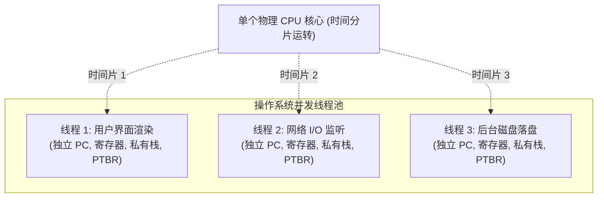
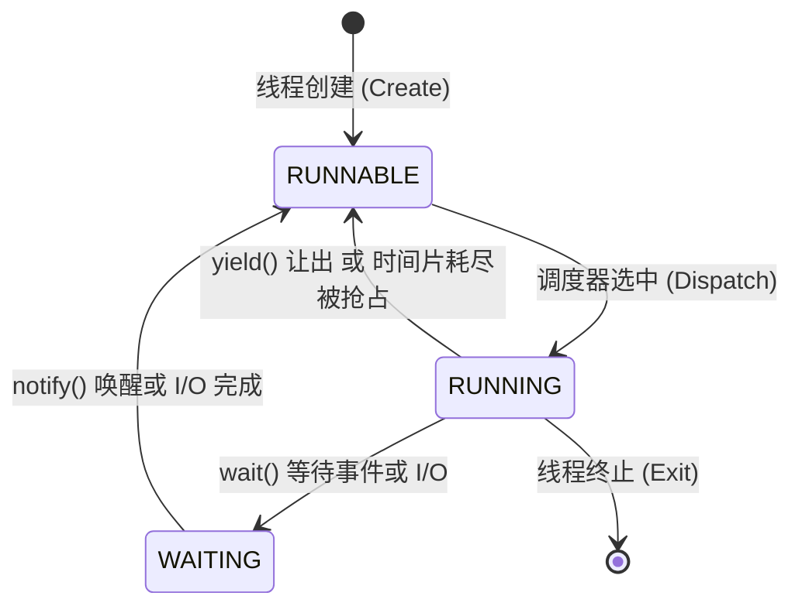
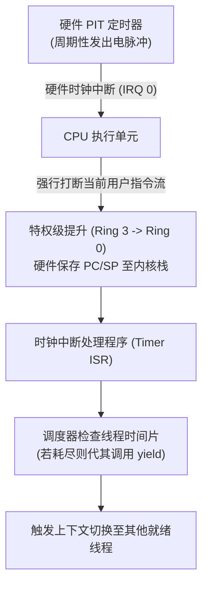

# Lec 5 线程技术与处理器虚拟化

> 阅读参考书 §5.5, §5.6

## TL;DR

- 线程是物理处理器的虚拟化载体，通过在内存中的线程控制块（TCB）封存 PC、通用寄存器、私有栈指针（SP）与页表基址（PTBR），为并发任务营造独占 CPU 的假象。
- `yield()` 原语在内核态保存当前寄存器后，通过偷换硬件栈指针（SP）与页表基址，使得后续的汇编 `RET` 指令直接返回到另一个线程的历史栈帧，实现无缝上下文切换。
- 条件变量将高能耗的自旋忙等待转化为挂起休眠；其核心契约 `wait()` 必须原子化地执行“挂入等待队列、置为 WAITING、释放互斥锁”，彻底杜绝丢失通知（Lost-Notify）竞态死锁。
- 协作式调度无法抵御恶意死循环霸占 CPU；硬件可编程定时器（PIT）产生周期性时钟中断，强制剥离执行权并执行内核调度，构筑了现代操作系统的抢占式调度防线。

## 思考题与核心概念梳理

- **什么是虚拟化（Virtualization）？**  
  虚拟化是计算机系统工程的核心技术之一。它在底层有限或异构的物理硬件之上构建抽象层，为上层软件模拟出多个功能完备、边界隔离的虚拟硬件实例。例如虚拟内存将有限的物理内存虚拟化为巨大的私有平坦地址空间；线程则将有限的物理 CPU 核心虚拟化为成百上千个并发流淌的虚拟处理器。
- **suspend() 和 resume() 做什么？**  
  `suspend()` 将正在物理 CPU 上运行的线程冻结，将其当前硬件寄存器和执行上下文封存入内存中的控制块，并让出物理核心；`resume()` 则将之前冻结的上下文重新加载到硬件寄存器中，使线程恢复指令执行。
- **yield() 的目的是什么？它是如何工作的？**  
  `yield()` 是线程主动交出物理 CPU 使用权的原语。它在调度器锁的保护下，将当前线程标记为 `RUNNABLE` 并加入就绪队列，接着保存当前线程的寄存器与栈指针，选取下一个就绪线程，将硬件栈指针（SP）和页表基地址寄存器（PTBR）切换为目标线程的值，最后通过一条 `RET` 指令直接跳转到目标线程之前保存的执行点。
- **线程处于 RUNNABLE 和 RUNNING 状态分别是什么意思？**  
  - `RUNNING`（运行态）：当前线程正加载在物理 CPU 核心上执行指令。
  - `RUNNABLE`（就绪态）：线程已具备运行的一切前置条件，正静止保存在操作系统的就绪队列中，随时可由调度器分派上核心。
- **为什么保存线程的当前状态等于保存它的页表寄存器和栈指针？**  
  因为页表寄存器（PTBR）决定了当前虚拟地址空间的内存映射关系（数据段、代码段）；而私有调用栈保存了所有的局部变量、函数嵌套调用链和返回地址。在栈指针（SP）确定的前提下，其他通用寄存器均可通过压栈存入该私有栈中。只要恢复了 PTBR 和 SP，就能完整重建线程的执行上下文。
- **条件变量是什么？它们解决了什么问题？**  
  条件变量（Condition Variable, CV）是操作系统提供给并发线程的同步原语，用于管理“等待某种特定业务状态达成”的线程队列。它彻底解决了轮询忙等待（Busy-waiting/Spinning）消耗大量 CPU 算力并导致其他线程饥饿的问题。
- **在有界缓冲区中添加 wait() 和 notify() 的原因：**  
  当生产者发现缓冲区满、或消费者发现缓冲区空时，调用 `wait()` 使自身主动进入 `WAITING` 阻塞态，不再占用 CPU；一旦对方线程生产或消费了数据，通过调用 `notify()` 唤醒阻塞者重新参与调度。
- **什么是“丢失通知”（Lost-Notify）问题？**  
  如果释放锁和将线程加入等待队列不是一个原子操作，在线程释放锁之后、但尚未真正加入等待队列之前，另一个线程可能立即抢占执行并调用了 `notify()`。此时等待队列为空，通知被永久丢弃；随后该线程才正式进入等待队列休眠，陷入无人唤醒的死锁状态。
- **yield_wait() 和 yield() 的区别与必要性：**  
  `yield()` 仅简单将当前线程置为 `RUNNABLE` 并重新排入调度队列，无法阻止调度器在下一个时间片重新选中它；而 `yield_wait()`（即 `wait()` 内部机制）必须在持有调度器锁的同时，将线程置为 `WAITING` 并放入条件变量的等待队列，并原子性地解绑上层用户锁，从而保证在等待事件发生前绝不被调度器再次唤醒，杜绝丢失通知。
- **什么是抢占（Preemption）？解决了什么问题？**  
  抢占是指硬件时钟中断强制打断当前正在执行的用户线程，强行将控制权收回操作系统内核，由内核决定是否切换其他线程。它解决了协作式调度中若某个线程陷入死循环或恶意拒绝调用 `yield()`，会导致整个单机系统彻底冻结死锁的问题。

---

## 1. 物理 CPU 虚拟化动机与线程抽象

在单核处理器或核心数量受限的计算机系统中，并发编程面临的最根本挑战是算力资源的合理分配。在上一讲实现的有界缓冲区中，我们通过自旋锁实现了互斥访问：

```python
def spin_send(bb, message):
    acquire(bb.lock)
    while (bb.in_idx - bb.out_idx) == N:
        release(bb.lock)
        acquire(bb.lock)  # 自旋重试！
    # 写入数据并递增 in_idx...
    release(bb.lock)
```

::: pitfall 自旋忙等待在单核系统上的致命死局
当只有一个物理 CPU 核心时，生产者线程 `spin_send` 发现缓冲区满，开始疯狂自旋抢锁。此时它把 CPU 占用率拉满到 100%，却无法推进任何实质计算。更严重的是，**唯独能消费数据、腾出缓冲空间的消费者线程，正因为物理 CPU 被生产者死死霸占而无法获得哪怕一个时间片的运行机会**。系统陷入了人为制造的算力饥饿与停滞。
:::

为了终结自旋忙等待，计算机系统工程引入了针对物理处理器的核心抽象——**线程（Thread）**。

::: definition 线程（Thread）与线程控制块（TCB）
**线程**是操作系统对物理 CPU 核心的虚拟化抽象。它为应用程序营造出每一个任务都在独立虚拟处理器上运行的错觉。每一个线程拥有四个关键要素：
1. **程序计数器（Program Counter, PC）**：指示当前正在执行的指令内存地址；
2. **通用寄存器组（Registers）**：保存运算中的算术中间值与状态标志；
3. **私有调用栈与栈指针（Stack Pointer, SP）**：管理局部变量、参数传递与嵌套函数返回地址；
4. **页表基地址寄存器（PTBR / CR3）**：定义线程所属进程的独立虚拟地址空间。

操作系统内核为每个线程维护一个内存数据结构，称为**线程控制块（Thread Control Block, TCB）**，用于保存上述所有状态要素。
:::



---

## 2. 上下文切换机制与 yield() 汇编时序

让一个运行中的线程停下来，并将 CPU 交给另一个线程的过程被称为**上下文切换（Context Switching）**。其最核心的协作原语就是 `yield()`。

### 2.1 yield() 内核伪代码剖析

在操作系统内核中，`yield()` 并不是普通的函数调用，而是直接操纵硬件特权寄存器的高难度底层原语。为了防止多核 CPU 同时操作调度队列造成混乱，函数进入时必须首先获取全局调度器自旋锁 `scheduler_lock`。随后，函数将当前线程标记为就绪态，并在挑选出目标运行线程后，完成硬件寄存器与地址空间上下文的原子偷换：

```c
// 运行在内核态的上下文切换原语
void yield() {
    acquire(&scheduler_lock);
    
    struct tcb *prev = current_running_thread;
    struct tcb *next = pick_next_runnable_thread();
    
    // 步骤 1: 标记当前线程为就绪态，保存通用寄存器至 TCB
    prev->state = RUNNABLE;
    save_cpu_registers_to_tcb(prev);
    
    // 步骤 2: 切换当前运行指针
    current_running_thread = next;
    next->state = RUNNING;
    
    // 步骤 3: 核心操作——切换页表基址与硬件栈指针!
    switch_page_table(next->ptbr);
    set_hardware_stack_pointer(next->saved_sp);
    
    // 步骤 4: 恢复目标线程的通用寄存器
    restore_cpu_registers_from_tcb(next);
    
    release(&scheduler_lock);
    return; // <--- 关键所在：RET 指令的返回目标发生了转移！
}
```

上述内核逻辑主要划分为四个精密的执行阶段：
1. **状态封存**：将当前物理 CPU 中的通用寄存器（如 RAX、RBX、RCX 等）保存到 `prev` 的 TCB 结构中，并将其状态置为 `RUNNABLE`。
2. **指针重定向**：调度器从就绪队列中选出下一个优先级最高或等待时间最长的就绪线程 `next`，并将全局当前指针指向它。
3. **特权寄存器切换**：通过特权汇编指令将 CPU 的页表基址寄存器（在 x86 架构下为 `CR3` 寄存器）刷新为 `next` 的页表基址，从而瞬间完成虚拟内存地址空间的切换；紧接着将硬件栈指针（`RSP`）替换为 `next->saved_sp`。
4. **寄存器复原与栈帧弹出**：从 `next` 的 TCB 或私有栈中弹出先前保存的寄存器数值，并在释放调度器锁后执行 `RET` 指令。此时硬件弹出的栈顶地址正是线程 `next` 过去暂停时保存的代码执行位置。

### 2.2 汇编栈指针偷换的执行推演

在经典的单线程调用模型中，函数末尾的 `return` 语句会执行汇编指令 `RET`，将当前调用栈栈顶保存的返回地址弹出到程序计数器 PC 中，从而返回调用者的下一行代码。

但是在 `yield()` 的步骤 3 中，操作系统利用硬件特权指令，**直接修改了物理 CPU 的栈指针寄存器（SP）**：
- 当 `yield()` 执行到末尾的 `RET` 指令时，CPU 从栈顶读取返回地址；
- 但此时的栈指针已经指向了目标线程 `next` 的私有栈顶；
- 弹出的返回地址，正是线程 `next` 上一次调用 `yield()` 时压入栈中的指令地址！

因此，控制流进入 `yield()` 时代表着线程 A，而从 `yield()` 返回时却已经在执行线程 B 的代码逻辑。这种控制流的转移完全不依赖复杂的跳转指令，仅凭切换栈指针与页表基址即可实现。

---

## 3. 线程状态迁移模型

在现代操作系统调度器中，一个线程在其生命周期内始终处于以下三种基本状态之一：



1. **`RUNNING`（运行态）**：线程的寄存器与指令流正在物理 CPU 核心上实时执行。
2. **`RUNNABLE`（就绪态）**：线程具备执行所需的一切数据与资源，正排在操作系统的就绪队列（Run Queue）中等待被物理核心调度。
3. **`WAITING`（等待/阻塞态）**：线程因为缺少某些必要事件（如等待网络包到达、锁释放或条件变量满足）而被移出就绪队列。**在等待期间，调度器完全忽略该线程，它不消耗任何物理 CPU 算力**。

---

## 4. 条件变量机制与丢失通知（Lost-Notify）陷阱

为了实现高效的事件等待与唤醒，操作系统提供了**条件变量（Condition Variable, CV）**抽象。

### 4.1 条件变量的标准语义

::: definition 条件变量原语
条件变量由一个内部等待队列与一把保护互斥锁构成：
- `wait(lock, cv)`：释放互斥锁 `lock`，将当前线程挂入条件变量 `cv` 的等待队列，将状态更新为 `WAITING` 并触发上下文切换；被唤醒后必须重新抢占互斥锁 `lock` 才能返回。
- `notify(cv)`：从 `cv` 的等待队列中移出一个等待线程，将其状态由 `WAITING` 更改为 `RUNNABLE` 并加入就绪队列。
- `broadcast(cv)`：唤醒等待在该条件变量上的所有线程。
:::

### 4.2 致命缺陷重现：丢失通知（Lost-Notify）竞态时序

如果程序员或操作系统实现者错误地将 `wait()` 中的“释放互斥锁”与“加入等待队列”拆解为两个非原子操作，就会引发严重的系统死锁灾难：

```python
# 存在致命竞态缺陷的 wait 实现
def broken_wait(lock, cv):
    release(lock)
    # ========= 致命危险窗口期 =========
    # 此时若发生上下文切换，通知将被丢弃！
    add_to_wait_queue(cv, current_thread)
    current_thread.state = WAITING
    yield()
    acquire(lock)
```

设当前有界缓冲区为空（`count == 0`），消费者线程 C 与生产者线程 P 的交错时序如下表所示：

| 时间步 | 消费者线程 C 行为 | 生产者线程 P 行为 | 缓冲区状态 | 等待队列状态 |
|:---|:---|:---|:---|:---|
| $t_1$ | `acquire(bb.lock)` 成功 | - | `count = 0` | 空 |
| $t_2$ | 检查 `count == 0`，准备等待 | - | `count = 0` | 空 |
| $t_3$ | 调用 `broken_wait` 执行 `release(lock)` | - | 锁已变为空闲 | 空 |
| $t_4$ | **（时钟中断发生，C 被切出）** | 抢到锁，写入数据 `count = 1` | `count = 1` | 空 |
| $t_5$ | - | 调用 `notify(cv)` 唤醒等待者 | `count = 1` | **队列为空，通知被抛弃！** |
| $t_6$ | - | 执行 `release(lock)` 退出 | `count = 1` | 空 |
| $t_7$ | **C 恢复运行，执行 `add_to_wait_queue`** | - | `count = 1` | C 入队 |
| $t_8$ | **C 将自身置为 WAITING 并休眠** | - | `count = 1` | **C 陷入永久沉睡！** |

由于 $t_5$ 时生产者发出的通知在等待者入队前到达，通知直接丢失。随后消费者 C 永久挂起，即便后续缓冲区满溢，C 也无法再次醒来消费数据。

::: theorem 条件变量原子契约
为杜绝丢失通知问题，操作系统的 `wait(lock, cv)` 原语必须在内核调度器锁的保护下，将以下三项操作合并为单一不可分割的原子步骤：
$$\text{Atomically} \left( \text{Enqueue}(cv, T), \text{State}(T) \leftarrow \text{WAITING}, \text{Release}(lock) \right)$$
在线程正式挂入等待队列之前，任何其他线程绝不可能抢先获得用户锁并触发 `notify()`。
:::

---

## 5. 抢占式调度与硬件时钟中断

### 5.1 协作式调度的局限性

前述的所有线程切换都建立在线程主动调用 `yield()` 或 `wait()` 的前提下，这被称为**协作式调度（Cooperative Scheduling）**。

在协作式多任务系统中，若某个应用程序存在编程错误（如死循环 `while(1){}`）或者恶意攻击代码拒绝交出 CPU，内核代码将永远无法获得执行权，整个计算机系统将当场瘫痪锁死。

### 5.2 硬件可编程定时器（PIT）与抢占流程

为了打破恶意垄断，计算机体系结构引入了**可编程间隔定时器（Programmable Interval Timer, PIT）**：



1. **时钟节拍**：硬件定时器按固定频率（如每 10 毫秒）向处理器引脚触发中断信号；
2. **强制陷入**：CPU 硬件单元自动暂停当前指令流水线，将特权级别由用户态（Ring 3）提升至内核态（Ring 0），并保存当前的执行位置；
3. **内核介入**：CPU 控制流强制跳转至预先注册的中断服务例程（ISR），由操作系统的调度器判定当前线程是否用尽时间片；
4. **强制让出**：若时间片耗尽，内核直接代表该线程调用 `yield()`，完成抢占切换。

---

## 6. 我的理解：从内核重量级线程到用户态协程的演进闭环

::: insight 内核线程与轻量级协程的架构权衡
回顾从物理 CPU 到虚拟线程的演进过程，操作系统的 1:1 内核线程模型成功解决了多任务隔离与抢占式公平调度的难题。然而，每个内核线程都必须配备独立的内核栈（典型大小为 8KB 到 64KB）以及耗时的系统调用陷入开销（通常需要数千个时钟周期）。

在现代超高并发网络服务（如海量微服务连接）的场景下，数以万计的内核线程会造成惨烈的内存开销与调度锁竞争。因此，系统架构设计在现代语言（如 Go 语言的 Goroutine、Rust 的 async/await）中重新“复活”了用户态协作调度的思想：
- **混合调度模型（M:N）**：通过在少量内核线程（M）之上构建轻量级用户态调度器，将大量协程（N）映射其上；
- **微型栈与动态扩容**：协程的初始栈仅分配 2KB，并随着调用深度动态翻倍，使得单机维持百万并发连接成为可能；
- **协作与抢占的融合**：Go 语言在早期采用协作式（通过编译器在函数序言中插入抢占检查点），但在面对没有函数调用的紧密计算循环时同样会遇到“单协程霸占核心”的顽疾，最终在 Go 1.14 中同样引入了基于 POSIX 信号（`SIGURG`）的用户态抢占机制。

这印证了计算机系统设计的一大核心规律：**随着硬件规模与应用场景的交替演进，经典问题的解法往往会在不同系统抽象层级（内核态与用户态）以惊人一致的形态完成自我复现**。
:::
