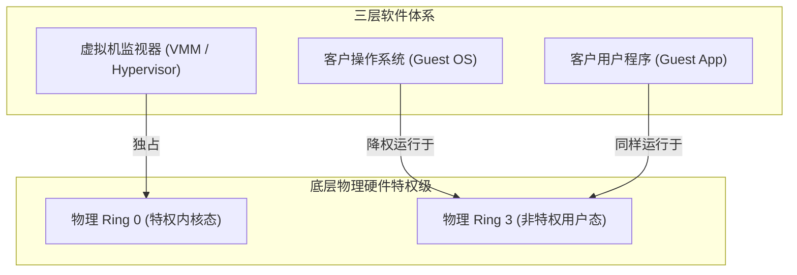
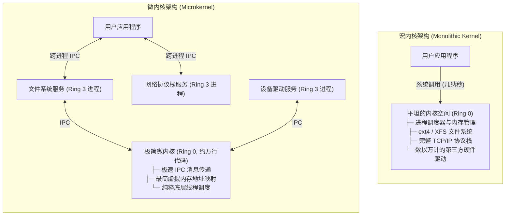

# Lec 6 虚拟机技术加强模块化

> 阅读参考书 §5.8

## TL;DR

- 虚拟机监视器（VMM/Hypervisor）独占硬件特权态（Ring 0），将客户操作系统（Guest OS）降格至用户态（Ring 3），实现多租户整机级强故障隔离。
- “陷入与仿真”（Trap-and-Emulate）拦截 Guest OS 试图执行的特权指令（如修改页表寄存器），由 VMM 在后台代为完成映射并推进虚拟程序计数器，维持独占硬件的假象。
- 双层地址映射（GVA $\to$ GPA $\to$ HPA）通过影子页表（Shadow Page Table）或硬件辅助虚拟化（EPT/NPT）合成为单一硬件转换映射，消除多级转换开销。
- 微内核将驱动与服务降为用户态进程以追求故障隔离；宏内核将所有核心子系统置于特权 Ring 0 以消除 IPC 与 TLB 刷新开销，两者体现了容错与吞吐的经典工程取舍。

## 思考题与核心概念梳理

- **为什么我们希望在同一台物理机器上运行多个操作系统？**  
  1. **多租户整合（Multi-Tenancy）**：云计算数据中心通过将单台高性能物理服务器切分为数十个独立虚拟机出租，极大提升硬件资源利用率并降低运营成本；
  2. **故障与安全强隔离**：某个操作系统发生内核崩溃、内存泄漏或遭受黑客入侵时，仅影响其自身沙箱，同一物理机上的其他系统与宿主机不受任何干扰；
  3. **简化系统开发与运维**：允许在生产机器上安全测试全新操作系统或旧版本系统，且虚拟机镜像具备纳秒级快照与无缝热迁移能力。
- **虚拟机监控器（VMM）的作用是什么？**  
  VMM 独占物理硬件特权级，提供三项核心能力：
  1. **计算虚拟化**：截获特权指令并提供仿真，向客户机呈现一致的虚拟 CPU 与内存接口；
  2. **事件分派**：截获所有硬件中断、时钟脉冲和系统调用，并将异常准确分发给对应的虚拟机；
  3. **资源调度分配**：在互不信任的多个客户操作系统之间公平调度物理 CPU 核心与 DRAM 内存。
- **“陷入和仿真”（Trap and Emulate）是什么意思？**  
  当运行在受限用户态的客户操作系统试图执行特权指令（如修改页映射地址寄存器）时，硬件触发非法特权异常并强制“陷入”到 VMM。VMM 读取该指令的意图，在宿主机状态中代为“仿真”其预期行为，随后推进虚拟 PC 并放行客户机继续运行。客户操作系统感知不到异常，误以为自己拥有完整的物理机控制权。
- **VMM 如何处理客户操作系统的虚拟内存？**  
  引入三层地址空间：客户虚拟地址（GVA）、客户物理地址（GPA）与主机真实物理地址（HPA）。VMM 通过维护机器映射表（Machine Map: GPA $\to$ HPA），在内核中构建“影子页表”（Shadow Page Table: GVA $\to$ HPA），使得物理 MMU 能够以单层硬件速度直接完成寻址。
- **VMM 如何处理客户操作系统的用户/内核位（U/K bit）？**  
  物理硬件上，客户操作系统内核与客户应用程序均被迫运行在用户态（Ring 3）。VMM 在内存的虚拟机状态数据结构中显式维护一个虚拟的 U/K 位。当客户应用尝试执行非法操作时，陷入 VMM 的逻辑会检查该虚拟位，确认是否应将异常转交客户内核处理。
- **为什么 VMM 必须深度参与虚拟内存与 U/K 位的管理？**  
  因为一旦允许客户操作系统直接控制物理页表寄存器或特权级位，客户机就可以直接将自身页表映射到宿主机物理内存或其他租户的私有内存中，彻底击穿整机的安全隔离屏障。
- **什么是宏内核（Monolithic Kernel）与微内核（Microkernel）？**  
  - **宏内核**：将进程调度、虚拟内存、文件系统、网络协议栈以及海量硬件驱动全部打包在特权 Ring 0 内核空间内运行（如 Linux、BSD）。
  - **微内核**：仅在 Ring 0 保留最微小的核心调度、极简虚拟内存和进程间通信（IPC），文件系统与各类设备驱动全部降格为普通的用户态服务进程（如 seL4、QNX）。
- **为什么许多主流操作系统仍采用宏内核架构？**  
  根本原因在于极致的性能与吞吐。宏内核内部模块交互只需微秒以内的普通 C 语言函数调用；而微内核中每次服务调用都需要经历用户态-内核态的双向陷入、线程上下文切换以及跨进程导致的 CPU 缓存冷启动与 TLB 硬件快表刷新，开销高出数倍至数十倍。

---

## 1. 整机虚拟化架构与实现方式

前面各讲介绍了多种高级抽象，用于虚拟化处理器、内存和通信链路，以实现模块化。应用程序通过系统调用（Supervisor-call）接口以及中断和异常处理程序与这些抽象进行交互。

另一种方法是使用虚拟机（Virtual Machine, VM）。尽可能利用真实的物理机实现多个虚拟实例（包括特权指令，如加载和存储到页映射地址寄存器）。实现虚拟机的软件被称为**虚拟机监视器（Virtual Machine Monitor, VMM / Hypervisor）**。

### 1.1 虚拟机的核心用途与形态划分

1. **并行运行异构系统**：在同一物理主板上并发执行 Linux、Windows 或定制实时系统；
2. **错误强隔离**：客户操作系统内部即使发生空指针解引用导致内核崩溃蓝屏，也被严格限制在虚拟机容器内，不会扩散至其他租户；
3. **简化系统开发与测试**：内核开发人员无需反复重启物理机，即可在虚拟机内部安全调试底层设备驱动。

在实现机制上，虚拟化主要分为两种形态：
- **裸机型（Type-1 / Bare-metal Hypervisor）**：VMM 直接运行在裸机硬件之上（以硬件特权内核态执行），而所有客户操作系统均降格运行在受限的用户态；
- **托管型（Type-2 / Hosted Hypervisor）**：VMM 作为用户态应用程序运行在宿主操作系统之上，借助宿主系统的系统调用转发底层硬件事件。


### 1.2 虚拟机监视器的三项核心职责

要成功虚拟化整台物理机器，监视器必须严密提供三项核心功能：
1. **计算机虚拟化**：例如如果 Guest OS 向页映射地址寄存器（PMAR / CR3）存储新值，监视器必须让 Guest OS 确信自己成功执行了该指令，即便它物理上运行在用户态；
2. **事件分派**：监视器必须截获 CPU 触发的所有硬件中断、时钟滴答与异常，并精准转发给对应的 Guest OS；
3. **物理资源分配**：监视器必须公平切分并动态调度物理 CPU 时间片与物理 DRAM 页面，防止某个虚拟机耗尽宿主机资源。

---

## 2. 陷入与仿真（Trap-and-Emulate）机制

在标准的处理器特权级模型中，硬件通常仅区分特权态（Kernel Mode / Ring 0）与用户态（User Mode / Ring 3）。而系统中存在三层软件实体：VMM、Guest OS、以及 Guest OS 内运行的应用程序。



### 2.1 降权与陷入拦截

VMM 将自身置于特权 Ring 0，而将 Guest OS 强制剥离特权，安置在物理 Ring 3：
1. **特权指令执行**：当 Guest OS 试图调度线程并执行特权汇编指令更新页表寄存器时（如 `MOV CR3, EAX`）；
2. **硬件异常触发**：由于当前物理特权级为 Ring 3，CPU 硬件执行单元立刻判定该指令为非法越权操作，拒绝执行并触发硬件通用保护异常（General Protection Fault）；
3. **控制流陷入**：硬件打断 Guest OS，强制切换特权级并跳转到预设在 Ring 0 的 VMM 异常处理程序中。

### 2.2 仿真与透明恢复

接管控制权的 VMM 依照如下流程完成仿真操作：
1. **解析指令操作数**：VMM 解析发生异常的机器指令，提取 Guest OS 意图写入的目标页表地址；
2. **验证与安全重映射**：检查目标地址是否落在分配给该虚拟机的合法物理内存区间内，在后台同步更新宿主机的真实映射结构；
3. **推进虚拟指令流**：在虚拟机的上下文结构体中，将虚拟程序计数器（PC）推进一条指令的长度；
4. **恢复执行**：VMM 执行特权返回指令，将 CPU 重新交还给 Guest OS。在 Guest OS 的视角中，它发出的特权指令已如同在原生裸机上一样成功执行完毕。

---

## 3. 内存虚拟化与影子页表（Shadow Page Tables）

在虚拟化环境中，内存寻址横跨三层不同的地址语义：

```text
Guest App ──[GVA: 客户虚拟地址]──> Guest OS ──[GPA: 客户物理地址]──> 宿主真实 DRAM [HPA: 主机物理地址]
                                      │                                      ▲
                                      └─────────────[VMM 介入合成]────────────┘
```

1. **客户虚拟地址（Guest Virtual Address, GVA）**：客户机中普通应用程序使用的线性逻辑地址；
2. **客户物理地址（Guest Physical Address, GPA）**：Guest OS 以为是物理主板上的内存地址，本质上只是 VMM 分配给它的内存切片；
3. **主机物理地址（Host Physical Address, HPA）**：宿主机 DRAM 颗粒上真正的物理电气地址。

### 3.1 机器映射表与双重转换合成

如果 CPU 的 MMU 每次读写都要在内存中分别走一遍“GVA $\to$ GPA”和“GPA $\to$ HPA”的两层逐级查表，访存延迟将膨胀数倍。

为了解决性能损耗，VMM 在内部维护了一张**机器映射表（Machine Map）**：
- 当客户机执行存储指令向页映射地址寄存器写入数据时，监视器读取该页映射表，获悉客户机建立的虚拟地址到虚拟机地址的映射；
- 监视器结合自身的机器映射表，直接合成出一张**影子页表（Shadow Page Table）**，将客户机的虚拟地址一步到位映射到主机物理地址（$\text{GVA} \to \text{HPA}$）；
- 监视器将影子页表的物理基地址写入物理 CPU 的页映射寄存器。因此，硬件 MMU 在寻址时依然只需执行单层转换，完全维持了硬件的原生访存性能。
- 随后，现代 CPU（如 Intel EPT 和 AMD NPT）直接在硬件电路中内置了**扩展页表（Extended Page Tables）**，由芯片硬件自动完成两阶段页表遍历（Two-dimensional Paging），进一步减轻了软件维护影子页表的开销。

---

## 4. Popek-Goldberg 定理与硬件虚拟化进化

在 1970 年代，计算机科学家 Gerald Popek 与 Robert Goldberg 提出了虚拟化领域的奠基性理论：

::: theorem Popek-Goldberg 虚拟化准则
一个处理器架构能够通过“纯粹的陷入与仿真”实现完全硬件虚拟化的充分必要条件是：**系统中的所有敏感指令（Sensitive Instructions）都必须是特权指令（Privileged Instructions）的严格子集**。
- **敏感指令**：指能够读取或改变底层硬件敏感状态（如修改时钟中断使能、查看当前物理特权级）的指令；
- **特权指令**：指在非特权模式（用户态）下执行时，硬件电路必然触发异常陷入内核的指令。
:::

### 4.1 早期 x86 的设计缺陷：不可虚拟化指令

早期的 Intel x86 体系结构存在 17 条不可虚拟化的敏感指令，其中最典型的即为 `POPF` 指令（从栈顶弹出标志位至 EFLAGS 寄存器）：
- 在特权态执行 `POPF` 时，可以修改中断使能位（IF 位）；
- 当处于用户态执行 `POPF` 时，x86 芯片为了兼容旧程序，既不触发非法指令异常，也不修改 IF 位，而是**直接静默忽略（Silent Ignore）**！
- 这种静默忽略导致 VMM 无法通过异常捕获 Guest OS 的关中断意图，使得临界区保护瞬间破产。

### 4.2 突破方案：二进制翻译到硬件辅助虚拟化（VT-x）

为破解 x86 的不可虚拟化难题，工业界经历了两个关键发展阶段：
1. **动态二进制翻译（Dynamic Binary Translation）**：VMware 在 1998 年首创此项技术。VMM 在执行客户内核代码前动态扫描指令流，当检测到类似 `POPF` 的敏感非特权指令时，实时在内存中将其重写为显式陷入例程（Trap Stub），在纯软件层面达成了完全虚拟化；
2. **硬件辅助虚拟化（Intel VT-x / AMD-V）**：芯片厂商自 2005 年起在硬件层面开辟了全新的特权维度——**根操作模式（VMX Root Operation，运行 VMM）**与**非根操作模式（VMX Non-Root Operation，运行 Guest OS）**。在非根模式下，任何敏感指令均被硬件强制拦截并触发 `VM-Exit` 退出至 VMM，从根本上终结了软件翻译的额外开销。

---

## 5. 内核架构之争：宏内核 vs 微内核

虚拟化技术带来的强模块化隔离思考，在操作系统工程史上引发了微内核与宏内核的著名学术与工业大辩论。



### 5.1 微内核：以故障隔离为最高信条

微内核架构（如 seL4、QNX、Minix）主张内核的特权态应尽可能微小精简：
- **最小特权集**：只有线程调度、基础内存映射与进程间通信（IPC）有资格留在 Ring 0；
- **服务解耦**：文件系统、网络协议栈以及最容易引入崩溃缺陷的第三方硬件驱动全部下放为用户态服务进程；
- **故障隔离**：当某个显卡或网卡驱动发生内存访问越界崩溃时，仅该用户态服务退出，微内核只需重新拉起该驱动进程即可，整个系统主体绝不会蓝屏或挂起。

### 5.2 宏内核：追求极致的吞吐性能

然而，在工业服务器与移动终端（Linux、Android、macOS XNU 混合架构）中，宏内核依然占据着统治地位：
- **开销差异**：在宏内核中，写入一条文件记录或发送一个网络包，只是内核空间内部的微秒级普通 C 函数调用；
- **IPC 与 TLB 损耗**：在微内核中，一次简单的磁盘读写需要多次跨进程 IPC 往返，每一次跨进程通信都伴随着用户态到内核态的上下文切换，并引发**页表切换导致的 TLB 硬件快表全量刷新**，在频繁 I/O 场景下会造成显著的吞吐惩罚。

---

## 6. 我的理解：从硬件全虚拟化到容器与微虚机（MicroVM）的融合演进

::: insight 虚拟化技术在现代云原生架构中的螺旋上升
从 6.1800 讲授的传统 VMM 陷入仿真机制出发，观察过去数十年的工业界实践，可以清晰地识别出一条关于“隔离性、启动开销与性能密度”的系统设计螺旋演进脉络：

1. **重型虚拟机时代**：依靠 VMM 配合影子页表与 VT-x，提供了近乎完美的操作系统级故障隔离。但其代价是每个虚拟机都要加载一套独立的 Guest 内核与基础镜像，冷启动耗时数十秒，内存常驻开销达数百兆字节；
2. **轻量容器化突围**：Linux Containers（Docker / cgroups / namespaces）摒弃了硬件虚拟化与 VMM 抽象，退回到单机操作系统的共享内核方案。它实现了毫秒级启动与极高的算力密度，但在多租户公共云场景下，所有容器共享同一个底层 Linux 内核，单点内核漏洞（Kernel Privilege Escalation）就可能导致整机沦陷；
3. **微虚机（MicroVM）的架构回归**：近年来 AWS 推出的 Firecracker 以及云原生 Kata Containers 展现了现代系统工程的终极折中方案——利用现代 CPU 的硬件虚拟化（KVM / VT-x），剥离所有过时的老旧设备仿真（去除了软驱、IDE 接口、复杂的 PCI 拓扑），仅保留极简的内存、CPU 与 VirtIO 网络/块设备抽象。

这种微虚机不仅继承了传统 VMM 坚不可摧的硬件级特权态强隔离（Ring 0 / Ring 3 隔离），同时将冷启动时间压缩到 5毫秒以内，单机可并发驻留数千个微虚机。这再次揭示了系统工程的永恒智慧：**当旧技术的性能瓶颈被更精确的场景定义（剪除无用抽象）与现代芯片特性重新审视时，经典方案往往能够以更轻盈的姿态重新主导计算基础设施**。
:::
