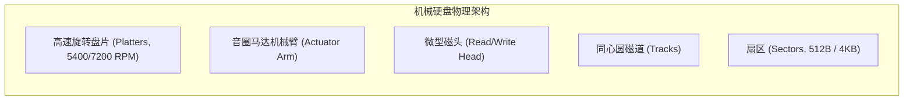
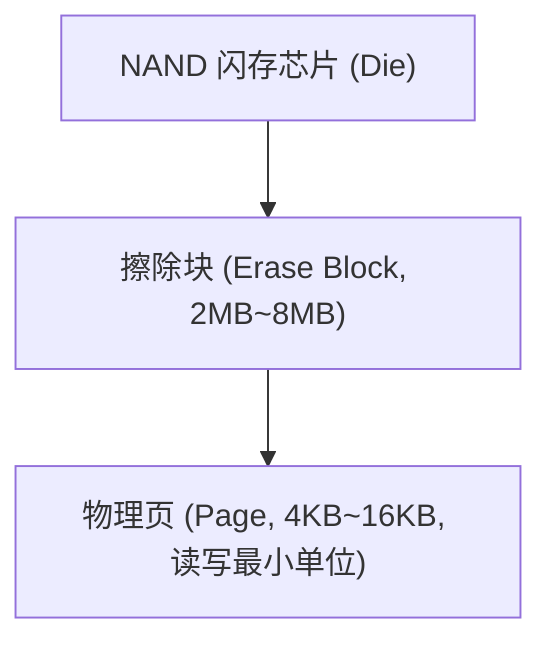
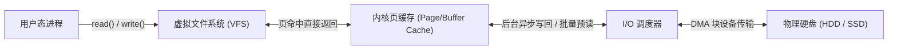

# Lec 7 存储性能与 I/O 吞吐优化

> 阅读资料：
> - 论文：Ritchie & Thompson《The UNIX Time-Sharing System》（CACM 1974）第 5–6 章

## TL;DR

- 存储层级存在高达千万倍的时延悬崖（CPU 纳秒 vs 磁盘毫秒）；系统性能工程的本质是利用局部性原理，通过缓存与批量化抹平延迟鸿沟。
- 机械硬盘（HDD）性能受物理寻道与旋转延迟支配，顺序连续读写带宽可达随机 I/O 的 200 倍以上，倒逼上层软件采用追加写与大块排布设计。
- 固态硬盘（SSD）消除机械寻道，但受制于闪存“页读写、块擦除、无法原地覆写”的物理约束，依靠 FTL 异地重映射，引入垃圾回收（GC）与写入放大（WAF）。
- 操作系统通过页缓存（`Buffer Cache`）、预读（Read-Ahead）与写回（Write-Back）隐藏延迟；而数据库为杜绝双重缓存与乱序写破坏预写日志（WAL），常选用 `O_DIRECT` 绕过内核缓存。

## 思考题与核心概念梳理

- **性能瓶颈（Bottleneck）是指什么？**  
  性能瓶颈是指在流水线或端到端请求路径中，吞吐量最低、时延最高从而限制了整个系统最终性能的关键组件。根据阿姆达尔定律（Amdahl's Law），针对非瓶颈环节的任何优化对系统整体吞吐量的提升极其微弱，性能调优必须首先精确度量并识别瓶颈。
- **在思考系统性能时，拥有系统模型有何帮助？**  
  系统模型将复杂的硬件与软件交互抽象为具备参数化特性的抽象阶段（例如将磁盘 I/O 抽象为“固定寻道延时 + 旋转延时 + 传输延时”）。这使工程师能够在无需全量测试的情况下，通过闭式方程或阶数推演快速预测不同工作负载下的理论性能边界，评估优化方案的可行性。
- **常见的性能指标有哪些？它们各自的含义与关系如何？**  
  - **时延（Latency）**：系统完成单次请求所需的端到端时间（单位通常为毫秒或微秒）；
  - **吞吐量（Throughput）**：系统在单位时间内成功处理的请求数量或传输的数据总量（如 QPS 或 MB/s）；
  - **资源利用率（Utilization）**：某物理硬件（CPU、磁盘、网络带宽）在测量周期内处于忙碌状态的时间百分比。
  - **三者关系**：在低负载区，吞吐量随着请求到达率线性上升，而时延基本保持平坦；一旦吞吐量逼近硬件饱和极限，队列排队效应导致时延急剧恶化发散，继续增加负载会导致吞吐量因资源竞争而停滞甚至下跌。
- **哪些系统级技术通常能提升性能？**  
  1. **批处理（Batching / Amortization）**：合并多次小规模请求，摊薄单次固定的系统调用或硬件寻道开销；
  2. **缓存（Caching）**：将高频访问的数据副本缓存在低延迟存储介质中，消除底层缓慢介质的访问；
  3. **并发与调度（Concurrency & Scheduling）**：通过乱序重排与队列优化（如电梯调度算法）减少机械移动；
  4. **并行化（Parallelism）**：利用条带化（Striping）将负载跨磁盘或跨节点切分，成倍提升聚合带宽。
- **机械硬盘（HDD）与固态硬盘（SSD）读写机制的区别：**  
  - **HDD**：依靠磁头臂机械寻道与盘片旋转物理对准目标扇区，随机寻道通常需要 $5 \sim 10\text{ ms}$，顺序读写性能远超随机读写；
  - **SSD**：基于 NAND 闪存电荷存储，具备几十微秒的高速随机读取能力；但闪存无法原地覆写，必须按页（Page）写入、按块（Block）高压擦除，依靠内部闪存转换层（FTL）进行异地追加更新与后台垃圾回收。
- **为什么在机械硬盘上批量读取能提升性能？**  
  因为单次 I/O 的大部分时间耗费在机械寻道（$T_{\text{seek}}$）和旋转等待（$T_{\text{rotational}}$）上。批量顺序读取一个连续区域时，只需经历一次初始寻道与旋转，随后便可以接近总线带宽全速连续流式传输数据，使得有效吞吐量从随机模式的几百 KB/s 跃升至过百 MB/s。
- **在文件系统之上实现大型数据库的考量与 DBMS 专长：**  
  1. **双重缓存浪费（Double Buffering）**：文件系统页缓存与数据库自身内存缓冲池（Buffer Pool）重复保存数据，浪费一半内存；
  2. **驱逐算法语义错位**：OS 的盲目 LRU 策略容易将数据库高价值的根索引页踢出；
  3. **写回顺序与崩溃恢复冲突**：OS 页缓存乱序写回磁盘会摧毁预写日志（WAL）与数据页之间的时序依赖。因此专业数据库管理系统（DBMS）更倾向于使用 `O_DIRECT` 绕过内核缓存，自主掌控磁盘调度。

---

## 1. 系统性能指标与时钟延迟悬崖

在单机系统工程中，内存与存储并不是无限快且均质的。下表呈现了计算机体系结构中著名的**时钟延迟标尺**：

| 硬件操作 | 实际物理延迟 | 等比放大为人性时间（设 1 ns = 1 秒） |
| :--- | :--- | :--- |
| **CPU 寄存器访问** | $\sim 0.5 \text{ ns}$ | **0.5 秒**（心跳一次） |
| **L1 缓存命中** | $\sim 1 \text{ ns}$ | **1 秒**（随手拿笔） |
| **L2/L3 缓存命中** | $\sim 4 - 15 \text{ ns}$ | **4 - 15 秒** |
| **DRAM 主内存访问** | $\sim 60 - 100 \text{ ns}$ | **1 - 2 分钟**（下楼取快递） |
| **NVMe 固态硬盘（SSD）读取** | $\sim 10 - 50\ \mu\text{s}$ | **数小时至 1 天**（异地飞行） |
| **机械硬盘（HDD）随机寻道** | $\sim 5 - 10 \text{ ms}$ | **数月至半年**（长途跨洋徒步） |

### 1.1 性能度量三大基石：时延、吞吐量与利用率

系统性能必须建立在客观可复现的测量基准之上：
- **时延（Latency）**：执行单个工作单元所耗费的绝对时间；
- **吞吐量（Throughput）**：在稳态下系统单位时间完成的工作单元总数；
- **利用率（Utilization）**：资源在采样区间内处于工作状态的时间比例。

如上图所示，当系统负荷较低时，吞吐量随请求率线性爬升，队列极短，时延稳定。当负载逼近系统的瓶颈处理上限时，未处理请求在队列中堆积，时延呈现非线性的急剧陡增。

---

## 2. 机械硬盘（HDD）物理延迟与数学建模

机械硬盘通过在高速旋转的铝质或玻璃盘片表面涂覆磁性涂层存储数据。

### 2.1 磁盘访问时延分解方程

访问一个物理扇区的总时延由三部分构成：
$$T_{\text{access}} = T_{\text{seek}} + T_{\text{rotational}} + T_{\text{transfer}}$$

1. **寻道时间（Seek Time, $T_{\text{seek}}$）**：驱动机械臂将磁头精确定位到目标柱面（磁道）所需的机械加减速时间（典型值为 $4 \sim 10\text{ ms}$）；
2. **旋转延迟（Rotational Latency, $T_{\text{rotational}}$）**：盘片旋转将目标扇区带到磁头下方所需的时间。对于 7200 RPM 硬盘，单圈旋转耗时 $8.33\text{ ms}$，平均旋转延时为：
   $$\bar{T}_{\text{rotational}} = \frac{1}{2} \times \frac{60\text{ s}}{7200} \approx 4.17\text{ ms}$$
3. **传输时间（Transfer Time, $T_{\text{transfer}}$）**：扇区数据在磁头下方扫过并读取电平的时间，通常在数十微秒以内。

### 2.2 随机 I/O vs 顺序连续 I/O 算术对比

假设硬盘平均寻道 $8.2\text{ ms}$，平均旋转 $4.1\text{ ms}$，连续数据传输率为 $50\text{ MB/s}$：

::: example 随机读写与顺序读写的吞吐量巨大落差
1. **随机读取 1000 个 4KB 扇区**：
   - 每次读取均需重新寻道和旋转：
     $$T_{\text{single}} = 8.2\text{ ms} + 4.1\text{ ms} + \frac{4\text{ KB}}{50\text{ MB/s}} \approx 12.38\text{ ms}$$
   - 读取 1000 个块总时间：$12.38\text{ 秒}$。
   - 有效吞吐带宽：
     $$\text{Throughput}_{\text{random}} = \frac{4\text{ MB}}{12.38\text{ s}} \approx \mathbf{323\text{ KB/s}}$$
   - 系统超过 **99.3% 的时间**消耗在无意义的机械等待上！

2. **顺序读取连续 4MB 大文件**：
   - 仅经历一次初始寻道与旋转：$12.3\text{ ms}$；
   - 连续传输时间：$\frac{4\text{ MB}}{50\text{ MB/s}} = 80\text{ ms}$；
   - 总耗时：$92.3\text{ ms} \approx 0.092\text{ 秒}$。
   - 有效吞吐带宽：
     $$\text{Throughput}_{\text{sequential}} = \frac{4\text{ MB}}{0.0923\text{ s}} \approx \mathbf{43.3\text{ MB/s}}$$

结论：**顺序 I/O 的吞吐量是纯随机 I/O 的 130 倍以上**！这一物理定律决定了所有现代持久化系统（如 LSM-Tree、WAL、Kafka）都优先采用追加写模式。
:::

---

## 3. 固态硬盘（SSD）与闪存转换层（FTL）

SSD 彻底移除了机械运动结构，采用闪存阵列（NAND Flash）提供高达数万 IOPS 的低延迟随机访问。

### 3.1 闪存物理铁律：页读写与块擦除

NAND 闪存受微观电荷捕获物理机制制约，具有如下核心约束：
1. **读写基本单元为页（Page）**：无法按单字节读写；
2. **擦除基本单元为块（Block）**：一个 Block 包含数十至数百个 Page；
3. **禁止原地覆写（No In-Place Update）**：一旦某个 Page 被写入数据，再次写入前必须先对整个 Block 施加高压擦除，将所有位重置为 1。

### 3.2 FTL 异地重映射与写入放大

为兼容传统的块设备接口，SSD 固件内置**闪存转换层（Flash Translation Layer, FTL）**：
- **逻辑地址映射**：维护逻辑块地址（LBA）到物理页地址（PPA）的动态映射表；
- **异地追加写**：对现有数据的修改会被追加写入全新空闲物理页，并将旧页标记为无效（Invalid）；
- **后台垃圾回收（GC）**：当空闲块不足时，挑选垃圾页最多的块，将有效页复制到新块后擦除旧块；
- **写入放大（Write Amplification Factor, WAF）**：
  $$\text{WAF} = \frac{\text{实际写入闪存芯片的物理数据量}}{\text{主机操作系统请求写入的数据量}}$$
  高 WAF 会严重侵蚀 SSD 的写性能并加速闪存颗粒的擦写磨损寿命。

---

## 4. 操作系统存储性能优化技术

面对底层介质的延迟特性，操作系统构建了多层次的优化机制：

### 4.1 操作系统页缓存与预读机制

- **顺序预读（Read-Ahead）**：内核监测进程的读模式，一旦识别出连续顺序读，便提前异步拉取后续数十个块载入内存，将后续读操作的时延降为零；
- **延迟写回（Write-Back）**：写操作在写入内存 `Buffer Cache` 并标记为脏页后立刻返回，后台线程（如 `flusher`）定期批量合并刷盘，将大量随机小写融合成大块顺序写；
- **数据持久化契约 `fsync()`**：对于不能容忍断电丢数据的核心服务，必须通过显式调用 `fsync(fd)` 强制等待数据真正落盘。

### 4.2 I/O 调度与磁头电梯算法

针对并发发出的离散请求，I/O 调度器根据目标扇区磁道号进行队列重排（例如经典的 Elevator 电梯算法与 CFQ），使磁头沿单向平滑移动，杜绝机械臂剧烈来回折返。

### 4.3 存储层次与性能优化法则小结

1. **深刻理解底层介质特性**：优化不是凭空猜想，必须依据存储介质的物理瓶颈定制上层结构；
2. **批量化摊薄开销**：单次传输的固定开销极大，必须通过聚合将固定开销分摊到海量数据上；
3. **缓存利用局部性**：利用时间与空间局部性，将极少数热点数据常驻高速层，实现性价比与性能的兼得；
4. **机制与策略分离**：通用操作系统提供普适的缓存策略，同时保留直接访问接口，赋能专业子系统自主决策。

---

## 5. 经典论文精读：UNIX 分时系统（II）文件系统与进程模型

UNIX 系统在 1970 年代确立了现代操作系统的文件抽象规范，其简洁优雅的树状结构沿用至今。

### 5.1 i-node 索引节点机制与多级间接块

在 UNIX 文件系统中，目录本质上是一个由“文件名 + i-number（inode 编号）”键值对组成的文件。操作系统通过已知区域维护的 `i-list` 系统表检索 `i-node`：

::: definition UNIX i-node 核心元数据结构
每个文件对应的 `i-node` 包含如下核心信息：
1. 文件所有者标识（User ID / Group ID）；
2. 保护访问权限位（Read, Write, Execute）；
3. 数据块物理地址索引数组（含直接块指针与间接寻址块指针）；
4. 文件逻辑大小（以字节为单位）；
5. 访问与最后修改时间戳；
6. 文件的硬链接计数（Link Count）；
7. 文件类型标志（普通文件、目录文件、块/字符特殊设备文件）。
:::

- **多级间接索引寻址**：i-node 内置 8 个设备地址。对于小于 4KB 的小文件，地址直接指向实际物理盘块；对于大文件，指针指向间接块（每个间接块可存放 256 个块地址），支持支持多达 $8 \times 256 \times 512 = 2^{20}$ 字节的单文件存储。
- **硬链接与原子删除**：硬链接仅在目标目录下新增一项并递增对应 i-node 的 `link-count`。当用户删除文件时，执行系统调用递减计数器，只有当链接计数归零且无进程打开该文件时，物理盘块与 i-node 才被真正释放回收。
- **设备即文件与 mount 机制**：块设备与字符设备被统一映射为特殊文件；`mount` 系统调用维护全局转换表，在路径解析中自动将普通文件的 i-number 与设备号透明重定向为挂载分区的根目录（i-number = 1）。

### 5.2 UNIX 进程与 Shell 管道哲学

UNIX 将计算实体建模为具有私有地址空间的进程，并通过最小正交原语实现灵活组合：
1. **进程创建与镜像替换**：
   - `fork()` 原语无缝复制当前进程的所有执行上下文（私有页表、文件描述符表、栈帧）；
   - `exec()` 原语则用全新的二进制可执行文件覆盖当前进程的地址空间，保持现有进程 PID 与已打开文件句柄不变。
2. **Shell 命令行环境与进程管道**：
   - Shell 本身只是一个普通的用户态程序。当用户键入命令 `cat file | grep pattern` 时，Shell 首先调用 `pipe()` 创建内核管道，接着两次调用 `fork()` 派生子进程；
   - 子进程在调用 `exec()` 之前，利用 `dup()` 重定向各自的标准输入（0）与标准输出（1）到管道两端；
   - 这种正交设计将模块化隔离与组件灵活编排推向了极致。

### 5.3 UNIX 分时系统与系统工程思想总结

UNIX 分时系统的成功彰显了计算机系统工程的核心信条：**以极少数高度正交的原语（文件、进程、管道）取代臃肿庞杂的特化功能；以隐藏底层复杂度的抽象界面保证通用性，同时为专业系统保留深入底层的控制通道**。

---

## 6. 我的理解：从操作系统页缓存到现代用户态存储引擎的架构演进

::: insight 存储栈在现代高性能架构中的“去操作系统化”变革
在 6.1800 讲授的传统 UNIX 存储架构中，操作系统内核扮演了无所不能的“大家长”角色：从硬件抽象、中断响应、块调度到页缓存（`Buffer Cache`）统一纳管。这一模型在机械硬盘（HDD）时代是无懈可击的——因为单次磁盘机械寻道长达 10 毫秒，在这期间执行几千行内核代码与上下文切换的微秒级开销完全可以被忽略。

然而，随着 NVMe 固态硬盘与持久内存（PMEM）将硬件延迟压缩至微秒甚至百纳秒级别，原有的软件栈结构遭到了颠覆性冲击：
1. **中断与系统调用成为新瓶颈**：一次传统的 `read()` 系统调用伴随着用户态到内核态的上下文陷入、中断信号分发以及调度器锁竞争，耗时在数微秒量级。在 10 毫秒的机械硬盘面前微不足道，但在 10 微秒的 NVMe SSD 面前，**操作系统内核自身的软件开销已经占到了总延迟的 50% 以上**！
2. **数据库对页缓存的终极抗拒**：数据库管理系统（DBMS）具有全局的数据访问语义认知。操作系统的页缓存不仅造成了内存双重缓存（Double Buffering）浪费，更致命的是，内核的异步刷盘无法保证预写日志（WAL）在数据页落盘前严格刷入介质，极易在断电时导致 ACID 事务破坏。
3. **用户态存储引擎（SPDK 与 io_uring）的兴起**：
   现代高性能存储系统正在经历一场彻底的“去内核化”革命：
   - **SPDK（Storage Performance Development Kit）**：将 NVMe 硬件驱动完全下放到用户态，利用轮询模式（Polled-Mode Driver）彻底废除硬件中断，直接在用户空间发起微秒级无锁 DMA 传输；
   - **Linux io_uring**：通过在用户空间与内核空间共享环形提交/完成队列（Ring Buffer），彻底消除了每次 I/O 调用的系统调用陷入开销。

这深刻地反映了阿姆达尔定律的动态法则：**当底层的物理瓶颈被革命性硬件彻底碾平时，原本位于上层为了掩盖瓶颈而构建的软件抽象层，自身就会变成新的系统瓶颈**。系统架构师必须具备不断审视旧有假设、勇于拆除过时抽象层级的洞察力。
:::
