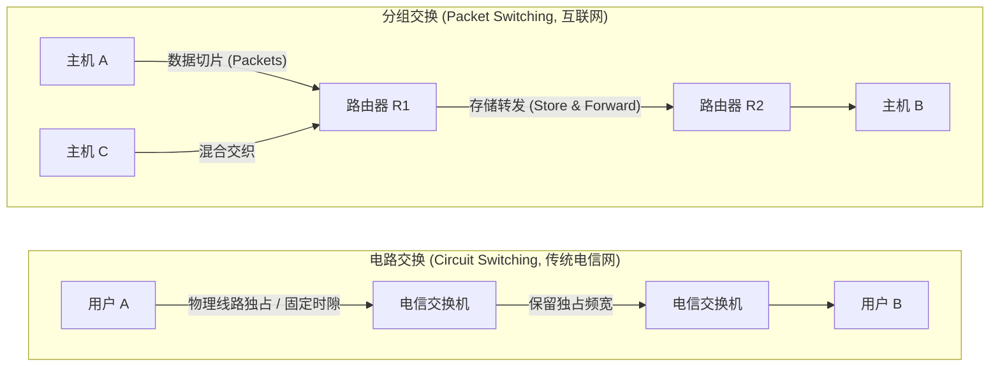

# Lec 8 计算机网络介绍与端到端论据

> 阅读资料：
> - 教材：Saltzer & Kaashoek《Principles of Computer System Design》第 7 章（Networking）
> - 经典论文：[End-to-End Arguments in System Design (Saltzer, Reed & Clark, 1984)](https://web.mit.edu/Saltzer/www/publications/endtoend/endtoend.pdf)

## TL;DR

- **分组交换与统计复用**：通过数据包切片与存储转发取代电路交换独占信道，以不可靠的“尽力而为（Best-Effort）”交付换取高弹性与极高信道利用率。
- **协议栈分层与沙漏模型**：应用层、传输层、网络层、链路层严格解耦，核心路由器仅根据 L3 IP 头转发，保证网络核心极简与上层应用创新自由。
- **端到端论据（End-to-End Argument）**：系统终极正确性只能由终端应用闭环判定；底层通信子系统实现的功能充其量只是局部性能优化，绝不能作为可靠性基石。

---

## 1. 广域互联挑战与交换范式抉择

在单机系统中，内核写入内存只需依赖物理硬件的确定性；而在广域互联网络中，系统必须面对三大不可回避的物理现实：
1. **设备与介质的高度异构性（Heterogeneity）**：连接网络的节点涵盖超级计算机、移动终端乃至低功耗传感器；物理链路跨越海底光缆、城市双绞线与易受干扰的无线信道。
2. **缺乏全局主宰（No Central Controller）**：全球互联网由数万个独立自治域（AS）去中心化组成，没有任何单点能够掌控全局拓扑。
3. **不可靠性成为常态（Failure as a Norm）**：光缆中断、无线衰落、路由器瞬时突发队列溢出导致的丢包随处可见。

面对这些物理约束，通信史上形成了两种截然不同的架构抉择：



### 1.1 电路交换 vs 分组交换

- **电路交换（Circuit Switching）**：通信前必须执行呼叫建立（Call Setup），在通信链路上预留固定带宽或时隙（Time Slot）。在通话期间，无论是否静音，物理资源均被独占。
- **分组交换（Packet Switching）**：
  - **数据切片（Packets）**：数据流被切分为带长度上限的离散包（通常为 1500 字节 MTU）。
  - **自描述包头（Self-Describing Headers）**：每个数据包头包含完整的源与目的地址，在网络中独立路由寻址。
  - **统计复用（Statistical Multiplexing）与存储转发（Store-and-Forward）**：路由器不为任何连接预留带宽，多个主机的突发流量在输出缓冲区动态排队共享信道。

::: definition 统计复用与尽力而为服务
- **统计复用（Statistical Multiplexing）**：利用计算机通信强突发性（Bursty）特征，根据实际流量动态共享信道，大幅提升物理线路利用率。
- **尽力而为（Best-Effort Delivery）**：底层网络仅保证尽最大努力转发数据，但不承诺延迟上限、不保证吞吐带宽、允许丢包、乱序与重复。
:::

---

## 2. 协议栈分层与数据包封装机制

随着系统的发展，我们需要考虑如何将一组链路加入到网络中。为了控制软件工程的复杂度，计算机网络借鉴模块化思想，确立了层次化协议模型。


| 分层 | 职责定位 | 代表协议与关键实体 |
| :--- | :--- | :--- |
| **应用层（Application）** | 实际产生业务流量的程序，定义数据交换语义与报文格式 | HTTP, DNS, SSH, TLS |
| **传输层（Transport）** | 进程间端到端通信通道，提供端口多路复用、可靠重传或拥塞控制 | TCP, UDP |
| **网络层（Network）** | 全网节点命名、拓扑寻址与逐跳转发（Host-to-Host） | IP (IPv4 / IPv6), ICMP |
| **链路层与物理层（Link & Phys）**| 相邻直连物理节点之间的帧传输、信道接入与比特编解码 | Ethernet, 802.11 (Wi-Fi), 5G, 光纤 |

### 2.1 封包剥离与沙漏模型（Hourglass Model）

在数据传输过程中，报文在源端经历逐层“俄罗斯套娃”式封装，在目的端经历逐层解封装：

```text
[源主机 Application]      HTTP 载荷
          ↓ 封装 TCP 头
[源主机 Transport]        [ TCP 头 | HTTP 载荷 ]
          ↓ 封装 IP 头
[源主机 Network]          [ IP 头  | TCP 头 | HTTP 载荷 ]
          ↓ 封装以太网头尾
[源主机 Link]             [ 以太网头 | IP 头 | TCP 头 | HTTP 载荷 | FCS 校验 ]
          ↓ 物理光纤比特传输
[中间路由器 Network]       只剥离以太网帧，解析 IP 头目的地址并查表转发，绝不解封传输层与应用层载荷！
          ↓ 物理传输
[目的端 Transport]        校验并剥离 TCP 头，按端口号分发至目标套接字
          ↓
[目的端 Application]      应用程序读取纯净 HTTP 业务数据
```

::: theorem 网络沙漏定理（The Hourglass Architecture）
互联网协议栈在拓扑中间收窄为单一的**网络层（IP 协议）**：
1. **上层多样性**：可以在 IP 之上自由创新任何传输层协议（TCP, UDP, QUIC）与应用协议；
2. **下层多样性**：IP 可以运行在任何物理传输介质之上（铜线、光纤、无线电、卫星）；
3. **核心最小化**：全网所有中间路由器只需要理解且仅理解 IP 协议，彻底隔绝底层物理变动与上层应用创新。
:::

---

## 3. 计算机网络的第一哲学：端到端论据

1984 年，Jerry Saltzer、David Reed 与 David Clark 发表了计算机系统工程领域的里程碑论文《End-to-End Arguments in System Design》，回答了核心架构问题：**一项特定的系统功能（如可靠传输、数据加密、完整性校验），到底应该做在通信子系统内部，还是做在端点应用层？**

### 3.1 思想实验：可靠文件传输（Reliable File Transfer）

假设主机 A 需要将一个 10 GB 的大文件跨越广域网完整传输到主机 B 的磁盘上：


如果网络工程师在中间路由器之间投入重金，实现了“100% 完美的逐跳链路层可靠确认与重传（Hop-by-Hop Reliability）”，端到端文件传输就高枕无忧了吗？
**答案是否定的，因为故障点遍布链路之外的各个环节：**
1. **发送端存储故障**：磁盘控制器读出时遭遇位翻转，或者内存条遭受粒子撞击产生软错误；
2. **操作系统缺陷**：主机 A 的网络驱动存在竞态并发 Bug，损坏了缓冲区数据；
3. **路由器内存损坏**：数据包在路由器 R2 的 DRAM 转发队列中发生静默比特翻转，此时因底层链路校验（FCS）在出端口重新计算，错误的包被合法转发；
4. **接收端宿主崩溃**：数据已抵达主机 B 内存，但在落盘（`fsync`）之前操作系统宕机或电源断电；
5. **接收端物理坏道**：写入磁盘后介质损坏。

::: definition 端到端论据的形式化陈述（The Formal Principle）
> **“只有完全了解应用程序业务语义的两端终端（End-Points），才能彻底、正确地实现该功能。因此，试图在底层通信系统内部实现该功能是不可行的；在通信系统内部放置该功能，通常充其量只能作为一种局部的性能优化，而不能作为正确性的基石。”**
:::

根据该论据，主机 B 必须在最终落盘后计算全局哈希校验（如 SHA-256），并与主机 A 校验。既然无论底层通信多么可靠，应用层都必须自己实现端到端校验与重传兜底，那么在底层花费巨大代价保证绝对可靠性不仅冗余，而且徒增复杂度。

---

## 4. 底层优化的边界：性能权衡法则

端到端论据绝非教条主义，它并不禁止在网络底层添加机制，但该机制必须满足**性能权衡准则（Performance Trade-Off）**。

### 4.1 无线信道（Wi-Fi / 5G）局部重传案例

考虑一段包含 100 个数据包的 TCP 流：
- **低误码陆地光纤**：丢包率 $p < 10^{-6}$，在链路层增加逐跳确认与重传只会徒增硬件延迟，完全没有必要。
- **高误码无线链路**：由于多径效应和环境噪声，无线信道丢包率可能高达 $p = 10\%$。
  - 若无线链路层**不进行重传**，整条流在端到端无损穿透的概率为：
    $$P_{\text{success}} = (1 - 0.1)^{100} \approx 2.6 \times 10^{-5}$$
    端到端 TCP 将遭遇无限次超时重传，拥塞窗口退化为 1，整个网络吞吐量彻底归零。
  - 若无线链路层在物理接入跳引入**局部的微秒级自动重传（ARQ）**，将该跳丢包率从 $10\%$ 压制到 $0.01\%$，端到端吞吐量将恢复 $99\%$ 以上。

::: theorem 性能优化边界准则
底层通信系统添加的功能（如 Wi-Fi 局部重传、链路层压缩）：
1. **仅作为性能优化（Performance Optimization）**，绝不能免除上层端到端的最终校验责任；
2. **不得对不需要该功能的高层应用造成惩罚**：底层机制不能对低延迟实时流（如 VoIP 音视频通话）强加高延迟重传阻滞。
:::

---

## 5. 现实异化：网络中间件与协议僵化

互联网的古典设计理念遵循**“智能在边缘，核心保持愚蠢（Smart Edges, Dumb Network）”**。然而随着互联网的商业化膨胀，现实力量逐渐背离了端到端论据：
1. **网络地址转换（NAT）**：因 IPv4 地址枯竭，家庭和企业路由器开始私自重写 IP 头与端口号，打破了双向透明端到端直连。
2. **深度包检测防火墙（DPI Firewalls）**：中间网关强行窥探并篡改 L4/L7 载荷，拦截特定应用。
3. **协议僵化（Protocol Ossification）**：中间防火墙与网关假定所有流量严格符合原始 TCP 行为，导致任何对 TCP 握手语义的改良升级都会被中间件视为恶意报文直接丢弃。

这一困境最终迫使 Google 与 IETF 绕过僵化的 TCP，在 UDP 基础之上重新发明了现代传输层协议 **QUIC（HTTP/3 的底层基础）**，将拥塞控制与 TLS 加密全部收拢回用户态端点，重新捍卫了端到端哲学。

---

## 我的理解

::: insight 架构师见解：端到端论据的跨时代生命力
1. **分布式系统的一致性映射**：端到端论据不仅适用于网络数据包，更统治着现代分布式系统与微服务架构。在跨服务 RPC 调用中，即使底层使用了高可靠的 TCP 连接并开启了重试机制，分布式事务依然可能在落库前因 OOM、GC 停顿或幂等性冲突而静默失败。高可用架构师绝不能依赖“底层网络从不丢请求”的幻觉，必须在业务端点实现幂等键（Idempotency Key）、逆向补偿事务与最终对账闭环。
2. **沙漏模型与极简核心的演进红利**：沙漏模型的真正伟大之处在于它赋予了系统抵御时间侵蚀的能力。40 年前发明 IP 协议时，设计者从未设想过移动流媒体、深度学习分布式训练或大规模多租户云平台的出现；然而正是因为网络核心保持了“无状态、只寻址、尽力而为”的极致克制，全球基础设施才得以无缝吞吐指数级爆发的全新技术，无需经历推倒重来的灾难性重构。
:::
