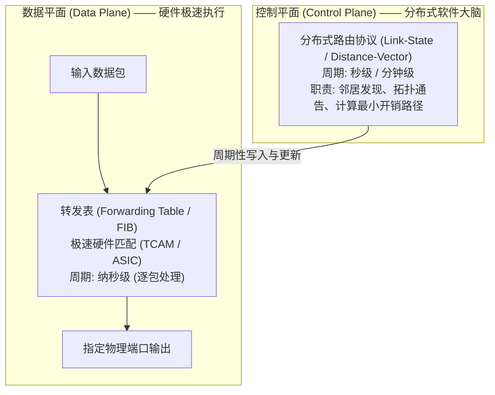

# Lec 9 网络层路由：链路状态与距离向量

> 阅读资料：
> - 教材：Saltzer & Kaashoek《Principles of Computer System Design》第 7 章（Networking, §7.4）

## TL;DR

- **数据平面与控制平面解耦**：转发（Forwarding）是硬件 TCAM 纳秒级查表推包，路由（Routing）是全网分布式协议协作求解图论最优路径。
- **链路状态算法（Link-State）**：全网可靠泛洪局部链路状态（LSP），构建统一 LSDB 拓扑矩阵后本地运行 Dijkstra，收敛迅速但消息量达 $O(|V| \cdot |E|)$。
- **距离向量算法（Distance-Vector）**：仅与直连邻居交换全网距离向量，基于 Bellman-Ford 迭代松弛；收敛面临“好消息传得快、坏消息传得慢”与计数到无穷困境，毒性逆转无法彻底消除多节点环路。

---

## 1. 路由体系结构：数据平面与控制平面

当数据包进入路由器时，网络必须回答一个核心问题：**路由器凭什么知道应该把数据包推向哪一根物理网线，才能保证其最终跨越全球抵达目的地？**

现代计算机网络体系结构通过两大平面的解耦来管理这一复杂度。传统网络设备在逻辑和物理上均被清晰地拆分为两套协同运作的子系统：负责极速物理执行的“数据平面”与负责宏观决策协商的“控制平面”。

这两个平面的运行频率与设计哲学存在着数量级上的根本差异：

- **转发（Forwarding / 数据平面）**：这是纯局部的纳秒级硬件操作。在 100 Gbps 骨干网络中，一个最小尺寸的数据包仅有几十纳秒的传输窗口。数据平面绝不允许执行任何复杂的图遍历算法，必须依靠专用集成电路（ASIC）与三态内容寻址寄存器（TCAM）在硬件层面对目的 IP 执行常数时间 $O(1)$ 的最长前缀匹配（LPM），并立刻将数据包推入指定出口的物理队列。它只负责“执行”既定规则。
- **路由（Routing / 控制平面）**：这是全网范围的分布式软件协作。所有路由器运行在通用 CPU 之上，通过协议报文相互通信、周期性交换链路状态或向量信息。控制平面在宏观图论意义上计算全网最短路径，并在拓扑发生变化时重新收敛，最终把计算结果提炼为简洁的“目的前缀 $\to$ 下一跳”映射表，批量写入数据平面的硬件转发表中。

这种“软件大脑掌控拓扑，硬件肌肉专注推包”的分离范式，不仅极大地提高了单机转发吞吐，更成为后世软件定义网络（SDN）解耦创新的核心理论源头。

---

## 2. 路由问题形式化抽象与路由表

在数学抽象中，计算机网络可表示为加权连通图 $G = (V, E)$：
- $V$ 为全网路由器节点集合；
- $E$ 为物理通信链路集合；
- 边权重 $c(u, v)$ 代表链路开销（Cost），可综合反映物理延迟、线路租金、跳数或剩余带宽。

路由协议的目标是为每个交换节点计算到达目的地的最小成本路径表：

我们主要讨论**分布式路由协议**（节点自组织协同建立路由表，而非依赖脆弱的集中式控制器）。分布式路由协议通常由三个核心步骤循环驱动：

1. **邻居发现（Neighbor Discovery）**：节点通过双向心跳（Hello 协议）发现直连邻居，并测定链路开销 $c(u, v)$；
2. **通告学习（Disseminating Advertisements）**：节点在网络中交换路由通告，获取全网拓扑或距离信息；
3. **最优路径求解（Shortest Path Computation）**：各节点根据通告数据计算最小代价路径，生成转发表项。

以上步骤**周期性或事件驱动地持续发生**，赋予了分布式路由自愈物理故障与适应流量拓扑漂移的弹性。

---

## 3. 链路状态路由算法（Link-State / Dijkstra）

链路状态算法的哲学本质是：**“每个人将自己身边的局部直连信息，通告给全网所有节点；最终全网每个节点各自拼装出一张完全一致的全局拓扑图。”**（代表实现：OSPF、IS-IS）。

### 3.1 运作机制

1. **生成链路状态数据包（LSP）**：
   每个节点 $A$ 定期测定并广播自身与直连邻居的链路代价，构造通告报文，如：
   $$\text{LSP}_A = \big[ (B, 7), (D, 2), (F, 1) \big], \quad \text{Seq} = 101, \quad \text{TTL} = 64$$
2. **全网可靠泛洪（Reliable Flooding）**：
   节点将 LSP 向所有相邻端口泛洪转发，接收节点无条件再次扩散：

   - **防环与去重机制**：节点在内存中记录每个源节点的最大序号（`Seq`）。若收到已处理过或更旧的报文则直接丢弃；同时利用 TTL 递减防止悬空环路；在转发时避免回传给报文的发送邻居（Reverse Path Check）。
3. **构建链路状态数据库（LSDB）**：
   全网泛洪稳定后，所有节点的内存中都拥有一份全局无差别的拓扑图 $G=(V, E)$。
4. **本地独立运行 Dijkstra 最短路径算法**：
   以本节点为根节点，构建最短路径生成树（SPT），推导出到达每个目的地的下一跳接口。

### 3.2 链路状态的工程代价与路由震荡

- **消息与状态复杂度高**：全网泛洪产生 $O(|V| \cdot |E|)$ 的报文开销，拓扑规模受限；每个节点都需要存储全网 LSDB。
- **流量敏感型开销震荡（Routing Oscillations）**：若链路开销 $c(e)$ 与实时承载流量强挂钩，算法会导致全网流量在多条等价干线之间像钟摆一样剧烈震荡切换，引发系统性严重抖动。

---

## 4. 距离向量路由算法（Distance-Vector / Bellman-Ford）

与链路状态相反，距离向量算法的哲学是：**“每个人只与自己直接相连的邻居交换信息，但交换的信息是自己对全网所有节点的距离估计！”**（代表实现：RIP）。

### 4.1 Bellman-Ford 核心方程

设 $D_x(y)$ 为节点 $x$ 到目的节点 $y$ 的最短路径距离估计值。节点 $x$ 与直接邻居 $v \in \text{Neighbors}(x)$ 的开销为 $c(x, v)$。则动态规划递推方程为：

$$D_x(y) = \min_{v \in \text{Neighbors}(x)} \Big\{ c(x, v) + D_v(y) \Big\}$$

### 4.2 向量交换与松弛迭代

1. 每个节点仅在内存中维护一维距离向量数组 $D_x(*)$；
2. 节点仅向**直连邻居**发送自己的完整距离向量副本；
3. 当节点收到来自邻居的向量通告时，根据 Bellman-Ford 方程更新本地最短开销与下一跳；
4. 仅当本节点的距离向量发生实质变化时，才触发向外扩散更新。

---

## 5. 坏消息传得慢与计数到无穷问题

距离向量算法结构精简、无需全网泛洪，但其隐藏着分布式系统的经典隐患：**“好消息传得快，坏消息传得慢（Good news travels fast, bad news travels slow）。”**

### 5.1 计数到无穷（Count-to-Infinity）推导演算

考虑线性拓扑 $A \xleftrightarrow{\quad 1 \quad} B \xleftrightarrow{\quad 1 \quad} C$：
- 稳态下：$D_B(C) = 1$（下一跳 $C$）；$D_A(C) = 2$（下一跳 $B$）。
- **突发故障**：$B$ 与 $C$ 之间物理链路中断（$c(B, C) = \infty$）。
- **致命误判**：
  1. $B$ 发现直连 $C$ 故障，但检视邻居 $A$ 的通告，发现 $A$ 曾宣称 $D_A(C) = 2$；
  2. $B$ 误以为能通过 $A$ 绕行抵达 $C$，误判 $D_B(C) = c(B, A) + D_A(C) = 1 + 2 = 3$；
  3. $B$ 将更新通告给 $A$；$A$ 发现经由 $B$ 涨价了，将自己的开销更新为 $D_A(C) = 1 + 3 = 4$ 并回传；
  4. 双方在互相依赖中陷入死循环自欺欺人，数值持续攀升至无穷大。

### 5.2 环路补救机制与局限性

1. **人工截断无穷大（Defining Infinity）**：
   协议（如 RIP）强行定义 $\infty = 16$。开销达到 16 即判定不可达，限制了环路死循环上限，但直接锁死了网络的最大物理直径（$\le 15$ 跳）。
2. **水平分割（Split Horizon）**：
   若节点 $A$ 到目的地的最短路由是经由邻居 $B$ 学习到的，则 $A$ 在向 $B$ 发送向量通告时，隐瞒该目的地信息。
3. **毒性逆转（Poison Reverse）**：
   $A$ 在向其路由下一跳 $B$ 通告该目的地时，显式将开销谎报为 $\infty$（“从我这里走不通”），迫使 $B$ 绝不反向绕回 $A$。

::: pitfall 毒性逆转的失效边界
毒性逆转**只能防范双节点之间的直接双向微环路**。在三个及以上节点组成的环形拓扑（如三角形或多边形网状网络）中，断网信息在多跳节点间交叉反弹，毒性逆转完全失效，计数到无穷依然会重现。
:::

---

## 6. 两种协议的系统工程对比与选型

| 评估维度 | 链路状态路由（Link-State） | 距离向量路由（Distance-Vector） |
| :--- | :--- | :--- |
| **拓扑知识广度** | 全局视角：每个节点拥有全网拓扑矩阵 | 局部视角：仅掌握邻居与黑盒距离估计 |
| **消息复杂度** | 较高：全网泛洪，报文量达 $O(\|V\| \cdot \|E\|)$ | 较低：仅在相邻节点间点对点交换向量 |
| **收敛速度** | **极快**：泛洪就绪后本地独立重新运算 | **慢**：需多轮迭代，受坏消息传得慢阻滞 |
| **环路风险** | 本地运行 Dijkstra，天然无瞬时逻辑环路 | 易发生瞬时路由环路与计数到无穷 |
| **故障隔离度** | 节点仅通告自身直连状态，单点错误破坏范围可控 | 单节点通告错误距离向量，会如瘟疫般全网污染 |
| **典型应用** | OSPF, IS-IS（数据中心、园区内网、骨干网） | RIP（老旧小型局域网）、**BGP（升华为路径向量）** |

---

## 我的理解

::: insight 架构师见解：从距离向量到路径向量的范式跃迁
1. **距离向量“盲人摸象”的本质瓶颈**：距离向量算法之所以频现计数到无穷，其根本矛盾在于**“信息的不可溯源性”**。节点收到一个纯数字的开销标量，无法洞悉其背后到底踩过了哪些中间节点，因果信息的丢失必然带来环路隐患。链路状态用“全网全知”强行治愈了这一痛点，但代价是极高的泛洪广播与内存消耗，根本无法拓展到横跨数万自治域的全球广域互联网。
2. **BGP 路径向量（Path-Vector）的破局之道**：正是为了在不进行全网暴力泛洪的前提下彻底扼杀环路，互联网核心控制平面孕育了 **BGP 路径向量协议**。它继承了距离向量只与邻居点对点交换的极简开销，但将通告内容从单薄的标量开销进化为带有完整自治域序列的 `AS-Path`。节点只需检查自身 AS 编号是否出现在路径链条中，即可在 $O(1)$ 时间内以确定性数学判定切断任何潜在环路。
:::
