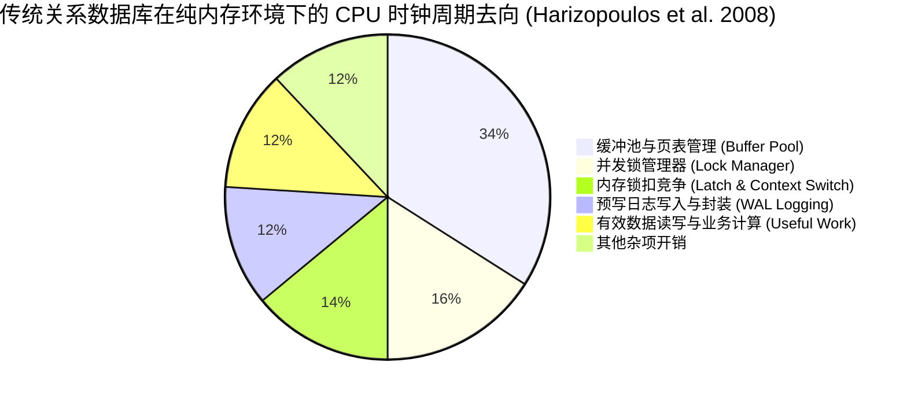
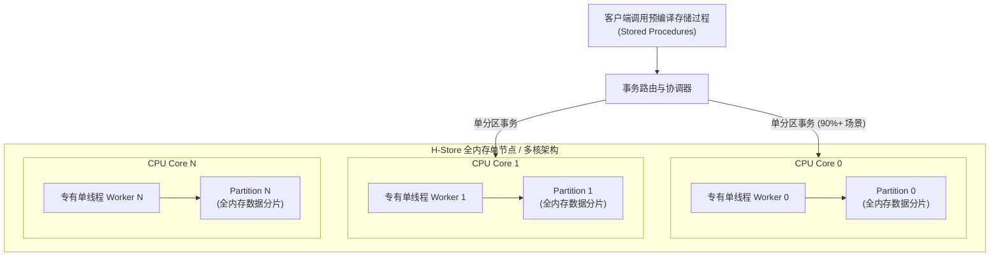
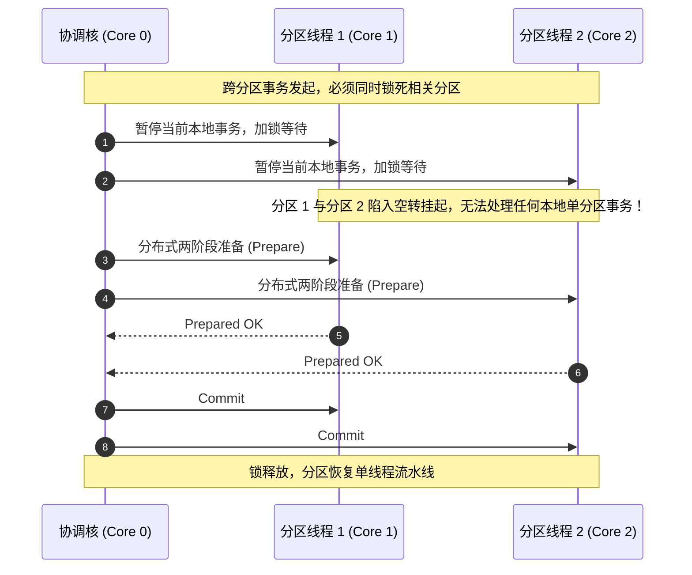
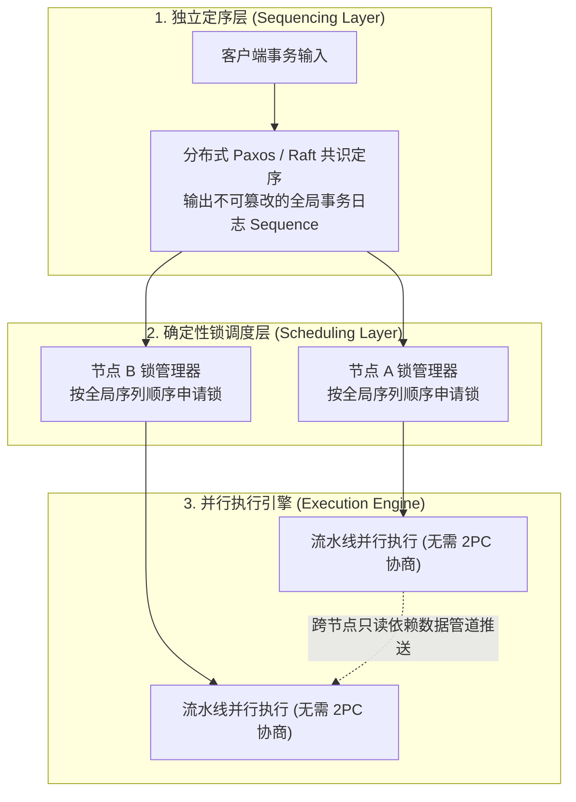

# 全内存 OLTP 架构与确定性调度：H-Store 与 Calvin（In-Memory OLTP & Deterministic Scheduling）

> 计算机系统 · 数据库系统 · 核心概念专题  
> 经典文献：Michael Stonebraker et al. (VLDB 2007) *`The End of an Architectural Era (It's Time for a Complete Rewrite)`*；Stavros Harizopoulos et al. (SIGMOD 2008) *`OLTP Through the Looking Glass, and What We Found There`*；Alexander Thomson et al. (SIGMOD 2012) *`Calvin: Fast Distributed Transactions for Partitioned Database Systems`*

## 问题情境

在传统的关系型数据库（RDBMS，如 System R、Oracle、PostgreSQL、MySQL InnoDB）体系中，所有的底层架构假定均围绕着一个残酷的物理事实展开：**外存磁盘（HDD）比主存（DRAM）慢数十万倍甚至数百万倍**。为此，经典数据库演化出一整套复杂的调度与防线：
- **缓冲池（Buffer Pool）**：维护 Frame 表与页面哈希表，通过替换算法平滑 I/O 延迟；
- **锁管理器（Lock Manager）**：通过严格两阶段锁（Strict 2PL）保证多线程并发可串行化；
- **崩溃恢复体系（ARIES / WAL）**：维护预写日志与脏页追踪，确保断电自愈；
- **线程上下文切换**：当事务等待慢速磁盘 I/O 时，操作系统与引擎频繁挂起并切换线程。

然而，随着半导体工业发展，服务器主存（DRAM）容量轻松突破数百 GB 至数 TB，大部分企业的核心交易工作集（Working Set）已经可以**完全常驻在物理内存中**。当磁盘物理 I/O 瓶颈彻底消失后，研究人员对传统数据库进行微架构级性能剖析（Profiling），得出了一个震撼学术界与工业界的结论：**在纯内存环境下，超过 90% 的 CPU 周期被缓冲池查表、并发锁竞争、Latch 竞争与上下文切换白白浪费，真正用于读取与写入有效数据的业务计算不到 10%！**

既然传统数据库架构在内存时代已沦为“跑跑跑的累赘”，如何在全内存环境下重构事务引擎，彻底榨干现代多核 CPU 的吞吐潜力？

## 概念界定

针对全内存与多核架构下的开销危机，学术界与工业界诞生了两种划时代的革命性架构方案：**H-Store** 与 **Calvin**。

::: definition H-Store 单线程分区架构（Single-Threaded Partitioned Execution）
H-Store 是一种完全摒弃缓冲池与行级锁管理器的全内存 OLTP 引擎架构。它将整库数据物理切分为互不相交的独立分区（Partitions），每个 CPU 核心独占绑定一个专有单线程，以**串行化无并发（Run-to-Completion）**的方式依次执行事务。在每个单线程分区内部，由于不存在任何并发事务，系统**完全消除了行锁、表锁与内存 Latch**。
:::

::: definition Calvin 确定性事务调度协议（Deterministic Transaction Scheduling）
Calvin 是一种基于**全局预先定序（Sequencing Layer）**与**确定性锁调度（Deterministic Locking）**的分布式事务协议。Calvin 将事务的“共识定序”阶段移至“事务执行”之前，通过分布式 Paxos / Raft 对事务输入请求完成严格全局排序。一旦全局序列确立，所有节点完全遵循确定性顺序申请锁并推进执行。只要输入序列确定，各节点的最终状态收敛是严格确定的，从而**彻底消灭了分布式两阶段提交（2PC）的协调阻塞，消除了分布式死锁**。
:::

## 解释与依据

::: insight 为什么消除硬件瓶颈反而放大了软件协议开销？
在经典的 Amdahl 定律中，如果一个系统的最大瓶颈（磁盘 I/O）被物理硬件革命性地消除了数十万倍，原来微不足道的软件协议开销（如哈希查表、互斥锁、自旋等待、上下文切换）就会瞬间跃升为系统的绝对主导瓶颈。H-Store 和 Calvin 的深刻洞察在于：当外部物理制约发生质变时，给旧架构做局部的“补丁式优化”毫无意义，必须彻底重构软件并发与一致性契约。
:::

### 1. H-Store 的极简暴力美学与三大法则

H-Store 由图灵奖得主 Michael Stonebraker、Sam Madden 等人于 2007 年提出，其核心逻辑是通过强约束换取极端性能：

1. **法则 1：粉碎缓冲池（No Buffer Pool）**：
   数据全部驻留物理内存，指针直接引用内存物理地址，完全移除 PageID 转换哈希表与 Frame 锁扣（Page Latch）。
2. **法则 2：单核绑定单线程（Thread Affinity）**：
   一个 CPU 核心只运行一个执行线程，负责一个数据分区。事务一旦启动，以串行方式执行完毕（Run-to-Completion）才处理下一个事务。没有多线程争用，无需任何并发锁。
3. **法则 3：强制存储过程（Stored Procedures Only）**：
   禁止传统客户端通过交互式 SQL（如发送 `BEGIN` -> 查询 -> 思考 -> 更新 -> `COMMIT`）操作数据库，杜绝了“人脑网络延迟持有数据库锁”的灾难。所有业务逻辑打包为预编译存储过程一次性传入。

### 2. H-Store 的阿喀琉斯之踵：跨分区事务瘫痪

当事务访问的数据仅位于单个分区时，H-Store 的吞吐量可达数百万 TPS。然而，一旦出现跨分区事务（Multi-Partition Transactions，例如跨分区的账户资金转账），H-Store 的单线程串行设计瞬间沦为致命缺陷。

由于单线程分区完全没有行级锁或表级锁机制，保护并发一致性的唯一手段就是**将整个涉及的目标分区全面锁死挂起**。如果一个事务需要同时读取分区 1 并修改分区 2，协调核必须向分区 1 和分区 2 发送协调锁指令，强行打断并挂起这两个分区上的所有后续事务。

如下面的时序调用所示，在跨分区协调的往返时延（RTT）期间，所有被锁定的 CPU 核心完全处于空转状态，无法推进任何本地轻量事务：

在跨分区协调期间，涉及的所有 CPU 核心必须完全挂起等待网络 RPC。一旦跨分区事务占比达到 10%，H-Store 的全局吞吐量会暴跌 90% 以上，退化为串行单点！

### 3. Calvin 革命：消灭非确定性，将共识前置

耶鲁大学 Daniel Abadi 团队在 2012 年提出的 Calvin 协议精准击中了这一痛点。Calvin 发现，传统分布式事务之所以需要耗时阻塞的 2PC，是因为**事务执行中存在不确定性（Non-determinism）**：
- 节点动态判断是否冲突；
- 事务执行依赖动态局部时钟（如 `NOW()`）或随机数；
- 节点随时可能发生动态死锁或条件中止（Abort）。

Calvin 的核心突破是：**在执行任何事务之前，先通过分布式定序层（Sequencing Layer）对所有事务输入进行全局严格排序**。

在 Calvin 中：
1. **确定性锁申请**：所有节点按照完全相同的全局日志顺序申请锁，杜绝了死锁可能（无环等待），**完全不需要死锁检测与回滚**；
2. **无需两阶段提交**：因为输入已排定且执行逻辑确定，只要没有物理单点断电，所有节点的计算结果必然完全一致，节点无需相互询问“你准备好提交了吗？”，各自执行完毕即可直接提交！

## 边界与辨析

### 1. 四大主流并发控制架构全景对比

| 架构特性 | 传统严格两阶段锁（Strict 2PL） | 乐观并发控制（OCC） | H-Store 单线程分区 | Calvin 确定性调度 |
| :--- | :--- | :--- | :--- | :--- |
| **内存/磁盘模型** | 外存磁盘为主，缓冲池缓存 | 外存/内存混合 | 全量物理内存驻留 | 全内存或分层存储 |
| **锁与 Latch 开销** | 极高（行锁、表锁、Frame Latch） | 中等（验证阶段全局时钟/读写集锁） | **零（无锁、无 Latch）** | 低（确定性无死锁排队锁） |
| **执行模式** | 交互式 SQL 多线程并发 | 本地私有空间计算 + 集中验证 | 存储过程单线程串行 | 预编译存储过程确定性流水线 |
| **跨分区分布式事务** | 强依赖分布式 2PC 阻塞协商 | 依赖分布式 2PC 验证与提交 | **致命短板（全局挂起阻塞）** | **原生极高吞吐（消除 2PC 协商）** |
| **事务动态中止率** | 死锁时回滚牺牲者 | 高争用场景冲突率极高，频繁回滚 | 极低（仅业务主动异常中止） | 零内部冲突中止（无死锁、无竞争中止） |

### 2. 适用边界与核心假设

- **H-Store 的适用边界**：
  工作负载必须能够**极其清晰地按业务键物理分区**（如用户 ID、租户 ID），且跨分区操作比例低于 1%~2%。在社交点赞、单租户 SaaS 场景下表现无与伦比；但在复杂数仓、全局高频转账场景下会遭遇性能断崖。
- **Calvin 的核心代价与制约**：
  Calvin 要求事务在进入定序层之前，必须能**静态确定其读写集（Read/Write Sets）**。对于依赖运行时计算结果才能确定下一步读取哪一行的交互式复杂事务（如二级指针查找），Calvin 必须引入“预先运行探测（Reconnaissance Phase）”预测读写集；若预测失误，则必须回滚并重放，引入了额外开销。

## 提取与迁移

从 H-Store 与 Calvin 的演进中，可以提炼出分布式与高性能系统工程的三大通用底层设计公理：

1. **消除开销的终极方法不是“加速开销”，而是“彻底干掉产生开销的机制”**：
   传统数据库试图通过无锁哈希表、细粒度自旋锁优化锁管理器；H-Store 则直接指出“既然锁占了 30% 开销，那我按核单线程串行跑，直接消灭锁本身”。
2. **共识前置与确定性状态机（Deterministic State Machine Replication）**：
   现代分布式架构（如 Raft、Kafka、Event Sourcing）的核心精髓与 Calvin 异曲同工：只要将事件日志严格排序并保证执行器是确定性的，就可以免去执行过程中无数次昂贵易错的分布式协商。
3. **消除交互式网络停顿（Run-to-Completion / Batch RPC）**：
   网络 RTT 往往是微秒甚至毫秒级，而现代 CPU 执行一条指令只需零点几纳秒。任何在持有关键资源时等待远程客户端输入的设计，都会被现代硬件无情惩罚。将交互式调用收拢为存储过程、脚本化批处理（如 Redis Lua 脚本）是维持超高吞吐的标准模式。

## 关联与来源

- **先修与关联讲义**：
  - [Lec 4 数据库内部架构：存储与缓冲池](../lec4.md)（理解经典缓冲池与锁管理器的开销源头）
  - [Lec 11 事务处理与两阶段锁](../lec11.md)（理解严格 2PL 的可串行化与死锁机制）
  - [Lec 16 分布式事务与两阶段提交](../lec16.md)（理解传统 2PC 协议的阻塞脆弱性）
- **学术文献出处**：
  - Michael Stonebraker et al. (VLDB 2007) *The End of an Architectural Era (It's Time for a Complete Rewrite)*
  - Stavros Harizopoulos et al. (SIGMOD 2008) *OLTP Through the Looking Glass, and What We Found There*
  - Robert Kallman et al. (SIGMOD 2008) *H-Store: A High-Performance, Distributed Main Memory Transaction Processing System*
  - Alexander Thomson et al. (SIGMOD 2012) *Calvin: Fast Distributed Transactions for Partitioned Database Systems*
- **工业系统衍生**：
  - **VoltDB**：H-Store 商业化闭环系统，主打千万级单机电信计费；
  - **FaunaDB**：由 Twitter 前工程副总裁主导，直接基于 Calvin 协议构建的分布式全局数据库；
  - **Redis**：单线程事件循环执行命令，实践了单核串行消除并发锁的工程哲学。

## TL;DR

- 硬件 DRAM 成本下降使数据常驻内存成为现实；微架构剖析证明传统数据库超过 90% 的 CPU 周期被缓冲池查表、锁扣（Latch）竞争与并发锁管理器虚耗。
- H-Store 提出单线程分区无锁模型，单核绑定单线程，以纯内存串行执行彻底消灭锁机制与缓冲池，但在跨分区事务时面临严重性能断崖。
- Calvin 协议通过共识定序层将全局排序前置，配合确定性锁调度消除分布式死锁，彻底摆脱了两阶段提交（2PC）的协调阻塞。
- 现代高性能架构的通用启示是：将交互式查询封装为存储过程，前置事件序列，以确定性状态机替代运行期分布式锁协同。
