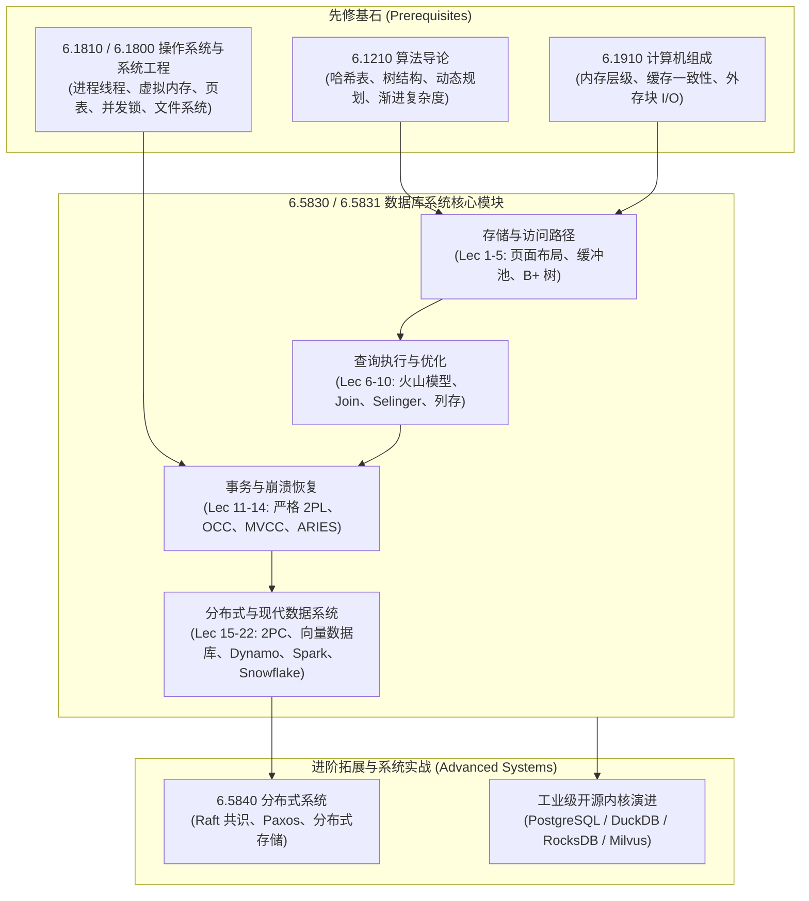

# 6.5830 数据库系统（Spring 2026）

> 麻省理工学院（MIT）计算机科学与人工智能实验室（CSAIL）数据系统组（Data Systems Group）研究生/本科生高阶核心课程  
> 授课教授：Prof. Michael Cafarella、Prof. Tianyu Li、Prof. Sam Madden  
> 官方主页：[MIT 6.5830 / 6.5831 Official Site](https://dsg.csail.mit.edu/6.5830/) · 课程日历：[Spring 2026 Schedule](https://dsg.csail.mit.edu/6.5830/sched.php)

## TL;DR

- 数据库系统是现代数据密集型应用的核心基石，全面贯穿关系模型、存储引擎、查询编译与分布式事务。
- 从单机外存模型（B+ 树、缓冲池置换、列存压缩）到查询优化器（Selinger 算法与代价模型）的物理执行全貌。
- 深入并发控制与恢复理论（严格 2PL、MVCC、ARIES 算法），并延展至分布式系统、高维向量检索与云原生数据仓库。
- 理论与工程深度结合，配套 Go 语言自主实现的关系型内核 GoDB 实验体系。

---

## 课程描述

### 1. 先修课程与知识拓扑

本课程面向具备坚实计算机系统与算法工程基础的高年级本科生和研究生。数据库内核设计横跨硬件外存、操作系统调度、编译器优化及分布式共识，是一个典型的高度集成的复杂软件系统。在学习过程中，学生不仅需要理解抽象代数规则与事务语义，还必须深入到字节对齐、磁盘块 I/O、无锁并发控制及网络协议栈的物理实现细节。

数据库内核的构建依赖于三大传统核心领域的深度融合：
1. **算法与复杂度分析**：索引的高效检索与动态维护（如 B+ 树的平衡分裂与旋转）、哈希表的分桶与冲突解决策略、外排序中的多路归并、以及查询优化器中基于动态规划状态压缩的连接顺序搜索空间剪枝；
2. **计算机硬件体系结构**：现代存储介质的物理特性差异（机械硬盘 HDD 的磁头寻道延迟与旋转延迟、固态硬盘 SSD 的闪存页读取与块擦除不对称性）、CPU 缓存行局部性优化、硬件级原子指令（CAS、LL/SC）以及 SIMD 向量化指令在分析型批处理中的算力挖掘；
3. **操作系统与并发运行时**：跨越内核态与用户态的直接 I/O（`O_DIRECT`）、内存映射文件（`mmap`）的虚页置换陷阱、轻量级用户态协程调度、多线程互斥锁扣（Latches）与事务行级锁（Locks）的职责解耦，以及面向预写日志持久化的物理刷盘屏障（`fsync`）。

为了在底层内核设计与 GoDB 物理引擎实验中游刃有余，技术读者在进入本课程前应系统建立上述三大学科基石的知识储备，并参考下方的体系化认知拓扑路线图逐步递进：

### 2. 官方课程描述（中译）

> **MIT 6.5830 / 6.5831 课程官方大纲（Syllabus Overview）**：  
> 本课程旨在系统介绍数据库系统的理论基石与工程实现，核心聚焦于**关系代数与数据模型、查询优化、查询物理执行、事务并发控制与故障恢复**。本课程不是一门关于数据库应用设计或 SQL 业务开发的入门课，而是一门关于**“如何从零工程实现一个工业级高性能数据库内核”**的系统系统级硬核课程。
> 
> 课堂涵盖数据库工程设计领域的经典主题：数据模型；数据库与模式设计；范式规范化与完整性约束；查询物理执行与向量化引擎；查询编译优化与代价模型估计；事务并发处理（ACID）；故障恢复算法（预写日志与 ARIES）；隔离级别与最终一致性；分布式、并行与无共享（Shared-Nothing）数据库；列式存储与 OLAP 分析型架构；流式处理；高维向量数据库检索；以及云原生“存算分离”数据库架构服务。

### 3. 培养目标与能力模型

通过全学期的深度研读与实验重构，学习者将构建起完整的数据库内核认知：
1. **外存引擎设计能力**：掌握外存行式与列式物理布局，亲手实现 Slotted-Page 页结构与基于时钟置换的缓冲池管理器；
2. **执行引擎优化能力**：理解流水线火山迭代器与基于编译的 JIT 引擎，掌握连接算子（Grace Hash Join）与动态规划连接定序优化；
3. **事务一致性把控力**：洞悉冲突可串行化理论，精通多版本并发控制（MVCC）与 ARIES 幂等预写日志恢复体系；
4. **现代系统架构视野**：掌握分布式两阶段提交（2PC）、亚马逊 Dynamo 最终一致性、高维向量近似最近邻图索引（HNSW）及 Snowflake 存算分离架构。

### 4. 参考教材与经典文献

- **核心必读文献集**：*Readings in Database Systems*（俗称 **Red Book 红宝书**，Peter Bailis, Joseph M. Hellerstein, Michael Stonebraker 编著，第 5 版）；
- **经典工程教材**：*Database Management Systems*（俗称 **Cow Book 牛书**，Raghu Ramakrishnan & Johannes Gehrke 著）；
- **现代内核参考**：Alex Petrov *Database Internals: A Deep Dive into How Distributed Data Systems Work*。

---

## 课程内容全景

### 1. 核心模块架构

数据库系统内核工程规模宏大，全课程紧扣现代数据系统的四阶段技术演进脉络展开。从单机外存页面布局出发，经历执行优化、事务安全，最终延伸至跨机房分布式与大规模云原生环境：

```mermaid
flowchart LR
    subgraph M1["模块一：物理存储与访问路径"]
        direction TB
        L1["Lec 1-3: 关系模型与高级 SQL"]
        L2["Lec 4: 数据库内部机制 (存储与缓冲池)"]
        L3["Lec 5: B+ 树与多维空间索引"]
    end

    subgraph M2["模块二：执行引擎与代价优化"]
        direction TB
        L4["Lec 6-7: 算子物理执行与 Join 算法"]
        L5["Lec 8-9: 查询代价优化与模式范式论"]
        L6["Lec 10: 列式存储与 OLAP 分析引擎"]
    end

    subgraph M3["模块三：事务并发与崩溃恢复"]
        direction TB
        L7["Lec 11-12: 事务可串行化、2PL 与 OCC"]
        L8["Lec 13-14: 故障恢复、WAL 与 ARIES 算法"]
    end

    subgraph M4["模块四：分布式系统与现代云架构"]
        direction TB
        L9["Lec 15-16: 分布式架构与 2PC / Paxos"]
        L10["Lec 17-18: 向量数据库 (HNSW) 与最终一致性 (Dynamo)"]
        L11["Lec 19-22: Spark 集群、云数仓、基数估计与 AI 算子"]
    end

    M1 ==> M2 ==> M3 ==> M4
```

每个核心模块承担着明确的物理和理论职责：
- **物理存储与访问路径（Lec 1–5）**：解决冷数据如何在块设备（Block Devices）上紧凑持久化，并通过内存页缓冲池（Buffer Pool）平滑 I/O 延迟，利用高分支比 B+ 树建立对数级检索通道；
- **执行引擎与代价优化（Lec 6–10）**：解决声明式 SQL 关系代数树的物理算子映射，权衡流水线迭代与批处理向量化，通过 Selinger 代价模型在庞大的搜索空间中确定最优执行计划，并推演 OLAP 列存压缩；
- **事务并发与崩溃恢复（Lec 11–14）**：在硬件断电、并发竞争与死锁陷阱中维系 ACID 契约，通过严格两阶段锁（2PL）和快照隔离（SI）保证可串行化，依靠预写日志与 ARIES 算法实现幂等自愈；
- **分布式系统与现代云架构（Lec 15–22）**：跨越网络分区与单机极限，涵盖分布式 2PC 原子提交、亚马逊 Dynamo 最终一致性、高维向量近邻检索（HNSW）以及现代存算分离云数仓。

### 2. 官方全景讲义列表（严格 1:1 对齐 MIT 6.5830 官方大纲）

本知识库讲义严格对齐 MIT 官方教学日程（[Spring 2026 Schedule](https://dsg.csail.mit.edu/6.5830/sched.php)），消除了历史版本错位，保持每一讲的单点事实标准：

| 讲次 | 讲义标题 | 英文主题 (Official Title) | 核心知识体系与技术焦点 | 配套实验与资料 |
| :--- | :--- | :--- | :--- | :--- |
| [Lec 1](./lec1.md) | 关系模型与 SQL 基础 | Intro, Relational Model, SQL 1 | 逻辑谓词模型、Codd 关系代数与数据独立性 | Assigned: Lab 1, PS 1 · [推荐研读](./paper/what_goes_around_comes_around.md) |
| [Lec 2](./lec2.md) | 现代 SQL 与高级查询 | SQL 2 | 窗口函数、公用表表达式（CTE）、GROUP BY 扩展 | [必读: What Goes Around Comes Around](./paper/what_goes_around_comes_around.md) |
| [Lec 3](./lec3.md) | 模式设计与递归查询 | Schema Design | 模式关系建模、递归查询、复杂聚合与高级分析 | [研读: 模式范式理论](./paper/what_goes_around_comes_around.md) |
| [Lec 4](./lec4.md) | 数据库内部架构：存储与缓冲池 | Intro to DB Internals | Slotted Page 物理页面布局、元组封装与时钟缓冲池 | [必读: Architecture of a DB System](./paper/architecture_of_a_database_system.md) |
| [Lec 5](./lec5.md) | 索引机制与访问路径 | Indexing and Access Methods | B+ 树分裂合并、GiST 空间索引与访问代价计算 | [研读: 外存索引与存储引擎](./paper/architecture_of_a_database_system.md) |
| [Lec 6](./lec6.md) | 查询执行引擎与算子处理 | DB Operators & Query Processing | 火山迭代模型、物化 vs 流式、向量化与 JIT 编译 | Assigned: Lab 2 · [必读: 查询执行架构](./paper/architecture_of_a_database_system.md) |
| [Lec 7](./lec7.md) | 连接算法与物理执行 | Join Algorithms | 嵌套循环连接（NLJ/BNLJ）、Grace Hash Join、Sort-Merge | Due: Lab 1 · [必读: Join Processing 代价分析](./paper/join_processing_hash_sort_merge.md) |
| [Lec 8](./lec8.md) | 查询优化器：规则与代价 | Query Optimization | 关系代数等价重写、Selinger 动态规划连接定序 | [必读: Selinger 查询优化奠基](./paper/selinger_query_optimization.md) |
| [Lec 9](./lec9.md) | 模式设计与范式理论 | Database Design & Normalization | 函数依赖（FDs）、无损分解、BCNF 与 3NF 判定 | [研读: 范式与列存投影](./paper/cstore_column_store.md) |
| [Lec 10](./lec10.md) | 分析型数据库：列式存储 | OLAP & Column Stores | C-Store 架构、字典压缩、游程编码与延迟物化 | Quiz 1 备考 · [必读: C-Store 列式存储](./paper/cstore_column_store.md) |
| [Lec 11](./lec11.md) | 事务处理与两阶段锁 | Transactions and Locking | 冲突可串行化、优先图判定与严格两阶段锁（Strict 2PL） | [必读: 并发控制与恢复理论](./paper/concurrency_control_and_recovery.md) |
| [Lec 12](./lec12.md) | 乐观并发控制与快照隔离 | OCC & Snapshot Isolation | OCC 读/验证/写三阶段、快照隔离、写倾斜异常 | Due: Lab 2, Assigned: Lab 3 · [必读: Kung OCC](./paper/optimistic_concurrency_control_kung.md) |
| [Lec 13](./lec13.md) | 故障恢复原理与日志体系 | Recovery | 存储层次崩溃模型、预写日志（WAL）、Steal/No-Force | [必读: ARIES 恢复系统总览](./paper/aries_recovery_algorithm.md) |
| [Lec 14](./lec14.md) | 故障恢复精讲：ARIES 算法 | Recovery 2: ARIES | ARIES 三阶段分析、重做 Redo、撤销 Undo 与 CLR | Assigned: Lab 4 · [必读: ARIES 三阶段与 CLR](./paper/aries_recovery_algorithm.md) |
| [Lec 15](./lec15.md) | 并行与分布式数据库架构 | Distributed Databases | Shared-Nothing 架构、分片策略、Exchange 算子 | Assigned: PS 3 · [研读: 分布式事务体系](./paper/rstar_distributed_2pc.md) |
| [Lec 16](./lec16.md) | 分布式事务与两阶段提交 | Distributed Transactions | 协调者阻塞危机、2PC 提交状态机、Paxos 共识融合 | [必读: R* 分布式事务与 2PC](./paper/rstar_distributed_2pc.md) |
| [Lec 17](./lec17.md) | 向量数据库与高维向量检索 | Embeddings, RAG, and Vector DBs | 词向量嵌入、维数灾难、ANN 检索、HNSW 图索引 | 现代 AI 检索前沿 · [扩展: 分布式高维存储](./paper/amazon_dynamo_sosp2007.md) |
| [Lec 18](./lec18.md) | 最终一致性与去中心化架构 | Eventual Consistency | CAP / PACELC 定理、Dynamo 一致性哈希、矢量时钟、逆熵 | Due: Lab 3 · [必读: Amazon Dynamo](./paper/amazon_dynamo_sosp2007.md) |
| [Lec 19](./lec19.md) | 大规模集群计算：Spark | Cluster Computing: Spark | MapReduce I/O 瓶颈、RDD 血统容错、Shuffle 洗牌 | [必读: Spark 弹性分布式数据集](./paper/spark_rdd_cluster_computing.md) |
| [Lec 20](./lec20.md) | 云原生数据库：Aurora 与 Snowflake | Cloud DB: Aurora & Snowflake | 存算分离架构、Aurora 存储下推、Snowflake 微分区 | Due: PS 3 · [必读: Snowflake 云原生数仓](./paper/snowflake_elastic_data_warehouse.md) |
| [Lec 21](./lec21.md) | 高级基数估计与概率概要算法 | Advanced Cardinality Estimation | 等深直方图、HyperLogLog、Count-Min Sketch、布隆过滤器 | [研读: 基数估计与概率概要算法](./paper/selinger_query_optimization.md) |
| [Lec 22](./lec22.md) | 语义算子与数据库内置 AI | Semantic Operators | 大模型端到端推断下推、语义 Join、自然语言查询算子 | 官方 2026 前沿新讲 |

### 3. 实验体系与大作业（GoDB Engine）

课程配套基于 Go 语言研发的教学级关系型数据库内核 **GoDB**，要求学生亲手编码实现四大底层核心模块：

- **Lab 1：元组打包与外存页面管理（Tuples & Storage Management）**  
  实现基本字段元组描述（`TupleDesc`）、堆文件物理分块（`HeapPage` & `HeapFile`），支持 Slotted-Page 插槽读写与磁盘块序列化；
- **Lab 2：物理执行算子与连接算法（Query Operators & Joins）**  
  实现火山迭代模型驱动的 `Filter`、`Project`、`Aggregate` 算子，以及内存敏感的 `NestedLoopJoin` 与 `HashJoin`；
- **Lab 3：缓冲池置换与并发控制（Buffer Pool & Transactions）**  
  实现多线程安全的缓冲池 Frame 管理与页钉机制、页面级读写锁，支持基于严格两阶段锁（Strict 2PL）的事务隔离与死锁检测；
- **Lab 4：B+ 树索引与系统自愈恢复（B+ Tree Indexes / Recovery）**（6.5831 必修）  
  构建动态分裂与合并的 B+ 树索引文件，或构建基于预写日志的崩溃恢复引擎。

### 4. 经典文献与论文研读体系（Reading Assignments）

本课程紧扣顶会与红宝书（*Red Book: Readings in Database Systems*）核心论文展开，知识库已完成全套核心文献的中文深度精读与课前思考题解答：

1. [What Goes Around Comes Around：数据模型半个世纪的技术轮回 (Stonebraker & Hellerstein 2005)](./paper/what_goes_around_comes_around.md) · 配套 Lec 1-3
2. [Architecture of a Database System：关系型数据库系统架构设计全景 (Hellerstein, Stonebraker, Hamilton 2007)](./paper/architecture_of_a_database_system.md) · 配套 Lec 4-6
3. [Join Processing in Database Systems：大内存时代连接算法代价与演进 (Shapiro 1986)](./paper/join_processing_hash_sort_merge.md) · 配套 Lec 7
4. [Access Path Selection：Selinger 关系查询优化器奠基之作 (Selinger et al. 1979)](./paper/selinger_query_optimization.md) · 配套 Lec 8
5. [C-Store：列式存储数据库架构开山之作 (Stonebraker et al. 2005)](./paper/cstore_column_store.md) · 配套 Lec 9-10
6. [Concurrency Control and Recovery：事务并发控制与故障恢复理论基石 (Franklin 1997)](./paper/concurrency_control_and_recovery.md) · 配套 Lec 11
7. [Optimistic Concurrency Control：Kung-Robinson 乐观并发控制奠基之作 (Kung & Robinson 1981)](./paper/optimistic_concurrency_control_kung.md) · 配套 Lec 12
8. [ARIES：基于预写日志的细粒度崩溃恢复算法 (Mohan et al. 1992)](./paper/aries_recovery_algorithm.md) · 配套 Lec 13-14
9. [Distributed Transaction Management in R*：两阶段提交协议与优化变体 (Mohan et al. 1986)](./paper/rstar_distributed_2pc.md) · 配套 Lec 15-16
10. [Dynamo：亚马逊高可用去中心化键值存储系统 (DeCandia et al. 2007)](./paper/amazon_dynamo_sosp2007.md) · 配套 Lec 18
11. [Resilient Distributed Datasets：Spark 弹性分布式内存计算 (Zaharia et al. 2012)](./paper/spark_rdd_cluster_computing.md) · 配套 Lec 19
12. [The Snowflake Elastic Data Warehouse：云原生数仓存算分离架构 (Dageville et al. 2016)](./paper/snowflake_elastic_data_warehouse.md) · 配套 Lec 20
