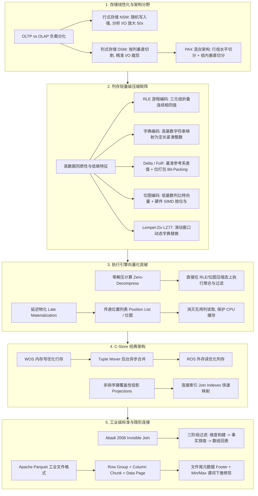

# Lec 10 分析型数据库：列式存储

## TL;DR

- **OLAP 与列存革命**：针对分析型查询只访问宽表中少数列的特征，列式存储（DSM）通过一维存储的物理分解消除 90% 以上无效 I/O，并利用数据高同质性实现 3~10 倍的高压缩比。
- **向量化与零解压计算**：利用 RLE、字典编码、Frame of Reference 与位图编码，现代列式引擎可直接在压缩数据上执行谓词过滤与聚合计算，推迟物化以减少缓存污染。
- **C-Store 双引擎与多重投影**：引入内存写优化存储（WOS）与外存读优化存储（ROS），结合后台 Tuple Mover 异步合并，并通过不同排序列的覆盖性投影与连接索引兼顾写入与查询效率。
- **Invisible Join 与工业级 Parquet**：星型模型下隐形连接通过三阶段位图过滤消除无序元组构造开销；Apache Parquet 以行组、列块与页级元数据实现零 I/O 谓词下推修剪。
---

## 架构演进与核心洞察

::: insight 字典编码带来的查询下推质变
字典编码不仅削减了物理存储空间，更彻底重构了算子的执行性能。
当 SQL 中包含条件过滤 `WHERE state = 'California'` 时，优化器在扫描前首先查询字典表，获取 `'California'` 的整数编码（例如 `ID = 2`）。
在后续扫描整个列的几千万行数据时，执行引擎不需要对每个字符串调用昂贵的 `memcmp` 逐字节比对，而是**将其退化为 CPU 单周期完成的原生整数比较指令**：
$$\text{Predicate Check}: \quad \text{code} == 2$$
这不仅提升了分支预测准确率，还使得单条 SIMD 向量化指令能够一次并行比对 16 个或 32 个数据项。
:::

## 课前阅读与文献研读 (Reading Assignment)

> 本讲核心必读文献。VLDB 2005 经典开山之作，深入理解面向 OLAP 分析型场景的列式存储内核、RS/WS 冷热分离双引擎架构、游程编码（RLE）与延迟物化（Late Materialization）极致性能优化。  
> 📖 **文献研读入口**：[必读论文精读：C-Store：列式存储数据库架构开山之作](./paper/cstore_column_store.md)

## 核心机制与讲义正文

> [!TIP] **[待补截图]** 建议截取官方课件 Slides 第 10 讲中关于“列存游程编码（RLE）与延迟物化（Late Materialization）行号拼接对比图”。此处预留插图空间。

## 1. OLTP 与 OLAP 的世纪分野与存储线性化

在现代数据库体系结构演进中，业务负载的物理特征分化促成了系统架构的深刻分野。根据数据访问模式、更新频率与计算特征，数据库系统被划分为两大典型阵营：面向事务处理的联机事务处理（OLTP, Online Transaction Processing）与面向分析决策的联机分析处理（OLAP, Online Analytical Processing）。

| 评估维度 | 事务型业务（OLTP） | 分析型业务（OLAP） |
| :--- | :--- | :--- |
| **核心业务目标** | 电商下单、银行转账、高频点查 | 商业智能（BI）、报表聚合、趋势洞察 |
| **查询读写模式** | 读写密集，高频并发单行更新与随机写 | 批量导入，近乎 100% 读密集型全表扫描 |
| **单次访问数据量** | 精准点查单行或数十行关联记录 | 单个查询扫描数千万乃至数十亿条记录 |
| **字段访问宽度** | 访问元组的几乎所有列（宽行全字段） | 访问超宽表（100+ 列）中的 2~4 个列 |
| **查询延迟敏感度** | 毫秒级乃至亚毫秒级（低延迟高并发） | 秒级至分钟级（高吞吐量与大带宽） |
| **数据建模范式** | 严格遵循 3NF / BCNF 规范消除冗余 | 星型模型（Star Schema）或雪花模型（Snowflake） |

### 1.1 现实世界的超宽事实表与 I/O 放大危机

在经典数据仓库建模中，系统通常采用星型模型：核心是记录业务流水的大型**事实表（Fact Table）**，周围环绕着描述维度的**维度表（Dimension Tables）**。为了避免在复杂的多表连接中消耗计算资源，数据仓库中的事实表通常被设计得极度宽泛，包含数以百计的维度外键、度量指标与打标状态。

例如，在麻省理工学院（MIT）讲座中引用的 Cambridge Mobile Telematics（CMT）实际车载物联网数据仓库中，核心表的列数分布展现了典型的超宽特征：

| 数据仓库核心表 | 物理列数（Column Count） | 典型查询涉及列数 |
| :--- | :--- | :--- |
| **表 $t_1$** | 251 列 | 4 ~ 5 列 |
| **表 $t_2$** | 248 列 | 4 ~ 5 列 |
| **表 $t_3$** | 134 列 | 3 ~ 5 列 |
| **表 $t_4$** | 107 列 | 2 ~ 4 列 |
| **表 $t_5 \sim t_{10}$** | 45 ~ 87 列 | 2 ~ 4 列 |

生产监控表明，高频查询几乎全部集中在排名前两至三张超宽表上，且平均每个查询仅需提取其中 4 到 5 个字段。物理存储介质（无论是传统机械磁盘、NVMe SSD 还是 DRAM 内存）在底层均表现为连续的一维物理地址空间，数据以固定大小的页面（4KB、8KB 或 16KB）为单元从外存调度到缓存。关系模型的二维网格必须以某种方式被映射到一维地址线上，这被称为**存储线性化（Storage Linearization）**。

### 1.2 行式存储（NSM）在分析负载中的性能崩溃

传统的行式存储模型被称为 **N-ary Storage Model (NSM)**。它将单个元组的所有属性依次紧邻排列，存放在同一个物理页内：

```text
一维磁盘空间排布 (NSM / Row Store):
[元组1: GM, 30.77, 1000, 2026-01-17] [元组2: GM, 30.78, 1200, 2026-01-17] [元组3: AAPL, 185.50, 9000, 2026-01-17] ...
```

在行式排布下，追加一条完整记录只需要定位到最后一个物理页并顺次写入，具备出色的单行写入速度。然而在 OLAP 场景下，这种结构会引发致命的 I/O 放大：

::: pitfall 行存全表扫描时的带宽与缓存污染灾难
设某电商事实表包含 200 个字段，单行宽度为 1000 字节，整表包含 $10^8$ 行数据（总量 100 GB）。执行聚合查询 `SELECT AVG(price) FROM Sales;` 时，引擎只需要扫描 4 字节的浮点数字段 `price`。
在行式存储中，由于字段紧密绑定在行内，操作系统和数据库缓存池必须将整张表的所有 1000 字节数据页全部从磁盘搬运到内存。
此时的有效读取带宽比率为：
$$\eta = \frac{4 \text{ Bytes}}{1000 \text{ Bytes}} = 0.4\%$$
这意味着高达 **99.6%** 的磁盘 I/O 带宽、总线传输能力与 CPU L1/L2/L3 缓存行，被完全无关的 199 个列彻底填满并污染！在 CMT 仓库中，行式存储带来了整整 50 倍（$200/4 = 50\times$）的无效开销。
:::

### 1.3 列式存储（DSM）与 PAX 混合架构

为了彻底消除分析负载下的无效带宽损耗，数据库架构师提出了**分解存储模型（Decomposition Storage Model, DSM）**，即纯粹的列式存储（Column Store）。列存系统将同一列的所有数值独立聚集存储在一维空间中：

```text
一维磁盘空间排布 (DSM / Column Store):
symbol 列数组: [ GM,    GM,    AAPL,   MSFT,   ... ]
price  列数组: [ 30.77, 30.78, 185.50, 420.10, ... ]
volume 列数组: [ 1000,  1200,  9000,   5000,   ... ]
date   列数组: [ 01-17, 01-17, 01-17,  01-17,  ... ]
```

当执行相同查询 `SELECT AVG(price) FROM Sales;` 时，列式引擎在物理层面只定位并连续扫描存储 `price` 数组的物理文件或数据块。其余 199 列对应的存储完全不产生任何 I/O 操作，读取的数据量从 100 GB 骤降至 400 MB，瞬间实现 250 倍的 I/O 吞吐提升。

为了在单个物理页内同时平衡行存的局部性与列存的扫描效率，Ailamaki 等人在 2001 年提出了 **PAX（Partition Attributes Across）** 架构。PAX 在宏观上按行对数据进行水平分块（生成行组 Row Group），而在每个行组内部，则将不同属性垂直分割为独立的列微块（Mini-blocks）。这一思想直接启发了当今大数据工业界 Apache Parquet 与 ORC 存储格式的分层设计。

---

## 2. 列存轻量级压缩算法矩阵与数学原理

列式存储不仅具备精准裁剪无效列的能力，更带来了颠覆性的**压缩比增益**。在传统行存中，相邻字节分别属于字符串、浮点数、布尔值与时间戳，数据熵极高且几乎无局部相关性；而在列式存储中，同一列数据拥有完全相同的数据类型、相近的值域范围以及高度的偏斜特征（Skewness），这为轻量级无损压缩提供了理想的温床。

| 压缩算法 | 核心编码机制与数学表达 | 典型解码复杂度 | 最优适用数据形态 |
| :--- | :--- | :--- | :--- |
| **游程编码 (RLE)** | 连续相同项压缩为三元组 $\langle v, f, n \rangle$ | $O(1)$ 跳跃扫描 | 排序后的列、大量连续重复值 |
| **字典编码 (Dictionary)** | 将高基数字符串映射为短定宽整数键 $k \in [0, 2^B-1]$ | $O(1)$ 数组寻址 | 中低基数字符串列（省份、状态） |
| **基准参考系 (FoR / Delta)** | 存储与基准值的差值 $\Delta_i = x_i - x_{\min}$ | $O(1)$ 加法与位移 | 单调递增序列、时间戳、密集整数 |
| **位打包 (Bit-Packing)** | 抛弃字节对齐，按 $\lceil \log_2(V_{\max}+1) \rceil$ 紧凑存储 | SIMD 并行展开 | 紧凑小整数集合（如取值 0~100） |
| **位图编码 (Bitmap)** | 每个唯一值维护一个长度为 $N$ 的布尔向量 | 硬件按位运算 | 极低基数列（性别、枚举状态） |
| **Lempel-Ziv (LZ77)** | 动态构建滑动窗口字符串字典并替换历史引用 | 流式解压开销中等 | 无序长文本、非结构化备注字段 |

### 2.1 游程编码（Run-Length Encoding / RLE）

当一列数据经过排序或具有极高聚集性时，相同的值会连续出现成百上千次。RLE 将这一连续的值序列（Run）压缩为一个定宽记录。
在 C-Store 系统中，RLE 记录被严格形式化为三元组：
$$\text{Run} = \langle v, f, n \rangle$$
其中：
- $v$（Value）：当前连续区间的数据值；
- $f$（First Position）：该连续段在整个逻辑列中的起始行偏移序号（从 1 开始）；
- $n$（Length）：该数值连续重复出现的总行数。

例如，股票代码列存储了 1,000,000 行高频交易，前 400,000 行全部为 `'GM'`，紧随其后的是 600,000 行 `'AAPL'`：
$$\text{原始存储} = 1,000,000 \times 8 \text{ 字节} = 8 \text{ MB}$$
$$\text{RLE 编码} = \left[ \langle \text{'GM'}, 1, 400000 \rangle, \langle \text{'AAPL'}, 400001, 600000 \rangle \right] \approx 2 \times 24 \text{ 字节} = 48 \text{ 字节}$$
数据压缩比超过 **160,000:1**。同时，由于三元组直接内嵌了起始序号与长度，引擎在处理位置点查时能够借助二分查找或 B 树在 $O(\log K)$ 复杂度内完成定位，其中 $K$ 为唯一游程数量。

### 2.2 字典编码（Dictionary Compression）

在现实数仓中，维度属性通常为长字符串（如客户国籍 `'CHINA'`、交易状态 `'TRANSACTION_COMPLETED'`），单个值常占用 10 至 30 字节。
字典编码在列数据块头部维护一个有序映射表 $D$，将出现过的唯一字符串映射为紧凑的定长无符号整数代号（Code）：
$$D: S \to \{0, 1, \dots, |D|-1\}$$
如果一列中不同状态的唯一数量为 $|D| = 12$，则只需使用 $\lceil \log_2 12 \rceil = 4$ 个二进制位（半字节）即可表示每一个元组的值。

::: insight 字典编码带来的查询下推质变
字典编码不仅削减了物理存储空间，更彻底重构了算子的执行性能。
当 SQL 中包含条件过滤 `WHERE state = 'California'` 时，优化器在扫描前首先查询字典表，获取 `'California'` 的整数编码（例如 `ID = 2`）。
在后续扫描整个列的几千万行数据时，执行引擎不需要对每个字符串调用昂贵的 `memcmp` 逐字节比对，而是**将其退化为 CPU 单周期完成的原生整数比较指令**：
$$\text{Predicate Check}: \quad \text{code} == 2$$
这不仅提升了分支预测准确率，还使得单条 SIMD 向量化指令能够一次并行比对 16 个或 32 个数据项。
:::

### 2.3 基准参考系（Frame of Reference / FoR）与差值编码

对于连续记录的时间戳、自增主键或传感器读数，数值本身往往很大，但相邻数值之间的差异却很小。
基准参考系（FoR）首先确定该数据块内的最小值 $Base = x_{\min}$，然后将每个数值重写为相对于基准值的非负偏移量：
$$\Delta_i = x_i - Base, \quad \Delta_i \in [0, x_{\max} - x_{\min}]$$
例如，记录毫秒级 UNIX 时间戳的列包含如下 4 个数据点：
$$X = [1700000002, 1700000005, 1700000011, 1700000015]$$
若以原始 64 位整型（8 字节）存储，共需 32 字节。
采用 FoR 方案，选取基准值 $Base = 1700000000$，偏移量序列转换为：
$$\Delta = [2, 5, 11, 15]$$
由于最大偏移量为 15，只需使用 4 个比特（4 bits）即可精确表达每一个数。结合位打包（Bit-Packing）技术，原本占用 256 比特的数据被压缩到 $64 + 4 \times 4 = 80$ 比特，空间节省了 **68.75%**。

### 2.4 位图编码（Bitmap Encoding）

位图编码主要应用于基数较低（Low Cardinality）的离散列（如支付渠道、性别、审批阶段）。
对于包含 $C$ 个不同取值的列，位图编码构建 $C$ 个长度等于表总行数 $N$ 的比特向量（Bit Vector）。
在向量 $B_c$ 中，当且仅当第 $i$ 行元组的值等于第 $c$ 个唯一值时，该位被置为 1，其余全为 0：
$$B_c[i] = \begin{cases} 1, & \text{if } Col[i] = v_c \\ 0, & \text{otherwise} \end{cases}$$

```text
行号序号:        0   1   2   3   4   5   6   7
原始状态列:    [ S,  F,  S,  P,  S,  F,  P,  S ]  (S: Success, F: Failed, P: Pending)

Bitmap(S):     [ 1,  0,  1,  0,  1,  0,  0,  1 ]  (仅用 8 bits)
Bitmap(F):     [ 0,  1,  0,  0,  0,  1,  0,  0 ]  (仅用 8 bits)
Bitmap(P):     [ 0,  0,  0,  1,  0,  0,  1,  0 ]  (仅用 8 bits)
```

位图编码在执行复杂多条件布尔过滤时具备硬件级的计算优势。例如执行查询：
`WHERE status = 'SUCCESS' AND payment_method = 'ALIPAY'`
列存引擎直接取出 `Bitmap(status='SUCCESS')` 与 `Bitmap(payment='ALIPAY')`，直接调用 CPU 的 64 位整数按位与指令（`uint64_t & uint64_t`）或 AVX-512 向量化指令（`_mm512_and_si512`）。单个 CPU 时钟周期即可并行判定 512 行元组的筛选条件。

### 2.5 通用字典压缩：Lempel-Ziv (LZ77) 算法与滑动窗口推演

当数据列包含较长且缺乏固定模式的字符串（如日志信息、用户备注、半结构化 JSON 片段）时，简单的定宽数值位打包或单一静态字典往往无法处理高度动态变化的词汇空间。在此类工况下，现代列存系统通常回退到通用的无损自适应字典压缩算法——以 Lempel-Ziv 系列（LZ77、LZ4、ZSTD、Snappy）为核心的流式压缩引擎。

LZ77 的核心工程原理基于信息论中的上下文局部性原理：在一个大型连续字节流中，近期出现过的字符序列具有极高概率在随后的数据中重复出现。算法维护一个逻辑上的滑动窗口（Sliding Window），包含保存历史已处理数据的**搜索缓冲区（Search Buffer）**与保存当前待处理输入的**先行缓冲区（Lookahead Buffer）**。每当在先行缓冲区中探索到与历史搜索缓冲区匹配的最长子串时，算法不再重复输出这些字符，而是将其替换为一个简短的引用标记：
$$\text{Reference Token} = \langle \text{Offset}, \text{Length} \rangle$$
其中 $\text{Offset}$ 表示向历史窗口回退寻找匹配起点的距离，$\text{Length}$ 表示匹配子串的长度。

以下完整再现 MIT 6.5830 官方讲义（Slide 28~46）展示的 Lempel-Ziv 算法推演过程。
设输入字符串流为长度 15 的字符序列：
$$\text{Stream} = \text{AAPLAAPLIBMAAPL}$$
初始状态下，字典预装全部单字符码表：
$$A \to 1, \quad B \to 2, \quad \dots, \quad I \to 9, \quad \dots, \quad L \to 12, \quad M \to 13, \quad \dots, \quad P \to 16$$

```text
Lempel-Ziv 动态建典与输出流转表:
+------+----------+----------+--------------------+-----------------------------+
| 步骤 | 输入字符 | 匹配前缀 | 编码输出 (Tokens)  | 动态加入字典的新条目        |
+------+----------+----------+--------------------+-----------------------------+
| 1    | A        | A        | 1                  | (等待下一个字符探索新前缀)  |
| 2    | A        | A        | 1                  | AA -> 27                    |
| 3    | P        | P        | 16                 | AP -> 28                    |
| 4    | L        | L        | 12                 | PL -> 29                    |
| 5    | A        | A        | -                  | LA -> 30                    |
| 6    | AP       | AA       | 27 (匹配历史 AA)   | AAP -> 31                   |
| 7    | L        | PL       | 29 (匹配历史 PL)   | PLI -> 32                   |
| 8    | I        | I        | 9                  | LI -> 33                    |
| 9    | B        | B        | 2                  | IB -> 34                    |
| 10   | M        | M        | 13                 | BM -> 35                    |
| 11   | A        | A        | -                  | MA -> 36                    |
| 12   | APL      | AAP      | 31 (匹配历史 AAP)  | AAPL -> 37                  |
| 13   | L        | L        | 12                 | -                           |
+------+----------+----------+--------------------+-----------------------------+
```

经过全流程扫描，原始 15 个符号被压缩为 11 个输出标记（Token）：
$$\text{Output Tokens} = [ 1, 1, 16, 12, 27, 29, 9, 2, 13, 31, 12 ]$$

在推演初期，前 4 个字符 `AAPL` 并没有出现过重复模式，因此编码器只能以基础字符代码输出 `[1, 1, 16, 12]`，但在此过程中，动态字典自动登记了组合模式 `AA(27)`、`AP(28)` 和 `PL(29)`。当扫描指针推进到第 6 步再次遇到 `AAP` 时，算法直接识别出历史模式 `AA` 并输出 `27`，同时创建更长的模式 `AAP(31)`。到第 12 步再次出现 `AAPL` 时，算法命中 `AAP` 输出 `31`，并顺理成章将完整词组 `AAPL` 登记为编号 `37`。

随着后续文本规模持续扩张，一旦文本中出现任何一次股票代码 `'AAPL'`，系统只需吐出紧凑的整数代号 `37`。原始 4 字节的英文字符开销被压制为单字节引用。随后，生成的整数代号流会被送入二级霍夫曼编码（Huffman Coding）或有限状态熵编码（FSE），使得出现频次极高的代号占用更短的比特位宽，实现理论极限的高压缩率。

---

## 3. 直接在压缩数据上计算与物化策略大决战

传统数据库在使用压缩技术时存在一个长期的认知误区：仅仅将压缩视为一种节省外存磁盘空间的被动手段。数据从磁盘读取至内存缓冲池后，算子必须立刻对其进行全量解压还原为原始未压缩格式，随后再送入查询计划执行。这种方案虽然节省了磁盘 I/O，但加剧了 CPU 解压算力负担，且未压缩的膨胀数据依然在缓存与总线之间造成严重拥堵。

### 3.1 零解压计算（Zero-Decompress Computing / Direct Execution）

图灵奖得主 Michael Stonebraker 与 Daniel Abadi 等人在 C-Store 项目中提出了颠覆性的设计原则：**查询执行引擎应当直接在压缩态数据上进行计算，彻底消灭运行时的解压开销！**

例如，对一个采用了 RLE 编码的列执行聚合统计查询：
```sql
SELECT COUNT(*) FROM Trades WHERE symbol = 'GM';
```
在 RLE 存储中，数据被紧凑记录为 $\langle \text{'GM'}, 1, 400000 \rangle$。
- **传统行存解压做法**：在内存中分配空间，将该游程循环展开解压为 400,000 个连续的 `'GM'` 字符串指针，然后由聚合算子循环迭代 400,000 次执行累加计数。
- **C-Store 零解压做法**：过滤算子直接比对三元组的值字段，命中 `'GM'` 后，直接读取其长度字段 $n = 400000$ 并输出给聚合算子。执行器仅执行一次简单的整数加法（`count += 400000`），**在 1 个 CPU 指令周期内完成了四十万次逻辑元组的计算**！

### 3.2 早期物化 vs 延迟物化

由于列存将同一行的不同字段拆分保存在相互独立的数组文件中，当查询最终需要返回多个字段（例如 `SELECT symbol, price, volume`）时，系统必须将分散在各处的列属性重新“拼合”成完整的行记录。这一过程在学术界被称为**物化（Tuple Materialization）**。物化时机的选择直接决定了系统的吞吐上限与资源瓶颈。

在硬件层面上，物化操作的本质是跨内存缓冲区的随机数据收集与重新排布。若在查询初期过早进行元组构造，系统不仅需要为数百万甚至上亿个中间行分配连续的堆内存空间，还会因为宽行对象的膨胀迅速冲垮 CPU 的 L1/L2 数据缓存；相反，若将物化推迟到谓词过滤与聚合计算之后，流经执行流水线的数据量将呈现指数级缩减。在现代分析型数据库内核中，物化时机主要划分为早期物化与延迟物化两种截然不同的执行路线：

```text
早期物化 (Early Materialization / 传统过渡方案):
               [ Scan symbol ]   [ Scan price ]   [ Scan date ]
                      \                |                /
                       +---------------+---------------+
                                       |
                                [ 立即拼装完整行 ]  <-- 致命瓶颈! (内存中实例化数百万个宽行对象)
                                       |
                                [ Filter: sym='GM' ]
                                       |
                                [ Filter: date='1/17' ]
                                       |
                                  [ AVG(price) ]
```

在早期物化方案中，系统在从磁盘或外存读取各个所需列之后，**立刻**根据各列在数组中的相同偏移位置执行跨列组装，在内存中动态分配并实例化出完整的行式元组结构体（C++ Object 或 Tuple 内存块）。完成拼装后，执行引擎退化为传统的火山模型迭代器，上层的过滤算子和聚合算子完全在宽行对象上迭代计算。

这种早期拼装机制在工程实现上最为直接，因为它使得现有的行式查询执行引擎（如基于火山模型的迭代器代码库）能够以极小的改动直接复用。然而，这种妥协抹杀了列存的核心红利：如果一个包含 1000 万行的表上有多个高选择性谓词，早期物化会在内存中预先创建 1000 万个完整的元组对象，随后被第一道过滤算子无情抛弃 99% 以上。这不仅耗费了极其昂贵的内存分配（）与内存拷贝开销，更导致 CPU 缓存被完全无用的废弃行占满。

```text
延迟物化 (Late Materialization / C-Store 核心王牌):
          [ Scan symbol ]                [ Scan date ]
                 |                              |
          (Pos.SELECT 'GM')              (Pos.SELECT '1/17')
                 |                              |
      [ 生成位置位图 (1,1,1,0) ]       [ 生成位置位图 (1,1,1,1) ]
                 \                              /
                  +--------------+-------------+
                                 | (SIMD 按位与: AND)
                        [ 最终命中位置列表: <1, 2, 3> ]
                                 |
                        [ 仅按位置列表点查 price 列 ]
                                 |
                            [ AVG(price) ]
```

在延迟物化方案中，查询执行的全流程始终维持着严谨的列式形态与向量流转。系统坚决不在中间算子间传递膨胀的宽行，而是以极度紧凑的行偏移位置数组（Position List）或位图向量作为通用通信协议：
1. **谓词独立并发过滤**：针对 `symbol` 列与 `date` 列分别独立扫描，生成紧凑的**位置列表（Position List）**或 0/1 位图（Bitmap）；
2. **高速位图交集**：利用 SIMD 指令对多个谓词生成的位置位图执行按位与运算，得到最终满足全部条件的行序号；
3. **按需精准点查**：下游的 `AVG(price)` 算子直接拿着最终的位置序号列表，去 `price` 数组中仅读取命中位置的浮点数值，未命中行的数据根本不会被读取；
4. **延迟至最后一刻**：只有当查询最终需要向客户端输出多列结果时，才在输出序列化层执行行组装。

从数学代价模型来看，设输入总行数为 $N$，涉及列集合为 $\{C_1, C_2, \dots, C_k\}$，各列独立选择度为 $\sigma_1, \sigma_2, \dots, \sigma_k$。在早期物化下，元组构造的代价为 $O(N \cdot k)$；而在延迟物化下，若按照选择度由小到大评估谓词，第 $i$ 列仅需处理 $N \cdot \prod_{j=1}^{i-1} \sigma_j$ 个位置索引，总代价降低为 $O(N \cdot (\sigma_1 + \sigma_1\sigma_2 + \dots))$。当选择度较低时，总内存搬运量呈现几何级数暴跌。

### 3.3 延迟物化的核心工程优势

对比两种物化机制，延迟物化展现了三大压倒性的系统层优势：
- **完全避免无用列的内存与 I/O 拷贝**：若第一层过滤条件筛掉了 99% 的数据，则第三列数据只需发生 1% 的读取与解压缩，节省了 99% 的无用计算；
- **CPU 缓存零污染**：管道中流转的全部是密集打包的 32 位整型位置序号或布尔比特位，L1/L2 数据缓存命中率接近 100%，CPU 指令流水线极少发生停顿；
- **算子与压缩编码无缝协同**：算子在传递位置列表时能够直接维持游程（RLE）格式，使得后续算子能够继续享受“零解压”运算的红利。

---

## 4. MIT 课堂精要：列式压缩选型实战解析

在麻省理工学院 6.5830 课堂互动的 Study Break（Slide 54）中，教授给出了 5 种典型工业生产列的数据特征，要求根据其数学分布与访问行为设计最优压缩方案。

::: definition 随堂实战题：5 大典型列的物理压缩方案决策
针对以下 5 种特定数据分布的列，给出推荐的压缩算法并论证系统层收益：
1. **取值在 $[0, 100]$ 之间的无序整数列**；
2. **大致有序（Mostly Sorted）的任意字符串列**；
3. **大致有序（Mostly Sorted）且取值在 $[0, 10]$ 之间的小整数列**；
4. **严格排序的连续浮点数列**；
5. **极低基数（Few Unique Values）的离散状态列**。
:::

### 4.1 方案论证与内核分析

针对上述 5 大工业场景，列式存储引擎的设计决策与性能依据如下：

1. **场景 1：无序整数 $[0, 100]$ $\to$ 推荐：位打包（Bit-Packing）或基准参考系（FoR）**
   - **理论依据**：由于数据无序，连续相同值的游程（Run）极短，RLE 编码不仅无法压缩反而会因元数据开销导致空间膨胀；
   - **位宽计算**：该列的最大取值为 100，满足 $100 < 2^7 = 128$。因此，每个数值仅需严格的 **7 个比特（7 bits）**即可无损表示。相较于标准 32 位整型（4 字节），空间直接节约 **78.1%**，且解压过程可通过 SIMD 指令批量位移并行展开。
2. **场景 2：大致有序的任意字符串 $\to$ 推荐：字典编码（Dictionary）结合 Lempel-Ziv（LZ）**
   - **理论依据**：由于字符串长度与内容任意，无法直接应用数值位打包。但由于列大致有序，相邻元组的前缀与模式具有高度局部性；
   - **工程实现**：首先建立全局/局部字典，将重复的高频字符串转换为整型代号；对于长尾无规则字符串，利用 LZ77 的滑动窗口动态捕捉重复字符子串。
3. **场景 3：大致有序且范围 $[0, 10]$ 的小整数 $\to$ 推荐：游程编码（RLE）**
   - **理论依据**：值域极其狭窄（仅 11 种可能）且整体大致有序，这意味着相同数值必然形成数千乃至数万行长距离的连续聚集（Long Runs）；
   - **存储效率**：原本数十万行的数据会被折叠为极少数三元组 $\langle v, f, n \rangle$，压缩比极易突破 95% 以上，且支持直接进行零解压过滤。
4. **场景 4：严格排序的连续浮点数列 $\to$ 推荐：差值编码（Delta / FoR）**
   - **理论依据**：浮点数遵循 IEEE 754 标准，包含符号位、阶码与尾数，直接通用压缩效果极差。但在严格排序下，相邻浮点数之差 $\Delta_i = x_i - x_{i-1}$ 极其微小且分布平稳；
   - **扩展演进**：现代引擎对浮点数差值进一步实施 XOR 异或编码（如 Gorilla 压缩算法），能够大幅消除尾数中的高频零比特。
5. **场景 5：极低基数的离散状态列 $\to$ 推荐：位图编码（Bitmap Encoding）**
   - **理论依据**：当唯一值数量极少（如枚举值 2~5 个）时，构建位图所耗费的存储极小（单列仅占 $N$ bits）；
   - **运算红利**：生成的位图可直接用于延迟物化流水线中的硬件按位操作，为复合查询提供极致的向量化吞吐。

---

## 5. C-Store 经典架构哲学：破解列存写入死穴

列式存储在读分析场景中表现卓越，但其物理结构天生存在一个致命阿喀琉斯之踵：**极度厌恶随机写入与单行插入更新**。
在传统行存中，插入一条包含 100 个字段的记录只需向磁盘某个物理数据页末尾追加一段连续字节（1 次 I/O）；但在纯列存中，这 100 个属性被分散在 100 个完全不同的物理文件中，单行插入意味着系统必须对外存执行 **100 次离散寻道与小数据块写入**，写入吞吐瞬间暴跌两个数量级以上。

### 5.1 双引擎破局：WOS、ROS 与 Tuple Mover

为了在纯列存架构下兼顾分析性能与高并发写入更新，Stonebraker 等人在 C-Store 中提出了著名的双存储引擎架构：


C-Store 将系统划分为四个协同运转的核心子系统：
1. **写优化存储（Write-Optimized Store, WOS）**：
   - 完全常驻内存的行式存储引擎，支持高并发的单行写入、修改与删除；
   - 插入事务以极低延迟快速写入 WOS，保障数据不丢失并立即对事务可见；
2. **读优化存储（Read-Optimized Store, ROS）**：
   - 外存上只读、紧凑排列、高压缩比的纯列式存储结构；
   - 承担全系统 99% 的海量分析扫描负载；
3. **元组搬运工（Tuple Mover）**：
   - 异步运行的后台守护进程。当 WOS 内存占用达到预设阈值时，Tuple Mover 批量扫描 WOS 中的数据，在内存中完成排序与列式切分，随后以大块顺序写的方式合并刷写到磁盘的 ROS 中；
4. **联合查询执行器（Federated Query Executor）**：
   - 对外呈现统一的 SQL 关系接口。用户查询下发时，执行器自动向 ROS 与 WOS 同时分发子计划，并将两部分结果在内存中做合并（Union），确保读写强一致性与数据的零延迟可见。

::: insight 架构寻根：现代 LSM-Tree 与数据湖 Lakehouse 的先驱
2005 年 C-Store 提出的 WOS/ROS/Tuple Mover 范式，深刻启迪了随后二十年整个现代数据系统的演化路径：
- **ClickHouse** 的 `MergeTree` 引擎通过内存 Buffer 写入，后台异步分段 Merge；
- **Apache Doris / StarRocks** 的前端 MemTable 缓存写与后台 Segment 列存落盘；
- **Apache Iceberg / Delta Lake** 的追加写 Parquet 与后台 Compaction 任务。
其底层核心逻辑无一例外均源自 C-Store 的冷热分层与批量合并哲学。
:::

### 5.2 物理投影（Projections）与多重排序键

传统行式关系数据库中，物理存储结构是逻辑表的直接镜像，一张逻辑表严格对应一个物理堆文件。而 C-Store 打破了逻辑表与物理存储的硬编码绑定，提出了**物理投影（Projections）**的概念：
- 物理投影是一组属性列的集合，它依附于某张逻辑锚表（Anchor Table），并包含该表的部分或全部属性；
- 每个投影指定一个明确的**排序键（Sort Key）**，投影内部的所有列严格按照该排序键的物理顺序排列；
- 同一张逻辑表可以预先建立多个拥有不同排序键的覆盖性物理投影。

例如，针对企业核心员工表 `EMP(name, age, salary, dept)`，C-Store 可以构建如下互为补充的物理投影：
```text
投影 1: EMP1(dept, age, salary | dept)   -- 按部门编号严格排序
投影 2: EMP2(name, salary, age  | salary) -- 按薪资数额严格排序
```
当用户查询 `SELECT AVG(salary) FROM EMP WHERE dept = 10` 时，优化器自动路由至投影 1 执行，由于数据已按 `dept` 排序，连续的部门记录能够形成超长的 RLE 游程，以极小 I/O 瞬间扫完；而当查询寻找最高薪资员工时，优化器则自动选择投影 2 扫描。

### 5.3 存储键与连接索引（Join Indexes）

为了支持跨不同投影重构逻辑元组，C-Store 提出了**存储键（Storage Key, SK）**与**连接索引（Join Index）**机制：
- 在只读的 ROS 中，存储键并不需要占用任何磁盘空间物理存储，它等价于该数值在列数组中的行号偏移量（$1, 2, 3, \dots$）；
- 当系统需要将按 `salary` 排序的投影与按 `age` 排序的投影进行字段关联拼接时，系统利用预先计算的连接索引记录映射关系。


连接索引本质上是一组二元组构成的映射列：
$$\text{JoinIndex} = \langle \text{Target\_SID}, \text{Target\_SK} \rangle$$
它逻辑上记录了“源投影中的第 $i$ 行数据，在目标投影中位于哪个数据段（SID）以及第几行（SK）”。通过遍历连接索引，执行器无需进行耗费巨大 CPU 算力的全表 Hash Join，即可像指针跳转一样快速重构完整跨投影元组。

---

## 6. 经典论文精析：列存与行存的本质较量（Abadi et al., VLDB 2008）

在列式数据库崛起初期，学术界与工业界曾引发了一场激烈的争论：**列存展现出的数十倍性能提升，究竟是源于“列式物理存储格式”本身，还是源自底层执行引擎针对列式数据所做的向量化计算重构？**
如果仅仅是因为行存读取了无用列，那么我们在成熟的传统行式存储系统（如 Oracle、PostgreSQL）上，通过物理设计模拟列存特性（例如将每列垂直拆分为两列表，或者在所有列上建索引），是否就能获得与 C-Store 相同的性能？

### 6.1 在行存中模拟列存的“三大物理设计”及其破灭

Daniel Abadi、Peter Boncz 与 Stavros Harizopoulos 等人在 VLDB 2008 发表的重磅论文中，在行式系统上系统性地测试了三种模拟列存的方案：
1. **完全垂直分区（Vertical Partitioning）**：
   - 将原表 $T(A, B, C)$ 垂直拆分为多张独立的物理双列表：$T_A(pos, A)$、$T_B(pos, B)$、$T_C(pos, C)$；
   - 结果：性能极其低下。传统行存为每行数据附加了沉重的**行头元数据（Tuple Header，通常 24 字节）**，导致存储体积膨胀数倍；且查询多列时必须在 `pos` 属性上执行昂贵的物理连接。
2. **仅索引计划（Index-Only Plans）**：
   - 在表的所有列上分别建立非聚簇 B+ 树辅助索引，查询只读取索引中的 `(Record-ID, Value)` 键值对而不回表；
   - 结果：依然落败。非聚簇 B+ 树索引为了支持在线修改保留了大量内部空洞，随机访问开销巨大，缺乏连续顺序扫描的高吞吐能力。
3. **物化视图（Materialized Views）**：
   - 针对每种查询类型预先固化生成包含所需列的物化视图；
   - 结果：虽然接近了列存的 I/O 量，但一旦脱离预定义工作负载便无法工作，且完全无法获得列存直接在压缩数据上执行的计算加速。

最终结论表明：**列存储的性能突破，是“列式物理排布”与“列式查询执行器（延迟物化、向量化块迭代、隐形连接）”深度结合的产物，仅改动存储层绝不可能复现其威力。**

### 6.2 星型模型基准（SSBM）与隐形连接（Invisible Join）

为了在纯粹的数据仓库工作负载下衡量列存性能，Abadi 等人采用了著名的 **Star Schema Benchmark (SSBM)**。


SSBM 包含一个拥有 17 个属性、规模因子可达数千万至数亿行的庞大事实表 `LINEORDER`，以及围绕其周边的 4 个维度表：`CUSTOMER`、`SUPPLIER`、`PART` 与 `DWDATE`。典型查询涉及在多个维度表上施加范围过滤，并与事实表关联后执行分组聚合：

```sql
SELECT c.nation, s.nation, d.year, SUM(lo.revenue) AS revenue
FROM customer AS c, lineorder AS lo, supplier AS s, dwdate AS d
WHERE lo.custkey = c.custkey
  AND lo.suppkey = s.suppkey
  AND lo.orderdate = d.datekey
  AND c.region = 'ASIA'
  AND s.region = 'ASIA'
  AND d.year >= 1992 AND d.year <= 1997
GROUP BY c.nation, s.nation, d.year
ORDER BY d.year ASC, revenue DESC;
```

针对此类星型模式查询，Abadi 等人提出了著名的**隐形连接（Invisible Join）**技术，将星型连接彻底重构为**三阶段位图过滤与延迟回表**过程。

#### 第一阶段：维度表谓词评估与哈希表构建


执行引擎首先并发扫描各小型维度表，应用本地过滤条件：
- 在 `Customer` 表上执行 `region = 'ASIA'`，提取所有符合条件的 `custkey` 集合并构建内存哈希表（或直接利用布隆过滤器）；
- 同理在 `Supplier` 上评估 `region = 'ASIA'`，在 `Date` 上评估年份范围，分别构建各维度的合法主键集合。

#### 第二阶段：事实表外键探查与位图交集提取


进入核心事实表处理阶段：
- 引擎按列顺序扫描事实表的外键列 `lo.custkey`，利用各元素的键值探查第一阶段建立的哈希表，生成表示事实表各行是否匹配的比特位图 $B_{\text{cust}}$；
- 紧接着顺序扫描 `lo.suppkey` 与 `lo.orderdate` 列，分别生成比特位图 $B_{\text{supp}}$ 与 $B_{\text{date}}$；
- 调用向量化指令将全部位图做按位与运算：
$$P = B_{\text{cust}} \ \mathbf{AND} \ B_{\text{supp}} \ \mathbf{AND} \ B_{\text{date}}$$
最终生成的位图 $P$（Position List）精确指明了整个事实表中同时满足全部维度约束的行序号集合。

#### 第三阶段：维度属性与度量按需提取


最后，引擎利用位图 $P$ 中的位置指示：
- 从事实表中仅按需读取命中行的 `revenue` 列，执行累加聚合；
- 从事实表中提取命中行的外键值，直接作为**数组物理下标（Array Offset Index）**，在纳秒级时间内回查维度表取出 `c.nation`、`s.nation` 与 `d.year`。
隐形连接完全消除了传统 Hash Join 构建庞大中间关联表与宽行元组的开销，使得星型多表连接达到了接近单表连续扫描的极致性能。

#### 进阶绝技：区间谓词重写（Between-Predicate Rewriting）

论文进一步指出，数据仓库中很多维度表的主键在逻辑上是连续且具备层级顺序的（例如时间维度的 `datekey` 按年份递增）。
若维度表过滤后留下的合法键是一个连续区间 $[19920101, 19971231]$，隐形连接优化器会自动触发**区间谓词重写**：
将外键列上的哈希表探查指令直接改写为紧凑的范围比较指令：
$$\text{Filter}: \quad 19920101 \le lo.orderdate \le 19971231$$
此时连哈希表内存寻址都被彻底省去，转化为单条 CPU 比较指令，执行效率再次飙升数倍。

---

## 7. 现代大数据工业级列存标准：Apache Parquet 与数据湖实践

在当今云原生、AI 与大数据分析领域，由 Twitter 与 Cloudera 联合开源的 **Apache Parquet** 已经成为跨引擎事实上的工业级列存物理文件格式标准。它不仅深度吸收了 C-Store 的列式压缩与延迟物化精髓，更借鉴了 Google Dremel 的嵌套数据切分模型，在通用文件系统与对象存储（如 AWS S3、腾讯云 COS）上实现了极致的分析吞吐。

现代分析型查询引擎（如 DuckDB、ClickHouse、Presto/Trino、Apache Spark 与 Snowflake）均将 Parquet 作为核心外部存储底座。其底层物理存储组织高度结构化，能够在不解压、不扫描全表的前提下，仅凭元数据便跳过绝大多数非目标数据块。

```text
Apache Parquet 物理文件分层结构:
+--------------------------------------------------------------------------+
|  4 字节文件头魔数: 'PAR1'                                                |
|  +--------------------------------------------------------------------+  |
|  | Row Group 1 (水平切分数据块，通常 128 MB ~ 1 GB，包含约百万行)     |  |
|  |  +--------------------------------------------------------------+  |  |
|  |  | Column Chunk 1 (属性 A 的所有数据，紧凑连续存放)             |  |  |
|  |  |   [ Page 1 (数据页，通常 1 MB，含头元数据、编码与压缩数据) ] |  |  |
|  |  |   [ Page 2 (数据页) ] ...                                    |  |  |
|  |  +--------------------------------------------------------------+  |  |
|  |  +--------------------------------------------------------------+  |  |
|  |  | Column Chunk 2 (属性 B 的所有数据)                           |  |  |
|  |  +--------------------------------------------------------------+  |  |
|  +--------------------------------------------------------------------+  |
|  +--------------------------------------------------------------------+  |
|  | Row Group 2 (下一个水平数据块)                                     |  |
|  +--------------------------------------------------------------------+  |
|  +--------------------------------------------------------------------+  |
|  | File Footer (文件尾部核心元数据字典，包含 Schema 与分块统计信息)   |  |
|  |  - 全局表模式定义 (Schema)                                         |  |
|  |  - 每个 Row Group 的起始偏移量与物理长度                           |  |
|  |  - 列级统计指标字典: [ Min, Max, Null_Count ]                      |  |
|  +--------------------------------------------------------------------+  |
|  4 字节文件尾长度 + 4 字节尾部魔数: 'PAR1'                               |
+--------------------------------------------------------------------------+
```

### 7.1 分层架构与物理划分

Parquet 的物理结构自顶向下分为四个核心层次，这种设计完美契合了现代分布式计算与大规模 I/O 调度的物理约束：
1. **行组（Row Group）**：
   在水平维度将整张表的数据切分为若干大型批次（典型大小为 128MB 至 1GB，对应数十万至数百万行）。行组是分布式计算引擎（如 Spark、Presto、DuckDB）进行并行任务切分的基本调度单元。由于单个 Row Group 大小远超传统数据库的 8KB 物理页，单次 I/O 能够充分填满磁盘带宽或对象存储的流式管道；
2. **列块（Column Chunk）**：
   在每个行组内部，同一个属性列的数据被物理连续地保存在一个列块中，支持单次连续大顺序读。若查询仅需访问表中的两三个列，引擎只需对该 Row Group 内部对应的两三个 Column Chunk 发起异步并行读取；
3. **数据页（Data Page）**：
   列块内部进一步拆分为大小约 1MB 的数据页。**Page 是 Parquet 实施字典编码、位打包与物理压缩（Snappy/ZSTD）的最小原子工作单元**。每个 Page 拥有独立的 Header 元数据，记录了该页采用的编码类型（如 `PLAIN_DICTIONARY`、`RLE`、`DELTA_BINARY_PACKED`）以及解压后的真实字节数；
4. **文件尾元数据（File Footer）**：
   Parquet 极为巧妙地将全文件的核心元数据放置在**文件最末端**。这种设计使得写入进程无需预先计算文件全貌，能够在流式写入全部数据块后，最终一次性刷写元数据。客户端在读取时，只需首先发送一次小型的 Range-Get 请求读取末尾几 KB 的元数据，即可洞悉全文件的行组数量、各列偏移量以及类型模式。

### 7.2 谓词下推与行组裁剪（Row Group Pruning）

Parquet 在 File Footer 与每个 Page 头部均显式固化了列统计信息：
$$\text{Metadata} = \left[ \min = 100, \quad \max = 500, \quad \text{null\_count} = 0 \right]$$

当查询引擎（如 DuckDB、ClickHouse、Spark SQL）执行包含过滤条件的查询时：
```sql
SELECT user_id, amount FROM Orders WHERE amount > 10000;
```
引擎读取流程展现了惊人的效率：
1. 执行引擎首先发起一次微小的范围读取（Range Read），拉取文件尾部仅数 KB 的 File Footer 元数据；
2. 引擎检查 Row Group 1 的元数据，发现该行组中 `amount` 列的统计指标为 $\max = 5000$；
3. 由于 $5000 < 10000$，优化器断定该行组不可能包含任何符合条件的元组。**执行器直接跳过这整个 512MB 的 Row Group，不进行任何物理 I/O 读取！**

在 MIT 官方给出的 Pandas 基准测试中：
```python
# 传统低效全量读取
df_csv = pd.read_csv('trades.csv')  # 耗时极长，全量解析文本

# 现代 Parquet 谓词裁剪与列投影
df_pq = pd.read_parquet('trades.parquet', columns=['price', 'symbol'])
```
相比传统文本格式或行存文件，Parquet 凭借**列投影（Projection）与行组裁剪（Pruning）**的双重威力，在分析型基准中斩获了 **47 倍以上**的端到端吞吐加速。

---

## 8. 学术前沿与深度思考题

深入探讨列式存储与现代硬件体系架构的协同演化，能够帮助工程师在更深层次上理解分析型数据库的本质。以下提供三道具有代表性的学术思考题：

::: insight 思考题 1：现代 NVMe SSD 寻道延迟大幅降低，传统列存的延迟物化优势是否依然存在？
**深度剖析**：
机械磁盘时代随机 I/O 寻道时间高达 10ms，而现代 NVMe SSD 的随机读取延迟已经压缩至 10~50 微秒，且 4KB 随机点查的 IOPS 突破数百万。
然而，延迟物化（Late Materialization）的核心收益不仅体现在外存磁盘 I/O 层面，更体现在 **CPU 缓存流水线与总线带宽** 层面：
1. 宽行元组如果在过滤前拼装，其体积往往会瞬间超过 CPU L1/L2 缓存容量（32KB~512KB），导致严重的 Cacheline 颠簸与换出；
2. 延迟物化在管道中流转的是紧凑的 32-bit 行号或比特位，这使得单条 SIMD 向量化指令能够在单时钟周期内处理几十个数据项；
3. 即使在内存数据库中，内存总线带宽（约 100~300 GB/s）依然远远落后于 CPU 算力吞吐。延迟物化大幅减少了在内存总线上传输的无效字段，因此在全内存计算时代依然是性能分水岭。
:::

::: insight 思考题 2：C-Store 物理投影的多排序键冗余存储，与现代 LSM-Tree 存储引擎相比各有哪些工程取舍？
**深度剖析**：
- **C-Store 物理投影模型**：
  - *优势*：读性能达到极限。不同维度的查询均能命中完美匹配自身排序键的物理投影，实现最大化的 RLE 压缩比与顺序扫描吞吐；同时多份投影天然满足高可用容灾（K-safety）。
  - *代价*：写放大极为严重。写入新元组时，系统必须同步更新锚表关联的全部投影，后台 Tuple Mover 需要向多个不同排序键的数据段分别执行合并与重排序，存储空间开销按投影数量成倍增加。
- **现代 LSM-Tree 列存湖仓（如 ClickHouse / Iceberg）**：
  - *优势*：通常只保留一份主键排序的主存储结构，写入极其轻量，全部为单点顺序追加；
  - *代价*：如果查询过滤字段不是主排序列，系统无法享受 RLE 压缩红利，必须依赖辅助跳表索引（Skip Index）或二级位图索引进行粗粒度数据过滤。
:::

::: insight 思考题 3：隐形连接中的“区间谓词重写”在何种数据分布下会面临退化？现代系统如何防范此类退化？
**深度剖析**：
- *退化工况*：当维度表经过过滤后的合法主键集合在空间上**高度离散、稀疏分布**时（例如过滤结果为 ID 散落在 $[1, 10^7]$ 范围内的 10 个随机数字），区间谓词重写将区间范围放宽为 $1 \le ID \le 10^7$，导致大量原本不符合条件的中间事实行被误判为命中，使得过滤选择度急剧恶化，引发大量无用回表。
- *工程防范机制*：
  1. **运行时阈值校验**：优化器在重写前评估有效区间内合法键的**覆盖密度（Density）**：
     $$\text{Density} = \frac{|\text{Valid Keys}|}{\max(\text{Key}) - \min(\text{Key}) + 1}$$
     只有当密度 $\text{Density} > 0.8$ 时才允许改写为区间比较，否则安全回退至哈希查找或位图探查；
  2. **局部字典序重映射（Order-Preserving Dictionary Encoding）**：在数据入库阶段为维度属性分配单调递增的紧凑连续编码，使得任意维度的连续范围查询在编码空间内始终保持严格连续。
:::

---

## 9. 核心机制沉淀与全讲思维导图

本讲全面解构了分析型数据库在物理存储、编码压缩、计算执行与工业标准四个层面的核心技术基石：从根本上说，列式存储并非单纯改变了磁盘上的数据排布方式，而是通过正交分解重构了整套查询执行管道的数学逻辑与内存流转。

在传统的行式架构中，数据模型、索引抽象与算子管道均围绕“完整元组”构建；而在现代列式体系中，数据以同质紧凑的数值数组为唯一载体，计算过程以 SIMD 向量化指令和位图算子为执行原语，物化操作被极致推迟至流水线终端。这种从物理底层到逻辑顶层的端到端协同，才是分析型系统获得数十倍吞吐跃迁的终极源泉。



### 9.1 核心知识清单

为了帮助读者在系统设计与技术选型中快速对照，下表梳理了分析型数据库六大核心模块的机制原理、性能代价与工业界典型代表系统：

| 知识模块 | 核心机制与底层原理 | 典型工业代表与应用场景 |
| :--- | :--- | :--- |
| **存储排布模型** | DSM（列存）消除无效 I/O；PAX 在行组内实施垂直列切分 | Apache Parquet, Apache ORC, DuckDB |
| **轻量级压缩技术** | RLE、字典映射、Frame of Reference、位图编码与 LZ77 | ClickHouse, Vertica, Snowflake |
| **运行时执行优化** | 零解压计算、延迟物化（Late Materialization）、SIMD 向量化 | Velox, DuckDB, C-Store |
| **冷热写入双引擎** | WOS（内存写优化）+ ROS（外存读优化）+ Tuple Mover 异步合并 | ClickHouse (MergeTree), StarRocks (MemTable) |
| **星型模式连接优化**| 隐形连接（Invisible Join）三阶段算法与区间谓词重写 | C-Store, Vertica, 列式执行优化器 |
| **数据湖存储标准** | 行组划分、1MB 数据页、文件尾元数据与 Min/Max 谓词下推 | Apache Iceberg, Delta Lake, AWS S3 / COS |

无论是云原生数据仓库的极速分析，还是大规模分布式数据湖的存算分离构建，理解列式存储与向量化计算的底层契约，始终是驾驭现代海量数据架构的必备功底。

---

## 详细机制推导与原版课堂图解

> MIT 6.5830 / 6.5831 · Database Systems · 第 10 讲  
> 核心教材：*Readings in Database Systems* (5th Edition, Red Book)  
> 配套实验：GoDB (Go-based Database Engine)

## 本讲导览

- 概述
- 基于启发式规则的优化
- 基于成本优化
- 查询计划

- 研究近况

## 本讲导览

由于 SQL 是声明式的，查询仅告诉 DBMS 要计算什么，而不是如何计算。因此，DBMS 需要将 SQL 语句转换为可执行的查询计划。但是，执行查询计划中每个运算符的方式（例如 Join 算法）各不相同，并且这些计划之间的性能会有所不同。DBMS 优化器的工作是为任何给定的查询选择最佳计划。

查询优化器的第一个实现是 IBM System R，设计于 20 世纪 70 年代。在此之前，人们并不相信 DBMS 能够比人类更好地构建查询计划。System R 优化器的许多概念和设计决策至今仍在使用。

查询优化有两种高级策略。

第一种方法是使用静态规则或**启发式算法（heuristics）**。启发式算法将查询的各个部分与已知模式进行匹配，以构建计划。这些规则会转换查询以消除低效率。虽然这些规则可能需要查阅目录才能理解数据结构，但它们无需检查数据本身。

另一种方法是使用基于成本的搜索（cost-based search）来读取数据并估算执行等效计划的成本。成本模型会选择成本最低的计划。

查询优化是构建 DBMS 中最困难的部分。一些系统尝试应用机器学习来提高优化器的准确性和效率，但目前还没有主流 DBMS 部署基于此技术的优化器。


如上图所示，查询优化器有几个核心模块：

- **重写规则（rewrite rules）**：首先从逻辑计划优化开始，通过一组专家设计的规则（Expert-designed rules）对逻辑查询进行等价变换。
- **计划枚举（Plan Enumeration）**：重写后的逻辑计划可能对应多个物理执行方式，优化器会通过枚举候选物理计划来寻找最优者。最著名的枚举算法是 Selinger 风格的动态规划算法（源于 IBM System R）。在计划空间庞大时，还可结合启发式剪枝或基于代价的启发搜索
- **基数估计器（Cardinality Estimation）**： 在枚举计划时，优化器需要估算每个操作产生多少输出行。基数估计结果会直接影响连接顺序和物理操作符的选择。通常依赖列的直方图（histogram）或统计信息等
  - 估算基数被认为是查询优化中最具挑战性的部分

- **成本模型（Cost Model）**：优化器需要一个代价函数来比较不同候选计划的开销，通常考虑 CPU 成本， I/O 成本。


图 1：架构概览 – 应用程序连接到数据库系统并发送 SQL 查询，该查询可能会被重写为其他格式。SQL 字符串被解析为构成语法树的标记。绑定器通过查询系统目录，将语法树中的命名对象转换为内部标识符。绑定器发出一个逻辑计划，该逻辑计划可能会被提供给树重写器以获取额外的架构信息。逻辑计划被提供给优化器，优化器选择最高效的程序来执行该计划。

### 物理计划 vs. 逻辑计划

优化器的任务是：把一个逻辑上的代数表达式（例如：关系代数的投影、选择、连接等操作），转换为一个等价但执行代价更低的物理执行计划。

**逻辑计划**接近于关系代数中定义的那些抽象操作（例如 `SELECT`, `JOIN`, `PROJECT` 等），它不考虑底层实现细节，重点是表达“做什么”。

物理操作符（例如 Hash Join、Index Scan）则关注“怎么做”。它会指定使用何种算法、哪种索引、是否预取、是否压缩等实际执行细节。**物理计划**的选择会受限于数据的存储格式。例如：如果表数据已经排序好了，可以选择 merge join；如果用了列存并压缩，某些 scan 操作可能更高效。

对于一个逻辑操作，不一定只有一个物理实现方式；同一个逻辑计划可以有多个物理执行计划（也就是说，是多对一的关系）。

### 例子： 为什么很重要？

```sql
SELECT * FROM nation n, customer c, supplier s
WHERE n.nationkey = c.nationkey
AND s.nationkey = c.nationkey
AND n.name = "GERMANY"
```

> 下面那个连接排序更好？
>
> 应该选择什么连接算法？
>
> 应该选择什么访问方法？
>
> （需要考虑基数估计和成本信息）


**准确的基数评估非常关键且非常有挑战性**

### 例子： 为什么很有挑战性？

单列索引： 非常简单


多列索引： 复杂， 因为需要考虑列之间的相关性和排序


多表连接： 非常复杂，因为连接操作改变了数据的分布和相关性


## 基于启发式规则的优化

将一个逻辑计划（例如关系代数表达式）转换为等效的逻辑计划，过一组专家设计的规则（Expert-designed rules）对逻辑查询进行等价变换，这种转换的目的是为了在后续的搜索过程中更容易找到最优的执行计划。

尽管在这一阶段没有引入成本模型来直接比较不同的计划，但可以“引导”转换到优选的一侧。

### 逻辑查询优化

一些选择（selection）优化包括：

- 谓词下推（Predicate Pushdown）：尽早在查询计划中应用筛选条件（`WHERE` 子句），即把过滤操作尽可能提前到数据源附近。
- 调整谓词顺序（reorder predicates）：先执行过滤率高的。
  - 当多个条件联合出现时（例如 `WHERE a = 5 AND b = 10`），先执行选择性更高（能过滤掉更多数据**）**的条件。

- 拆分合取谓词（Split Conjunctive Predicates）：将复杂条件拆成独立子句，各自向下推送，提升过滤效率

一些投影（projection）优化包括：

- 投影下推（Projection Pushdown）：尽早执行投影，以创建较小的元组并减少中间结果
- 投影除请求或需要的属性之外的所有属性

一些重写（rewrite）优化包括：

- 删除不可能或者不必要的谓词。在这个优化中，DBMS 会省略对结果在表中每个元组保持不变的谓词的求值。绕过这些谓词可以降低计算成本。
- 合并谓词
- 取消关联或者展平嵌套子查询来重写查询

将笛卡尔积替换为连接（Replace Cartesian Products with Joins）

#### 选择优化

##### 拆分合取谓词

```sql
SELECT ARTIST.NAME
FROM ARTIST, APPEARS, ALBUM
WHERE ARTIST.ID=APPEARS.ARTIST_ID 
AND APPEARS.ALBUM_ID=ALBUM.ID
AND ALBUM.NAME="Andy's OG Remix"
```

当优化器识别到查询中有多个条件合并（比如这里出现很多 AND）在一起时，它可以应用模式匹配规则，将这些条件分解为更简单的形式。


##### 谓词下推


#### 投影优化

##### 投影下推

当优化器识别到查询只需要部分列时，它会应用规则尽早执行投影操作，以减少不必要的数据处理


#### 重写优化

##### 将笛卡尔积替换为连接

如果优化器检测到查询中包含笛卡尔积操作，它可以通过匹配这个模式并将其替换为更高效的连接操作


##### 嵌套子查询

DBMS 将``where``子句中的嵌套子查询视为带参数的函数，这些函数返回单个值或一组值。

有两种方法：

- 重写以解除关联 AND/OR，将其扁平化
- 分解嵌套查询并将结果存储到临时表

举个例子


##### 分解查询

- 对于更复杂的查询，优化器会将查询分解成多个块，然后逐一处理每个块。
- 子查询的结果会被写入临时表中，这些临时表在查询完成后会被丢弃

EX：


分解为


##### 表达式重写

优化器将查询中的表达式（例如 WHERE/ON 子句中的谓词）转换为最小集合的表达式。 这是通过 if/then/else 语句或模式匹配规则引擎来实现的。

- 搜索与模式匹配的表达式。
- 当找到匹配项时，重写表达式。
- 如果没有更多匹配的规则，则停止。

```sql
-- 不可能/非必要谓词
SELECT * FROM A WHERE 1 = 0;
SELECT * FROM A WHERE NOW() IS NULL;
SELECT * FROM A WHERE RANDOM() IS NULL;
```

合并谓词

```sql
SELECT * FROM A WHERE val between 1 AND 150;
```

## 成本估算

## 基于成本搜索

- 使用模型来估计执行计划的成本
- 枚举多个等效计划：对于一个查询，生成多个等效的执行计划，并选择其中成本最低的计划。

### 成本估计

- 数据库管理系统（DBMS）使用成本模型来预测在特定数据库状态下查询计划的行为。
  - 这种成本模型是一个内部的度量，用于比较不同计划的优劣。

- 直接运行每一个可能的计划来确定成本是过于昂贵的，因此 DBMS 需要一种方法来推导和估计这些信息

### 成本模型组成

- Option#1:物理成本
  - 预测 CPU 周期， I/O，缓存未命中，RAM 消耗，网络消息等

- Option#2: 逻辑成本
  - 估计每个操作符的输出大小
  - 与操作符算法无关
- Option#3：算法成本
  - 操作付算法实现的复杂性

### Postgres 成本模型

使用 CPU 和 I/O 成本的组合，并通过”神奇“的常数因子进行加权

默认设置显然是针对磁盘驻留的数据库，而不是一个具有大量内存的数据库

- 在内存中处理一个元祖比磁盘快 400 倍
- 顺序 I/O 比随机 I/O 快 4 倍

### 统计

数据库管理系统为了进行查询优化，会收集和维护在其内部目录中存储有关表、属性和索引的内部统计信息。不同的系统会在不同的时间更新这些统计信息。不同的系统会在不同的时间更新这些统计信息。这些统计信息帮助优化器在执行查询时选择最优的执行计划。

手动调用更新命令

- Postgres/SQLite: `ANALYZE`
- Oracle/MySQL: `ANALYZE TABLE`
- SQL Server: `UPDATE STATISTICS`
- DB2: `RUNSTATS`

#### 选择基数（Selection Cardinality）

选择基数（sel）是指在数据库查询中，一个谓词条件（比如 age = 9）所过滤后的数据及大小占据原数据集的比例。

等值谓词：A = 常量 $\rightarrow$​ sel(A=const) = #出现次数/|R|

##### 假设

为了简化计算，作如下假设

1. 数据均匀（Uniform Data）
   - 值的分布（除了重度分布的）是相同的
2. 谓词独立
   - 属性上的谓词是独立
3. 包含原则
   - 连接键的域重叠，使得内表中的每个键也会在外表中存在

##### 相关属性

考虑一个汽车数据库，品牌 10 个，型号 100 个，假设查询（make='Honda' AND model "Accord"），在独立性和均匀性的假设下，选择性为.1 * .01 = .001，但是只有 Honda 有 Accord 型号，实际的选择性是 .01

#### 统计信息

有如下选择：

1. 直方图 Histograms，用于记录列中每个值或值范围出现次数
2. Sketches（草图的意思）：一种概率数据结构，用于给出给定值的大致计数
3. 抽样：DBMS 维护每个表的一个小子集，并利用这个子集来评估表达式，以计算选择性

##### 直方图


我们的公式很好，但我们假设数据值是均匀分布的

**等宽直方图**

维护一组值的计数，而不是每个唯一键的计数。所有桶（bucket）具有相同的宽度，即相同数量的值


##### 草图

生成关于数据集的近似统计信息的概率数据结构。成本模型可以用草图（sketches）来替代直方图，以提高选择性估计的准确性。最常见的例子包括：

- **Count-Min Sketch (1988)**: 近似计算集合中元素的频率计数。
- **HyperLogLog (2007)**: 近似计算集合中不同元素的数量。

##### 抽样

现代数据库管理系统（DBMS）还会从表中收集样本以估计选择性。在基础表发生显著变化时，更新这些样本。


通过抽样得出结论


> 我们估计的对象是什么？


$$
Card(X<5) = 5/ 9 * 9 = 5
$$

- 表大小{R} = 9
- 过滤谓词: X < 5
- 选择概率 Pr(X<5) = 5/9
- 基数：5

我们将 Card(X) 的估算值记作 ``^Card(X)``

### 等宽直方图

等宽直方图是一种用来近似单个属性数据分布的统计工具。它通过将数据范围划分为若干个宽度相等的区间（或“箱”），并在每个区间内记录数据的频率或数量，从而估算数据的分布情况。

（直方图假设每个区间内的值是**均匀分布**的，即每个区间的频率是一个常数。这种假设简化了计算，但可能在实际情况中不完全准确，因为实际数据可能存在非均匀分布的情况）


> ^Card(X<10K) ?

(.61+.09) * {R}

> ^Card(X<23K) ?

、

假设每个区间分布均匀，^Card(X<23K) = (.61+.09+.05+.036+.02**\*3/5**)*{R}

是否准确呢？   **顶多+-0.02\*{R}**的偏差

> 那如果是^Card(X=0)? 是否准确？

不准确。^Card(X=0) = 0.61\*1/5000\*{R} ,而现实可能是 Card(X=0) = 0.61\*0.5\*{R}，即有一半的是 0 的，在区间内部，数据不是均匀分布的。这里面会存在巨大的偏差。

在实际使用中，某些区间可能包含的频率远高于其他区间，这种不平衡性可能导致直方图的估计不准确。，比如最后面的.0001 那个区间

>  这种情况下怎么办？

- 等深度直方图，更准确估算单个属性分布
- 常见值 MCV(most common value)

### 等深度直方图

- 区间宽度不同，但是每个区间的密度相同

- 更加高效且估计更加准确

- 构建和维护成本略高

###  常见值+直方图


> ^Card(X<10) = ?

Solution: ^Card(X<10) = (.305+.05+.008+.004*10/300) * {R}

其中前三个加数通过检查 MCV 表，最后一个是通过检查直方图得出。

- 提高了准确性，尤其是点过滤估计方面
- 放宽了在每个区间内值均匀分布的假设
- 对单列过滤器的基数估计非常准确且高效

### 实战： Postgres


无需使用直方图。使用最常见值（MCV）可以获得完美的统计数据，除非数据发生变化。 Postgres 会在表首次加载时以及每次更改后自动进行“ANALYZE”，除非手动关闭。

> 如果多列过滤器呢？

比如对 R：过滤 X < 5 AND Y < 0


假设属性独立时

^Card(X<5 AND Y < 0)  = P(X<5) * P(Y < 0) *{R}  = 5/9 * 3/9 * {R}

由于 X 和 Y 不是独立的，因此存在较大的估算误差。这个误差随着列数的增加呈指数级增长。

### 一维直方图总结

直方图是最广泛使用的基数估计方法，在 Postgres 和各种商业数据库管理系统中使用。

优点：

- 构建速度快
- 占用的内存和推理开销可忽略不计
- 内存和推理时间与桶的数量成线性关系（O(nbins)）
- 易于使用新数据进行更新

缺点：

- 对涉及多列的过滤器不准确
- 对连接大小的估计不准确（稍后讨论）

### 多维直方图


> 表 R 有属性 X，Z，Y，我们想要估算其过滤 X=0,Y < 0 以及 Z > 5 的基数。
>
> 你建立了一个基于 X 和 Z 的二维直方图来估算 ^Card(X = 0 和 Z > 5) = 0.2 * {R}，以及一个基于 Y 的一维直方图来估算 ^Card(Y < 0) = 0.2 * {R}。假设真实基数是 0.16 * {R}。你低估/高估了多少倍

- 许多数据库管理系统（DBMS）支持多维直方图（例如，PostgreSQL），但不是默认启用的
- 内存和推断开销为 $O(nbins^d)$
  -  d 是维度（列）的数量

- 当 d 较大（例如 d > 2）时，即使使用现代直方图压缩技术，通常也难以承受

- 对于多个（>2）相关属性的过滤器呢？→ **仍然非常不准确**

### 概率图模型


- 概率图模型（PGMs）提供了一种紧凑且准确的方法来构建多个二维直方图并用于基数估算
- 每个节点在树中最多只有一个父节点。内存/推断复杂度为$ O(nbins^2) $
-  树状结构的依赖关系可以保留许多实际数据中的相关性，从而为单表提供准确的估算。
- 一些数据库管理系统使用 PGM，例如字节跳动的 ByConity


### 特殊过滤类型和估算方法

- String 类型的匹配

  ```sql
  SELECT COUNT(*) FROM R WHERE X LIKE '%MIT%';
  ```

- 复杂的数学表达式

  ```sql
  SELECT COUNT(*) FROM R WHERE SORT(X*Y)-Z*3) > 0;
  ```

- 使用预定义函数

  ```sql
  SELECT COUNT(*) FROM R WHERE my_hash(X) =0;
  ```

复杂的过滤谓词

- 无法使用直方图来估算它们
- 大多数数据库管理系统（DBMS）仅对这些谓词假设某个常数选择性（例如 7%）。
  - 仍然可以对其他谓词使用直方图
- 采样作为基数估算
  - 保留 R 的样本（例如 1%）在内存中
  - 在这个样本上运行过滤器
  - 优点：适用于任何过滤器
  - 缺点：非常昂贵/可能不准确

### 估算连接操作的基数

- 查询优化中最关键且最具挑战性的部分

  - 好的执行计划可能在几秒内完成，而差的执行计划可能需要数周时间。

  - 每种连接模式都会引入独特的数据分布和属性相关性。

- 目标：

  - **准确性**：能够准确预测查询执行的代价和结果。
  - **轻量性**：构建时间快，内存开销低。
  - **速度快**：推理（即选择最佳执行计划）的时间要短。

#### 均匀性假设

- 假设所有连接键均匀分布
- 例如，表 R 有 500 条记录，R.X 列的不同值的数量（NDV，即不同值的数量）为 100，所以每个值正好重复 5 次。


> {R} = 500, NDV(R.X) = 100，所以每个值重复 5 次
>
> {S} = 1000, NDV(S.Y) = 500, 所以每个值重复 2 次
>
> a) 内联 R.X ⨝ S.Y， 至多有多少个唯一结果？
>
> b) 每个值在内联结果中可能最大重复次数？
>
> c) ^Card(R.X ⨝ S.Y) = ?

Solution:

a) Min(100, 500) = 100

b) $\set{R.X}/NVD(R.X) * \set{S.Y}/NVD(S.Y)$ = 5 * 2 = 10

c) Min(100, 500)  * 100 * 10 = 1000

^$Card(R.X \Join S.Y)= min(NVD(R.X) , NVD(S.Y)) * \set{R.X}/NVD(R.X) * \set{S.Y}/NVD(S.Y)$

即 左边是连接后的唯一结果数 x 每个值会重复的次数

-----

> 有两个表{R} = 500 , {S} = 1000, NDV(R.X) = 100, NDV(S.Y) = 500, 过滤 R.A < 0 的选择性是 20%，过滤 S.B > 0 的选择性是 10%
>
> 1) 在均匀性假设下， ^Card(R.X ⨝ S.Y AND R.A < 0 AND S.B > 0) = ？
>
> 2) 如果实际基数比估计值大，最大可能的估计误差是多少？（以 Card/^Card 为单位）
>
>    (a) 1-10x 低估
>
>    (b) 10-100x 低估
>
>    (c) 100-1000x 低估
>
>    (d) 1000x 以上低估

Solution：

Q1： 1000 * 0.1 * 0.2 = 20

Q2：

- 过滤 R.A 后，R 有 100 行，过滤 S.B > 0 后，S 有 100 行
- 如果数据高度倾斜，max(card) = 100 * 100 = 10000
- 由于估计值是 20， 那将有 500x 的评估误差

#### 连接直方图


- 部分 DBMS（如 Oracle）采用这个方法
- 更昂贵但是比联合均匀假设更准确
- 缺点：
  - 无法考虑过滤属性与连接键之间的相关性
  - 相同的区间必须应用于连接键

- 连接直方图
- 研究近况

## 查询计划

执行基于规则的逻辑重写后，DBMS 会对查询计划空间进行**计划枚举（Plan Enumeration）**，生成不同候选物理计划，并对每个计划进行代价估算。最终，它会选择代价最小的计划作为执行计划。如果枚举计划耗时过长，可能会在超时后提前选择当前最优计划。

### 单关系查询计划

对于查询只涉及一个表，即单关系查询计划（Single-Relation Query Plans），最大的障碍是选择最佳访问方法（Access Method），例如，顺序扫描、二分查找、索引扫描等。大多数新型 DBMS 仅使用启发式算法（而非复杂的成本模型）来选择访问方法

对于 OLTP 查询，这尤其容易，因为它们是**可搜索的（Search Argument Able）**，这意味着存在一个可以为查询选择的最佳索引。这也可以通过简单的启发式算法来实现。

### 多关系查询计划

对于多关系查询计划，随着连接数量的增加，备选计划的数量会迅速增加。 因此，限制搜索空间以便能够在合理的时间内找到最优计划至关重要。

有两种方法可以解决这个搜索问题：

- 自下而上：从无到构建出自己想要的结果。
  - 示例：IBM System R、DB2、MySQL、Postgres 以及大多数开源 DBMS。

- 自上而下：从您想要的结果开始，然后沿着树向下，逐步向下构建查询计划，直到找到最优的执行路径
  -  示例：MSSQL、Greenplum、CockroachDB、Volcano 9

#### 自下而上优化例子——System R

使用静态规则进行初始优化。然后使用动态规划，通过分治搜索方法确定表的最佳连接顺序。💡思路：

- 将查询分解成多个块，并为每个块生成逻辑操作符。
- 对于每个逻辑操作符，生成一组实现它的物理操作符。
  - 包含所有连接算法和访问路径的组合。
- 然后逐步构建一个 "left-deep" 连接树，以最小化执行计划的预估工作量。

我们看一下这个例子，涉及到三个表的操作，

```sql
SELECT artist.name FROM artist, appears, alblum
WHERE artist.id = appears.artist_id
	AND appears.album_id = alblum.id
	AND album.name = "Andy's OS Remix"
ORDER BY artist.id
```

步骤：

1. 选择访问每个表最佳的访问方法：

   ARTIST: 顺序扫描

   APPEARS: 顺序扫描

   ALBUM: 用名称进行索引查找

2. 列举所有可能的连接顺序

   

3. 确定最低 成本的连接顺序

   

   任意挑选两个表进行连接（hash 连接或者排序连接），根据成本模型，计算出物理操作符的联合操作的执行成本，丢掉成本高的

   

   


​	这个查询有 ORDER BY 动作，但是逻辑计划并不包含排序性质

#### 至顶向下优化

从我们期望查询的逻辑计划开始。执行分支限界搜索，通过将逻辑操作符转换为物理操作符来遍历计划树。

- 在搜索过程中跟踪最佳计划
- 在规划过程中，将数据的物理属性视为一等实体

例子


- 我们需要调用两条规则来创建节点并遍历树
  - 逻辑到逻辑： JOIN(A, B) to JOIN(B, A)
  - 逻辑到物理：JOIN(A, B) to HASH_JOIN(A, B)


如果新节点成本当前成本小，就可以往下走


## 研究近况

- 过去五年在 SIGMOD/VLDB 有 20 篇左右的

- 两个方向

  - 数据驱动：通过分析数据构建统计
    - 目前所学都是这个方向
    - 用复杂的统计/机器学习模型理解分布
  - 查询驱动：不分析数据，而分析查询
    - 将查询映射到实际的基数（通过执行的反馈得到）
    - 对查询进行特征化，并使用基于机器学习/深度学习的回归模型
