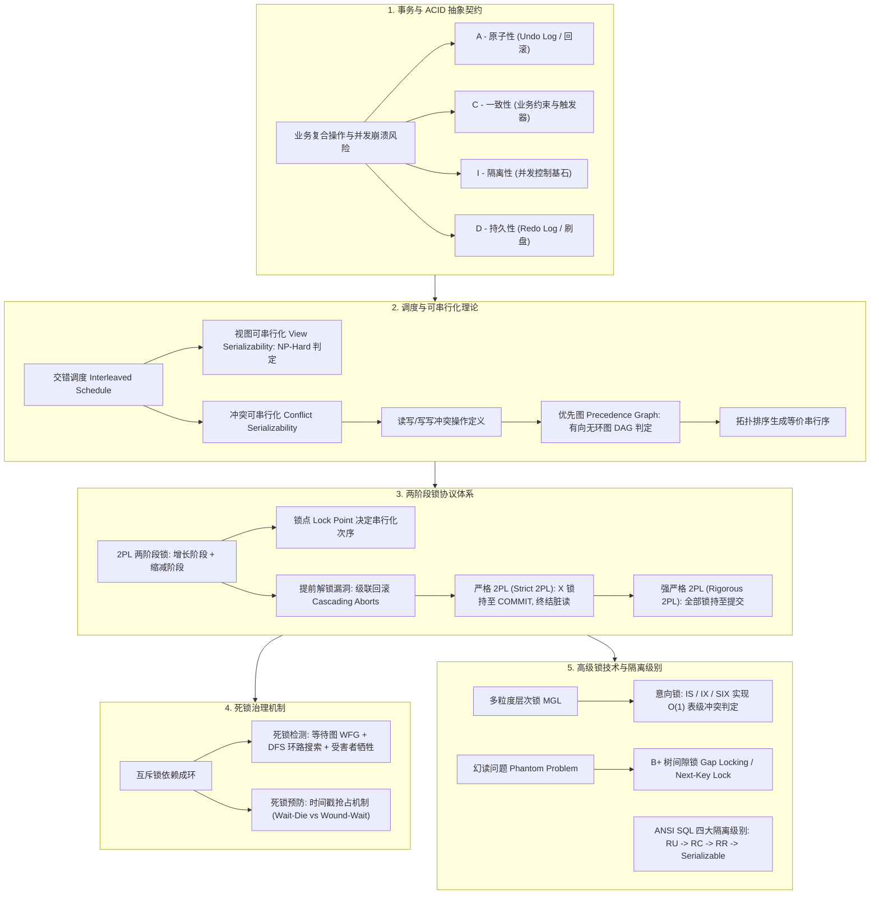

# Lec 11 事务处理与两阶段锁

## TL;DR

- **ACID 抽象契约**：事务将复合数据库操作封装为全做或全不做的逻辑单元，由预写日志（WAL）保障原子性与持久性，由并发控制保证隔离性与全局一致性。
- **冲突可串行化定理**：调度等价于串行执行的充要条件是其优先图（Precedence Graph）无环；相比 NP-Hard 的视图可串行化，冲突可串行化具备 $O(V+E)$ 的拓扑排序判定复杂度。
- **两阶段锁（2PL）与严格 2PL**：经典 2PL 通过增长与缩减阶段规避冲突环路，其锁点决定等价串行序；严格两阶段锁（Strict 2PL）强制将 X 锁持至事务提交，彻底终结级联回滚与脏读。
- **死锁防范与层次意向锁**：死锁通过等待图环路检测（DFS）牺牲受害者解决，或通过时间戳（Wait-Die / Wound-Wait）预防；多粒度锁（IS/IX/SIX）通过自顶向下意向加锁实现 $O(1)$ 层次冲突判定。
---

## 架构演进与核心洞察

::: insight 思考题 1：为什么 2PL 是冲突可串行化的“充分但非必要条件”？能举出一个可串行但被 2PL 拒绝的安全调度吗？
**深度剖析**：
- **充分性**：2PL 强制每个事务拥有唯一的锁点（Lock Point）。由于事务在跨过锁点前不能放锁，两个冲突操作的执行先后顺序必须与两者锁点的先后顺序严格一致。锁点定义了一个全局严格全序，因此优先图绝不可能成环，充分保障了冲突可串行化。
- **非必要性**：2PL 是一种悲观的前置物理约束。如 Franklin 论文图 3 所示调度：
  $$S: R_1(A), W_1(A), R_2(A), W_2(A), R_1(B), W_1(B)$$
  在该调度中，$T_1$ 在访问 $A$ 后立即释放了 $A$ 并被 $T_2$ 读取；随后 $T_1$ 又去申请访问 $B$。
  - 从优先图来看：仅存在 $T_1 \to T_2$（因 $A$ 上的冲突），图无环，完全等价于串行调度 $(T_1, T_2)$；
  - 但在 2PL 规则下：$T_1$ 释放 $A$ 意味着已进入缩减阶段，后续严禁再次申请 $B$ 的锁。因此 2PL 会在 $T_1$ 申请 $B$ 时报错或拒绝调度。2PL 为了前置防范环路，保守地牺牲了部分无环调度。
:::

## 课前阅读与文献研读 (Reading Assignment)

> 本讲核心必读文献。Franklin 1997 经典综述，系统形式化推导冲突可串行化（Conflict Serializability）优先图判定、严格两阶段锁（Strict 2PL）协议与多粒度意向锁层次。  
> 📖 **文献研读入口**：[必读文献精读：Concurrency Control and Recovery（事务并发控制与故障恢复理论基石）](./paper/concurrency_control_and_recovery.md)

## 核心机制与讲义正文

> [!TIP] **[待补截图]** 建议截取官方课件 Slides 第 11 讲中关于“多粒度意向锁（IS/IX/SIX）在树状资源层次上的申请路径示意图”。此处预留插图空间。

## 1. 事务概念与 ACID 核心哲学

在真实的商业应用与数据系统中，对数据库的操作极少表现为孤立的单个字段读写，而是由一系列在业务逻辑上具备紧密因果关联的操作序列构成的复合动作。以金融账户管理、在线电商交易或机票预订系统为例，一次高层业务事件往往映射为底层存储引擎中对多个数据页、记录行和辅助索引的连续修改。

### 1.1 经典转账场景与并发交错灾难

考虑经典的银行转账案例：用户 Alice 计划向 Bob 转账 100 美元。在关系数据库中，该业务操作被翻译为两条必须原子执行的 SQL 更新语句：
```sql
-- 步骤 1: 扣减 Alice 账户余额
UPDATE Account SET balance = balance - 100 WHERE user = 'Alice';

-- 步骤 2: 增加 Bob 账户余额
UPDATE Account SET balance = balance + 100 WHERE user = 'Bob';
```

在缺乏系统级并发控制与崩溃容错机制的多线程共享环境中，这种复合操作必然遭遇两类灾难性的系统崩溃风险：


1. **部分失败与系统崩溃（Partial Failure）**：
   如果在步骤 1 执行完毕并已写入磁盘、而步骤 2 尚未执行的物理瞬间，服务器遭遇突发断电、操作系统崩溃或进程异常退出，系统重启后数据库将陷入不可挽回的不一致状态：Alice 账户凭空损失 100 美元，而 Bob 并未收到款项。全系统的资产守恒定律被彻底打破。
2. **并发交错读写与脏读取（Concurrent Interleaving）**：
   如果在步骤 1 刚刚写入内存缓冲区、而步骤 2 尚未执行的间隙，财务审计进程并发执行了全表资产求和查询 `SELECT SUM(balance) FROM Account;`，审计程序读取到了 Alice 扣款后的最新值与 Bob 尚未入账的旧值，计算得出的全行资产总额凭空蒸发了 100 美元。

为了消解这种物理不确定性，图灵奖得主 Jim Gray 等人在 20 世纪 70 年代形式化提出了**事务（Transaction）**的数学抽象：
::: definition 事务（Transaction）的形式化定义
数据库事务是由一系列读写操作构成的逻辑工作单元（Logical Unit of Work）。无论系统面临多么复杂的底层线程并发交错，亦或遭遇突发硬件断电崩溃，数据库管理系统（DBMS）必须向应用层提供一种绝对保证：**该操作单元要么完整执行并持久化生效，要么如同从未发生过一样彻底抹去所有物理痕迹**。
:::

### 1.2 ACID 特性的物理语义与系统实现映射

现代数据库体系结构将事务的安全契约形式化为著名的 **ACID 四大特性**。这四个字母不仅代表了对应用程序的抽象语义承诺，更对应了数据库内核中完全不同且精密协同的底层工程子系统：

| ACID 特性 | 核心物理语义 | 破坏场景示例 | 数据库内核实现子系统 |
| :--- | :--- | :--- | :--- |
| **原子性 (Atomicity)** | 全做或全不做 (All or Nothing) | 执行至 99% 时断电，产生半更新状态 | 预写日志系统（WAL Undo Log） |
| **一致性 (Consistency)** | 状态转移严格满足所有显式与隐式约束 | 账户转账后总资产不守恒，或违反外键规则 | 应用逻辑与 DBMS 完整性约束检查器 |
| **隔离性 (Isolation)** | 并发交错执行结果等价于无交错串行执行 | 脏读、不可重复读、更新丢失与幻读异象 | 并发控制引擎（Lock Manager / MVCC） |
| **持久性 (Durability)** | 事务一旦提交成功，其结果绝不丢失 | 提交后发生断电，重启发现数据回到过去 | 预写日志系统（WAL Redo Log 强制刷盘） |

在一致性（Consistency）的物理实现层面，除了数据库内置的模式级实体完整性（Primary Key）、参照完整性（Foreign Key）与 Check 约束之外，高级生产数据库还支持基于存储过程与触发器的强不变式校验。MIT 6.5830 课件 Slide 11 展示了在 PostgreSQL 中利用 PL/pgSQL 触发器在事务提交边界强行守护业务不变式的工业实例：

```sql
-- MIT 6.5830 Slide 11: PostgreSQL 触发器强制保障一致性不变式
CREATE FUNCTION sal_check() RETURNS trigger AS $sal_check$
BEGIN
    -- 强制校验员工薪资必须大于等于零
    IF NEW.salary < 0 THEN
        RAISE EXCEPTION 'Negative salary is not allowed: %', NEW.salary;
    END IF;
    RETURN NEW;
END;
$sal_check$ LANGUAGE plpgsql;

CREATE TRIGGER check_salary_invariant
    BEFORE INSERT OR UPDATE ON Employee
    FOR EACH ROW EXECUTE FUNCTION sal_check();
```

---

## 2. 调度与可串行化理论（Serializability Theory）

在并发控制理论中，事务被形式化抽象为一组作用于数据项上的离散操作序列：$R(X)$ 表示读取数据项 $X$ 的当前物理值；$W(X)$ 表示向数据项 $X$ 写入新值；$C$（Commit）表示事务提交；$A$（Abort）表示事务中止回滚。

### 2.1 调度的定义与串行等价基准

**调度（Schedule / History）**是属于一个或多个并发事务的操作在物理时间轴上的交错执行序列。调度中任意单个事务所包含的操作之间的相对执行顺序，必须与其程序逻辑中定义的先后顺序完全一致。


根据操作在时间轴上的编排方式，调度被严格划分为两类：
- **串行调度（Serial Schedule）**：事务一个接一个地独占执行。前一个事务的所有操作全部完成并提交后，下一个事务才允许开始执行。
  $$\text{Schedule } S_{\text{serial}}: R_1(A), W_1(A), C_1, R_2(A), W_2(A), C_2$$
  串行调度是天然正确的系统基准线，不存在任何并发干扰与竞态条件。然而串行调度意味着无法利用多核 CPU、无法并发重叠磁盘 I/O，系统的每秒事务吞吐量（TPS）极其低下；
- **交错并发调度（Interleaved Schedule）**：来自不同事务的操作相互穿插重叠执行。
  设计并发控制协议的核心目标在于：**在允许多个事务交错执行以最大化硬件利用率的同时，确保最终的执行状态与某种串行调度的执行结果完全等价**。这种性质被称为**可串行化（Serializability）**。

### 2.2 视图可串行化（View Serializability）及其计算复杂性

视图可串行化是从数据流与读写因果关系的视角来定义调度的等价性。


::: definition 视图等价（View Equivalence）的三大数学准则
设 $S$ 和 $S'$ 是包含相同事务集合的两个调度。$S$ 与 $S'$ 视图等价，当且仅当满足以下三个条件：
1. **初始读一致性**：对于任意数据项 $A$，若事务 $T_i$ 在调度 $S$ 中读取了 $A$ 的初始状态值，则 $T_i$ 在 $S'$ 中也必须读取 $A$ 的初始状态值；
2. **读写因果链一致性**：对于任意数据项 $A$，若事务 $T_i$ 在调度 $S$ 中读取了由事务 $T_j$ 写入的数据项 $A$ 的值，则在调度 $S'$ 中 $T_i$ 读取的也必须是由 $T_j$ 写入的值（即 $W_j(A) \to R_i(A)$ 依赖不变）；
3. **最终写一致性**：对于任意数据项 $A$，若事务 $T_k$ 在调度 $S$ 中对 $A$ 执行了全调度的最后一次写入操作，则在调度 $S'$ 中 $T_k$ 也必须执行对 $A$ 的最后一次写入。
:::

若一个并发调度 $S$ 与某个串行调度 $S'$ 视图等价，则称 $S$ 是**视图可串行化（View Serializable）**的。


然而，在工业界数据库内核中，视图可串行化几乎从未被直接采用。其根本瓶颈在于理论计算复杂度：
- **判定视图可串行化是一个著名的 NP-Complete（NP 完全）问题**。对于包含 $N$ 个事务的调度，优化器或锁管理器必须在最坏情况下测试全部 $N!$ 种可能的串行调度排列；
- 更致命的是，视图可串行化主要依赖于事后对全调度依赖关系的全局分析，学术界至今未曾设计出能够在事务动态运行过程中仅凭局部信息高效强制保证视图可串行化的在线轻量协议。

### 2.3 冲突操作与冲突可串行化（Conflict Serializability）

为了工程化在线判定与前置防范，学术界提出了约束更为严格但判定极其高效的子集——**冲突可串行化（Conflict Serializability）**。


::: definition 冲突操作（Conflicting Operations）
在同一个调度中，如果两个连续或不连续的操作 $O_i$ 与 $O_j$ 同时满足以下三个物理条件，则它们被严格定义为**冲突操作**：
1. 属于**不同的事务**（$T_i \neq T_j$）；
2. 访问**同一个物理数据项**（如相同的记录行或数据页 $A$）；
3. **至少有一个操作是写操作（Write）**。
:::

根据读写组合，冲突必然属于以下两种物理形态之一：
- **读-写冲突（Read-Write Conflict）**：$R_i(A)$ 与 $W_j(A)$（或 $W_i(A)$ 与 $R_j(A)$）。若颠倒两者执行次序，读操作观察到的数据版本将发生突变；
- **写-写冲突（Write-Write Conflict）**：$W_i(A)$ 与 $W_j(A)$。若颠倒两者次序，外存中该数据项的最终物理覆盖版本将发生颠倒。
*(需要强调的是，读-读操作 $R_i(A)$ 与 $R_j(A)$ 绝不冲突，任意交换读操作的先后时间顺序绝不会对任何事务的输入与输出结果产生物理影响。)*


**冲突等价（Conflict Equivalence）**：
如果一个调度 $S$ 能够通过一系列**相邻非冲突操作的合法位置交换**，平滑变形为另一个调度 $S'$，则称 $S$ 与 $S'$ 冲突等价。
若调度 $S$ 冲突等价于某个串行调度，则称 $S$ 具备**冲突可串行化**。

### 2.4 优先图（Precedence Graph）与无环判定定理

检测一个交错并发调度是否满足冲突可串行化，可以通过构建有向图进行极其高效的图论判定。该图在学术界被称为**优先图（Precedence Graph）**或序列化图（Serialization Graph）。

构建有向图 $G = (V, E)$ 的形式化算法如下：
1. **顶点集 $V$**：调度中包含的每一个已提交活动事务各对应图中的一个顶点 $T_i$；
2. **有向边集 $E$**：对于属于不同事务的任意两个操作 $O_i \in T_i$ 与 $O_j \in T_j$，只要它们满足冲突条件且在调度中 $O_i$ 先于 $O_j$ 执行，系统便在图中建立一条有向边：
   $$T_i \longrightarrow T_j$$
   *(其代数语义表明：在任何等价的串行执行顺序中，事务 $T_i$ 必须在逻辑时间上先于事务 $T_j$ 提交！)*


::: theorem 冲突可串行化黄金判定定理
一个并发调度 $S$ 是冲突可串行化的，**当且仅当其对应的优先图 $G(S)$ 是一个无环有向图（Acyclic Directed Graph）！**
若图 $G$ 中不存在任何有向环路，则对该图执行经典的**拓扑排序（Topological Sort）**，所得到的线性顶点序列即为该并发调度在数学上完全等价的串行执行顺序。检测优先图有向环算法的复杂度仅为 $O(|V| + |E|)$，在计算上极其高效。
:::

---

## 3. MIT 课堂随堂测试与盲写异象深入推导

在麻省理工学院 6.5830 课件（Slide 18 与 Slide 28）中，授课团队设计了经典的互动决策案例，用于检验对可串行化判定准则与特殊异常边界的深度理解。

### 3.1 MIT 随堂测试题：三事务交错调度的优先图判定


设系统中有 $T_1, T_2, T_3$ 三个并发事务，其交错操作序列按时间向下流转如下：
1. $T_1: R(A)$
2. $T_2: R(B)$
3. $T_1: W(A)$
4. $T_3: R(B)$
5. $T_2: W(B)$
6. $T_3: W(B)$
7. $T_2: R(A)$
8. $T_2: W(A)$
9. 全部事务依次提交。


**推演解析过程**：
- **考察数据项 $A$ 上的冲突对**：
  - 步骤 1 $T_1: R(A)$ 先于步骤 8 $T_2: W(A)$ 执行 $\implies$ 产生依赖边 $T_1 \to T_2$；
  - 步骤 3 $T_1: W(A)$ 先于步骤 7 $T_2: R(A)$ 与步骤 8 $T_2: W(A)$ 执行 $\implies$ 产生依赖边 $T_1 \to T_2$；
- **考察数据项 $B$ 上的冲突对**：
  - 步骤 4 $T_3: R(B)$ 先于步骤 5 $T_2: W(B)$ 执行 $\implies$ 产生依赖边 $T_3 \to T_2$；
  - 步骤 5 $T_2: W(B)$ 先于步骤 6 $T_3: W(B)$ 执行 $\implies$ 产生依赖边 $T_2 \to T_3$！
- **拓扑成环判定**：
  在优先图中，事务 $T_2$ 与 $T_3$ 之间同时存在互指的有向边：$T_3 \to T_2$ 且 $T_2 \to T_3$。两者构成了长度为 2 的闭合回路！
- **结论**：**该调度绝非冲突可串行化调度**。

### 3.2 盲写（Blind Write）与“视图可串行但非冲突可串行”特例

在可串行化理论图谱中，冲突可串行化是视图可串行化的真子集。究竟在何种特定代码工况下，一个调度虽然不满足冲突可串行化，但在语义上却属于视图可串行化？


考虑 MIT 课件 Slide 18 提出的调度实例：
```text
时间轴交错调度 S:
  T1: R(A)
  T2:      W(A)   (盲写! T2 未读 A 即覆写 A)
  T1:           W(A)
  T3:                W(A)
  T1:                     R(B)  W(B)
```

1. **冲突图成环**：
   - 数据项 $A$ 上：$T_2: W(A)$ 先于 $T_1: W(A)$ 执行 $\implies T_2 \to T_1$；
   - 同样在 $A$ 上：$T_1: R(A)$ 先于 $T_2: W(A)$ 执行 $\implies T_1 \to T_2$；
   - 优先图形成 $T_1 \leftrightarrow T_2$ 双向死环，因此**该调度不是冲突可串行化的**；
2. **视图等价检验**：
   - 考察串行调度 $S' = (T_1, T_2, T_3)$：
     - 在 $S$ 与 $S'$ 中，读取 $A$ 初始值的事务唯有 $T_1$；
     - 在 $S$ 与 $S'$ 中，读取 $B$ 值的事务唯有 $T_1$；
     - 在 $S$ 与 $S'$ 中，对数据项 $A$ 执行最终写入的事务唯有 $T_3$（$T_2$ 和 $T_1$ 写入的值均被 $T_3$ 最终无情覆盖）；
     - 各事务读取的值与最终写结果在两个调度中完全吻合，因此 $S$ **严格视图等价于串行调度 $S'$**！
3. **理论本质**：
   此种分离现象**唯有在存在盲写操作（Blind Write，即事务在不读取数据项的情况下直接强制覆写）时才会发生**。在实际业务逻辑中，绝大多数写入均依赖于此前的读取计算（如 `balance = balance - 100`），纯盲写极其罕见。

---

## 4. 两阶段锁协议（2PL）与严格 2PL（Strict 2PL）

构建优先图虽然能精准判定调度合法性，但数据库内核绝不可能等到所有事务执行完毕后再事后建图检测。如果等到用户看到结果才发现违背串行化，系统将不得不承受全量回滚与业务补偿的巨大代价。工业级系统必须采用一种**前置并发控制协议**，在事务动态执行的每一步主动防止不可串行化交错的发生。

### 4.1 锁相容性矩阵与提前解锁的反面教材

数据库管理系统引入了**锁管理器（Lock Manager）**作为并发仲裁中枢。基础锁包含两种核心模式：
- **共享锁（Shared Lock / S 锁 / 读锁）**：支持多个事务并发读取同一数据项，允许多个持锁者并存；
- **排他锁（Exclusive Lock / X 锁 / 写锁）**：独占该数据项，禁止其他任何事务施加读写操作。


一个极其自然的初级工程设想是：每当事务需要访问数据时立即申请加锁，一旦底层数据项读取或修改完毕，为了最大化并发度便立刻释放锁。然而，这种朴素机制会导致灾难性的隔离性破坏：


如上图所示：事务 $T_1$ 计划更新 $A$ 和 $B$。$T_1$ 更新完 $A$ 后立刻释放了 $A$ 的锁。此时事务 $T_2$ 趁虚而入，获取了 $A$ 和 $B$ 的锁并修改了它们；随后 $T_1$ 重新获得 $B$ 的锁并更新 $B$。
由于 $T_1$ 在释放 $A$ 之后又申请了 $B$，导致 $T_2$ 的操作序列横插在 $T_1$ 中间，优先图中形成 $T_1 \to T_2$（因 $A$ 冲突）且 $T_2 \to T_1$（因 $B$ 冲突）的环路！

### 4.2 经典两阶段锁规则（Classical 2PL）与锁点

为了彻底堵死上述漏洞，Eswaran 等人在 1976 年提出了著名的**两阶段锁协议（Two-Phase Locking Protocol / 2PL）**。


::: definition 两阶段锁协议（2PL）核心铁律
两阶段锁协议强制要求每一个活动事务将其整个生命周期严格划分为两个阶段：
1. **加锁增长阶段（Growing Phase）**：
   - 事务可以持续申请新的锁（S 锁或 X 锁），或将已持有的 S 锁升级（Upgrade）为 X 锁；
   - **严禁释放任何已经持有的锁**；
2. **解锁缩减阶段（Shrinking Phase）**：
   - 事务可以逐步释放已持有的锁，或将 X 锁降级（Downgrade）为 S 锁；
   - **严禁再申请任何新的锁**！一旦事务释放了哪怕任何一把锁，便永久性跨越边界进入缩减阶段。
:::


事务获取其生命周期中**最后一把锁的物理时间瞬间**，被称为该事务的**锁点（Lock Point）**。
- **数学证明直觉**：一旦事务 $T$ 抵达了其锁点，它在全局等价串行序中的逻辑位置便彻底固化。
- 任何尚未抵达锁点的事务，在 $T$ 释放锁之前绝不可能执行与 $T$ 冲突的操作（被严格排在 $T$ 之后）；
- 任何已经越过锁点的事务，必须在 $T$ 推进之前完成其冲突操作（被严格排在 $T$ 之前）。
学术界已严格证明：**遵循 2PL 协议的调度集合，必然具备冲突可串行化！**


需要指出的是，**2PL 是实现冲突可串行化的充分条件，但绝非必要条件**。如 Franklin 论文图 3 所示，存在部分交错调度其优先图天然无环（属于安全可串行化），但由于操作交错导致无法被 2PL 的增长/缩减两阶段模型所接纳而被保守阻塞。

### 4.3 级联回滚危机与工业级严格两阶段锁（Strict 2PL）

尽管经典 2PL 在数学上杜绝了非串行化异象，但如果允许事务在提交前进入缩减阶段逐步释放锁，系统将面临灾难性的**级联回滚（Cascading Aborts）**：


1. 事务 $T_1$ 获取排他锁修改了数据项 $A=100$，随后提前进入缩减阶段释放了 $A$ 的锁；
2. 事务 $T_2$ 立即获得 $A$ 的读锁，读取了 $A=100$ 并继续执行庞大的后续业务；
3. 此时，$T_1$ 突然遭遇除零异常或用户主动执行 `ROLLBACK`（中止回滚）。
4. **灾难降临**：由于 $T_1$ 写入的 $A=100$ 是一个被彻底抹去的无效脏值，读取了脏数据的 $T_2$ 必须被系统强行连带回滚！如果 $T_2$ 已经向外界输出了数据或者触发了下游事务 $T_3$ 的写入，$T_3$ 也必须连带回滚。整个系统的吞吐量瞬间陷入雪崩。


为了彻底扑灭级联回滚，现代主流关系型数据库（PostgreSQL、MySQL InnoDB、Oracle、SQL Server）在内核中强制实施**严格两阶段锁协议（Strict 2PL / S2PL）**与**强严格两阶段锁（Rigorous 2PL / SS2PL）**：

::: definition 严格两阶段锁（Strict 2PL）与强严格两阶段锁（Rigorous 2PL）
- **Strict 2PL (S2PL)**：
  1. 事务读取前必须申请 S 锁，写入前必须申请 X 锁；
  2. **事务持有的所有排他锁（X 锁），必须持续持有直至事务彻底提交（COMMIT）或回滚（ABORT）的瞬间，才允许一次性释放！**
- **Rigorous 2PL (SS2PL / Strong Strict 2PL)**：
  - 不仅排他锁（X 锁），**事务所持有的全部共享锁（S 锁）与排他锁（X 锁），均必须持续持有直至事务彻底提交或回滚！**
:::

**工业级收益**：
在 Strict 2PL 下，只要事务 $T_1$ 修改了数据项 $A$，在 $T_1$ 提交前其他任何事务绝无可能获取读锁读取该数据。脏读被从物理层面彻底消除，**事务回滚完全自包含且安全幂等，绝不引发任何下游级联回滚**；而在 Rigorous 2PL 下，事务的提交物理时间戳直接严格等于其等价串行化顺序，极大简化了分布式事务的设计。

---

## 5. 死锁处理：检测与预防（Deadlocks）

锁机制的核心矛盾在于：它以事务的阻塞等待换取调度的串行等价。当多个并发事务以交叉顺序争抢同一组资源时，不可避免会陷入彼此永久阻塞的僵局——**死锁（Deadlock）**。


在经典的两事务死锁中：$T_1$ 持有资源 $A$ 的 X 锁并请求 $B$；而 $T_2$ 恰好持有 $B$ 的 X 锁并请求 $A$。双方均挂起在等待队列中，若无外力介入将永久死锁。


### 5.1 死锁检测（Deadlock Detection）与受害者挑选

绝大多数现代数据库系统采取“允许死锁发生，并在后台异步检测消除”的悲观检测策略：
1. **等待图（Wait-For Graph / WFG）**：
   - 节点为当前活跃事务；
   - 有向边 $T_i \to T_j$ 表示 $T_i$ 当前正被阻塞，等待 $T_j$ 所持有的锁资源；
2. **环路扫描算法**：
   - 锁管理器后台守护线程以固定周期（如每 200ms ~ 1000ms）在等待图上运行深度优先搜索（DFS）或 Tarjan 强连通分量算法；
   - **一旦在 WFG 中检测到闭合回路，即判定系统发生了死锁**；


3. **受害者挑选（Victim Selection）**：
   系统必须主动选择并强行中止（Abort）环路中的某个事务，释放其全部锁资源以解救其他事务。挑选受害者的启发式准则包括：
   - **回滚成本最低**：修改数据页最少、持有锁最少的事务；
   - **生命周期最短**：新近启动的年轻事务；
   - **防饥饿机制（Anti-Starvation）**：事务每次被选为受害者强制回滚并重试时，系统保留其初始时间戳并累加其优先级权重，防止同一个大事务被反复“杀死”导致活锁饥饿。

### 5.2 死锁预防（Deadlock Prevention：时间戳抢占策略）

与事后检测不同，死锁预防通过在事务发起锁申请的瞬间进行时间戳仲裁，从数学上杜绝等待图中形成任何环路。
设事务启动时系统赋予其单调递增的物理时间戳 $TS(T)$。**时间戳越小，事务越年老（优先级越高）**。当事务 $T_{\text{req}}$ 申请的锁正被事务 $T_{\text{hold}}$ 占有时，系统提供两种经典仲裁策略：

在死锁预防算法中，系统为每一个新发起的事务分配一个在时间域上单调递增的物理时间戳 $TS(T)$。时间戳越小，代表事务越早启动、在系统中积累的计算成果越丰硕、优先级越高。当申请锁的事务 $T_{\text{req}}$ 遭遇持有锁的事务 $T_{\text{hold}}$ 时，系统完全依据两者的相对时间戳大小进行确定性裁决，严禁形成任意相互等待：

```text
+-----------------------+--------------------------------------------------------------+
| 策略名称              | 核心仲裁规则与物理动作                                       |
+-----------------------+--------------------------------------------------------------+
| Wait-Die (老等新死)   | • 若 TS(T_req) < TS(T_hold) [老等新]: 允许老事务阻塞排队等待 |
| (非抢占式 Non-preempt)| • 若 TS(T_req) > TS(T_hold) [新遇老]: 新事务直接自杀回滚 (Die) |
+-----------------------+--------------------------------------------------------------+
| Wound-Wait (老伤新等) | • 若 TS(T_req) < TS(T_hold) [老打新]: 老事务强行抢占并回滚  |
| (抢占式 Preemptive)   |   T_hold (Wound/Kill T_hold)                                 |
|                       | • 若 TS(T_req) > TS(T_hold) [新遇老]: 允许新事务阻塞排队等待 |
+-----------------------+--------------------------------------------------------------+
```

从代数拓扑角度证明，这两种策略能够从数学上完全根除等待图成环的可能性：
1. **Wait-Die 算法的单向无环性证明**：
   在 Wait-Die 策略中，唯有当 $TS(T_{\text{req}}) < TS(T_{\text{hold}})$ 时，等待关系才被允许建立。这意味着在等待图（Wait-For Graph）中，每一条有向边 $T_i \to T_j$ 必然满足严格单调递增不等式：
   $$TS(T_i) < TS(T_j)$$
   若等待图中存在长度为 $k$ 的闭合环路 $T_1 \to T_2 \to \dots \to T_k \to T_1$，则必然推导出矛盾的链式不等式：
   $$TS(T_1) < TS(T_2) < \dots < TS(T_k) < TS(T_1)$$
   这在严格全序的实数标量时间戳空间中在数学上是绝对不成立的！因此等待图绝不可能出现环路。
2. **Wound-Wait 算法的单向无环性证明**：
   在 Wound-Wait 策略中，仅当年轻事务遇到年老事务时才允许等待，即等待图中的每一条有效边必须严格满足 $TS(T_{\text{req}}) > TS(T_{\text{hold}})$。同样的单调严格偏序性从反方向再次杜绝了环路产生。
3. **事务重启防饥饿法则（Anti-Starvation Protocol）**：
   在上述两种算法中，如果一个被杀死的事务在重启时被赋予了当下的崭新时间戳，该事务将变得比先前更加“年轻”，在随后的资源争抢中更容易再次沦为牺牲品被反复杀死，导致永久活锁与饥饿。工业级数据库的强制解决法则是：**任何由于死锁预防或冲突抢占被回滚的事务，在其重新发起重试时，必须严格保留其最初诞生时的原始时间戳 $TS_{\text{orig}}$！** 随着时间推移，该事务的相对年龄在全系统中必然会变得越来越老，直至其成为系统中唯一的“最年老事务”，从而拥有不可阻挡的最高优先级并顺利提交。

---

## 6. 多粒度锁与意向锁（Multiple Granularity Locking / MGL）

在复杂的生产数据库中，锁的对象既可以是极细粒度的单个数据记录行（Tuple），也可以是粗粒度的整个数据页（Page）、完整数据表（Table）乃至全数据库（Database）。

```text
多粒度层次锁树状结构:
                [ 数据库 (Database) ]
                          |
                    [ 数据表 (Table) ]
                          |
                   [ 数据页 (Data Page) ]
                          |
                  [ 记录行 (Tuple / Row) ]
```

### 6.1 粒度冲突难题与意向锁（Intent Locks）机制

设事务 $T_1$ 正在高频更新 `Orders` 表中某一行，在行级别持有排他锁 $X$。此时运维事务 $T_2$ 试图执行表结构变更 `ALTER TABLE Orders ADD COLUMN status INT;`，需要获取整张 `Orders` 表的表级排他锁。
若无层次化标记，表级锁申请者 $T_2$ 必须遍历该表全部上千万个数据页与数亿条记录行，检查是否有任何一行被锁定！这种 $O(N)$ 的检测开销在工程上是无法接受的性能灾难。

为了实现自顶向下 $O(1)$ 复杂度的极速冲突检测，Gray 等人提出了**意向锁（Intent Locks）**机制：
- **意向共享锁（Intent Shared / IS 锁）**：在粗粒度节点（如表）打标，声明该事务打算在更细粒度的后代节点（如行）上申请共享锁（S 锁）；
- **意向排他锁（Intent Exclusive / IX 锁）**：声明该事务打算在更细粒度的后代节点上申请排他锁（X 锁）；
- **共享意向排他锁（Shared + Intent Exclusive / SIX 锁）**：事务对整个当前节点持有共享锁（如全表只读扫描），同时打算在部分后代行上执行排他性修改。


#### 多粒度锁操作铁律（MGL Protocol）：
1. **加锁方向：严格自顶向下（Top-Down）**：
   事务若想在叶子节点（行）申请 X 锁，必须先在数据库层申请 IX 锁，在表层申请 IX 锁，在数据页层申请 IX 锁，最后才能在目标行上加 X 锁；
2. **解锁方向：严格自底向上（Bottom-Up）**：
   必须先释放行级锁，才能逐层向上释放页面、表和数据库级的意向锁。
- **系统层收益**：$T_2$ 请求表级 X 锁时，只需检查 `Orders` 表头是否已挂有 IX 锁，若存在，即刻以 $O(1)$ 时间判定冲突并挂起，完全无需遍历底层数亿条记录。


::: example MIT 随堂测试：多粒度意向锁并发相容性判定
给定包含 Database $\to$ Table $\to$ Page $\to$ Record 的层次结构，准备将 3 条记录添加到同一张表的两个页中（P1 包含 A、B；P2 包含 C）。


问：以下哪对事务可以在不阻塞的情况下安全并发执行？
- A) $T_1$: 读 P1；$T_2$: 写 A
- B) $T_1$: 写 P2；$T_2$: 读整表 T
- C) $T_1$: 写 P1；$T_2$: 写 P2
- D) $T_1$: 读 P1；$T_2$: 写 C

**解析**：
- 选项 A 中 $T_1$ 持有 P1 的 S 锁，$T_2$ 试图在 P1 上获取 IX 锁并写 A，由于 S 与 IX 冲突，阻塞；
- 选项 B 中 $T_1$ 在表 T 获取 IX 锁并在 P2 获取 X 锁，$T_2$ 试图在表 T 获取 S 锁，IX 与 S 冲突，阻塞；
- 选项 C 中 $T_1$ 在表 T 获取 IX 锁并在 P1 获取 X 锁，$T_2$ 在表 T 获取 IX 锁并在 P2 获取 X 锁。表 T 上的 IX 与 IX 相容，且 P1 与 P2 为互不干扰的独立物理页，因此完全可以无阻塞并发执行；
- 选项 D 中 $T_1$ 在 P1 加 S 锁（表 T 加 IS 锁），$T_2$ 在表 T 加 IX 并在 P2 加 IX 与写 C，表 T 上的 IS 与 IX 相容，P1 与 P2 无冲突，同样可以无阻塞并发执行。
因此正确答案为 **C 与 D**。
:::

---

## 7. 幻读问题（The Phantom Problem）与 ANSI SQL 隔离级别

### 7.1 为什么行级锁防不住“幽灵”插入？

考虑事务 $T_1$ 执行范围统计与审计：
```sql
-- T1 步骤 1: 统计 30 岁以上员工总数
SELECT COUNT(*) FROM Users WHERE age > 30; -- 返回 10 人 (T1 对已存在的 10 行分别加 S 锁)

-- 此时事务 T2 并发插入一条符合条件的新员工记录:
INSERT INTO Users (id, name, age) VALUES (999, 'Eve', 35);
COMMIT; -- T2 提交成功!

-- T1 步骤 2: 重新执行相同范围查询
SELECT COUNT(*) FROM Users WHERE age > 30; -- 结果竟然变成了 11 人!
```
**物理本质剖析**：
$T_1$ 确实遵循 Strict 2PL，对当前满足 `age > 30` 的 10 个现有行加上了行级读锁。然而，新记录 `id=999` 在 $T_1$ 步骤 1 执行时在数据库中**根本不存在**！行级锁管理器无法锁定物理上尚不存在的幽灵实体。这个新插入的行被称为**幻影（Phantom）**。

### 7.2 谓词锁与工业级间隙锁（Gap Locks）

- **谓词锁（Predicate Locks）**：理论上，系统应当对谓词条件 `age > 30` 本身加锁。然而在任意 SQL 复杂谓词（如包含多表 Join、正则与数学函数）下，判定两个谓词空间是否存在几何重叠是一个计算开销极大的判定问题；
- **工业级间隙锁（Gap Locking / Next-Key Locking）**：
  以 MySQL InnoDB 与 DB2 为代表的系统，巧妙利用 B+ 树索引键值的物理有序性实现范围封锁。在有序索引中，间隙锁锁定的不仅是已有键值，更是锁定两个连续索引键之间的**开区间（Gap）**，例如锁定 $(25, 40)$ 之间的空隙，从物理上阻止任何并发事务向该区间插入新记录，以极低开销终结了幻读。

### 7.3 ANSI SQL 四大隔离级别对比与物理加锁机制

根据事务对脏读、不可重复读与幻读三类并发异象的容忍程度，ANSI SQL 定义了四大隔离级别。理解其底层的物理加锁机制，是权衡并发性能与一致性的核心基本功：

| 隔离级别 (Isolation Level) | 脏读 (Dirty Read) | 不可重复读 (Non-Repeatable) | 幻读 (Phantom) | 底层物理锁实现机制 |
| :--- | :--- | :--- | :--- | :--- |
| **读未提交 (Read Uncommitted)** | 允许 | 允许 | 允许 | 读取完全不加 S 锁直接读内存；写操作持有短期 X 锁 |
| **读已提交 (Read Committed)** | **禁止** | 允许 | 允许 | 读操作持有语句级短 S 锁（读取完毕立即释放）；写持有 Strict X 锁至提交 |
| **可重复读 (Repeatable Read)** | **禁止** | **禁止** | 允许 | Strict 2PL：读 S 锁与写 X 锁均持续持有至事务提交；防不住新插入幻读 |
| **可串行化 (Serializable)** | **禁止** | **禁止** | **禁止** | Strict 2PL + 谓词锁 / B+ 树 Next-Key 间隙锁，彻底杜绝所有并发异象 |

---

## 8. 经典学术论文精读（Paper Reading）

深入理解现代事务并发控制内核，离不开对奠定该领域理论大厦的三篇里程碑文献的精读：

### 8.1 经典文献 1：2PL 的奠基与充要性证明（Eswaran et al., CACM 1976）
- **论文标题**：*The Notions of Consistency and Predicate Locks in a Database System*
- **核心贡献**：
  1. 首次在关系模型下给出了系统一致性状态的严格数学定义；
  2. 正式提出了两阶段锁协议（Two-Phase Locking），并给出了划时代的充要性证明：若事务集合中存在非两阶段加锁的事务，则总能构造出一种交错执行调度导致不可串行化；
  3. 提出了谓词锁（Predicate Locking）概念，为解决关系数据库中的动态集合插入（幻读）奠定了理论基础。

### 8.2 经典文献 2：多粒度锁与一致性级别体系（Gray et al., 1976）
- **论文标题**：*Granularity of Locks and Degrees of Consistency in a Shared Data Base*
- **核心贡献**：
  1. 形式化提出了多粒度层次锁体系（Multiple Granularity Locking），发明了意向共享锁（IS）、意向排他锁（IX）与 SIX 复合锁；
  2. 建立了 0 级、1 级、2 级、3 级一致性（Degrees of Consistency）体系，这一分类法直接成为了后续 ANSI/ISO SQL 四大事务隔离级别的理论蓝本；
  3. 阐明了粗细粒度锁在并发开销与冲突概率之间的帕累托最优边界。

### 8.3 经典文献 3：并发控制与崩溃恢复的统一视界（Franklin, 1997）
- **论文标题**：*Concurrency Control and Recovery*
- **核心贡献**：
  1. 全面解构了并发控制（隔离性）与崩溃恢复（原子性与持久性）之间的深层物理耦合；
  2. 深入剖析了缓冲区管理器在 STEAL/NO-STEAL 与 FORCE/NO-FORCE 策略组合下的取舍；
  3. 论证了为何 Strict 2PL（保持排他锁至提交）是配合预写日志（WAL）与 ARIES 恢复算法唯一能够避免级联回滚的工业实用方案。

---

## 9. 学术研讨与深度思考题

结合 MIT 课堂研讨与工业界分布式系统设计前沿，精选三道深入考察并发控制底层权衡的学术思考题：

::: insight 思考题 1：为什么 2PL 是冲突可串行化的“充分但非必要条件”？能举出一个可串行但被 2PL 拒绝的安全调度吗？
**深度剖析**：
- **充分性**：2PL 强制每个事务拥有唯一的锁点（Lock Point）。由于事务在跨过锁点前不能放锁，两个冲突操作的执行先后顺序必须与两者锁点的先后顺序严格一致。锁点定义了一个全局严格全序，因此优先图绝不可能成环，充分保障了冲突可串行化。
- **非必要性**：2PL 是一种悲观的前置物理约束。如 Franklin 论文图 3 所示调度：
  $$S: R_1(A), W_1(A), R_2(A), W_2(A), R_1(B), W_1(B)$$
  在该调度中，$T_1$ 在访问 $A$ 后立即释放了 $A$ 并被 $T_2$ 读取；随后 $T_1$ 又去申请访问 $B$。
  - 从优先图来看：仅存在 $T_1 \to T_2$（因 $A$ 上的冲突），图无环，完全等价于串行调度 $(T_1, T_2)$；
  - 但在 2PL 规则下：$T_1$ 释放 $A$ 意味着已进入缩减阶段，后续严禁再次申请 $B$ 的锁。因此 2PL 会在 $T_1$ 申请 $B$ 时报错或拒绝调度。2PL 为了前置防范环路，保守地牺牲了部分无环调度。
:::

::: insight 思考题 2：在分布式数据库中，死锁检测（全局 Wait-For Graph）面临哪些网络与一致性挑战？工业界如何取舍？
**深度剖析**：
- **全局等待图的现实困境**：
  在分布式 Sharding 或 Spanner 类架构中，事务跨节点持锁。
  1. **网络延迟与假死锁（Phantom Deadlock）**：收集各节点的局部等待边至中心化协调器需要网络 RTT。在收集过程中，某事务可能已经提交释放了锁，但由于网络消息乱序，中心节点依然收到了滞后的等待边并误判成环，导致无辜事务被误杀；
  2. **高可用单点风险**：中心化检测节点容易成为性能瓶颈与单点故障源。
- **工业界的实用权衡**：
  1. **放弃显式全局建图，改用纯超时机制（Lock Wait Timeout）**：如 MySQL Cluster，事务阻塞超过固定阈值（如 50 秒）直接主动回滚；
  2. **时间戳死锁预防（Wait-Die / Wound-Wait）**：如 Google Spanner，利用 TrueTime 分配全局单调事务时间戳，节点仅根据本地时间戳即可本地决策抢占或等待，从数学上根除死锁可能，完全无需跨节点通信建图。
:::

::: insight 思考题 3：在高并发联机交易系统中，Rigorous 2PL 与快照隔离（Snapshot Isolation / MVCC）相比各自有何致命弱点？
**深度剖析**：
- **Rigorous 2PL 的致命弱点：读写严重互斥与吞吐瓶颈**
  - 在 Rigorous 2PL 下，读操作必须申请 S 锁且持续至事务提交。长时间运行的大报表分析查询会持有全表 S 锁数分钟，导致所有并发写入事务全部陷入饥饿阻塞；并发度在高争抢场景下急剧恶化。
- **快照隔离（MVCC）的致命弱点：写倾斜异象（Write Skew）导致可串行化失效**
  - MVCC 实现了“读不阻塞写、写不阻塞读”，但它满足的是快照隔离（SI）而非纯粹的可串行化；
  - 经典写倾斜反例：两名医生值班，规则要求至少留一人。两名医生并发申请请假：事务 1 读快照发现有 2 人，更新自己请假；事务 2 读快照也发现有 2 人，更新自己请假。两个事务无写-写冲突均提交成功，最终导致 0 名医生值班，破坏了业务不变式。防范写倾斜必须引入可串行化快照隔离（SSI）或退化为 SELECT FOR UPDATE 显式加锁。
:::

---

## 10. 核心机制沉淀与全讲思维导图

本讲系统解构了关系数据库事务处理与并发控制理论的核心大厦：从业务正确性的抽象基石 ACID，到调度等价的数学判定，再到工业级加锁工程实践。并发控制并非脱离硬件物理约束的纯逻辑博弈，而是直接受制于处理器体系结构、内存总线带宽与存储介质特性的工程妥协。

在过去四十年的数据库系统演化史上，两阶段锁协议（2PL）构筑了关系数据库世界最坚固的护城河。它通过悲观互斥的方式，在不可预测的多线程执行流中硬性拉齐出一条严谨的等价串行序。然而，随着现代硬件向数百核心的大规模对称多处理（SMP）架构演进，加锁与互斥排队带来的线程切换开销、缓存行颠簸（Cacheline Bouncing）以及锁管理器内部哈希桶的自旋锁竞争，逐渐成为制约系统纵向扩展的核心吞吐瓶颈。



### 10.1 核心知识清单

| 知识模块 | 核心机制与底层原理 | 典型工业代表与应用场景 |
| :--- | :--- | :--- |
| **事务契约体系** | ACID 四大属性：WAL 保障原子与持久，Locking 保障隔离 | PostgreSQL, MySQL, SQLite |
| **可串行化准则** | 优先图（Precedence Graph）无环判定冲突可串行化 | 并发控制理论与优化器正确性验证 |
| **两阶段锁协议** | 经典 2PL（充分非必要）与 Strict 2PL（无级联回滚） | MySQL InnoDB, SQL Server, Spanner |
| **死锁治理架构** | 等待图（WFG）环路检测；时间戳抢占（Wait-Die / Wound-Wait） | 锁管理器后台守护线程, 分布式死锁预防 |
| **多粒度意向锁** | IS / IX / SIX 意向锁；自顶向下加锁消除全表扫描冲突检测 | 数据库/表/页/行分层并发管理 |
| **范围并发控制** | B+ 树间隙锁（Gap Lock）与临键锁（Next-Key Lock）终结幻读 | MySQL InnoDB Repeatable Read 隔离实现 |

两阶段锁协议以其坚固的数学证明与严密的物理隔离，构筑了过去四十年关系数据库世界的并发基石。然而悲观锁的等待开销催生了后续更为激进的无锁与多版本并发技术，这也正是下一讲我们将深入探讨的系统主题。
