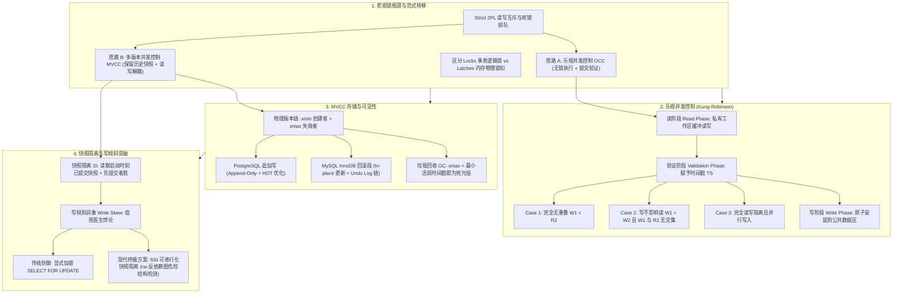

# Lec 12 乐观并发控制与快照隔离

## TL;DR

- **悲观锁与乐观演进**：两阶段锁（2PL）因读写互斥与死锁排队在高并发下遭遇性能瓶颈，驱动现代数据库向无锁化乐观并发控制（OCC）与多版本并发控制（MVCC）范式转移。
- **OCC 三阶段与验证准则**：Kung-Robinson 协议在本地私有工作区完成读取与写入缓冲，提交时进入验证阶段（Case 1/2/3 时钟与读写集判定），通过后原子安装，在低争用读密集负载下实现千万级 TPS。
- **MVCC 与快照隔离（SI）**：通过维护数据逻辑元组的历史物理版本链，达成“读不阻塞写，写不阻塞读”；快照隔离以开始时间戳提供一致性视图，并依赖“先提交者胜”规则解决写写冲突。
- **写倾斜与 SSI 终极突破**：快照隔离无法防御跨行反依赖导致的写倾斜（Write Skew：值班医生悖论）；可串行化快照隔离（SSI）通过动态追踪读写反依赖危险结构，以极低开销实现真正串行化。
---

## 架构演进与核心洞察

::: insight 思考题 1：在什么样的工作负载特征下，OCC 的性能会大幅碾压 Strict 2PL？在何种负载下它又会迅速崩溃？
**深度剖析**：
- **OCC 性能碾压 Strict 2PL 的工况**：
  1. *读密集型或完全只读工作负载（Read-Heavy）*：由于读操作完全在私有工作区进行，不加任何锁，锁管理器开销降为零，CPU 缓存无锁冲突，系统吞吐量随核心数线性扩展；
  2. *低冲突大空间写入*：数据行数极其庞大，事务访问的数据集高度离散稀疏，两个事务撞车的概率趋近于零。OCC 避免了 2PL 的加锁往返开销，能够实现极高并发。
- **OCC 性能崩溃的工况**：
  1. *热点行争抢（High Contention）*：如账户余额、库存秒杀等场景。并发事务读完后在验证阶段遭遇大面积冲突，导致成片事务被迫 Abort 回滚；
  2. *长运行写事务（Long-Running Txns）*：长事务读取的数据集极其庞大，在其漫长的读阶段中，只要有任何短事务修改了其读集中的某一行并提交，长事务在最后验证时必死无疑，陷入永久饥饿。
:::

## 课前阅读与文献研读 (Reading Assignment)

> 本讲核心必读文献。Kung & Robinson 1981 划时代论文，详尽解构乐观并发控制（OCC）的读-验证-写三阶段、时间戳分配与天然死锁免疫（Deadlock-Free）特性。  
> 📖 **文献研读入口**：[必读论文精读：Optimistic Concurrency Control（Kung-Robinson 乐观并发控制奠基之作）](./paper/optimistic_concurrency_control_kung.md)

## 核心机制与讲义正文

> [!TIP] **[待补截图]** 建议截取官方课件 Slides 第 12 讲中关于“快照隔离（Snapshot Isolation）写倾斜（Write Skew）交叉冲突时序图”。此处预留插图空间。

## 1. 悲观锁的性能死结与范式转移

在传统的基于严格两阶段锁（Strict 2PL）的并发控制架构中，系统立足于一个悲观假设：**只要两个并发事务试图访问同一个数据项，它们大概率会发生冲突并破坏可串行化，因此必须通过互斥排他锁强制一方阻塞等待**。

这种悲观哲学在低并发、短事务的早期单核系统中运行良好，但在现代高并发、多核处理器以及存算分离的工业架构下，暴露出三大致命性能瓶颈：
1. **读写互斥阻塞**：读事务申请共享锁（S 锁），写事务必须挂起等待；写事务持有排他锁（X 锁），所有并发读查询全部被阻塞。读写无法并行推进；
2. **长查询雪崩效应**：商业智能（BI）分析或全表聚合统计查询往往需要耗时数秒至数分钟。在 Strict 2PL 下，长查询会沿途锁定整张表或大量数据页，导致并发的 OLTP 高频轻量级更新事务全线停摆积压；
3. **中心化锁管理器争用**：在高并发多核环境下，每一个读写操作都要向中心化锁管理器（Lock Manager）申请加锁，内部的锁哈希表桶锁与自旋锁成为严重的 CPU 缓存行颠簸（Cacheline Bouncing）热点。

为了冲破悲观锁的并发枷锁，数据库体系结构发生了重大的范式转移，催生了两大核心设计流派：
- **方案 A：乐观并发控制（OCC）**：执行期间完全不加锁，事务先在本地工作区“乐观地”跑完；提交时一次性集中验证是否存在冲突，无冲突则安装生效，有冲突则回滚重试；
- **方案 B：多版本并发控制（MVCC）**：修改数据时绝不就地覆盖历史数据，而是在物理底层保留多个历史快照版本。读事务始终沿着历史版本链读取自己启动时的过去快照，彻底实现**读不阻塞写、写不阻塞读**。

### 1.1 系统架构辨析：Locks（事务锁）vs Latches（内存锁扣）

在进入高级并发控制前，必须厘清数据库内核中两个常被混淆的概念——**事务锁（Locks）**与**内存锁扣（Latches）**：

| 评估维度 | 事务锁（Locks） | 内存锁扣（Latches / Mutex） |
| :--- | :--- | :--- |
| **保护目标** | 保护数据库的**逻辑内容**（行、表、谓词范围） | 保护内存中**物理数据结构**（B+ 树节点、缓冲池页帧、哈希桶） |
| **持锁生命周期** | 整个事务执行期间（严格遵循 2PL，通常数毫秒至数秒） | 临界区代码执行瞬间（微秒级或纳秒级，用完立即释放） |
| **死锁与回滚** | 可能发生死锁，内核配备等待图检测与事务回滚（Abort） | 不允许发生死锁，依赖严格的模块内加锁全序避免死锁；无事务回滚机制 |
| **内核管理实体** | 由专门的锁管理器（Lock Manager）通过哈希表与队列跟踪 | 操作系统原生互斥体、读写锁（`pthread_rwlock`）或原子自旋锁 |

---

## 2. 乐观并发控制（OCC 协议体系）

1981 年，H.T. Kung（孔祥重）与 John Robinson 在 ACM TODS 上发表了划时代论文 *《》*，奠定了非加锁并发控制的理论基石。


### 2.1 核心哲学与三阶段执行模型

OCC 的核心假设是：在绝大多数只读或轻度冲突的数据处理中，事务之间真正产生物理交叠的概率极低。因此，为每一次读写都进行加锁和解锁是非常不经济的。

每一个 OCC 事务在其生命周期内被严格划分为三个单调演进的物理阶段：
1. **读阶段（Read Phase）**：
   - 事务启动时分配一个完全隔离的私有内存工作区（Private Workspace）；
   - 事务读取任何数据项时，将底层页面中的原始数据拷贝至本地工作区，并在**读集（ReadSet）**中记录其对象标识；
   - 事务的所有写操作与更新**只在私有本地工作区内缓冲修改**，在**写集（WriteSet）**中记录变更。底层共享数据库完全不受影响，其他并发事务也绝对观察不到这些脏修改；
2. **验证阶段（Validation Phase）**：
   - 当事务完成所有业务计算并发起 `COMMIT` 申请时，事务进入验证阶段；
   - 系统为该事务分配一个单调递增的全局事务标识符/时间戳 $TS(T)$，以确立其在全局等价串行序中的逻辑位次；
   - 系统根据数学验证准则，检测该事务是否与其它在时间轴上存在重叠的并发事务发生读写冲突。若通过验证，则准予提交；若验证失败，则立即中止（Abort）并清空本地副本；
3. **写阶段（Write Phase）**：
   - 验证通过后，事务将本地 WriteSet 中暂存的所有修改原子地安装（Install）到底层公共数据结构中，使之对外部所有事务正式可见；
   - 安装完成后，事务正式宣告提交成功，释放临时工作区资源。

### 2.2 验证准则与三大判定条件（Kung-Robinson 协议）

为了从数学上证明 OCC 调度的冲突可串行化，设系统按照事务进入验证阶段的时间先后顺序赋予时间戳。对于任意两个在时间轴上有交叠的事务 $T_i$ 与 $T_j$，若 $TS(T_i) < TS(T_j)$（即在等价串行序中 $T_i$ 必须排在 $T_j$ 之前），则在 $T_j$ 验证时，必须满足以下三个条件之一：


#### 条件 1（无时间重叠）：
$$W(T_i) \prec R(T_j)$$
事务 $T_i$ 在事务 $T_j$ 开始其读阶段之前，就已经完整执行完毕其写阶段。两个事务在执行时间上完全串行错开，无任何并发重叠，天然安全。


#### 条件 2（写不影响读）：
$$W(T_i) \prec W(T_j) \quad \land \quad WriteSet(T_i) \cap ReadSet(T_j) = \emptyset$$
事务 $T_i$ 在 $T_j$ 开始其写阶段之前完成了写阶段，并且 $T_i$ 所修改写入的数据集合与 $T_j$ 在读阶段所读取的数据集合完全没有交集。这保证了 $T_j$ 在读取期间绝不可能读到被 $T_i$ 修改前的陈旧脏数据，且 $T_i$ 的写入先于 $T_j$ 发生。


#### 条件 3（完全读写隔离与并行写入）：
$$R(T_i) \prec R(T_j) \quad \land \quad WriteSet(T_i) \cap ReadSet(T_j) = \emptyset \quad \land \quad WriteSet(T_i) \cap WriteSet(T_j) = \emptyset$$
事务 $T_i$ 的读阶段先于 $T_j$ 的读阶段完成，且 $T_i$ 的写集合既不与 $T_j$ 的读集合重叠，也不与 $T_j$ 的写集合重叠。这允许 $T_i$ 和 $T_j$ 的写入阶段完全并发重叠执行，而不会产生写覆盖或读破坏。


### 2.3 验证时机与事务标识符分配哲学

在 OCC 实现中，何时为事务赋予时间戳 $TS$ 是一个至关重要的架构决策：
- **错误方案：在事务启动（读阶段开始）时分配**：
  这实际上退化为了某种悲观假定。如果一个长事务在开始时拿到了很小的编号，它在漫长的读取过程中，所有后到达但执行迅速的短事务在验证时都会因为“试图排在这个长事务之后”而被迫频繁冲突回滚；
- **正确方案：在读阶段结束、验证阶段开始的瞬间分配**：
  此时事务的实际计算已经完成，时间戳真实反映了事务准备提交的实际时间。这最大化缩短了事务处于验证队列中的暴露时间窗口，使系统吞吐量达到最优。

::: pitfall 乐观并发控制的性能死穴：高冲突下的“回滚风暴”
OCC 在读密集、低争用工况下能够释放出超过每秒千万次事务（10M+ TPS）的恐怖性能。
然而，一旦业务场景存在极度热门的数据项（例如限时秒杀库存行、全局全局单调自增计数器）：
成百上千个并发线程同时读取相同数据并在私有工作区完成昂贵计算，随后挤入验证阶段。此时除第一个提交者能通过外，**后续 99% 的事务将因读写冲突被成片强行回滚（Abort Storm）**！大量的 CPU 算力与内存带宽被毫无产出地白白浪费，甚至引发事务饥饿。因此 OCC 必须辅以指数退避重试或动态降级加锁机制。
:::

---

## 3. 多版本并发控制（MVCC 核心架构）

1978 年，David Reed 在其 MIT 博士论文中提出了一个开创性的理念：如果我们在写入新数据时并不销毁旧数据，而是允许多个历史版本在存储系统中并存，并发事务的执行逻辑将被彻底颠覆。今天，MVCC 已经成为 PostgreSQL、MySQL InnoDB、Oracle 等几乎全部现代关系型数据库的通用内核基石。

```text
同一逻辑元组的版本链物理排布:
逻辑主键 ID = 1001 (用户账户余额)
       |
       v
+---------------------------------------------------------------------------------+
|  [ Version 3 ]: balance = 300 | xmin = 105 | xmax = inf  | ptr_next = V2        |
|         ^                                                                       |
|         |                                                                       |
|  [ Version 2 ]: balance = 200 | xmin = 102 | xmax = 105  | ptr_next = V1        |
|         ^                                                                       |
|         |                                                                       |
|  [ Version 1 ]: balance = 100 | xmin = 100 | xmax = 102  | ptr_next = null      |
+---------------------------------------------------------------------------------+
```

### 3.1 核心机制：写不覆盖与元数据行头

在 MVCC 系统中，一个逻辑上的“行”在物理底层可能对应着多个不同时间维度的物理数据副本（Tuple Versions）。
数据库在每个物理元组的行头（Tuple Header）中固化关键的事务可见性元数据：
- `xmin`（或 `begin-ts`）：创建并写入该物理版本的事务全局标识符（Transaction ID）；
- `xmax`（或 `end-ts`）：删除该版本、或通过更新操作产生下一个新版本而使当前版本失效的事务 ID。若当前版本仍是最新的活跃有效数据，则 `xmax` 置为 $\infty$（未失效标记）。

当执行 `UPDATE` 操作时：
系统并非直接原地抹去旧字节，而是以原子操作将旧版本的 `xmax` 标记为当前事务 ID，随后插入一条 `xmin = 当前事务ID` 且 `xmax = \infty` 的全新元组版本，并通过单向指针链将新旧版本串联起来。

### 3.2 黄金法则：读写并发的终极解耦

MVCC 最伟大的工程价值在于彻底消除了读写互斥：
> **读事务永远不需要申请排他锁，读操作绝不阻塞任何并发写操作；**  
> **写事务只需要在最新物理版本上加排他标记，写操作绝不阻塞任何并发读操作！**

只读长查询（如报表统计）进入系统后，只需基于快照沿着历史版本链追溯属于自己时间区间的有效版本，无论外界写入事务如何翻天覆地并发提交，长查询看到的数据库状态始终凝固在它启动的那一刻，彻底终结了读写死锁。

---

## 4. 快照隔离（Snapshot Isolation / SI）机制

在 MVCC 之上，现代数据库广泛实现的黄金隔离级别是**快照隔离（Snapshot Isolation / SI）**。在很多商业系统中（如 Oracle 与 PostgreSQL），当用户在 SQL 中声明 `SET TRANSACTION ISOLATION LEVEL REPEATABLE READ` 时，底层实际提供的正是快照隔离。


### 4.1 可见性判断算法（Visibility Rules）

当事务 $T$ 在逻辑时间点 $T_{\text{start}}$ 启动时，内核通过拷贝当前活跃事务状态表为 $T$ 生成一个**只读快照视图（Snapshot）**。
对于存储系统中的任意物理版本 $V$，它对事务 $T$ 满足**可见（Visible）**，当且仅当以下两条规则同时成立：
1. **产生时间有效且已提交**：
   $$xmin(V) < T_{\text{start}} \quad \land \quad xmin(V) \text{ 属于在 } T_{\text{start}} \text{ 前已提交的事务}$$
   *(若 $xmin(V)$ 是由 $T$ 自身创建的，同样对自己可见；若由未提交的并发事务创建，则绝对不可见)*；
2. **失效时间晚于快照点**：
   $$xmax(V) = \infty \quad \lor \quad xmax(V) > T_{\text{start}} \quad \lor \quad (xmax(V) \text{ 属于在 } T_{\text{start}} \text{ 时尚未提交的事务})$$
   *(说明在 $T$ 启动的那一瞬间，该数据版本尚未被删除或覆写，因此对 $T$ 依然有效)*。

### 4.2 写写冲突处理：先提交者胜（First-Committer-Wins）

快照隔离允许读操作完全无锁，但为了防止多个写入事务发生写覆盖丢失更新，系统在写入阶段实施**先提交者胜（First-Committer-Wins）**准则：
- 事务 $T$ 试图更新数据项 $X$ 时，必须先在 $X$ 的最新版本上获取行级互斥锁扣；
- 若并发事务 $T'$ 已经先一步修改了 $X$ 并且已经提交，由于 $T'$ 的提交时间晚于 $T$ 的启动时间 $T_{\text{start}}$，这破坏了 $T$ 的无冲突假设；
- 系统立刻向事务 $T$ 抛出异常并强制回滚：
  `ERROR: could not serialize access due to concurrent update`。

---

## 5. 致命死穴：快照隔离下的写倾斜异象（Write Skew Anomaly）

在很长一段时间里，工业界普遍存在一种误解：既然快照隔离消除了脏读、不可重复读，并且由于只读快照的存在甚至杜绝了传统基于行锁的幻读，那它是否就等价于真正的可串行化？

1995 年，图灵奖得主 Jim Gray 与 Hal Berenson 等人在其经典论文 *“A Critique of ANSI SQL Isolation Levels”* 中打破了这一迷思，指出**快照隔离严格弱于可串行化**，其致命死穴在于无法防范**写倾斜（Write Skew）**。

### 5.1 经典案例：医院值班医生悖论（The On-call Doctors Problem）

设某大型综合医院在系统中定义了一条必须严格遵守的核心业务不变式约束：
$$\text{Business Invariant}: \quad \text{医院每时每刻必须保证至少有 1 名医生处于在岗值班状态。}$$

当前数据库中存储着两位当班医生的状态记录：
```text
初始数据表状态 (二人同时在岗):
+------------+------------+
| Doctor     | On_Call    |
+------------+------------+
| Alice      | TRUE       |
| Bob        | TRUE       |
+------------+------------+
```

周五深夜，Alice 和 Bob 恰好同时感到突发身体不适，各自打开移动办公 App 提交请假申请。两个事务 $T_1$ 和 $T_2$ 在快照隔离下并发交错执行：

```text
时间轴交错调度:
  T1 (Alice 的请假事务):
    步骤 1: SELECT COUNT(*) FROM Doctors WHERE On_Call = TRUE;
            -- T1 在其快照中读到: Alice=TRUE, Bob=TRUE (统计值为 2 人)
            -- 业务逻辑判定: 2 > 1，允许请假!
  
  T2 (Bob 的请假事务):
    步骤 2: SELECT COUNT(*) FROM Doctors WHERE On_Call = TRUE;
            -- T2 也在其快照中读到: Alice=TRUE, Bob=TRUE (统计值为 2 人)
            -- 业务逻辑判定: 2 > 1，允许请假!
  
  T1 步骤 3:
    UPDATE Doctors SET On_Call = FALSE WHERE Doctor = 'Alice';
    COMMIT;  -- 成功提交!

  T2 步骤 4:
    UPDATE Doctors SET On_Call = FALSE WHERE Doctor = 'Bob';
    COMMIT;  -- 竟然也成功提交了!
```

#### 灾难后果与物理根源剖析：
当两个事务均宣告提交成功后，数据库管理员上线查看最终数据表状态：
```text
灾难性最终状态:
+------------+------------+
| Doctor     | On_Call    |
+------------+------------+
| Alice      | FALSE      |
| Bob        | FALSE      |
+------------+------------+
```
**全院在岗值班医生数为 0！医院的安全防线被彻底撕碎！**

为什么在快照隔离下，“先提交者胜”规则完全没有触发报警拦截？
- **写集完全不相交**：事务 $T_1$ 修改的是 Alice 所在的物理行；事务 $T_2$ 修改的是 Bob 所在的物理行。
  $$WriteSet(T_1) \cap WriteSet(T_2) = \{\text{Alice}\} \cap \{\text{Bob}\} = \emptyset$$
  由于不存在对同一物理行的写-写冲突，“先提交者胜”机制被完美绕过！
- **反向依赖破坏串行性**：在串行调度下，若 Alice 先请假提交，Bob 随后查询将发现只剩 1 人，系统必然驳回 Bob 的请求；反之亦然。绝无可能产生两人同时休假的物理状态。

### 5.2 消除写倾斜的终极解决方案：SSI（可串行化快照隔离）

在过去的工程实践中，为了在快照隔离下防范写倾斜，工程师被迫倒退回悲观加锁，在查询时手动添加显式排他锁：
`SELECT * FROM Doctors WHERE On_Call = TRUE FOR UPDATE;`
这种方式重新将读写操作绑定为互斥排队，扼杀了 MVCC 的性能初衷。

2008 年，Michael Cahill、Uwe Röhm 与 Alan Fekete 在 SIGMOD 上提出了突破性的 **Serializable Snapshot Isolation（SSI，可串行化快照隔离）** 算法（该算法已被完整合并进 PostgreSQL 9.1+ 核心）：
- **核心理论**：数学证明表明，快照隔离下所有不可串行化调度（包括写倾斜）在优先图中必然且仅必然包含一种特定拓扑结构——**两个连续的读写反依赖边（Consecutive $rw$-antidependency edges，即 $T_1 \xrightarrow{rw} T_2 \xrightarrow{rw} T_3$）**；
- **轻量检测**：SSI 在运行时完全不加锁，只在内存中以极小的位图或锁标记追踪“哪个事务读取了被另一个并发事务修改的旧版本”（标记为 $rw$-依赖）；
- **精准狙击**：一旦检测到连续两个反依赖构成的“危险结构（Dangerous Structure）”，系统只需精准中止回滚其中一个事务。SSI 使得数据库以不到 2% 的微小运行时开销，在 MVCC 之上实现了真正数学意义上的 Serializable！

---

## 6. MVCC 物理存储架构大决战：Append-Only vs Undo Log

在关系数据库内核实现中，如何组织和存放同一逻辑行的多个历史物理版本，形成了两大截然不同的架构流派：

| 评估维度 | 追加写存储 (Append-Only / In-Place Heap) | 回滚段差值存储 (Rollback Segment / Undo Log) |
| :--- | :--- | :--- |
| **工业界代表系统** | **PostgreSQL** | **MySQL InnoDB**, Oracle |
| **更新数据物理动作** | 在主数据堆表页面中直接追加插入一条全新元组 | 在原物理位置**原地覆盖修改（In-Place Update）** |
| **旧版本存放位置** | 旧版本物理元组继续留在数据页面堆表中，标记 xmax | 旧版本以逆向差值补丁（Delta）形式写入 Undo 表空间 |
| **单行更新性能** | 极快（顺序追加写），无需生成复杂的 Undo 补丁 | 中等（需实时计算前后镜像差值并构造 Undo Record） |
| **存储空间与表膨胀** | 存在严重的**表膨胀（Table Bloat）**，数据页空洞率高 | 主表极其紧凑无膨胀，空间利用率极高 |
| **辅助索引维护成本** | 极重（新元组产生新 RID，所有索引必须同步新增指针） | 极轻（物理位置不变，非主键列更新无需修改辅助索引） |
| **长查询历史版本回放**| 极快（历史行作为完整元组独立存在，单次读取直达） | 较慢（长查询需沿着 Undo 链一路反向回放拼装历史值） |

### 6.1 PostgreSQL 的追加写优化：HOT（Heap-Only Tuple）

针对 Append-Only 架构导致辅助索引频繁膨胀的痛点，PostgreSQL 发明了著名的 **HOT（堆内元组）** 技术：
如果一次 `UPDATE` 没有修改任何被索引覆盖的列，且当前数据页内还有足够的空闲空间，系统直接在同一个数据页内部存放新元组，并在旧元组头部建立页内指针跳转。外部 B+ 树索引依然指向旧元组的物理行号，查询遍历索引到达旧元组后，通过页内指针直接跳转到最新元组。这彻底消除了非索引列更新带来的全索引同步开销。

---

## 7. 死元组与垃圾回收机制（Garbage Collection / Vacuum）

随着系统持续高频地执行更新和删除，大量被废弃的历史物理版本在磁盘和内存中迅速堆积。如果不及时清理，存储空间将被迅速耗尽，且顺序扫描会被大量无用数据严重拖慢。

::: definition 死元组（Dead Tuple）的安全回收准则
设当前系统中所有正在运行的活跃事务的开始时间戳集合为 $\text{ActiveTxns}$。
对于任意一个历史物理版本 $V$，**当且仅当其失效时间戳 $xmax(V)$ 严格小于全系统所有活跃事务的最小开始时间戳时：**
$$xmax(V) < \min_{T \in \text{ActiveTxns}} (TS_{\text{start}}(T))$$
该版本 $V$ 才被判定为绝对安全的**死元组（Dead Tuple）**。此时，当前系统中的任何事务以及未来启动的所有新事务，根据可见性规则绝无可能再访问到该版本，系统可以放心地将其物理擦除并回收空间。
:::

在工程落地中：
- **PostgreSQL 采用 VACUUM 进程**：后台守护进程定期扫描数据页面，将死元组占用的空间标记为空闲链表（FSM），并在页面内执行碎片整理，极端情况下需通过 `VACUUM FULL` 执行全表重构以释放外存给操作系统；
- **MySQL InnoDB 采用 Purge 线程**：Undo 链表中的旧版本一旦低于系统的活跃事务低水位线（Read View Watermark），后台 Purge 线程自动将其从 Undo 段中裁剪释放。

---

## 8. 经典学术论文精读（Paper Reading）

精读以下三篇经典学术论文，是全面吃透乐观并发控制、快照隔离与 SSI 内核精髓的必由之路：

### 8.1 经典文献 1：OCC 的开山之作（Kung & Robinson, ACM TODS 1981）
- **论文标题**：*《》*
- **核心贡献**：
  1. 首次正式提出了乐观并发控制（OCC）哲学，系统论证了在低冲突场景下消除锁开销的巨大吞吐收益；
  2. 形式化推导了读阶段、验证阶段与写阶段的三大可串行化条件（Case 1/2/3），给出了基于事务计数器（TNC）的轻量分配协议；
  3. 提出了基于私有副本对象交换（Pointer Exchange）的高效原子安装机制。

### 8.2 经典文献 2：ANSI SQL 隔离级别的全面反思（Berenson et al., SIGMOD 1995）
- **论文标题**：*A Critique of ANSI SQL Isolation Levels*
- **核心贡献**：
  1. 严厉批判了 1992 年 ANSI SQL 标准关于隔离级别的模糊定义（标准仅基于三种简单异常现象，忽略了多版本实现）；
  2. 首次从学术上精确定义了**快照隔离（Snapshot Isolation / SI）**模型与先提交者胜规则；
  3. 正式揭示了**写倾斜（Write Skew）**与读倾斜（Read Skew）等深层并发异象，证明了快照隔离不等于可串行化。

### 8.3 经典文献 3：SSI 可串行化快照隔离突破（Cahill et al., SIGMOD 2008）
- **论文标题**：*Serializable Snapshot Isolation: Pipelined Execution of Serializability Tests*
- **核心贡献**：
  1. 奠定了现代数据库兼具高吞吐与强一致性的核心算法 SSI；
  2. 证明了在有向依赖图中，不可串行化调度的产生必须依赖两条相连的读写反依赖边（$T_1 \xrightarrow{rw} T_2 \xrightarrow{rw} T_3$）；
  3. 设计了基于 SIREAD 标记的极低开销在线追踪算法，使 PostgreSQL 首次获得了完全无锁的可串行化能力。

---

## 9. 学术研讨与深度思考题

结合 MIT 课堂研讨与现代数据库系统前沿，提供三道极具深度的思考题：

::: insight 思考题 1：在什么样的工作负载特征下，OCC 的性能会大幅碾压 Strict 2PL？在何种负载下它又会迅速崩溃？
**深度剖析**：
- **OCC 性能碾压 Strict 2PL 的工况**：
  1. *读密集型或完全只读工作负载（Read-Heavy）*：由于读操作完全在私有工作区进行，不加任何锁，锁管理器开销降为零，CPU 缓存无锁冲突，系统吞吐量随核心数线性扩展；
  2. *低冲突大空间写入*：数据行数极其庞大，事务访问的数据集高度离散稀疏，两个事务撞车的概率趋近于零。OCC 避免了 2PL 的加锁往返开销，能够实现极高并发。
- **OCC 性能崩溃的工况**：
  1. *热点行争抢（High Contention）*：如账户余额、库存秒杀等场景。并发事务读完后在验证阶段遭遇大面积冲突，导致成片事务被迫 Abort 回滚；
  2. *长运行写事务（Long-Running Txns）*：长事务读取的数据集极其庞大，在其漫长的读阶段中，只要有任何短事务修改了其读集中的某一行并提交，长事务在最后验证时必死无疑，陷入永久饥饿。
:::

::: insight 思考题 2：对比 PostgreSQL 追加写与 MySQL InnoDB 回滚段两种 MVCC 实现，在面临高频更新时各有哪些性能陷阱？
**深度剖析**：
- **PostgreSQL 追加写的陷阱：空间膨胀与写放大**
  - 高频 `UPDATE` 导致数据堆表中产生大量死元组，数据页迅速被填满，触发频繁的跨页物理扩容（表膨胀）；
  - 若更新涉及索引列，HOT 优化失效，新旧元组 RID 变更迫使表上所有二级 B+ 树索引都必须同步插入新指针，造成极其严重的 I/O 写放大；后台 VACUUM 进程不得不消耗大量磁盘带宽和 CPU 周期进行垃圾清理。
- **MySQL InnoDB 回滚段的陷阱：长事务 Undo 链雪崩与读取衰退**
  - 在 InnoDB 中，若系统中存在一个长时间运行未提交的事务，其 Read View 会阻止后台 Purge 线程回收在此之后产生的所有 Undo 日志；
  - 频繁的更新导致 Undo 链表极度拉长，Undo 表空间急剧膨胀甚至撑爆磁盘；
  - 当另一个普通事务试图读取这行数据时，必须沿着极其漫长的 Undo 指针链进行几十万次链表反向寻址回溯与内存重组，导致读取性能断崖式暴跌。
:::

::: insight 思考题 3：为什么快照隔离（SI）在面对“两名医生值班”的写倾斜案例时束手无策？SSI 是如何在不加重锁的情况下精准防范的？
**深度剖析**：
- **快照隔离失效的根源**：
  快照隔离的并发写入冲突防护建立在**单一物理对象碰撞**的假设上（First-Committer-Wins 仅检查写集是否相交）。而在医生值班案例中，Alice 修改自身状态，Bob 修改自身状态，两者的物理写集完全分离，底层的行锁与提交检查判定毫无冲突；但业务规则是不变式约束在多行之间建立了逻辑谓词依赖，快照隔离无法感知跨行的因果约束。
- **SSI 的轻量防范机制**：
  SSI 引入了虚拟的 `SIREAD` 标记。当 Alice 事务读取全表时，在符合条件的元组上留下只读标记；当 Bob 并发修改自身状态时，系统检测到 Bob 试图使 Alice 的读取失效，于是在内存依赖图中记录一条读写反依赖边 $T_{\text{Alice}} \xrightarrow{rw} T_{\text{Bob}}$；同理检测到 $T_{\text{Bob}} \xrightarrow{rw} T_{\text{Alice}}$。
  由于形成了互相指向的危险环路，SSI 优化器在提交时果断介入，强制选择其中一个事务中止回滚，从而在完全不依赖重量级互斥排他锁的前提下，精确守护了全局业务不变式。
:::

---

## 10. 核心机制沉淀与全讲思维导图

本讲系统解构了现代数据库摆脱传统悲观锁枷锁的两大核心武器——乐观并发控制与多版本并发控制：从私有工作区的验证模型，到多版本快照的可见性推演，再到可串行化快照隔离的工业级突破。



### 10.1 核心知识清单

| 知识模块 | 核心机制与底层原理 | 典型工业代表与应用场景 |
| :--- | :--- | :--- |
| **并发范式转移** | 读写互斥向 OCC（无锁验证）与 MVCC（快照多版本）演进 | 现代分布式与单机高并发交易系统 |
| **OCC 协议规范** | 私有工作区、Case 1/2/3 可串行化验证准则与原子安装 | Silo, Cicada, 内存数据库高吞吐场景 |
| **MVCC 版本管理** | 行头元数据（xmin/xmax）、版本链追溯与死元组回收准则 | PostgreSQL, MySQL InnoDB, Oracle |
| **物理版本存储流派**| Append-Only（追加写 + HOT） vs Undo Log（原地更新 + 回滚段）| PostgreSQL 堆表 vs InnoDB 聚簇索引 |
| **快照隔离与并发异象**| 读可见性算法、先提交者胜规则与跨行写倾斜（Write Skew） | 绝大多数商业数据库的默认/高级隔离实现 |
| **可串行化快照隔离**| SSI 算法：内存读写反依赖图（$rw$-antidependency）危险结构消除 | PostgreSQL Serializable 隔离级别 |

从 OCC 的乐观验证到 MVCC 的快照解耦，数据库内核通过对时间维度的重新编排，达成了吞吐量与一致性的精妙平衡。至此，我们已经完整解构了事务系统的隔离性（Isolation）支柱。在下一讲中，我们将迈入事务处理的最后一道终极防线——**故障恢复与 ARIES 算法**，探究系统在面临掉电与崩溃时如何创造永不丢失的数据奇迹！

---

## 详细机制推导与原版课堂图解

> MIT 6.5830 / 6.5831 · Database Systems · 第 12 讲  
> 核心教材：*Readings in Database Systems* (5th Edition, Red Book)  
> 配套实验：GoDB (Go-based Database Engine)

## 事务

事务提供了一种抽象，提供了 all-or-nothing 和 before-or-after 原子性。事务由 ACID 特性

### 原子性

许多动作看起来像一个整体；“全有或全无”，但实际上，动作需要时间！为了实现原子性，防止多个动作互相干扰，它们是**隔离**的

### 一致性

简单说，不变量的保持。通常以约束条件的形式表达，例如， 主键约束/外键约束、触发器、或者是没有员工比他们的经理高。 需要使用不太优雅的非 SQL 语法（例如 PL/pg SQL)，通常在应用程序中完成

**Postgres PL/pgSQL 触发器例子**

用于实现工资检查的功能

```postgresql
-- 创建 PL/pgSQL 函数用于工资检查
CREATE OR REPLACE FUNCTION sal_check() RETURNS trigger AS $sal_check$
DECLARE
    mgr_sal integer;
BEGIN
    IF NEW.salary IS NOT NULL THEN
        -- 查询该员工的经理的工资
        SELECT INTO mgr_sal salary
        FROM emp
        JOIN manages ON NEW.eid = manages.eid AND emp.eid = manages.eid
        LIMIT 1;
        
        -- 检查员工工资是否超过经理工资(如果没有经理, mgr_sal is NULL)
        IF mgr_sal < NEW.salary THEN 
            RAISE EXCEPTION 'employee cannot make more than manager';
        END IF;
    END IF;
    
    RETURN NEW;
END;

-- 创建触发器，使其在每次向 emp 表中插入新记录或修改现有记录时，都调用 sal_check 函数
$sal_check$ LANGUAGE plpgsql;
CREATE TRIGGER eid_sal BEFORE INSERT OR UPDATE ON emp
FOR EACH ROW EXECUTE FUNCTION sal_check();
```

- NEW 是被添加的记录

- mgr_sal 是本地变量

### 隔离性

> **我们如何隔离动作？**

- 串行执行：意味着一次只允许一个事务运行。
  - 存在一下几个问题
    - 无法发挥多处理器优势
    - 如果长时间运行事务，会阻塞其他，导致出现饥饿现象
- 目标： 保持串行等价性的同时，允许并发执行。 串行等价性意味着并发执行的结果与某种串行执行的结果相同
- 并发控制算法就是用来实现上述目标的。

### 持久性

TODO

## 可串行化

### 定义

**一个并发事务的操作顺序实现串行等价的例子**


- RA： Read A， 读 A
- WA：Write A， 写 A
- A/B： 他们是都是一些对象——比如，记录，磁盘页等
- 假设读和写的逻辑是任意的

**不具备串行等价**——T2 对 A 的写入丢失了，这在串行调度中不可能发送

- 在 T1-T2 的顺序中，T2 应该能看到 T1 对 A 的写入
- 在 T2-T1 的顺序中，T1 应该能看到 T2 对 A 的写入

### 可串行化的验证


从图中我们可知，任何一种冲突可串行化都是视图可串行化，反之则不然

### 视图可串行化

在调度 S 中，指令的特定顺序当且仅当满足以下条件时，与串行顺序 S' 视图等价

-  S 中的每个读取操作获取的值，和 S' 中对应的读取操作获取的值是一样的。
- S 和 S' 中，每个数据的最终修改都是由同一个事务完成的。
- 简单来说，就是在 S 中，所有事务“看到”的值和它们在 S' 中“看到”的值是一样的，并且事务执行后的最终结果也是一样的。

----

视图可串行化例子

我们发现 T2 在两个调度中总是做最后一个做修改


- 在调度 S 中读取的每个值，都是在串行顺序 S' 中由相同读取操作读取的相同值。
- 每个对象的最终写入操作在 S 和 S' 中由相同的事务 T 完成

#### 视图可串行化限制

- 必须针对每一个可能的串行调度进行测试，以确定串行等价性
  - 这是一个 NP-Hard 问题
  - 对于 N 个并发事务，则有$2^N$种串行化调度可能
- 没有协议能在事务运行时确保视图可串行化
- **冲突可串行化**解决了这两个问题

### 冲突可串行化

满足以下条件， 两个操作视为**冲突的**

- 两个操作都作用在同个对选哪个

- 至少有个操作室写操作

- 例子，$T1_{WA}$ 与$T2_{RA}$冲突，但是$T1_{RA}$和$T2_{RA}$不冲突

  

**冲突可串行化**定义

如果可以通过交换不冲突的操作来得出一个串行调度， 那么这个调度是冲突可串行化的。 等价地说： 对于所有成对的冲突操作 {O1 in T1 , O2 in T2 }，要么：

- O1 总是先于 O2，或者
- O2 总是先于 O1。

- 记作$T1 \prec T2$​ ， T1 先于 T2 发生

例子


#### Precedence（优先） 图

- 给定事务 Ti 和 Tj
- 当满足以下条件时，新建一条边$T_i \rightarrow T_j $：
  - 在 Tj 写 A 之前，Ti 读/写 A，即$RA_{Ti} \prec WA_{Tj} $ 或者$WA_{Ti} \prec WA_{Tj} $​
  - 在 Tj 读 A 之前，Ti 写 A，即$WA_{Ti} \prec RA_{Tj} $​
- 如果在这个图中存在环路，那么调度就不是冲突可串行化的

#### 非冲突可串行化例子


#### 冲突可串行化例子


#### 总结：三种方法检测冲突可串行化

1. 检查所有的冲突操作的边 (O1 在 T1,O2 在 T2)

   - 要么 O1 总是在 O2 前执行
   - 要么 O2 总是在 O1 前执行

2. 交换不冲突的操作以获得串行调度

3. 构建优先图，检查是否存在环路

> 以下调度是否是冲突可串行化？
>
> | T1     | T2     | T3     |
> | ------ | ------ | ------ |
> | RA     |        |        |
> |        | RB     |        |
> | WA     |        |        |
> |        |        | RB     |
> |        | WB     |        |
> |        |        | WB     |
> |        | RA     |        |
> |        | WA     |        |
> | COMMIT | COMMIT | COMMIT |

Solution：

不是。


### 视图可串行化 vs 冲突可串行化

- 视图可串行化的检测是 NP-Hard 问题
  - 必须考虑所有的排序可能
- 冲突可串行化应用于实际中
  - 不是因为 NP 难题
  - 而是因为我们有办法在事务运行时强制执行它

一个视图可串行化但不是冲突可串行化的调度示例：

> | T1   | T2   | T3   |
> | ---- | ---- | ---- |
> | RA   |      |      |
> |      | WA   |      |
> | WA   |      |      |
> |      |      | WA   |
> | RB   |      |      |
> | WB   |      |      |
>
> 问以上调度是
> A) 既不是视图可串行化也不是冲突可串行化
> B) 冲突可串行化，但非视图可串行化
> C) 视图可串行化，但非冲突可串行化
> D) 既是视图可串行化，也是冲突可串行化


等价与 T1, T2, T3 的顺序调度 S'，满足所有的读取操作读取的值在视图等价的调度中必须相同，也满足每个对象的最终写入应该由相同的事务完成。

综上， 这种情况只会发生在有**盲写操作**的时候

## 冲突可串行化的实现

- 有几种协议
- 但是我们这里只讨论两阶段锁（2PL）
- 主要思想：
  - 在每次读一个对象前获取共享锁（S lock)
  - 在每次写一个对象前获取排他锁（X lock）
- 多个事务可以持有 S 锁
- 而只有一个事务可持有 X 锁
- 如果一个事物不能获取锁，则它会等待（“阻塞“）


锁的兼容性表

### 何时释放锁

- 每个操作完成后？

- 还是在事务处理完变量后？

- 都不对，下面看一个例子

  - T2 在 T1 更新 B 之前"偷偷插入"并更新了 A 和 B

  

  这个调度是非可串行的.

### 两阶段锁

上述问题的解决方案： **两阶段锁**

> [!NOTE]
>
> 规则：一个事务不能释放任何锁直到它获取了它要加锁所有的锁


我们将事务在执行过程中获取最后一个锁的时间点称为锁点（lock point），通过锁点，我们可以在并发执行的事务中推导出一个等价的串行调度

#### 正确性——直觉上

- 一旦事务 T 达到了它的锁点：

  - T 在串行顺序中的位置已确定

  - 任何尚未获取所有锁的事务，在 T 释放锁之前，不能执行任何冲突的操作
    - **被排在后面**
  - 任何已经获取所有锁的事务，必须在 T 进行之前完成它们的冲突操作（释放它们的锁
    - **被排在前面**

#### 两阶段锁协议

- 在每个读之前需要获取一个 S 锁
- 在每个写之前，需要获取一个 X 锁（或者是将 S 锁更新为 X 锁）
- 只有当最后一个锁获取完毕，且对该对象的操作已经完成之后，才能释放锁

#### 潜在问题？

- 死锁
- 级联中止
- 如何知道操作完成

#####  死锁

- T2 需要的锁，刚好被 T1 持有


- 复杂的死锁情况
  - 
  - 解决办法：**中止其中一个事务**
  - 

##### 级联回滚

- 当 T1 中止了， T2 读取了 T1 写的数据，因此 T2 也需要中止


> 能否有 2PL 的变体使得既不需要死锁检测也不会有级联中止吗？

###### 严格的两阶段锁

- 通过持有 X 锁直到事务结束，这样可以规避级联中止
- 保证事务永不会读其他未提交事务的数据

###### 严格的两阶段锁协议

- 在每个读之前需要获取一个 S 锁
- 在每个写之前，需要获取一个 X 锁（或者是将 S 锁更新为 X 锁）
- ~~只有当最后一个锁获取完毕，且对该对象的操作已经完成之后，才能释放锁~~
- 仅在获取最后一个锁并且对该对象的操作完成后，才释放共享锁
- 仅在事务提交后才释放排他锁
- 确保无级联回滚。

##### 什么情况下释放？

- • 数据库管理系统（DBMS）如何知道一个事务不再需要某个锁？
- 这很困难，因为事务可能是交互式发出的。
- 实际上，这意味着所有锁都会一直持有到事务结束。
- 这被称为**更严格的两阶段锁**。

###### 更严格的两阶段锁协议

- 在每个读之前，需要获取一个 S 锁
- 在每个写之前，需要获取一个 X 锁（或者是将 S 锁更新为 X 锁）
- ~~只有当最后一个锁获取完毕，且对该对象的操作已经完成之后，才能释放锁~~
- 仅在事务提交后才释放所有锁
- 确保无级联回滚，并且
- COMIT 顺序等于串行化顺序

> 这样做有什么问题？

死锁！


> 如何处理？

- 要求按顺序获取锁（避免死锁）。
- 这样做有什么问题？会减少并发性。
- 通过在等待图中查找循环来检测死锁。
  - 那接下来呢？"杀掉"一个事务——例如，强制它中止。

### 幽灵问题

当我们对单个数据项进行加锁时，如果一个事务 T1 扫描了一个数据范围，而另一个事务 T2 在该范围内插入数据并且 T2 先于 T1 提交，那么这个操作顺序就不能被视为串行等价。这是因为锁的对象（单个数据项）与系统中实际查询的逻辑对象（数据范围）不匹配。

为了解决这个问题，可以使用谓词锁，它允许锁一组逻辑上的值范围。然而，这个方法存在几个问题：

- **执行成本**：检测两个谓词是否冲突的计算代价非常高，尤其是在锁管理器的内部循环中进行这种检测会严重影响性能。
- **悲观锁**：这种方法可能过于保守，导致一些本来不冲突的操作无法同时进行。例如，T1 锁了“母亲”的数据范围，而 T2 锁了“父亲”的数据范围，理论上它们不应该冲突，但谓词锁可能会阻止这种情况。
- **确定锁范围的难度**：很难决定哪些范围需要锁，这需要人为判断。

由于上述问题，实际中通常不会使用任意 SQL 语句生成的谓词锁。一个更实际的解决方案是在 B+树结构中加锁。通过锁每次范围扫描后的下一个键（称为“下一个键锁”），可以防止在这个范围内插入新的数据。

除了锁机制外，还有其他协议可以用来实现串行调度。例如，乐观并发控制（Optimistic Concurrency Control，OCC）是一种不依赖锁的并发控制方法，下一次会探讨它的性能和应用。

## 论文阅读：Frankin 的并发控制和恢复

[Concurrency Control and Recovery, franklin97](https://courses.cs.washington.edu/courses/cse544/11wi/papers/franklin97.pdf)

## 1. 介绍

像很多银行、机场、医院等 DBMS 场景需要两个核心功能，一是保护保存到数据库中的数据、二是即使会有各种软硬件故障，也能提供正确且高可用的用户并发访问的能力。这个功能就在于 DBMS 软件中的并发控制和恢复模块。其中**并发控制**保证单个用户能够看到数据库一致的状态，即便有很多用户交错执行了部分操作，而恢复保证了数据库时可容错。而这些功能，也让应用能够无需担心并发和容错的情况正确写入数据。

在数据库系统中，并发访问正确性与事务的概念关系密切，一个事务就是一个单位的工作，可能包含了多个数据的访问和更新，但是原子性的提交或中断。正式地说，事务有 ACID 四个特性。


看上面的错误的并发执行的例子。有很多并发控制和恢复的解决方法被提出，并且这些也运用在很多领域，比如文件系统，内存系统。ACID 模型有两个显著特点，使事务与其他方法区别开来。首先，它将隔离性（并发控制）和容错性（恢复）问题结合在一起。其次，它关注于将对多个数据项的多次写入和/或读取操作视为一个原子性、隔离性的工作单元处理。

## 2. 原理

### 2.1 并发控制

#### 可串行化

在并发执行的正确性的概念上，最被广泛接受的就是 可串行化**Serializability**。其是一种性质，执行的结果与其中某一个非交错执行的结果相同。我们将关注可串行化的一个特殊变体，称为**冲突可串行化 Conflict serializability**，它之所以能被广泛采纳是因为有高效、且容易实现的技术来检测或者强制满足这个性质；另外一个比较出名的变体称为**视图可串行化 View serializability**，视图可串行化限制更少，但由于实现难度较大，视图可串行性及其他变体主要具有**理论意义**，在实际系统中不太实用。

#### 事务调度

调度定义的顺序可以是部分排序， 因为它只需满足以下两种依赖关系的要求：

- 事物内部操作的顺序： 对于给定事务中已明确指定执行顺序的所有操作，必须在调度中按照该顺序执行
- 跨事务的冲突操作顺序： 来自不同事务的所有**冲突操作**的执行顺序必须在调度中明确指定

调度的概念提供了一种机制表达和推测（可能）当前事务的执行状态。串行调度（serial schedule）是说每个事务的所有操作连续出现，比如在`REPORTSUM`之后`TRANSFER`串行执行如下
$$
r_0[A] \rightarrow 
w_0[A] \rightarrow
r_0[B] \rightarrow
w_0[B] \rightarrow
c_0 \rightarrow
r_1[A] \rightarrow
r_1[B] \rightarrow
c_1
$$
在这种表示法中，每个操作由其首字母表示，操作的下标表示执行该操作的事务编号，大写字母（用方括号括起来）表示数据库中的特定数据项（适用于读和写操作）。事务编号是由 DBMS 为每次事务执行分配。在上述示例中，`TRANSFER` 的执行被分配为 `tr 0`，而 `REPORTSUM` 的执行被分配为 `tr 1`。两个操作之间的右箭头 (→) 表示左侧操作的执行顺序在右侧操作之前。此顺序关系具有传递性，因此由传递性隐含的顺序不会明确绘出。

例如，图 1 中展示的 `TRANSFER` 和 `REPORTSUM` 的交错执行将产生以下调度：
$$
r_0[A] \rightarrow 
w_0[A] \rightarrow
r_1[A] \rightarrow
r_1[B] \rightarrow
c_1 \rightarrow
r_0[B] \rightarrow
w_0[B] \rightarrow
c_0
$$
可串行性的正式定义基于等价调度的概念。两个调度被称为 equivalent（$\equiv$）等价，当且仅当满足以下条件：

- 包含相同的事务和操作；且
- 对所有非中止事务的冲突操作，它们的执行顺序在两个调度中是相同的。

基于此等价调度的概念，如果一个调度等价于某个串行调度，则称该调度是可串行的。例如，以下并发调度是可串行的，因为它与调度 (1) 等价。
$$
r_0[A] \rightarrow 
w_0[A] \rightarrow
r_1[A] \rightarrow
r_0[B] \rightarrow
w_0[B] \rightarrow
c_0 \rightarrow
r_1[B] \rightarrow
c_1
$$
相比之下，调度 (2) 的交错执行不可串行。来看为什么？ 注意在 TRANSFER 和 REPORTSUM 的任何串行执行中，要么 TRANSFER 的两个写操作都在 REPORTSUM 的两个读操作之前，要么反之。然而，在调度 (2) 中，存在以下执行顺序关系：$w_0[A] \rightarrow
r_1[A] $， $r_1[B] \rightarrow
w_0[B] $，因此调度（2）不等价与任何可能的串行调度，因而不可串行。

#### 可串行化的验证

通过 **优先图（precedence graph）**轻松测试调度是否可串行。优先图是一个有向图，每个顶点代表已提交事务的执行（未提交的事务可忽略），如果在调度中，事务执行$T_i$中的某个操作必须在事务执行$T_j$中某个操作之前执行（$i \neq j$），则在图中添加$T_i \rightarrow T_j$的有向边。如果一个额调度的优先图是无环的，则该调度是可串行的；反之如果存在环，则不可串行。实际上有很多种方式实现冲突可串行化

### 2.2 恢复

#### 缓冲区管理问题

UNDO，是为了移除对中止或者未完成的事务的影响，以达到原子性的要求。而 REDO 是重新构建已经提交的事务的影响，以达到持久性的要求。Recovery 的工作量，取决于 DBMS 缓冲区管理器如何工作的，即如何处理正在执行、正在提交的事务的数据。Buffer Manager 是 DBMS 中协调主存储器与磁盘之间传输的组件。可以原子性写入**非易失性存储**的存储单元称为页面（page），更新操作首先对（volatile）缓冲池中的页面副本进行修改，这些副本稍后才被写入非易失性存储。Steal 策略——如果缓冲区管理器允许未提交事务的更新覆盖非易失性存储中数据项的最近提交值（反之则是 No-Steal 策略）；force 策略——如果缓存区管理器确保事务的所有更新在该事务提交前已被写入非易失性存储，则称其为支持 Force 策略（反之称为 No-Force）。

支持 Steal 策略意味着，如果事务需要回滚（事务失败或者系统崩溃），则需要恢复该事务更新的任何在非易失性存储上的数据，恢复到它先前提交的状态。相比之下，No-steal 时钟保证非易失性存储上的数据是有效的，因此不需要恢复操作。

NO-FORCE 策略可能会导致在系统崩溃时，某些已提交的数据值丢失，因为无法保证它们已经被写入非易失性存储。因此，为了保证已提交更新的持久性（durability），可能需要执行大量的重做（REDO）操作。而 FORCE 策略则确保已提交的更新在事务提交时被写入非易失性存储，因此即使发生系统崩溃，非易失性存储中的数据库副本仍能反映这些更新。

上述讨论， NO-STEAL 和 FORCE 策略的组合对 UNDO 和 REDO 的需求最少，然而对于在正常操作而言效率很低。NO-STEAL 强制缓冲区管理器在**事务提交之前**将更新后的数据一直保持到内存中（或者是将数据写入到非易失性存储上的临时区域，比如 swap 区），直到事务提交才写入到易失性存储，即占用内存，限制事务并发。FORCE 策略的问题在于，它可能在事务提交的关键路径上引入显著的磁盘写入开销。因此，许多缓冲区管理器支持 STEAL 和 NO-FORCE（STEAL/NO-FORCE）策略。

#### 日志

为了处理 UNDO 和 REDO 的需求，DBMS 通用依赖对 log 的使用。log 是一个顺序文件，存储着事务的信息和系统的状态，每个日志实体称为日志记录（log record），每个事务通常会涉及到多个日志记录的写入，当一条日志记录创建时，就会分配日志序列号（LSN），自增的。很多系统会将新日志记录的 LSN 写入到包括更新数据的页面，通过这种记录方式，恢复系统能够能够将**数据页的状态**与**日志中的更新**关联起来，从而判断特定日志记录是否已反映在数据页的当前状态中。

日志记录还用于记录事务管理活动，例如事务的提交或中止。此外，有时还会写入日志记录来描述系统在特定时间段的状态。例如，此类日志记录是作为 Checkpoint 过程的一部分写入的。在系统正常运行期间， checkpoint 会定期执行，以限制崩溃时所需的工作量。这些记录可能包含：缓冲池的内容、当前事务的信息。具体内容取决于所使用的检查点方法。一种**非侵入性**的检查点方法是由**ARIES** 恢复方法使用的检查点技术。

对于事务更新操作，日志记录有两种基本类型：物理日志和逻辑日志。物理日志通常指示数据库中被修改数据的位置（例如某个页面的具体位置），如果系统支持 UNDO 操作，则日志记录中会包含更新前的数据值，称为该数据项的前镜像（before image），如果系统支持 REDO 操作，则会记录更新后的数据值，称为该数据的后镜像（after image），因此在采用 STEAL/NO-FORCE 缓冲管理策略的 DBMS 中，物理日志记录通常同时包含数据项的旧值和新值。使用物理日志进行恢复时，恢复操作（如 UNDO 或 REDO）具有幂等性，即无论执行多少次，效果都相同。这种特性非常重要，尤其是在系统**多次失败**（例如由于**电源故障**或**设备损坏**）而**重复执行恢复操作**时，能够保证数据的一致性和正确性。

逻辑日志（有时候称操作日志）记录高层次的执行动作信息，而非实际的变化。比如，在关系中插入一个元祖可能需要数据库的物理变化，比如空间分配，索引更新，和重新组织等。物理日志需要为所有这些变更写入日志记录。而逻辑日志则仅记录插入操作的发生及被插入元组的值。在逻辑日志系统中，REDO 过程必须确定完整恢复该插入操作所需执行的动作集合；同理，UNDO 逻辑也需确定构成该日志操作逆操作的动作集合。

逻辑日志的优势在于能最小化需写入日志的数据量。此外，其内在吸引力在于可将复杂操作的诸多实现细节隐藏在 UNDO/REDO 逻辑中。然而实践中，基于逻辑日志的恢复机制难以实现，因为构成日志操作的各个动作并非原子性执行。即当系统崩溃后重启时，数据库可能未处于与复杂操作相对应的动作一致状态——崩溃前可能只有部分操作更新被写入非易失性存储。这导致恢复系统难以判断逻辑更新中哪些部分已反映在恢复后的数据库状态中。相较而言，物理日志虽不存在此问题，但可能产生显著更高的日志记录开销。

实践中，系统往往采用介于物理日志和逻辑日志之间的折中方案——physiological logging。该方案要求每条日志记录仅涉及单个页面，但可记录该页面上的逻辑操作。例如，针对页面插入操作的 physiological 日志记录会标明新增元组的值，但不会记录插入引发的空闲空间调整或页面数据重组的细节——插入操作的 REDO 和 UNDO 逻辑自行推导。若元组插入需更新多个页面（如数据页及多个索引页），则每个被修改的页面都会生成独立的 physiological 日志记录。ARIES 恢复算法便是采用 physiological 日志的典型范例。

#### 预写日志

。WAL 协议能确保：在使用 STEAL/NO-FORCE 缓冲管理策略时，即使系统崩溃，恢复日志仍包含足够信息来执行必要的 UNDO 和 REDO 操作。该协议具体保证以下两点：

1. **修改页面前必先写日志**：在允许覆盖非易失性存储中的页面之前，必须先将与该页面更新相关的所有日志记录写入非易失性存储；
2. **提交事务前必先写日志**：只有当事务的所有日志记录（包括提交记录）都写入稳定存储后，该事务才被视为已提交。

第一条确保在崩溃发生时，日志中始终存在因 STEAL 策略所需的 UNDO 信息；同理，第二条则保证所有 REDO 信息。WAL 协议由 DBMS 缓冲区管理器提供实现。

## 3. 最佳实践

### 3.1 并发控制

#### 3.1.1 两阶段锁

最常见的并发控制实现技术是锁。通常支持两个类型锁，共享（S）锁和独占（X）锁。根据兼容性矩阵，如果一个事务请求的锁因锁冲突而无法被授予，该事务将被阻塞（即，禁止继续进行），直到其他事务释放所有冲突的锁。

|      | S    | X    |
| ---- | ---- | ---- |
| S    | y    | n    |
| X    | n    | n    |

表中定义的 S 锁和 X 锁直接模拟了在冲突可串行化（conflict serializability）定义中使用的冲突语义。锁的机制通过阻止事务因锁冲突而产生的非串行调度，从而确保了事务的执行顺序是可串行化的。可串行化意味着最终结果和串行执行的结果相同。

通过使用两阶段锁 (2PL)，可以强制实现可串行化。两阶段锁要求所有事务都是 Well-form（”良构“，意味着读取时总持有 S 或 X 锁，写入时持有 X 锁），并且需要遵守如下规则

> [!IMPORTANT]
>
> 一旦事务释放了锁，它就不再被允许获取任何额外的锁

这个规则导致事务有两个阶段：

1. 增长阶段，在该阶段事务正在获取锁；
2. 缩减阶段，在该阶段锁被释放。

两阶段规则规定，事务在第一次释放锁时从增长阶段转入缩减阶段。为了理解 2PL 如何强制实现可串行化，可以再次考虑调度 (2)


因为$w_0[A] \rightarrow r_1[A]$但$r_1[B] \rightarrow w_0[B]$​，在 2PL 下不可能生成这种调度，因为当事务 1 尝试读取 A（Report-Sum）时，他将被阻塞。因为事务 0 将持有 A 的 X 锁。在获得 B 的 X 锁之前，事务 0 将不允许释放该 X 锁，因此它要么中止，要么在事务 1 被允许继续执行之前已经更新完 B。

> [!NOTE]
>
> 串行调度在 2PL 中是允许的，2PL 还允许（可串行化）交错调度

2PL 是实现可串行化的充分但非必要条件，比如调度 3 就是个例子


为了实现 2PL，数据库管理系统 (DBMS) 包含一个称为锁管理器的组件。锁管理器负责授予或阻止锁请求，管理被阻塞事务的队列，以及在锁被释放时解除事务的阻塞。此外，锁管理器还负责处理死锁情况。数据库系统通过两种通用技术之一来处理死锁：避免或检测。死锁避免可以通过规定获取数据项锁的顺序、要求事务预先声明其锁需求，或者在某些情况下中止事务而不是阻塞它们来实现。

另一方面，死锁检测可以通过超时或显式检查来实现。超时是最简单的技术；如果一个事务被阻塞超过一定时间，则假定发生了死锁。然而，选择超时间隔可能会带来问题。如果时间间隔太短，系统可能会错误地推断出存在实际上不存在的死锁。如果时间间隔太长，死锁可能会在较长时间内未被检测到。另一种方法是使用一种称为等待图 (waits-for graph) 的结构来显式检查死锁。等待图是一个有向图，其中每个活动事务对应一个顶点。锁管理器通过在事务 Ti 和事务 Tj 之间放置一条边来构建图，如果 Ti 被阻塞，正在等待 Tj 持有的锁。如果等待图包含一个循环，则表明所有参与循环的事务都在等待彼此，因此它们陷入了死锁。当检测到死锁时，涉及的一个或多个事务会被回滚

#### 3.1.2 隔离级别

事务隔离会以潜在并发性为代价。事务阻塞可能会显著增加事务响应时间。在某些应用中，串行化并不是严格必要的。为了允许事务在控制范围内为一致性与并发性做出权衡。基于锁、依赖关系和异常现象（即在串行调度中不可能发生的结果）定义了四个一致性级别。这些级别被命名为 0-3 级，其中 0 级是一致性最差的，3 级则旨在等同于串行执行。然而，为了解决幻读问题，需要对一致性级别的定义进行扩展。

幻读问题的一个例子如下：假设事务 Ti 读取了一组满足查询谓词的元组。另一个事务 Tj 插入了一个满足该谓词的新元组。如果 Ti 再次执行查询，它将看到这个新元组，因此它的第二次查询结果与第一次不同。这种行为在串行调度中永远不会发生，因为一个“幻影”元组出现在事务执行的中间，因此这种执行是异常的。幻读问题是我们迄今为止使用的仅包含对**单个**数据项的读写操作的事务模型的产物。实际上，事务包含基于谓词动态定义的数据集的**查询**。当查询被执行时，所有在该时刻满足谓词的元组都会被锁。**然而，这些单个锁并不能防止后来添加的满足谓词的新元组**。

幻读问题的一个明显解决方案是锁谓词而不是（或者除了）单个数据项【Eswa76】。然而，这种解决方案由于检测一组任意谓词重叠的复杂性而难以实现。谓词锁可以通过基于锁数据簇或索引值范围的技术来近似实现。然而，这些技术超出了本章的讨论范围。在此讨论中，我们将假设可以锁谓词，而不具体说明如何实现这一点的技术细节（详见 Gray93, Moha92a）。

基于锁的隔离级别定义是基于读和/或写操作是否是良构的，如果是良构的，那么再基于锁是长时间锁还是短时间锁。长时间锁一直保持到事务结束 (EOT)（即当它提交或中止时）；短时间锁则可以提前释放。当事务 T₀ 对数据项 A 进行了写操作后，T₁ 也对同一个数据项进行了写操作。随后，如果 T₀ 中止，根据常规的恢复机制，数据库会尝试使用 T₀ 的前镜像（before image）恢复 A 到 T₀ 进行写操作前的状态。在这种情况下，用 T₀ 的原始镜像恢复 A 是不正确的，因为这会覆盖 T₁ 的更新。简单地忽略 T₀ 的中止也是不正确的。如果 T₁ 随后中止，恢复其前镜像将重新安装 T₀ 写入的值。出于这个原因以及为了简化，锁系统通常会在数据项上持有长时间的锁。这有时被称为**严格锁**
$$
w_0[A] \rightarrow w_1[A] \rightarrow a_0
$$
假设所有级别都在**写操作**方面是**良构**的，并且对更新的数据项持有**长时间的写（即排他）锁**。定义了四个级别（从最弱到最强）：

- 未提交读 Read Uncommitted：这一级别提供最弱的一致性保证，允许事务读取其他未提交事务写入的数据。在锁实现中，这个级别通过在读取时不获取读取锁）来实现。
- 提交读 Read Committed：这一级别确保事务只能看到已提交的事务所做的更新。这个级别通过在单个数据项读取时良构，但仅持有短时间读取锁来实现。在这个级别运行的事务面临看到不可重复读的风险（除更严格级别的风险外）。即，一个事务 T₀ 可能会两次读取数据项并看到两个不同的值。如果在 T₀ 的两次读取之间，另一个事务更新了该数据项并提交，这种异常现象可能会发生。
- 可重复读（Repeatable Read）： 这一届别确保对单个数据项的读取是可重复的。但是不保护之前描述的幻读问题。这个级别通过在单个数据项读取时良构，并持有这些锁较长时间来实现。
- 可串行化（SERIALIZABLE）：这一级别保护所有较低级别的问题，包括幻读问题。它通过对谓词和单个数据项读取时良构，并持有所有锁较长时间来实现

因此，这些隔离级别提供了一种强大的工具，使得应用程序编写者或用户可以在一致性和改进并发性之间进行权衡。对于不基于锁的并发控制方法来说，定义这些隔离级别一直是个问题。

值得注意的是，迄今为止对锁的讨论忽略了数据库中通常存在的重要数据类别，即索引。因为索引是辅助信息。索引可以在非两阶段（2PL）的方式下访问，而不会牺牲可串行化性。此外，许多索引（如 B-树）的层次结构使其在结构的上层可能成为并发瓶颈，因为这些位置会出现高度的竞争。基于这个原因，大量研究工作致力于开发能够为索引提供高并发访问的方法

#### 3.1.3 分层锁

在前面的并发控制讨论中，示例主要涉及对单一数据项粒度（例如元组）的操作。然而，在实际应用中，冲突和锁的概念可以应用于许多不同的粒度。例如，可以在页、关系甚至整个数据库的粒度上执行加锁。在选择执行锁的适当粒度时，存在潜在并发性和锁开销之间的基本权衡。以细粒度（如单个元组）进行锁，**允许最大程度的并发，**因为只有真正访问相同元组的事务才有可能发生冲突。然而，这种细粒度锁的**缺点**是，访问大量元组的事务将不得不**获取大量锁**。每个锁请求都需要调用锁管理器，这种开销可以通过在较粗粒度上进行锁来减少，但**粗粒度锁增加了虚假冲**突的可能性。例如，在页级锁下，更新同一页上不同元组的两个事务会发生冲突，而在元组级锁下则不会。

引入**分层锁**或**多粒度锁**的概念是为了允许并发事务在不同粒度上获取锁，以优化上述权衡【Gray 75】。在分层锁中，在粒度层次结构中的某个级别对某个粒度的锁隐式地锁了该粒度所包含的所有项目。例如，对关系的 S 锁隐式锁了该关系中的所有页和元组。因此，持有这种锁的事务可以读取关系中的任何元组，而无需请求其他锁。分层锁引入了除 S 和 X 之外的额外锁模式。这些额外的模式允许事务声明它们打算对粒度层次结构中较低级别的对象执行操作。新的模式包括 IS（意图共享）、IX（意图独占）和 SIX（共享与意图独占）。对某个粒度的**IS（或 IX）锁并不提供对该粒度的权限，但表示持有者打算在一个或多个更细的粒度上获取 S（或 X）锁**。**SIX 锁将整个粒度的 S 锁与 IX 锁结合在一起。SIX 锁支持对粒度中的项目（例如关系中的元组）进行扫描，并根据其值选择更新其中一部分的常见访问模式**。与 S 和 X 锁类似，这些锁模式可以用兼容性矩阵来描述。

这些模式的兼容性矩阵如表 2 所示。为了使在不同粒度上进行锁的事务共存，所有事务必须遵循相同的分层锁协议，从粒度层次结构的根节点开始。此协议如表 3 所示。

例如，要读取单个记录，事务将获取数据库、关系和页上的 IS 锁，然后对特定元组获取 S 锁。如果事务想要读取页上的所有或大多数元组，它可以获取数据库和关系上的 IS 锁，然后获取整个页的 S 锁。通过遵循这个统一的协议，可以检测最终在不同粒度上获取 S 和/或 X 锁的事务之间的潜在冲突。分层锁的一个有用扩展被称为**锁升级（lock esclation）**。锁升级允许 DBMS 根据事务的行为自动调整获取锁的粒度。如果系统检测到事务正在获取组成较大粒度的大部分小粒度上的锁，它可以尝试为事务授予较大粒度上的锁，这样在随后访问该粒度中的其他对象时不再需要额外的锁。自动升级很有用，因为事务将产生的访问模式通常在事先并不清楚。


#### 3.1.4 其他并发控制方法

这一段讨论了几种替代传统两阶段锁定（2PL）的并发控制方法。**两阶段锁定**是一种悲观方法，它假设事务之间可能会发生冲突，因此使用锁定和阻塞来避免冲突。与此相对的是**乐观并发控制**，它允许事务在不锁定的情况下执行，只有在提交之前才会验证是否发生了冲突。如果检测到冲突，相关事务将被中止并重新执行。这种方法在资源充足的情况下可能更为有效，但在资源有限的环境中，传统的锁定方法可能更优。

此外，文中还介绍了**多版本并发控制**（MVCC），这是一种允许并发读写操作的技术。在这种方法中，更新事务会保留数据项的旧版本，使得只读事务能够看到一致但可能过时的数据库快照。这种方法特别适合需要高并发读操作的场景。

### 3.2 故障恢复

故障恢复系统被认为是 DBMS 中最难设计的部分之一，主要有两个原因：

1. 恢复系统必须在故障情况下工作，并且必须能够正确处理大量可能的系统和数据库状态
2. 恢复系统依赖于 DBMS 中许多其他组件的行为，例如并发控制、缓冲区管理、磁盘管理和查询处理。

#### 3.2.1 ARIES 概述

ARIES 是对预写日志（Write-Ahead Logging, WAL）协议的一个相对较新的改进。WAL 协议使得 STEAL/NO FORCE 缓冲区管理策略的使用成为可能，这意味着可以**随时覆盖稳定存储中的页面**，并且在提交事务时不需要将数据页面强制写入磁盘。与其他 WAL 实现一样，数据库中的每个页面都包含一个日志序列号（Log Sequence Number, LSN），该编号唯一标识应用于该页面的最新更新的日志记录。这个 LSN（称为 pageLSN）在恢复期间用于确定是否需要重新执行页面的更新。LSN 信息还用于确定系统崩溃后重新启动时 REDO 操作开始的日志位置。LSN 通常使用日志记录在日志中的物理地址来实现，从而可以有效地定位给定 LSN 的日志记录。

ARIES 算法的力量和相对简单性在很大程度上归功于其“重复历史”的 REDO 范式，这意味着它会重做所有事务的更新——包括那些最终将被撤销的事务。重复历史使得 ARIES 能够采用之前描述的生理日志记录技术的变体：它使用页面导向的 REDO 和一种形式的逻辑 UNDO。页面导向的 REDO 意味着 REDO 操作仅涉及单个页面，并且受影响的页面在日志记录中被指定。这是生理日志记录的一部分。在 ARIES 的上下文中，逻辑 UNDO 意味着撤销更新时执行的操作不需要是原始更新操作的精确逆操作。

在 ARIES 中，逻辑 UNDO 用于支持细粒度（例如，元组级）锁定和高并发的索引管理。对于后者的问题，考虑以下情况：事务 T1 在给定页面 P1 上更新了一个索引条目。在 T1 完成之前，另一个事务 T2 可能会分割 P1，从而将索引条目移动到一个新页面（P2）上。如果必须撤销 T1，物理的、页面导向的方法将失败，因为它会错误地尝试在 P1 上执行 UNDO 操作。逻辑 UNDO 通过使用索引结构找到索引条目，并在其新位置应用 UNDO 操作来解决这个问题。与 UNDO 不同，页面导向的 REDO 可以使用，因为重复历史范式确保 REDO 操作总是能在日志记录中引用的页面上找到索引条目——任何影响索引操作位置的操作都会在重新执行该日志记录之前被重播。

ARIES 使用三步算法进行重新启动恢复。第一步是分析（Analysis）阶段，该阶段从最近的检查点开始向前处理日志。此阶段确定了关于脏页和活跃事务的信息，这些信息在随后的步骤中使用。第二步是 REDO 阶段，在此阶段通过从最早的可能需要重做的日志记录开始向前处理日志来重复历史，从而确保所有记录的操作都已被应用。第三步是 UNDO 阶段，该阶段从日志的末尾开始向后进行，移除不必要的操作。

#### 3.2.2 分析阶段

分析阶段在重启恢复过程中的任务有三方面：

1. 确定 REDO 阶段的日志位置
2. 确定在崩溃时哪些页面可能是脏页，从而在 REDO 阶段避免不必要的 I/O 操作
3. 确定在崩溃时尚未提交的事务，用于 UNDO 阶段处理

**分析阶段**从最近的检查点开始，向前扫描直到日志的末尾。它会重建**事务表**（Transaction Table）和**脏页表**（Dirty Page Table），以确定系统在崩溃时的状态。

- 当遇到一个事务不在事务表中的日志记录时，该事务将被添加到事务表中
- 当遇到事务提交或中止的日志记录时，相应的事务将从事务表中删除
- 当遇到一个更新页面且不在脏页表中的日志记录时，该页面将被添加到脏页表中，并且导致该页面被添加到表中的日志记录的 LSN 将被记录为该页面的恢复 LSN。

> **恢复 LSN**是表示该页面自上次写入磁盘后第一次被修改的日志位置。在恢复过程中，系统会从这个恢复 LSN 开始，重新应用对该页面的所有修改操作，以确保页面恢复到正确的状态。

在分析阶段结束时，脏页表将包含一个保守的列表，即所有在系统崩溃时可能是脏页的数据库页面（因为某些页面可能已经被刷新到非易失性存储中）。事务表则包含了那些在 UNDO 阶段实际需要进行撤销处理的事务。所有脏页表中条目的最早恢复 LSN，称为 firstLSN，被用作开始 REDO 阶段的日志位置。

#### 3.2.3 重做阶段

ARIES 采用了一种称为“**重复历史”**的重做模式。也就是说，它会重新应用**所有**事务（无论是否提交）的更新操作。“重复历史”的效果是，在重做阶段结束时，数据库在日志记录的更新方面恢复到崩溃发生时的状态。重做阶段从分析阶段确定的**firstLSN**所对应的日志记录开始，并从那里向前扫描。为了重做某个更新，系统会重新应用已记录的操作，并将页面上的**pageLSN**设置为被重做的日志记录的 LSN。重做操作本身不会生成新的日志记录。对于每一条日志记录，使用以下算法来判断该更新是否需要重做：

- 如果受影响的页面不在脏页表中，说明该页面在崩溃前已经被写入到磁盘，因此不需要重做该更新。
- 如果受影响的页面在脏页表中，则如果页面表项中的**recovery LSN 大于**正在检查的日志记录的 LSN，说明该页面已经包含了更新内容，因此不需要重做。
- 否则，需要检查存储在页面上的 LSN（即 pageLSN）。这可能需要将页面从磁盘中读取。如果 pageLSN 大于或等于正在检查的日志记录的 LSN，说明页面上的数据已经包含了该日志记录中的更新操作，因此也不需要重做。否则，必须重做该更新操作

#### 3.2.4 撤销阶段

撤销阶段从日志的末尾向前扫描。在撤销阶段，所有在崩溃发生时尚未提交的事务必须被撤销。在 ARIES 中，撤销是一种非条件操作。这意味着不会检查受影响页面的 pageLSN，因为撤销操作必须被执行。这是由于重复历史的特点，确保所有记录的更新已经被应用到页面上。

当一个更新被撤销时，撤销操作会应用到页面上，并且会记录到一个称为补偿日志记录 (CLR) 的特殊类型的日志记录中。除了撤销操作，CLR 还包含一个名为`UndoNxtLSN`的字段。`UndoNxtLSN` 是下一个必须为该事务撤销的日志记录的 LSN，它被设置为正在撤销的日志记录的`prevLSN`字段的值。以这种方式记录 CLR 使得 ARIES 能够避免重复撤销某些更新，从而限制必须撤销的工作量，并在多次崩溃的情况下减少工作量。

如果在向后扫描时遇到一个 CLR，不会对页面执行任何操作，向后扫描将继续进行，跳转到`UndoNxtLSN`字段中指向的日志记录，从而跳过已撤销的更新以及该事务中已被撤销的其他更新（多事务的情况将在稍后讨论）。图 4 展示了一个示例执行。在图 4 中，系统第一次崩溃前，一个事务记录了三个更新（LSNs 10, 20, 和 30）。在重做阶段，数据库被更新到与日志一致的状态（即，如果 10, 20, 和/或 30 不在非易失性存储中，它们将被重做），但是由于该事务在崩溃时仍在进行中，这些更新必须被撤销。在撤销阶段，更新 30 被撤销，生成了一个带有 LSN 40 的 CLR，该 CLR 的`UndoNxtLSN`值指向 20。然后，更新 20 被撤销，生成了一个带有 LSN 50 的 CLR，该 CLR 的`UndoNxtLSN`值指向 10。然而，系统在更新 10 被撤销之前再次崩溃。再次重做历史时，数据库状态恢复到应用 LSN 50（20 的 CLR）之后的状态。在第二次重启期间，当撤销开始时，它首先检查日志记录 50。由于该记录是 CLR，不会对页面执行任何修改，并且撤销将跳到 CLR 中`UndoNxtLSN`字段所存储的日志记录（即，LSN 10）。因此，它将继续撤销具有 LSN 10 的日志记录中描述的更新。这是第二次崩溃时撤销阶段被中断的地方。注意，第二次崩溃并未导致额外的日志记录。

为了撤销多个事务，重启撤销阶段会保存一个列表，该列表包含每个正在撤销的事务中下一个需要撤销的 LSN。当在撤销阶段处理日志记录时，`prevLSN`（或在 CLR 中为`UndoNxtLSN`）会被输入为该事务中下一个需要撤销的 LSN。然后撤销阶段会移动到最近的需要撤销的 LSN 所对应的日志记录。撤销会在日志中向后进行，直到列表中的所有事务都被撤销到其第一个日志记录为止。事务回滚的撤销与上述的重启撤销阶段类似。唯一的区别是，在事务回滚期间，只需撤销单个事务（或部分事务）。因此，回滚不需要保存多个事务的待撤销 LSN 列表，只需沿着该事务的日志记录链向后追踪即可。
