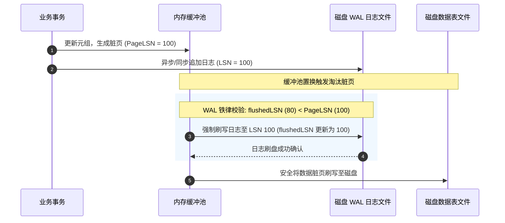
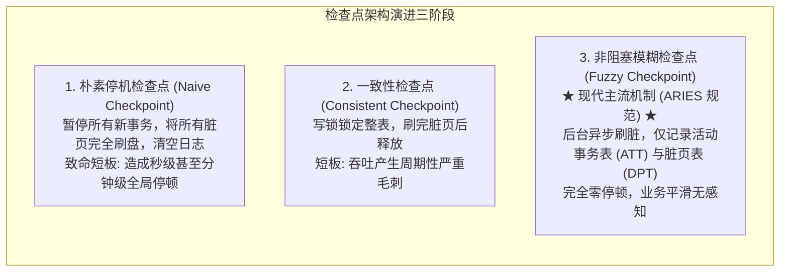

# Lec 13 故障恢复原理与日志体系

## TL;DR

- 故障恢复在硬件崩溃与突发断电面前捍卫 ACID 事务的原子性（Atomicity）与持久性（Durability）。
- 缓冲池策略 Steal（允许未提交脏页换出刷盘）与 No-Force（允许已提交脏页延迟刷盘）最大化吞吐，但分别引入撤销（Undo）与重做（Redo）的恢复需求。
- 预写日志（WAL）铁律强制要求：任何数据脏页刷盘前，其对应的日志记录必须先行落盘（`flushedLSN >= pageLSN`）。
- 生理日志（Physiological Logging）结合“物理寻址到页、逻辑操作于页内”，兼顾了状态自包含性与高并发下的极低日志体积。
- 模糊检查点（Fuzzy Checkpointing）与组提交（Group Commit）在不停机、不阻塞并发的前提下平滑 I/O 尖峰并加速恢复收敛。

## 架构演进与核心洞察

::: insight 预写日志的哲学本质：以廉价顺序 I/O 赎买昂贵随机 I/O
在传统面向磁盘的数据库架构中，数据页通常分散在存储介质的各个区域。如果每次事务提交都要强制将修改的数据页同步刷盘（Force 策略），系统将承受灾难性的随机 I/O 寻道惩罚，吞吐量暴跌数个量级。
预写日志（Write-Ahead Logging）展现了存储系统设计中的经典哲学转换：**将分散在整个存储空间的随机修改，转化为连续追加（Append-Only）写入的顺序日志流**。既然顺序写日志的速度比随机写数据页快数十至数百倍，那么只要日志落盘即可视作事务持久化成功；真实的数据脏页则可以在缓冲池中充分合并修改并异步批量刷盘。这一设计以极小的顺序 I/O 赎买了昂贵的随机 I/O，构筑了现代数据库高吞吐写入的物理基石。
:::

## 课前阅读与文献研读 (Reading Assignment)

> 本讲核心必读文献。ARIES 划时代恢复算法上篇：深入理解 STEAL/NO-FORCE 缓冲池策略、预写日志（WAL）铁律与 LSN 递增序列号体系。  
> 📖 **文献研读入口**：[必读论文精读：ARIES：基于预写日志的细粒度崩溃恢复算法](./paper/aries_recovery_algorithm.md)

## 核心机制与讲义正文

> [!TIP] **[待补截图]** 建议截取官方课件 Slides 第 13 讲中关于“缓冲池 Steal/No-Force 策略与 WAL 刷盘先后顺序屏障图”。此处预留插图空间。

> MIT 6.5830 / 6.5831 · Database Systems · 第 13 讲  
> 核心教材：*Readings in Database Systems* (5th Edition, Red Book)  
> 经典文献：Jim Gray (1981) *`Notes on Data Base Operating Systems`*；C. Mohan et al. (IBM Almaden, 1992) *`ARIES: A Transaction Recovery Method`*  
> 配套实验：GoDB (Go-based Database Engine) Lab 4: Transactions and Recovery

## 1. 存储体系与崩溃故障模型

数据库运行在多层硬件存储介质之上，由于易失性存储与非易失性存储的物理特性差异，系统必须应对各种突发硬件故障。

### 1.1 存储介质分级特性

| 存储类型 | 数据持久性 | 典型示例 | 数据库核心用途 |
| :--- | :--- | :--- | :--- |
| **易失性存储（Volatile）** | 断电后数据瞬间丢失 | DRAM、CPU 缓存 | 缓冲池缓存、锁表、活动事务表 |
| **非易失性存储（Non-Volatile）** | 断电后数据可靠保留 | NVMe SSD、企业级 HDD | 数据表文件、预写日志文件（`WAL`） |
| **稳定存储（Stable Storage）** | 理论永不丢失（通过多副本容灾逼近） | RAID 阵列、跨机房对象存储、日志流复制 | 归档日志、全量备份镜像、跨区域容灾备机 |

### 1.2 故障类型与恢复责任边界

数据库系统通常划分三类典型故障：
1. **事务故障（Transaction Failure）**：
   - **逻辑错误**：事务因违反业务约束或完整性检查主动中止（`ABORT`）；
   - **内部异常**：死锁检测器选中该事务作为牺牲品终止执行。
   - **处理方案**：通过事务日志逆向撤销（Undo）未提交操作，释放所持资源。
2. **系统崩溃（System Crash）**：
   - **物理断电**：机房供电中断或操作系统 Kernel Panic 导致崩溃；
   - **故障假设**：易失性内存（DRAM）内容全部丢失，非易失性存储（SSD/HDD）内容完好无损（Fail-Stop 模型，不存在拜占庭故障或静默数据损坏）。
   - **处理方案**：重启时扫描预写日志，重做已提交事务，撤销未完成事务。
3. **介质故障（Media Failure）**：
   - **灾难损坏**：磁盘磁头损坏、存储控制器固件故障或介质不可读。
   - **处理方案**：依赖全量备份镜像结合归档日志进行离线重放恢复，或通过分布式多副本共识机制实现即时自动转移。

---

## 2. 缓冲池策略与预写日志铁律（`WAL Invariant`）

故障恢复机制的核心复杂度直接源于数据库缓冲池（Buffer Pool）管理内存脏页与磁盘文件同步的策略取舍。


### 2.1 STEAL 与 FORCE 策略的本质权衡

缓冲池策略由两个维度的正交选择定义：

1. **STEAL 策略（允许窃取）**：
   - **定义**：当缓冲池已满且需要调入新页时，系统是否允许将**尚未提交事务修改过的脏页**置换并刷入磁盘。
   - **若允许（STEAL）**：极大释放内存压力，提升缓冲池利用率与并发吞吐；代价是磁盘可能包含未提交脏数据，系统崩溃后**必须具备 Undo（撤销）能力**以清除未完成事务的影响。
   - **若禁止（NO-STEAL）**：未提交脏页绝不能刷盘，事务所有修改必须常驻内存直至提交；一旦内存耗尽系统将无法继续执行长事务。
2. **FORCE 策略（强制刷盘）**：
   - **定义**：当一个事务请求提交（`COMMIT`）时，系统是否必须强制将该事务修改过的**所有数据脏页**全部同步刷写到磁盘后才返回成功。
   - **若强制（FORCE）**：提交时磁盘已拥有事务的最新状态，系统崩溃后**无需 Redo（重做）**；代价是每次事务提交都会产生灾难级的多页面随机 I/O 写入，严重扼杀并发性能。
   - **若不强制（NO-FORCE）**：事务提交时只需保证其修改日志落盘，数据页可继续驻留内存异步批量写回；代价是磁盘可能缺少已提交事务的最新数据，系统崩溃后**必须具备 Redo（重做）能力**。

现代高性能关系数据库（如 PostgreSQL、MySQL InnoDB、Oracle、SQL Server）一致选择 **STEAL + NO-FORCE** 组合：以最大的自由度榨取系统并发吞吐，并将一致性与持久性重任交由预写日志（WAL）承担。

### 2.2 预写日志铁律（Write-Ahead Logging Invariant）

为了在 STEAL + NO-FORCE 策略下严格维持 ACID 契约，系统必须严格恪守以下两条物理不变量：



::: theorem 预写日志第一铁律（WAL Invariant / Undo 规则）
在缓冲池将任何包含未提交修改的数据脏页写回非易失性磁盘之前，描述该修改的预写日志记录必须已经完全同步落盘。
$$\text{flushedLSN} \ge \text{pageLSN}$$
如果违反此规则，磁盘上可能出现未提交的脏数据，而用于撤销它的日志尚未落盘；此时若发生断电，系统将无法撤销脏数据，永久破坏事务的原子性（Atomicity）。
:::

::: theorem 预写日志第二铁律（Commit Invariant / Redo 规则）
在事务向客户端返回提交成功确认之前，该事务生成的所有日志记录（包括最终的 `COMMIT` 记录）必须已经完全同步刷入非易失性磁盘。
如果违反此规则，客户端收到提交确认后若系统瞬间断电，由于对应日志丢失，重启后无法重做该事务，永久破坏事务的持久性（Durability）。
:::

---

## 3. 日志记录模式与生理日志演进

预写日志的内容记录方式直接决定了日志文件的大小、生成速度以及故障恢复时的复杂性。

### 3.1 物理日志 vs 逻辑日志 vs 生理日志

| 日志类型 | 记录内容 | 核心优势 | 致命短板 |
| :--- | :--- | :--- | :--- |
| **物理状态日志（Physical State Logging）** | 记录修改前后的整个数据页二进制镜像（Before-Image / After-Image） | 恢复逻辑极度简单，天然绝对幂等 | 日志体积极其庞大，写放大严重，网络与磁盘瓶颈严重 |
| **逻辑操作日志（Logical Operation Logging）** | 记录高层操作命令（如 `UPDATE accounts SET balance = balance + 10 WHERE id = 1`） | 日志极其紧凑，体积微小 | 并发恢复无法保证幂等性，多版本隔离下极难还原精确物理状态 |
| **生理日志（Physiological Logging）** | **物理寻址到页，逻辑记录于页内**（Physical-to-a-page, Logical-within-a-page） | 兼顾物理日志的状态独立性与逻辑日志的极度紧凑，工业界标准 | 需要解析内部 Slot 与元组偏移 |

### 3.2 现代生理日志的工业实践

现代数据库广泛采用生理日志架构：
- 每一条日志明确关联一个唯一的 `PageID`；
- 日志内部记录页面内部的局部逻辑操作（例如：“在数据页 42 的插槽 3 中将偏移量 16 处的整型值由 100 改为 150”）；
- 这种设计的关键优势在于：**每个数据页可以独立执行重做与撤销，不同数据页之间的恢复互不影响，天然支持多线程高度并发恢复**。

---

## 4. 组提交（Group Commit）与变更数据捕获（CDC）

### 4.1 组提交：平滑 fsync 尖峰

在传统设计中，每个事务提交时都要触发一次磁盘 `fsync`。在机械硬盘时代，单次 `fsync` 耗时约 10ms，系统吞吐量硬上限仅为 100 TPS。

组提交（Group Commit）机制通过流水线化聚合并发事务的刷盘请求：
1. **Leader 选举**：第一个到达提交阶段的线程成为 Group Leader，后续并发到达的线程作为 Follower 将自身日志追加到内存缓冲区并挂起等待；
2. **批量刷盘**：Group Leader 执行一次统一的系统调用 `fsync()`，一次性将这批并发事务的全部日志刷入磁盘；
3. **唤醒返回**：Leader 唤醒所有挂起的 Follower，并发向客户端返回提交成功。

组提交将单事务提交延迟与系统整体吞吐量解耦，在高并发负载下使得系统每秒能够处理数万次事务提交，同时保持严格的持久性保证。

### 4.2 变更数据捕获（Change Data Capture, CDC）

由于 WAL 顺序记录了数据库的所有状态变更，现代数据架构普遍将 WAL 作为下游系统的数据总线：
- 通过解析 WAL 日志流（如 Debezium、PostgreSQL Logical Replication）；
- 将更新事件无损、实时地分发至 Elasticsearch 搜索引擎、Kafka 消息队列以及 Snowflake / ClickHouse 实时数仓；
- 彻底避免了在应用层编写双写逻辑引发的数据不一致。

---

## 5. 检查点机制与活动事务管理

如果系统无休止地累积 WAL 日志，故障恢复将面临两大严峻挑战：
1. **磁盘空间耗尽**：历史日志无法安全归档或删除；
2. **恢复时间（RTO）无限延长**：重启时必须从数据库创建的第一天起扫描所有日志。

系统必须定期执行**检查点（Checkpointing）**以截断日志并限定扫描范围。



在模糊检查点中，系统只需在日志中写入 `<CHECKPOINT-BEGIN>`，记录当前内存中的活动事务表（Active Transaction Table, ATT）与脏页表（Dirty Page Table, DPT），随后写入 `<CHECKPOINT-END>`。在检查点执行期间，所有读写业务照常并发推进，真正做到了平滑无损。

---

## 6. 经典文献研读与学术思辨

### 6.1 图灵奖得主 Jim Gray 的开创性贡献（Notes on Data Base Operating Systems, 1981）

Jim Gray 在 1981 年的奠基之作中，首次在理论上形式化定义了数据库事务的 ACID 特性，并系统性推导了基于预写日志（WAL）与影子分页（Shadow Paging）的恢复模型。

- **核心洞见**：Gray 指出，任何计算机系统的物理存储层次必然分为易失与非易失介质，原子性与持久性本质上是**利用非易失日志对易失内存状态的确定性重构**；
- **历史影响**：为后续 1992 年 C. Mohan 提出工业事实标准 ARIES 奠定了理论基石。

---

## 7. 关键设计抉择与架构认知

::: insight 为什么现代数据库毫不犹豫选择 Steal + No-Force？
初学者可能会设想：采用 No-Steal + Force 策略，系统崩溃后既不需要 Undo 也不需要 Redo，代码实现极其简单。为什么工业界没有选择这条路？
原因在于**硬件物理特性的极度不对称性**。磁盘随机写入的延迟比内存高出数个数量级。Force 策略将昂贵的随机 I/O 绑定在事务的关键路径（Critical Path）上，每一笔小交易都要卡死几十毫秒等待磁头寻道；而 No-Steal 则将长事务死死卡在内存容量上限上。现代数据库毫不犹豫选择 Steal + No-Force，是用软件复杂度的提升（引入 ARIES 算法）换取系统吞吐量成百上千倍的量级跃迁。
:::

::: pitfall 忽视操作系统的页缓存（Page Cache）虚假落盘陷阱
在编写数据库内核或存储引擎时，最致命的误区是误以为调用 `write()` 将日志写入文件就完成了持久化。实际上，操作系统会将写入缓存在内核的 Page Cache 中，并没有真正落盘到 SSD 物理芯片。若此时突发断电，Page Cache 中的日志将彻底蒸发，导致 WAL 不变量被悄然破坏！
生产级数据库必须通过 `fsync()` / `fdatasync()` 或以 `O_DIRECT` / `O_DSYNC` 标志打开文件，强制物理硬件将电荷写入非易失介质，杜绝假持久化隐患。
:::

---

## 8. 课后深度思考题

### 思考题 1：预写日志铁律与组提交的临界并发推演
假设一个高并发电商系统，平均每秒有 5000 个轻量级事务请求提交。如果关闭组提交（Group Commit），单次 `fsync` 物理耗时为 1ms，请分析：
1. 系统的最大理论并发提交吞吐量是多少？为什么会出现严重的线程排队雪崩？
2. 在开启组提交后，Group Leader 是如何协同多个 Follower 线程完成批量持久化的？
3. 在组提交等待队列中，如果系统突发断电，哪些事务会成功持久化，哪些事务会被回滚？是否存在数据不一致的灰色地带？

### 思考题 2：影子分页（Shadow Paging）vs 预写日志（WAL）的工程抉择
早期数据库系统（如 System R 的部分实验版本）曾尝试采用影子分页（Shadow Paging）实现恢复：修改数据时绝不就地覆盖旧页，而是开辟新物理页并更新当前页表指针；提交时原子切换根页表指针。
1. 试从磁盘寻道局部性、聚簇索引连续性与垃圾回收（GC）开销三个角度，论证为什么影子分页在大规模高并发 OLTP 场景下惨败给预写日志（WAL）？
2. 现代写时复制文件系统（如 ZFS、Btrfs）或存算分离云数仓在何种程度上复兴了影子分页的思想？其成立的硬件与应用前提是什么？

---

## 详细机制推导与原版课堂图解

> MIT 6.5830 / 6.5831 · Database Systems · 第 13 讲  
> 核心教材：*Readings in Database Systems* (5th Edition, Red Book)  
> 配套实验：GoDB (Go-based Database Engine)

## 本讲导览

- 乐观并发控制
- 多版本并发控制
- 论文阅读：

## 乐观并发控制

乐观并发控制（Opitimistic Concurrency Control， OCC）， 是非锁的事务隔离性方案，”乐观“是指认为冲突很少，不加锁，让事务“乐观地”执行，到最后再验证是否出现了冲突。

💡关键方法：
- 每个事务有自己的写缓冲区，写操作先写在缓冲区中，不直接修改数据库
- 跟踪读写操作，分别组成读取和写入集合
- 提交时，检查是否与其他并发事务存在冲突
- 如果检测到冲突，事务会中止（abort），一般会重试。
- 如果验证通过（无冲突），则将写缓冲区的数据写入数据库（真正生效）

在乐观并发控制（OCC）中， 从不需要等待锁，因此没有死锁。但是...发生冲突的事务必须重新启动，因此事务可能会“饥饿”——例如，反复被重新启动，永远无法取得进展。**权衡**：当重启率较低时，OCC 的表现会更好（即，争用较少）。

最近关于高性能事务处理的研究集中在 OCC 上，因为：OCC 的检查可以在单个事务之间完成；不像全局共享的锁表那样复杂。 现代 OCC 系统能够实现极高的吞吐量（超过每秒 1000 万次操作）。
### 实现

事务的执行划分为三个阶段：

1. 读取阶段：事务在数据库上执行操作，并存储局部状态。
2. 验证阶段：事务检查它是否可以提交。
3. 写入阶段：事务将状态写入数据库。

#### 1. 读取阶段

- 事务正常执行，但所有修改只影响自己的本地数据副本
- 事务记录下它读了什么、改了什么（read set 和 write set）

```python
def twrite(object, value):
  if object not in write_set: # 从没写入，制作副本
    m = read(object)
    copies[object] = m
    write_set = write_set U {object} # 加入新元素
  write(copies[object, value])

def tread(object): 
 read_set = read_set U {object}; 
 if object in write_set: # 这允许我们读取自己写入的内容
   return read(copies[object]); 
 else:
   return read(object); 
```

#### 2. 验证阶**段**

需要有一套验证规则，让我们如何知道事务是否可以提交。但是首先……我们如何对事务进行排序？

##### 验证规则

验证规则会保证可串行性，$T_j$在冲突方面将会被排序到$T_i$之后。 具体来说，在事务$T_j$完成其读取阶段时，对于所有的$T_i  \prec T_j$，必须满足以下条件之一，才能是验证通过（$T_j$才能提交）

1. $T_i$在$T_j$开始读取阶段之前完成了其写入阶段，即$W(T_i) \prec R(T_j)$

   

   在$T_j$开始读阶段时， $T_i$已经完成它的写阶段，他们**没有任何重叠**

2. $W(T_j)$与$R(T_i)$不相交，并且$W(T_i) \prec W(T_j)$

   

   原因：$W(T_j)$与$R(T_i)$相交，说明$T_i$读取了一部分$T_j$写入的内容；$W(T_i)$ 与$W(T_j)$相交，说明$T_j$ 写入了$T_i$写入的内容。这样保证了，$T_j$写的任何$T_i$已经写入的数据，后面会被安装，且$T_i$读的数据不会反映$T_j$的写入。

3. W($T_i$) 与 R($T_j$)或 W($T_j$) 不相交，$R(T_i) \prec R(T_j)$​

   

   原因：$W(T_j)$与$R(T_i)$相交，说明$T_i$读取了一部分$T_j$写入的内容（但是$T_i$可能读取了。

   $T_j$ 没有读取或写入$T_i$写入的数据（但是$T_i$可能读取了$T_j$吸入

4. W($T_i$) 与 R($T_j$)或 W($T_j$) 不相交，并且 W($T_j$) 与 R($T_i$)不相交（即没有冲突）

#### 3. 写入阶段

```python
def twrite(object, value): 
 if object not in write_set: # 如果从未写过，制作副本
   m = read(object)
   copies[object] = m
   write_set = write_set U {object}
 write(copies[object], value)
```

通过写入本地副本，我们确保了不干净的结果对其他并发事务不可见。

### 事务标识符分配

>  分配事务标识符 T1, … Tn，以确保这是与串行等效的顺序。
>
> **何时分配事务标识符？**
>
> a) 在事务开始时
> b) 在验证阶段开始时
> c) 在写入阶段开始时
> d) 在写入阶段结束时

- 目标：分配事务标识符 T1, ... Tn，以确保这是与串行等效的顺序。
- 何时应该分配事务标识符？
- 在读取阶段开始时分配？
  - 不行！这将是“悲观的”——不想在事务运行完成之前就预先分配事务顺序。
  - 长时间运行的事务必须在之后的短事务之前提交。
- **在读取阶段结束时分配**，就在验证开始之前。

## 多版本并发控制和快照隔离

### 本讲导览

多版本并发控制 (MVCC) 是一个比并发控制协议更大的概念。它涉及 DBMS 设计和实现的各个方面。MVCC 是 DBMS 使用最广泛的方案。过去 10 年内，几乎所有新开发的 DBMS 都采用了它。即使是不支持多语句事务的系统（例如 NoSQL）也使用了它。

使用 MVCC，DBMS 会在数据库中维护单个**逻辑**对象的多个**物理**版本。当事务写入对象时，DBMS 会创建该对象的新版本。当事务读取对象时，它会读取事务启动时存在的最新版本。MVCC 的基本概念/优点是写入操作不会阻塞读取操作，读取操作也不会阻塞写入操作。这意味着一个事务可以修改对象，而其他事务可以读取旧版本。但如果写入者正在写入同一对象，则由于与数据库对象相关的版本仍然处于上锁状态，因此其他写入者仍可能会被阻塞。

使用 MVCC 的一个优点是，只读事务可以读取数据库的一致**快照（snapshot）**，而无需使用任何类型的锁。此外，多版本 DBMS 可以轻松支持时间旅行查询，即基于数据库在某个其他时间点的状态的查询（例如，对 3 小时前的数据库执行查询）。

典型的基于 MVCC 的数据库设计将：

1. 有一个版本化存储，用于存储同一逻辑对象的不同版本。
2. 当事务开始时，DBMS 会创建数据库快照（通过复制事务状态表）
3. DBMS 使用快照来确定哪些版本的对象对事务可见

MVCC 设计有五个重要的决策：

1. 并发控制协议
2. 版本存储
3. 垃圾回收
4. 索引管理
5. 删除

并发协议的选择取决于之前课程中讨论的方法（两阶段锁定、时间戳排序、乐观并发控制）。

**快照隔离**

快照隔离是指在事务启动时为事务提供一致的数据库快照。快照中的数据值仅包含已提交事务的值，并且该事务在完成之前完全与其他事务隔离运行。这对于只读事务非常理想，因为它们无需等待其他事务的写入。写入操作保存在事务的私有工作区中，或与事务元数据一起写入存储，并且只有在事务成功提交后才对数据库可见。 写入冲突：如果两个事务更新同一个对象，则第一个写入者获胜。 当两个并发事务修改不同的对象导致不可序列化的调度时，快照隔离中可能会发生写入倾斜异常。例如，如果一个事务将所有白色弹珠更改为黑色，而另一个事务将所有黑色弹珠更改为白色，则结果可能不符合任何可序列化的调度。

### 可重复读 vs 可串行化

一些系统，例如 PostgreSQL，通过一种基于事务开始时数据库快照的不同机制来实现**可重复读** (REPEATABLE READ)。

- 这种机制被称为“多版本并发控制”（MVCC）——这是实现隔离性的一种方式！

这种机制除了幻影读问题外，还有其他问题——所谓的“读偏斜异常”（read skew anomalies）。

### 快照隔离

- 当一个事务 (TA) 开始时，它会接收到一个时间戳 T。

- 所有读取操作都是基于 T 时间戳的数据库版本进行的。
  - 这意味着需要保留所有对象的历史版本！
- 所有写入操作都在一个单独的缓冲区中进行。
  - 这些写入操作只有在提交后才会变得可见。
- 当事务提交时，数据库管理系统 (DBMS) 会检查是否存在冲突。
  - 如果存在事务 TA2 满足以下条件，则中止事务 TA1（时间戳为 T1）：
    - TA2 在 T1 之后且在 TA1 之前提交。
    - TA1 和 TA2 更新了相同的对象。

> 在快照隔离下，
> A） T2 应该中止还是提交？
>
> B）T3 应该中止还是提交？
>
> | T1               | T2                                          | T3                               |
> | ---------------- | ------------------------------------------- | -------------------------------- |
> |                  |                                             | R(Y)                             |
> | W(Y)<br />Commit |                                             |                                  |
> |                  | Start<br />R(X)<br />R(Y)                   |                                  |
> |                  |                                             | W(X)<br />W(Z)<br />Commit/Abort |
> |                  | R(Z)<br />R(Y)<br />W(X)<br />Abort/Commit? |                                  |

事务 T1 在使用快照隔离时：

- 在开始时获取已提交数据的快照
- 始终在自己的快照中读取/修改数据
- 并发事务的更新对 T1 不可见
- T1 的写入操作在提交时完成
- **先提交者获胜**规则
  - 只有在没有其他并发事务已经写入 T1 打算写入的数据的情况下，T1 才能提交

Solution：
对于 T2 来说

R(Z)->v0， 并发更新不可见
R(Y) ->v1,  自身更新可见
W(X:=v3): 非 X 的首个提交者
串行化失败，T2 必须回滚

| T1                     | T2                                                      | T3                                         |
| ---------------------- | ------------------------------------------------------- | ------------------------------------------ |
|                        |                                                         | R(Y)->v0                                   |
| W(Y := v1)<br />Commit |                                                         |                                            |
|                        | Start<br />R(X) -> v0<br />R(Y) -> v1                   |                                            |
|                        |                                                         | W(X := v2)<br />W(Z := v1)<br />**Commit** |
|                        | R(Z) -> v0<br />R(Y) -> v1<br />W(X:=v3)<br />**Abort** |                                            |

> 对于什么类型的工作负载，你应该使用两阶段锁定（2PL），对于什么类型的工作负载你应该使用快照隔离（SI）？

创建一个现实世界的示例（例如，银行业务、酒店预订等），其中使用快照隔离保证执行的两个事务将违反可串行化。

- 快照隔离无法防止读写冲突，因为它不会检查是否读取了另一个事务写入的数据

- 这会导致所谓的写偏差

  - 例子：

  | T1   | T2   |
  | ---- | ---- |
  | RX   |      |
  |      | RY   |
  | WY   |      |
  |      | WX   |

  两个事务都没有看到对方的写操作，这在串行化是无法被允许的

- 现实世界的例子：

  - 员工 X 和员工 Y 正在报名值班。
  - 他们互相厌恶，不想一起工作。
  - 员工 Y 检查员工 X 是否没有值班（读取 X）。
  - 员工 X 检查员工 Y 是否没有值班（读取 Y）。
  - 两人都更新了他们的时间表，在同一天值班。

> 快照隔离有幻读问题吗？

> 在 2PL 下， 以下锁请求来自锁管理器，这里有死锁吗？你能想到创建或解决死锁的简单更改吗？
>
> | T1   | T2   | T3   |
> | ---- | ---- | ---- |
> | RA   | RB   | RC   |
> | WB   | RC   | RA   |
>
> 

| 时间戳 | 类型            | TID  |
| ------ | --------------- | ---- |
| t1     | Req.ReadLock A  | T1   |
| t2     | Req.ReadLock B  | T2   |
| t3     | Req.ReadLock C  | T3   |
| t4     | Req.ReadLock A  | T3   |
| t5     | Req.WriteLock B | T1   |
| t6     | Req.ReadLock C  | T2   |

## 事务隔离性级别

### ANSI SQL 定义

ANSI SQL 标准定义了四个“隔离等级”

- 未提交读（Read Uncommitted），一个事务可以读任何已提交或未提交的数据。
  - 这可以通过“读操作不需要请求任何锁”来实现。
  - 但是，为了防止其他事务看到脏数据，需要在事务的整个持续时间内持有写锁
  - 应用场景，如果只是报告一些统计数据，如用户数量或浏览次数，这可能是可以接受的
- 读已提交（Read Committed）, 一个事务可以读任何已提交的数据。对于同一个对象的重复读可能导致读到不同版本的数据。
  - 如果所有其他事务都持有写锁（就如在 READ UNCOMMITTED 中），它将永远不会读取脏数据
  - 实现方式是，读数据前必须首先获得一个读操作锁，一旦数据读取之后该锁被立即释放。
    - 由于不在意总是读取相同的值，读取后可以释放锁
- 可重复读（Repeatable Read）：一个事务只能读取一个已提交数据的一个版本；一旦该事务读取了一个对象，那么，它将只能读取该对象的同一个版本。
  - 如果我们想总是读取相同的值，需要在事务持续时间内持有读锁， 因此实现方式是，事务在请求读数据 之前必须获得一个锁，并且保持该锁直到事务结束。
- 可串行化
  - 与可重复读相比， 可串行化还需要防止幻读。

大部分 DBMS 默认是读已提交。

#### 幻读和幽灵问题

乍一看可重复读似乎保证了完全的可串行化，但是，其实并不是这样。 在幽灵问题中，一个事务使用同样的谓词多次访问了同一个关系，但是，最近的访问却得到了最初访问时没有发现的新的“幽灵元组”。原因在于，元 组级的两段锁并不能阻止往表中插入元组。表级别的两段锁可以防止幽灵问题，但是，当事 务通过索引访问表中的几个元组时，表级别的两段锁是被限制的

----

### 其他隔离级别

#### 快照隔离

这是 MVCC 在数据库产品中的主要应用之一。当事务开始时，它从一个单调递增的计数器中得到一个开始时间戳，当它成功提交时得到一个终止时间戳。对于一个事务 T 而言，只有当具有与 T 重叠的开始/结束时间戳的其他事务不去写事务 T 要写的数据时，事务 T 才会提交。这种隔离模型更依赖于多版本并发的实现，而不是锁机制。

- 当一个事务（TA）启动时，它会接收到一个时间戳 T。

- 所有读取操作都基于 T 时刻的数据库版本进行。
  - 需要保留所有对象的历史版本！
- 所有写入操作都在一个单独的缓冲区中进行。
  - 写入操作只有在提交后才会变得可见。
- 当事务提交时，DBMS 会检查冲突。
  - 如果存在事务 TA2 满足以下条件，则中止具有时间戳 T1 的事务 TA1：
    - TA2 在 T1 之后且在 TA1 之前提交
    - TA1 和 TA2 更新了相同的对象

**例子**


> T2 会提交还是中止？
>
> T3 会提交还是中止？

#### 读一致

这是 Oracle 定义的一种 MVCC 形式，它相对于快照隔离有一些不同。

#### 游标稳定

这个等级是为了解决已提交读的更新丢失问题。假设有两个事务 T1 和 T2。T1 以“已提交读”模式运行，读取数据项 X（假设是银行账户值），记录这个 值，然后根据记录的值重写数据项 X（假设为原始账户增加￥100）。T2 同样读写了 X（假设从账户取走￥300）。如果 T2 的行为发生在 T1 的读和写之间，那么 T2 对于 账户的修改将丢失，即对于我们的例子而言，该账户最终将增加￥100 而不是减少 ￥200。游标稳定中的事务将根据查询游标在最近读取的数据项上加一个锁，当游 标移走（如数据被提取）或者事务中止时释放该锁。游标稳定允许事务对个别数据 项目按照“读—处理—写”的顺序来操作，其间避免了其他事务的更新干扰

## 论文阅读： 乐观并发控制

孔祥重，台湾人写的。OCC 的奠基之作

## 本讲导览

大多数并发控制方法都依赖于对数据对象加锁实现，这论文介绍两种非锁的并发控制。所使用的方法是“乐观的”，因为它们主要依赖于事务回滚作为控制机制，并“希望”事务之间不会发生冲突。文中还讨论了这些方法在某些应用中可能比锁定更高效的情况。

## 1 介绍

我们假设某些特殊对象（称为 root）总是存在的，且访问任何非根对象只能通过首先访问一个根对象，然后跟随指向该对象的指针来进行。任何保持数据完整性约束的数据库访问序列称为**事务**。

如果我们的**目标是最大化对数据库的访问吞吐量**，那么有两种典型场景尤其需要做高并发的访问，即同时允许多个事务或请求访问数据库系统：

1. 即使是只读事务（如查询），理论上不会破坏数据完整性，但为了防止读取到正在被修改的数据，也需要加锁。
2. 如果这时只允许低并发（比如一次只能有一个事务运行），那么 CPU 会等待磁盘 I/O，系统整体会处于低利用状态。

这两种情况系统的硬件资源（CPU 和 I/O 等待）都会被浪费，从而导致数据库的访问吞吐量远低于理论上限。通常实现并发访问的方法是用锁，但有几个缺陷：

1. 锁的维护开销大。即便是只读事务，也需要锁，即便并不影响数据的完整性；此外死锁检测也被认为是锁的维护开销的一部分；如果锁机制本身可能造成死锁，还要额外投入资源进行**死锁检测**，进一步增加开销。

2. 没有通用的高并发无死锁的锁协议

3. 事务在访问一个热点节点（如 root），若此时该节点尚未从磁盘调入内存，会显著降低并发性

4. 为了支持事务回滚，在事务完成或者中止之前，不能释放锁。进一步降低并发性

5. 在很多场景中，锁其实不太需要。 **(a)** 数据库中节点非常多，但每次事务涉及的节点很少。**(b)** 热点节点（容易冲突的节点）被修改的概率很低。

   当下述条件成立时，可以预期（5）的论点是成立的：图中的节点数量远大于在给定时间内所有正在运行的事务涉及的节点总数，修改热点节点的概率很小。

💡而在本文中，消除锁的乐观方法背后的想法非常简单：

1. 由于从节点读取一个值或指针永远不会导致完整性丧失，因此读取是完全不受限制，然而，**返回查询结果被认为等同于写入**，因此要按照下面讨论的方式进行验证。
2. 写入受到严格限制。要求任何事务由两个或三个阶段组成：读取阶段、验证阶段和可能的写入阶段（见图 1）。在读取阶段，所有写入都在本地副本上进行修改。然后，如果在验证阶段能够确定事务所做的更改不会导致完整性丧失，则在写入阶段将本地副本变为全局副本。在查询的情况下，必须确定查询返回的结果确实是正确的。确定事务不会导致完整性丧失（或将返回正确结果）的步骤称为验证。


在第 2 节中，我们将更详细地讨论事务的读取和写入阶段。在第 3 节中，我们将介绍一种特别强大的验证形式。第 4 节中的并发控制系列具有串行的最终验证步骤，而第 5 节中的并发控制具有完全并行的验证，但总成本更高。第六节将分析乐观方法在控制 B 树并发插入中的应用。第七节包含总结以及对未来研究的讨论。

## 2 读取和写入阶段

并发控制如何支持用户编程的事务的读写阶段（以对用户不可见的方式），以及如何高效地实现这一点。验证阶段将在接下来的三节中进行讨论。

我们假设一个底层系统提供了对各种类型对象的操作。为了简单起见，假设所有对象都是相同类型的。对象通过以下过程进行操作，其中 n 是对象的名称，i 是传递给类型管理器的参数，v 是任意类型的值（v 可以是指针，即对象名称，或数据）：

我们假设一个底层系统提供了对各种类型对象的操作。为了简单起见，假设所有对象都是相同类型的。对象通过以下过程进行操作：

- `create`: 创建一个新对象并返回其名称。
- `delete(n)`: 删除对象 n。
- `read(n, i)`: 读取对象 n 的项 i 并返回其值。
- `write(n, i, v)`: 将 v 作为对象 n 的项 i 的值进行写入。

为了支持事务的读写阶段，我们还使用以下过程：

- `COPY(n)`: 创建一个对象 n 的副本并返回其名称。
- `exchange(n1, n2)`: 交换对象 n1 和 n2 的名称。

并发控制对用户是不可见的；事务的编写好像直接使用了上述过程一样。然而，事务需要使用语法上相同的过程`create`, `tdelete`, `tread`, 和`twrite`。对于每个事务，并发控制维护了事务访问的对象名称集。这些集合通过`tbegin`调用被初始化为空。用户编写的事务主体实际上是前面提到的读阶段；后续的验证阶段直到`tend`调用之后才开始。

```go
tcreate = (
	n := create;
	create_set := create_set ∪ {n}; # create set 用于跟踪当前事务中已经创建的所有对象
	return n;
)
twrite(n, i, v) = (
	if n ∊ create_set
		then write(n, i, v);
	else if n ∊ write_set
		then write(copies[n], i, v);
	else (
		m := copy(n);
		copies[n] := m;
		write_set := write_set ∪ {n};
		write(copies[n], i, v);
	)
)

tread(n, i) = (
	read_set := read_set ∪ {n};
	if n ∊ write_set
		then return read(copies[n], i);
	else
		return read(n,i);
)

tdelete(n) = (
	delete_set := delete_set ∪ {n}
)
```

我们可以看到，在读阶段，没有全局写入操作发生。相反，每当请求对某个对象进行第一次写入时，会创建一个副本，所有后续的写入都指向这个副本。这个副本可能是全局的，但在读阶段，根据我们的约定，由于所有节点只能通过从根节点指针访问，因此它对其他事务不可访问。如果该节点是根节点，由于名称错误，这个副本也是不可访问的（所有事务“知道”根节点的全局名称）。假设没有根节点被创建或删除，没有指向已删除节点的悬挂指针，且创建的节点通过写入新指针变得可访问（这些条件是每个事务需要单独维护的数据结构的完整性标准的一部分）。

当事务完成时，它将通过`tend`调用请求验证和写入阶段。如果验证成功，则事务进入写入阶段，这仅仅是：

```text
for n ∈ write_set do exchange(n, copies[n])
```

写入阶段之后，所有写入的值变为“全局的”，所有创建的节点变得可访问，所有删除的节点变得不可访问。当然，一些清理操作是必要的，我们不认为这属于写入阶段的一部分，因为它不与其他事务交互：

```text
(for n ∈ delete_set do delete(n);
for n ∈ write_set do delete(copies[n]))
```

如果事务中止，这些清理操作也是必要的。请注意，由于对象是虚拟的（对象通过名称引用，而不是通过物理地址），交换操作（以及写入阶段）可以非常快速：基本上只需要交换两个对象描述符的物理地址部分。

最后，我们注意到，两阶段事务的概念对于恢复操作非常有价值，因为在读阶段结束时，事务打算对数据结构进行的所有更改都已知晓。

## 3 验证阶段

首先，串行等价性是验证并发事务执行正确性的一种常用标准。假设多个事务 `T1, T2, ..., Tn` 并发执行，共享数据结构为 `d`，定义数据集为 `D`。每个事务 $T_i$ 都可以视为
$$
T_i :D\rightarrow D
$$
公式（1）定义了正确性条件：如果初始数据结构为 `d_initial`，最终数据结构为 `d_final`，则并发执行是正确的，当且仅当存在一个排列 `π`，使得事务按照 `π` 的顺序执行时，最终的数据结构仍然是 `d_final`。
$$
d_{final} = T_{\pi(n)} \circ T_{\pi(n-1)}... \circ T_{\pi(2)} \circ T_{\pi(1)}(d_{initial})
$$
这个正确性标准背后的思想是，每个事务都应该独立地维护共享数据结构的完整性。

### 3.1 串行等价性验证

串行等价性的验证直接基于公式（1），其中需要找到一个事务执行的排列 `π`。为了实现这一点，在事务执行过程中为每个事务分配一个唯一的整数事务编号 `t(i)`。在验证过程中，确保事务 $T_i$ 在 $T_j$ 之前执行，当且仅当 `t(i) < t(j)`。这可以通过以下验证条件来保证：

1. $T_i$ 的写阶段在 $T_j$ 的读阶段开始之前完成。
2. $T_i$ 的写集合与 $T_j$ 的读集合没有交集，并且 $T_i$ 在 $T_j$ 开始写阶段之前完成写阶段。
3.  $T_i$ 的写集合与 $T_j$ 的读集合或写集合没有交集，并且 $T_i$ 的读阶段在 $T_j$ 的读阶段完成之前完成。


### 3.2 事务编号的分配

设计分配事务编号的并发控制机制时，首先要考虑如何分配事务编号。显然，事务编号应该按顺序分配，因为如果 $T_i$ 在 $T_j$ 开始之前完成，必须满足 `t(i) < t(j)`。文中建议的简单方案是维护一个全局整数计数器 `tnc`（事务编号计数器）；每当需要事务编号时，递增计数器并返回结果值。

为了优化事务的响应时间，作者建议在读阶段结束时分配事务编号，这样可以尽可能立即验证事务，而无需等待其他事务的完成。

### 3.3 实际考虑

给定这种分配方法，处理读阶段特别长的事务的情况， 当验证这种事务时，必须检查在其读阶段开始之前完成读阶段但尚未完成写阶段的所有事务的写集合。为了避免无限增长的写集合，文中建议只维护有限数量的最近写集合。如果无法获取旧的写集合，验证失败，事务回滚并重新执行。

最后，文中讨论了验证失败时的处理方法。通常情况下，事务会被中止并重新开始，分配一个新的事务编号。然而，如果验证多次失败，可能会导致事务“饥饿”。文中提出了一种简单的解决方案：在 `tend` 过程中进入短暂的关键区，如果并发控制检测到“饥饿”事务，它将在不释放关键区信号量的情况下重新启动事务，相当于锁定整个数据库，确保该事务能顺利完成。

## 4 串行验证 OCC

我们将介绍一系列并发控制，它们是第 3.1 节中验证条件 (1) 和 (2) 的实现。由于我们不使用条件 (3)，因此条件 (2) 的最后一部分意味着写入阶段必须是串行的。实现这一点的最简单方法是将事务号的分配、验证以及随后的写入阶段都放在一个临界区中（即在事务执行后期（`tend` 阶段），将“验证 + 写入 + 事务编号分配”封装在一个临界区里，串行完成）。在下文中，**我们将临界区用"<>"括起来**。

```go
tbegin = (
	create set := empty;
	read set := empty;
	write set := empty;
	delete set := empty;
	start tn := tnc; // 记录当前事务开始时的最大事务编号
)

tend = (
  <finish tn := tnc; // 暂时设为当前最大编号
  valid := true;
  // 检查【之后开始、但还没写入】的事务中是否有写了我读的东西
  for t from start tn + 1 to finish tn do
     if (关于事务t的写set与读set有交叉) 
			then valid := false; 
  if valid:
  	then
  			(write phase);
  			tnc := tnc + 1;
  			tn := tnc)
  >; 
  if valid 
		then ( cleanup )	// 清理临时数据
		else (backup)			// 放弃修改重新开始
)
```

## 5 并行验证

本节介绍的并发控制使用了 3.1 节所有三个验证条件， 从而允许更高的并发度。我们保留上一节的优化，仅在验证成功的情况下，在写入阶段之后分配事务号。
