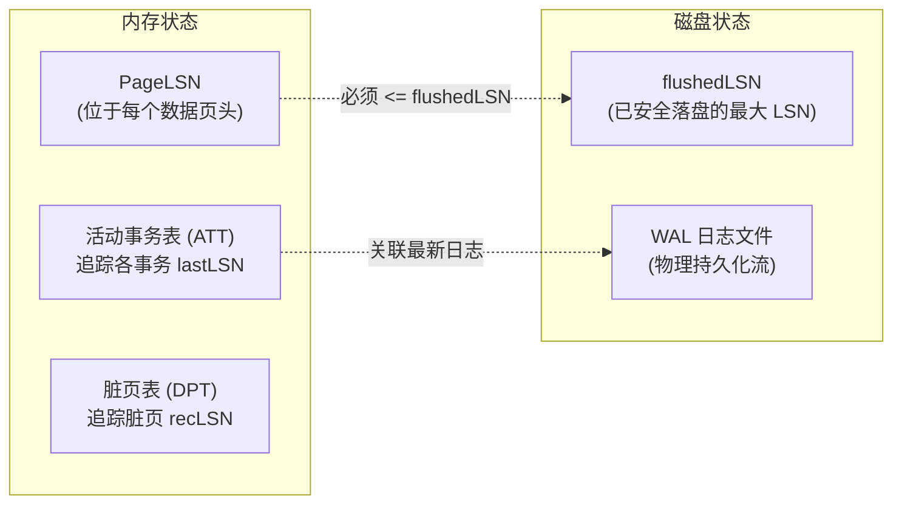
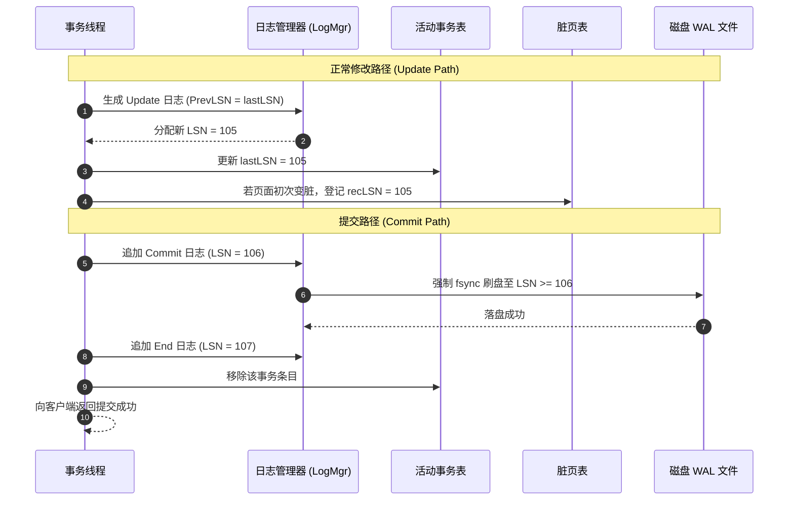
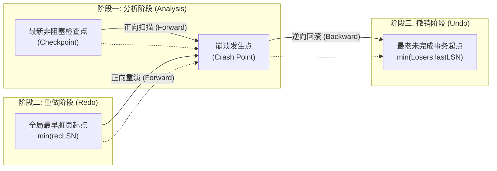
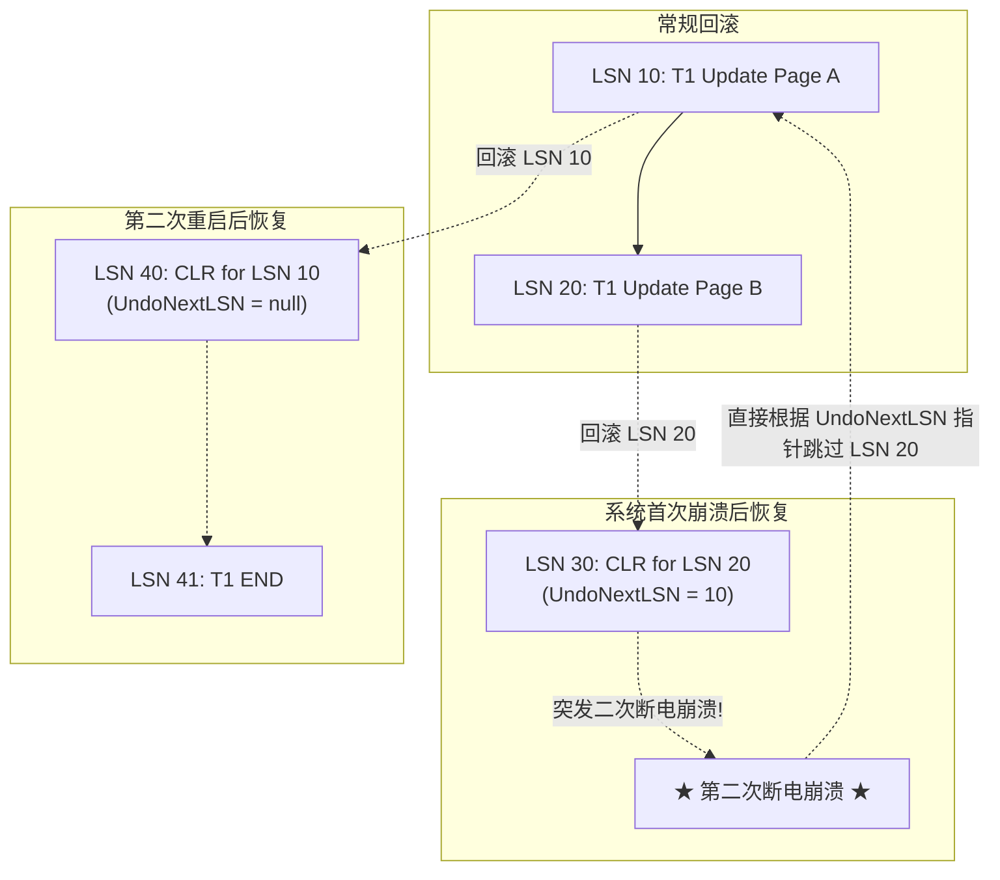

# Lec 14 故障恢复精讲：ARIES 算法

## TL;DR

- ARIES 是现代关系型数据库故障恢复的行业事实标准，基于预写日志（WAL）与 STEAL / NO-FORCE 缓冲池策略协同运行。
- ARIES 经典三阶段扫描：分析阶段重构活动事务表与脏页表；重做阶段物理重演全部历史（Repeating History）；撤销阶段逆向回滚全部未完成事务。
- 补偿日志记录（CLR）携带 `UndoNextLSN` 跳跃指针，彻底杜绝恢复期间重复崩溃引发的死循环，提供绝对的幂等性。
- 脏页表中的 `recLSN` 记录最早导致页变脏的日志编号，将重做扫描起点精确定位为所有脏页的最小 `recLSN`。
- GoDB Lab 4 完整落地 ARIES 协议，通过日志管理器与事务管理器的协作保障系统崩溃重启后数据自愈收敛。

## 架构演进与核心洞察

::: insight 补偿日志（CLR）与幂等恢复的天才之处
ARIES 算法中最天才的设计是补偿日志记录（Compensation Log Record, CLR）。当系统在崩溃恢复的 Undo 阶段执行回滚操作时，如果恢复过程再次发生断电崩溃，传统系统可能会重复执行回滚导致数据被双重破坏。CLR 记录了 Undo 操作本身，并在页头更新 PageLSN。更为关键的是，CLR 携带了指向当前事务下一个待回滚日志的跳跃指针（`UndoNextLSN`），使得重启后系统直接跳过已回滚的步骤，绝不重复撤销。任何重做或撤销操作均是严格幂等的，保证系统无论在恢复的哪一毫秒再次断电都能最终收敛到正确状态。
:::

## 课前阅读与文献研读 (Reading Assignment)

> 本讲核心必读文献。ARIES 划时代恢复算法下篇：详尽推演 Analysis 阶段、Redo 历史重放阶段与 Undo 回滚阶段中补偿日志记录（CLR）如何杜绝崩溃恢复期间二次死机引发的无限循环。  
> 📖 **文献研读入口**：[必读论文精读：ARIES：基于预写日志的细粒度崩溃恢复算法（恢复三阶段与 CLR 深度推导）](./paper/aries_recovery_algorithm.md)

## 核心机制与讲义正文

> [!TIP] **[待补截图]** 建议截取官方课件 Slides 第 14 讲中关于“ARIES 补偿日志记录（CLR）UndoNextLSN 跳跃指针避免二次崩溃回滚示意图”。此处预留插图空间。

> MIT 6.5830 / 6.5831 · Database Systems · 第 14 讲  
> 核心教材：*Readings in Database Systems* (5th Edition, Red Book)  
> 经典文献：C. Mohan et al. (IBM Almaden, 1992) *`ARIES: A Transaction Recovery Method Supporting Fine-Granularity Locking and Partial Rollbacks Using Write-Ahead Logging`*  
> 配套实验：GoDB (Go-based Database Engine) Lab 4: Transactions and Recovery

## 1. ARIES 恢复模型全景与核心设计哲学

由 IBM Almaden 研究中心的 C. Mohan 等人在 1992 年提出的 ARIES（Algorithms for Recovery and Isolation Exploiting Semantics）算法，被公认为数据库故障恢复领域最重要的里程碑。

ARIES 建立在三大核心基石之上：
1. **预写日志与生理日志（WAL with Physiological Logging）**：
   脏页写盘前日志先行落盘，单条日志物理寻址到页、逻辑修改于页内；
2. **重做期间重演历史（Repeating History during Redo）**：
   在系统重启后的 Redo 阶段，ARIES 不区分事务是已提交还是未完成，完全无差别地将数据库从崩溃时刻的状态精准“重演”出来，包括那些最终会被中止的事务操作；
3. **撤销期间记录补偿日志（Logging Changes during Undo via CLR）**：
   在回滚未完成事务的操作时，系统会像正常更新一样生成特殊的补偿日志（CLR），赋予恢复流程完全的幂等性。

---

## 2. ARIES 核心元数据与正常运行推进

在系统正常运行期间，数据库内核维护一组关键的状态标识与内存动态表。

### 2.1 日志序列号（LSN）体系

每个日志记录被赋予一个单调递增的 64 位整数——**日志序列号（Log Sequence Number, LSN）**。



- **`PageLSN`**：存储在每一个数据页的页头，记录最近一次对该页进行修改的日志记录 LSN；
- **`flushedLSN`**：内存中维护的全局标量，记录当前已经成功持久化刷入磁盘的最大日志 LSN；
- **`recLSN`（Recovery LSN）**：存储在脏页表（DPT）中，记录导致该页在内存中由“干净”变为“脏”的**第一条**日志 LSN。它是该页尚未写回磁盘的最早修改起点；
- **`lastLSN`**：存储在活动事务表（ATT）中，记录该事务所追加的最新一条日志记录的 LSN。

### 2.2 内存核心追踪表

1. **活动事务表（Active Transaction Table, ATT）**：
   - 追踪当前系统中所有正在运行但尚未完全提交或中止的事务；
   - 字段包括：`TxID`、事务状态（`Running` / `Committing` / `Aborting`）、`lastLSN`。
2. **脏页表（Dirty Page Table, DPT）**：
   - 追踪当前驻留在缓冲池中且内容与磁盘文件不一致的脏页；
   - 字段包括：`PageID`、`recLSN`。当一个脏页被缓冲池成功刷盘写回后，该条目从 DPT 中移除。

### 2.3 正常运行路径：提交与中止

在数据库系统没有发生故障的正常运行期，事务执行的所有写操作都会持续向 WAL 追加更新日志，同时原子更新内存中的活动事务表（ATT）与脏页表（DPT）。对于正常的事务提交与主动中止操作，系统遵循标准的状态迁移路径。

如下面的时序图所示，事务在生命周期中经历了日志生成、LSN 递增登记、强制同步落盘与最终资源清理的完整闭环：



- **正常提交路径**：写入 `Commit` 日志并调用 `fsync` 强制落盘。一旦落盘成功，事务即视为持久化成功。随后追加一条无需强制刷盘的 `End` 日志，并将该事务从 ATT 中清理。
- **正常中止路径**：事务在执行中主动中止时，从 ATT 中读取其 `lastLSN`，沿着 `PrevLSN` 指针逆向扫描其所有日志，为每一次反向撤销操作写入一条补偿日志（CLR），直至回滚到事务起点，最后写入 `End` 日志。

---

## 3. ARIES 崩溃恢复三大扫描阶段深度剖析

当数据库系统遭遇掉电或崩溃重启后，ARIES 恢复程序依次执行三个独立的日志扫描阶段。



### 3.1 阶段一：分析阶段（Analysis Phase）

- **扫描起点**：从磁盘上找到的最新一个成功写入的检查点（`CHECKPOINT-BEGIN`）开始；
- **扫描方向**：**从前向后（正向扫描）**直至日志末尾；
- **核心使命**：
  1. 重构崩溃瞬间内存中的活动事务表（ATT）与脏页表（DPT）；
  2. 确定在崩溃发生时哪些事务处于未完成状态（这些事务被称为“失败者 Losers”）；
  3. 确定阶段二（Redo 阶段）的扫描起点：即重构后的 DPT 中所有记录的**最小 `recLSN`**。

### 3.2 阶段二：重做阶段（Redo Phase - “重演历史”）

- **扫描起点**：从分析阶段确定的全局 $\min(\text{recLSN})$ 开始；
- **扫描方向**：**从前向后（正向扫描）**直至日志末尾；
- **核心哲学**：**重演历史（Repeating History）**。ARIES 在此阶段一视同仁地重做**所有**事务的操作（包括已提交的事务和注定要被回滚的 Losers 事务），同时重做 CLR 记录的操作，使数据库物理恢复到崩溃发生前一微秒的完全相同状态。
- **重做判断与条件跳过**：
  对于扫描到的每一条可重做日志，检查对应的目标页面是否确实需要重做：
  1. 若目标 `PageID` 不在 DPT 中，说明该页修改在崩溃前早已刷盘，**跳过**；
  2. 若目标 `PageID` 在 DPT 中，但 $\text{LSN} < \text{recLSN}$，说明该修改也已落盘，**跳过**；
  3. 若以上均不满足，从磁盘调入该数据页，若页头的 $\text{pageLSN} \ge \text{LSN}$，说明该修改已经持久化，**跳过**；
  4. 只有当 $\text{pageLSN} < \text{LSN}$ 时，才真正将修改应用到数据页上，并将页头的 `pageLSN` 更新为此 LSN。

### 3.3 阶段三：撤销阶段（Undo Phase - “回滚失败者”）

- **扫描起点**：从崩溃发生时的日志末尾开始；
- **扫描方向**：**从后向前（逆向扫描）**；
- **核心使命**：将分析阶段识别出的所有未完成事务（Losers）所做的全部修改彻底撤销。
- **撤销执行流程**：
  1. 系统维护一个集合包含所有 Loser 事务的当前 `lastLSN`；
  2. 每次从集合中选出最大（即最新）的一个 LSN 进行回滚处理；
  3. 执行撤销操作，并立即为该撤销写入一条**补偿日志记录（CLR）**；
  4. CLR 的 `UndoNextLSN` 字段被设置为当前被撤销日志的 `PrevLSN`；
  5. 当某事务的所有操作均已撤销完毕，写入 `End` 日志并将其从集合中移除，直至所有 Loser 事务处理完毕。

---

## 4. 补偿日志（CLR）与恢复期崩溃的幂等防线

故障恢复算法面临的最极端考验是：**在恢复阶段正在执行 Undo 回滚时，系统突然再次断电崩溃！**



### 4.1 为什么普通 Undo 日志会导致死循环崩溃？

若没有 CLR，系统在回滚 LSN 20 时若再次断电，重启后系统又会发现 LSN 20 未提交，再次尝试回滚 LSN 20。如果恢复代码本身存在边缘缺陷或反复遭遇断电，恢复过程将永远陷入重复回滚的死循环。

### 4.2 CLR 的不可撤销性与跳跃指针

- **CLR 绝不被撤销**：补偿日志本身记录的是一个撤销动作，对 CLR 进行回滚在语义上是荒谬的；
- **`UndoNextLSN` 跳跃导航**：CLR 内部携带一个显式指针 `UndoNextLSN = PrevLSN(被撤销日志)`。
  当二次崩溃重启后，扫描到 CLR 时，Undo 引擎直接读取 `UndoNextLSN`，跳过已经成功补偿过的修改，直接回滚上一步操作。这种设计确保了：**无论系统在恢复期间断电重启多少次，恢复总工作量严格单调递减，保证系统最终收敛完成恢复！**

---

## 5. 非阻塞模糊检查点机制（Fuzzy Checkpoint）

在 ARIES 架构中，检查点是完全非阻塞的，其具体执行时序如下：

1. 写入一条 `<CHECKPOINT-BEGIN>` 日志，记录启动时刻；
2. 扫描内存，复制当前活动事务表（ATT）与脏页表（DPT）的快照；
3. 将此快照作为内容写入一条 `<CHECKPOINT-END>` 日志并落盘；
4. 将 `<CHECKPOINT-BEGIN>` 的起始 LSN 写入磁盘固定主扇区的 Master Record 中。

在整个检查点执行期间，无需任何全局锁，读写事务不受任何干扰。

---

## 6. 经典文献研读与学术思辨

### 6.1 ARIES 论文精读（C. Mohan et al., ACM TODS 1992）

Mohan 等人在 1992 年发表的 66 页长篇论文 *`ARIES: A Transaction Recovery Method Supporting Fine-Granularity Locking and Partial Rollbacks Using Write-Ahead Logging`* 彻底统一了工业界数据库的恢复理论。

- **核心历史贡献**：
  1. 首次论证了为什么“重演历史（Repeating History）”比“仅重做已提交事务”更为严谨且易于支持细粒度行锁与锁释放；
  2. 提出了基于 CLR 的绝对幂等性保证；
  3. 允许部分回滚（Partial Rollbacks，如保存点 Savepoint）。
- **学术思辨：为什么 ARIES 要先重做未提交事务然后再撤销它？**
  如果直接跳过未提交事务的重做，系统必须在重做阶段动态解析并发事务交织的修改。然而在细粒度行锁和复杂多索引修改（如 B+ 树分裂）下，未提交事务所造成的物理页面结构变更可能已经被后续已提交事务观察或依赖。重演历史确保了所有页面的物理拓扑结构完全恢复到崩溃时的确定性状态，使得随后的 Undo 能够安全地在确定拓扑上执行。

---

## 7. GoDB 实验对齐与工业级实践

在 GoDB 实验体系的 Lab 4（Transactions & Recovery）中，学生需要亲手实现 ARIES 核心模块：

- **`LogFile`**：管理磁盘 WAL 文件的追加、头部定位与原子刷盘；
- **`TransactionManager`**：维护全局并发事务状态，在提交与中止时协调日志写入；
- **`BufferPool`**：严格执行 WAL 铁律，在脏页换出前校验 `flushedLSN >= pageLSN`；
- **`RecoveryManager`**：实现 Analysis、Redo 与 Undo 三大阶段逻辑，并在恢复过程中正确生成 CLR。

---

## 8. 课后深度思考题

### 思考题 1：重演历史（Repeating History）在并发行级锁系统中的不可替代性
设想两个并发事务 $T_1$ 和 $T_2$ 分别修改了同一个数据页 $P$ 中的不同元组（行锁隔离）。$T_1$ 先修改后系统换页刷盘，随后 $T_2$ 修改但未提交，此时发生系统崩溃。
1. 为什么传统的“仅重做已提交事务”算法在处理多行并发修改时极难实现？
2. ARIES 是如何通过先在 Redo 阶段重演 $T_2$ 的历史修改、再在 Undo 阶段撤销 $T_2$，来解耦恢复逻辑与并发锁管理器的？

### 思考题 2：ARIES 恢复期间突发重复断电的边界推演
假设事务 $T_1$ 产生了日志 $L_1, L_2, L_3$。系统崩溃重启进入 Undo 阶段：
- 成功撤销了 $L_3$ 并写入了 $\text{CLR}_3$（其 $\text{UndoNextLSN} = L_2$）；
- 正在撤销 $L_2$ 时，机房再次断电崩溃！
1. 在第二次重启后，分析阶段和重做阶段将如何处理 $\text{CLR}_3$？
2. 阶段三（Undo）将从哪一条日志开始继续回滚？请画出两次崩溃间的日志链路与指针跳跃关系。

---

## 详细机制推导与原版课堂图解

> MIT 6.5830 / 6.5831 · Database Systems · 第 14 讲  
> 核心教材：*Readings in Database Systems* (5th Edition, Red Book)  
> 配套实验：GoDB (Go-based Database Engine)

## 存储类型

| 存储类型         | 数据持久性             | 典型示例                                                     | 适用场景                               |
| :--------------- | :--------------------- | :----------------------------------------------------------- | :------------------------------------- |
| 易失性存储       | 断电丢失               | DRAM、SRAM                                                   | 高速缓存、内存计算                     |
| 非易失性存储     | 断电保留               | HDD、SSD                                                     | 文件存储、数据库                       |
| 稳定存储（理论） | 永不丢失（需冗余实现） | 无直接对应硬件，但可通过多设备冗余（如 RAID**、**分布式存储**）**来近似实现 | 关键数据备份（如金融交易、分布式系统） |

DBMS 使用易失性存储（如内存）来缓存缓冲池中的页数据，因为易失性存储的读写速度远快于非易失性存储（如硬盘）。然而，DBMS 需要保证数据的持久性（Durability），因此为了性能考虑，允许缓冲池中存在脏页（Dirty Pages）（即已被修改但尚未写入磁盘的页），并在必要时才将其刷入非易失性存储。

## 故障分类

由于 DBMS 的组件基于不同存储设备划分，系统需应对多种可能的故障。其中部分故障可恢复，而另一些则无法自动修复。

**Type #1: 事务故障**

当事务执行过程中出现错误并被迫中止时，即发生事务故障。主要分为两类：

- 逻辑错误，事务因内部错误条件无法完成（如违反完整性约束、数据一致性冲突）
- 内部状态错误：DBMS 因系统状态异常必须终止活动事务（如死锁）

**恢复方式**： 通过事务日志 UNDO 未提交的操作，确保数据库恢复到一致状态

**Type #2: 系统故障**

系统故障指运行 DBMS 的底层软件或硬件意外失效，需通过崩溃恢复协议处理。

- 软件故障： DBMS 实现缺陷导致系统中断（如未捕获的除零异常）
- 硬件故障：主机意外崩溃（如断点）。此时假设非易失性存储数据未被破坏（即故障停止假设，Fail-stop），以简化恢复流程

**恢复方式**： 利用预写日志（WAL）和检查点（checkpoint），通过 REDO 重放已提交的事务，UNDO 未提交失误。

**Type #3 存储介质故障**

存储介质故障指物理存储设备损坏且无法修复，需从备份中还原系统。此类故障 无法由 DBMS 自动恢复，必须人工干预。

- 不可修复的硬件故障（如磁头撞击导致磁盘损坏），破坏部分或全部非易失性存储数据（假设损坏可被检测到）。

## 加锁粒度

### 背景：权衡

性能和一致性的权衡

- 一个涉及许多记录的事务将不得不获取许多锁！
  - 这增加了每个操作的开销
- 一个只需要访问部分表格但却锁定整个表格的事务将限制并发性。
- 允许的情况包括：
  - 当事务只需要修改或查询少量记录时， 最好使用较细粒度的锁定机制，如记录级别或页面级别的锁定
  - 锁定多个记录的事务使用表格锁

### 多粒度锁定增加了复杂性

- 需要确保不同粒度的锁可以共存

- **并非简单问题，例如：**

  - 如果事务 T1 尝试在表 A 的某个记录上获取锁，而事务 T2 已经获取了表 A 的写锁，则应该阻止 T1 获取该记录的锁

- 解决方案： 引入层次锁（或者说，锁的层次结构）

  ```text
  Table
  	Page
  		Record
  或者是
  Table
  	Range
  		Record
  ```

  关键思想： **在获取低级别锁（如记录锁）之前，先获取高级别锁（如表锁）**。

> 如果一个事务想要修改单个记录？它是否需要在整个表上获取 X 锁定？
>
> 这似乎违背了记录级别锁定的目的！

----

## 意向锁（Intention Locks）

解决方案： 意向锁

```text
Table
	Page
		Record
```

关键思想：

- 假设事务 T1 想要写记录 R1
- 需要在包含 R1 的表和页上获取意向锁
- 意向锁在更高层次上标记某个事务在较低层次上有一个锁
- 意向锁
  - 可以是读意向（IS）锁或写意向（IX）锁
  - 防止当一个事务在较低层次对象上工作时，其他事务获取整个对象的锁。例如， 当 T1 在记录 R1 上有写锁时，意向锁确保其他事务不能在 T1 完成之前锁定整个表进行修改。
  - 不同事务可以同时持有对同一个对象的锁，前提是这些锁是兼容的。下面是 *锁兼容性矩阵*

> [!NOTE]
>
> 根据锁在**意图**分类，有：
>
> - **S (Shared)**：共享锁，提供读取权限。
> - **X (eXclusive)**：排他锁，提供读取和写入权限。
> - **IX (Intention eXclusive)**：意向排他锁。
> - **IS (Intention Shared)**：意向共享锁。
> - **SIX (Shared Intention eXclusive)**：共享意向排他锁。
>
> 锁在**粒度**上分类，包括（从上到下，层次越来越高）：
>
> - 元祖（记录级别锁）--> 慢
> - 页
> - 表
> - DB --> 限制并发

| T2 trying to acquire \ T1 holds | S    | X    | IX   | IS   | SIX  |
| ------------------------------- | ---- | ---- | ---- | ---- | ---- |
| **S**                           | ✔    |      |      | ✔    |      |
| **X**                           |      |      |      |      |      |
| **IX**                          |      |      | ✔    | ✔    |      |
| **IS**                          | ✔    |      | ✔    | ✔    |      |
| **SIX**                         |      |      |      |      |      |

从上图中我们可以发现

- 如果 T1 正在更新较低层次数据，T2 不能读取整个层次的数据

- 如果 T1 正在读取较低层次数据，T2 可以读取整个层次的数据

- 如果 T1 正在更新较低层次数据，T2 不能更新整个层次的数据

- 如果 T1 正在读取较低层次数据，T2 可以更新整个层次的数据

- 如果 T1 正在读取/更新较低层次的数据，T2 可以读取/更新较低层次的数据

  > 那如果它们尝试访问相同的较低层次对象呢？

  A: 较低层次的锁将会阻止它们

### 意图锁 （IS/IX ）的协议

1. 考虑事务 T 尝试在层次结构的第 j 层对记录 R 获取 S/X 锁
2. for each level L in 1 ... j - 1
   - 在 L 层中， R 所在对象获取 IS / IX 锁
     - 如果不能兼容，则阻塞
3. 获取记录的 S/X 锁
4. 当释放锁的时候按照相反的顺序


举个例子，如果想读取 X 记录， 先在 X 所在数据库加 IS 锁， 然后在 X 所在表获取 IS 锁， 接着在 X 所在页添加 IS 锁，最终将得到 X 的 S 锁。

> 思考题
>
> 给定上述的层次结构，准备将 3 个记录添加到同个表的两个页中
>
> 
>
> 以下哪对事务可以在不阻塞的情况下并发执行？
>
> A) T1: Read P1 T2: Write A
>
> B) T1: Write P2 T2: Read T
>
> C) T1: Write P1 T2: Write P2
>
> D) T1: Read P1 T2: Write C

C，D

## 恢复

恢复是关于你如何处理一个已经 crashed 的系统，主要有两件事：

- 确保故障时的原子性
- 确保故障时的持久性

当发生 crash 时， 所有的内存状态， 所有的进程，以及缓冲池中的所有内存都消失了，你只能从磁盘上面带回一些东西，通过恢复过程， 将数据库带入一个事务一致的状态，也就是说

- 要确保故障时的原子性
  - 需要撤销未被 commit 的工作
- 确保故障时的持久性
  - 已提交的事务保存在稳定存储（磁盘）上

> 为什么要回滚未提交的事务？ 为什么会出现未提交的事务？

- 系统崩溃后，所有的客户端连接都断掉了
- 一般不可能确定还有哪些工作没有完成
- 最好的选择是将数据库恢复到事务没有发生的状态
  - 保持原子性
  - 意味着客户端不能依赖未提交的结果

### DBMS 运行时状态


 在 crash 后

- 内存的东西，没了！

- 有些事务可能尚未把已经 commit 的状态回刷到表中——需要重做
- 有些事务可能把尚未 commit 的状态写入到表中了——需要撤销

关键思想： 日志记录了事务的开始和结束，以及对表进行写操作的内容。因此我们可以解决上述两个问题。

- 日志捕捉了所有写操作开始和结束的状态
  - 比如， 页 X 以前是 X0 现在是 X1
- 并且告诉我们哪些事务已经提交，哪些没有提交。

> 为什么我们需要记录写操作的内容？

- 如果没有，将无法判定写操作是否被应用
- 如果磁盘上没有表的状态，能够让我们重做已经提交的写操作
- 如果磁盘上有表状态， 能够让我们撤销未提交的写操作。

### 基于日志的恢复

#### 物理日志 vs. 逻辑日志


逻辑日志：不直接关注数据在磁盘上的物理存储结构，而是记录操作的逻辑意义和效果。 比如: tid 100: sal += 1000

物理日志：关注数据在磁盘上的存储位置

虽然逻辑日志记录方式更为紧凑，但它要页必须准确地反映事务操作的变化状态，以便正确执行恢复过程中的撤销和重做操作。

#### 预写日志 WAL

预写日志 WAL (Write-Ahead logging) 策略是指所有的数据的修改操作之前，都会将修改操作写到日志记录中。日志记录包括

- 开始或提交事务
- 当系统执行写操作，将页数据写入到磁盘上的表时，这些写操作会被记录到日志中（读取操作不记录日志）

> 如果我们不这样，会有什么差错？或者说为什么要预写日志？

- 如果不这么做， 在未提交的事务中更新页面，系统崩溃（这时应该回滚该更新操作），但是，我们没有任何方法来知道页面是否已被更新。

- **在执行操作之前，先记录我们计划要做的事情，并在日志中留下足够的信息，以便我们可以确定是否已经执行了这些操作**。

  需要注意的是，我们必须将所有操作写两次，但日志记录是追加进行的，不像对数据库的写操作是随机的

#### 日志记录类型及其字段

- Start（SOT）
  - LSN: 递增的日志序列号
  - TID：事务 ID
  - 记录事务的开始，标记事务的起始点
- End（EOT）
  - LSN
  - TID
  - 结果（commit 还是 abort）
  - 记录事务的结束
- UNDO
  - LSN
  - TID
  - Before image: 事务执行前快照
  - 记录撤销操作，用于事务回滚
- REDO
  - LSN
  - TID
  - after image：事务执行后的数据快照。
  - 记录重做操作，用于在系统崩溃后恢复事务提交的修改。
- CheckPoint（检查点
  - LSN
  - TID
  - state to limit how much is logged：记录检查点的状态，用于限制日志记录的量
- CLR（Compensation Log Record，补偿日志记录 )
  - LSN
  - TID
  - 允许重新启动恢复过程的记录

#### 日志的两个复杂性

##### 脏页写回

> 有时候我们想要将脏页（尚未 commited）刷回数据库， 为什么？

- 如果我们不将脏页面写回，它们必须在内存中保存直到事务完成
  - 考虑一个更新表中所有记录的事务。如果数据库不将脏页面写回，这些页面就必须在事务执行期间一直保持在内存中，内存可能顶不住这么大。
- 将脏页写回数据库的过程称为，Steal
- 数据库执行“STEAL”时，即使事务尚未提交，也可以将脏页面写回数据库。当恢复时，需要用``UNDO``来移除未提交的事务

##### 已提交的更改未写回

> 如果每次提交都把页面刷回，不就可以解决这个问题吗？

- 这样做会让性能变慢，需要在 commit 时候进行大量的写操作

- 不强制在提交时写回所有写入的数据库被称为 NO FORCE
- 追加日志记录足以确保可恢复性，因此对于可恢复性来说，FORCE 是不必要的
- NO FORCE 需要通过``REDO``将记录的写操作应用到数据库

这里我们会发现，Steal、Non-force 与 UNDO/REDO 是一一对应的。

- 如果我们采用了 Steal 策略，则我们需要 UNDO
- 如果不采用强制写回策略，则我们需要用 REDO

- 如果我们 FORCE 页面，在 FORCE 和 COMMIT 之间发生崩溃时，我们需要能够执行 UNDO 操作。


#### 非强制写回/Steal 策略的恢复

在系统崩溃后，我们必须执行以下操作：

- **REDO 已提交的“胜利”事务**
- **UNDO 未提交的“失败”事务**

**赢家事务**指的是在日志中同时包含了事务开始（SOT）和提交（COMMIT）记录的事务。

- 这些事务需要通过 REDO 操作从头到尾重新执行。

**失败事务**指的是在日志中包含了事务开始（SOT），但没有提交（EOT），或者标记为 ABORT 的事务。这些事务需要通过 UNDO 操作，

- 按照相反的顺序，从末尾到开头进行撤销。

此外，我们还需要执行 UNDO 操作来撤销已中止（ABORT）的事务。

#### 恢复 3 阶段

- 分析： 扫描日志，找到胜利和失败事务
- 重做： 从头扫尾扫描日志，找到胜利事务
- 撤销：  从头扫尾扫描日志，找到失败事务

具体顺序可以有多种

- 先撤销在重做
- 先重做再撤销

下一节会详细讨论。

##### 案例分析

- 假设我们有三个事务，采用 NO Force， Steal 策略
- T1 写 A，commited
- T2 写 B，abort
- T3 写 C，系统 crash


----

恢复过程


- 分析： T1 是胜利事务，T2，T3 是失败事务
- REDO：正向扫描，重放 WA
- UNDO： 反向扫描，撤销 WB，WC 操作

恢复后，T1 的效果还在，而 T2，T3 的就没了。

### 恢复和隔离性

- 在一个正确隔离的数据库中，如果使用页面级别的锁定，同时运行的事务不会读写同一页面
  - 因此，我

## 论文阅读： ARIES

### 本讲导览

1. ARIES 目标
2. ARIES 总览
3. 数据结构
4. 正常处理
5. 重启处理
6. 重启过程的检查点
7. 媒体恢复

## 故障恢复的难点

- B 树
  1. 逻辑插入创建不同的 B 树
  2. 在更新多页 B-树或 B-树与数据页不一致时崩溃
- 检查点成本
  - 在执行检查点操作时，我们是否必须阻塞系统？
- 恢复时间
  - 在系统再次可用之前，我们需要等待多久？
- 恢复期间崩溃
  - 在执行恢复过程中，如果系统再次崩溃，会发生什么？
- 托管更新（Escrow updates）
  - 托管更新是指某些事务可能需要保留某些资源的部分更新，在恢复过程中处理这些更新可能会非常复杂。

## 本讲导览

- 日志记录的黄金准则
  - 指定所有细节
- NO Force / Steal
- 可恢复的故障恢复
- 日志记录的哲学
- 低开销的 checkpoint
- 支持托管更新
  - E.g., increment / decrements

## ARIES 恢复方法： 3 次日志遍历

- 分析： 确定需要完成的工作（前向扫描）。
- 重做阶段：确保数据库反映日志中记录但尚未写入表的更新（前向扫描）
  - 包括那些属于最终将被回滚的事务的更新！
  - 为什么？这样可以确保数据库达到“操作一致”的状态，从而允许逻辑上的撤销操作
  - 这一步被称为**“重复历史”**，因为它会重新应用已经记录的操作。
- 撤掉阶段： 回滚失败的事务（反向扫描）。

### 日志记录格式


- LSN： 每条日志记录都有 LSN
- prevLSN： 写在这个事务前面的 LSN
- Undo Image/Redo Image 更新记录都有 UNDO 和 REDO 的信息
- pageLSN： 每次写入一个页面时，与该日志记录相关的最新 LSN（日志序列号）会作为 pageLSN 包含在页面中。

### 日志记录的哲学

- REDO 是物理的。

  - 在崩溃时，数据库可能不处于“操作一致”的状态
  - 一些操作可能包含多个非原子物理操作

  

  

   X 可能在索引中反映出来了，但在表中没有反映出来，或者反过来

  - **用物理日志重放会比较容易**
    - 重放时按照日志中的顺序逐条应用即可，不需要考虑操作的依赖关系和顺序问题

- UNOD 是逻辑的。

  - 我们只需要撤销一些操作。
  - 意味着在进行 UNDO 时的状态可能与写入日志时的状态不同（可能有其他事务在此期间修改了数据库）
    - 因此，物理日志记录的具体前快照和后快照可能已经不再适用，无法直接用于撤销操作

#### 撤销的例子


- 在序号 3 时刻，LSN = 3 已经写回了到页 i
- 在序号 4 时刻，LSN = 4 事务已经写回到页 i + 1
- 当发生 crash 时候，我们反向扫描进行撤销

此时会发现，当我们对 T2（LSN =3 ）进行撤销时候，数据库的状态与最初日志记录时的状态不同了，因此需要逻辑撤销（B 已经移动到不同的页了）

> 为什么不需要 REDO？

因为我们已经重复了历史，已经回放了所有东西。自上次操作以来对数据库进行的物理修改仍将是正确的

## ARIES 的正常操作

- 两个关键数据结构
  - 事务表 Transaction table —— 活跃事务的列表
  - 脏页表 —— 哪些已经更改但没有写回磁盘的页的列表
- 随着系统运行数据结构会更新
  - 页是异步刷回磁盘
    - 在刷新之前，日志被强制写入（但不是在写入之前）
    - 刷回不会被日志记录
  - 在 commit 被确认之前，日志被强制写入

### 事务表


- 所有活跃事务都在表上
- lastLSN: 指特定事务所写入的最新日志记录的 LSN（日志序列号）

### 脏页表


- 脏页是指已被修改但尚未写回到磁盘的数据库页， 将脏页写回到磁盘的过程称为**刷新**，刷新时从脏页表中移除相应的条目。
- recLSN: 是指第一个将该页面标记为脏页的日志记录的 LSN

### 检查点 checkpoints

- 会定期执行检查点，以记录当前数据库的状态
- 检查点记录包括两部分内容：脏页表的状态和事务表的状态
  - 不要求在检查点期间刷新页到磁盘
- 检查点可以帮助数据库系统在发生崩溃时限制需要重放的日志量。这样可以加快系统的恢复速度

### ARIES 的例子


- UP：update page
- CP:  checkpoint

#### ARIES 数据结构

- xactionTable
- dirtyPgTable
- Checkpoint

- Disk page

**从事务开始**


**执行 checkpoint 的变化**


**刷新后变化**


1. 将脏页的对应条目移除
2. 在磁盘页上记录

**完成一个事务后**


**crash 前最近的状态**


#### 分析阶段

主要目标是重建系统在崩溃发生时的状态，特别是恢复事务表（Transaction Table）和脏页表（Dirty Page Table）的状态

##### 正向重放日志

- **事务表的更新**：根据日志中的 SOT（事务开始）、COMMIT（提交）和 ABORT（回滚）记录，将事务添加到或从事务表中移除，并更新相关的事务状态。
- 对于每个页面的更新操作（UP 日志记录），更新事务的 lastLSN（最近日志序列号）
- 随着日志中写入操作的发生而更新脏页表。

##### 分析后的状态的分析

- 分析完成后，我们可以了解到脏页表（Dirty Page Table）和事务表（Transaction Table）的状态如何了。

- 事务表告诉我们需要撤销（UNDO）哪些操作。
- 脏页表是一个保守的列表，标记了需要重新执行（REDO）的页面。
- 为什么说它是**保守**的？
  - 因为我们实际上并不知道磁盘上的确切状态；一些页面可能已经应用了更新；前面已经提到刷新不会写入日志

> 我们从哪里开始分析？

最近一次 checkpoint 开始。当然你也可以从头开始，不过需要扫描很多日志

> 我们哪里找到这个 checkpoint？

在磁盘上的一个已知位置保留指向检查点的指针。

##### 例子

还是回到上面的例子，我们

**从最近的检查点开始扫描**


**正向回放**


**扫描最后一条日志**


- 此时活跃事务表上面的事务都是”失败“事务
- 脏页表没有反映磁盘上出正确的状态
  - **保守性**： 尽管我们不能确定所有脏页表中列出的页都需要被重放（REDO），但我们确保磁盘上的数据至少包含了所有这些 LSN 所记录的更新操作

#### Redo 阶段

##### 从哪里开始？

- 可以从检查点开始。

- 也可以从最小的 recLSN（最早未刷新的更新）开始。

##### 需要执行什么？

- 所有东西？
  - 太慢了
  - 可能会出现问题，尤其是在使用逻辑日志/托管日志
- 除非以下条件之一，否则需要重做一个更新操作：
  - **页面不在脏页表（dirtyPgTable）中**
    - 意味着该页面在崩溃前已经被写回到磁盘，并且没有再次变脏。
  - **LSN < recLSN**
    - 页面在检查点之前被刷新 & 再次变脏只可能在检查点之前
  - **LSN <= pageLSN**
    - 页面在检查点之后被刷新


> [!IMPORTANT]
>
> redo 阶段是恢复过程中唯一需要访问磁盘的阶段，因为它需要查看页面的物理状态以决定是否需要重放操作

**REDO 的条件的例子**


第一个情况： A/LSN 3

第二个情况： B/LSN 2

第三个情况： C/LSN6

**将整个日志执行完**


#### Undo 阶段

系统会按照事务最后一个 LSN 的 prevLSN 链（前向链）的逆序顺遍历，以回滚未提交的事务（失败事务）所做的修改

> 为什么可以简单地按照 prevLSN 链逆序执行 UNDO 操作呢？

因为恢复过程中的 UNDO 操作实际上是在重复历史操作,只不过这次是反向操作，将数据库状态回滚到事务执行之前的状态。


-----

数据库运行过程中，没有执行任何刷新（flush）操作。在第一个检查点（checkpoint1）的时候，脏页表（dirty page table）和事务表（transaction table）都是空的。


> 在崩溃发生时，表的状态必须是什么？


> 分析阶段从哪个 LSN 开始？

18

> 重做阶段从哪个 LSN 开始？

Min(recLSN) = 12

> 第一个被撤销的 LSN 是什么？

12

### 日志截断

- 我们必须永久保留日志吗？
- 我们将会查看日志中的最早的点是什么？
  - min（last checkpoint, min(recLSN))
- 我们可以安全的阶段任何在这之前的内容

### 补偿日志记录 CLRs

Compensation Log Records，

- 在每次 UNDO 后写入 CLR 记录
- 避免重复撤销操作
- 为什么？
  - 因为 UNDO 是逻辑性的，我们不检查记录是否已经被撤销。如果重新撤销了某些逻辑操作，可能会出现问题。

#### 用 CLR 来 UNDO


####   使用 CLR 来 REDO

- 在崩溃恢复时重做 CLR
  - 使用 REDO 规则检查 CLR 中的更新是否完成
- 避免重复进行操作（托管）操作
  - 理 CLR 后，在 xactionTable 中更新 lastLSN 字段
- 允许 UNDO 从正确位置开始，如果我们在 UNDO 过程中进行检查点

## 灾难级恢复

解决方案： 复制

### 复制

- 典型方法：专用的“热备份”
  - 通过“日志传送”保持最新 - 它按照与主数据库完全相同的顺序执行日志中的操作

- 可能有多个副本，一个在本地数据中心附近，一个在更远的地方
  - ”飓风半径“
- 副本通常用于只读查询
  - 由于它们只是重放日志而不处理事务，因此具有多余的处理能力 副本故障转移

#### 故障恢复

- 在故障时，开始将查询引导到副本
- 启动新的副本
  - 使用例如每晚备份 + 日志

- 在实践中比较复杂：

  - 必须确实确定数据库失败了
    - 许多组织依赖手动故障转移

  - 需要经常测试故障转移

  - 复制负载可能会很大
