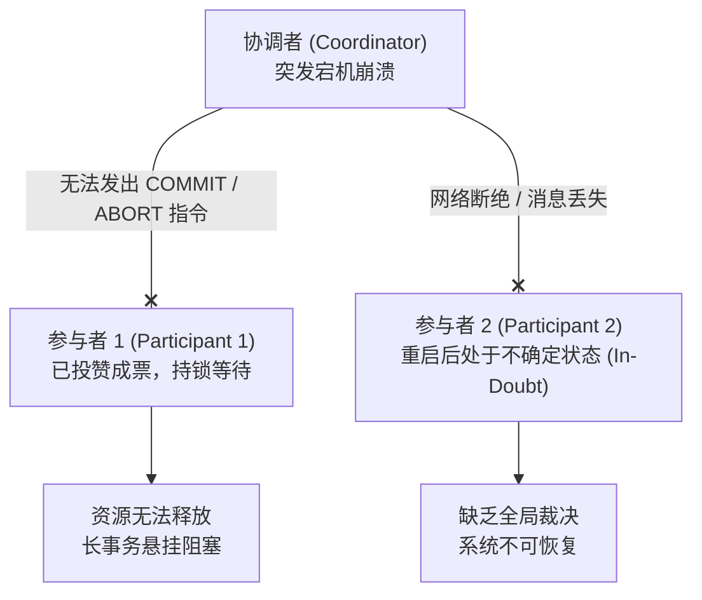
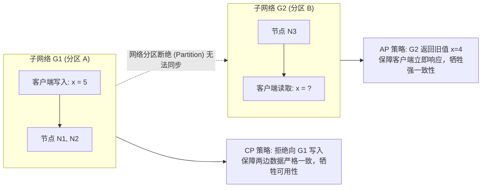
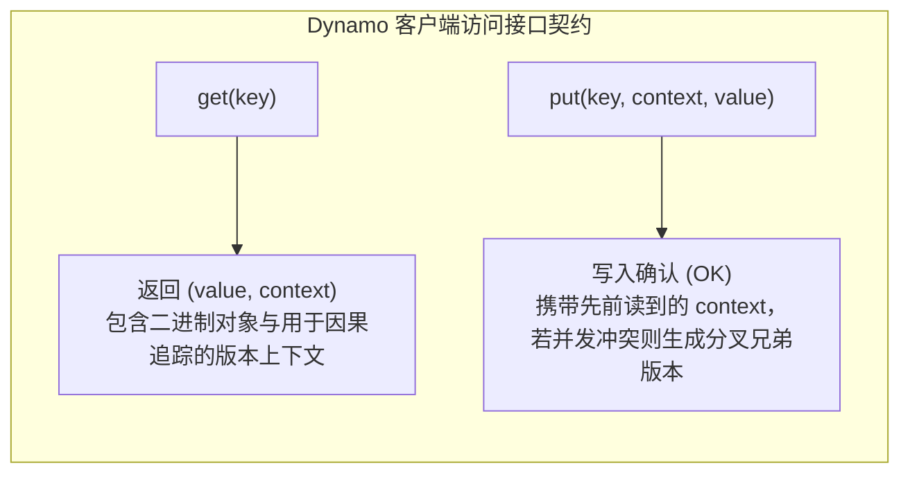
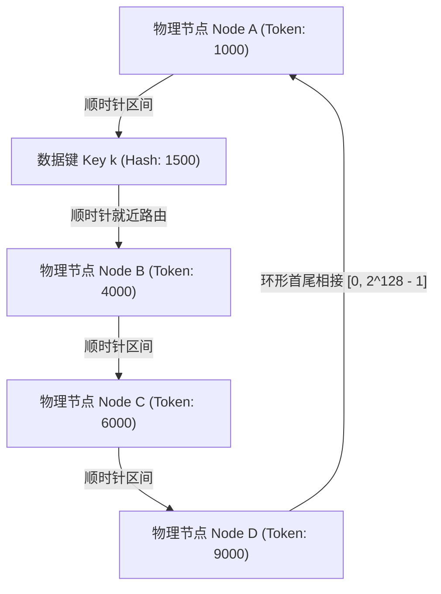
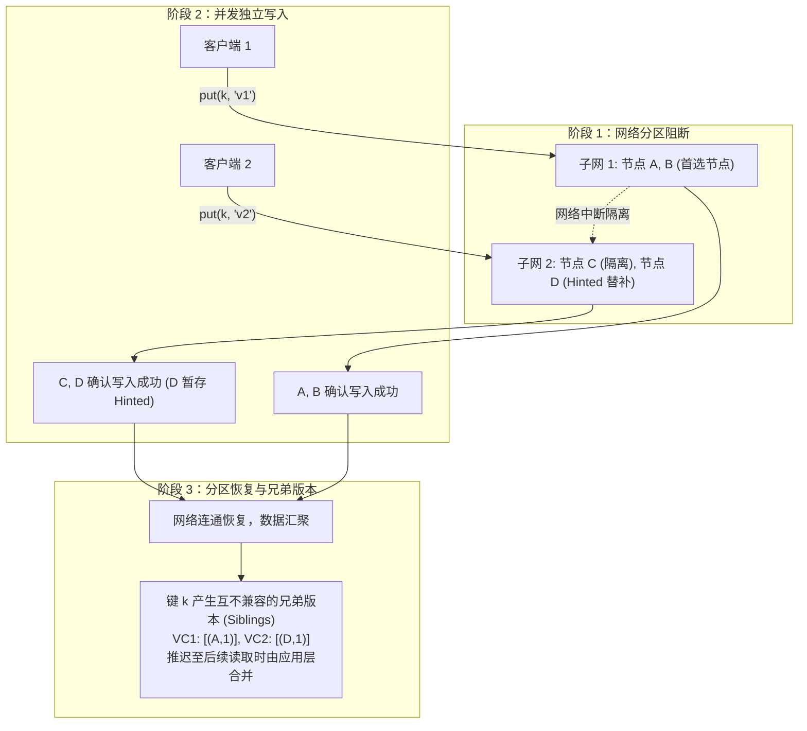

# Lec 18 最终一致性与去中心化架构

## TL;DR

- 分布式系统面对网络分区时在可用性与一致性间权衡；亚马逊 Dynamo 通过一致性哈希、宽松仲裁、提示移交与矢量时钟实现“写永远可用”的最终一致性。
- 一致性哈希环引入虚拟节点机制，消除物理节点异构性与数据热点倾斜，使增删节点的数据迁移开销达到理论极小值。
- 宽松仲裁（Sloppy Quorums）与提示移交（Hinted Handoff）允许存活后继节点临时代理写入，确保网络分区或节点故障期间写入绝不阻塞。
- 矢量时钟（Vector Clocks）捕捉多节点并发更新偏序关系，将因果分歧推迟至读取端由客户端显式协调合并。
- 后台逆熵收敛借助默克尔哈希树（Merkle Tree）实现高效无状态比对，仅传输分歧叶子区间，保障分布式副本静默自愈。

## 架构演进与核心洞察

::: insight 最终一致性的哲学本质：从绝对确定性到高可用自愈
传统关系型数据库（RDBMS）的基石建立在“绝对确定性”之上：跨节点事务必须强一致（ACID），通过两阶段提交（2PC）维持全局串行视图。然而，面对互联网级的爆炸式并发与不可避免的网络分区，2PC 的全票通过契约会导致长事务阻塞与系统瘫痪。
Dynamo 架构展现了分布式存储系统的哲学转向：**承认物理硬件与网络链路的不可靠性，以牺牲单次读取的即时强一致性，换取任何极端机房故障下的“写永远成功”**。通过一致性哈希、矢量时钟与默克尔树等数学收敛结构，系统将冲突调和与版本自愈平滑推迟至读取阶段或后台异步收敛，实现了工业级弹性和极高的可用性。
:::

## 课前阅读与文献研读 (Reading Assignment)

> 本讲核心必读文献。SOSP 2007 经典名篇，系统推导一致性哈希虚拟节点、矢量时钟因果分叉跟踪、Sloppy Quorum 与 Merkle 树后台逆熵同步机制。  
> 📖 **文献研读入口**：[必读论文精读：Dynamo：亚马逊高可用去中心化键值存储系统](./paper/amazon_dynamo_sosp2007.md)

## 核心机制与讲义正文

> [!TIP] **[待补截图]** 建议截取官方课件 Slides 第 18 讲中关于“矢量时钟（Vector Clock）在分布式网络分区下的分叉与合并因果树示意图”。此处预留插图空间。

> MIT 6.5830 / 6.5831 · Database Systems · 第 18 讲  
> 核心教材：*Readings in Database Systems* (5th Edition, Red Book)  
> 经典文献：Giuseppe DeCandia et al. (Amazon, SOSP 2007) *`Dynamo: Amazon’s Highly Available Key-value Store`*；Werner Vogels (ACM Queue / CACM 2008) *`Eventually Consistent - Revisited`*；David Karger et al. (STOC 1997) *`Consistent Hashing and Random Trees`*  
> 配套实验：GoDB (Go-based Database Engine) 分布式复制与最终一致性

## 1. 分布式系统的可用性范式转移与 CAP 定理

在单机系统中，ACID 事务模型为应用程序提供了简单可靠的抽象。然而，当数据量和吞吐量超越单机上限，系统必须扩展至由数百台甚至数万台服务器构成的分布式集群。在分布式环境下，物理硬件故障、网络链路抖动与光纤中断成为系统的常态，传统事务协议面临前所未有的生存挑战。

### 1.1 传统两阶段提交（2PC）的不可用阻塞困境

在前一讲讨论的两阶段提交协议（2PC）中，协调者（Coordinator）负责与所有参与者（Participants）协商事务提交。2PC 的核心原则是“全票通过方可提交”。然而，2PC 属于典型的阻塞性协议（Blocking Protocol）：

当协调者在向部分参与者发送 `COMMIT` 之后突发崩溃，且接收到指令的参与者也同时宕机时，剩余存活的参与者将陷入“不确定状态（In-Doubt State）”。它们既不能单方面提交（因为协调者可能决议中止），也不能单方面回滚（因为可能已有节点执行了提交），只能永久持有行锁并阻塞后续事务。这种阻塞特性在追求极致可用性的超大规模 Web 系统中是完全无法接受的。

### 1.2 亚马逊电商业务的工业诉求与服务级别协议（SLA）

2000 年代初，亚马逊（Amazon.com）的基础设施面临巨大的扩展压力。作为一个全球化电子商务平台，数万台服务器部署于全球多个数据中心。在这一工程背景下，系统设计者总结出以下核心业务诉求：

1. **“写永远可用”（Always-Available Writes）**：
   对于电商平台而言，结账购物车（Shopping Cart）是直接转化的核心命脉。如果客户在结账或将商品加入购物车时遇到系统弹窗报错“服务暂不可用，请稍后再试”，客户很可能会放弃购买并转向竞争对手。亚马逊的研究表明，每增加 100ms 的页面渲染延迟就会导致 1% 的销售额下滑，而任何写入拒绝都会直接造成真实交易损失。
2. **严格的 P99.9 服务级别协议（SLA Guarantee）**：
   传统系统往往以“平均延迟（Average Latency）”衡量性能，但在微服务深度依赖的架构中，平均延迟掩盖了严重的问题。一个用户请求在前端聚合时可能扇出（Fan-out）调用后台 150 个内部服务。如果每个微服务只有 1% 的概率出现长尾延迟，那么整个页面聚合请求遭遇延迟的概率将高达 $1 - (1 - 0.01)^{150} \approx 78\%$！因此，亚马逊必须以第 99.9 百分位数（P99.9）作为核心设计基准。

在高并发负载下，微服务架构的尾延迟往往由个别慢节点、GC 停顿或网络抖动引起。由于低概率故障在大规模并发下已成为常态分布，系统必须具备容忍长尾节点异常的自我调节能力。

### 1.3 一致性光谱与客户端一致性模型全景

在分布式数据存储系统中，一致性并非二元对立的“有”或“无”，而是一条连续的权衡光谱（Consistency Spectrum）：

1. **强一致性（Strong Consistency / Linearizability）**：
   在单副本或多副本同步系统中，所有读操作必须返回最近一次成功写入的值。系统对外表现如同单机串行执行，读写延迟高，可用性在网络分区时降为零。
2. **弱一致性（Weak Consistency）**：
   写入操作成功后，系统不保证后续读取能立刻读到最新值，也不保证何时能够达到一致。
3. **最终一致性（Eventual Consistency）**：
   弱一致性的特例。若不再有新的写入发生，在经过一段有限的物理时间后，所有副本最终都会收敛到一致的状态。

在最终一致性的大框架下，从客户端视角出发，可以进一步衍生出多个细粒度的一致性保证：

- **因果一致性（Causal Consistency）**：如果操作 A 在因果上先于操作 B（例如回复帖子先于发帖），则所有节点必须以相同的因果顺序观察到 A 和 B；并发无关的操作则允许乱序。
- **读己所写（Read-Your-Writes Consistency）**：单个客户端在更新数据后，其后续发起的读取操作一定能够看到自己刚才的更新，绝不会看到过期的旧数据。
- **单调读（Monotonic Read Consistency）**：单个客户端如果读取到了某个数据版本 $v$，那么该客户端后续的所有读取操作绝不会读取到比 $v$ 更旧的历史版本。
- **单调写（Monotonic Write Consistency）**：单个客户端发起的多个写操作，系统保证按照其发起的先后顺序串行应用到所有副本上。

### 1.4 CAP 定理几何证明与 PACELC 理论扩展

2000 年，Eric Brewer 提出了著名的 CAP 猜想，随后由 Seth Gilbert 与 Nancy Lynch 在 2002 年通过异步网络模型完成了形式化数学证明。

在异步通信系统中，消息延迟无上界。假设网络发生分区故障，集群被割裂为不相交的两个子集 $G_1$ 和 $G_2$。当客户端向 $G_1$ 写入 $x = 5$，由于分区阻断，$G_1$ 中的节点无法向 $G_2$ 同步此更新：
- 若要求**强一致性（Consistency）**：当另一个客户端从 $G_2$ 读取 $x$ 时，$G_2$ 无法获知最新写入，只能拒绝服务或无限期阻塞，系统失去**可用性（Availability）**，即选择 **CP**；
- 若要求**可用性（Availability）**：$G_2$ 必须非阻塞地响应读取请求，返回旧值 $x = 4$，导致两个子网数据产生不一致，系统牺牲**强一致性**，即选择 **AP**。

Daniel Abadi 进一步指出，CAP 仅描述了发生网络分区异常时的权衡，而在 99.9% 正常运行的时间内系统依然面临延迟与一致性的取舍，从而提出了 **PACELC 定理**：
$$\text{PACELC}: \text{If } \mathbf{P} \text{ (Partition)}, \text{choose } \mathbf{A} \lor \mathbf{C}; \quad \text{Else } \mathbf{E}, \text{choose } \mathbf{L} \lor \mathbf{C}$$
即在无分区常态下，系统若追求极致低延迟（Latency），必须采用异步多副本同步，从而放弃强一致性（Consistency）。

基于对 CAP 与 PACELC 权衡的重新思考，工业界催生了 `NoSQL` 运动，分化出四大主流数据存储模型：

1. **键值数据库（Key-Value Stores）**：如 Dynamo、Redis，结构极简，支持单键高并发吞吐；
2. **文档数据库（Document Stores）**：如 MongoDB、CouchDB，支持半结构化 JSON 嵌套与局部二级索引；
3. **列族数据库（Wide-Column Stores）**：如 Bigtable、Cassandra，适合稀疏宽表与时间序列数据；
4. **图数据库（Graph Databases）**：如 Neo4j，专长于实体关联拓扑的高效图遍历。

::: definition 最终一致性（Eventual Consistency）
设分布式系统包含副本集 $\mathcal{R} = \{R_1, R_2, \dots, R_N\}$。若在物理时间戳 $T_0$ 之后，系统不再接受任何对键 $K$ 的新写入操作，则存在一个有限时间差 $\Delta t < \infty$，当物理时间 $t \ge T_0 + \Delta t$ 时，所有健康的副本读取键 $K$ 均返回完全相同的收敛状态：
$$\forall R_i, R_j \in \mathcal{R}_{\text{healthy}}, \quad \text{Read}(R_i, K) = \text{Read}(R_j, K)$$
:::

---

## 2. 亚马逊 Dynamo 架构与系统分层设计

2007 年，亚马逊工程师在 SOSP 上发表了里程碑论文 *`Dynamo: Amazon’s Highly Available Key-value Store`*，正式确立了高可用分布式去中心化键值系统的经典架构。

### 2.1 极简键值查询接口与单键原子性

Dynamo 面向无复杂关系模式的应用场景，放弃了复杂的 SQL 查询、JOIN 联表和跨行事务，仅暴露出最纯粹的原子接口契约：

- **单键原子性（Single-Key Atomicity）**：每次读写操作针对单个键保证原子执行；
- **不透明 Blob 存储**：系统对 value 内容保持透明，将其视作任意长度的二进制字节数组（Byte Array），通常小于 1MB；
- **哈希主键定位**：对 key 计算 MD5 哈希生成 128 位整数标识符，决定其在分布式集群中的存储物理位置。

### 2.2 Dynamo 架构全景与技术实现矩阵

Dynamo 是一个完全去中心化、对称对等（Symmetric & Peer-to-Peer）的系统。集群中所有节点承担对等职责，不存在主从角色划分，也没有单点协调器：

为在无中心节点的架构下实现高吞吐、高可用与自愈能力，Dynamo 巧妙组装了多项经典的分布式机制：

| 问题领域 | 采用技术机制 | 核心工程价值 |
| :--- | :--- | :--- |
| **数据水平分区** | 一致性哈希（Consistent Hashing with Vnodes） | 节点增删时仅迁移 $1/N$ 数据，负载均匀离散 |
| **高可用写入路由** | 宽松仲裁与偏好列表（Sloppy Quorum） | 节点故障时不阻塞写入，保障写操作始终成功 |
| **临时故障处理** | 提示移交（Hinted Handoff） | 邻居节点临时接管写入，原主节点恢复后无缝回传 |
| **并发写冲突检测** | 矢量时钟版本追踪（Vector Clocks） | 精确捕获因果关系，并发分叉交由应用层语义合并 |
| **永久故障与静默收敛** | 默克尔树逆熵同步（Anti-Entropy via Merkle Trees） | 分层哈希对比，仅传输分歧叶子区间，节约 99% 带宽 |
| **成员管理与故障检测** | 基于 Gossip 八卦协议的去中心化探测 | 无需配置中心，节点自动感知集群拓扑变化 |

---

## 3. 一致性哈希与分布式拓扑自愈

分布式存储系统面临的首要问题是如何将海量数据均匀分散到大量物理机器上，并适应节点的动态扩容与缩容。

### 3.1 经典哈希取模的节点增删雪崩危机

最直观的数据路由方式是对键做哈希后按机器数量取模：$$\text{NodeID} = \text{Hash}(key) \pmod N$$
当集群规模 $N$ 保持不变时，此方式能均匀分散数据。然而，当由于负载增加新增一台机器（$N \to N+1$）或某台机器发生断电离线（$N \to N-1$）时，取模基数发生改变：
- 几乎所有已有键的映射目标都会发生错位重排；
- 缓存与存储命中率瞬间骤降至接近 0%，引发全量数据跨网络迁移和剧烈的“缓存雪崩（Cache Stampede）”。

### 3.2 一致性哈希环拓扑与就近路由

David Karger 等人在 1997 年提出了一致性哈希（Consistent Hashing）。该算法将哈希空间首尾相接，构建为一个虚拟的环状拓扑（Ring）：

1. **哈希空间环化**：使用相同哈希函数（如 MD5），将整个输出域映射到 $[0, 2^{128} - 1]$ 的整数环上；
2. **节点与数据同环映射**：物理节点（依据 IP 或主机名）与数据键（Key）均通过哈希函数计算出环上的位置点；
3. **顺时针就近路由**：对于任意给定的数据键 $k$，其存储位置从 $\text{Hash}(k)$ 开始沿环**顺时针前行**，遇到的第一个物理节点即为该键的负责节点（Successor Node）。

### 3.3 虚拟节点（Vnodes）机制与离散负载均衡

在最简单的一致性哈希环上，如果物理节点数量较少，由于哈希分布的随机方差，节点在环上的间距可能严重不均，导致“数据倾斜”；此外，若某节点宕机，其顺时针方向的下一个邻居节点必须全盘接管其全部数据，造成局部负载翻倍。

Dynamo 引入了**虚拟节点（Virtual Nodes / Vnodes）**机制彻底解决了这一问题：

- **离散交错分布**：一台物理机在环上不再对应单个点，而是对应 $M$ 个离散交错的虚拟 Token（通常 $M \approx 100 \sim 256$）；
- **异构硬件适配**：性能强劲的新机器可以分配更多的虚拟节点（如 200 个），性能较弱的旧机器分配较少的虚拟节点（如 50 个）；
- **平滑故障稀释**：当一台物理机器崩溃离线时，其管理的多个虚拟节点由于均匀穿插在环上，其负载将被环上的多台不同物理机共同均摊吸收，杜绝了单点被压垮的级联故障。

### 3.4 节点平滑增删与数据区间迁移

当向系统加入新节点时，新节点在环上获得若干虚拟节点位置：

- **最小化迁移**：新节点仅从其顺时针后继节点处“切割”并接管部分原本属于该后继节点的数据区间；
- **全局稳定性**：整个集群其余节点的分配映射完全保持不变，平均迁移数据量仅为全网的 $1/N$。

### 3.5 基于 Gossip 协议的集群成员拓扑发现与故障检测

Dynamo 采用去中心化的 **Gossip（八卦 / 流言）协议**维护集群成员视图：

1. 每个节点周期性（如每 1 秒）随机挑选集群中的另一个节点进行点对点通信，交换各自所知的集群成员列表及其代数（Epoch/Heartbeat Counter）；
2. 拓扑状态变更以指数级传播速度（$O(\log N)$ 轮交互）迅速感染全网所有节点；
3. **故障检测（Failure Detection）**：若节点 A 向节点 B 发送心跳持续超时，A 标记 B 为疑似宕机（Suspected Dead）；当多数节点在 Gossip 中达成共识后，B 被正式认定为故障并移出活跃路由表。

### 3.6 外部种子节点（Seed Nodes）与冷启动机制

为了防止网络分区或并发启动时系统产生相互隔离的“认知孤岛”，Dynamo 引入了**种子节点（Seed Nodes）**机制：

- 种子节点是一组在静态配置文件中显式列出的已知节点，通常跨多个可用区部署；
- 任何新节点加入集群时，首先联系种子节点获取当前权威的集群成员视图，随后再通过 Gossip 协议与全网其他节点建立连接，保证拓扑发现的确定性。

---

## 4. 宽松仲裁、提示移交与读写并发协同

为了保证高可用容错，Dynamo 将每个数据项复制到 $N$ 个不同的物理节点上。在一致性哈希环上，负责键 $k$ 的第一个节点称为协调者（Coordinator），协调者顺时针前行选出排在前面的 $N$ 个物理节点构成**偏好列表（Preference List）**。

### 4.1 传统严格仲裁（Strict Quorum）的可用性缺陷

经典 Quorum 机制要求系统配置三个参数 $(N, R, W)$：
- $N$：副本总数（例如 $N = 3$）；
- $R$：一次成功读取所必须响应的最小副本数；
- $W$：一次成功写入所必须确认的最小副本数。

若满足鸽巢原理（Pigeonhole Principle）：
$$R + W > N$$
则任何包含 $R$ 个节点的读集合与包含 $W$ 个节点的写集合必定至少重叠一个节点，从而保证读者能读到最新的写入。然而在生产实践中，如果偏好列表中的某个节点因网络故障宕机，严格仲裁将因凑不齐 $W$ 个法定副本而拒绝写入，牺牲了写入可用性。

### 4.2 宽松仲裁（Sloppy Quorum）与偏好列表选择

Dynamo 提出了**宽松仲裁（Sloppy Quorum）**：
- 当偏好列表中排名前 $N$ 的首选节点出现不可达故障时，协调者**不会拒绝写入**；
- 协调者继续沿着一致性哈希环向后顺时针顺延，挑选排在第 $N+1, N+2, \dots$ 位的健康物理节点临时接受写请求，直到满足 $W$ 个确认节点为止。

### 4.3 提示移交（Hinted Handoff）时序机制与临时接管

当一个非首选节点 $D$ 临时接受了本应写入首选节点 $A$ 的数据时，该写入会被附带元数据标记为“提示移交（Hinted Handoff）”：

1. 临时节点 $D$ 将该数据存放在专用的本地队列中，记录其“真实归属原主”是节点 $A$；
2. 节点 $D$ 在后台周期性探测节点 $A$ 的健康状态；
3. 一旦通过 Gossip 感知到节点 $A$ 已经恢复在线，节点 $D$ **立刻将暂存的数据打包推送回传给节点 $A$**，并在确认传输成功后从本地安全删除该副本。

### 4.4 宽松仲裁在网络分区下的数据分叉三阶段演进

宽松仲裁保证了写入的极致可用，但在网络分区（Network Partition）发生时，将必然导致副本数据的因果分歧：

在阶段三网络恢复后，节点上同时存在由两边并发写入产生的“兄弟版本（Sibling Versions）”，系统必须依靠因果追踪机制检测并调和这一冲突。

### 4.5 客户端读取流转、协调者扇出与读修复（Read Repair）

Dynamo 的读请求处理流程如下：

1. **路由与协调**：客户端将 `get(key)` 请求发送给任意节点，或通过智能客户端直接路由到键 $k$ 的首选节点作为协调者；
2. **扇出读取**：协调者向偏好列表中的 $N$ 个节点并发发送读请求，等待至少 $R$ 个副本返回响应；
3. **版本比对**：
   - 若这 $R$ 个响应包含相同版本或存在因果前序版本，协调者将最新因果版本返回给客户端；
   - 若发现某些节点返回的是较旧的过期版本，协调者在后台异步向旧节点发送最新数据执行**读修复（Read Repair）**；
   - 若发现 $R$ 个响应中包含互不兼容的并发分叉版本，协调者将所有冲突版本一并打包返回给客户端，要求应用层进行业务冲突合并。

---

## 5. 矢量时钟、冲突检测与逆熵数据收敛

在分布式系统中，各个节点的物理时钟存在时钟漂移（Clock Drift）与 NTP 抖动，绝对物理时间戳无法用来可靠判定因果顺序。为此，Dynamo 采用**矢量时钟（Vector Clocks）**精确捕获对象的因果偏序关系。

### 5.1 物理时钟局限与矢量时钟数学形式化

矢量时钟本质是一个由节点标识符和单调递增计数器构成的元组列表：
$$VC = [ (S_1, c_1), (S_2, c_2), \dots, (S_k, c_k) ]$$
其中 $S_i$ 表示处理写操作的协调者节点，$c_i$ 为该节点为该对象分配的本地逻辑版本计数器。

::: theorem 矢量时钟的因果偏序与并发冲突判定定理
给定同一键的两个矢量时钟版本 $VC_A$ 与 $VC_B$：
1. **因果支配（Causal Dominance）**：若对于所有节点分量 $S_k$，均有 $VC_A[S_k] \ge VC_B[S_k]$，且存在至少一个分量严格满足 $VC_A[S_i] > VC_B[S_i]$，则记作 $VC_B < VC_A$。说明 $VC_A$ 是 $VC_B$ 的因果后继，系统可安全使用 $VC_A$ 覆盖 $VC_B$；
2. **并发冲突（Concurrent / Incomparable）**：若存在节点 $S_i$ 使得 $VC_A[S_i] > VC_B[S_i]$，同时存在另一节点 $S_j$ 使得 $VC_A[S_j] < VC_B[S_j]$，则 $VC_A \parallel VC_B$。说明两个版本是在彼此未通信的情况下并发产生的，系统必须同时保留二者作为兄弟版本（Siblings）。
:::

### 5.2 矢量时钟演化过程与因果偏序推导

下面通过三步具体的演化时序展现矢量时钟的工作原理：

**步骤 1：创建初始对象**  
客户端 1 通过节点 C 写入新键 $k$。节点 C 将自己的计数器自增为 1，生成版本 $[(C, 1)]$ 并同步给节点 D 和 E：

**步骤 2：因果后继单调写入**  
客户端 1 读取到版本 $[(C, 1)]$，修改内容后再次通过节点 C 提交写入。节点 C 将自身计数器递增为 2，生成新版本 $[(C, 2)]$。由于 $[(C, 2)]$ 的分量严格大于 $[(C, 1)]$，旧版本被因果覆盖：

**步骤 3：网络分区引发并发分叉**  
客户端 2 在尚未观察到步骤 2 写入的情况下，从节点 D 读取到了旧版本 $[(C, 1)]$，并向节点 D 发起更新。节点 D 生成版本 $[(C, 1), (D, 1)]$。此时系统中同时存在：
- 版本 2：$VC_2 = [(C, 2)]$
- 版本 3：$VC_3 = [(C, 1), (D, 1)]$

比对分量：在节点 C 上 $VC_2(2) > VC_3(1)$，但在节点 D 上 $VC_2(0) < VC_3(1)$。两者互不包含，进入并发分叉状态！

### 5.3 客户端语义冲突合并与版本上下文

由于数据存储引擎本身并不了解应用层业务逻辑（例如不知道 value 是购物车、文本还是计数器），Dynamo 将并发冲突解决推迟给客户端应用层：

1. 当客户端调用 `get(key)` 遇到分叉版本时，Dynamo 将所有兄弟版本及其上下文打包返回；
2. 客户端应用根据业务语义进行合并（例如对于购物车，将两个分叉版本中的商品列表取**并集**，确保用户添加的商品绝不丢失）；
3. 客户端随后调用 `put(key, combined_context, merged_value)`，该写操作将包含所有分叉分支的时钟信息，协调者节点递增自己的分量后，生成能够因果覆盖所有先前分叉的统一新版本。

::: example 矢量时钟因果覆盖与并发冲突判定实例
假设有三个副本 $R_1, R_2, R_3$，系统记录了三个矢量时钟版本：
- $V_1 = \langle R_1: 0, R_2: 3, R_3: 2 \rangle$
- $V_2 = \langle R_1: 1, R_2: 3, R_3: 2 \rangle$
- $V_3 = \langle R_1: 0, R_2: 0, R_3: 3 \rangle$

1. **比较 $V_1$ 与 $V_2$**：
   - $R_1: 0 < 1$；$R_2: 3 = 3$；$R_3: 2 = 2$；
   - $V_1$ 的所有分量均 $\le V_2$，且存在一个分量严格小于，因此 $V_1 < V_2$，$V_2$ 能够因果覆盖 $V_1$。
2. **比较 $V_1$ 与 $V_3$**：
   - $R_2$ 分量上 $V_1(3) > V_3(0)$，但 $R_3$ 分量上 $V_1(2) < V_3(3)$；
   - 互有大小，因此 $V_1 \parallel V_3$ 属于并发冲突关系，无法单方面覆盖，必须保留合并。
:::

### 5.4 逆熵协议（Anti-Entropy）与默克尔树（Merkle Trees）分层同步

读修复与提示移交只能在数据被访问或网络临时闪断时修复副本。若某些冷数据长期未被读取，或者某节点故障离线时间过长导致提示移交数据丢失，副本间将产生静默的数据漂移。

为了在后台低开销地自愈所有副本，Dynamo 采用了基于**默克尔树（Merkle Tree）**的**逆熵协议（Anti-Entropy Protocol）**：

1. 每个节点为自己负责的每个虚拟节点键范围在本地维护一棵默克尔哈希树；
2. 叶子节点是具体键值数据的哈希值，父节点是其子节点哈希拼接后的散列摘要；
3. 树的根节点（Root Hash）代表了整个键区间的总体摘要：
   - 节点同步时，首先仅需在网络中交换两个副本的根哈希；
   - 若根哈希相同，瞬间确定数十 GB 的数据完全一致，无须进行任何额外网络传输；
   - 若根哈希不同，双方递归比对子节点的哈希值，顺藤摸瓜精准定位发生分歧的叶子区间。

如图所示，两节点比对时，完全相同的浅灰色分支直接忽略，系统仅在网络上传输深黑色差异叶子所对应的数据条目，将网络带宽消耗压缩到了理论极限。

---
## 6. 经典文献研读与学术思辨

本讲所涉及的技术思想源自过去三十年来分布式系统领域的数篇划时代经典论文。

### 6.1 Dynamo 核心论文研读（DeCandia et al., SOSP 2007）

Giuseppe DeCandia 等人在 2007 年发表的 *`Dynamo: Amazon’s Highly Available Key-value Store`* 被公认为工业界去中心化分布式存储的奠基之作。

- **核心贡献**：首次完整展示了如何将一致性哈希、矢量时钟、宽松仲裁、提示移交、默克尔树逆熵和 Gossip 协议有机整合成一个可扩展至数万台服务器的自愈系统；
- **设计哲学**：
  1. “写入绝不失败”优先于读取简单性，将冲突调和复杂性推给读取端和应用层；
  2. 严格以 P99.9 服务级别协议为设计锚点；
- **历史影响**：直接启发了开源界著名分布式数据库 Apache Cassandra 与 Basho Riak 的诞生。

### 6.2 最终一致性再探讨（Werner Vogels, ACM Queue 2008）

亚马逊 CTO Werner Vogels 在 2008 年发表的 *`Eventually Consistent - Revisited`* 深刻阐释了弱一致性在现代互联网服务中的必然性。

- **核心论点**：在物理世界中，由于光速传播延迟与独立故障域的存在，强一致性是一项极度昂贵且往往不必要的奢求；
- **系统分层**：Vogels 明确区分了存储服务端的最终收敛保证与客户端视角的因果、单调读写保证，指出只要应用层能够宽容暂时的陈旧状态，系统就能获得近乎无限的水平扩展与容错弹性。

### 6.3 一致性哈希与随机树理论根基（Karger et al., STOC 1997 / Web Caching 1999）

David Karger 等人在 STOC 1997 发表并在 1999 年应用于 Web 缓存的论文构筑了一致性哈希的数学基石。

- **四大核心数学性质**：
  1. **平滑性（Smoothness）**：增删桶时，重新分配的项数量达到维持平衡所需的理论最小值；
  2. **分散性（Spread）**：在不同客户端视角（Views）不一致的情况下，同一个项被映射到的不同机器数量严格受限；
  3. **负载均衡（Load）**：任意单台机器承载的对象数量期望不会超过平均负载的常数倍；
  4. **单调性（Monotonicity）**：新增机器时，已有对象只会从旧机器迁移至新机器，绝不会在旧机器之间盲目乱窜。

---

## 7. 关键设计抉择与架构认知

::: insight 为什么 Dynamo 不支持跨分区事务与关系查询？
Dynamo 的核心设计目标是服务电商核心链路（如购物车、会话状态），这类负载的访问模式极度纯粹：通过主键进行点查（`get`）与点写（`put`）。如果引入跨分区事务或跨键原子性，系统就必须退回分布式锁协调或两阶段提交，这与 Dynamo “写永远可用”的核心设计原则直接相违。保持无事务的键值抽象是 Dynamo 获得极致高可用与水平扩展弹性的根本前提。
:::

::: pitfall 盲目推崇最终一致性与数据版本爆炸
在工程落地中必须警惕：在涉及金融转账、库存严格超卖控制、全局唯一约束等严苛业务中，盲目采用最终一致性会导致灾难性后果。若业务层缺乏自动化的语义冲突合并逻辑，矢量时钟分叉将转嫁为巨大的业务清洗成本；此外，提示移交在网络持续故障时会导致临时节点磁盘打满，必须设定硬性存储配额与降级丢弃阈值。
:::

---

## 8. 课后深度思考题

### 思考题 1：提示移交（Hinted Handoff）与矢量时钟在极端长时间网络分区下的版本漂移与剪枝上限
在长时间的大规模网络分区场景中，临时接管写入的节点可能会积攒海量的提示移交数据，导致本地磁盘面临打满风险；同时，若参与写入协调的节点不断变更，矢量时钟的元素数量会持续膨胀。请思考：
1. Dynamo 针对磁盘耗尽和长时间宕机节点采取何种保护策略？为什么不能无限制保留提示移交？
2. 矢量时钟的长度无限制增长会对网络传输和存储造成多大损耗？工业界常用的矢量时钟截断（Truncation / Pruning）策略是什么？截断策略引入了什么潜在因果破坏风险？

### 思考题 2：宽松仲裁（Sloppy Quorums）在跨机房网络脑裂时的行为推演
假设一个部署在两个机房（DC1 和 DC2）的 Dynamo 集群，配置 $N=3, R=2, W=2$。某键的偏好列表节点依次为 $[A_{\text{DC1}}, B_{\text{DC1}}, C_{\text{DC2}}]$。当跨机房光纤中断（脑裂）且两机房内部网络均正常时：
1. 客户端若向 DC2 发起针对该键的写入，宽松仲裁机制将如何选择节点进行委托代理？
2. 客户端若分别在 DC1 和 DC2 同时对该键发起并发写入，系统是否均能成功返回写入确认？此时数据版本在两个机房中呈现何种状态？
3. 在网络分区修复后，逆熵协议与读修复将如何介入使得该键的数据副本最终收敛？
