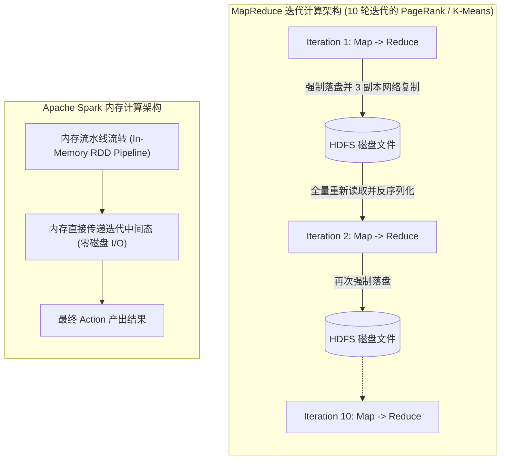
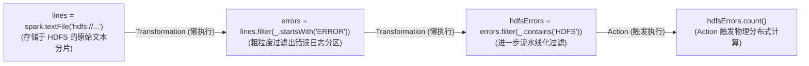
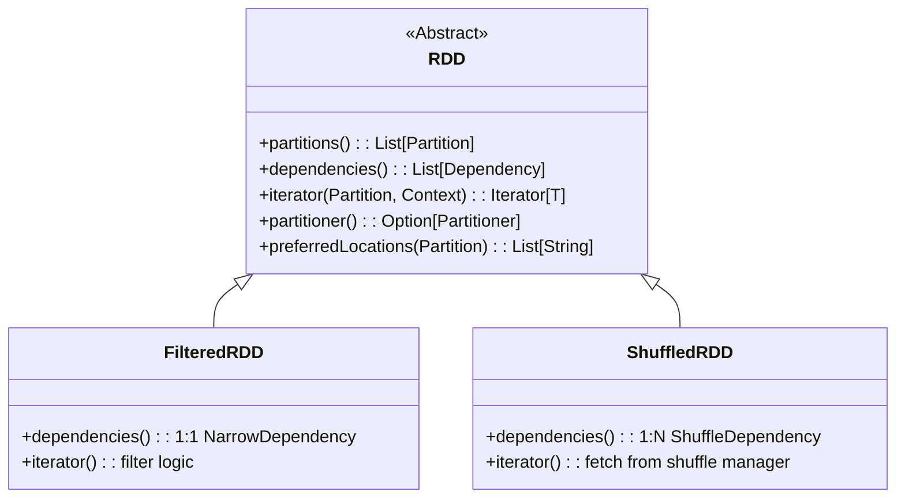
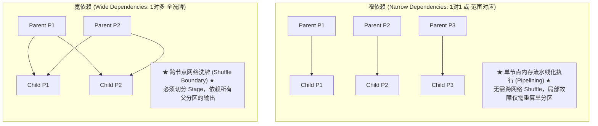
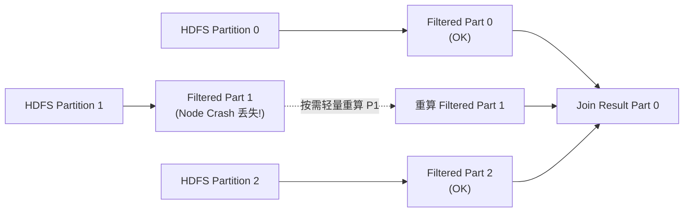

# Lec 19 大规模集群计算：Spark

## TL;DR

- MapReduce 在迭代算法与即席查询中遭遇严重的磁盘 I/O 刷盘与网络 Shuffle 瓶颈；Spark 确立了以内存为中心的集群计算范式。
- 弹性分布式数据集（RDD）是不可变、已分片且具备粗粒度转换特性的记录集合，通过只读契约实现确定性容错。
- 惰性求值（Lazy Evaluation）将转换算子（Transformations）累积为有向无环图（DAG），仅在触发行动算子（Actions）时由调度器流水线化执行。
- 窄依赖（Narrow Dependencies）支持在单个节点内流水线（Pipelining）无缝执行；宽依赖（Wide Dependencies）需要跨节点网络洗牌（Shuffle）并划分 Stage 边界。
- 血统图容错（Lineage Graph）以轻量级数学逻辑日志替代昂贵的外存多副本复制，在节点崩溃时实现受损分区的局部按需自愈。

## 架构演进与核心洞察

::: insight 内存计算与血统容错：对传统分布式存储副本的颠覆
在传统的分布式大数据框架（如 Hadoop MapReduce、GFS / HDFS）中，容错的唯一手段是“物理多副本复制”：每一个中间计算步骤产生的临时文件都必须通过集群网络复制 3 份并强制刷写至机械磁盘。这种悲观防线将 90% 以上的计算时间白白耗费在跨节点 I/O 与反序列化上。
Apache Spark 实现历史性突破的核心洞见在于：**放弃数据的物理复制，转向记录生成数据的计算血统（Lineage）**。通过限制操作为粗粒度转换（Coarse-Grained Transformations，即将相同逻辑确定性应用于所有分区数据），系统只需用几百字节的 DAG 依赖图，就能在任意节点故障时，从稳定存储源头顺着血统图重新推演丢失的分区。这一思想用纯粹的数学函数确定性取代了昂贵的物理冗余，彻底释放了分布式内存的高速吞吐潜能。
:::

## 课前阅读与文献研读 (Reading Assignment)

> 本讲核心必读文献。NSDI 2012 经典论文，全面剖析弹性分布式数据集（RDD）、粗粒度变换血统（Lineage）轻量容错，以及基于宽窄依赖切分的 Stage 流水线调度范式。  
> 📖 **文献研读入口**：[必读论文精读：Resilient Distributed Datasets：Spark 弹性分布式内存计算](./paper/spark_rdd_cluster_computing.md)

## 核心机制与讲义正文

> [!TIP] **[待补截图]** 建议截取官方课件 Slides 第 19 讲中关于“Spark DAG 调度器根据宽依赖 Shuffle 边界划分 Stage 任务集合示意图”。此处预留插图空间。

> MIT 6.5830 / 6.5831 · Database Systems · 第 19 讲  
> 核心教材：*Readings in Database Systems* (5th Edition, Red Book)  
> 经典文献：Matei Zaharia et al. (UC Berkeley AMPLab, NSDI 2012) *`Resilient Distributed Datasets: A Fault-Tolerant Abstraction for In-Memory Cluster Computing`*；Jeffrey Dean & Sanjay Ghemawat (Google, OSDI 2004) *`MapReduce: Simplified Data Processing on Large Clusters`*  
> 配套实验：GoDB (Go-based Database Engine) 分布式算子与并行计算

## 1. 从 MapReduce 磁盘瓶颈到内存计算革命

2004 年，Google 发表了 MapReduce 论文，开创了在低成本商用 PC 集群上进行海量异构数据批处理的时代。然而，随着大数据应用向**交互式即席查询（Interactive Ad-hoc Query）**与**机器学习迭代算法（如 PageRank、K-Means、逻辑回归）**深度延伸，MapReduce 暴露了严重的体系结构缺陷。



MapReduce 的核心痛点体现在：
1. **外存 I/O 泥潭**：每一轮 Map 和 Reduce 之间都必须将全部中间数据物化刷写至本地磁盘或 HDFS，并经历昂贵的跨网络序列化与网络复制；
2. **缺乏数据复用抽象**：同一个基础数据集无法常驻在分布式内存中供多次交互式分析并发共享。

2012 年，UC Berkeley AMPLab 团队提出了 **Apache Spark**，确立了**以内存为中心（In-Memory Computing）**的大规模分布式计算架构，使迭代型算法与即席查询速度提升了 **10 到 100 倍**！

---

## 2. 弹性分布式数据集（RDD）核心抽象

Spark 的核心抽象是 **RDD（Resilient Distributed Dataset）**。

::: definition 弹性分布式数据集（RDD）
RDD 是一个**只读（Read-Only）、已分片（Partitioned）、可并行计算且具备故障自愈能力（Resilient）**的记录集合。RDD 只能通过稳定存储中的持久化数据（如 HDFS 文件）或其他 RDD 经过确定性的粗粒度操作变换生成。
:::

### 2.1 粗粒度操作 vs 细粒度更新

集群分布式内存系统（如分布式共享内存 DSM、分布式键值存储）通常提供基于可变状态的细粒度更新（如修改单行记录中的某个单元格）。在这种接口下，为了提供容错，系统必须对每一步小修改执行网络多副本复制或分布式 WAL 记录，网络与存储开销极其巨大。

RDD 采取了截然相反的设计哲学：**只提供粗粒度的转换操作（如 `map`、`filter`、`join`）**，这些操作将相同的转换函数统一应用于整个分区数据集。这种粗粒度约束使得系统能够通过记录用于构建数据集的操作历史（血统），在分区丢失时快速重新计算该分区，而无需进行昂贵的数据复制。

如下面的代码执行拓扑所示，从 HDFS 原始文本到最终错误统计，每一步变换都在逻辑层级串联，延迟求值直到真正的 Action 被触发：



### 2.2 转换（Transformations）与行动（Actions）

Spark 将操作划分为两大正交范畴：
1. **转换操作（Transformations）**：
   - **特性**：从已有 RDD 生成新的 RDD（例如 `map`, `filter`, `flatMap`, `groupByKey`, `reduceByKey`）；
   - **执行模式**：**惰性求值（Lazy Evaluation）**。调用转换函数时并不会立即触发计算，系统只是在内存中追加构建计算血统有向无环图（Lineage DAG）；
2. **行动操作（Actions）**：
   - **特性**：执行实际的计算，将结果汇总返回给 Driver 驱动程序，或持久化写出到外部存储系统（例如 `count`, `collect`, `saveAsTextFile`）；
   - **执行模式**：触发 DAG 优化器将逻辑计划编译为物理 Stage 任务集并提交集群执行。

---

## 3. 控制台日志挖掘与典型迭代场景实战

### 3.1 案例实战：控制台海量日志交互式挖掘

假设某大型互联网服务的 Web 集群突发异常，运维人员需要从 HDFS 中数 TB 的系统日志中定位故障源头。在传统的 MapReduce 架构下，每一次交互式过滤都必须重新扫描数十 GB 的磁盘文件并经历完整的 MapReduce 阶段，导致简单的即席分析耗时数十分钟。

使用 Apache Spark，运维人员可以通过 Scala 或 Python 解释器进行交互式挖掘。通过调用 `persist()` 方法，系统能够将清洗后的高频数据直接常驻在分布式节点的物理内存中，使后续连续查询实现亚秒级甚至毫秒级极速响应：

```scala
// 1. 构建基础 RDD (惰性声明，不占用实际内存)
val lines = sc.textFile("hdfs://logs/web_server.log")

// 2. 转换：筛选出所有包含 ERROR 的日志行
val errors = lines.filter(_.startsWith("ERROR"))

// 3. 性能关键：显式声明将 errors 分布式常驻内存！
errors.persist()

// 4. 交互式查询 1: 统计含 MySQL 的错误数 (秒级返回)
val mysqlCount = errors.filter(_.contains("MySQL")).count()

// 5. 交互式查询 2: 统计含 HDFS 的错误数 (直接复用内存中的 errors，零磁盘 I/O！)
val hdfsCount = errors.filter(_.contains("HDFS")).count()
```


如图所示，第一条查询执行后，清洗出的 `errors` 分区被自动缓存于各 Worker 节点的物理内存中。随后的多次即席分析直接在内存缓存中流水线执行，响应时间从分钟级降至秒级。

### 3.2 迭代型机器学习：PageRank 链接分析

在 PageRank 算法中，每个网页的权重由其入链网页的权重迭代更新决定：
$$r^{(t+1)} = \frac{1 - \alpha}{N} + \alpha \sum_{j \in \text{in-links}(i)} \frac{r_j^{(t)}}{\text{out-degree}(j)}$$

在 MapReduce 中，每一轮迭代都需要对整个网页拓扑图和最新权重进行两次完整的外存读写与全量网络重分区。而在 Spark 中：
- 静态网页邻接表 `links` 经哈希分区后**永久缓存于各节点内存中**；
- 只有轻量级的权重向量 `ranks` 在迭代中流转，并与本地的 `links` 进行就地局部连接（Colocated Join），彻底消除了重复 Shuffle 开销！

---

## 4. RDD 内部表示与五大通用接口

为了让调度器能够在不了解具体计算逻辑的前提下统一编排所有 RDD，Spark 为 RDD 定义了一组极简但功能完备的核心内部接口（Five Core Interfaces）：

| 接口方法 | 核心功能与语义约定 |
| :--- | :--- |
| **`partitions()`** | 返回该 RDD 包含的物理数据分片（Partitions）数组 |
| **`dependencies()`** | 返回该 RDD 依赖的父 RDD 列表及依赖类型（宽依赖 / 窄依赖） |
| **`iterator(p, parentIters)`** | 给定输入分片，计算并产生该分区的记录迭代器流 |
| **`partitioner()`** | 可选接口：指定该 RDD 是否按键进行了特定分区（如 HashPartitioner 或 RangePartitioner） |
| **`preferredLocations(p)`** | 可选接口：指定分片 $p$ 的物理数据本地性偏好（实现“计算向数据移动”） |



---

## 5. 依赖拓扑与 DAG 调度流水线

Spark 调度器之所以能够实现极致的内存执行性能，核心在于将 RDD 之间的依赖划分为**窄依赖（Narrow Dependencies）**与**宽依赖（Wide Dependencies / Shuffle Dependencies）**。



### 5.1 窄依赖（Narrow Dependency）

- **定义**：父 RDD 的每个分区最多只能被子 RDD 的一个分区所使用；
- **典型操作**：`map`, `filter`, `union`，以及两个具有相同分区的 RDD 之间的 `join`（如已协同分区的 HashJoin）；
- **执行优势**：
  1. **流水线执行（Pipelining）**：调度器可以将多个连续的窄依赖算子合并为一个计算任务（Task），一条记录从磁盘读入后在 CPU 寄存器和缓存中一次性跑完所有转换，中间数据绝不落盘；
  2. **局部高效容错**：某个分区丢失时，只需在单个节点上重新计算该分区，与其他分区完全解耦。

### 5.2 宽依赖（Wide Dependency）

- **定义**：父 RDD 的一个分区可能被子 RDD 的多个分区所依赖；
- **典型操作**：`groupByKey`, `reduceByKey`, 以及未预先协同分区的任意 `join`；
- **执行特性**：
  必须触发跨集群节点的**网络洗牌（Shuffle）**，子分区需要从所有父分区的节点拉取属于自己键范围的数据。宽依赖构成了 DAG 调度划分 **Stage（阶段）**的物理边界。

---

## 6. 血统容错与内存管理机制

### 6.1 血统图（Lineage Graph）重算容错



当集群中某个 Worker 节点因掉电或硬件故障丢失了部分分区时：
1. Spark 调度器检查该丢失分区所属 RDD 的血统链（Lineage）；
2. 调度器仅在存活的 Worker 上重新调度该丢失分区的上游计算任务；
3. 对于窄依赖，重算过程与集群其余 99% 正在运行的健康分区完全并行，业务感知极小；
4. 这种自愈机制使得 Spark 无需任何外存双写即可提供严格的容错一致性。

### 6.2 检查点机制（Checkpointing）与长血统截断

在长时间运行的流式作业或具有数十轮迭代的图算法（如 PageRank）中，RDD 的血统 DAG 链条会无限拉长。此时会带来两大风险：
- 堆栈溢出（StackOverflowError）；
- 一旦下游节点故障，重算链条过长导致恢复时间不可接受。

Spark 提供了 `rdd.checkpoint()` 接口：将数据物理刷写至持久化高可用存储（如 HDFS），并将该 RDD 的血统依赖直接截断（清空父依赖）。在迭代算法中，通常每隔 10~20 轮执行一次 Checkpoint，在内存速度与容错恢复时间之间取得最优平衡。

---

## 7. 经典文献研读与学术思辨

### 7.1 Zaharia 论文研读（Matei Zaharia et al., NSDI 2012）

Matei Zaharia 等人在 2012 年发表的奠基性论文 *`Resilient Distributed Datasets: A Fault-Tolerant Abstraction for In-Memory Cluster Computing`* 荣获最佳论文奖。

- **核心理论突破**：证明了“粗粒度转换”足以涵盖绝大多数现实世界中的并行计算模型（包括 MapReduce、DryadLINQ、Pregel 图计算、HaLoop 迭代模型）；
- **性能评估**：在 PageRank 与逻辑回归基准测试中，Spark 比基于磁盘的 Hadoop MapReduce 快 **20 到 30 倍**，且在大规模故障注入测试中，Spark 展现出在数秒内仅凭血统图自愈受损分区的优异弹性。

### 7.2 Spark vs RDBMS：图灵奖得主 Stonebraker 的学术论辩

在 Spark 席卷工业界后，数据库领域权威学者（包括 Michael Stonebraker）对通用集群计算引擎提出了深刻思辨：

1. **“Spark 是数据库技术的一次后退吗？”（A Major Step Backwards?）**：
   Stonebraker 曾尖锐批评 MapReduce 丢弃了关系数据库数十年积累的关系模式（Schema）、数据独立性与声明式查询优化器。
2. **Spark 的自我救赎与架构收敛**：
   Spark 社区迅速吸纳了数据库学术界的批评，在后续版本中推出了 **DataFrame / Dataset API**，并开发了现代关系查询优化器 **Catalyst** 与整阶段代码生成引擎 **Tungsten**。现代 Spark 本质上已经演化为一个运行在分布式内存之上、深度吸收了经典数据库火山模型与向量化编译执行精髓的分布式关系型数据引擎。

---

## 8. 关键设计抉择与架构认知

::: insight 为什么 Spark 不适合细粒度高频低延迟写负载？
初学者容易产生误区：既然 Spark 内存计算比传统数据库快 100 倍，是否可以用 Spark 替代 MySQL / Redis 处理高并发在线交易（OLTP）？
答案是绝对不能。RDD 的核心基石是**粗粒度操作与不可变性**。如果一个应用需要每秒修改几万次单条用户的账户余额，在 RDD 模型下每一次微小修改都要生成一个新的 RDD 分区版本，内存瞬间被血统元数据打爆。Spark 的基因是**大规模批量计算与离线/实时数仓分析（OLAP）**，细粒度在线事务必须交由专门的 OLTP 引擎处理。
:::

::: pitfall 忽视 Wide Dependency 中的数据倾斜（Data Skew）与内存溢出（OOM）
在进行 `groupByKey` 或大表连接时，如果某些特定键（Key）对应的记录数呈现幂律分布（例如热门明星的用户 ID 拥有上千万条互动记录），Shuffle 阶段会将所有相同键的数据全部路由到单个特定 Worker 节点上。
该节点在尝试聚合这些数据时，JVM 堆内存将被瞬间撑爆并触发致命的 `OutOfMemoryError`（OOM），导致整个作业反复失败。生产实践中必须结合加盐加权（Salting）、广播连接（Broadcast Hash Join）或 `reduceByKey` 局部聚合来平滑倾斜。
:::

---

## 9. 课后深度思考题

### 思考题 1：窄依赖与宽依赖在 Stage 调度切分与执行失败时的影响分析
试从分布式计算理论与集群网络 I/O 角度论证：
1. 为什么 Spark 的 DAG 调度器必须在所有宽依赖（ShuffleDependency）处将作业切分为不同的 Stage？
2. 若一个包含 1000 个分区的 Stage 在执行尾声时，单个 Worker 节点硬件宕机丢失了其负责的 1 个分区：对于窄依赖 Stage 与宽依赖 Stage，恢复代价各呈现何种量级差异？

### 思考题 2：粗粒度血统图容错与传统关系数据库 ARIES 算法的哲学对照
在 Lec 14 中我们深入推演了面向磁盘关系数据库的 ARIES 恢复体系（基于物理/生理日志的 Analysis, Redo, Undo）。
1. 试对比 Spark RDD 的血统（Lineage）与 ARIES 的预写日志（WAL）：两者在记录抽象层次、存储介质占用与恢复推演机制上有何根本异同？
2. 为什么说“不可变只读数据结构”是 Spark 能够抛弃复杂锁机制与 Undo 回滚逻辑的根源？

---

## 详细机制推导与原版课堂图解

> MIT 6.5830 / 6.5831 · Database Systems · 第 19 讲  
> 核心教材：*Readings in Database Systems* (5th Edition, Red Book)  
> 配套实验：GoDB (Go-based Database Engine)

## Mapreduce

在分布式集群内处理大规模数据的编程模型。编程规范：

- Map函数： 处理输入的K/V对，并产生中间K/V对
- Reduce函数： 对具有相同的K的中间值进行归并。

例子

```python
def map(key, value):
  for word in value.split():
    emit(word, 1)
    
def reduce(key, values):
  total_count = sum(values)
  emit(key, total_count)
# input: [('doc1', 'hello world'), ('doc2', 'hello mapreduce’)]
# output: [('hello', 2), ('world', 1), ('mapreduce', 1)]
```

### 执行过程

- Input Splitting。数据被分区成多chunks，以便为了能够map任务并行处理
- mapping。每个chunk被一个map任务独立地处理
- shuffling。中间K/V对根据K进行排序和分组
- Reducing。 每组中间值都被一个reduce任务处理
- output： 从reduce任务生成出结果。


### 分析

**优点**：MapReduce 这种框架让开发者可以轻松实现并行计算，而不需要关心底层的复杂性。提供了高层次的计算抽象，主要包括 `map()` 和 `reduce()` 两种核心操作。不需要预定义数据的结构（Schema-Free）

**缺点**：对集群中节点的内存利用率低，甚至没有利用。对于迭代（iterative）或交互式（interactive）任务，数据重用会有很大的开销。虽然不需要提前定义数据模式（Schema-Free）是优点，但也带来了缺点，主要体现在数据管理和查询优化方面。MapReduce 系统的实现通常会有较高的延迟（Latency）。

## Spark： 弹性数据集RDD

Spark利用分布式内存，提供高效的容错。

- 避免显式地存储数据更新。Spark 不会直接将每次操作后的数据结果写入磁盘，而是通过 记录操作的变换逻辑（lineage，血统） 来重建数据，而不是像 MapReduce 那样存储中间数据。

Spark 只支持 **粗粒度操作**（Coarse-Grained Transformation），即对整个数据集进行批量处理，而不是对单个记录的细粒度操作

Spark 允许用户显式地控制数据是否持久化、如何分区、是否缓存

### RDD是什么

RDD 是不能直接修改，被分区到不同节点的记录集合。它有两种操作，一个是Transformation（转换操作），对RDD执行某种变换，生成新的RDD，但其是懒执行；另外一个是Action（行动操作），真正触发计算，返回结果或者将结果输出到外部存储。

有几个特性。

- 懒执行。可以自动优化执行计划，避免多次重复计算
- 容错。如果某个分区丢失，Spark可以通过RDD的血统信息自动恢复
  - 血统 (lineage)：是 RDD 的生成历史，记录从输入到输出的所有操作。如果数据丢失，Spark 可基于血统信息，从原始数据重新计算
- 推测执行。当某个任务执行速度慢时，Spark 可以启动一个备用任务以加速完成，避免因个别节点瓶颈拖慢整体速度。
  - Mapreduce也可以这样做

举个例子


```python
lines = spark.textFile("hdfs://..")
errors = lines.filter(_.startsWith("ERROR"))
errors.count()
```


### RDD容错性

RDD只日志记录Transformation，而不复制数据，并且限制其操作为粗粒度的。

Lineage: transformations used to build a dataset • Recover lost partition by applying lineage from corresponding data  partition in stable storage • Because data is read-only, this is always possible 怎么连接诶

## 论文阅读：RDDs

[RDDs](./RDDs.md)

《Resilient Distributed Datasets: A Fault-Tolerant Abstraction for In-Memory Cluster Computing, OSDI'12》 最佳博士论文

Mapreduce的论文是在2008年，分布式图计算框架Pregel是2010年

## 概述

RDD（翻译为弹性分布式数据集）这是一种分布式内存抽象，允许程序员在大型集群上以容错的方式执行内存计算。RDDs 的设计动机源于当前计算框架无法高效处理的两类应用程序：迭代算法和交互式数据挖掘工具。在这两种情况下，将数据保存在内存中可以将性能提升一个数量级。为了高效地实现容错，RDDs 提供了一种受限的共享内存形式，基于**粗粒度的转换**（coarse-grained transformations），而非对共享状态的细粒度更新。我们展示了 RDDs 足够表达一大类计算，包括最近专门为迭代作业设计的编程模型（如 Pregel）等等。我们在一个名为 Spark 的系统中实现了 RDDs，并通过多种用户应用和基准测试对其进行了评估。

## 1 介绍

集群计算框架如MapReduce 和Dryad已经被广泛采用于大规模数据分析。这些系统允许用户使用一组高级操作符编写并行计算，而无需担心工作分配和容错问题。尽管现有的框架提供了众多用于访问集群计算资源的抽象，但它们**缺乏利用分布式内存的抽象**。在许多迭代的机器学习和图算法中，如PageRank、K均值聚类和逻辑回归，数据重用非常常见。另一个引人注目的用例是交互式数据挖掘，用户在同一数据子集上运行多次临时查询。不幸的是，在大多数现有框架中，在计算之间重用数据（例如，在两个MapReduce作业之间）唯一的方法是将数据写入外部的稳定存储系统，例如分布式文件系统。

认识到这个问题，研究人员为一些需要数据重用的应用开发了专门的框架，比如Pregel是一个迭代式的图计算框架，将中间数据在内存中保持。然而，这些框架仅支持特定的计算模式（例如循环执行一系列 MapReduce 步骤），并且仅在这些模式下**隐式**地执行数据共享。它们**不提供更通用的数据复用抽象**。 我们提出了一种新的抽象，称为弹性分布式数据集（RDD），它可以在广泛的应用中实现高效的数据重用。RDD是一种容错的并行数据结构，允许用户显式地将中间结果持久化在内存中，控制它们的分区以优化数据的放置，并使用丰富的操作符集合来操作它们。

设计RDD的主要挑战在于定义一个能够**高效**提供**容错**的编程接口。现有的集群内存存储抽象，如分布式共享内存、键值存储、数据库和Piccolo，提供的接口基于对可变状态（例如表格中的单元格）的细粒度更新。对于这种接口，提供容错的唯一方法是将数据复制到多台机器上或跨多台机器记录更新。这两种方法对于数据密集型工作负载来说都很昂贵，因为它们需要通过集群网络复制大量数据，而集群网络的带宽远低于RAM，并且它们会产生大量的存储开销。

与这些系统相比，RDD提供了一个基于粗粒度变换（例如，map、filter和join）的接口，该变换将同一操作应用于许多数据项。这使得RDD能够通过记录用于构建数据集的变换而不是实际数据，来高效地提供容错。如果RDD的一个分区丢失了，RDD拥有足够的信息来重新计算丢失的分区，而无需昂贵的复制。因此，丢失的数据可以快速恢复，而不需要高成本的复制。尽管基于粗粒度变换的接口乍看起来可能有限，但RDD非常适合许多并行应用，因为这些应用自然地将同一操作应用于多个数据项。

我们在一个称为Spark的系统中实现了RDD，该系统正在加州大学伯克利分校和几家公司用于研究和生产应用。Spark提供了一个方便的语言集成编程接口，类似于Scala编程语言中的DryadLINQ [31]。此外，Spark可以交互式地用于从Scala解释器查询大数据集。我们相信，Spark是第一个允许使用通用编程语言以交互速度在集群上进行内存数据挖掘的系统。

Spark比Hadoop快20倍，加速了一个现实世界的数据分析报告40倍，并且可以交互式地以5-7秒的延迟扫描1 TB的数据集。更为根本的是，为了说明RDD的通用性，我们在Spark之上实现了Pregel和HaLoop编程模型，包括它们所采用的放置优化

本文首先概述了RDD (§2)和Spark (§3)，然后讨论了RDD的内部表示 (§4)、我们的实现 (§5)和实验结果 (§6)。最后，我们讨论了RDD如何捕捉几个现有的集群编程模型 (§7)，回顾相关工作 (§8)，并作出总结。

## 2 弹性分布式数据集（RDDs)

本节提供了对RDD的概述。我们首先定义RDD (§2.1) 并介绍它们在Spark中的编程接口 (§2.2)。接着，我们将RDD与更细粒度的共享内存抽象进行比较 (§2.3)。最后，我们讨论RDD模型的局限性 (§2.4)

### 2.1 RDD抽象

形式上，RDD是一个只读的、分区的记录集合。RDD只能通过对稳定存储中的数据或其他RDD进行确定性的操作来创建。我们称这些操作为转换（Transformation），以区别于对RDD进行的其他操作。转换的例子包括map、filter和join。RDD不需要一直被物化。相反，RDD有足够的信息来重建其分区，这些信息来源于其他数据集（即RDD的血统）。这种属性非常强大：本质上，一个程序不能引用它在故障后无法重建的RDD。最后，用户可以控制RDD的两个方面：持久性和分区。用户可以指示哪些RDD将会被重用，并为其选择存储策略（例如，内存存储）。他们还可以要求根据记录中的键在机器间对RDD的元素进行分区。这对于放置优化非常有用，例如确保将要连接的两个数据集以相同的方式进行哈希分区。

### 2.2 Spark的编程接口

Spark通过类似于DryadLINQ [31] 和 FlumeJava [8] 的语言集成API暴露RDD，在这些API中，每个数据集被表示为一个对象，并且可以通过这些对象上的方法调用转换。

程序员首先通过对稳定存储中的数据进行转换（例如map和filter）来定义一个或多个RDD。然后，他们可以在操作中使用这些RDD，这些操作返回一个值给应用程序或将数据导出到存储系统。操作的例子包括count（返回数据集中的元素数）、collect（返回元素本身）和save（将数据集输出到存储系统）。像DryadLINQ一样，Spark在第一次使用操作时懒惰地计算RDD，以便能够对转换进行流水线处理。

此外，程序员可以调用persist方法来指示哪些RDD他们希望在未来的操作中重用。默认情况下，Spark将持久化的RDD保存在内存中，但如果内存不足，它可以将它们溢出到磁盘。用户还可以通过persist的标志请求其他持久化策略，例如仅将RDD存储在磁盘上或在机器间复制。最后，用户可以为每个RDD设置持久化优先级，以指定哪些内存数据应首先溢出到磁盘。

#### 2.2.1 示例： 控制台日志挖掘


假设某个Web服务遇到了错误，运维人员希望搜索Hadoop文件系统（HDFS）中的海量日志，以查找问题的原因。使用Spark，运维人员可以将日志中的错误消息加载到一组节点的内存中，并进行交互式查询。

首先，她会输入以下Scala代码：

```scala
lines = spark.textFile("hdfs://...")
errors = lines.filter(_.startsWith("ERROR"))
errors.persist()
```

第一行定义了一个由HDFS文件支持的RDD（作为文本行的集合），第二行从中派生出一个过滤后的RDD。第三行要求将错误消息持久化到内存中，以便可以在查询中共享它们。请注意，`filter`的参数是Scala语法中的闭包。

此时，集群上尚未执行任何工作。然而，用户现在可以在操作中使用RDD，例如，计算消息的数量：

```scala
errors.count()
```

用户还可以对RDD进行进一步的转换并使用其结果，如以下几行代码所示：

```scala
// 统计包含MySQL的错误：
errors.filter(_.contains("MySQL")).count()
// 返回包含HDFS的错误的时间字段作为数组（假设时间是制表符分隔格式中的字段号3）：
errors.filter(_.contains("HDFS"))
.map(_.split(’\t’)(3))
.collect()
```

在第一次涉及errors的操作运行后，Spark将把错误的分区存储在内存中，从而大大加快后续的计算。请注意，基础RDD（lines）不会加载到RAM中。这是理想的，因为错误消息可能只是数据的一小部分（小到可以装入内存）。

最后，为了说明我们的模型如何实现容错性，我们展示了图1中RDD在第三个查询中的血统图。在此查询中，Spark 会将 `filter` 和 `map` 组合为一个任务，分发到集群中每个分区执行，计算完成后，`collect()` 会将所有符合条件的数据汇集回驱动程序。实际上这段代码是，提取包含 "HDFS" 的错误中的时间字段，`collect()`会触发action，返回一个包含时间字段的数组。容错机制 基于血统：如果某个分区丢失，Spark 仅需重算丢失的分区，而非全部数据。

### 2.3 RDD模型的优势

为了理解RDD作为分布式内存抽象的好处，我们在表1中将其与分布式共享内存（DSM）进行了比较。在DSM系统中，应用程序读取和写入全局地址空间中的任意位置。DSM是一个非常通用的抽象，但这种通用性使得在商品集群上以高效和容错的方式实现它变得更加困难。

| **方面**             | **RDDs**                             | **分布式共享内存 (DSM)**               |
| -------------------- | ------------------------------------ | -------------------------------------- |
| **读取操作**         | 粗粒度或细粒度                       | 细粒度                                 |
| **写入操作**         | 粗粒度                               | 细粒度                                 |
| **一致性**           | 简单（不可变）                       | 由应用程序或运行时环境决定             |
| **故障恢复**         | 使用数据血统进行细粒度、低开销的恢复 | 需要检查点和程序回滚                   |
| **缓慢节点缓解**     | 通过备份任务实现                     | 难以实现                               |
| **工作分配**         | 基于数据位置自动安排                 | 由应用程序决定（运行时环境尝试透明化） |
| **内存不足时的行为** | 类似于现有的数据流系统               | 性能差（可能出现交换？）               |

RDD与DSM的主要区别在于，RDD只能通过粗粒度的转换（例如map和filter）来创建（"写入"），而DSM允许对每个内存位置进行读写。这限制了RDD只能用于执行批量写入的应用程序，但允许更高效的容错性。特别是，RDD不需要产生检查点的开销，因为它们可以通过血统信息进行恢复。此外，在故障发生时，只需重新计算RDD的丢失分区，并且可以在不同的节点上并行进行重新计算，而不需要回滚整个程序。

RDD的另一个好处是，由于其不可变性，系统可以通过运行慢速任务的备份副本来缓解慢速节点（"拖尾"）的影响，如MapReduce [10]中的实现。如果是DSM，则难以实现备份任务，因为任务的两个副本将访问相同的内存位置，并干扰彼此的更新。

最后，RDD相比于DSM还提供了两个其他好处。首先，在RDD上的批量操作中，运行时可以基于数据本地性进行任务调度，以提高性能。其次，只要RDD仅用于基于扫描的操作，当内存不足以存储它们时，它们会优雅地退化。未能装入RAM的分区可以存储在磁盘上，并提供与当前数据并行系统相似的性能。

### 2.4 不适合RDD的应用

RDD最适合批处理应用，这些应用对数据集的所有元素应用相同的操作。在这些情况下，RDD可以高效地记住每次转换作为血统图中的一个步骤，并且可以在不需要记录大量数据的情况下恢复丢失的分区。RDD不太适合那些对共享状态进行异步细粒度更新的应用，例如Web应用程序的存储系统或增量Web爬虫。对于这些应用，使用执行传统的更新日志记录和数据检查点的系统更为高效。我们的目标是为批量分析提供一种高效的编程模型，并将这些异步应用留给专用系统

## 3 RDD抽象的Spark实现

Spark通过一个类似于DryadLINQ的语言集成API来提供RDD（Resilient Distributed Dataset）抽象。该API在Scala中实现，Scala是一种用于Java虚拟机（JVM）的静态类型的函数式编程语言。我们选择Scala是因为它具有简洁性（便于交互使用）和效率（由于静态类型）。不过，RDD抽象本身并不需要函数式语言。


为了使用Spark，开发者编写一个驱动程序，该程序连接到一组工作节点，如图2所示。驱动程序定义一个或多个RDD，并在其上调用操作。驱动程序中的Spark代码还跟踪RDD的血统（即数据的来源和变换过程）。工作节点是持久化的进程，可以在多次操作之间将RDD的分区存储在RAM中。

正如我们在第2.2.1节的日志挖掘示例中所展示的，用户通过传递闭包给RDD操作（如`map`）来提供参数。Scala将每个闭包表示为一个Java对象，这些对象可以序列化并加载到另一个节点上，以在网络上传递闭包。Scala还将闭包中绑定的变量作为字段保存在Java对象中。例如，可以编写如下代码来将5添加到RDD的每个元素中：`var x = 5; rdd.map(_ + x)`。

RDD本身是具有静态类型的对象，其参数化的元素类型。例如，`RDD[Int]`表示一个整数的RDD。然而，由于Scala支持类型推断，大多数示例中我们省略了类型。

尽管我们在Scala中暴露RDD的方法在概念上很简单，但我们不得不使用反射来解决Scala的闭包对象的一些问题。我们还需要更多的工作来使Spark在Scala解释器中可用，具体内容将在第5.2节讨论。然而，我们并没有修改Scala编译器。

### 3.1 Spark中的RDD操作


表2列出了Spark中主要的RDD转换和动作操作。我们给出了每个操作的签名，使用方括号表示类型参数。回想一下，转换操作是定义一个新RDD的惰性操作，而动作操作会启动计算以将值返回给程序或将数据写入外部存储。需要注意的是，一些操作（如`join`）只在键值对RDD上可用。此外，我们选择的函数名称与Scala和其他函数式语言中的API相匹配；例如，`map`是一个一对一的映射，而`flatMap`将每个输入值映射到一个或多个输出（类似于MapReduce中的`map`）。

除了这些操作之外，用户还可以要求持久化一个RDD。此外，用户可以获取一个RDD的分区顺序，该顺序由一个Partitioner类表示，并根据它对另一个数据集进行分区。诸如`groupByKey`、`reduceByKey`和`sort`之类的操作会自动生成哈希或范围分区的RDD。

### 3.2 示例应用程序

我们用两个迭代应用程序来补充第2.2.1节中的数据挖掘示例：逻辑回归和PageRank。后者还展示了如何控制RDD的分区以提高性能。

#### 3.2.1 逻辑回归

许多机器学习算法具有迭代性，因为它们运行迭代优化过程（如梯度下降）来最大化一个函数。通过将数据保存在内存中，这些算法可以运行得更快。

作为示例，以下程序实现了逻辑回归，一种常见的分类算法，用于寻找最佳分隔两个点集（如垃圾邮件和非垃圾邮件）的超平面w。该算法使用梯度下降：从随机值w开始，在每次迭代中，通过在数据上求和一个函数来移动w，使其更接近优化目标。

```scala
val points = spark.textFile(...)
  .map(parsePoint).persist()
var w = // 随机初始向量
for (i <- 1 to ITERATIONS) {
  val gradient = points.map { p =>
    p.x * (1/(1+exp(-p.y*(w dot p.x)))-1)*p.y
  }.reduce((a, b) => a + b)
  w -= gradient
}

```

我们首先通过对文本文件执行`map`转换，并解析每行文本为一个`Point`对象，定义了一个持久化的RDD，名为`points`。然后我们在每次迭代中反复对`points`执行`map`和`reduce`操作，以计算每一步的梯度，方法是对当前`w`的一个函数求和。通过在迭代之间保持`points`在内存中，可以实现20倍的加速。

#### 3.2.2  PageRank


在PageRank中发生了更复杂的数据共享模式。该算法通过累加来自链接到它的文档的贡献，迭代地更新每个文档的排名。在每次迭代中，每个文档向其邻居发送一个贡献`r/n`，其中`r`是其排名，`n`是其邻居的数量。然后它将其排名更新为`α/N + (1 − α)∑ci`，其中累加和来自收到的贡献，`N`是文档总数。

```scala
// 加载图作为(URL, 出链)对的RDD
val links = spark.textFile(...).map(...).persist()
var ranks = // (URL, 排名)对的RDD
for (i <- 1 to ITERATIONS) {
  // 构建一个RDD (targetURL, float)对，
  // 其中包含每个页面发送的贡献
  val contribs = links.join(ranks).flatMap {
    case (url, (links, rank)) =>
      links.map(dest => (dest, rank / links.size))
  }
  // 通过URL求和贡献并获取新排名
  ranks = contribs.reduceByKey((x, y) => x + y)
    .mapValues(sum => α / N + (1 - α) * sum)
}

```

这个程序导致了图3中的RDD血统图。在每次迭代中，我们根据前一轮的`contribs`和`ranks`以及静态的`links`数据集创建一个新的`ranks`数据集。这个图的一个有趣特性是它随着迭代次数的增加而变得越来越长。因此，在有很多迭代的作业中，可能需要可靠地复制一些`ranks`的版本，以减少故障恢复时间。用户可以通过调用带有`RELIABLE`标志的`persist`方法来实现这一点。

最后，我们可以通过控制RDD的分区来优化PageRank中的通信。如果我们为`links`指定了一个分区方式（例如，通过URL对链接列表进行哈希分区），我们可以以同样的方式对`ranks`进行分区，确保`links`和`ranks`之间的连接操作不需要通信（因为每个URL的排名会与其链接列表位于同一台机器上）。我们还可以编写自定义的Partitioner类，将相互链接的页面分组在一起（例如，按域名对URL进行分区）。这两种优化都可以通过在定义`links`时调用`partitionBy`来表达：

```scala
links = spark.textFile(...).map(...)
  .partitionBy(myPartFunc).persist()
```

在此初始调用之后，`links`和`ranks`之间的连接操作将自动将每个URL的贡献聚合到其链接列表所在的机器上，在那里计算其新排名，并与其链接一起加入。这种跨迭代的一致分区是像Pregel这样专门化框架中的主要优化之一。RDD允许用户直接表达这一目标。

## 4. RDD的表示

为RDD提供抽象的挑战之一是能够支持各种转换。理论上应该提供给用户任意组合，因此我们提出了一种基于图形的简单 RDD 表示形式。我们建议通过一个通用接口来表示每个 RDD，该接口公开五条信息：一组分区，它们是数据集的原子部分；一组对父 RDD 的依赖关系；一个基于其父级计算数据集的函数；以及有关其分区方案和数据放置的元数据。


例如，表示 HDFS 文件的 RDD 为文件的每个块都有一个分区，并且知道每个块位于哪些机器上。同时，此 RDD 上的映射结果具有相同的分区，但在计算其元素时将映射函数应用于父级数据。我们在表 3 中总结了此接口。

| 操作                     | 作用                                           |
| ------------------------ | ---------------------------------------------- |
| partitions()             | 返回一个分区对象列表                           |
| preferreLocations(p)     | 列出由于数据局部性而可以更快访问分区 p 的节点  |
| dependencies()           | 返回依赖的列表                                 |
| iterator(p, parentIters) | 给定分区 p 的父分区的迭代器，计算分区 p 的元素 |
| partitioner()            | 返回指定 RDD 是否为哈希/范围分区的元数据       |

在设计这种接口时，最有趣的问题是如何表示 RDD之间的依赖关系。 我们发现将依赖关系分类为以下两种类型既足够又实用：

1. **窄依赖（Narrow Dependencies）**：
   - 每个父 RDD 的分区最多被**一个**子 RDD 的分区使用。
   - 例如，`map` 操作会产生窄依赖。
2. **宽依赖（Wide Dependencies）**：
   - 多个子 RDD 的分区可能依赖于同一个父 RDD 的分区。
   - 例如，`join` 操作通常会产生宽依赖（除非父 RDD 经过**哈希分区**）。

图 4 展示了其他示例。


HDFS 文件：在我们的样本中，输入 RDD 来自 HDFS 中的文件。对于这些 RDD，`partitions` 方法为文件的每个数据块返回一个分区（每个 `Partition` 对象中存储了数据块的偏移量），`preferredLocations` 方法返回数据块所在的节点，`iterator` 方法用于读取数据块。

- map：在任何 RDD 上调用 `map` 方法都会返回一个 `MappedRDD` 对象。该对象与其父 RDD 具有相同的分区和首选位置，但在其 `iterator` 方法中对父 RDD 的记录应用传递给 `map` 方法的函数。
- union：在两个 RDD 上调用 `union` 方法会返回一个 RDD，其分区是父 RDD 分区的并集。每个子分区通过与对应父 RDD 之间的窄依赖（narrow dependency）进行计算。
- sample：抽样操作与映射操作类似，区别在于 RDD 会为每个分区存储一个随机数生成器的种子，从而对父 RDD 的记录进行确定性抽样。
- join：对两个 RDD 执行 `join` 操作可能会产生两种窄依赖（如果两个 RDD 都使用相同的哈希分区器或范围分区器）、两种宽依赖（wide dependency）或二者的混合形式（如果只有一个父 RDD 使用分区器）。无论哪种情况，输出 RDD 都会有一个分区器（要么继承自父 RDD，要么使用默认的哈希分区器）。

## 5. 实现

系统运行在Mesos集群管理器上，允许其与Hadoop共享资源。每个Spark程序都作为单独的Mesos应用，并且资源管理由Mesos控制。Spark可以从Hadoop输入源（HDFS 或者 HBase），并且运行在原生的Scala上。我们关注几个有趣的部分： Job调度，Spark 解释器运行作为交互使用，内存管理以及支持checkpointing

### 5.1 Job调度

Spark调度采用了第四节介绍的RDD的表示，总的来说，我们的调度器类似于Dryad‘s，但是考虑了哪写分区的RDD在内存可用。每当用户在RDD上运行action（比如count 或 save），调度程序都会检查该RDD的血统以构建要执行的DAG，如图5所示（实线框是RDD，分区时阴影框，如果在内存则为黑色。要在RDD G上action，在宽依赖项处构建构建阶段，并在每个阶段内流水线化窄转换）。每个阶段都包含尽可能多的的窄依赖性的流水线转换，阶段的边界是宽依赖所需的shuffe操作，或者是任何可以缩短父RDD计算的已计算分区。


