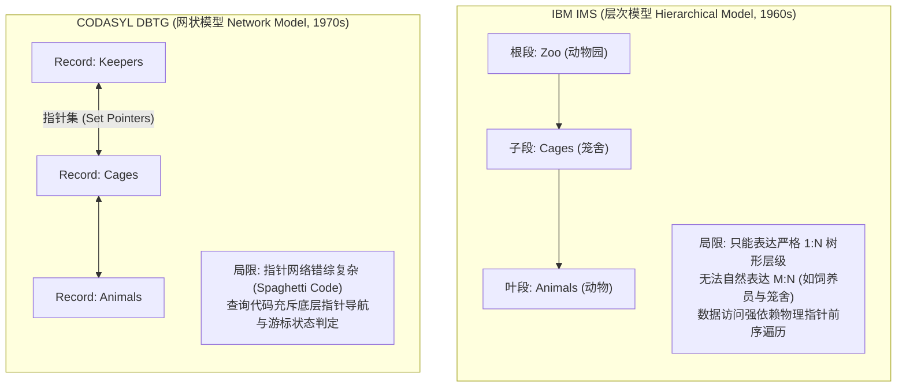
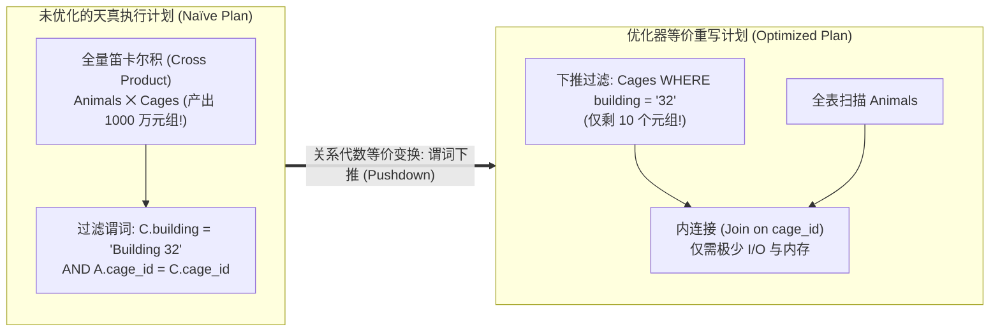

# Lec 2 现代 SQL 与高级查询

## TL;DR

- 早期层次模型（IMS）与网状模型（CODASYL）将应用程序逻辑与物理指针、存储路径深度耦合，缺乏数据独立性。
- Codd 关系模型通过声明式抽象彻底解耦物理存储（物理独立性）与逻辑结构（逻辑独立性）。
- 关系代数等价性规则（Relational Identities）为声明式 SQL 编译提供了数学基石，使得谓词下推与连接重排序成为自动优化可能。
- 视图（Views）作为虚拟表，既是实现逻辑数据独立性的核心工具，也是企业级细粒度安全访问控制与多租户隔离的防线。
- 现代数据库系统运维结合基于角色的访问控制（RBAC）、资源组隔离与统计信息分析（`ANALYZE`）维持生产集群稳定运行。

## 架构演进与核心洞察

::: insight 声明式语言与双重数据独立性的划时代革命
在 1970 年以前，程序员要查询“某个动物饲养在哪个笼舍”，必须在 COBOL 或 PL/1 代码中手写遍历磁带与磁盘指针的底层跳转循环（如 IMS 的 `GET UNIQUE`、`GET NEXT`）。一旦存储管理员为了提升性能在磁盘上调整了索引或增删了字段，所有上层业务代码全部崩溃报废。
Codd 提出关系模型的革命性本质在于**双重数据独立性**：
1. **物理数据独立性（Physical Data Independence）**：底层数据是在 B+ 树、堆文件还是哈希桶中，是否按某列排序，对上层 SQL 完全透明；
2. **逻辑数据独立性（Logical Data Independence）**：通过视图（Views）机制，底层表结构的合并、拆分或模式变更对终端应用完全透明。
程序员只需用声明式 SQL 描述“想要什么（What）”，而不是“如何去取（How）”，将执行策略的繁重负担彻底移交给了数据库内部的查询优化器。
:::

## 课前阅读与文献研读 (Reading Assignment)

> 本讲官方必读文献。深入剖析层次模型（IMS）与网状模型（CODASYL）在指针遍历中的历史泥潭，理解关系代数封闭性与声明式 SQL 对开发生产力的革命性解放。  
> 📖 **文献研读入口**：[必读论文精读：What Goes Around Comes Around（数据模型半个世纪的技术轮回）](./paper/what_goes_around_comes_around.md)

## 核心机制与讲义正文

> [!TIP] **[待补截图]** 建议截取官方课件 Slides 第 2 讲中关于“窗口函数（Window Functions）滑动帧（Frame Specification: ROWS BETWEEN）执行原理图”。此处预留插图空间。

> MIT 6.5830 / 6.5831 · Database Systems · 第 2 讲  
> 核心教材：*Readings in Database Systems* (5th Edition, Red Book)  
> 经典文献：E. F. Codd (CACM 1970) *`A Relational Model of Data for Large Shared Data Banks`*；Michael Stonebraker (ACM SIGMOD 1975) *`Implementation of Integrity Constraints and Views by Query Modification`*  
> 配套实验：GoDB (Go-based Database Engine) Lab 1: SQL and Data Catalog

## 1. 历史的教训：早期数据模型的物理绑定泥潭

为了深刻理解关系模型与 SQL 的伟大，必须回顾它所推翻的历史前身：IBM IMS（层次模型）与 CODASYL（网状模型）。



### 1.1 IBM IMS 与层次模型局限

在 IMS 中，数据被组织为树形结构的“段（Segments）”：
- **存取强依赖物理遍历**：查询必须通过类似 `GET UNIQUE Zoo`, `GET NEXT WITHIN PARENT Cage` 等过程式命令逐级下潜；
- **难以表达多对多（M:N）关系**：例如“一个饲养员照料多个笼舍，一个笼舍有多名饲养员”，在树形结构中必须人为引入冗余数据副本，引发严重的更新异常；
- **零物理独立性**：一旦重构段在磁盘上的链接指针，所有既有应用程序必须重写重编译。

### 1.2 CODASYL 与网状模型危机

CODASYL 通过“系（Set）”的概念引入图结构指针网络，允许一个子记录拥有多个父记录：
- 程序员必须在代码中维护复杂的“当前位置游标（Current of Run-Unit / Current of Record Type）”；
- 查询代码充斥着底层指针漫游与状态判断，被称为“指针意大利面（Pointer Spaghetti）”；
- 系统的正确性极度依赖程序员个人的编程细致程度，维护成本极其高昂。

---

## 2. 关系代数等价性与声明式查询重写

关系模型使用集合论与一阶谓词逻辑取代了指针网络。在关系代数中，所有操作的输入是关系，输出依然是关系（**闭包性 Closure Property**）。这一数学性质使得查询优化器能够利用代数等价规则自动重写查询。

### 2.1 核心关系代数等价规则（Relational Identities）



1. **选择算子（Selection $\sigma$）级联与交换律**：
   $$\sigma_{c_1 \land c_2}(R) \equiv \sigma_{c_1}(\sigma_{c_2}(R)) \equiv \sigma_{c_2}(\sigma_{c_1}(R))$$
2. **选择算子下推到连接（Pushdown Predicates past Joins）**：
   若谓词 $c$ 仅涉及关系 $R$ 的属性，则：
   $$\sigma_c(R \bowtie S) \equiv (\sigma_c(R)) \bowtie S$$
   此规则将原本需要先算庞大连接后再过滤的昂贵计算，转化为先在单表过滤掉 99% 的无关记录，将连接输入数据量压缩数个数量级。
3. **连接算子结合律与交换律（Join Commutativity & Associativity）**：
   $$R \bowtie S \equiv S \bowtie R$$
   $$(R \bowtie S) \bowtie T \equiv R \bowtie (S \bowtie T)$$
   这使得查询优化器可以在庞大的可能连接树形状（左深树、浓密树）中，自由探索代价最低的最佳定序（Join Ordering）。

---

## 3. 视图抽象：逻辑数据独立性与安全沙箱

视图（View）是存储在数据字典中的命名查询，对外呈现为一个虚拟的关系表。

### 3.1 视图消解与查询重写机制（Query Modification）

当客户端向视图发起查询时，数据库内核并不会预先生成临时物理表，而是通过图灵奖得主 Michael Stonebraker 提出的**查询修改（Query Modification / View Unfolding）**技术，将视图定义直接内联并入用户查询的关系代数树中。

这种内联消解不仅消除了临时物化表的磁盘与内存写入开销，更使得全局查询优化器能够将外层查询的过滤条件直接下推到视图底层的扫描算子中，实现跨越视图边界的全局端到端优化。

如下面的代码示例所示，用户面向视图编写的查询，在经过查询重写阶段后，被自动合并展开为直接针对底层基础物理表的单阶段高效执行计划：

```sql
-- 1. 定义视图：只暴露 32 号楼的动物与笼舍信息
CREATE VIEW Building32Animals AS
SELECT A.animal_id, A.name, A.species, C.cage_id, C.size
FROM Animals A
JOIN Cages C ON A.cage_id = C.cage_id
WHERE C.building = 'Building 32';

-- 2. 客户端发起的查询
SELECT name, size FROM Building32Animals WHERE species = 'Lion';

-- 3. 优化器内联消解后的真实执行计划等价于：
SELECT A.name, C.size
FROM Animals A
JOIN Cages C ON A.cage_id = C.cage_id
WHERE C.building = 'Building 32' AND A.species = 'Lion';
```

### 3.2 逻辑独立性与安全隔离应用

1. **解耦模式重构**：若 DBA 决定将 `Animals` 拆分为 `Mammals` 和 `Birds` 两张实体表，通过创建一个同名的 `Animals` 联合视图（`UNION ALL`），上层所有的既有业务系统无需改动哪怕一行代码；
2. **多租户安全沙箱**：通过视图过滤掉敏感字段（如薪资、身份证号）和非当前租户的数据行，再结合权限系统，为不同角色的用户提供定制化的数据访问切面。

---

## 4. 企业级系统运维与安全管控

现代企业级数据库不仅要支持灵活的数据分析与查询表达，还必须提供生产级可观测性、多租户访问隔离与物理存储运维保障。在多团队协同开发的环境中，必须确保遵循最小权限原则，防止误操作或权限泄露导致生产数据被意外破坏或篡改。

### 4.1 基于角色的访问控制（RBAC）

在现代数据库管理系统中，直接为每一个具体的用户单独授予零散的权限不仅维护成本极其高昂，而且在人员离职或换岗时极易留下安全审计漏洞。

基于角色的访问控制（Role-Based Access Control, RBAC）通过引入“角色（Role）”这一中介实体，将权限集与具体用户解耦。系统首先创建具备特定业务语义的角色，并为其分配精准的操作权限；随后仅需将该角色授予具体的用户账户即可完成权限交接。

在如下标准管理流程中，管理员首先通过 `CREATE ROLE` 声明只读权限组，使用 `GRANT SELECT` 将表级查询权限绑定至该角色；随后创建具体的业务分析师账户，并将角色整体授予用户；最后通过 `FLUSH PRIVILEGES` 确保内核权限缓存与磁盘授权表即时同步生效：

```sql
-- 1. 创建只读分析师角色
CREATE ROLE 'bi_analyst';

-- 2. 授予特定业务数据库的只读权限与特定视图访问权
GRANT SELECT ON production_dw.* TO 'bi_analyst';
GRANT SELECT ON secure_schema.Building32Animals TO 'bi_analyst';

-- 3. 创建具体运维用户并赋予角色
CREATE USER 'analyst_alice'@'%' IDENTIFIED BY 'StrongP@ssw0rd!';
GRANT 'bi_analyst' TO 'analyst_alice'@'%';
SET DEFAULT ROLE 'bi_analyst' TO 'analyst_alice'@'%';
FLUSH PRIVILEGES;
```

### 4.2 统计信息维护与表物理优化

优化器依赖真实的数据分布统计来挑选最佳物理计划。当表数据经历大规模写入或删除后，DBA 必须执行表维护命令：

```sql
-- 更新优化器基数估计所依赖的高频值与直方图统计
ANALYZE TABLE CustomerOrders;

-- 重新组织物理数据页并释放碎片空间 (对于支持原地整理的引擎)
OPTIMIZE TABLE CustomerOrders;
```

---

## 5. 关键设计抉择与架构认知

::: insight 为什么 SQL 是“包（Bags / Multiset）”而不是纯数学的“集合（Set）”？
Codd 最初提出的纯关系代数严格要求集合性质——即关系中不允许存在重复元组。
然而在 SQL 规范工业化落地时，设计者做出了务实的妥协：默认允许重复项（Multiset 语义）。
原因在于性能：如果每次 `SELECT col FROM Table` 都严格去重，数据库必须在每一步操作后都执行一次昂贵的全局排序或哈希去重，这在工业级高并发下是完全不可接受的。因此 SQL 将去重交由用户显式声明（`DISTINCT`），默认保留重复行以实现零额外开销的物理流式管道。
:::

::: pitfall 忽视复杂可更新视图（Updatable Views）的边界限制
虽然只读视图的展开和优化极为成熟，但通过视图执行 `INSERT` 或 `UPDATE` 存在深刻的理论限制。如果一个视图包含 `JOIN`、`GROUP BY`、`DISTINCT` 或聚合函数，底层物理表中的行与视图中的行不再是一对一对应关系，向其执行更新会产生歧义。
生产架构中应严格将视图作为**只读分析与安全切面**使用，核心写入事务应直接面向权威基础表。
:::

---

## 6. 课后深度思考题

### 思考题 1：过程式数据导航 vs 声明式查询优化在底层实现上的代际差异
试从算法复杂度与现代多核/并行硬件亲和性角度对比：
1. 为什么 IMS / CODASYL 的过程式循环导航代码无法由编译器自动进行跨节点的并行化改造？
2. 关系代数的声明式性质是如何让现代分布式引擎（如 Presto、Spark、Snowflake）能够全自动进行算子分区切分与分布式 Shuffle 的？

### 思考题 2：谓词下推与可满足性判定的优化边界
设查询为 `SELECT * FROM R JOIN S ON R.id = S.id WHERE R.val > 100 OR S.status = 'ACTIVE'`。
1. 试分析为什么由于 `OR` 谓词横跨两张不同的表，优化器无法直接将该过滤条件简单下推到单表 $R$ 或 $S$ 上？
2. 现代优化器通过何种代数等价重写（例如重写为 `UNION ALL` 形式）来强行实现局部的谓词下推？
