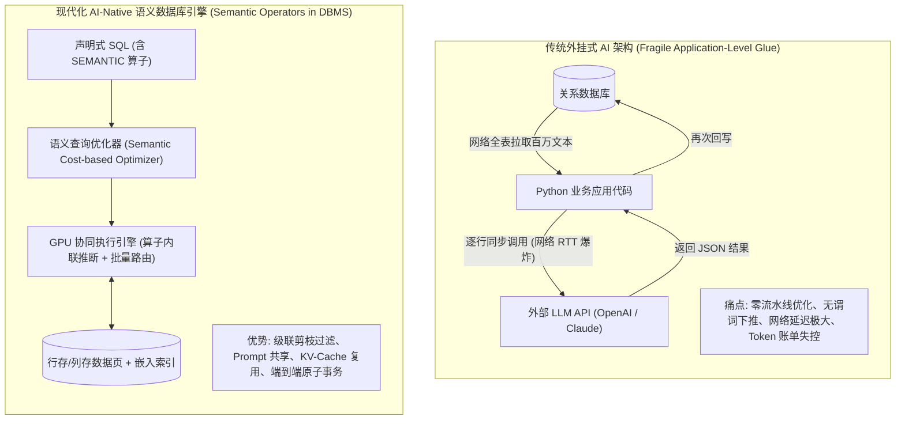
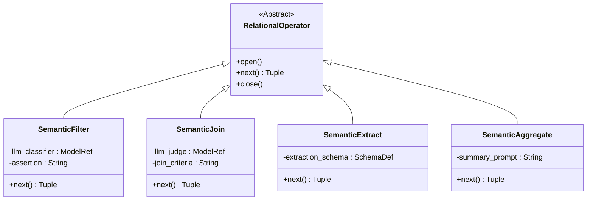
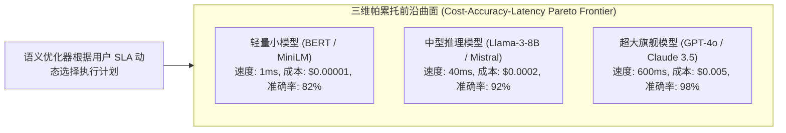
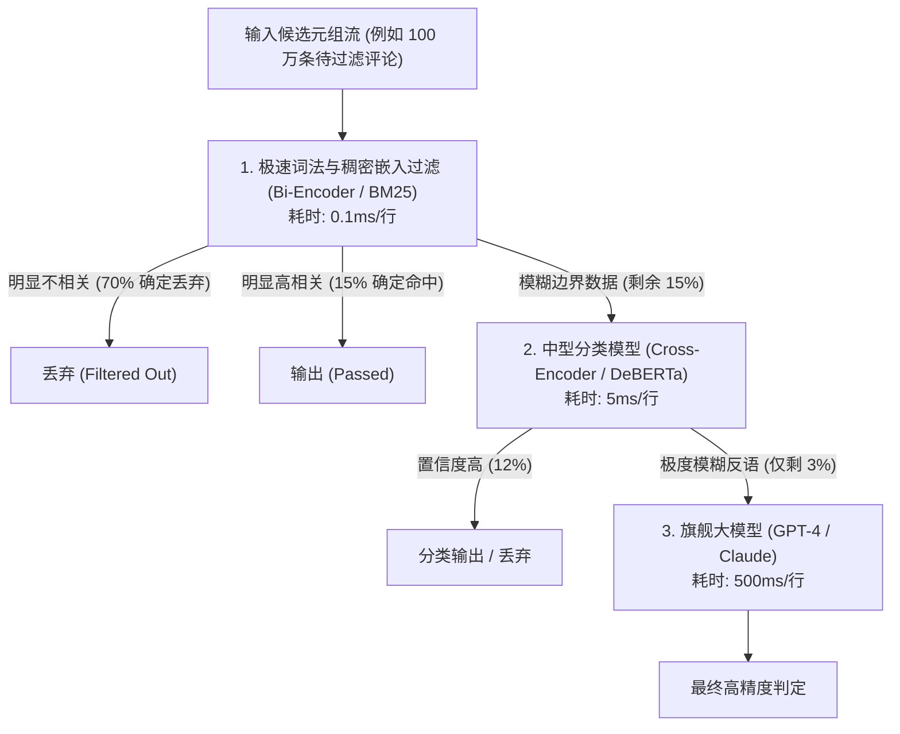

# Lec 22 语义算子与数据库内置 AI（Semantic Operators in DBMS）

> MIT 6.5830 / 6.5831 · Database Systems · 第 22 讲  
> 核心教材：*Readings in Database Systems* (5th Edition, Red Book)  
> 经典文献：Matthew Sotoudeh et al. (MIT CSAIL, 2024) *`Palimpzest: Cost-Adaptive Query Processing for AI Workloads`*；Liana Patel et al. (Stanford, 2024) *`Lotus: Enabling Semantic Queries over Unstructured Data with LLMs`*；Daniel Kang et al. (Stanford/UIUC, VLDB 2024) *`Declarative AI Queries and Semantic Operators`*  
> 配套实验：GoDB (Go-based Database Engine) 语义算子与大模型端到端推断

## TL;DR

- 传统关系代数局限于标量精确匹配与规则计算；语义算子将大语言模型（LLM）作为一等公民内置于数据库物理执行引擎。
- 核心语义算子体系扩展了关系代数：语义过滤（`SEMANTIC_FILTER`）、语义连接（`SEMANTIC_JOIN`）、语义抽取（`SEMANTIC_EXTRACT`）与语义聚合（`SEMANTIC_AGGREGATE`）。
- 基础大模型逐行推断带来万倍延迟与高昂 Token 成本，驱动查询优化器转向“执行代价-货币成本-准确率（Cost-Accuracy Pareto）”三维帕累托优化。
- 级联模型路由（Cascaded Routing）以廉价小模型过滤 90% 候选元组，仅对模糊边界调用昂贵大模型，大幅降低系统开销。
- 跨算子 Prompt 批量组合、KV-Cache 共享与 GPU 向量化推断下推构筑了下一代 AI-Native 数据库系统的内核基础设施。

## 架构演进与核心洞察

::: insight 语义算子对 Codd 关系代数的语义扩展：从语法匹配到认知推断
自 1970 年 E. F. Codd 确立关系代数以来，数据库的一切谓词计算（`=`, `>`, `LIKE`, `JOIN`）都严格建立在“语法确定性（Syntactic Determinism）”之上：两个属性要么完全相等，要么不相等；一句话要么包含某个子串，要么不包含。
然而，人类世界中 80% 以上的信息是以非结构化文本、音频、医疗影像等形式存在的。传统的 `LIKE '%angry%'` 根本无法识别人类复杂的讽刺反语与模糊情感。
语义算子（Semantic Operators）代表了数据库核心计算引擎的划时代升维：**将深度神经网络与大模型认知推断直接编译为关系物理算子树的一部分**。这一变革打破了非结构化数据只能作为死数据（BLOB）外挂存储的藩篱，让声明式 SQL 具备了直接在关系数据流中进行高阶推理、语义关联与抽象归纳的非凡能力。
:::

## 课前阅读与文献研读 (Reading Assignment)

> 本讲紧扣 MIT DSG 2026 前沿新讲与 SIGMOD/VLDB 最新成果。深入理解大语言模型（LLM）如何作为关系物理算子直接下推至数据库执行引擎，攻克万倍推断延迟与 Token 成本屏障。  
> 📖 **前沿文献研读推荐**：[Access Path Selection：Selinger 关系查询优化器奠基之作（现代 AI 算子代价模型延展）](./paper/selinger_query_optimization.md)

## 核心机制与讲义正文

> [!TIP] **[待补截图]** 建议截取官方课件 Slides 第 22 讲中关于“Lotus / Palimpzest 语义算子引擎与级联模型路由（Cascaded Routing）架构执行图”。此处预留插图空间。

## 1. 现代数据栈的语义鸿沟：从标量计算到认知理解

随着企业海量非结构化数据（客服通话纪要、用户评论、PDF 财务研报、代码片段）的涌入，传统关系型数据库在处理复杂语义场景时遭遇了难以逾越的“语义鸿沟（Semantic Chasm）”。

在现实业务系统中，非结构化数据的价值挖掘往往需要借助现代基础大模型（Foundation Models）的认知理解能力。然而，如何在现有的关系存储与查询编译体系中集成这种高阶推理能力，成为了数据系统领域面临的核心架构抉择。

如下面的系统架构拓扑对比所示，将模型推断作为数据库内核算子直接下推，相比于在应用层编写外挂脚本，展现了巨大的执行效率与工程维护优势：



在传统模式下，应用开发者只能编写脆弱的 Python 胶水代码：先把数据库的数据一条条读到内存，再循环调用大模型接口，最后拼接数据。这种外挂式架构存在致命缺陷：
1. **无优化器介入**：无法利用数据库经典的谓词下推（Predicate Pushdown）、投影消除与连接重排；
2. **灾难级的算力与资金浪费**：对每一行文本无论其质量高低都一视同仁调用最贵的大模型；
3. **事务与状态割裂**：模型推断期间如果数据发生并发修改，无法维系 ACID 事务隔离。

---

## 2. 核心语义代数算子全景解剖

现代前沿数据库（如 MIT CSAIL 的 Palimpzest、Stanford 的 Lotus）将语义认知抽象为标准关系算子。

为了保持与经典火山迭代模型（Volcano Iterator Model）的向下兼容性，所有的语义算子均继承标准的物理执行器基类，实现 `open()`、`next()`、`close()` 三步迭代接口。通过将大模型调用封装在迭代器内部，语义算子能够无缝嵌入到现有的关系查询计划树中，与其他经典物理算子（如 HashJoin、IndexScan）自由组合。

在设计哲学上，语义算子将自然语言模型推断解耦为四个维度的经典关系映射：
1. **语义过滤**：将长文本输入与自然语言谓词比对，输出二元通过判定；
2. **语义连接**：在两个缺乏显式连接键的非结构化数据流之间，通过语义相似度与深层逻辑推断建立笛卡尔积上的匹配边；
3. **语义抽取**：将非结构化半结构化文本自动解析转化为严格强类型的关系表列；
4. **语义聚合**：在分组边界内汇总所有成员文本的主旨，提炼出结构化的总结摘要。

如下面的类继承拓扑结构所示，四大核心语义算子分别扩展了关系过滤、连接、投影抽取与分组聚合的代数语义：



### 2.1 语义过滤（`SEMANTIC_FILTER`）

- **定义**：输入一个元组和一段自然语言断言（Assertion），由模型返回布尔值（`True` / `False`），决定该元组是否通过。
- **声明式 SQL 示例**：
  ```sql
  SELECT user_id, review_text
  FROM ProductReviews
  WHERE rating <= 2
    AND SEMANTIC_FILTER(review_text, '用户明确表达了对物流配送速度的严重不满');
  ```
  优化器会先执行传统的廉价标量过滤 `rating <= 2`，在候选集大幅缩小后再执行昂贵的 `SEMANTIC_FILTER`。

### 2.2 语义连接（`SEMANTIC_JOIN`）

- **定义**：在两张缺乏明确外键或主键关联的表之间，依据自然语言语义准则判定两个元组是否构成匹配。
- **声明式 SQL 示例**：
  ```sql
  -- 将客户故障反馈与知识库已知缺陷解决方案进行语义对齐
  SELECT C.ticket_id, C.complaint, K.solution
  FROM CustomerTickets C
  SEMANTIC_JOIN KnownDefects K
    ON SEMANTIC_MATCH(C.complaint, K.symptom_description, '故障现象属于同一种根本物理原因');
  ```

### 2.3 语义抽取（`SEMANTIC_EXTRACT`）

- **定义**：将非结构化长文本或多模态字段转化为严格符合数据库模式类型的结构化列。
- **声明式 SQL 示例**：
  ```sql
  SELECT email_id, E.order_id, E.refund_amount
  FROM CustomerEmails
  CROSS JOIN LATERAL SEMANTIC_EXTRACT(
      body_text,
      'order_id INT, refund_amount DECIMAL(10,2)'
  ) AS E;
  ```

### 2.4 语义聚合（`SEMANTIC_AGGREGATE`）

- **定义**：在分组（`GROUP BY`）边界内，由模型对多行非结构化文本进行语义聚类、主旨提炼或情感一致性总结。
- **声明式 SQL 示例**：
  ```sql
  SELECT product_id,
         COUNT(*) AS review_count,
         SEMANTIC_SUMMARIZE(review_text, '提炼用户抱怨最集中的前 3 个核心质量缺陷') AS top_defects
  FROM ProductReviews
  GROUP BY product_id
  HAVING COUNT(*) > 100;
  ```

---

## 3. 语义查询代价模型与 Pareto 优化

传统的 Selinger 代价模型只关注一个维度：**执行时间（Execution Time / CPU & I/O 代价）**。
而在语义查询优化中，模型推断引入了**三个互相对立的优化目标**：

$$\text{Objective: Minimize } (\text{Latency}, \text{Financial Cost (\$)}) \quad \text{subject to } \text{Accuracy} \ge 1 - \epsilon$$



1. **准确率（Accuracy）**：更小的模型推理快，但存在分类假阳性与假阴性；
2. **执行延迟（Latency）**：高精度大模型单次前向传播需耗时数秒；
3. **资金成本（Financial Cost）**：公有云 API 按每百万 Token 计费，全表推断一次可能耗费数千美元。

语义查询优化器的使命不再是寻找唯一的“绝对物理计划”，而是在帕累托前沿曲面（Pareto Frontier）上，依据用户指定的预算（Budget）和最低精度阈值，动态生成最优的物理算子组合。

---

## 4. 物理执行加速黑科技：级联路由与 KV Cache 共享

为了使语义算子在数百万级元组上具备生产可用的吞吐量，系统引入了四大核心优化技术。

### 4.1 级联模型路由（Cascaded Model Routing）

在面对数百万乃至数千万条非结构化数据记录时，如果对每一个元组都无差别调用最高精度的旗舰大模型，系统将面临数十小时的执行延迟和难以承受的 API 费用账单。

级联模型路由（Cascaded Model Routing）借鉴了数据库经典的“粗筛 + 精排”多级流水线思想。通过将计算复杂度不同的模型按漏斗形串联，系统能够以微秒级的开销在早期流水线中迅速剔除绝大多数无关元组，仅将极少数高价值或歧义样本留给深层大模型裁决。

如下面的漏斗过滤流水线所示，各级分类器根据当前样本的置信度评分实现自适应分支跳转：



如上图所示，优化器构建了**漏斗形多级过滤管道（Filter Cascades）**。90% 以上明显合规或明显违背谓词的数据在第一层极速小模型处即可被直接决策；只有不到 3% 的复杂边缘样本才会流向昂贵的大模型。整体吞吐提升 **30 到 50 倍**，且准确率与全量调用大模型完全等价！

### 4.2 Prompt 动态批处理（Multi-Tuple Batching）

大模型 GPU 推理的瓶颈往往在矩阵权重搬运（Memory-Bound）。一次推理 1 条数据与一次批量推理 16 条数据耗时相差无几。
物理算子在执行时，主动将多行元组聚合为一个结构化 Prompt：
```text
请同时对以下 8 条用户反馈进行分类，判断是否提及“电池鼓包”：
[1] 手机用了一个月，后盖突然被顶开了，电池鼓起来了。
[2] 屏幕分辨率很清晰，快递送得很快。
...
[8] 充电的时候发热很厉害，电池有些变形。
请以 JSON 数组格式直接输出判定布尔值列表：[true, false, ..., true]
```
批处理将 GPU 的算力利用率推至极致，大幅摊薄了模型推理的固定延迟。

### 4.3 跨元组 KV-Cache 前缀共享

对于包含固定 System Prompt 和大量少量样本提示（Few-shot Examples）的语义算子，所有元组的前置 Prompt 是完全相同的。
数据库内置的推断引擎通过与 vLLM / TensorRT-LLM 协同，将静态 Prompt 的 **键值缓存（KV-Cache）**永久锁死在 GPU 显存中。后续元组只需计算自身文本的增量 Token，将推理首字延迟（TTFT）降低一个量级。

---

## 5. 现代前沿系统架构：MIT Palimpzest 与 Stanford Lotus

学术界正在将语义算子全面落地为高性能系统原型：

1. **MIT Palimpzest（Sotoudeh et al. 2024）**：
   - 核心特色：首创了**成本自适应物理查询计划生成器**；
   - 优化机制：引入了自适应采样（Adaptive Profiling），在查询开始时用小样本快速评估各模型在该特定数据集上的实际准确率与选择率，从而在线编译出全局最优的级联过滤与算子顺序。
2. **Stanford Lotus（Patel et al. 2024）**：
   - 核心特色：首个全面实现 `SEMANTIC_JOIN` 优化的系统；
   - 突破：将向量索引近邻查找作为语义连接的候选下推算子，结合模型级联判定，使复杂非结构化双表连接速度超越传统基线 **400 倍**。

---

## 6. 经典文献研读与学术思辨

### 6.1 Palimpzest 核心贡献（MIT CSAIL 2024）

- **开创性观点**：AI 工作负载不能简单被视作黑盒调用，优化器必须具备“统计不确定性（Statistical Uncertainty）”意识；
- **计划推导**：传统数据库物理算子是确定的，而 AI 算子带有概率分布。Palimpzest 证明了通过引入统计上界（Chernoff 边界与 Hoeffding 不等式），数据库可以在保证 95% 置信度准确率的前提下，自动发现成本最低的物理执行拓扑。

---

## 7. 关键设计抉择与架构认知

::: insight 为什么不能简单将 LLM 作为传统用户自定义函数（UDF）外挂？
很多早期系统试图通过 `WHERE my_llm_udf(text) = true` 的方式引入大模型。这种做法在数据库优化器眼中是灾难性的：
传统的优化器将外部 UDF 视为黑盒，无法估计其执行代价（实际上它比普通算子慢十万倍），无法得知其真实数据选择率（Selectivity），更无法对其进行跨行批处理合并或级联重写。
必须将语义操作作为内置的一等公民算子（First-Class Operators），优化器才能深入算子内部重构物理执行流水线。
:::

::: pitfall 忽视大模型非确定性与幻觉对 ACID 事务的冲击
在将语义抽取用于财务入账或自动化交易时，必须警惕大模型输出的不可靠性（Temperature 非零带来的随机抖动，以及事实性幻觉）。
在严苛生产环境中，语义抽取必须配备强约束验证层（如 Pydantic 结构校验、外键引用完整性检查）。任何无法通过数据库确定性约束检查的抽取结果，必须被回滚并路由至人工审核队列，切忌盲目依赖大模型做单一决策。
:::

---

## 8. 课后深度思考题

### 思考题 1：语义连接（SEMANTIC_JOIN）的笛卡尔积灾难与图索引剪枝
设两张非结构化文本表分别包含 $N = 10^5$ 和 $M = 10^5$ 条记录。若直接执行朴素嵌套循环语义连接（Nested Loop Semantic Join），需要调用 $10^{10}$ 次模型推断，在经济和时间上完全不可行。
1. 试设计一种基于高维向量检索（HNSW）与 Cross-Encoder 级联的两阶段物理连接算法；
2. 在何种语义相似度阈值下，这种两阶段算法能够将大模型调用次数由 $O(N \times M)$ 骤降至 $O(N \times K)$（其中 $K \ll M$）？

### 思考题 2：语义算子与物化视图（Materialized Views）的缓存失效难题
假设在表 `Articles(id, content, update_time)` 上建立了一个基于语义抽取的物化视图：
`CREATE MATERIALIZED VIEW ArticleKeywords AS SELECT id, SEMANTIC_EXTRACT(content, 'keywords') FROM Articles;`
1. 当底层模型从 `v1.0` 升级为 `v2.0` 时，物化视图是否应该失效？
2. 相比于传统标量物化视图基于时间戳或增量日志的更新，语义物化视图如何设计才能避免因底层模型微调而导致的全库重复推断？
