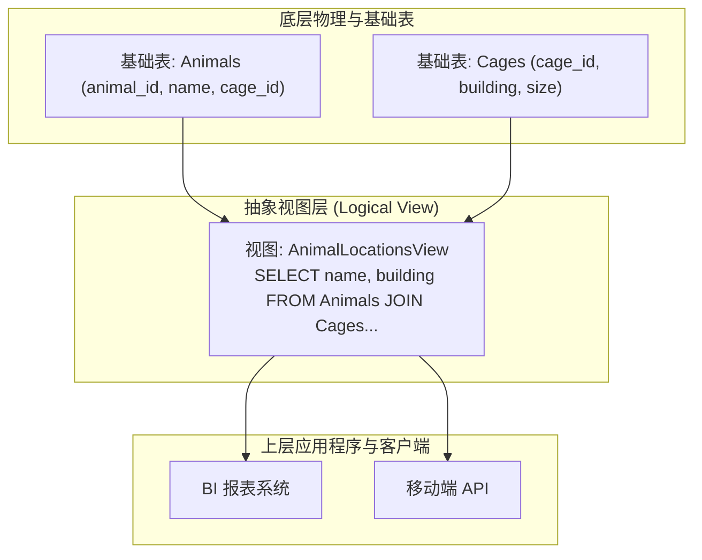
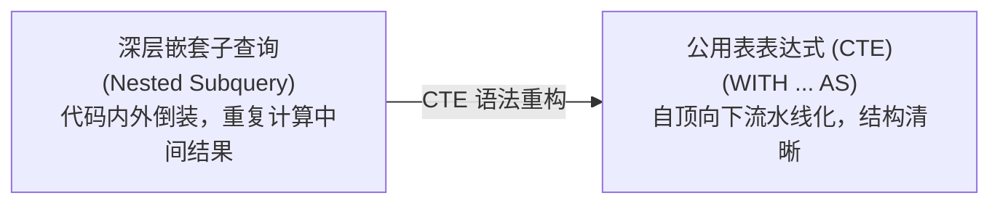
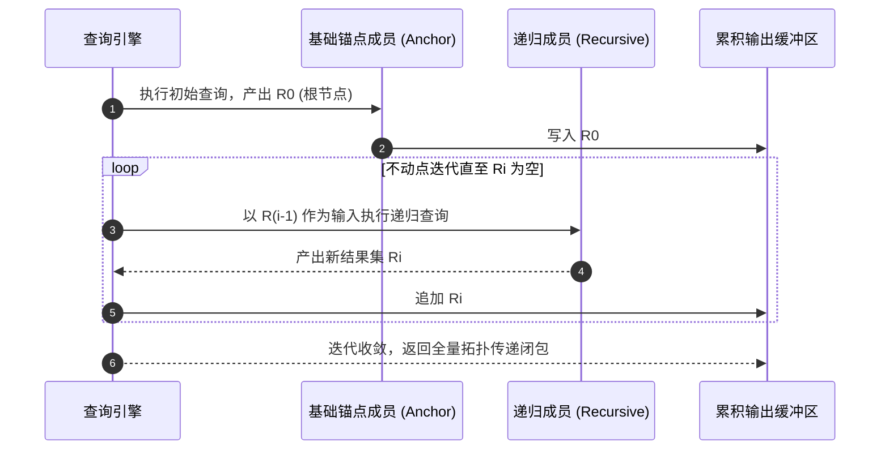
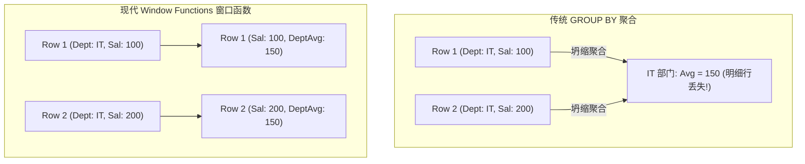

# Lec 3 模式设计与递归查询

## TL;DR

- 逻辑数据独立性通过数据库视图（Views）将物理存储与应用程序解耦，实现模式变更对业务透明。
- 关系连接（Joins）涵盖内连接、外连接与自连接（Self-Join），支持多实体间复杂拓扑关联。
- 通用表表达式（CTE）消除深层嵌套子查询的语义杂乱，显著提升复杂查询的可读性与可维护性。
- 递归查询（`WITH RECURSIVE`）通过固定点迭代打破关系代数无法表达传递闭包的理论局限，支持图路径查找与组织树遍历。
- 窗口函数（Window Functions）在保留细粒度原始记录的同时沿滑动窗口轴线计算动态聚合，彻底告别繁琐自连接。

## 架构演进与核心洞察

::: insight 递归查询对经典一阶关系代数的图灵完备性突破
由 E. F. Codd 奠定的经典一阶关系代数（Relational Algebra）存在一个众所周知的理论边界：**它无法表达传递闭包（Transitive Closure）**。这意味着在纯粹的 SQL-89 关系代数中，你无法写出一个通用查询来计算图结构中“节点 A 到节点 B 是否连通”或“获取某个员工的所有间接下属”。
SQL-99 引入的 `WITH RECURSIVE` 是数据库查询表达力的一次历史性跃迁。它将关系代数由纯粹的“单次映射”升级为“受控不动点迭代（Least Fixed Point Iteration）”，使 SQL 具备了直接在关系引擎内部高效遍历树与图的能力，而无需将数据反复拉取到应用层进行循环扫描。
:::

## 课前阅读与文献研读 (Reading Assignment)

> 官方课前研读推荐。探讨关系数据建模、函数依赖与 BCNF/3NF 规范化理论，分析为何概念 ER 模型能够天然收敛至高范式关系模式。  
> 📖 **文献研读入口**：[推荐文献研读：What Goes Around Comes Around（模式设计与关系范式理论）](./paper/what_goes_around_comes_around.md)

## 核心机制与讲义正文

> [!TIP] **[待补截图]** 建议截取官方课件 Slides 第 3 讲中关于“递归查询（Recursive CTE）工作表（Working Table）与中间迭代流转图”。此处预留插图空间。

> MIT 6.5830 / 6.5831 · Database Systems · 第 3 讲  
> 核心教材：*Readings in Database Systems* (5th Edition, Red Book)  
> 经典文献：E. F. Codd (CACM 1970) *`A Relational Model of Data for Large Shared Data Banks`*  
> 配套实验：GoDB (Go-based Database Engine)

## 1. 视图抽象与逻辑数据独立性

在企业级信息系统中，数据库模式（Schema）绝非一成不变，而是会随着业务规模拓展、安全合规审计与性能优化重构而不断演进。**逻辑数据独立性（Logical Data Independence）**是关系数据库系统的核心设计承诺之一：它保证当底层基础物理表或逻辑表的组织结构发生变动时，无需对上层成百上千个微服务和应用程序代码进行伤筋动骨的重写。

通过引入分层解耦的抽象机制，数据库系统能够屏蔽底层物理存储的多样性与复杂演化。如下面的架构分层拓扑所示，上层应用和分析报表不再直接与底层基础物理表产生硬编码依赖，而是统一通过逻辑视图层进行交互解耦：



通过创建视图（View），系统为客户端提供虚拟的逻辑表抽象：
```sql
CREATE VIEW AnimalLocations AS
SELECT A.name, C.building, C.size
FROM Animals A
JOIN Cages C ON A.cage_id = C.cage_id;
```
若底层决定将 `Cages` 拆分为 `IndoorCages` 与 `OutdoorCages`，DBA 只需重写视图定义，上层的 BI 报表与 API 客户端的查询完全不受任何影响。

---

## 2. 关系连接全景：外连接与自连接（Self Joins）

在多表关联查询中，连接操作负责将笛卡尔积（Cross Product）按谓词约束缩减为有意义的实体关系。

### 2.1 连接类型与空值补齐语义

- **内连接（Inner Join）**：仅保留两表谓词匹配成功的行，任何不匹配的元组均被丢弃；
- **左外连接（Left Outer Join）**：保留左表所有元组；若右表无匹配，右表各字段以 `NULL` 补齐；
- **全外连接（Full Outer Join）**：保留左右两表的所有元组，互不匹配的字段各自以 `NULL` 补齐。

### 2.2 自连接（Self-Join）与别名消除歧义

当实体之间存在内部层级关联（如员工表中的“员工-主管”关系，动物园中的“捕食者-猎物”关系）时，系统必须使用自连接：

```sql
-- 查询同一展馆中所有共处的动物对 (A1, A2)
SELECT A1.name AS animal_1, A2.name AS animal_2, A1.cage_id
FROM Animals A1
JOIN Animals A2 ON A1.cage_id = A2.cage_id
WHERE A1.animal_id < A2.animal_id; -- 避免自身配对与对称重复
```

---

## 3. 复杂查询解耦：嵌套子查询与通用表表达式（CTE）

在处理真实企业级业务分析、多层级数据清洗与中间聚合汇总时，开发人员往往需要将前一步查询的产出作为后一步分析的输入。在早期的 SQL 编程范式中，这种依赖关系通常只能通过深层嵌套子查询（Nested Subqueries）或内联派生表（Derived Tables）来实现。

然而，当嵌套层级超过三层时，SQL 的可读性将呈断崖式下跌。内外层查询逻辑颠倒，代码维护成本剧增，并且相同的子查询可能在多个分支中被重复计算，给查询优化器带来了严重的识别障碍。

通用表表达式（Common Table Expressions, CTE）正是为了打破这种嵌套泥潭而引入的革命性语言特性。它将深层嵌套的结构重构为自顶向下流转的清晰计算流水线：



通用表表达式（Common Table Expressions, CTE）通过 `WITH` 关键字定义命名临时结果集：

```sql
WITH HighDensityCages AS (
    SELECT cage_id, COUNT(*) AS animal_count
    FROM Animals
    GROUP BY cage_id
    HAVING COUNT(*) > 5
),
BuildingStats AS (
    SELECT C.building, SUM(H.animal_count) AS total_dense_animals
    FROM HighDensityCages H
    JOIN Cages C ON H.cage_id = C.cage_id
    GROUP BY C.building
)
SELECT * FROM BuildingStats WHERE total_dense_animals > 20;
```
CTE 不仅使代码具备自顶向下的逻辑流水线结构，现代查询优化器还能识别非相关 CTE 并进行中间结果物化或内联等价重写。

---

## 4. 递归查询（Recursive CTE）与图遍历实战

递归查询是 SQL-99 规范中最强大的特性之一，专用于处理自引用分层数据、多层级组织架构、物料清单（BOM）与任意拓扑图的深度优先或广度优先遍历。在没有递归查询之前，应用层必须通过多次网络往返，在客户端循环执行 SQL 查询并拼接数据，不仅延迟极高，而且在大规模图数据下极易引发网络拥塞。

### 4.1 递归查询执行模型

在关系代数的数学框架中，递归查询本质上是定义了一个集合变换算子序列的不动点迭代（Fixed Point Iteration）。递归 CTE 在语法上由两个核心部分通过 `UNION ALL`（或 `UNION`）结合构成：
1. **基础锚点成员（Anchor Member）**：初始化递归过程的非递归查询，产生第一轮结果集 $R_0$；
2. **递归成员（Recursive Member）**：引用 CTE 自身的查询，以上一轮迭代产生的临时结果集 $R_{i-1}$ 作为输入，生成下一轮结果集 $R_i$；
3. **终止条件**：当递归成员计算产出的结果集为空（$\emptyset$）时，迭代停止，系统将所有 $R_0, R_1, \dots, R_k$ 合并输出。



### 4.2 案例实战：员工层级树全景检索

为了具象化理解递归查询的执行威力，我们考虑一个经典的企业组织层级架构。设公司员工表结构为 `Employees(emp_id, name, manager_id)`，其中 `manager_id` 外键自引用指向其直接汇报主管的 `emp_id`。

现在的核心业务诉求是：查找主管张三（`emp_id = 1`）所管理的所有直接与间接下属，并以树形深度层级（`level`）进行结构化排序呈现。通过递归 CTE，我们无需编写外部应用层循环，直接在一条声明式 SQL 内高效完成整棵下属子树的完整剪枝检索：

```sql
WITH RECURSIVE SubordinatesTree AS (
    -- 1. 基础锚点：找到根节点 (张三)
    SELECT emp_id, name, manager_id, 0 AS level
    FROM Employees
    WHERE emp_id = 1

    UNION ALL

    -- 2. 递归成员：寻找下一层级的直接汇报人
    SELECT E.emp_id, E.name, E.manager_id, S.level + 1
    FROM Employees E
    JOIN SubordinatesTree S ON E.manager_id = S.emp_id
)
SELECT * FROM SubordinatesTree ORDER BY level, emp_id;
```

---

## 5. 窗口函数（Window Functions）与滑动分析

传统 `GROUP BY` 是破坏性的，多行记录会被合并为单行，导致行级明细丢失。**窗口函数（Window Functions）**在保留原有每一行明细数据的同时，沿窗口轴线计算滑动统计值。



### 5.1 语法结构与核心子句

```sql
FUNCTION() OVER (
    PARTITION BY 分组列
    ORDER BY 排序列
    ROWS/RANGE BETWEEN 窗口起始 AND 窗口结束
)
```
- **`PARTITION BY`**：将记录集划分为逻辑分区，计算在分区内部独立进行；
- **`ORDER BY`**：定义分区内数据计算的先后顺序；
- **窗口帧（Frame Specification）**：限定当前行计算所涉及的物理行范围（如 `ROWS BETWEEN 2 PRECEDING AND CURRENT ROW` 计算移动平均）。

### 5.2 核心窗口函数分类对照表

| 函数分类 | 典型函数 | 核心功能与应用场景 |
| :--- | :--- | :--- |
| **排名函数** | `ROW_NUMBER()` | 无论并列，按行严格连续编号（1, 2, 3, 4） |
| | `RANK()` | 遇到并列跳跃编号（1, 2, 2, 4） |
| | `DENSE_RANK()` | 遇到并列连续编号（1, 2, 2, 3） |
| **跨行位移函数** | `LAG(col, n)` | 获取当前行之前第 $n$ 行的字段值（环比增长计算） |
| | `LEAD(col, n)` | 获取当前行之后第 $n$ 行的字段值 |
| **分布与切片** | `NTILE(k)` | 将分区内记录均匀分入 $k$ 个桶中（分位数分析） |
| **累积聚合** | `SUM() OVER (...)` | 计算分区内的累计流水总和（Running Total） |

---

## 6. 关键设计抉择与架构认知

::: insight 为什么关系引擎不适合执行任意深度的复杂图计算？
虽然 `WITH RECURSIVE` 赋予了 SQL 遍历图的能力，但关系数据库在底层依然是面向行或列存储的块存储引擎。当图的度数极大且深度超过几十层时，递归 CTE 会产生海量的随机连接与中间数据复制，导致内存溢出与性能断崖。
在涉及数十亿边规模的复杂图拓扑挖掘（如 PageRank、社区发现、最短路径矩阵）场景中，专用图计算引擎（如 GraphX、Neo4j）或内存计算框架能够通过邻接表内存常驻与顶点程序模型提供数个量级的性能优势。
:::

::: pitfall 忽视递归查询环路（Cycles）引发的无限死循环
在有向图或图谱数据中，如果存在环路（例如 $A \to B \to C \to A$），朴素的递归 CTE 会在环路中无限循环执行，直到消耗殆尽内存或触发数据库最大递归深度报警（如 PostgreSQL `max_recursion_depth`）。
工程实践中必须在递归中维护已访问节点的数组路径（`array_append`），并在递归条件中加入 `WHERE NOT node_id = ANY(path)` 进行防环剪枝。
:::

---

## 7. 课后深度思考题

### 思考题 1：递归查询执行过程中的中间结果物化与不动点收敛
试从关系代数和系统实现角度分析：
1. 数据库优化器在执行 `WITH RECURSIVE` 时，是如何通过维护工作表（Working Table）与中间结果表（Intermediate Table）来实现每一轮差量数据驱动的？
2. 为什么 SQL 标准严格禁止在递归成员中使用 `LEFT JOIN`（以递归表为右侧）或 `NOT IN`（引用递归表）等非单调（Non-monotonic）操作符？

### 思考题 2：窗口函数执行引擎架构：排序代价 vs 流水线执行
在执行一个包含多个窗口函数的复杂分析查询时（例如一个按 `PARTITION BY department ORDER BY salary` 计算排名，另一个按 `PARTITION BY age ORDER BY hire_date` 计算均值）：
1. 执行引擎必须采取何种物理计划来满足不同的分区与排序要求？
2. 优化器如何对具有兼容 `PARTITION BY` 和 `ORDER BY` 的多个窗口函数进行合并计算，以消除不必要的额外排序（Sort）算子？

---

## 详细机制推导与原版课堂图解

> MIT 6.5830 / 6.5831 · Database Systems · 第 3 讲  
> 核心教材：*Readings in Database Systems* (5th Edition, Red Book)  
> 配套实验：GoDB (Go-based Database Engine)

## 本讲导览

- 关系代数
- 规范化
- 数据模型

## 关系代数

关系代数（relational algebra）是一种能够作用在关系的一组算术操作，关系代数可以被视为一种能够表达数据查询方式的机制，数据是存储在关系里面的。关系代数对于理解关系数据库如何表示和优化查询（queries）很重要。 除了基本的关系代数，还有分组、聚合操作，连接操作。

### 单目计算

#### 选择

#### 投影

#### 重命名

### 叉积与连接

#### 叉积

#### 连接

#### $\Theta$连接和等值连接

#### 自然连接

### 集合操作

### 除法

### 查询

关系代数的操作作用于关系，并且结果也是关系，

#### 操作序列

#### 表达式树

## 规范化

（关系对应表，属性对应列，元组对应行）

- 规范化（Normalization）是修改数据库结构以满足某些要求的过程。这些要求由一系列的范式（normal forms）定义。

- 规范化的一个主要目标是使维护正确的数据集合更加容易。正确的数据是完整且自洽（self-consistent）的。数据库不应包含与我们理解的事实相矛盾的数据。

为了阐明规范化的必要性，作如下分析


- 插入异常： 新教师加入学校，没有课程，这样导致每个属性选择 NULL 值或者是创建虚假课程
- 删除异常，如果删除了 English Literature，那 Larsen 的信息全都没了
- 更新异常：考虑 Reyes 更换办公室，如果忘记更新其中一个，就会导致数据内部不一致。

---

### 键 vs 超键

关系的超键是该关系的某些属性的子集， 这些属性能够唯一标识关系中的任何元组。考虑图书馆关系。我们断言，属性集合{author, titile, year}是一个超键，能够保证对关系中任何元组唯一性。关系的任何属性的子集，如果它是某个已知超键的超集，那么它也是关系的超键。{author, title, year, author_birth} 必须是一个超键，因为它是一个已知超键的超集。

而关系的键是关系的一个超键，我们不能从中减去任何属性并仍然得到一个超键。

**确定关系的键**是分析关系是否已经相对于 **2NF** 或更高范式规范化的关键步骤


### 函数依赖

**函数依赖**，与超键密切相关，是关于关系的两个属性集的声明。考虑两个属性集，我们分别标记为 X 和 Y。如果关系中的两个元组在 X 上的值相同，那么它们在 Y 上的值也必须相同，这时我们称 X 函数决定 Y，或者 Y 函数依赖于 X。这个关系用符号表示为 X→Y。

和键一样，FD 是我们对数据施加的约束。另一种理解函数依赖的方法是：如果你有一个只包含 X 或 Y 的属性的关系，那么 X 将是该关系的超键。也就是说，X 唯一地确定了 X 和 Y 的并集中的所有内容。（现在我们可以提供另一种超键的定义，即关系中某个属性的子集函数决定了关系的所有属性集。）

另一种理解 FD 的方法是：如果 X 函数决定 Y，那么如果我们知道 X 中的值，我们就知道或可以确定 Y 中的值，因为 Y 只是关于 X 的单值事实。

以下是一些图书馆关系的更多 FD 示例：

- {author, title} → {genre}
- {author} → {author_birth, author_death}
- {genre} → {section}
- {author, title} → {title, year}
- {title, genre} → {title}

#### 类型

- 平凡
  - 右集是左集的子集
  - Ex：第五个
- 非平凡
  - 右集有部分不在左集
  - Ex：第四个
- 完全非平凡
  - 左右两个集合的交集是空集
  - Ex：前三个

#### 推理规则

- 反身规则（Reflexive Rule）
  - 如果 Y 是 X 的子集，那么 X→Y

-  增强规则（Augmentation Rule）
  - 如果 X→Y 成立，那么 XZ→YZ 也是
- 传递规则（Transitive rule）
  - 如果 X→Y，Y→Z，那么 X→Z
- 分解规则（*Splitting rule (or decomposition, or projective, rule）*)
  - 如果 X→YZ 成立，那么 X→Y 和 X→Z 也成立
- 合并规则
  - 如果 X→Y 且 X→Z，那么 X→YZ 也成立

### 闭包

闭包的概念是我们从某个属性集出发，通过应用一系列 FD 规则，能够推导出该属性集所能确定的所有其他属性。换句话说，闭包帮助我们了解一个属性集的力量——它能确定哪些其他属性。

通过计算属性集的闭包，我们可以验证该属性集是否是一个超键（能唯一标识一条记录的属性集）。此外，闭包在数据库的规范化过程中也起着关键作用，有助于我们分解数据库表并消除冗余。在这个例子中，作者和书名的组合（{author, title}）可以唯一地确定一本书的所有相关属性，这意味着这个组合是图书馆关系的一个超键。我们通过应用推理规则逐步扩展这个属性集，最终得到它能够确定的所有属性。

### 2,3 范式和 BCNF

#### 1NF

- 属性是单值的
- 同属性的类型是相同的
- 每个元组应该都是独一无二的——添加 uid，或者是多个属性确定唯一性
- EX：


####   2NF

确保关系中的**所有非键属性依赖于键，而不是仅仅依赖于键的某个真子集**。

- 如果一个关系的键只有一个属性，它自动满足 2NF，因为不存在真子集的情况。

- EX1： 图书馆关系（library）不满足 2NF。图书馆关系的键是{author, title}。然而，假如我们有以下函数依赖（FD）：

  - {author} → {author_birth, author_death}

  - 在这个依赖中，左侧只包含 author。我们称上述 FD 违反了第二范式。

- EX2:

  

#### 3NF

在满足 2NF 的基础上，要求关系中不存在非键属性依赖于其他非键属性。这意味着所有非键属性必须直接依赖于键，而不能间接依赖于其他非键属性。

-  Ex： 违反 3NF。考虑图书馆关系中的依赖：

  - {genre} → {section}
  - 这违反了 3NF，因为 genre 和 section 都不是任何键的一部分。

- Ex2:

  

   供应商电话依赖供应商，即存在非键属性依赖于其他非键属性

  

#### BCNF

**Boyce-Codd 范式（BCNF）**：这是比 3NF 更严格的范式（3.5 范式），要求关系中的每个非平凡 FD 的左侧必须是超键。这意味着 BCNF 对 3NF 的要求更加严格，但确保了更强的数据完整性。

**BCNF 的定义**：一个关系处于 BCNF 当且仅当它处于 1NF，并且对于关系中的每个非平凡函数依赖（FD），X 是关系的一个超键。

**与 3NF 的比较**：

（候选键是最小的超键）

3NF 和 BCNF 之间的区别在于 3NF 允许函数依赖的右侧是关键属性的子集。这种情况相对少见，这也是为什么大多数符合 3NF 的关系也符合 BCNF 的原因。我们将在后续章节中进一步探讨这种区别

### 分解属性

规范化分解的两个理想属性。


- 完全恢复性：分解后的关系必须能够通过联接恢复原始关系。这意味着联接后的关系必须包含原始关系中的所有元组，并且没有额外的元组。

  - 实际上，BCNF 分解算法能够满足这一条件；而任意分解不一定能做到这一点
  - EX：X 属性（作者）作为外键保留，Y 属性（作者出生、作者去世）可以被移除在。共享的外键上联接这些关系，可以将 Y 值恢复到正确的元组中。

- 依赖保留：所有由原始函数依赖暗示的约束在分解后的数据库中都得到保留。

  - 通过将关系规范化到 3NF，我们可以保证这一属性，但 BCNF 并不总是能满足这一要求。

  - EX：涉及 Hugo 奖和 Nebula 奖，这两个奖项每年在多个类别中颁发，假设给定格式的作品在每年中只能获得一个奖项。如果我们知道奖项、年份和格式，我们可以明确确定获奖作品。有两个重要依赖

    - 反映每年每种格式只能有一个作品获奖
      - {award, year, format} --> {author, title}
      - 不违反 3NF 或 BCNF，因为**左侧是关键属性**
    - 承认每个作品属于某种特定格式
      - {author, title} -> {format}
      - 属于 3NF 但不属于 BCNF 的狭隘类别，因为{author, title}不是该关系的关键属性。即当出现 AB→C 和 C→B 时就会出现。然而，FD 并不违反 3NF，因为右侧（{format}）是关系的一个关键属性的子集

  - 如果我们按照 BCNF 的分解方法对一个违反 BCNF 的关系进行分解，得到的分解关系必须能通过连接恢复原始关系，并且保证原始数据的正确性。在分解后，我们会得到两个关系，例如：

    - `scifi_awards_1`：包含属性 `{author, title, format}`
    - `scifi_awards_2`：包含属性 `{award, year, author, title}`

    原始的依赖 `award, year, format -> author, title` 在这两个新关系中不再适用。这样，即使这两个新关系在 BCNF 下是合理的，数据的完整性约束（如同一年同一类别的奖项只会颁发给一个作品）可能在分解后被破坏

    **具体数据示例**
    例如，我们在两个新关系中存储了如下数据：

    - `scifi_awards_1`：记录了作者、标题和格式
    - `scifi_awards_2`：记录了奖项、年份、作者和标题

    在`scifi_awards_1`中，Ursula K. Le Guin 和 Roger Zelazny 的书籍在同一年都获得了 Hugo 奖。如果这两本书的类别相同，那么第二个关系（`scifi_awards_2`）中可能会出现无效数据，因为它们应该属于不同的类别。如果我们仅查看分解后的关系而不进行连接，就很难识别这种数据不一致性。

    **解决方案**
    在这种情况下，保留原始关系的 3NF 可能更有利，因为我们可以利用主键 `{award, year, format}` 来维持数据的一致性。尽管在 3NF 下可能存在一些冗余（例如作品可能出现两次），但这种冗余量相对较小。

    - 如果我们选择保留原始关系在 3NF 中，就需要在应用程序中处理 BCNF 违例引起的修改异常。这样，尽管数据可能存在冗余，但可以保持约束和数据的一致性。
    - 如果我们决定将关系分解到 BCNF 水平，则需要在其他地方（例如应用程序逻辑中）强制执行丢失的约束，以确保数据的一致性。

### 多值依赖和第四范式（4NF）


违反 BCNF 的关系在正常的数据收集活动中经常出现。例如，一个 Web 服务器记录活动日志时，可能会记录用户信息以及用户在网站上访问的页面信息。这种情况下，用户信息在多个日志条目中重复出现，显然存在冗余。

相对而言，第四范式（4NF）违例在数据收集中不太常见。4NF 解决的问题是在尝试将包含多个独立一对多关系的数据存储到一个关系中时出现的问题。在这种情况下的冗余更为微妙，较难识别。


## 数据模型

数据库创建需要分析和设计活动。分析可能包括与那些对要存储的数据有深刻理解的人讨论、与数据库的预期用户讨论以及对代表性数据的检查。设计则利用分析中获得的见解来生成能够正确存储必要数据并满足用户需求的数据库结构。分析和设计是相辅相成的活动；分析为设计提供信息，而设计又会揭示出需要进一步分析的新问题。分析与设计之间的互动能够消除由于理解不完全和错误假设而导致的问题。

分析和设计可以通过各种图形和非图形文档来进行。数据模型是创建数据库时最有用的一种文档。数据模型至少必须捕捉到各种数据类型及其相互关系。我们可以使用数据模型来推理数据，从而脱离 SQL 或编程语言的细节

本文的这一部分探讨了在不同抽象层次上的图形数据模型。我们首先讨论了 E-R 图，这是一种高级的数据模型。ERD 在分析与设计的交汇点上特别有用，有助于与用户和领域专家的讨论。然后解释了如何从 ERD 过渡到关系数据库。最后我们会探讨这些模型与关系数据库的更密切的对应关系。

### ER 图

Peter Chen 构思，并在 1976 年的一篇论文中描述


- 基本模型

  - 实体：矩形
  - 属性：椭圆形，连接到实体
  - 键：每个实体至少一个属性可以唯一标志该实体的实力，用下划线标注
    - 允许有多个
    - 注意这与多个部分组成的键不同！！！
  - 关系：两个或更多实体可能会参与到一个关系中。关系类似动词，用菱形表示，并连接到实体上
  - 基数比
    - 1:1
    - 1:N
    - N:M
  - 参与度（participation）：如果一个实体的每个实例都必须与关系中的另一个实体的实例匹配，则该实体被认为在关系中具有完全参与度。
    - 每个工厂都有一个员工管理

- 其他模型选项

  - 递归关系

    - 关系可以存在于一个实体与其自身之间。
    - 每个员工（除公司负责人外）都有一个上司，这个上司也是另一位员工。这可以通过将员工连接到员工的一对多关系来轻松建模： 为了增加清晰度，我们在连接关系的线上标注了员工在关系中所扮演的角色：一个上司监督许多下属

  - 弱实体

    

    - 在某些情况下，我们可能希望为没有唯一标识符的实体建模，但该实体可以通过与另一个实体的关系唯一识别。例如，我们的计算机制造商的每个工厂都包含生产线。我们希望在数据库中跟踪每条生产线的某些信息，例如生产线的日生产量（它每天可以生产的计算机数量）。我们希望将这些建模为数据模型中的一个实体
    - 当然，我们可以为每条生产线生成一个唯一标识符，但还有一种更自然的方式来识别生产线。在每个工厂中，生产线通常从 1 开始编号，最有可能按其在工厂车间中的位置排序。要识别特定的生产线，我们首先说明它所在的工厂，然后是它在工厂中的编号。
    - 当一个实体依赖于另一个实体才能完全识别时，这个依赖实体称为弱实体，我们用双重轮廓的矩形来表示它。弱实体只有部分键或叫弱键——在我们的例子中，这就是生产线在工厂内的编号。我们用**虚线下划线标注弱键**。这种帮助弱实体获得唯一标识符的关系，我们称这种关系为**识别关系**，并用**双重轮廓**的菱形表示。**父实体的键与弱实体的弱键共**同构成了**弱实体实例的唯一标识符**。

  - 复合属性

    - 当我们的键本身是由多个属性组成时。我们不能简单地将每个组成部分的属性下划线，因为这将意味着每个属性本身都是一个键。相反，我们必须创建一个复合属性；我们在复合属性下划线
    - EX：公司构建的每种类型的计算机（或“型号”）都是通过一个名称（表示某一系列的计算机）和一个编号（表示该系列的版本）来标识的。由于没有更好的名称，我们将这些组合为一个复合属性，标记为“designation”（指定）

  - 多值属性

    

    - 某些实体的属性并不是简单的值，而是值的列表或集合。由于在将数据模型创建为数据库时需要对这些属性进行特殊处理，我们通过**双重轮廓**来区分这些多值属性与常规属性
    - 替代创建多值属性的一种方法是将可能的属性值建模为一个单独的实体，该实体通过多对多关系与原始实体相连。单独的实体将只有一个属性，并且其实例将表示可以与原始实体关联的可能值

  - 派生属性（Derived attributes）

    

    - 一种属性，它更倾向从数据模型中的其他值计算这些属性，而不是将它们存储在数据库中。例如年龄，会随着时间变化，需要定期更新。比如工厂的产量

  - 关系属性（Relationship attributes）

    

    - 大多数属性都附加在实体上，但我们也可以将属性附加在关系上。当一个属性适用于实体的组合而不是单个实体时，我们这样做。这种情况最常见于多对多关系中

  - 多元关系

    

    - 我们之前提到过，两个或两个以上的实体可以参与一个关系。虽然大多数关系是二元的，但你可能会遇到需要关联三个（或更多）实体的情况。

      EX：规定某个项目的某种零件必须来自特定的供应商，而另一个项目的同样零件则必须来自另一个供应商。这里的关键点是，这种情况涉及三个实体之间的关系（零件、项目、供应商）
