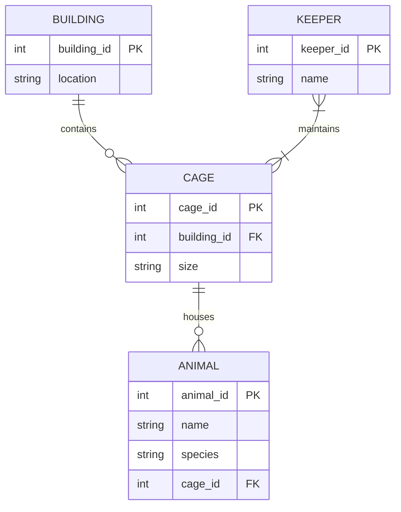
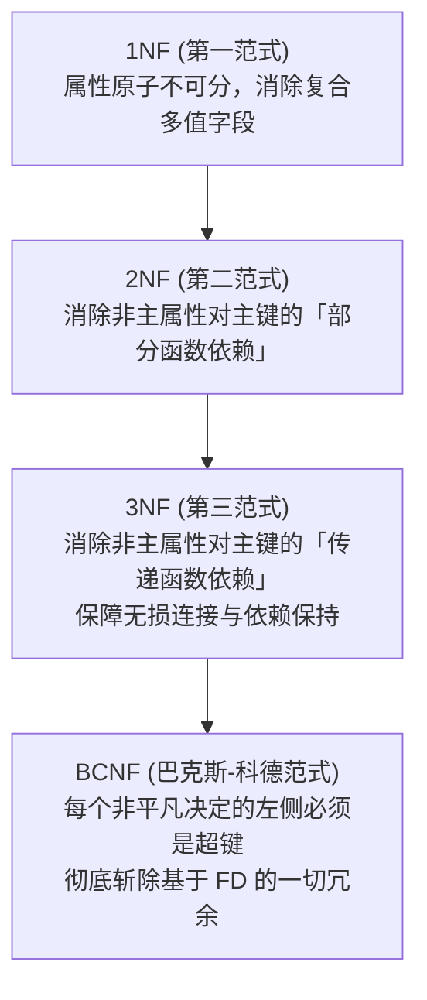

# Lec 9 模式设计与范式理论

## TL;DR

- 模式设计是关系数据库架构设计的起点，ER 实体关系图提供高级概念建模，规范化理论提供数学形式化验证。
- 非规范化模式会导致三大灾难性异常：插入异常（缺乏关联数据无法插入）、删除异常（级联删除导致有效信息丢失）与更新异常（冗余数据产生内部矛盾）。
- 函数依赖（Functional Dependency, FD）形式化刻画属性间的确定关系，阿姆斯特朗公理系统（健全且完备）提供依赖推导的数学依据。
- 巴克斯-科德范式（BCNF）通过要求每一个非平凡函数依赖的决定因子必须是超键，彻底消除了基于函数依赖的一切冗余。
- 第三范式（3NF）在允许极少量主属性传递依赖的前提下，严格保障无损连接（Lossless Join）与依赖保持（Dependency Preservation）。

## 架构演进与核心洞察

::: insight 范式理论的数学纯粹性与现实工程妥协
范式理论是计算机科学中极少数兼具纯粹数学严谨性与直接工业应用价值的理论体系之一。BCNF 的追求是极致的“一事一地（One Fact in One Place）”，将数据冗余与更新异常在数学层面完全斩除。
然而，在现实工业级系统中，极致的规范化意味着极度的表结构碎片化。每一次日常业务查询可能都需要 8 到 10 张表进行昂贵的分布式 JOIN。现代系统设计展现了从“理论纯粹”到“工程务实”的演进：在核心 OLTP 事务系统中以 3NF / BCNF 为基线防御异常；在读多写少的高并发缓存层与 OLAP 列存数仓中，则积极拥抱“适度反范式化（Denormalization）”设计宽表，用廉价的存储空间与后台补偿机制赎买极致的查询吞吐。
:::

## 课前阅读与文献研读 (Reading Assignment)

> 文献拓展研读。从规范化范式理论引申至分析型数仓中的“逆范式”宽表与物理投影（Projections），理解逻辑模式与物理存储布局的解耦。  
> 📖 **文献研读入口**：[关联文献研读：C-Store 列式存储架构（范式理论与物理投影设计）](./paper/cstore_column_store.md)

## 核心机制与讲义正文

> [!TIP] **[待补截图]** 建议截取官方课件 Slides 第 9 讲中关于“无损连接分解（Lossless Join Decomposition）表格测试法验证图”。此处预留插图空间。

> MIT 6.5830 / 6.5831 · Database Systems · 第 9 讲  
> 核心教材：*Readings in Database Systems* (5th Edition, Red Book)  
> 经典文献：E. F. Codd (1971) *`Further Normalization of the Data Base Relational Model`*；Peter Chen (ACM TODS 1976) *`The Entity-Relationship Model--Toward a Unified View of Data`*  
> 配套实验：GoDB (Go-based Database Engine)

## 1. 概念建模：实体-关系模型（Entity-Relationship Model）

数据库设计的第一阶段是概念建模。Peter Chen 在 1976 年提出的实体-关系模型（ER Model）为人类理解现实业务世界与计算机物理建模之间架起了一座标准化的桥梁。



### 1.1 ER 模型核心建模构件

1. **实体（Entity）与实体集（Entity Set）**：
   - 现实世界中可区分的客观对象（例如学生、教师、展馆、动物），在 ER 图中用矩形表示。
2. **属性（Attribute）**：
   - 实体所具有的特征性质（例如动物名称、年龄、展馆容量），在 ER 图中用椭圆表示。
   - **复合属性**：由多个子属性组合而成（如 `Address` 包含 `Street, City, ZipCode`）；
   - **多值属性**：一个实体可拥有多个取值（如员工拥有多个电话号码，用双椭圆表示）；
   - **派生属性**：可通过其他属性计算得出（如出生日期推导年龄，用虚线椭圆表示）。
3. **关系（Relationship）与基数比（Cardinality Constraints）**：
   - 实体间的相互关联，在 ER 图中用菱形表示。
   - **1:1（一对一）**：例如一个工厂只有一个厂长；
   - **1:N（一对多）**：例如一个展馆容纳多只动物；
   - **M:N（多对多）**：例如饲养员与笼舍（一个饲养员管理多个笼舍，一个笼舍由多名饲养员照料）。
4. **弱实体（Weak Entity）与识别关系**：
   - 无法通过自身属性唯一标识、必须依附于所有者实体的实体（如生产线编号依附于工厂编号），用双线矩形与双线菱形表示。

### 1.2 从 ER 模型映射至关系模式

概念设计完成后，系统遵循标准规则将其转换为物理关系表：
- **普通实体**：直接映射为一张表，主键为实体的标识符；
- **1:N 关系**：在“多（N）”端实体表中增加外键（Foreign Key），指向“一（1）”端实体的主键；
- **M:N 关系**：必须拆分为一张**独立的中间连接表（Join Table）**，连接表的主键由两端实体的主键联合组成。

---

## 2. 数据异常全景解剖（Data Anomalies）

如果未经规范化理论检验直接设计关系表，往往会导致不良模式，从而在系统运行期间引发严重的数据异常。

考虑一张将“教师、课程、办公室”混在一起的非规范化单表 `Teaching(Prof, Course, Office)`：


1. **插入异常（Insertion Anomaly）**：
   若新入职了一位教师 Larsen，但该教师本学期尚未分配教授任何课程。在主键为 `{Prof, Course}` 的表中，由于关系模型要求实体完整性（主键不能为 `NULL`），系统**无法记录该教师的信息**，除非虚构一门假课程。
2. **删除异常（Deletion Anomaly）**：
   若学校取消了某门小众语言课程，删除该行记录时，教授该课程的教师的所有人事信息（如姓名、办公室地址）**会被连带彻底抹除**。
3. **更新异常（Update Anomaly）**：
   若教授 Reyes 更换了办公室，由于该教授讲授了 5 门不同的课程，表中存在 5 条重复的办公室记录。如果只更新了其中 3 条而遗漏了 2 条，数据库将出现**自相矛盾的脏数据**。

---

## 3. 函数依赖理论体系（Functional Dependencies）

为了用数学方法彻底消灭上述异常，关系数据库奠基人引入了**函数依赖（Functional Dependency, FD）**的形式化定义。

### 3.1 形式化定义与超键

::: definition 函数依赖（Functional Dependency）
设 $R$ 是一个属性集合，$X, Y \subseteq R$。若对于关系 $r(R)$ 中的任意两个元组 $t_1, t_2$，只要它们在属性集 $X$ 上的取值相同，就必然在属性集 $Y$ 上的取值也相同：
$$\forall t_1, t_2 \in r, \quad t_1[X] = t_2[X] \implies t_1[Y] = t_2[Y]$$
则称 **$X$ 函数决定 $Y$**，或 **$Y$ 函数依赖于 $X$**，记作 $X \to Y$。
:::

- **超键（Superkey）**：若属性集 $K \subseteq R$ 满足 $K \to R$（即 $K$ 能够函数决定表中的所有属性），则称 $K$ 为 $R$ 的一个超键；
- **候选键（Candidate Key / 候选码）**：若 $K$ 是一个超键，且 $K$ 的任何真子集都无法成为超键（即极小超键），则称 $K$ 为候选键；
- **主属性（Prime Attribute）**：包含在任何一个候选键中的属性称为主属性；其余属性为非主属性。

### 3.2 阿姆斯特朗公理系统（Armstrong's Axioms）

阿姆斯特朗公理系统是函数依赖推导的基石，它在数学上是**健全的（Sound，推导出的依赖必定成立）**且**完备的（Complete，能推导出所有逻辑蕴涵的依赖）**。

1. **自反律（Reflexivity）**：若 $Y \subseteq X$，则 $X \to Y$（平凡函数依赖）；
2. **增广律（Augmentation）**：若 $X \to Y$，则对于任意属性集 $Z$，必有 $XZ \to YZ$；
3. **传递律（Transitivity）**：若 $X \to Y$ 且 $Y \to Z$，则必有 $X \to Z$。

由上述三大基本公理，可直接推导出常用次级规则：
- **合并律（Union）**：若 $X \to Y$ 且 $X \to Z$，则 $X \to YZ$；
- **分解律（Decomposition）**：若 $X \to YZ$，则 $X \to Y$ 且 $X \to Z$；
- **伪传递律（Pseudotransitivity）**：若 $X \to Y$ 且 $WY \to Z$，则 $WX \to Z$。

### 3.3 属性闭包计算算法（Attribute Closure）

属性集 $X$ 关于函数依赖集 $F$ 的闭包（记作 $X^+$）是指：基于给定模式成立的函数依赖集合 $F$ 以及阿姆斯特朗公理系统，由属性集合 $X$ 经过多步逻辑推理所能直接或间接函数决定的所有属性的最大全集。

属性闭包的计算是模式规范化判定、寻找关系的所有候选键以及验证某个函数依赖是否成立的核心算法引擎。其算法采用经典的不动点迭代思想：在每一轮遍历中，寻找那些“左侧决定因子已被当前闭包完全包含”的函数依赖，并将其右侧决定的新属性贪心追加到闭包中，直到闭包集合不再扩大为止：

```python
def compute_attribute_closure(X, F):
    closure = set(X)
    changed = True
    while changed:
        changed = False
        for (lhs, rhs) in F:
            if lhs.issubset(closure) and not rhs.issubset(closure):
                closure.update(rhs)
                changed = True
    return closure
```
**判定候选键的终极准则**：计算 $X^+$，若 $X^+ = R$，则 $X$ 是超键；若 $X$ 的任何真子集其闭包都不等于 $R$，则 $X$ 是候选键。

---

## 4. 范式理论体系与判定算法

规范化过程将关系模式逐步分解，使其满足更严苛的数学条件。



### 4.1 各级范式判定准则

| 范式级别 | 形式化定义准则 | 消灭的缺陷类型 |
| :--- | :--- | :--- |
| **1NF** | 表中的每一个属性字段值都是不可分割的原子项（Atomic Values） | 嵌套表、列表字段、JSON 复合串 |
| **2NF** | 在 1NF 基础上，每个非主属性必须**完全函数依赖（Full FD）**于候选键 | 复合主键下的部分依赖冗余 |
| **3NF** | 在 2NF 基础上，对于任何非平凡依赖 $X \to Y$，要么 **$X$ 是超键**，要么 **$Y$ 是主属性** | 传递依赖（$A \to B \to C$） |
| **BCNF** | 对于关系模式中成立的每一个非平凡函数依赖 $X \to Y$，**$X$ 必须是超键** | 彻底消灭一切函数依赖冗余 |

### 4.2 BCNF 分解算法（BCNFify）

若模式 $R$ 存在一个违反 BCNF 的依赖 $X \to Y$（即 $X \to Y$ 成立，但 $X$ 不是 $R$ 的超键）：
1. 计算 $X^+$（$X$ 的属性闭包）；
2. 将 $R$ 无损分解为两个子模式：
   $$R_1 = X^+, \quad R_2 = R \setminus (X^+ \setminus X) = (R \setminus X^+) \cup X$$
3. 在 $R_1$ 与 $R_2$ 上继续递归调用此过程，直至所有子模式均满足 BCNF。

### 4.3 模式分解的两大理论准则

在将一个大表拆分为多个小表时，分解必须满足两大数学契约：
1. **无损连接性（Lossless-Join Decomposition）**：
   分解后的子表通过自然连接（Natural Join）重组后，产生的结果集必须与原表**完全一致**，绝不能产生“幽灵虚假元组（Spurious Tuples）”。
   $$\pi_{R_1}(r) \bowtie \pi_{R_2}(r) = r$$
   **充要条件**：$R_1 \cap R_2 \to R_1$ 或 $R_1 \cap R_2 \to R_2$（两表的交集必须是其中至少一张表的超键）。
2. **依赖保持性（Dependency Preservation）**：
   原表上的所有函数依赖必须能够仅在各自子表内部独立检验，而无需跨子表执行昂贵的连接校验。
   **权衡边界**：**BCNF 保证无损连接，但有时无法保持函数依赖；3NF 既保证无损连接，又严格保证依赖保持**。

---

## 5. 关键设计抉择与架构认知

::: insight 为什么 3NF 在企业级数仓中往往战胜 BCNF？
BCNF 的理论纯粹性在遇到“某些依赖横跨两个候选键”时会遭遇困境。例如在经典三元关系 `(Street, City, ZipCode)` 中，存在依赖：
- `(Street, City) -> ZipCode`
- `ZipCode -> City`
此时若强行拆分为 BCNF，将无法在单表内部维护 `(Street, City) -> ZipCode` 的唯一性约束，每一次写入都要跨表连接验证依赖。3NF 允许 `ZipCode -> City`（因为 City 是候选键的一部分，属于主属性），在保留无损连接的同时完整保全了所有业务约束。
:::

::: pitfall 盲目追求最高范式引发的性能自残
在现代高并发在线交易（OLTP）和微服务架构中，过度规范化往往是数据库性能崩溃的元凶。将一个简单的订单对象拆分为订单主表、买家快照表、发票表、收件地址表、支付渠道表共 8 张表，会导致简单的明细查询变成 8 表大 JOIN。
合理的工程姿态是：**在逻辑建模阶段严格按 BCNF / 3NF 推演规范模式，彻底理清业务依赖；在物理落地阶段根据高频查询场景进行可控的“适度反范式化”**。
:::

---

## 6. 课后深度思考题

### 思考题 1：无损连接与依赖保持的不可兼得悖论
考虑关系模式 $R(A, B, C)$ 与函数依赖集 $F = \{ AB \to C, C \to B \}$：
1. 求出该模式的所有候选键，并判断其最高满足第几范式？
2. 尝试将其分解为 BCNF 模式。在分解后的子模式上，原有的哪个依赖无法被局部保持？
3. 试说明为什么 3NF 能够在保留无损连接的前提下解决这一矛盾？

### 思考题 2：阿姆斯特朗公理与最小依赖覆盖（Minimal Cover）
在关系数据库设计中，模式依赖集往往存在大量冗余依赖。
1. 何为依赖集的等价性（$F \equiv G$）？
2. 试推导计算最小函数依赖覆盖（Minimal Cover）的三大标准步骤：将右侧拆为单属性、消除左侧冗余属性、消除冗余依赖。

---

## 详细机制推导与原版课堂图解

> MIT 6.5830 / 6.5831 · Database Systems · 第 9 讲  
> 核心教材：*Readings in Database Systems* (5th Edition, Red Book)  
> 配套实验：GoDB (Go-based Database Engine)

## 处理模型

DBMS 处理模型（process model）定义了系统如何执行查询计划的。它指定了查询计划的执行方向以及在执行过程中操作符之间传递的数据类型等信息。不同的处理模型针对**不同的工作负载**进行权衡。

这些模型也可以实现为从上到下或从下到上调用操作符。虽然从上到下的方法更为常见，但从下到上的方法可以更严格地控制流水线中的缓存/寄存器。

我们考虑的三种执行模型是：

- 迭代模型
- 物化模型
- 矢量化/批处理模型

### 迭代模型

迭代器模型，也称为 Volcano 模型或 Pipeline 模型，是最常见的处理模型，几乎所有（基于行的）DBMS 都使用它。

迭代器模型的工作原理是为数据库中的每个操作符实现一个 Next 函数。查询计划中的每个节点都会在其子节点上调用 Next，直到到达叶节点，叶节点开始向上游节点发送元组进行处理。每个元组在计划中尽可能向上游处理，然后再获取下一个元组。这对于基于磁盘的系统非常有用，因为它允许我们在内存中充分利用每个元组.


- 图一迭代器模型示例 - 每个操作符的不同 Next 函数的伪代码。Next 函数本质上是遍历其子操作符输出的 for 循环。例如，根节点在其子节点（连接操作符）上调用 Next，**连接操作符**是一种访问方法，它循环遍历关系 R 并发送一个元组向上，然后对其进行操作。处理完所有元组后，发送空指针（或其他指示器），让父节点知道继续前进。

迭代器模型中的查询计划操作符具有高度可组合性且易于推理，因为只要实现了如下`Next`函数，每个操作符都可以独立于查询计划树中的父或子操作符实现：

- 每次调用 Next 时，操作符返回单个元组，如果没有更多元组要发送，则返回空标记。
- 操作符实现一个循环，在其子节点上调用 Next 以检索它们的元组然后处理它们。这样，在父节点上调用 Next 就会在其子节点上调用 Next。作为响应，子节点将返回父节点必须处理的下一个元组。

迭代器模型允许流水线操作，DBMS 可以在必须检索下一个元组之前，通过尽可能多的操作符处理一个元组。查询计划中为给定元组执行的一系列任务称为流水线。

这种方法很容易实现输出的控制，因为操作符一旦获得所需的所有元组，就可以停止在其子操作符上调用 Next。

### 物化模型

物化模型（Materialization Model） 是对迭代器模型的一种特化形式。在这种模型中，每个操作符会一次性处理完所有输入数据，然后一次性输出所有结果数据。与迭代器模型中使用 `Next()` 函数每次返回一个元组不同，在物化模型中，每次访问操作符时，它会直接返回它的全部元组。为了避免扫描过多元组，DBMS 可以将所需元组数量的信息（例如 LIMIT 限制）向下传递给后续操作符，每个操作符会将其输出“物化”为一个整体结果（即缓存起来的所有元组）。输出可以是完整的元组（即 NSM：Row/tuple-based 存储格式），也可以是列的一部分（即 DSM：Column/column-group-based 存储格式）

每个操作符实现一个 `Output()` 函数：

- 操作符会一次性处理它所有子节点输出的元组。
- 这个函数的返回值就是操作符会输出的全部元组；执行完一次后，DBMS 就不再访问这个操作符。

这种方法更适合 OLTP 类型的负载，因为这类查询通常一次只访问很少的元组。因此，函数调用次数更少（不像迭代器模型需要不断地调用 `Next()` 获取元组）。


### 向量化模型

像迭代器模型一样，向量化模型中的每个操作符也实现了一个 `Next()` 函数。但与之不同的是，向量化模型的每个操作符会一次返回**一批**（即一个向量）数据，而不是单个元组。操作符内部的循环实现被优化为按批处理数据，而不是一次处理一个元组。批次的大小可以根据硬件特性或查询属性而变化。


向量化模型特别适合需要扫描大量元组的 OLAP 查询，因为它减少了对 `Next()` 函数的调用次数。向量化模型还使操作符更容易利用向量化（SIMD）指令来批量处理元组，提高处理效率。

### 两种处理方向

- 方法 1：自顶向下。从根节点开始，自上而下地“拉取”数据（即父节点通过调用 `Next()` 来请求子节点返回数据），元组的传递总是通过函数调用来进行。
- 方法 2：自底向上。 从叶子节点开始，自下而上地“推送”数据给父节点，这种方式能更紧密地控制管道中操作符对缓存 / 寄存器的使用（更容易优化硬件利用）

## 访问方法

访问方法指的是 DBMS 如何访问表中存储的数据。一般来说，访问模型有两种方式：要么从表中顺序读取数据，要么通过索引读取。

### 顺序扫描

顺序扫描操作符会遍历表中的每个页面，并从缓冲池中检索它们。当扫描遍历每个页面上的所有元组时，它会评估谓词以决定是否将元组传递给下一个操作符。

DBMS 维护一个内部游标，用于跟踪上次检查的页面/槽位。

顺序表扫描几乎总是 DBMS 执行查询效率最低的方法。有许多优化技术可以使顺序扫描更快：

- **预取**：预先获取接下来的几个页面，使得 DBMS 在访问每个页面时不必因存储 I/O 而阻塞。
- **缓冲池旁路**：扫描操作符将从磁盘获取的页面存储在其本地内存中，而不是缓冲池中，以避免顺序洪泛。
- **并行化**：使用多个线程/进程并行执行扫描。
- **延迟物化**：DSM DBMS 可以延迟将元组拼接在一起，直到查询计划的上层部分。这使得每个操作符可以仅向下一个操作符传递最少量的必需信息（如记录 ID、列中记录的偏移量）。这仅在列存储系统中有用。
- **堆聚簇**：使用聚簇索引指定的顺序将元组存储在堆页面中。
- **近似查询（有损数据跳过）**：在整个表的采样子集上执行查询以产生近似结果。这通常用于在允许小误差的情况下计算聚合，以产生接近准确的答案。
- **区域映射（无损数据跳过）**：预计算页面中每个元组属性的聚合。然后，DBMS 可以通过首先检查其区域映射来决定是否需要访问页面。每个页面的区域映射存储在单独的页面中，通常每个区域映射页面中有多个条目。因此，可以减少顺序扫描中检查的页面总数。区域映射在云数据库系统中特别有价值，因为通过网络传输数据会产生更大的成本。区域映射的示例见图 4。

- **近似查询（有损数据跳过）**：在整个表的采样子集上执行查询以产生近似结果。这通常用于在允许小误差的情况下计算聚合，以产生接近准确的答案。

- **区域映射（无损数据跳过）**：预计算页面中每个元组属性的聚合。然后，DBMS 可以通过首先检查其区域映射来决定是否需要访问页面。每个页面的区域映射存储在单独的页面中，通常每个区域映射页面中有多个条目。因此，可以减少顺序扫描中检查的页面总数。区域映射在云数据库系统中特别有价值，因为通过网络传输数据会产生更大的成本。区域映射的示例见图 4。

  

### 索引扫描

在索引扫描中，DBMS 会选择某个索引来定位查询所需的元组。DBMS 的索引选择过程涉及多个因素，包括：

- 索引包含哪些属性
- 查询引用了哪些属性
- 属性的值域范围
- 谓词组合方式
- 索引键是唯一（unique）还是非唯一（non-unique）

更先进的 DBMS 支持**多索引扫描（multi-index scan）**。当查询使用多个索引时，DBMS 会执行以下操作：

1. 使用每个匹配的索引计算符合条件的记录 ID 集合
2. 根据查询谓词（如 AND、OR）合并这些集合
3. 检索记录并应用剩余的谓词条件

DBMS 可以使用位图（bitmaps）、哈希表（hash tables）或布隆过滤器（Bloom filters）来通过集合交集（set intersection）计算记录 ID。图 6 展示了一个利用多索引扫描的示例。

## 修改查询

修改数据库操作符 INSERT、UPDATE、DELETE 负责检查约束和更新索引。

- 对于 UPDATE / DELETE，子操作符会传递目标元组的记录 ID，并且必须跟踪之前访问过的元组。
- INSERT 操作符有两种实现方案：
  - 方案 1， 在操作符内部实现元组。
  - 方案 2，操作符插入从子操作符传入的任何元组

### 万圣节问题

万圣节问题是一种异常现象，即更新操作会改变元组的物理位置，导致扫描运算符多次访问该元组。这种情况可能发生在聚簇表或索引扫描中。 这种现象最初是由 IBM 研究人员在 1976 年万圣节构建 System R 时发现的。

解决这个问题的方法是跟踪每个查询修改后的记录 ID。

## 表达式求值


DBMS 将 WHERE 子句表示为**表达式树（expression tree）**，参见图 7 的示例。树中的节点代表不同的表达式类型。

以下是一些可以存储在树节点中的表达式类型示例：

- 比较 (=, <, >, !=)
- 连接 (AND), 析取 (OR)
- 算术运算符 (+, -, *, /, %)
- 常量和参数值
- 元组属性引用

为了在运行时求值表达式树，DBMS 会维护一个上下文句柄，其中包含执行所需的元数据，例如当前元组、参数和表 scheme。然后，DBMS 遍历树来对其运算符求值并生成结果。

以这种方式求值谓词的速度很慢，因为 DBMS 必须遍历整个树并确定每个运算符应采取的正确操作。更好的方法是直接求值表达式（例如 JIT 编译）。根据内部成本模型，DBMS 将决定是否采用代码生成来加速查询。

## 调度器

上述查询处理模型清晰地描述了数据流，而控制流则较为隐式。调度器将数据流和控制流清晰地分离。它在批处理模式下运行良好，尤其是在矢量化模型下。调度器创建调度组件（工作指令），它不是从上到下调用操作符树，而是遍历树并将调度工作放入调度队列。然后，工作线程从队列中获取请求并执行。

图 8：调度器与传统查询处理模型的比较


总体而言，它具有更清晰的抽象、动态优化、内置查询暂停、更佳的 p9x 性能以及更佳的可管理性和可调试性。
