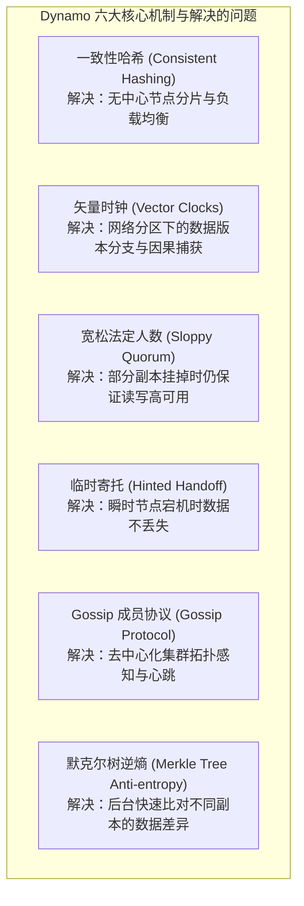

# Dynamo：亚马逊高可用去中心化键值存储系统

> **论文作者**：Giuseppe DeCandia, Deniz Hastorun, Madan Jampani, Gunavardhan Kakulapati, Avinash Lakshman, Alex Pilchin, Swami Sivasubramanian, Peter Vosshall, Werner Vogels  
> **发表出处**：*ACM Symposium on Operating Systems Principles (SOSP)*, 2007  
> **配套讲次**：[Lec 18 最终一致性与去中心化架构](../lec18.md)

## TL;DR

- 解构了亚马逊支撑千万级电商并发的核心基础设施——**Dynamo 分布式键值存储系统**。
- 在 CAP 定理的权衡中，明确做出**高可用性优先（Availability Over Strong Consistency）**的工程取舍，确保“永远允许写入（Always Writable）”，杜绝用户购物车结算失败。
- 集成了**一致性哈希（Consistent Hashing 与虚拟节点）**实现无主节点（Masterless）的数据自适应均匀分片与弹性伸缩。
- 运用**矢量时钟（Vector Clocks）**捕获跨版本因果依赖关系，利用 **Sloppy Quorum 与临时寄托（Hinted Handoff）**抵御节点瞬时故障，并通过后台 **Gossip 逆熵（Anti-entropy with Merkle Trees）**实现最终一致性。

---

## 1. 论文研究问题与业务驱动背景

在亚马逊全球电商平台的生产环境中，数以万计的并发请求在黑色星期五疯狂涌入购物车服务。对于电商业务而言，**服务不可用意味着直接的真金白银损失**：如果顾客试图把一件商品加入购物车却遭遇系统返回“数据库锁冲突超时”或“503 服务不可用”，客户就会转投竞争对手。

传统的 ACID 关系型数据库（如 Oracle RAC）在面对多机房网络分区时，为了保证强一致性（Consistency）必须拒绝写入。亚马逊 CTO Werner Vogels 等人提出的核心设计哲学是：**“在绝大多数业务场景中，强一致性并非绝对必需；系统必须牺牲实时强一致性，换取 99.999% 的绝对写入可用性，并在后续通过异步机制收敛至最终一致性（Eventual Consistency）。”**



---

## 2. 核心技术组件深度推导

### 2.1 一致性哈希与虚拟节点（Consistent Hashing with Virtual Nodes）
- **哈希环（Ring）**：使用 MD5 或 SHA-1 将哈希键空间映射到闭合的 $[0, 2^{128}-1]$ 圆环上；
- **虚拟节点（Virtual Nodes / Vnodes）**：
  - 若每台物理机器只在环上对应一个点，容易因哈希不均匀导致“热点倾斜”；
  - Dynamo 为每台物理服务器分配数百个“虚拟节点”（由服务器性能权重决定）；
  - **弹性扩缩容优势**：新加入一台物理服务器时，其虚拟节点均匀分散在环的各处，等比例从所有既有机器上分别搬迁极少量数据，杜绝局部热点爆发。
- **偏好列表（Preference List）**：对于一个给定的 Key，哈希落在环上的顺时针后继 $N$ 个不同**物理节点**构成其数据副本列表。

---

### 2.2 数据版本控制与矢量时钟（Vector Clocks）

为了保证“永远允许写”，当网络发生物理分区导致不同机房无法实时通信时，Dynamo 允许不同机房的节点**独立接受对同一个 Key 的写操作**！这必然导致数据发生**分支分裂（Divergent Versions）**。

Dynamo 使用**矢量时钟**记录修改历史：$VC = \{(S_1, v_1), (S_2, v_2), \dots\}$，其中 $S_i$ 为节点标识，$v_i$ 为单调递增版本号：

```text
+-----------------------------------------------------------------------------------------+
|                                矢量时钟因果分叉与合并推导                               |
|                                                                                         |
|   1. 客户端发起初始写入 Key='Cart', Value='Item A'，由节点 Sx 处理:                    |
|      -> 生成版本 D1: [(Sx, 1)]                                                          |
|                                                                                         |
|   2. 同一客户端追加 'Item B'，由节点 Sx 处理:                                           |
|      -> 递增版本 D2: [(Sx, 2)] (D2 严格因果后继于 D1，D1 可被安全覆盖淘汰)              |
|                                                                                         |
|   3. 突发网络分区！两个不同机房同时发生并发修改：                                       |
|      - 机房 X 追加 'Item C' (节点 Sx): D3 = [(Sx, 3)]                                   |
|      - 机房 Y 追加 'Item D' (节点 Sy): D4 = [(Sx, 2), (Sy, 1)]                          |
|                                                                                         |
|   4. 网络恢复，客户端下一次读取 Cart:                                                   |
|      -> 系统同时返回冲突的 D3 与 D4 (没有任何一方支配另一方，属于并发冲突 Concurrency) |
|      -> 【客户端应用层合并 (Client Reconciliation)】：                                   |
|         购物车应用代码将两份商品列表求并集: ['Item A', 'Item B', 'Item C', 'Item D']    |
|         写回最终合并版本 D5: [(Sx, 4), (Sy, 2)]，完成因果收敛！                          |
+-----------------------------------------------------------------------------------------+
```

---

### 2.3 宽松法定人数与临时寄托（Sloppy Quorum & Hinted Handoff）

传统 Quorum 机制要求在配置的 $N$ 个主副本中必须有 $R$ 个读成功、$W$ 个写成功且满足 $R + W > N$。

**Dynamo 的极致可用性扩展（Sloppy Quorum）**：
- 如果原本负责承载数据的首选前 $N$ 个健康节点中有 2 台发生临时宕机，系统**绝不报错**；
- 而是顺着哈希环继续顺时针往下寻找随后的健康节点（如第 $N+1$、$N+2$ 号节点）暂时接收写入；
- **临时寄托（Hinted Handoff）**：接收数据的备用节点在本地打上特殊标记（Hint），说明“我只是代为保管”；后台持续探测宕机节点的心跳，一旦原本的归属节点重新上线，备用节点立即将暂存数据完整移交归还。

---

### 2.4 后台逆熵与默克尔树（Anti-entropy with Merkle Trees）

为了应对长期下线节点的数据落后与网络丢失，Dynamo 在后台运行基于**默克尔树（Merkle Tree）**的逆熵同步：
- 默克尔树是一种层次哈希二叉树：叶子节点是键值数据的哈希值，父节点是子节点哈希值的哈希；
- **毫秒级差异定位**：两个副本节点比对数据时，首先比对树根 Root 的哈希；若一致说明两个节点上成千上万个键值完全相同，无需任何网络传输；
- 若根哈希不一致，逐层向下遍历子节点，能在 $O(\log M)$ 次网络探测内精确锁定到底哪几个具体数据页存在分歧，仅传输增量数据进行修补。

---

## 3. 官方课前思考题深度解答

### Q1: 为什么 Dynamo 决定将数据冲突的解决逻辑下放给客户端应用程序，而不是在数据库内核自动解决？
- **业务语义高于数学机制**：不同应用对冲突的容忍度完全不同。例如在“购物车”场景中，最合理的解决策略是将分叉的购物车商品列表取**并集（Union）**，宁可让顾客多看到一件之前想买的商品，也绝不能让顾客已经添加的商品神秘消失；但在其他场景中可能需要“最后写入者胜（LWW）”或按时间戳裁剪。下放给应用层能保证业务正确性与零数据丢失。

### Q2: 什么是最终一致性（Eventual Consistency）？在工程实践中它有哪些成立前提？
- **定义**：如果系统不再发生新的更新，随着时间的推移，所有副本上的数据最终都能达到一致的物理状态；
- **成立前提**：
  1. 副本之间存在不间断的通信协议（如 Gossip 与 Merkle 逆熵）以驱动状态扩散；
  2. 系统必须配备确定的冲突仲裁策略（如矢量时钟合并或单调递增版本号），确保数据分支能够数学收敛。

---

## 4. 架构师深度洞察

::: insight 最终一致性的普及与 Cassandra / NoSQL 浪潮
Dynamo 论文是分布式系统领域最具实操指导价值的工业工程杰作之一。它公开的技术组件几乎被随后的开源世界完整复刻：
- Facebook 借鉴了 Dynamo 的去中心化分片与 Google Bigtable 的 LSM 列族存储，研发了著名的 **Apache Cassandra**；
- Basho 团队完全按论文实现了 Erlang 版本的 **Riak**。

虽然现代许多系统因应用层合并过于繁琐而退化为了“基于时间戳的最后写入者胜（LWW）”，但 Dynamo 展现的在不可靠物理网络上通过弱一致性换取极高弹性的工程勇气，至今依然是构建全球级超大规模云服务的首要设计参考。
:::
