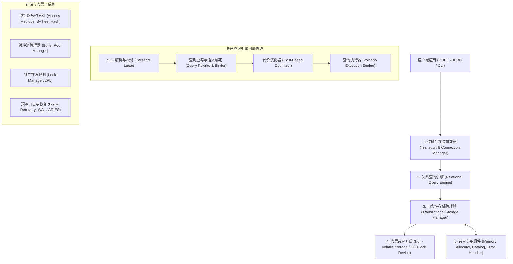

# Architecture of a Database System：关系型数据库系统架构设计全景

> **论文作者**：Joseph M. Hellerstein, Michael Stonebraker, James Hamilton  
> **发表出处**：*Foundations and Trends® in Databases*, 2007  
> **配套讲次**：[Lec 4 数据库内部架构：存储与缓冲池](../lec4.md) · [Lec 6 查询执行引擎与算子处理](../lec6.md)

## TL;DR

- 解构了商业与开源关系型数据库管理系统（RDBMS）的标准五大核心子系统及各层协作协议。
- 深入推演三大经典进程并发模型（Process-per-connection、Thread-per-connection、Server-based Thread Pool）在扩展性与系统调用开销上的物理权衡。
- 阐明了“DBMS 为何拒绝信任通用操作系统（OS）”的系统设计哲学：虚拟内存换页不感知事务、调度器抢占持有锁扣的线程、文件系统缓冲缺乏预写日志（WAL）持久化屏障。
- 确立了查询编译优化（AST $\to$ 逻辑计划 $\to$ 物理计划）与火山流水线迭代器（Volcano Iterator Model）的标准工程实现范式。

---

## 1. 论文背景与 RDBMS 宏观架构分解

关系数据库管理系统是软件工程史上最庞大、最复杂的系统软件之一。这篇长达 119 页的经典综述由三位数据库系统巨擘联合撰写，抽丝剥茧地总结了 Oracle、IBM DB2、Microsoft SQL Server 以及 PostgreSQL/MySQL 等工业级数据库的通用设计范式。

一个完备的企业级 DBMS 在逻辑上被严格划分为五大协同运行的子系统：



---

## 2. 核心子系统架构与机制推导

### 2.1 进程与并发调度模型（Process Models）
当数百上千个客户端连接同时到达时，操作系统进程/线程与数据库任务（Worker）应如何映射？论文深入对比了三大主流流型：

1. **每连接一进程（Process-per-Worker，如 PostgreSQL）**：
   - 每个客户端连接独占一个操作系统独立进程；
   - **优势**：极佳的隔离性，一个工作进程发生段错误崩溃不会拖垮整个 DBMS 实例；
   - **代价**：进程上下文切换开销高昂；各进程间共享缓冲池与锁表必须依赖重量级的操作系统共享内存（IPC / `shmget`），扩展到数千连接时面临 OS 调度瓶颈。
2. **每连接一线程（Thread-per-Worker，如早期 MySQL / SQL Server）**：
   - 共享统一进程地址空间，线程切换更轻量，内存开销较小；
   - **代价**：并发安全风险陡增，缺乏硬件级内存隔离屏障；部分操作系统线程库的并发伸缩性在数千线程下依然受限。
3. **基于工作池的异步调度模型（Thread Pool / Fiber / Event-driven）**：
   - 维护定长的工作线程池（大小与物理 CPU 核心数相当）；
   - 连接被解耦为网络会话（Session），仅在有具体 SQL 语句到达时才从线程池分派 Worker 运行；执行完成后线程归还；
   - 现代高并发云数据库的标准架构，兼顾内存可控性与极高的并发处理通量。

---

### 2.2 为什么 DBMS 从不信任操作系统？

在系统架构中，数据库开发者必须时刻防范通用操作系统的“自作聪明”：

```text
+-----------------------------------------------------------------------------------------+
|                               DBMS 与 OS 的设计哲学冲突                                 |
|                                                                                         |
|   系统需求          通用操作系统 (OS) 的行为                   DBMS 内核的绝对要求       |
|  +----------------+------------------------------------------+------------------------+ |
|  | 页面淘汰置换   | 基于 LRU 盲目换页，不知道哪些页是索引根节点| 必须支持页钉 (Pin/Latch)|
|  | 脏页物理刷盘   | 延迟异步刷盘，随时可能将脏数据写回磁盘   | 严格遵守预写日志 (WAL) |
|  | 线程调度抢占   | 任意时间片轮转抢占，可能在关键临界区暂停 | 锁扣与行锁分离，避免优先级反转|
|  | 内存映射 (mmap)| 屏蔽 I/O 细节，遭遇缺页中断时阻塞整个线程| 异步预读 (Async Prefetch)|
|  +----------------+------------------------------------------+------------------------+ |
+-----------------------------------------------------------------------------------------+
```

1. **缓存管理冲突**：若使用 OS Page Cache，操作系统对查询计划一无所知。当执行大规模全表扫描时，OS 会将高频复用的 B+ 树根节点刷出内存。DBMS 必须自主实现缓冲池，利用 `Clock-Pro` 或 `LRU-K` 算法并对活跃 Frame 施加**页钉（Pinning）**。
2. **WAL 屏障破坏**：如果事务修改了数据页，在对应的事务提交日志（Commit Log）通过 `fsync` 刷入磁盘前，该数据页**绝对严禁**写入磁盘。操作系统底层的脏页回写守护进程无法理解事务逻辑，极易导致未提交数据提前落盘，摧毁原子性（Atomicity）。
3. **直接 I/O（`O_DIRECT`）**：工业级 DBMS（如 Oracle、PostgreSQL）普遍开启 `O_DIRECT` 绕过内核文件缓存，直接与块设备进行定长扇区/页面交互。

---

### 2.3 查询编译与流水线执行引擎

从 SQL 字符串到物理元组流的生命周期遵循严格的单向管道：
1. **解析与重写（Parser & Rewrite）**：
   - 语法分析生成抽象语法树（AST），绑定系统目录（System Catalog）中的模式元数据（列名、数据类型、表 ID）；
   - 应用确定性启发式规则进行逻辑重写（视图扁平化 View Flattening、常量折叠 Constant Folding、冗余谓词消除）。
2. **代价优化器（Cost-Based Optimizer, CBO）**：
   - 将逻辑关系代数树映射为物理算子树；
   - 利用表级与列级统计直方图（Histograms），穷举或基于动态规划搜索连接顺序（Join Ordering），选出总 I/O 与 CPU 代价预估最小的物理计划。
3. **火山迭代模型（Volcano Iterator Model / Pull Model）**：
   - 每一个物理算子（`SeqScan`、`IndexScan`、`HashJoin`、`Sort`）均实现统一的标准接口：
     - `Open()`：初始化算子状态、申请工作内存或子算子递归预备；
     - `Next()`：向下游拉取并返回单个物理元组（Tuple）；到达流末尾返回 EOF；
     - `Close()`：释放临时分配的内存缓冲并关闭子节点。
   - **核心优势**：纯粹的流水线处理流，元组在算子树中即时消费，无需将整个中间结果物化到磁盘。

---

## 3. 官方课前思考题深度解答

### Q1: 数据库系统为什么要将事务锁（Locks）与内存锁扣（Latches）严格分开？
- **保护对象不同**：
  - **Locks（事务锁）**：保护数据库的**逻辑数据内容**（表、元组、键范围），生命周期贯穿整个事务执行过程（直至 `COMMIT` 或 `ABORT` 时释放），支持两阶段锁（2PL）协议并挂载死锁检测机制；
  - **Latches（内存锁扣）**：保护内存中的**物理数据结构**（如缓冲池散列表、B+ 树内部节点的内存指针），生命周期极短（临界区读写完成立即释放，纳秒至微秒级），无需死锁检测，追求极低的加锁指令开销。
- **解耦意义**：避免将复杂的并发事务隔离逻辑与底层底层内存并发访问混淆，保障内核多线程高吞吐并发。

### Q2: 为什么许多现代数据库不使用 `mmap` 进行文件 I/O，而是选择自建 Buffer Manager？
- **缺页中断的不可控阻塞**：当线程解引用一个未加载的虚拟内存地址时，操作系统触发缺页异常（Page Fault），同步阻塞当前线程直到磁盘块读入。在单进程或线程池模型中，这会导致 Worker 无法处理其他就绪事件；
- **刷盘时序失控**：操作系统 `msync` 的刷盘机制缺乏对 WAL 协议的精确控制，无法保证“日志先于数据落盘”的铁律；
- **错误处理能力极其脆弱**：若底层磁盘发生 I/O 硬件错误或断电损坏，`mmap` 往往直接向进程抛出未捕获的 `SIGBUS` 信号导致整个数据库崩溃，而自建缓冲池能优雅捕获并执行事务级回滚。

---

## 4. 架构师深度洞察

::: insight 软硬件协同演进下的架构再审视
Stonebraker 等人在 2007 年撰写此文时，硬件世界的典型特征是：机械硬盘 HDD 主导（寻道延迟以毫秒计）、内存容量小（以 GB 计）、CPU 核心数有限（4~8 核）。这导致整整一代 DBMS 架构都将**“减少磁盘随机寻道 I/O”**作为第一优先级。

而在二十年后的今天：
1. **介质革命**：NVMe SSD 与 CXL 内存池让随机读延迟降至微秒级甚至亚微秒级，I/O 瓶颈向 CPU 指令周期、内存总线带宽转移；
2. **执行模型变迁**：火山模型中频繁的虚拟函数调用（`Next()`）导致 CPU 指令缓存命中率大幅下降。以 DuckDB、ClickHouse 为代表的现代系统全面转向**向量化批处理（Vectorized Execution）**或基于 LLVM 的**代码生成编译（JIT Compilation）**。

理解经典的五大子系统不仅是为了致敬传统，更是为了在硬件发生剧烈变革时，清楚知道每一层该如何重塑。
:::
