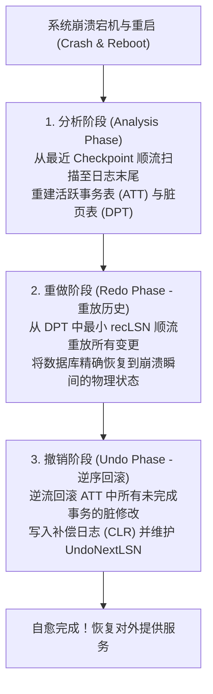

# ARIES：基于预写日志的细粒度崩溃恢复算法

> **论文作者**：C. Mohan, Don Haderle, Bruce Lindsay, Hamid Pirahesh, Peter Schwarz  
> **发表出处**：*ACM Transactions on Database Systems (TODS)*, Vol. 17, No. 1, 1992  
> **配套讲次**：[Lec 13 故障恢复原理与日志体系](../lec13.md) · [Lec 14 故障恢复精讲：ARIES 算法](../lec14.md)

## TL;DR

- 提出了统治现代工业级数据库（DB2、SQL Server、PostgreSQL）崩溃恢复机制长达三十余年的 **ARIES 算法**。
- 支持最高性能的缓冲池并发配置：**STEAL**（允许未提交事务脏页提前刷盘）与 **NO-FORCE**（提交时不强制刷新数据页）。
- 确立了严格的**日志序列号（LSN: Log Sequence Number）**物理时序体系，通过每个页面上的 `pageLSN` 消除冗余 I/O。
- 创新性提出了**重放历史（Repeating History）**原则与**补偿日志记录（CLR: Compensation Log Record）**机制，彻底根治了“恢复执行期间再次断电崩溃”引发的无限回滚循环难题。

---

## 1. 论文研究问题与系统崩溃模型

在计算机软硬件运行中，灾难随时可能降临：操作员踢掉电源线、操作系统发生内核 Panic、或者服务器主机突发断电。当服务器重新点火开机时，内存缓冲池中的数万个数据帧早已荡然无存，而外存磁盘上正处于一片极其险恶的混乱状态：
1. **已提交事务的修改丢失**：部分已向客户端返回成功状态的事务，其脏页尚未被操作系统写回磁盘；
2. **未提交事务的脏数据残留**：在系统崩溃前，由于缓冲池内存告急，属于未提交（甚至被中止）事务的部分脏页已经被悄悄刷入了磁盘堆文件；
3. **部分写入（Torn Write）**：一个 8KB 的数据块写到一半时突然断电，扇区物理损坏。

IBM 著名系统科学家 C. Mohan 等人发表的长达 68 页的 ARIES（Algorithms for Recovery and Isolation Exploiting Semantics）论文，提出了一套在保证并发细粒度行锁与高吞吐的同时，实现**幂等自愈（Idempotent Recovery）**的工业级标准协议。



---

## 2. 核心数据结构与时序拓扑

ARIES 的严密性依赖于一套贯穿内存与外存的日志序列号（LSN，单调递增的 64 位整数）：

```text
+-----------------------------------------------------------------------------------------+
|                               ARIES 核心数据结构与 LSN 映射                             |
|                                                                                         |
|   【内存中维护的核心表】：                                                              |
|   1. 活跃事务表 (Transaction Table / ATT):                                              |
|      - transID: 事务编号                                                                |
|      - status: 运行状态 (Running / Committing / Aborting)                               |
|      - lastLSN: 该事务所写入的最新一条日志记录的 LSN 编号                               |
|                                                                                         |
|   2. 脏页表 (Dirty Page Table / DPT):                                                   |
|      - pageID: 内存中已被修改但尚未持久化到磁盘的数据页编号                             |
|      - recLSN: 导致该页面“从干净变为脏”的第一次修改所对应的日志 LSN 编号                |
|                                                                                         |
|   【外存数据页头部标识】：                                                              |
|   - pageLSN: 记录最近一次修改该数据页所对应的日志 LSN（严格随写操作盖戳更新）           |
|                                                                                         |
|   【日志记录通用核心格式】：                                                            |
|   [ prevLSN | transID | type | pageID | redo-data | undo-data | UndoNextLSN ]           |
+-----------------------------------------------------------------------------------------+
```

---

## 3. ARIES 恢复三阶段深度推导

### 3.1 阶段一：分析阶段（Analysis Phase）
1. 从外存主日志中读取最近一次成功的**非阻塞检查点（Fuzzy Checkpoint）**记录，将检查点中保存的 ATT 和 DPT 载入内存作为基线；
2. **正向顺序扫描日志**直到日志物理末端：
   - 发现有新的修改日志：若该页不在 DPT 中，将其加入 DPT 并设置 `recLSN = 当前 LSN`；
   - 发现新的事务：将其加入 ATT；
   - 发现 `COMMIT` 记录：将该事务从 ATT 中剔除；
   - 发现 `END` 记录：事务彻底结束，清理对应状态；
3. **分析阶段产出**：
   - 准确找出在崩溃发生的一瞬间，系统里所有**未提交的“输家事务”（Losers）**；
   - 确定整个数据库中所有可能未落盘脏页的**最早修改起点（Redo 起点：$\min(\text{DPT.recLSN})$）**。

---

### 3.2 阶段二：重做阶段（Redo Phase —— 重放历史）
ARIES 采取了著名的**“重放历史（Repeat History）”**原则：无论是已提交的事务、还是注定要被回滚的未提交事务，在 Redo 阶段**一视同仁全部重新执行一遍**！

- **执行起点**：从分析阶段计算出的 $\min(\text{DPT.recLSN})$ 开始正向顺序扫描；
- **优化检查（消除冗余 I/O）**：对于扫描到的每条更新日志，在真正从磁盘读页并重放修改前，进行严格的三重短路判断：
  1. 该日志涉及的 `pageID` 是否在 DPT 中？若不在，说明此修改在崩溃前必定已经刷盘，**跳过**；
  2. 若在 DPT 中，是否满足 `当前日志 LSN < DPT[pageID].recLSN`？若是，说明该修改早于该页变脏的时刻，**跳过**；
  3. 若以上均不满足，真正从磁盘读入该页，检查页面头部的 `page.pageLSN`：若 `page.pageLSN >= 当前日志 LSN`，说明磁盘页上已经包含了该修改，**再次跳过！**
  4. 只有当 `page.pageLSN < 当前日志 LSN` 时，才执行物理重做，并将 `page.pageLSN` 更新为当前 LSN；
- **重做阶段终点**：重放完成后，数据库物理状态完全恢复到了**系统发生掉电崩溃前那微秒级瞬间的精确镜像**。

---

### 3.3 阶段三：撤销阶段（Undo Phase 与 CLR 机制）

此时，数据库中包含了那些在崩溃前尚未提交的“输家事务”写出的脏数据。系统必须对 ATT 中记录的所有输家事务执行逆序回滚。

```text
+-----------------------------------------------------------------------------------------+
|                               补偿日志记录 (CLR) 回滚避坑图                             |
|                                                                                         |
|   事务 T1 正常执行:                                                                     |
|   LSN 10: T1 modifies Page A (prevLSN=null)                                             |
|   LSN 20: T1 modifies Page B (prevLSN=10)                                               |
|   [ 发生崩溃 1，重启进入 Undo ]                                                         |
|                                                                                         |
|   Undo 阶段从最新 LSN 20 开始回滚:                                                      |
|   - 撤销 LSN 20 对 Page B 的修改，写出补偿日志 CLR:                                     |
|     LSN 30: CLR for Page B, UndoNextLSN = 10 (指针直接跳过 LSN 20，指向 10！)           |
|                                                                                         |
|   [ 在此关键节点发生二次掉电崩溃 2！]                                                   |
|                                                                                         |
|   系统二次重启:                                                                         |
|   - Redo 阶段重放到 LSN 30 时，重新应用该 CLR；                                         |
|   - 再次进入 Undo 阶段时，遇到 LSN 30 (CLR)，直接依据 UndoNextLSN = 10，                |
|     直接跳到 LSN 10 继续回滚，【绝不重复撤销已写出 CLR 的 Page B】！                   |
+-----------------------------------------------------------------------------------------+
```

- **补偿日志记录（CLR）的核心特性**：
  - CLR 本身是一条特殊的 Redo-Only 日志，记录的是对撤销动作的重做；
  - 内部携带一个关键字段 `UndoNextLSN`，精确指向该事务上一条尚未被撤销的正常修改日志；
  - **绝不被撤销**：系统在逆序回滚时，一旦遇到 CLR，直接顺着其 `UndoNextLSN` 指针“大跨步跳跃”继续回溯，**永远不会为一次撤销操作生成二次撤销**。
- **数学定理**：无论系统在恢复期间连续发生多少次宕机崩溃，ARIES 算法保证系统总能稳步向前推进，且单次操作的撤销成本在全局严格有界，彻底消除了无限崩溃循环。

---

## 4. 架构师深度洞察

::: insight 为什么现代云原生数据库（Aurora）宣称“日志即数据库”？
ARIES 算法的经典设计是单机存储与外存紧密绑定的产物：为了保证恢复安全，系统必须周期性写 Fuzzy Checkpoint，并在恢复时遍历 DPT 和磁盘数据页。

在以 Amazon Aurora、PolarDB 为代表的云原生分布式数据库中：
- 将传统 ARIES 架构中的**存储层下推至分布式存储节点**；
- 计算节点只向云存储层发送极其精简的 WAL 日志流；
- 存储节点利用海量后台协程持续、异步地在后台应用 Redo 日志生成最新数据页（Redo Processing Offloaded to Storage）；
- **崩溃恢复时间降为零**：计算节点宕机后，由于存储节点在网络后台持续重做日志，新计算节点挂载即可立即对外服务，无需经历传统 ARIES 漫长耗时的数据页扫描。

ARIES 的“重放历史”思想没有消亡，而是从单机的单线程恢复算法，蜕变为了现代存算分离云数仓的核心网络同步协议。
:::
