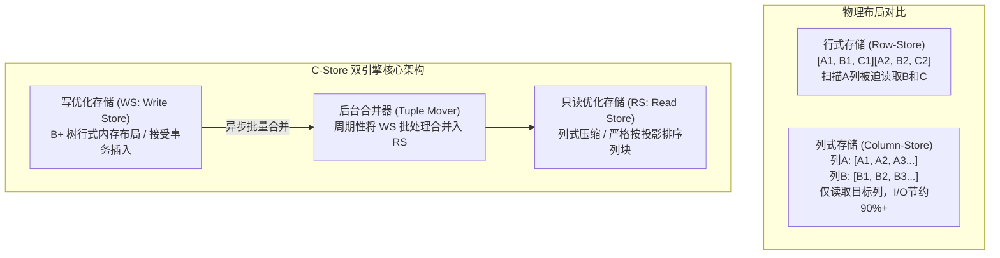

# C-Store：列式存储数据库架构开山之作

> **论文作者**：Mike Stonebraker, Daniel J. Abadi, Adam Batkin, Xuedong Chen, Mitch Cherniack, Miguel Ferreira, Edmond Lau, Amerson Lin, Sam Madden, Elizabeth O'Neil, Pat O'Neil, Alex Rasin, Nga Tran, Stan Zdonik  
> **发表出处**：*Proceedings of the 31st VLDB Conference*, 2005  
> **配套讲次**：[Lec 10 分析型数据库：列式存储](../lec10.md) · [Lec 9 模式设计与范式理论](../lec9.md)

## TL;DR

- 开创性提出了面向分析型在线分析处理（OLAP）场景的开源列式数据库管理系统架构，颠覆了统治业界数十年的行式（Row-Oriented）存储范式。
- 提出了基于混合架构的高吞吐设计：面向只读分析的**只读存储（Read-optimized Store, RS）**与面向实时追加更新的**写优化存储（Write-optimized Store, WS）**，并通过后台异步 **Tuple Mover** 批量合并数据。
- 全面推导了四类列存特异性压缩算法（游程编码 RLE、位图索引、位打包、字典编码），并证明了算子在压缩态下直接计算的巨大算力飞跃。
- 奠定了**延迟物化（Late Materialization）**与物理投影（Projections）的完整工程理论，成为商业数仓 Vertica 以及现代 ClickHouse、DuckDB 的始祖。

---

## 1. 论文背景与行存架构在 OLAP 场景的溃败

在 2000 年代初期，所有主流数据库（Oracle、DB2、SQL Server）均为面向在线事务处理（OLTP）设计的行式数据库（Row-Stores，如 Slotted Page 布局）。在行存中，属于同一元组的所有属性字段在磁盘页面内物理连续存储。

然而在典型的数据仓库（OLAP）场景中：
1. **宽表少列查询**：事实表通常包含 100~200 个属性列，但业务分析查询（如聚合销售额）往往只关心其中的 2~3 列；
2. **严重的 I/O 资源浪费**：行式数据库为了读取这 3 列，被迫将整个磁盘块中剩余的 97 列无用数据一并调入内存缓冲池，消耗了 90% 以上的无效 I/O 带宽；
3. **压缩效率低下**：同一行内不同列的数据类型截然不同（整数、变长字符串、浮点、时间戳），相邻字节熵增巨大，压缩算法难以施展。

Stonebraker 与 MIT CSAIL 团队由此提出了 **C-Store**，提出核心宣言：**“通用数据库架构已死，必须为读密集型分析设计完全原生的列式引擎”**。



---

## 2. 核心系统架构与设计机制

### 2.1 双存储引擎架构（RS + WS）
列式存储由于在物理上将各列独立切分，执行单行写入或点更新时代价极高（必须在多个列文件中同时追加并维护行号对齐）。为解决这一矛盾，C-Store 采用了冷热分离的双引擎解耦：
1. **WS（Write-optimized Store）**：
   - 专为并发插入、更新与小批量操作设计；
   - 数据驻留内存或使用行式 B+ 树外存存储，不进行激进的压缩，保障事务写入低延迟；
2. **RS（Read-optimized Store）**：
   - 专为超大规模只读扫描与分析优化；
   - 采用极致的列式物理布局并高度压缩，完全不接受就地原地更新（In-place update）；
3. **Tuple Mover（数据合并器）**：
   - 后台低优先级守护进程，周期性将 WS 中累积的数据通过多路归并批量刷入 RS；
   - 查询执行器在运行查询时，同时向 WS 与 RS 下发算子，并在内存中通过并集归并最终结果，对用户保持透明一致性。

---

### 2.2 物理投影（Projections）与冗余排序
C-Store 没有传统数据库的“逻辑基表与辅助索引”二元概念，取而代之的是**投影（Projections）**：
- 一个投影是若干列的子集，且**所有列严格按照某一个排序列（Sort Key）的物理顺序对齐存放**；
- 系统可以为同一组属性建立多个不同排序列的投影（如一个投影按 `date` 排序，另一个投影按 `customer_id` 排序）；
- **优化器策略**：对于特定查询，优化器选择那个排序列与查询 `WHERE` 谓词最匹配的投影进行高速范围扫描，既充当了数据实体，又扮演了多列聚集索引的角色。

---

### 2.3 四大列式专用压缩编码

因为同一列中的所有数据属于同一种类型，数据分布具备极高的局部性与重复度，C-Store 提出了极具代表性的压缩编码方案：

```text
+-----------------------------------------------------------------------------------------+
|                                C-Store 四类核心压缩编码                                 |
|                                                                                         |
|   编码方案            适用数据场景                       物理数据布局示例               |
|  +------------------+----------------------------------+------------------------------+ |
|  | 游程编码 (RLE)   | 数据按该列排序，存在大量连续重复值| (值, 起始行号, 连续长度)     |
|  |                  | (如城市代码: 连续 50,000 个 'NYC') | ('NYC', 1, 50000) 压缩比极高 |
|  +------------------+----------------------------------+------------------------------+ |
|  | 位图编码 (Bitmap)| 低基数列（不同取值种类极少）     | 每个枚举值维护一个 0/1 位图  |
|  |                  | (如性别、订单状态)               | 极其适合 SIMD 位运算加速过滤 |
|  +------------------+----------------------------------+------------------------------+ |
|  | 字典编码 (Dict)  | 中低基数的变长字符串             | 建立映射表: '北京'->1, '上海'->2|
|  |                  | (如国家、商品类别)               | 存储时仅存定长紧凑整数 ID    |
|  +------------------+----------------------------------+------------------------------+ |
|  | 位打包 (Bit-pack)| 数值差异小（Frame-of-Reference） | 记录相对于基准值的最小比特位 |
|  +------------------+----------------------------------+------------------------------+ |
+-----------------------------------------------------------------------------------------+
```

---

### 2.4 延迟物化（Late Materialization）

传统查询执行器在扫描到满足条件的列值后，会立即通过行号将该元组的其余所有列拼接（物化）成一行，再传递给后续的 Filter、Join 和 Aggregation 算子，这被称为**早期物化（Early Materialization）**。

**延迟物化的核心革命**：
- 各算子在传递数据时，始终保持**单列向量与行号位置列表（Position Lists / Bitmaps）**的形式，绝不轻易拼装成整行元组；
- **巨大性能优势**：
  1. **减少内存拷贝**：若第一层谓词过滤掉了 99% 的行，未参与过滤的其余列根本无需从磁盘或内存中解压和调出；
  2. **压缩态直接计算**：Filter 算子可以直接在 RLE 三元组或 Bitmap 上进行快速计算（如对连续 50,000 个值一次性评估），完全绕过逐行 CPU 解压循环；
  3. **物化时机**：直到整个查询计划的最顶层、即将向客户端返回结果的前一刻，才针对最终幸存的极少数行号进行多列物理对齐组装。

---

## 3. 官方课前思考题深度解答

### Q1: 为什么在 OLAP 场景中，列式存储的 I/O 效率和压缩比能远超行式存储？
- **I/O 按需读取**：查询只读投影中涉及的极少数列，外存块传输量直接按查询列宽与总列宽的比例缩减 80%~95%；
- **类型同质性与信息熵**：同一列内的数据类型完全相同、取值范围集中，特别是在按照特定列排序后，相邻数据呈现极长的连续相同段，非常适合 RLE 和 Delta 差分编码，使压缩比轻松达到 5:1 至 10:1。

### Q2: 延迟物化（Late Materialization）面临哪些潜在挑战？在什么情况下早期物化反而更优？
- **潜在挑战**：多列之间通过行号（Position）重新缝合拼接时，若行号是非连续的离散随机分布，会导致大量的**随机内存跳跃寻址（Cache Miss）**与辅助位置列表开销；
- **早期物化反超场景**：如果查询的选择率极低（即过滤几乎不淘汰行，95% 以上的数据都会幸存进入最终结果），并且查询涉及该表的绝大部分列，那么延迟物化额外的行号维护与多次遍历代价会超过其节省的解压开销，此时早期物化或行存效率更高。

---

## 4. 架构师深度洞察

::: insight 商业化涅槃与现代湖仓演进
C-Store 论文发表后，Stonebraker 团队迅速将其商业化为著名的分析型数据库 **Vertica**（后被惠普收购），在华尔街金融分析与海量电信日志领域确立了绝对统治地位。

如今，C-Store 提出的核心思想已成为整个大数据与现代软件系统的基石：
1. **开放文件格式标准**：Apache Parquet 与 Apache ORC 本质上就是把 C-Store 的列式块、字典编码与统计 Min/Max 下推搬到了 HDFS 与对象存储上；
2. **现代嵌入式分析内核**：DuckDB、ClickHouse 均以原生列式内存向量（Chunk/Vector）为核心流转单元，配合现代 CPU 的 AVX-512 SIMD 向量化指令，将 C-Store 提出的“压缩态直接计算”发挥到了极致。

C-Store 证明了一个颠覆性的系统原则：**存储物理布局必须与工作负载特征发生深度共振。**
:::
