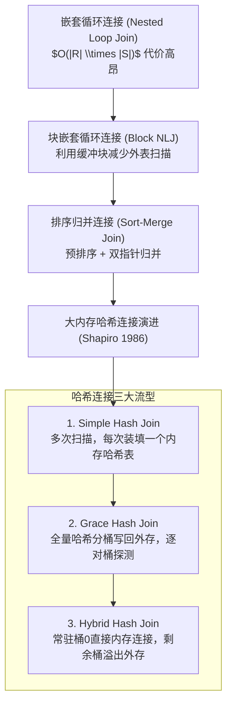

# Join Processing in Database Systems：大内存时代连接算法代价与演进

> **论文作者**：Leonard D. Shapiro  
> **发表出处**：*ACM Transactions on Database Systems (TODS)*, Vol. 11, No. 3, 1986  
> **配套讲次**：[Lec 7 连接算法与物理执行](../lec7.md)

## TL;DR

- 系统性评估了可用主存容量显著增加时，各连接算子在关系型数据库中的物理 I/O 成本表现。
- 确立了哈希连接（Hash Join）演进图谱：简单哈希连接（Simple Hash Join）、格雷斯哈希连接（Grace Hash Join）与混合哈希连接（Hybrid Hash Join）。
- 详细推导了外排序归并连接（Sort-Merge Join）与哈希连接在内存临界点上的数学代价函数，证明在大多数非排序等值连接场景中，哈希算法具备更低的 I/O 开销与线性扩展优势。
- 奠定了工业级查询执行引擎（如 PostgreSQL、DuckDB、Presto）中自适应内存分配与分区连接的核心算法基础。

---

## 1. 论文研究问题与时代背景

在关系代数中，连接算子（$\Join$）是计算复杂度最高、物理 I/O 最敏感的算子。在 1980 年代之前，由于数据库主机内存极其昂贵（往往仅有数十到数百 KB 可用于查询缓存），外排序归并连接（Sort-Merge Join）长期被奉为等值连接的统治级方案。

Leonard D. Shapiro 在 1986 年敏锐地洞察到：随着 DRAM 半导体技术的突破，计算机主存容量呈指数级增长。这篇论文的核心研究问题是：**当数据库系统拥有较大但仍不足以容纳全量关系的可用内存缓冲区时，不同物理连接算法的 I/O 表现与内存利用率究竟如何？**



---

## 2. 核心算法机制与物理推导

设两参与连接的关系为 $R$（较小的构建表 Build Relation）与 $S$（较大的探测表 Probe Relation），其物理磁盘页面数分别为 $|R|$ 与 $|S|$。系统分配给连接操作的可用内存缓冲区页面数为 $B$。

### 2.1 外排序归并连接（Sort-Merge Join, SMJ）
1. **阶段一（排序）**：利用 $B$ 块内存对关系 $R$ 和 $S$ 分别执行多路外部归并排序（External Merge Sort）。当两趟即可完成排序时，排序总 I/O 代价为：
   $$C_{\text{sort}} = 2 \cdot (|R| + |S|) + 2 \cdot (|R| + |S|) = 4(|R| + |S|)$$
2. **阶段二（归并）**：在两个排好序的关系上推进双指针，同步顺序扫描匹配元组。归并 I/O 代价为 $|R| + |S|$。
3. **总 I/O 成本**：若内存满足 $B > \sqrt{|S|}$，通常可以在两趟内完成，总代价约为 $3(|R| + |S|)$ 至 $5(|R| + |S|)$。
4. **核心特质**：输出结果天然保持连接键有序；非常适合上层紧跟 `ORDER BY` 或聚集算子的场景。

---

### 2.2 格雷斯哈希连接（Grace Hash Join）
由日本东京大学 Kittagawa 等人在 Grace 数据库机项目中提出，Shapiro 进行了形式化数学建模：

```text
+-----------------------------------------------------------------------------------------+
|                              Grace Hash Join 物理两阶段执行                             |
|                                                                                         |
|   【阶段 1：分区分桶 (Partitioning Phase)】                                             |
|   关系 R (Build): ---> [ 哈希函数 h1 ] ---> 分为 k 个小桶 (R1, R2, ..., Rk) 全部刷入外存 |
|   关系 S (Probe): ---> [ 哈希函数 h1 ] ---> 分为 k 个小桶 (S1, S2, ..., Sk) 全部刷入外存 |
|                                                                                         |
|   【阶段 2：逐桶匹配 (Probing Phase)】                                                 |
|   For i = 1 to k:                                                                       |
|     1. 将 Ri 全部读入内存，利用另一个哈希函数 h2 建立内存散列表                         |
|     2. 顺序流式读入 Si，对每个元组通过 h2 探测内存散列表，输出匹配连接元组              |
|     3. 清空内存散列表，处理下一对桶 (R_{i+1}, S_{i+1})                                  |
+-----------------------------------------------------------------------------------------+
```

- **分桶数量约束**：为确保每个小桶 $R_i$ 能完全塞入 $B-1$ 块可用内存，必须满足分桶数 $k \le B-1$，从而要求可用内存满足：
  $$B > \sqrt{f \cdot |R|}$$
  （其中 $f$ 为哈希表内存膨胀因子，通常取 1.1~1.2）。
- **总 I/O 代价**：写出所有桶需要 $|R| + |S|$，重新读入所有桶需要 $|R| + |S|$，总 I/O 恒定为：
  $$C_{\text{Grace}} = 3(|R| + |S|)$$

---

### 2.3 混合哈希连接（Hybrid Hash Join）
Shapiro 发现，Grace Hash Join 存在明显的浪费：在分桶阶段，内存中只需要保留 $k$ 个输出缓冲区页，剩余的 $B - k$ 个内存页完全处于闲置状态！

**Hybrid Hash Join 的极致优化**：
1. 计算分桶数 $k$ 后，将内存中剩余的所有富余空间直接作为**第 0 号桶（$R_0$）的内存哈希表**；
2. 分桶阶段，凡是映射到 $R_0$ 的元组**直接驻留内存**，绝不写出到磁盘；只有映射到 $R_1 \dots R_k$ 的元组才刷盘；
3. 对大表 $S$ 进行扫描分流时，属于 $S_0$ 的元组**无需写盘，直接在内存中与 $R_0$ 探测匹配并即时输出**！
4. **I/O 代价节约**：成功避免了 $R_0$ 和 $S_0$ 的写出与重新读入 I/O。其平均 I/O 代价介于 $1 \cdot (|R| + |S|)$（纯内存连接）到 $3 \cdot (|R| + |S|)$（Grace 模式）之间，随内存大小线性平滑下降。

---

## 3. 官方课前思考题深度解答

### Q1: 为什么在大多数等值连接场景中，哈希连接性能显著优于排序归并连接？
- **时间复杂度差异**：
  - Sort-Merge Join 的本质是排序，其比较操作的时间复杂度受制于 $O(N \log N)$，当数据量大时 CPU 比较指令开销可观；
  - Hash Join 的构建与探测在理想情况下是 $O(1)$ 常数时间，全量处理时间复杂度为线性 $O(|R| + |S|)$；
- **I/O 随内存扩展的利用率**：当系统内存增加时，Hybrid Hash Join 能直接扩大内存常驻桶 $R_0$ 的比例，使得磁盘 I/O 连续且线性递减；而 SMJ 的多路归并阶数（Fan-in）受磁盘块大小与磁头寻道制约，收益递减。

### Q2: 在什么场景下排序归并连接（SMJ）仍然不可替代？
- **非等值范围连接（Inequality / Non-equi Joins）**：如 `ON R.val BETWEEN S.low AND S.high` 或 `ON R.date < S.date`。哈希函数无法保留数据的大小序，哈希连接在此类场景下完全失效，只能退化为笛卡尔积或依赖 SMJ 的有序扫描；
- **输出序复用**：若上层执行树包含 `GROUP BY` 或 `ORDER BY` 且其排序列与连接键一致，SMJ 输出的结果无需额外再次排序，流水线整体代价最低；
- **数据极端倾斜（Data Skew）**：当连接键存在大量重复值（如 90% 的记录键值相同），哈希连接的特定桶会极度膨胀溢出，引发严重的二次哈希代价，而 SMJ 表现更加平稳可预测。

---

## 4. 架构师深度洞察

::: insight 内存墙时代连接算子的硬件感知演进
Shapiro 在 1986 年构建分析模型时，瓶颈完全由外存磁盘 I/O（以毫秒计）主导，内存访问被近似视为无开销的常数。

然而在现代现代服务器上（如拥有数百 GB DRAM 的节点）：
1. **CPU 缓存失效（Cache Miss）成为新瓶颈**：传统的链式哈希表散列分布在巨大的虚拟内存地址空间中，每次探测哈希桶几乎必然导致一次 CPU L3 Cache Miss（~200 CPU 周期）；
2. **现代 Radix Hash Join（基数哈希连接）**：借鉴 Shapiro 的分区分桶思想，现代数据库（如 DuckDB、MonetDB）在内存中执行多轮轻量级“基数划分（Radix Partitioning）”，将大散列表切分为恰好能装入 CPU L2 Cache（如 256KB~1MB）的极小块，确保探测过程完全在 CPU 缓存内部高速运行。

经典的分区分治思想不仅征服了磁盘外存，也正在彻底征服现代 CPU 的多级缓存层级。
:::
