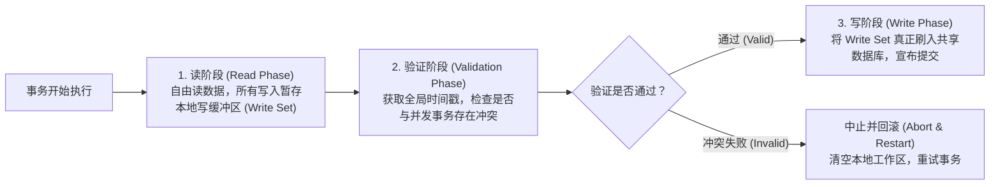

# Optimistic Concurrency Control：Kung-Robinson 乐观并发控制奠基之作

> **论文作者**：H. T. Kung, John T. Robinson  
> **发表出处**：*ACM Transactions on Database Systems (TODS)*, Vol. 6, No. 2, 1981  
> **配套讲次**：[Lec 12 乐观并发控制与快照隔离](../lec12.md)

## TL;DR

- 颠覆了传统基于互斥锁（2PL）的悲观并发控制假设，首次提出了**乐观并发控制（OCC: Optimistic Concurrency Control）**思想。
- 将事务生命周期解耦为严格隔离的三大阶段：**读阶段（Read Phase）**、**有效性验证阶段（Validation Phase）**与**写阶段（Write Phase）**。
- 提出了基于事务单调递增时间戳的集合交叉验证条件（Backward Validation 与 Forward Validation），数学证明了其调度符合可串行化要求。
- 实现了**天然死锁免疫（Deadlock-Free）**，消除了锁管理器的内存占用与加锁开销，在读多写少与低冲突负载下吞吐显著超越悲观锁。

---

## 1. 论文研究问题与设计哲学转换

在 1970 年代，学术界与工业界几乎完全被悲观两阶段锁（2PL）所统治。悲观锁基于防御性假设：**“任何并发事务都有可能冲突，因此在每次访问数据前必须先加锁排队”**。

然而，图灵奖得主 H. T. Kung 与 John T. Robinson 敏锐地指出：在大量实际应用中，大部分事务之间实际上访问的是不相交的数据，**真实冲突概率极低**。在低冲突场景下，悲观锁付出了极其沉重的性能惩罚：
1. **加锁开销高昂**：即使没有任何并发冲突，每次读写也必须反复陷入锁管理器查询锁表、分配内存锁结构；
2. **死锁风险常伴**：锁的持有导致资源环路等待，系统必须周期性运行死锁检测算法；
3. **持有时间过长**：加锁直到事务提交才释放，加剧了长事务对短事务的阻塞。

Kung 与 Robinson 提出了革命性的“乐观假设”：**“假定冲突绝少发生，让事务放手去跑，只在最终提交前进行一次快速检验；若有冲突再中止重试”**。



---

## 2. 核心三阶段机制与数学验证条件

### 2.1 读阶段（Read Phase）
- 事务执行期间**不申请任何共享锁或排他锁**；
- 读操作直接读取共享数据库中的当前数据副本，系统将访问过的所有数据项键值记录在本地的**读集合（Read Set, $RS$）**中；
- 所有的写操作（插入、修改、删除）**严禁直接修改共享数据库**，而是暂存（Buffer）在事务私有的**写集合（Write Set, $WS$）**内存工作区中。对事务自身而言，后续的读取能看到自己写集合中的最新修改。

---

### 2.2 验证阶段（Validation Phase）
当事务完成所有计算准备提交时，进入关键的验证阶段。此时系统为该事务正式分配一个全局唯一且单调递增的事务完成序号（时间戳 $T(i)$）。

为了保证所有通过验证的事务执行等价于按照时间戳顺序串行发生，对于任意两个在时间上有交叠的事务 $T_i$ 和 $T_j$（且 $T_i$ 的验证早于 $T_j$，即 $T(i) < T(j)$），必须满足以下三个充分条件之一：

```text
+-----------------------------------------------------------------------------------------+
|                               Kung-Robinson OCC 验证充分条件                            |
|                                                                                         |
|   【条件 1】：Ti 在 Tj 开始其读阶段之前就已经完全完成了写阶段。                          |
|   -> 物理含义：Ti 与 Tj 在物理时间上完全串行先后发生，不可能有任何冲突。                 |
|                                                                                         |
|   【条件 2】：Ti 的写集合与 Tj 的读集合完全没有交集，即：                                |
|              WS(Ti) ∩ RS(Tj) = ∅                                                         |
|              且 Ti 在 Tj 开始其写阶段之前完成了全部写阶段。                              |
|   -> 物理含义：Ti 的写入虽然与 Tj 的读取在时间上有重叠，但 Ti 没改动 Tj 关心的任何数据； |
|                且 Ti 的写入先于 Tj 的写入发生，写操作顺序完全一致。                     |
|                                                                                         |
|   【条件 3】：Ti 的写集合与 Tj 的读集合和写集合都完全没有交集，即：                      |
|              WS(Ti) ∩ RS(Tj) = ∅  且  WS(Ti) ∩ WS(Tj) = ∅                               |
|              且 Ti 在 Tj 完成其读阶段之前完成了自己的读阶段。                            |
|   -> 物理含义：两个并发事务彼此完全独立，读写互不相干，并发交错执行安全。               |
+-----------------------------------------------------------------------------------------+
```

---

### 2.3 写阶段（Write Phase）
一旦事务成功通过验证，便进入写阶段：
- 将私有写集合 $WS$ 中的所有修改真正应用并刷入底层共享数据库；
- 这一阶段通常非常短暂（因为数据已在内存就绪，只需进行内存拷贝或追加物理 WAL），确保不会阻塞系统；
- 事务向客户端宣告提交成功。

---

## 3. 官方课前思考题深度解答

### Q1: 在什么工作负载下，乐观并发控制（OCC）的性能会显著超越基于锁的悲观控制（2PL）？
- **读多写少的高并发负载**：如互联网电商商品详情浏览、维基百科检索。只读事务在 OCC 下只需收集读集合，无需在数据库内部申请任何锁、无需维护锁扣，CPU 效率极高；
- **低冲突与大内存系统**：当并发事务访问的记录跨度极大、数据热点分散时，冲突概率接近于零。OCC 避免了 2PL 中锁管理器的巨大内存与线程同步开销；
- **长读事务混合短写事务**：只读长事务不会对短事务施加共享锁阻碍，短事务可以毫秒级验证提交。

### Q2: 乐观并发控制可能会引发死锁（Deadlock）吗？为什么？
- **绝对免疫死锁（Deadlock-Free）**：
  - 死锁的数学必要条件是“循环等待已经持有的互斥资源（Hold and Wait）”；
  - 在 OCC 中，事务在读阶段**完全不持有任何锁**，不存在相互等待被阻塞的状态；
  - 在验证阶段，若发现与并发事务冲突，系统直接强制其中一个事务**中止（Abort）并清空私有工作区**，绝不挂起等待；
  - 这种即时失败并回滚的机制，在数学上彻底粉碎了形成等待有向环（Cycle）的可能。

### Q3: 如何在教学级系统（如 SimpleDB / GoDB）中工程实现 OCC？
1. **私有缓存封装**：为每个活跃事务对象维护一个本地的哈希表，重定向 `Insert()` / `Update()` / `Delete()` 调用，拦截并缓冲所有脏页或元组增量；
2. **读集跟踪**：通过拦截 `GetTuple(rid)` 调用，将所有读取过的物理 Record ID（或页面 ID）追加至事务的 `readSet` 集合；
3. **全局互斥验证临界区**：在事务 `Commit()` 时，进入一个极轻量的全局临界区（获取一个全局短互斥锁），获取当前单调事务序列号，比对其生命周期内已提交事务的写集合与自身读集合；若相交则抛出 `TransactionAbortException`，否则执行脏页应用并提交。

---

## 4. 架构师深度洞察

::: insight 乐观控制的阿喀琉斯之踵与现代硬件重生
Kung-Robinson 的 OCC 方案在理论上极其优雅，但早期工业化落地时面临致命痛点——**高冲突下的性能雪崩（Livelock / Starvation）**。在出现高频热点写（如秒杀库存扣减）时，90% 以上的事务会在验证阶段被无情打飞，事务消耗了大量 CPU 进行无意义的重试，系统有效吞吐瞬间趋近于零。

但在现代软硬件架构中，OCC 的变体正迎来巨大复兴：
1. **内存数据库与 Silo / TicToc**：现代内存引擎（如 Harvard Silo）利用 CPU 硬件级 CAS（Compare-And-Swap）原子指令，实现了每秒数百万次超低开销的 OCC 毫秒级提交；
2. **分布式存储与跨行事务**：Google Percolator（TiDB 底层模型）与 FoundationDB 在分布式环境下采用基于时间戳预取的 OCC 协议，避免了在跨机房网络上维持长连接悲观锁的高昂通信延迟。

OCC 并非淘汰了悲观锁，而是在低竞争与低延迟网络中开辟了无锁可串行化的终极路径。
:::
