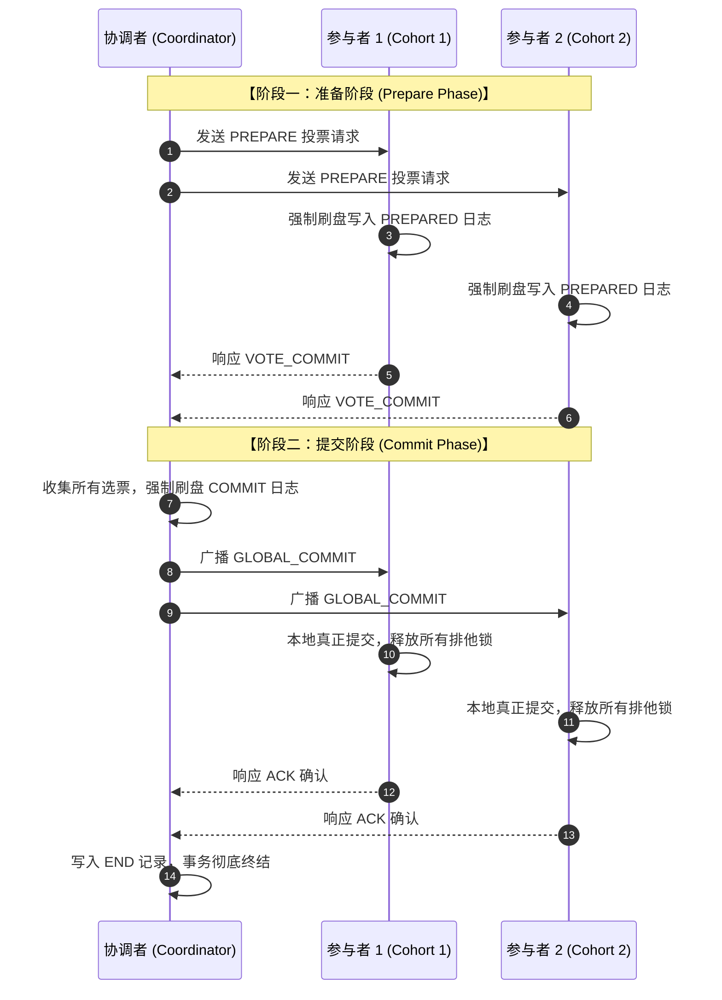

# Distributed Transaction Management in R*：两阶段提交协议与优化变体

> **论文作者**：C. Mohan, Bruce Lindsay, R. Obermarck  
> **发表出处**：*ACM Transactions on Database Systems (TODS)*, Vol. 11, No. 4, 1986  
> **配套讲次**：[Lec 16 分布式事务与两阶段提交](../lec16.md) · [Lec 15 并行与分布式数据库架构](../lec15.md)

## TL;DR

- 解构了 IBM R* 分布式关系型数据库系统中维系跨节点 ACID 语义的核心机制——**两阶段提交协议（2PC: Two-Phase Commit）**。
- 形式化分析了 2PC 在协调者（Coordinator）与参与者（Cohort）各节点发生单点故障或网络分区时的状态机转换与崩溃自愈逻辑。
- 剖析了标准 2PC 的致命痛点——**协调者单点阻塞问题（Blocking Problem）**及其同步刷盘 I/O 开销。
- 提出了划时代的工程优化变体：**假定中止（Presumed Abort, PA）**与**假定提交（Presumed Commit, PC）**，将网络通信报文与日志强制刷盘开销降低达 50% 以上。

---

## 1. 论文研究问题与分布式原子提交挑战

在单机系统中，事务原子性由本地 WAL 刷入 `COMMIT` 记录的一瞬间决定。但在无共享（Shared-Nothing）分布式数据库中，数据被分片切分至数十个物理节点上。一个业务事务（如跨行转账）往往需要跨多个物理节点并发执行读写。

分布式原子提交面临着严酷的网络与独立硬件故障挑战：**“参与事务的任何一个节点在本地写成功，并不代表全局能成功；只要有一个参与者由于约束冲突、死锁或硬件故障而失败，所有其他节点之前执行的所有本地修改必须全部干净回滚！”**

IBM 研究院 C. Mohan 等人在 1986 年发表的经典文献，系统化阐述了分布式事务管理器在应对不确定网络延迟与单点宕机时的状态机规范。



---

## 2. 经典两阶段提交协议（2PC）机制

### 2.1 阶段一：准备阶段（Prepare / Voting Phase）
1. 协调者向参与该分布式事务的所有参与者节点（Cohorts）广播 `PREPARE` 消息；
2. 参与者收到后检查本地事务执行状态：
   - 若本地执行无误，参与者**必须将该事务的所有修改与 `PREPARED` 日志强制同步刷盘（Force `fsync`）**；
   - 随后向协调者回复 `VOTE_COMMIT` 投票；此时该参与者进入“不确定状态（In-doubt State）”，承诺在收到协调者最终裁决前**绝不自主单方面中止或释放行锁**；
   - 若本地校验失败（如违反唯一性约束或死锁回滚），参与者写出 `ABORT` 日志，并回复 `VOTE_ABORT`。

---

### 2.2 阶段二：决定与提交阶段（Commit Phase）
1. **协调者裁决**：
   - 只有当**所有**参与者均投出 `VOTE_COMMIT` 票时，协调者才正式决定全局提交；
   - 协调者首先**将 `COMMIT` 日志记录强制同步刷入本地外存**（在此瞬间，事务在法律意义上正式达成全局提交）；
   - 向所有参与者广播 `GLOBAL_COMMIT` 消息；
2. **参与者生效**：
   - 参与者收到 `GLOBAL_COMMIT` 后，向本地日志写入 `COMMIT` 记录，释放该事务持有的所有锁资源，向协调者返回 `ACK` 确认；
3. **协调者终结**：
   - 协调者收集齐全所有参与者的 `ACK` 确认后，向本地写入一条非强刷的 `END` 日志，从内存事务表中安全注销该分布式事务。

---

### 2.3 协调者单点阻塞问题（The Blocking Problem）
经典 2PC 是一种**阻塞式协议（Blocking Protocol）**：
- 若参与者投完 `VOTE_COMMIT` 票进入 `PREPARED` 状态后，**协调者发生单点硬件宕机且网络通信彻底断绝**；
- 参与者**既不能擅自提交**（因为可能其他参与者投了 Abort），**也不能擅自回滚**（因为协调者可能已经向其他节点发送了 Commit 并宣布成功）；
- **灾难后果**：所有参与者节点必须永久死死锁定该事务涉及的所有数据行！后续所有试图访问这些数据的其他并发事务全部被无限期挂起阻塞，引发级联雪崩。

---

## 3. 核心优化：假定中止（PA）与假定提交（PC）

经典 2PC 每次事务提交都需要多次网络往返与多次极慢的磁盘 `fsync`。Mohan 等人提出了两大极其经典的假定优化协议：

```text
+-----------------------------------------------------------------------------------------+
|                               经典 2PC 与 PA / PC 优化开销对比                          |
|                                                                                         |
|   协议模式                正常提交时的强制刷盘次数        事务中止/回滚时的强制刷盘次数 |
|  +----------------------+-------------------------------+-----------------------------+ |
|  | 标准两阶段提交 (2PC) | 协调者 1 次 + 各参与者 1 次   | 协调者 1 次 + 各参与者 1 次  |
|  |                      | 必须等待所有 ACK 才能终结     | 必须写强制日志与回收 ACK    |
|  +----------------------+-------------------------------+-----------------------------+ |
|  | 假定中止 (PA)        | 与标准 2PC 相同 (强刷 Commit) | 【极低成本】：              |
|  | (Presumed Abort)     | 适合提交占比 > 95% 的系统     | 协调者根本无需强刷 Abort！  |
|  |                      |                               | 参与者无需响应 ACK！        |
|  +----------------------+-------------------------------+-----------------------------+ |
|  | 假定提交 (PC)        | 协调者无需强刷 Commit！       | 中止时需完整保留日志        |
|  | (Presumed Commit)    | 适合长链路分布式写系统        | 需显式确认                  |
|  +----------------------+-------------------------------+-----------------------------+ |
+-----------------------------------------------------------------------------------------+
```

### 3.1 假定中止（Presumed Abort, PA）的核心哲学
- **设计哲学**：**“系统没有记录的事务，一律假定它已经 Abort 回滚！”**
- **工程红利**：
  - 当某个参与者投了 `VOTE_ABORT` 时，协调者向本地写入 `ABORT` 日志时**完全无需 `fsync` 强刷**，甚至可以直接在内存中丢弃该事务；
  - 协调者向参与者发送 `GLOBAL_ABORT` 后，**完全不需要等待参与者的 ACK 确认消息**！
  - 若系统重启恢复时遇到一个没有最终决议的孤儿事务，依据“假定中止”原则直接就地回滚，安全无虞。极大削减了失败路径下的通信与磁盘 I/O 延迟。

---

## 4. 官方课前思考题深度解答

### Q1: 两阶段提交（2PC）协议的核心工作机制是什么？它解决了什么本质问题？代价是什么？
- **核心机制**：两阶段推进（Prepare 阶段收集选票与准备落盘，Commit 阶段广播决定与释放资源）；
- **本质问题**：在存在节点可能独立崩溃、网络可能丢包或延迟的无共享分布式网络中，实现跨节点的**分布式全原子性（Atomic Commit）**；
- **核心代价**：
  1. **高昂的高延迟与吞吐损耗**：需要至少 2 次网络往返（RTT）与多次外存日志同步物理 `fsync`；
  2. **单点阻塞脆弱性**：协调者故障期间，参与者必须死锁资源无法脱身。

### Q2: 假定中止（Presumed Abort）与假定提交（Presumed Commit）在减少开销上的意义何在？如何在这两两者之间抉择？
- **意义**：利用系统全局的“隐式默认认知”消除特定分支下的日志持久化屏障与确认报文；
- **抉择准则**：
  - 在绝大多数工业 OLTP 数据库中，**事务提交率通常超过 99%**，回滚只是极少数异常。**Presumed Abort（PA）是工业界压倒性的首选**，因为它以极简的逻辑极大优化了回滚路径，同时让提交路径保持清晰直接；
  - 只有在极少数协调者开销占主导、参与者节点数量极庞大的特定长事务专有系统中，才考虑 PC。

---

## 5. 架构师深度洞察

::: insight 从 2PC 到 Paxos/Raft 共识融合的现代演进
经典 2PC 最大的阿喀琉斯之踵在于：**它是针对单点协调者设计的**。一旦协调者永久性烧毁，系统便陷入死锁，必须依靠人工 DBA 介入运维。

现代分布式数据库（如 Google Spanner、TiDB、CockroachDB）的重大突破是**“共识协议与原子提交的深度融合”**：
- 将协调者以及每一个分片参与者，都用一个高可用 **Paxos / Raft 复制组**来替代；
- 协调者自身是由 3 副本或 5 副本构成的 Raft 组，即使 Leader 机器断电，Follower 节点能在毫秒级重新选举出新 Leader 并接管 2PC 状态机；
- 彻底消除了 2PC 的单点阻塞隐患，在广域网跨机房环境下实现了坚不可摧的高可用分布式事务。
:::
