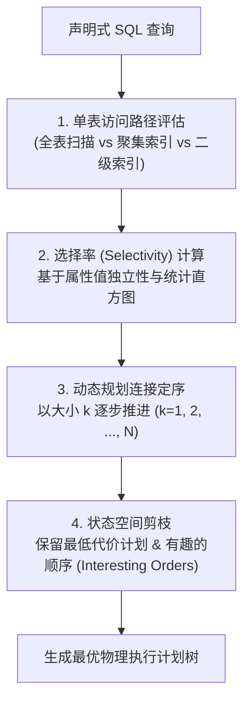

# Access Path Selection：Selinger 关系查询优化器奠基之作

> **论文作者**：Patricia G. Selinger, Morton M. Astrahan, Donald D. Chamberlin, Raymond A. Lorie, Thomas G. Price  
> **发表出处**：*ACM SIGMOD International Conference on Management of Data*, 1979  
> **配套讲次**：[Lec 8 查询优化器：规则与代价](../lec8.md)

## TL;DR

- 确立了现代基于代价的查询优化器（CBO: Cost-Based Optimizer）的全部基石理论，被称为数据库领域的“圣经级文献”。
- 首次提出了**物理执行代价模型（Cost Formula）**：统一度量磁盘页面 I/O 数量与 CPU 指令周期开销（$Cost = \text{PAGE\_FETCHES} + W \cdot \text{TUPLE\_EVAL}$）。
- 提出了基于**动态规划（Dynamic Programming）**的多表连接顺序搜索算法，利用左深树（Left-Deep Trees）有效控制搜索空间规模。
- 发明了**“有趣的顺序（Interesting Orders）”**保留机制，防止局部贪心算法因剪枝而错过全局最优的归并连接计划。

---

## 1. 论文研究问题与历史突破

在 IBM System R（世界上第一个关系数据库原型）诞生之前，计算机学界普遍怀疑关系模型与声明式 SQL 是否具有工业可行性。反对者的核心论据是：“程序员手工编写的过程式代码可以精巧地利用索引与指针，而高级声明式语言将控制权交给系统，机器绝不可能生成匹敌甚至超越人类专家的访问路径”。

Patricia Selinger 等人在 1979 年发表的这篇论文彻底击碎了这一质疑。论文提出了一整套能够自适应评估数据统计分布、物理索引、内存排序缓冲与连接拓扑的算法体系，奠定了此后四十年所有商业（DB2、Oracle、SQL Server）与开源（PostgreSQL）优化器的内核原型。



---

## 2. 核心算法机制与理论推导

### 2.1 代价模型形式化公式
优化器将物理代价抽象为磁盘 I/O 阻塞时间与 CPU 运算指令开销的加权和：
$$\text{Cost} = \text{PAGE\_FETCHES} + W \times (\text{TUPLE\_COMPARES})$$
其中：
- $\text{PAGE\_FETCHES}$：预计需要从外存调入内存缓冲池的磁盘块总数（单次 I/O 耗时基准）；
- $\text{TUPLE\_COMPARES}$：CPU 在内存中评估 `WHERE` 谓词、元组打包与哈希计算的次数；
- $W$：CPU 指令耗时换算为磁盘 I/O 耗时的归一化权重系数。

---

### 2.2 单表访问路径选择与选择率估计
对于涉及关系 $R$ 的扫描，优化器通过系统目录（Catalog）维护的统计信息推演谓词的选择率 $F$（Selectivity，即满足条件的元组比例）：
1. **等值谓词（`column = value`）**：
   $$F = \frac{1}{\text{CARD}(column)}$$
   （若无可用直方图，假设列中各不同值均匀分布，$\text{CARD}$ 为基数）；
2. **开放范围谓词（`column > value`）**：
   $$F = \frac{\text{HIGH\_VALUE} - \text{value}}{\text{HIGH\_VALUE} - \text{LOW\_VALUE}}$$
3. **布尔合取（`P1 AND P2`）**：
   - 依赖**属性值独立性假设（Attribute Value Independence, AVI）**：
     $$F(P1 \land P2) = F(P1) \times F(P2)$$

**访问路径比选**：
- **聚集索引（Clustered Index）扫描**：数据元组物理存储顺序与索引键一致，I/O 代价为：
  $$\text{Cost} = \text{Index\_Pages} \times F + \text{Data\_Pages} \times F$$
- **未聚集索引（Unclustered Index）扫描**：每个匹配元组可能散落在不同磁盘块上，I/O 代价急剧膨胀为：
  $$\text{Cost} = \text{Index\_Pages} \times F + \text{Total\_Tuples} \times F$$
  当选择率 $F > 1\% \sim 5\%$ 时，优化器会自动放弃未聚集二级索引，转而使用全表顺序扫描。

---

### 2.3 动态规划连接定序与左深树（Left-Deep Trees）

当查询包含 $N$ 张表连接时，可能的树形拓扑结构与连接组合呈超指数级爆发（$O((2N)! / N!)$）。

```text
+-----------------------------------------------------------------------------------------+
|                              左深树 (Left-Deep Trees) 结构                              |
|                                                                                         |
|            [ Join 3 ]                  【核心工程优势】：                               |
|             /      \                   1. 流水线物化开销极小：任何时刻内部只需保持一个  |
|        [ Join 2 ]   [ 表 D (Probe) ]      左侧流水线结果，右侧子节点永远是基础基表；   |
|         /      \                       2. 严格限制搜索空间：从稠密树的组合爆炸收敛至   |
|    [ Join 1 ]   [ 表 C (Probe) ]          $O(N!)$，使得动态规划状态压缩可行。          |
|     /      \                                                                            |
|  [ 表 A ]   [ 表 B ]                                                                    |
+-----------------------------------------------------------------------------------------+
```

**动态规划推进过程**：
1. **$k = 1$（基础表）**：为每个基表 $R_i$ 选出最优的单表访问路径（全表扫描或各索引）；
2. **$k = 2$（两两连接）**：穷举所有两表组合 $\{R_i, R_j\}$，测试 Nested Loop 与 Sort-Merge Join，为每对组合保留**最低代价**的子计划；
3. **$k \to k+1$**：对于已生成的 $k$ 表最优计划，尝试将剩余的任意单表作为右操作数（Outer table）加入连接，保留累积代价最小的计划；
4. **终止**：直至生成覆盖全部 $N$ 张表的最优左深树。

---

### 2.4 有趣的顺序（Interesting Orders）

如果简单地在每一步只保留代价最低的子计划，动态规划会发生**过早剪枝陷阱**！
- **反例**：在两表连接时，全表扫描配合 Hash Join 瞬时代价最低；而利用索引扫描进行 Sort-Merge Join 虽然单步稍慢，但它输出的结果集**天然按照连接键有序**！
- 如果后续还需要与第三张表进行归并连接，或者最终有 `ORDER BY` / `GROUP BY`，保留这个有序结果可以完全免除最后阶段代价极高昂的外部大排序！
- **解决方案**：Selinger 提出：若一个计划生成的物理输出顺序恰好满足上层查询的连接键或排序子句，该顺序被定义为**“有趣的顺序”**。优化器为每个“有趣的顺序”独立保留一个局部最优计划，不得被无序计划强制剪枝。

---

## 3. 官方课前思考题深度解答

### Q1: 优化器如何确定一个查询的“最优访问路径”？它真的能保证选出的计划在物理上最快吗？
- **确定流程**：结合数据字典的直方图统计计算选择率，基于统一的代价模型公式估算各候选路径的 I/O 块数与 CPU 周期，通过动态规划剪枝确定全树执行方案。
- **无法绝对保证最快**：优化器选出的是“在当前统计信息与代价模型假设下数学期望最优的计划”。在实际生产中，若统计信息陈旧、或者多列之间存在强物理相关性（违反 AVI 独立性假设），优化器计算出的基数偏差可能达到几个数量级，从而错误地选出病态的物理计划。

### Q2: 为什么动态规划算法只探索“左深树（Left-Deep Trees）”，而不探索所有的“浓密树（Bushy Trees）”？
- **搜索空间控制**：$N$ 张表的完全浓密树搜索空间极为庞大，在 $N \ge 8$ 时现代计算机内存与搜索耗时不可承受；而左深树仅有 $O(N \cdot 2^{N-1})$ 个状态，可在数十毫秒内快速完成；
- **执行器流水线缓存亲和性**：在左深树中，右孩子永远是存储介质上的基础表，优化器可以极其优雅地组织内存：左侧子树生成一条元组，立即流式传入连接算子与右表匹配，中间结果无需在磁盘上创建多个临时物化文件。

---

## 4. 架构师深度洞察

::: insight 静态优化器的尽头与自适应执行的兴起
Selinger 优化器开启了数据库内核四十年依赖静态成本估计的辉煌时代。然而，静态优化器的天花板在于其**“开弓没有回头箭”**——一旦执行器开始运转，即便在第一个算子就发现中间结果行数被低估了 10,000 倍，执行器也只能硬着头皮把错误的嵌套循环跑完。

现代先进执行引擎（如 Snowflake、Presto 以及 PostgreSQL 的 Adaptive Query Execution）的演进方向是：
- **自适应重优化（Runtime Adaptive Re-planning）**：在阶段边界收集真实的行数反馈，若发现基数失真，动态将后续的嵌套循环连接即时切换为 Grace Hash Join；
- **轻量采样与端到端统计**：在执行前进行轻量级高频 Reservoir 采样，用真实动态数据校准静态模型的数学先验。

Selinger 的框架至今依然是所有自适应优化的第一步基石。
:::
