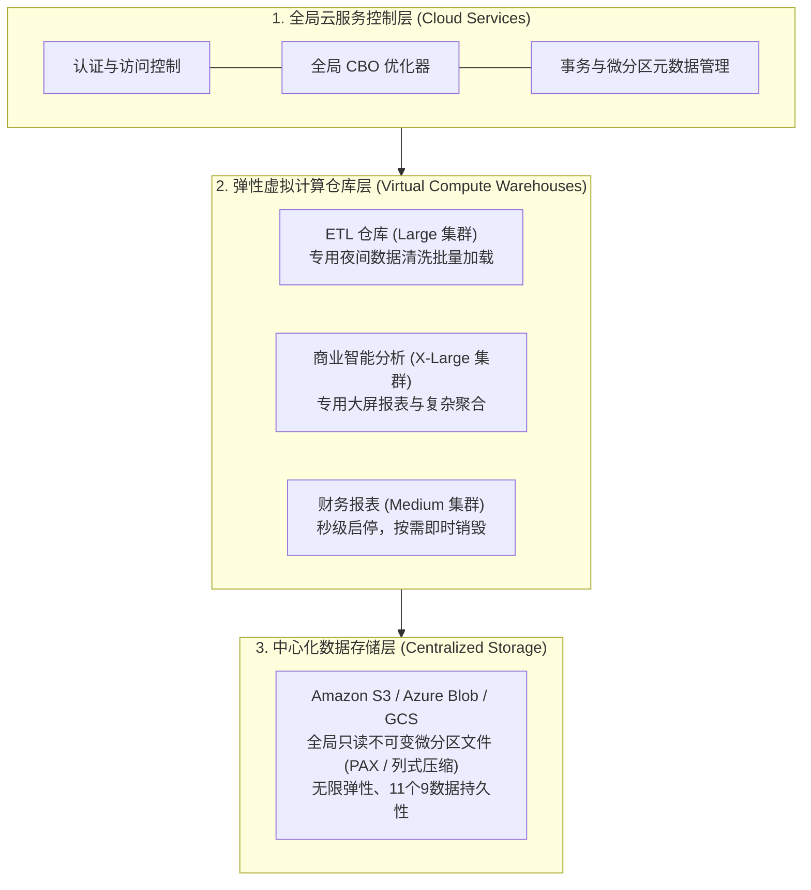

# The Snowflake Elastic Data Warehouse：云原生数仓存算分离架构

> **论文作者**：Benoit Dageville, Thierry Cruanes, Marcin Zukowski, Vadim Antonov, Artin Avanes, Jon Bock, Jonathan Claybaugh, Daniel Engovatov, Martin Hentschel, Jiansheng Huang, Allison W. Lee, Ashish Motivala, Abdul Q. Munir, Steven Pelley, Peter Povinec, Greg Rahn, Spyridon Triantafyllis, Philipp Unterbrunner  
> **发表出处**：*ACM SIGMOD International Conference on Management of Data*, 2016  
> **配套讲次**：[Lec 20 云原生数据库：Aurora 与 Snowflake](../lec20.md)

## TL;DR

- 提出了首个彻底为公有云环境量身打造的弹性企业级数据仓库架构——**Snowflake**。
- 颠覆了传统本地机房时代占统治地位的无共享（Shared-Nothing）体系，重构了现代**存算分离（Storage-Compute Separation）多租户架构**。
- 将系统严格解耦为三大正交扩展层：**数据存储层（Amazon S3）**、**虚拟计算仓库层（Virtual Warehouses）**与**全局云服务控制层（Cloud Services）**。
- 提出了基于只读不可变文件的**微分区（Micro-partitions）**技术与微结构元数据索引，实现了零锁竞争下的**时间旅行（Time Travel）**与**零拷贝快照克隆（Zero-Copy Clone）**。

---

## 1. 论文研究问题与传统 Shared-Nothing 的死穴

在云计算普及之前，高性能并行数据仓库（如 Teradata、Greenplum、Vertica）普遍采用**无共享架构（Shared-Nothing）**：每台服务器独立拥有自己的 CPU、内存与本地硬盘，数据通过哈希键严格水平分片分散在各个节点的本地磁盘中。

然而，公有云的普及（尤其是无限容量、极低单价的 Amazon S3 对象存储与秒级伸缩的 EC2 虚拟化算力）彻底暴露了 Shared-Nothing 的致命死穴：
1. **存储与计算强耦合捆绑**：扩容存储必须连带购买昂贵的服务器节点；扩容算力又必须承担闲置硬盘成本。在硬件配置上无法应对数据量激增而查询量平稳的失衡场景；
2. **节点故障与扩缩容极其笨重（Node Rebalancing）**：当需要向集群增加 5 台机器时，系统必须在网络上跨节点重新搬迁、重分布数十 TB 的历史数据，耗时数小时至数天，期间严重拖垮正常业务查询；
3. **多租户资源争抢无法隔离**：财务部门运行每月末耗时 4 小时的大报表，会把全集群 CPU 与 I/O 打满，导致风控与业务部门的实时报表被严重阻塞挂起。

Snowflake 创始团队（前 Oracle 内核架构师与 Vectorwise 创始人）提出了完全为公有云重构的架构宣言：**“利用对象存储作为全量事实源，实现计算与存储的物理绝对解耦！”**



---

## 2. 三层解耦核心架构与机制深度推导

### 2.1 存储层：以只读不可变对象为核心（S3）
- 所有的表数据最终均持久化在中心化对象存储（Amazon S3）中；
- 数据文件被水平切分为固定大小（压缩后约 16MB~50MB）的**微分区（Micro-partitions）**；
- **不可变性（Immutability）**：微分区文件一旦写出，**永久只读，绝不进行就地原地修改（No in-place updates）**；
- 当事务执行 `UPDATE` 或 `DELETE` 时，系统在逻辑上写出全新的微分区文件，并由元数据服务记录版本更迭指针。

---

### 2.2 计算层：完全独立的虚拟仓库（Virtual Warehouses）
- 虚拟仓库（VW）是由若干云虚拟机（EC2 实例）组成的计算集群；
- **无状态与纯算力**：各个 VW 完全不持久化任何主数据，它们从 S3 拉取数据并在本地内存和 SSD 缓存中计算；
- **物理资源绝对隔离**：
  - 数据科学家可以启动一个 64 节点的巨大 VW 跑复杂的机器学习模型；
  - 运营人员同时在一个 2 节点的微小 VW 上刷新实时看板；
  - 两个集群访问**同一份底层 S3 数据**，彼此之间的 CPU、内存与磁盘 I/O 没有任何物理交集，彻底粉碎多租户资源争抢；
- **按秒计费与秒级弹性**：业务高峰期一键将 VW 从 Small 动态扩容为 4X-Large，闲时自动挂起（Auto-suspend），计算成本直降为零。

---

### 2.3 微分区（Micro-partitions）与元数据修剪（Pruning）

传统数据库依赖 DBA 手动创建与维护 B+ 树索引，在海量数仓中索引维护代价极其沉重。Snowflake 采取了纯自适应的微分区与元数据修剪：

```text
+-----------------------------------------------------------------------------------------+
|                               微分区元数据与查询修剪 (Pruning)                          |
|                                                                                         |
|   【全局只读不可变微分区】：                                                            |
|   - Partition 1 (PAX 列存格式): 列 date [2026-01-01 ~ 2026-01-10], 列 city ['BJ', 'SH'] |
|   - Partition 2 (PAX 列存格式): 列 date [2026-01-11 ~ 2026-01-20], 列 city ['GZ', 'SZ'] |
|   - Partition 3 (PAX 列存格式): 列 date [2026-01-21 ~ 2026-01-31], 列 city ['BJ', 'CD'] |
|                                                                                         |
|   【云服务层维护的轻量元数据】：                                                        |
|   每个微分区自动记录其所包含每一列的: Min 值、Max 值、Null 值总数、不同值种类数。       |
|                                                                                         |
|   【查询修剪执行流程】：                                                                |
|   用户发起 SQL: SELECT * FROM sales WHERE date >= '2026-01-25' AND city = 'BJ';         |
|   1. 优化器在云服务层比对元数据：                                                       |
|      - Partition 1 的 Max(date)='2026-01-10' < '2026-01-25' -> 【直接整块剔除剪掉】!    |
|      - Partition 2 的 Max(date)='2026-01-20' < '2026-01-25' -> 【直接整块剔除剪掉】!    |
|   2. 最终只有 Partition 3 满足条件，虚拟仓库仅从 S3 下载这一个 30MB 的文件！            |
|   -> 无需建立任何庞大的辅助索引，实现 99% 无关数据的零 I/O 剪枝！                      |
+-----------------------------------------------------------------------------------------+
```

---

### 2.4 时间旅行（Time Travel）与零拷贝克隆（Zero-Copy Cloning）

得益于底层微分区文件的不可变性与云服务层的纯元数据驱动：
1. **时间旅行（Time Travel）**：
   - 用户可以执行 `SELECT * FROM orders AT(OFFSET => -3600)` 查询一小时前的数据库状态；
   - 甚至执行 `UNDROP TABLE customer` 瞬间恢复误删的表；
   - **实现原理**：误删或更新只是在元数据层将历史文件的生命周期标记为归档，历史数据块依然完好无损地驻留在 S3 上，查询只需按历史时间点回溯元数据视图。
2. **零拷贝克隆（Zero-Copy Clone）**：
   - 执行 `CREATE TABLE dev_db CLONE prod_db;` 复制一份 100TB 的生产数据库用于测试，耗时**不到 1 秒**，且**额外消耗的存储空间为 0 字节**；
   - **实现原理**：仅在云服务元数据层拷贝一份指向底层 S3 微分区的指针引用（Copy-on-write），只有在开发人员真正对 `dev_db` 发起修改写入时，系统才在 S3 生成新的局部微分区。

---

## 3. 官方课前思考题深度解答

### Q1: Snowflake 在哪些维度上体现出“完全为公有云量身定制”的设计理念？
- **硬件假设重构**：传统系统假定存储是私有的本地磁盘，Snowflake 将设计建立在“高吞吐、无限容量但延迟稍高的公有云对象存储（S3）”与“按需秒级供应的弹性虚拟机”之上；
- **商业与架构对齐**：传统数据库无法做到计算与存储分离计费，Snowflake 使得用户可以只为实际执行了计算的那几分钟算力以及实际占用的只读存储空间付费。

### Q2: 相比于传统的 Shared-Nothing 架构，Snowflake 的 Shared-Disk 存算分离有哪些独特优势与挑战？
- **独特优势**：
  - 弹性与扩缩容极其迅捷：增加计算节点无需耗费数天搬迁重分布历史数据；
  - 极佳的多租户物理隔离性，支持多个异构计算集群并发无阻塞访问统一事实源；
- **潜在挑战**：
  - S3 网络通信延迟明显高于本地 NVMe SSD；必须依赖计算节点本地的高速 SSD 局部缓存与精确的微分区元数据修剪来掩盖网络 I/O 延迟。

---

## 4. 架构师深度洞察

::: insight 云原生时代的范式转移
Snowflake 的成功是软件架构顺应物理基础设施变革的教科书级经典。它告诉我们：**当硬件底层假设发生根本性逆转（从本地磁盘转向公有云对象存储）时，局部修补旧架构绝无胜算，必须从零推演全新的系统拓扑。**

如今，无论是分析型的 Snowflake、ClickHouse Cloud、DuckDB (搭配 Motherduck)，还是事务型的 Amazon Aurora、Google AlloyDB，存算分离已成为现代所有云数据库的标准答案。
:::
