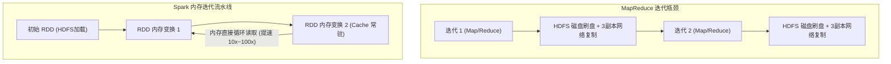

# Resilient Distributed Datasets：Spark 弹性分布式内存计算

> **论文作者**：Matei Zaharia, Mosharaf Chowdhury, Tathagata Das, Ankur Dave, Justin Ma, Murphy McCauley, Michael J. Franklin, Scott Shenker, Ion Stoica  
> **发表出处**：*USENIX Symposium on Networked Systems Design and Implementation (NSDI)*, 2012  
> **配套讲次**：[Lec 19 大规模集群计算：Spark](../lec19.md)

## TL;DR

- 针对传统 MapReduce 等第一代大数据计算框架在迭代计算（机器学习、图算法）与交互式数据分析中的磁盘 I/O 性能瓶颈，提出了 **Spark 内存计算引擎**。
- 提出了核心编程抽象——**弹性分布式数据集（RDD: Resilient Distributed Datasets）**，即一组跨集群分区分布、只读、具备高效容错能力的不可变对象集合。
- 创新性地用**粗粒度变换与数据血统（Lineage）**替代昂贵的多副本跨网络同步，节点故障时仅需对丢失分区重新执行局部的确定性变换管道。
- 形式化定义了**窄依赖（Narrow Dependencies）**与**宽依赖（Wide Dependencies）**，确立了基于 DAG 拓扑图与 Shuffle 边界的任务阶段（Stage）切分与算子流水线融合范式。

---

## 1. 论文背景与 MapReduce 的两代技术阵痛

在 2000 年代，Google MapReduce 与开源的 Apache Hadoop 极大地普及了大规模集群数据分析。然而，加州大学伯克利分校 AMPLab 团队在开发早期机器学习系统时发现，MapReduce 在两类极其关键的现代负载中性能遭遇严重瓶颈：

1. **复杂迭代式算法（Iterative Algorithms）**：例如 PageRank、K-Means 聚类、逻辑回归与梯度下降。这些算法需要反复对同一份数据集运行数十至数百轮迭代。在 MapReduce 中，每一轮迭代的输出**必须强制全部序列化并写回到高延迟的分布式磁盘文件系统（HDFS）**，并在下一轮重新读入，导致 90% 以上的时间浪费在磁盘读写、格式转换与三副本跨机房网络复制中；
2. **交互式即席查询（Interactive Data Mining）**：数据科学家使用 SQL 或 Python 对同一份 TB 级日志反复提出各种假设探索，每次查询都要完整重读磁盘，无法做到亚秒级响应。

Matei Zaharia 等人由此提出了 Spark 与 RDD，宣告大规模分布式计算正式迈入**高速内存计算时代**。



---

## 2. RDD 核心理论与系统机制

### 2.1 什么是弹性分布式数据集（RDD）？
RDD 在逻辑上是一个拥有五个核心属性的不可变（Immutable）分布式对象接口：
1. **分区列表（Partitions）**：数据集被水平切分为一组逻辑块，每个分区可在集群的一个工作节点上独立计算；
2. **计算函数（Compute Function）**：定义在父 RDD 分区上如何计算出当前分区的确定性迭代逻辑；
3. **依赖关系列表（Dependencies）**：记录当前 RDD 依赖哪些父 RDD 分区（即血统 Lineage）；
4. **针对键值对的 Partitioner**：可选（如 `HashPartitioner` 或 `RangePartitioner`），定义数据的分布式哈希分桶；
5. **首选位置列表（Preferred Locations）**：遵循“计算移动优于数据移动”原则，指示特定分区的底层数据块物理驻留在哪台节点上（实现数据本地性 Local Storage Affinity）。

---

### 2.2 粗粒度操作与血统容错（Lineage-based Fault Tolerance）

分布式系统容错的传统流派（如分布式共享内存 DSM）采用细粒度读写，系统必须对每一次细小的变量赋值进行持续的跨网络同步日志记录（Checkpointed Logging），开销极其沉重。

**RDD 的精巧解法——粗粒度变换（Coarse-grained Transformations）**：
- RDD 上的所有操作都是**粗粒度（Coarse-grained）**的，即同一个变换函数（如 `map`, `filter`, `join`）一次性同构应用于数据集中的**所有元素**；
- **血统（Lineage）有向无环图**：系统只记录在整个数据集上施加的一系列变换步骤（如 `A.map(...).filter(...).reduceByKey(...)`），而不是记录具体的数据字节；
- **自愈机制**：当集群中某一台机器突然断电宕机导致 RDD 的第 3 号分区丢失时，Spark 调度器只需在任意一台空闲机器上，沿着血统图**只对第 3 号分区重新执行这一段确定性计算管道**！其余 99 个正常运行的分区完全不受干扰。

---

### 2.3 窄依赖（Narrow）vs 宽依赖（Wide）与 Stage 划分

这是理解 Spark 执行引擎最核心的概念分水岭：

```text
+-----------------------------------------------------------------------------------------+
|                               窄依赖与宽依赖的物理本质对比                              |
|                                                                                         |
|   依赖类型          父子分区对应拓扑关系                       物理执行与网络特征       |
|  +----------------+------------------------------------------+------------------------+ |
|  | 窄依赖         | 父 RDD 的每个分区至多被子 RDD 的一个     | 【零网络 Shuffle】：   |
|  | (Narrow Dep)   | 分区所依赖 (例如: map, filter, union)    | 各算子可在单节点内存中 |
|  |                | [P1] ----> [C1]                          | 实现极限流水线合并     |
|  |                | [P2] ----> [C2]                          | (Pipelined Execution)  |
|  +----------------+------------------------------------------+------------------------+ |
|  | 宽依赖         | 父 RDD 的单个分区会被子 RDD 的多个       | 【必须网络 Shuffle】： |
|  | (Wide Dep)     | 子分区所依赖 (例如: groupByKey, join)    | 必须将数据按 Key 跨机器 |
|  |                | [P1] ---\ /--- [C1]                      | 重新哈希分发，产生网络 |
|  |                | [P2] ---/ \--- [C2]                      | I/O 阻断边界           |
|  +----------------+------------------------------------------+------------------------+ |
+-----------------------------------------------------------------------------------------+
```

**DAG 调度器（DAGScheduler）算法**：
1. 从最终行动算子（Action）逆向追溯 RDD 的依赖链；
2. **凡遇到宽依赖，立即切断，划分为一个新的阶段（Stage）边界**；
3. 在同一个 Stage 内部，所有的窄依赖算子被编译器融合成一个单一的流水线任务集合（TaskSet），数据在 CPU 寄存器与内存中一次性穿透执行，消除一切不必要的中间临时落盘。

---

## 3. 官方课前思考题深度解答

### Q1: Spark 的计算模型与 MapReduce 有哪些相似之处？有哪些本质不同？
- **相似之处**：两者都基于函数式编程思想，将计算抽象为数据并行的集合变换；都提供自动的任务调度、分布式数据分发与节点故障自动重试；
- **本质不同**：
  1. **存储介质与拓扑灵活性**：MapReduce 强制固定两阶段（Map $\to$ HDFS $\to$ Reduce $\to$ HDFS），无法复用内存；Spark 支持任意复杂的通用 DAG 算子图，并显式支持内存缓存持久化（`rdd.cache()`）；
  2. **调度粒度**：MapReduce 启动独立的 JVM 进程（启动延迟以秒计），Spark 采用长驻线程池模型（毫秒级调度）。

### Q2: 什么是“弹性分布式数据集（RDD）”？它如何帮助程序员编写高容错的分布式程序？
- **本质**：一种兼顾高表达力、内存高性能与轻量容错的一等公民抽象；
- **容错支持**：程序员无需在业务逻辑中编写复杂的重试重连、容灾切换或状态恢复代码。由于 RDD 是不可变的且携带完整的计算血统图，系统底层能够在节点宕机时完全自主地按需重算丢失分区，对程序员提供完全透明的分布式容错保障。

---

## 4. 架构师深度洞察

::: insight 从 RDD 到 DataFrame / Catalyst 优化器的演进
Matei Zaharia 在开发早期 RDD 时，将重点放在了**内存抽象与调度流水线**上。然而，RDD 的原生 API 面临与早期对象数据库类似的痛点——**黑盒函数的不透明性**：
- 当程序员写下 `rdd.map(x => x.price * 0.8).filter(x => x.age > 20)` 时，Spark 引擎只把传进去的代码看作黑盒字节码，无法像关系数据库优化器那样推导“应该把 filter 下推到 map 之前执行”；
- 为了解决这一问题，Spark 团队后续推出了 **DataFrame / Dataset API** 与 **Catalyst 优化器**，重新回归了 Codd 关系代数、属性元数据与逻辑优化重写，使 Spark 演化为兼具分布式计算力与 CBO 关系查询优化的现代数据栈标杆。
:::
