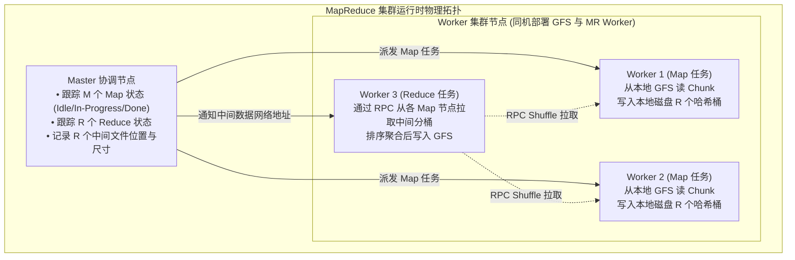
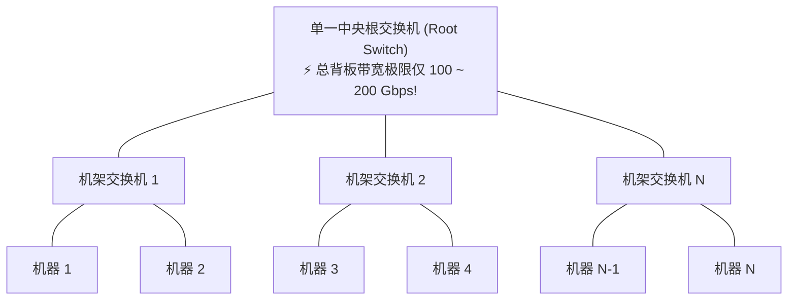
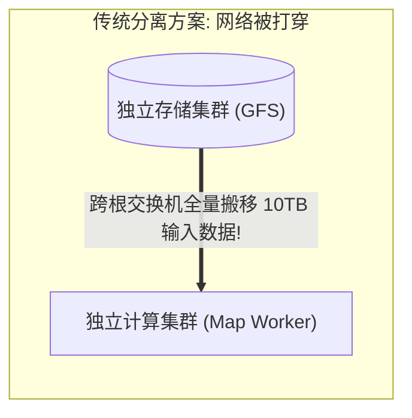
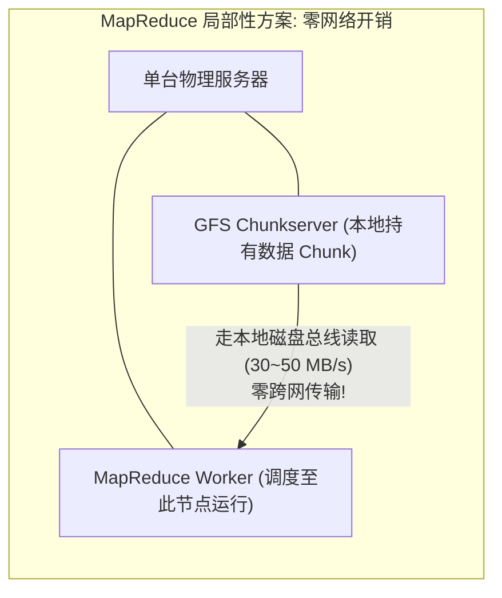
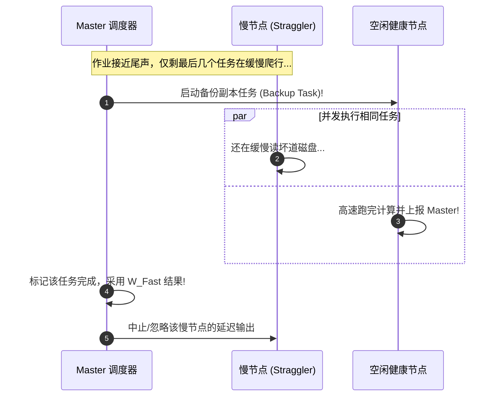
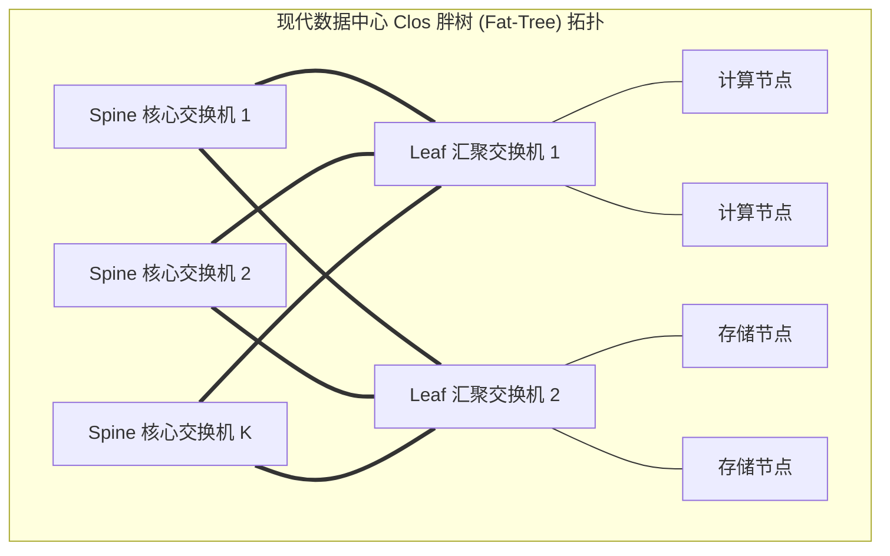

# Lec 1 课程总览与 MapReduce

> 课件：[Introduction (l01.txt)](https://pdos.csail.mit.edu/6.5840/notes/l01.txt)；论文：[MapReduce (2004)](https://pdos.csail.mit.edu/6.5840/papers/mapreduce.pdf)；论文翻译： [MapReduce翻译](./paper/mapreduce.md)

## TL;DR

- Map/Reduce 两函数将大规模计算抽象为四阶段：输入分片 → Map（产中间 KV）→ Shuffle（`hash(key) mod R` 分桶）→ Reduce（产最终输出），Map 间与 Reduce 间互不依赖故可线性扩展
- 2004 年网络是瓶颈（~55 Mb/s/机器）：通过**数据局部性**将 Map 调度到 GFS 数据所在机器消除输入网络传输，中间数据只跨网一次
- **容错 = 重新执行**：worker 崩溃时只重跑失败任务，前提是 Map/Reduce 必须纯确定性；Reduce 输出依赖 GFS 原子 rename 保证幂等
- 对慢节点（straggler）启动备份任务，谁先完成用谁，可将完成时间减少约 44%

## 何谓分布式系统？为何构建与为何艰难？

::: Definition 分布式系统（*distributed systems*）
分布式系统是一组计算机协同工作，它们齐心协力去完成某项连贯、统一的任务
在日常生活中，我们几乎都在使用分布式系统，例如流行 APP（实时通信 WECHAT、IG 等）、大型网站、电话通信系统等。

分布式系统有如下好处：通过**并行处理**提高计算能力（聚合数以千计的 CPU 核心、海量的物理内存，以及数千个独立运转的磁盘驱动臂）、容错与高可用、物理和地理分布（许多现实业务在空间上天然就是分散的）、安全与权限隔离（如果你要运行一段互不信任的代码，或者需要与外部第三方进行数据交互，但又担心对方存在恶意攻击或代码漏洞，最安全的做法是将计算物理隔离，通过窄接口交互）

分布式系统之所以充满陷阱，根源在于以下三大基本挑战：1）并发与不可预测的时间交错、2）局部故障、 3）扩展性瓶颈与收益递减
:::

本门课程是一门**专门探讨“面向应用程序的基础设施（Infrastructure for Applications）”**的课程。在整门课的讲解中，我都会把世界划分为两半：

- **上层应用（Applications）**：由业务工程师、客户或外部开发者编写的具体业务逻辑；
- **底层基础设施（Infrastructure）**：我们在这门课中重点研究、设计和构建的通用底座。

在基础设施中，通常涵盖三大形态：

1. **存储（Storage）**：这是我们在本课程中**最核心、投入时间最多**的主题。因为存储的语义规约非常清晰（写入数据、读取数据），学术界与工业界对如何构建高吞吐、多副本容错的存储系统有着极其深厚的理论沉淀与实践标准。
2. **计算（Computation）**：如今天将要深入剖析的批处理框架 MapReduce，以及后续的流式计算或并行任务调度。
3. **通信（Communication）**：多节点协同的连接纽带。不过我们主要是通信工具的“使用者”（例如利用 RPC 实现可靠调用），如果你想系统研究底层网络协议是如何在路由层面运转的。

我们构建存储与计算基础设施的**核心目标，是发现并确立优雅的抽象（Abstractions）**。什么是最具吸引力的抽象？我们的“终极梦想”是：

> **向应用程序提供一个接口，使其看起来就像一个完全非分布式的本地单机系统（例如标准 POSIX 文件系统或内存哈希表），拥有极其直观清晰的语义；而在这套简单接口的冰山之下，是由成千上万台机器构成的超高性能、多副本容错的庞大分布式集群！**

但是， 由于物理法则与网络分区的残酷现实，无法100%完美达成，但是工程界总结出了一套极具启发性的设计范式。在实现上述抽象的过程中，有三大核心议题将如影随形地贯穿本学期的每一篇论文与每一次讨论：

1. 性能与可扩展性。构建分布式系统最宏伟的愿景被称为**可扩展的加速（Scalable Speedup）**，或者称为线性加速。 

   - 为什么诱人？ 因为**计算机硬件是用钱就能直接买到的**！如果你的系统具备完美的扩展性，当业务流量爆发时，你只需花钱向数据中心采购 1000 台机器，就能瞬间获得 100 倍的吞吐量。反之，如果系统无法扩展，你就必须花费极其高昂的薪资雇佣顶尖软件工程师，耗费数月甚至数年去重构业务逻辑、重写底层算法。
   - 现实架构中，线性扩展极难维持到无穷大：初始阶段只有几千用户，单台机器同时运行Web服务器和数据库； 但用户飙升到1亿时，开始水平扩展Web节点，很快会发现，添加更多的Web已经无法提升吞吐了，瓶颈从无状态的计算层转移到了有状态的存储层，将单个数据库安全拆分为支持分布式并发读写的存储集群，需要极其深奥的分布式设计。

2. 容错机制。 大规模集群的故障统计学来说，1000台服务器的集群中，每天都会发生3台崩溃（除了机器本身、还有网络光纤、交换机、风扇啥的）。
   在容错领域，存在两个核心的制约维度：

   1. **可用性（Availability）**：在某些预设的局部故障模式下（例如双副本中宕掉 1 台），系统仍能对外保持不间断提供无损服务
   2. **可恢复性（Recoverability）**：故障发生后，系统可能暂时停机、拒绝外部请求；但一旦维修人员介入修复或电力恢复，系统能够基于持久化日志与检查点**完全恢复到故障前的正确状态，不产生任何数据丢失与状态破损**。

   解决容错问题的两大利器是

   1. **非易失存储（Non-Volatile Storage）**：磁盘/SSD/NVRAM，用于记录操作日志（WAL）与系统快照，为可恢复性提供落盘兜底。
   2. **多副本状态机复制（Replication）**：在多个独立节点上维护完全相同的状态拷贝，为可用性提供实时热切支持。

3. 一致性模型。

   并不是只有“两极”选择（强一致 or 不一致），而是有很多中间设计点：

   | 模式             | 一致性强弱   | 性能高低 | 常见系统                  |
   | ---------------- | ------------ | -------- | ------------------------- |
   | 强一致性         | 强           | 慢       | Paxos、Raft、Zookeeper    |
   | 线性一致性       | 比强一致稍弱 | 中等     | Etcd、Spanner             |
   | 顺序一致性       | 弱           | 高       | Kafka、消息队列           |
   | 最终一致性       | 很弱         | 高       | Dynamo、Cassandra、S3     |
   | 一致性完全不保证 | 极弱         | 非常高   | 一些本地缓存、CDN、MQTT等 |

## 经典范式：Google MapReduce（2004）

### 问题背景

在 2004 年前后，Google 遭遇了空前的大数据计算危机。他们需要从全网抓取的数十个 Terabyte（在当时是天文数字）的网页原始数据中：

- 构建全网倒排索引（Inverted Index）；
- 计算整个互联网网页之间的超链接引用图（如 PageRank 迭代计算）；
- 提取全网统计指标与词频分布。

构建全网索引本质上就是对海量数据进行全排序。如果用单台计算机运行排序，可能需要耗时数周甚至数年！Google 必须动用由数千台廉价 PC 构成的庞大集群来并行跑完这些计算。

但在 MapReduce 出现前，每当工程师要进行一次分布式计算，就必须纯手工编写一整套专有的分布式底层代码：

- 手动切分输入文件；
- 手动编写网络套接字通信与数据分发代码；
- 手动处理哪台机器中途断电死机；
- 手动处理机器跑得太慢如何兜底。

只有顶尖的分布式系统专家才能勉强把这套代码写对，这极大浪费了顶尖开发者的心智。Google 迫切需要一种通用抽象：**让普通的业务开发人员、机器学习学者和数据分析师，无需关心底层网络与集群故障，只需写几行纯单机视角的业务逻辑，就能直接驱动数千台机器并行计算！**  这就是 MapReduce 的诞生初心。

### 核心抽象

程序员只需实现两个完全无状态的纯函数（Pure Functions）：

```text
Map     (k1, v1)       ->  list(k2, v2)
Reduce  (k2, list(v2)) ->  list(v3)
```

MR 做词频统计的例子

```text
Input1 -> Map -> a,1 b,1
Input2 -> Map ->     b,1
Input3 -> Map -> a,1     c,1
                  |   |   |
                  |   |   -> Reduce -> c,1
                  |   -----> Reduce -> b,2
                  ---------> Reduce -> a,2
```


#### Map 阶段

Map 函数接收输入文件的切片数据，将其解析为单词，每遇到一个单词就调用框架提供的 `EmitIntermediate` 发射一条记录：

```cpp
// 用户编写的 Map 函数
void Map(string filename, string document_content) {
    for each word w in document_content:
        EmitIntermediate(w, "1");
}
```

#### Shuffle 阶段（框架全自动处理）

MapReduce 运行时框架会自动接管所有中间键值对，按 Key 进行全局分组聚合，将具有相同 Key 的所有 Value 汇聚成一个向量 `list(v)`。

#### Reduce 阶段

Reduce 函数接收某个特定的 Key 以及该 Key 在全网所有 Map 任务中产出的所有 Value 列表：

```cpp
// 用户编写的 Reduce 函数
void Reduce(string word, Iterator values) {
    int total = 0;
    for each v in values:
        total += ParseInt(v);
    Emit(AsString(total));
}
```

程序员无需写任何一行多线程锁、套接字收发或超时重传代码！代码极其优雅，将复杂的并行计算完全退化成了直观的函数式转换。


## 流程梳理


请大家看论文中的核心架构图（Figure 1）：



### 阶段一：任务划分与 Master 状态跟踪

1. 输入数据预先存储在 **GFS（Google File System）** 中，被自动拆分为若干个 $64\text{ MB}$ 大小的 Chunk。整个输入被切分成 $M$ 个分片（$M$ 通常为数万到数十万）。
2. 用户程序启动集群，选举出一个唯一的 **Master 节点**，其余数千台机器作为 **Worker 节点**。
3. Master 是整个作业的指挥中枢，内部维护两张核心调度表：
   - **任务状态表**：记录每个 Map 和 Reduce 任务的当前状态（`Idle`、`In-Progress`、`Done`）以及分配的 Worker 节点 ID。
   - **中间文件索引表**：针对每个已完成的 Map 任务，记录其在本地磁盘生成的 $R$ 个中间分区文件的具体物理位置与字节大小。

### 阶段二：Map 执行与本地磁盘落盘

- 被分配到 Map 任务的 Worker 读取对应的输入分片，将其反序列化并逐条传入用户的 `Map()` 函数。
- **关键设计：Map 的中间结果并不写入 GFS，而是缓存在内存中并周期性刷写到本地磁盘！**
- Worker 会通过分区函数（默认为 `hash(key) mod R`）将发出的所有中间 Key-Value 对严格切分成 $R$ 个分桶（对应预设的 $R$ 个 Reduce 任务）。
- Map 任务顺利完成后，Worker 将本地磁盘上生成的这 $R$ 个中间文件的路径上报给 Master。

### 阶段三：Shuffle与 Reduce 聚合

- 当所有 $M$ 个 Map 任务全部完成时，Master 开始调度 $R$ 个 Reduce 任务。
- Reduce Worker 收到 Master 发来的通知，得知所有持有属于自己分区数据的 Map Worker 网络地址。
- **全局跨网络拉取（Shuffle）**：Reduce Worker 通过 RPC 并发向全集群所有 Map Worker 发起拉取请求，将分布在各机器上的属于自己分桶的数据全部抓取到本地。
- **外排序（External Sorting）**：抓取完成后，数据按 Key 进行排序。如果中间数据量超过内存，系统将自动使用多路归并外排序，确保相同 Key 的所有记录紧密相邻。
- Reduce Worker 依次遍历每个唯一 Key，调用用户的 `Reduce()` 函数，最终结果直接以多副本形式原子写入 GFS 分布式文件系统中！


## 2004 年的物理现实：网络瓶颈与数据局部性

我们要触及本讲最核心的系统设计精髓了。请大家深思一个问题：在 2004 年的 MapReduce 系统中，性能的绝对瓶颈究竟在哪里？是 CPU？是内存？还是磁盘 I/O？
答： **网络带宽**。

论文第五节详细公布了他们当时评测使用的硬件拓扑环境：

- 集群由约 **1800 台 PC** 构成，每台机器配备 2 颗 2 GHz x86 处理器、4 GB 内存与 2 块 160 GB IDE 硬盘；
- 每台机器通过 100 Mbps 或 1 Gbps 的网线连接到本机架的机架交换机（Rack Switch）；
- **核心瓶颈**：所有机架交换机最终汇聚连接到**一台中央根交换机（Root Switch）**！



让我们来做一次残酷的除法计算：2004 年单机可用网络带宽算术，中央根交换机的全集群聚合双向带宽仅为 $100 \sim 200 \text{ Gbps}$。  当集群全负荷运行 1800 台机器，且跨机架流量均分时：$$\text{每台机器可分得的根交换机带宽} = \frac{100 \text{ Gbps}}{1800 \text{ 台}} \approx 55.5 \text{ Mbps} \approx 6.9 \text{ MB/s}$$


**$6.9\text{ MB/s}$​​ 是什么概念？**  
**跨越机架的网络传输速度，比读本地磁盘整整慢了一个数量级！** 如果每一个 Map 任务都要从网络另一端抓取数据，根交换机会在毫秒之内被彻底打穿拥死，数千颗 CPU 核心将全部处于饥饿阻塞状态！


Google 工程师为了绕开这个致命瓶颈，打出了一手精妙的系统组合拳——**计算向存储靠拢（Moving Computation to Data）**！





1. **同机混合部署**：GFS 存储服务器与 MapReduce Worker 完全运行在同一批物理服务器上！
2. **感知拓扑的任务调度**：当 Master 准备调度 Map 任务去处理第 $i$ 个数据分片时，Master 会先向 GFS 查询该分片实际存放在哪几台机器的本地硬盘上（GFS 默认维护 3 份副本）。
3. **优先本地调度**：Master 优先把该 Map 任务分派给**直接拥有该数据副本的物理机**！
   - 此时，Map Worker 直接读取本地硬盘，**网络开销完全为零**！
   - 若本地机器资源耗尽，退而求其次调度在同机架的邻近机器上（走机架内部交换，不惊动根交换机）；
   - 只有在极罕见情况下才跨机架搬移数据。


现在请大家思考一个经典面试题：**为什么 Map 产出的中间 Key-Value 文件要写本地磁盘，而不是直接写 GFS？**

**Robert Morris 教授**：  
很多初学者会觉得：“既然 GFS 是多副本高可用的，直接写 GFS 岂不是天然容错？”  
这在工程上是极度愚蠢的！因为：

- 如果写入 GFS，GFS 会将数据跨网络复制 2 到 3 份；
- Reduce 在读取时，又要通过网络跨机器读取 GFS；
- 这样一来，本就极其脆弱的网络交换机带宽会被白白多浪费 **$2 \sim 3$ 倍**！
- 相比之下，Map 输出写入本地磁盘只跨网络一次（Shuffle 阶段由 Reduce 按需拉取），将网络流量压榨到了理论极限。


## 容错重算机理、慢节点拖后腿问题与确定性规约

在由上千台机器协同运行的大型作业中，如果有机器在中途宕机了怎么办？

### 容错哲学：重算代价远小于状态机同步

MapReduce 的容错哲学非常激进且优雅：**容错 = 重新执行（Fault Tolerance by Re-execution）**。

#### Map Worker 宕机处理

Master 通过心跳周期性探测 Worker。如果某个 Map Worker 在指定时间内失联，Master 将其标记为故障：

- **无论该节点上的 Map 任务此前是否已经完成，Master 都必须在其他可用节点上全部重新调度运行！**
- **思考题**：为什么已经完成的 Map 任务也必须重跑？
- **解答**：因为该 Map 产出的中间结果保存在该节点的**本地磁盘**上！节点死了，本地磁盘自然无法访问，后续的 Reduce 节点将无法拉取属于自己的那份分桶数据，因此必须由其他健康的 Worker 重跑该分片。

#### Reduce Worker 宕机处理

- 若 Reduce Worker 宕机，只需在其他节点重新运行尚未完成的 Reduce 任务。
- **思考题**：已成功完成的 Reduce 任务需要重跑吗？
- **解答**：不需要！因为 Reduce 的最终产物已经写入了具有多副本容错保证的 GFS 中，即使该机器断电，输出文件依然安然无恙。

### 确定性是幂等重算的前提

::: definition 纯函数的确定性契约（Determinism Requirement）
如果用户的 `Map` 和 `Reduce` 包含外部未隔离的副作用（如向全局未加锁的外部数据库发请求、或者依赖本地系统当前时间戳、或者调用真随机数发生器），多次重新执行将会产生完全不一致的输出，导致系统语义彻底崩溃！  
MapReduce 要求函数必须是**纯确定性的**。配合底层 GFS 的**原子文件重命名（Atomic Rename）**机制，即使同一个任务由于超时误判被两台 Worker 同时执行，最终也只有一个版本的输出能够原子替换生效，确保了端到端的幂等性。
:::

### 慢节点拖后腿（The Straggler Problem）与备用任务机制

在大型作业中，最折磨人的往往不是“彻底死掉的机器”，而是**“半死不活的机器”（Stragglers）**。

比如某台机器的 CPU 风扇坏了导致严重降频、或者硬盘产生了大量坏道导致频繁触发底层硬件校验，读取速度从 $30\text{ MB/s}$ 暴跌到 $1\text{ MB/s}$。整个作业有 10,000 个任务，前 9,990 个任务在 10 分钟内全跑完了，唯独剩下最后 10 个慢任务卡在这些故障机器上，硬生生把整个作业拖延了几个小时！



**解决方案：备用任务（Backup Tasks / Speculative Execution）**  
当整个 MapReduce 作业接近完成（剩余任务数极少）时，Master 会对所有仍在运行中的任务**调度启动完全相同的备份副本任务**在其他空闲节点上并发执行！

- 原任务与备份任务谁先完成，Master 就采用谁的结果，并将另一个任务直接 Kill 或忽略其输出。
- 在论文的排序基准测试中，如果禁用备用任务机制，**整个作业的完成耗时直接暴增了 44%**！


## FQA


> Q：在真实业务中，我们是否可以把 Reduce 的输出直接作为下一个 MapReduce 作业的输入？

A：完全正确！在工业界实践中，几乎所有的复杂数据流水线都是这样运转的。比如 Google 的 PageRank 算法，它本质上是一个多次迭代逐渐收敛的图计算过程。系统会反复触发多个连续的 MapReduce 作业，后一个作业的输入就是前一个作业吐在 GFS 上的 Reduce 输出。

但这也暴露了原始 MapReduce 框架的一个显著短板：**它缺乏完整的全局流水线优化能力**。每一次作业交接，数据都必须硬生生在 GFS 磁盘上完整落盘一次，再由下一个作业重新读盘，这造成了极大的 I/O 浪费。后续我们在课程中要讲的 Spark 等新一代大数据框架，通过 RDD 和内存计算将整个执行拓扑（DAG）拉通优化，极大提升了这种迭代流水线的性能。


> Q：为什么 Reduce 必须等待所有 Map 全部执行完毕才能启动？为什么不能设计成类似流式（Streaming）的方式，Map 吐出一个 Key，下游 Reduce 就实时消费一个

 A：在现代高级数据系统中，很多确实转向了你提到的流式处理范式。但在 2004 年 MapReduce 的语境下，作者有两层极其核心的现实考量：

1. **编程模型的极致简单化**：MapReduce 的首要目标是给完全不懂分布式编程的业务开发者使用。在批处理模型下，传递给 `Reduce` 的是一个完整的聚集列表，语义非常直观。如果引入流式语义，处理乱序、局部聚合以及宕机回溯的逻辑会复杂得多。
2. **Shuffle 的全量排序依赖**：在批处理架构中，Reduce 依赖排序来将数据紧凑分组。如果网络两端全异步流式灌入，在内存有限的情况下，如何在无法预知后续还有没有新记录到来的前提下维护全局状态，开销是巨大的。


> Q：Google 还使用MapReduce吗？ 现在数据中心有哪些翻天覆地的变化？

A：MR 影响巨大，被运用在（Hadoop，Spark 等），可能现在 Google 已经不再使用了，被 Flume/FlumeJava 取代（见 Chambers 等人论文）；GFS 也被 Colossus 和 BigTable 取代

而造成这一架构迭代的最根本原因是数据中心网络物理拓扑的革命！



在 2020 年的现代数据中心中：

- 单根交换机早已被淘汰，取而代之的是由多层交换矩阵构成的 **Clos 胖树拓扑（Leaf-Spine Fat-Tree Architecture）**，具备几乎全对全的双向平分带宽（Full Bisection Bandwidth）；
- 网络带宽从 2004 年的 50 Mbps 跃升至 **100 Gbps ~ 400 Gbps**，单机跨机架传输几乎追平了本地内存和 NVMe SSD 的读写速度！
- **因此，“数据局部性（Data Locality）”在现代架构中已经不再是首要追求**！现代系统更倾向于**存算分离（Disaggregated Storage and Compute）**：计算节点专注于 CPU/GPU 计算，存储节点专注于高吞吐持久化，二者通过超高速光纤网络肆意搬移数据，彻底摆脱了将计算硬性绑定在存储节点上的调度枷锁。

技术的发展就是这样，当物理硬件的制约瓶颈发生转移时，上层软件架构的最佳实践就会随之发生戏剧性的重塑！


>  MapReduce 如何减少网络开销？

Solution:

- Map 尽量运行在本地拥有输入数据的 GFS 节点上
   → 避免读取时通过网络传输
   → 所有机器同时是 GFS 节点和 MR 工作机
- 中间数据仅通过网络传输一次
  - Map 将中间结果写入本地磁盘
  - Reduce 从对应 Map 的磁盘通过网络拉取数据
     （如果把中间结果写入 GFS，会增加两次网络传输）
- 中间数据按哈希分桶（不是每个 key 一个 Reduce）
  - 每个 Reduce 处理一个桶，里面包含多个 key
  - 这样可以批量传输，提高网络效率

> 如何保证负载均衡？

Solution：任务数量远多于工作机器数量。 为每个工作节点分配更多的任务。协调器会将新的任务分配给已经完成任务的工作节点，因此，较快的服务器将承担更多任务，较慢的服务器则承担较少任务，减少对总时间的影响

> MapReduce 如何处理容错？

我们希望把影响降到最低。只会重新执行失败的 Map 和 Reduce 任务，不需要重头运行整个作业。

- 工作节点崩溃， 我们希望应用程序开发者看不到故障（由 MR 自动处理）
  - 如果在 Map 阶段
    - 协调者会注意到工作节点没有响应
    - 协调器知道它执行过哪些 Map 任务
    - 这些任务的中间输出丢失，必须重新生成
    - 协调器会让其他工作机重新运行这些任务
    - 如果所有 Reduce 已经取走了中间数据，则可以省略重跑
  - 如果在执行 Reduce 阶段
    - 已完成的任务没问题——输出存储在 GFS，并且有副本
    - 协调器会在其他机器上重新运行未完成的任务
- 协调者崩溃（这本质上不能叫容错）
  - 论文中没展开，但显然会比较麻烦。

其他失败/问题：
- **协调器把同一个 Map 任务分配给两台 worker**：可能是协调器误认为某个节点死了。它会通知 Reduce 机器只从其中一台获取数据。
- **如果协调器将相同的 Reduce 任务分配给两个工作节点**：它们会尝试写入相同的输出文件。GFS 的原子`rename`可以防止这种情况；只有一个完整的文件会被显示。
- **如果某个工作节点非常慢（"拖后腿"）**：可能是硬件不稳定, 协调器会启动一个新的副本来执行最后几个任务。
- **如果某个工作节点计算出错误的输出（硬件或软件故障）**：无能为力！MapReduce 假设"故障停止"的 CPU 和软件。


> MR 如何最小化网络使用？

- 协调器尽量让每个 Map 任务在存储其输入的 GFS 服务器上运行。所有计算机同时运行 GFS 和 MapReduce 工作任务。所以 Map 输入通常从本地磁盘读取，而非通过网络。
- 中间数据只通过网络传输一次。Map 工作节点将数据写入本地磁盘，Reduce 工作节点从 Map 节点的磁盘上通过网络读取数据。（如果存储在 GFS 中，至少需要两次网络传输。）
- 中间数据按哈希划分为多个文件，包含多个键。Reduce 任务的单位是哈希桶（而不仅仅是一个键）。大的网络传输更加高效。

>
