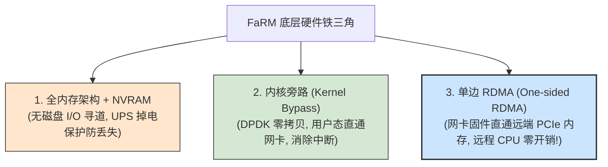
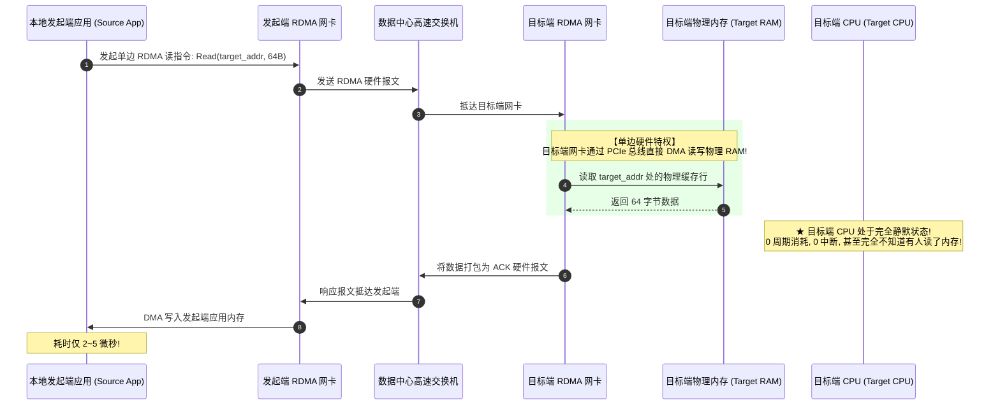

# Lec 14 乐观并发控制：FaRM架构深度剖析


**开场白**

今天我们研读的论文是微软研究院关于 **FaRM（Fast Remote Memory）** 的工作。

这是我们在分布式事务与多副本复制序列中的最后一篇论文。在此之前，我们探讨过的系统（如 GFS、ZooKeeper、Spanner、Aurora）都把网络 RPC、磁盘 I/O 寻道以及内核协议栈开销视为理所当然的物理前提。但在 FaRM 中，微软的工程师们向我们展示了一种全新的可能性：  **如果在单数据中心内将硬件压榨到极致，分布式 ACID 事务的延迟能够被压缩到什么地步？**

FaRM 给出的答案是：**单事务延迟仅需 5 到 10 微秒（$\mu s$）！集群每秒吞吐量突破数百万次事务！**

> [!NOTE]
> FaRM 目前仍是微软研究院的**研究原型**，未投生产，但其理念可能影响未来架构。顺带回答你笔记里的问题——**公司为何公开前沿论文而非保密**：① 核心团队多有学术背景（博士），视传播创新为使命、希望获业界认可；② 论文能展示"这里在做有趣的智力工作"，从而**吸引顶尖人才**；③ 借技术影响力**建立行业标准**。当然，公司只会公开自己软件中极小的一部分。


## 三大性能武器

为了达成这个看似天方夜谭的指标，FaRM 彻底颠覆了三项传统硬件假设：



### 1. 纯内存与非易失内存（NVRAM）

数据绝不存放在传统机械硬盘或常规 SSD 上，所有数据必须完整容纳在集群所有机器的物理 RAM 中；

为了解决掉电易失性，FaRM 的服务器配备了**电池后备电源（UPS / Battery-Backed NVRAM）**。当机房遭遇突发停电时，UPS 能保证机器持续供电数分钟，网卡与操作系统在此期间将 RAM 中的脏数据高速刷入板载 SSD，重启后直接载入，**使内存写入具备物理磁盘级别的持久性（Durability）**！

### 1.2 内核旁路（Kernel Bypass）

在传统 Linux/Windows 网络中，一个数据包到达网卡：

1. 触发硬件中断；
2. CPU 上下文切换进入内核态；
3. 内核 TCP/IP 协议栈解析、校验和、滑动窗口处理；
4. 数据从内核缓冲区拷贝到用户进程内存。

这一套流程下来，至少消耗数十微秒的 CPU 周期！  
FaRM 采用类似 DPDK 的**内核旁路技术**：应用进程直接映射网卡寄存器，用户态代码轮询内存队列，网卡直接将数据 DMA 到应用内存，**消灭所有操作系统内核调用与上下文切换**！


### 1.3 杀手锏：单边 RDMA（One-sided Remote Direct Memory Access）

这是 FaRM 最核心的技术灵魂。

传统的两边网络通信（Two-sided RPC，如 `send`/`recv`）要求目标机器的 CPU 必须唤醒并执行代码来解析请求、组装结果并回复。  而 **单边 RDMA（One-sided RDMA Read/Write）** 则完全不同：一台机器的应用借 RDMA 网卡**直接读写另一台机器的内存，完全不惊动对方 CPU**；按缓存行原子读取。一台服务器吞吐 10M+ ops/s，延迟 ~5µs；单次单边读/写最快可低至 1/18 µs，跨网络读写内存块仅需 **$2 \sim 5$ 微秒**！




> [!NOTE]
> FaRM 也会用 RDMA 来实现一种"类 RPC"：发送方用 RDMA 把请求**写入**接收方正在轮询的内存区，接收方同样方式回复——这比传统 RPC 快得多（无中断、无用户/内核切换）。FaRM 的 **LOCK** 阶段就是这样用 RDMA 的；而 **VALIDATE** 阶段用的是纯**单边读**。


## 为什么是乐观并发控制（OCC）？

上一讲我们刚刚学完严格两阶段锁（Strict 2PL）。很自然地，大家会问：  

> “我们能不能直接在 RDMA 之上跑两阶段锁？读数据之前先加锁，写数据之前也加锁？”

**答案是：如果使用 2PL，单边 RDMA 的核心性能优势将荡然无存！**

为什么？

1. **单边读是‘被动裸读’**：单边 RDMA 只能从远端物理地址读取几个字节，**它无法在目标机器上原子地执行复杂的‘加锁逻辑’**；
2. **锁检查迫使唤醒 CPU**：如果每次读取数据都必须先确认锁状态或注册读锁，你就必须向远端 CPU 发送传统的 RPC 请求，远端 CPU 必须介入排队。这样一来，单边 RDMA 绕过 CPU、微秒级响应的最大优势就被硬生生废弃了！

因此，FaRM 必须寻找一种**完全允许单边裸读、读操作绝不主动加锁**的并发控制体系——这就是 **乐观并发控制（Optimistic Concurrency Control, OCC）**！

---

## 4. 数据模型与内存布局

**简化事务 API**：

```text
txCreate()
o = txRead(oid)     // 单边 RDMA 读
o.f += 1
txWrite(oid, o)     // 纯本地操作（缓写）
ok = txCommit()     // 走 Figure 4 提交协议
```

**oid** = `<region#, address>`：`region#` 索引到一张 `[primary, backup1, ...]` 映射；`address` 被目标 RDMA 网卡直接用于读 RAM。

**服务器内存布局**：若干 region，每个是对象数组；**对象头含版本号（version#），锁标志位占版本号的最高位**；并为每个其他服务器维护"接入日志（incoming log）"与"接入消息队列"（发送方用 RDMA 写入、本地 FaRM 轮询读取）。这一切都在 NVRAM 里。

---

## 5. Figure 4：事务执行与提交协议

聚焦并发控制（暂略容错细节）。下面是简化的消息流（以 $f=1$、写 1 个主为例，共 4 条消息）：

```text
        Execute(无锁读)                   Commit
TC   ──RDMA读──► [Primary]        ──LOCK──► ──VALIDATE──► ──COMMIT-BACKUP──► ──COMMIT-PRIMARY──►
     (记录version#，本地缓写)        到主日志    单边重读只读对象   到备日志(等硬件ack)   到主日志(等硬件ack后返回"yes")
                                   ↓回yes/no
Primary 处理 COMMIT-PRIMARY: 写入新值 → version#++ → 清锁标志
```

**Execute 阶段**：TC 用单边 RDMA 读它需要的对象（**包括将要写的**），**不加锁**——这正是"乐观"所在；TC 记下各对象的 version#，并把写**缓存在本地**。

提交有两大目标：**原子分布式提交**（要么全写要么全不写）与**可串行化（serializability）**（看起来像整体先于或后于其他每个事务）。

**LOCK（提交协议第一条消息）**：TC 用 RDMA 向**每个被写对象的主**追加一条 LOCK 日志记录（含 oid、事务读到的 version#、新值）。它**既是预写日志（WAL）条目，又是发给主的 RPC 请求**，落在主的 NVRAM 里、可挺过断电。主处理 LOCK 时：

::: insight ✅ 关键结论：LOCK 的原子检查
主轮询到 LOCK 后：若对象**已被锁**、或 **version# ≠ 事务读到的值**，回 "no"；否则**置锁标志并回 "yes"，但暂不改数据**。检查锁 + 检查版本 + 置锁这三步用**原子 compare-and-swap（CAS）** 完成（锁标志是 version# 的最高位），以防别的 CPU 也在处理 LOCK、或有客户端正用 RDMA 在读。
:::

TC 等齐所有 LOCK 回复：任一为 "no" 即**中止**（向各主追加 ABORT 以释放锁，`txCommit()` 返回 "no"）。

**VALIDATE（只读对象的优化）**：对事务只读未写的对象，TC 发一次**单边 RDMA 读**重新取其 version#/lock；若已被锁或版本变了则中止。它**不置锁**，因而比 "LOCK+COMMIT" 快。

**COMMIT-BACKUP / COMMIT-PRIMARY**：TC 向各**备**追加 COMMIT-BACKUP（等硬件 ack），再向各**主**追加 COMMIT-PRIMARY（只等 RDMA **硬件 ack**——表示已安全落在主的 NVRAM，**不等**主处理日志），随后 `txCommit()` 返回 "yes"。主之后处理 COMMIT-PRIMARY 时才：拷新值入对象内存、version# 自增、清锁。

::: definition 📘 定义：提交点（Commit Point）
**写下第一个 COMMIT-PRIMARY 的时刻**即提交点——从那一刻起事务结果就可能被揭示（主写值并解锁）。**纯只读事务**只用单边 RDMA 读，无写、无日志记录、无锁——**极快**。
:::

---

## 6. 为什么 OCC 能保证可串行化（直觉 + 例子）

直觉：验证就是在问"这次执行是否等同于一次只跑一个"。若期间**没有冲突事务**，版本号不会变；若**有冲突**，必有一方在 LOCK 或 VALIDATE 时看到锁或变化的版本号，从而中止。

::: example 🔬 例子 1：T1、T2 都做 x = x + 1

:::

可串行化允许的结果（等价于逐个跑）：`x=2`（两方都"成功"）、`x=1`（一方成功一方中止）、`x=0`（两方都中止）。记号 `Rx0`=读到 x=0、`Lx`=锁 x、`Cx`=提交 x：

```text
完全同步:  T1: Rx0 Lx Cx        交错:  T1:    Rx0 Lx Cx        错开:  T1: Rx0 Lx Cx
           T2: Rx0 Lx Cx               T2: Rx0          Lx Cx          T2:           Rx0 Lx Cx
```

同步/交错时，后到的 LOCK 会发现 version# 已变（或被锁）而中止；错开时两者都能提交得 `x=2`。无论哪种交错，结果都落在可串行化允许的集合里。

::: example 🔬 例子 2：经典 VALIDATE 测试（x、y 初值为 0）

:::

`T1: if x==0 then y=1`；`T2: if y==0 then x=1`。可串行化的合法结果：`T1,T2 → y=1,x=0`；`T2,T1 → x=1,y=0`；中止可留 `x=0,y=0`。但**禁止 `x=1,y=1`**。

```text
同步:  T1: Rx Ly Vx Cy          错开:  T1: Rx Ly Vx     Cy
       T2: Ry Lx Vy Cx                 T2: Ry       Lx Vy Cx
```

同步时两个 LOCK 都成功、但两个 VALIDATE 都因看到对方锁位而失败 → **两者都中止**（合法）。错开时 T1 提交、T2 的 `Vy` 看到 T1 的锁或更高版本而中止。关键：**不可能两个 V 都排在对方的 L 之前**，所以永远产生不出被禁止的 `x=1,y=1`。VALIDATE 既正确又快（一次单边读，而非 LOCK+COMMIT 两次写）。

---

## 7. 容错与恢复

::: insight ✅ 关键结论：恢复的核心准则
若一个事务被故障打断，**而客户端可能已被告知它提交、或其提交值可能已被别的事务读到**，那么恢复时**必须保留并完成**该事务。
:::

由 Figure 4：已提交的写可能在**第一个 COMMIT-PRIMARY 发出**时就被揭示，所以到那时，该事务的所有写必须已在**所有相关分片的全部 $f+1$ 个副本**上。**LOCK + COMMIT-BACKUP 正好做到这点**：LOCK 把新值告诉所有主，COMMIT-BACKUP 把新值告诉所有备；TC 在收齐所有 LOCK 与 COMMIT-BACKUP 之前**不发** COMMIT-PRIMARY（备可能还没处理 COMMIT-BACKUP，但已在其 NVRAM 日志里）。

**为什么必须写 COMMIT-PRIMARY？**（否则的危险情形）

> [!IMPORTANT]
> 若 TC 在 COMMIT-BACKUP 之后、COMMIT-PRIMARY 之前就对应用回 "yes"，随后 TC 与所有备都失败——此时仅剩的证据是 LOCK 记录，而**即便一整套 LOCK 记录也无法判断 TC 到底提交了还是因 VALIDATE 失败而中止**。写下 COMMIT-PRIMARY 化解了风险：因为总有一个分片同时拥有完整的 COMMIT-BACKUP 与 COMMIT-PRIMARY，**其中任何一个都是"主决定提交"的证据**，从而 TC 的决定能挺过任一分片的 $f$ 次失败。

> [!TIP]
> **日志截断（truncation）**：TC 见到所有副本都已有 COMMIT-PRIMARY/COMMIT-BACKUP 后，通知它们删除该事务的日志条目；为让恢复仍知"此事务已完成"，主在截断后仍**记住已完成事务 ID**。每个主/备对每个 TC 有独立日志，故截断点之前的条目可一并删除。

---

## 8. 局限性

- **OCC 怕冲突**：多事务争同一对象时，LOCK 阶段会撞已持锁、VALIDATE 阶段会撞变化版本 → 大量**中止重试**，性能下滑。FaRM 评测好，多半因其负载冲突少。
- **数据须全装 RAM**。
- **仅单数据中心内复制**，无地理分布 → 容错能力有限。
- **数据模型底层**，需自建如 SQL 的上层库；NSDI 2014 的 API 用回调返回、较难用，应用代码须紧密交织"执行事务"与"轮询 RDMA 队列/日志"，且执行中可能看到（最终会被中止的）不一致——应用须容忍而不崩溃。
- **依赖不常见的 RDMA + NVRAM 硬件**；线程被钉在核上、占满所有核，应用难自由用线程。
- FaRM **只保证已提交事务的可串行化**；看到不一致的事务会被中止。

> [!NOTE]
> FAQ 的清醒提醒：论文中"终结一致性/可用性/性能的妥协"一节更像广告而非科学——历史表明，没有哪种性能高到无人想要更多，而那些人往往愿意在别处妥协来换性能。

---

## 9. FaRM vs Spanner

两者都**分片、复制、用 2PC 做事务**，但优化方向相反：

::: theorem ✅ 关键对比

:::

|          | Spanner                              | FaRM                                     |
| -------- | ------------------------------------ | ---------------------------------------- |
| 主要应对 | **地理复制的网络延迟**               | **CPU 成本**                             |
| 关键技术 | Paxos 容忍延迟 + TrueTime 读本地副本 | RDMA + 直连 NIC + NVRAM 避免磁盘写 + OCC |
| 部署     | 跨地理                               | 单数据中心                               |
| 性能     | 读写事务 10–100ms                    | 简单事务 **58µs**（约快 100×）           |
|   |                                      |                                          |

> [!NOTE]
> FaRM 用 ZooKeeper + CM 做外部配置管理、用标准主备协议处理事务写，论文将这种"外部主导重配置、Paxos 组重配时仍可服务"的风格松散地称为 **vertical Paxos**。

---

## 10. 小结与工程视角

::: insight ✅ 一图流记忆
NVRAM（电池+SSD）消灭磁盘写 + 单边 RDMA/内核旁路消灭网络-CPU 开销 + OCC 让读无需服务器参与

⇒ 微秒级分布式事务；

LOCK（WAL+RPC，CAS 原子置锁）→ VALIDATE（只读对象单边重读）→ COMMIT-BACKUP → COMMIT-PRIMARY（提交点）

⇒ 原子提交 + 可串行化 + 可恢复。
:::

- **超高速分布式事务**：硬件异构（NVRAM、RDMA）但未来可能普及；性能不仅来自硬件，更来自**同时**优化网络、持久化、CPU 三者（前人多只优化其一），以及大量用单边 RDMA 替代完整 RPC。
- **对你（分布式 SaaS）的可借鉴点**：① 若自配电池/UPS，可改造你的 Raft / k-v 服务利用电池做快速持久化；② OCC 适合**读多写少、冲突稀疏**的负载（很多 SaaS 读路径符合）；③ "用版本号 + 原子 CAS 做无锁校验"是高并发计数/库存场景的通用模式；④ FaRM 只在"需要每秒百万级事务"时才划算——几千 TPS 直接用成熟的 MySQL 即可。


## TL;DR

FaRM（*Fast Remote Memory*）追求**单数据中心内每秒数百万笔分布式事务**、单笔延迟仅几十微秒。它的做法是同时榨干三个瓶颈——用 **NVRAM** 消灭磁盘写、用 **单边 RDMA + 内核旁路** 消灭网络/CPU 开销、用 **乐观并发控制（*Optimistic Concurrency Control, OCC*）** 让读操作无需服务器 CPU 参与。OCC 与单边 RDMA 是天作之合：读不加锁，提交时再"验证"是否有冲突。
