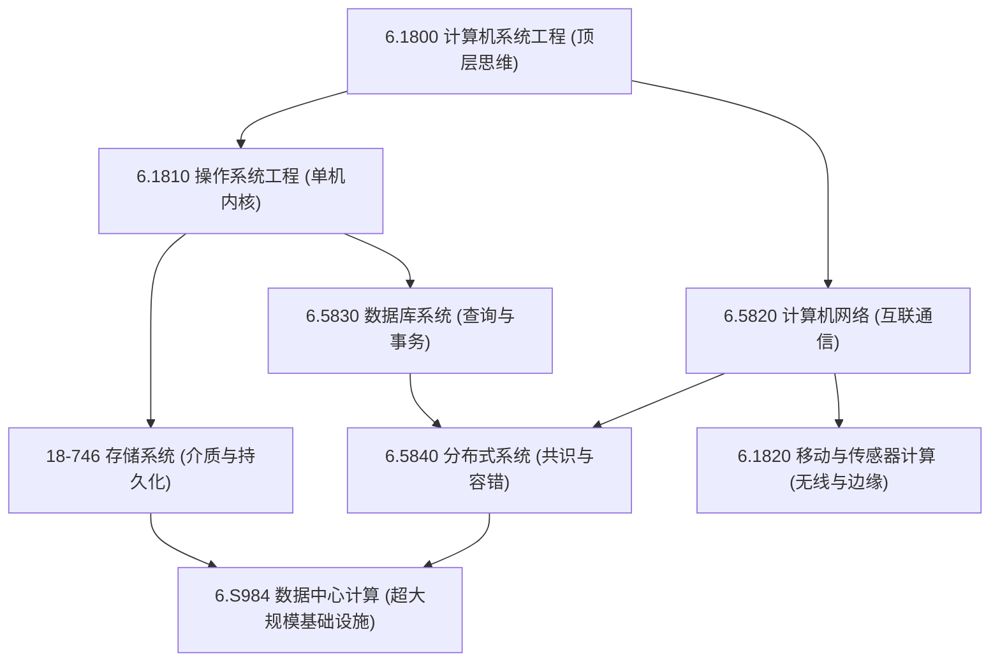

# 计算机系统

## TL;DR

- **完备的系统全景矩阵**：涵盖顶层系统原则（6.1800）、单机内核（6.1810）、网络与移动（6.5820/6.1820）、存储与数据管理（18-746/6.5830）、分布式共识（6.5840）至超大规模数据中心（6.S984）的完整闭环。
- **纵深交织的知识流向**：打破单向线性思维，以强模块化与虚拟化为基石，经由不可靠信道与共识复制展开，最终在仓库级基础设施中实现软硬件协同。

## 课程体系与拓扑演进

计算机系统（Computer Systems）不仅研究单机硬件之上的软硬件接口，更直面规模化网络互联、硬件部分失效以及海量高并发数据带来的严苛挑战。本板块收录的 8 门核心课程构成了一个自顶向下纵横贯通的有机整体：

### 计算机系统核心课程清单

| 模块分类 | 课程编号与名称 | 核心主题与设计机制 | 学习定位与建议 |
| :--- | :--- | :--- | :--- |
| **系统工程大局观** | [6.1800 计算机系统工程](./65810_computer_sys_eng/) | 复杂性控制、模块化与抽象、虚拟化、网络分层、事务容错与安全机制 | **全景鸟瞰（第一阶段）**：跳出局部代码细节，建立从单机到全球网络的宏观系统设计心智模型 |
| **单机系统内核** | [6.1810 操作系统工程](./61810_os/) | xv6 内核、系统调用、页表与虚存隔离、进程线程、自旋锁/条件变量、日志文件系统 | **机制攻坚（单机底座）**：亲手构建微内核机制，彻底掌握用户态与硬件之间的特权抽象屏障 |
| **网络互联通信** | [6.5820 计算机网络](./65820_network/) | 拥塞控制（BBR/Cubic）、网络分层与端到端原则、BGP 路由、SDN/P4 可编程数据平面、数据中心拓扑 | **横向连接（通信基石）**：攻克不可靠物理信道上的高吞吐低延迟传输与全球互联控制 |
| **边缘与泛在计算** | [6.1820 移动和传感器计算](./61820_mobile/) | 物联网物理感知、无线室内定位、能量收集、低功耗广域网（LoRa）、移动边缘推理 | **前沿拓展（泛在感知）**：将系统能力延伸至受限物理硬件与弱网边缘感知环境 |
| **数据存储底层** | [18-746 存储系统](./18746_storage/) | HDD/SSD 物理特性与 FTL 机制、RAID 与纠删码、日志结构文件系统（LFS）、持久内存（PMEM）与 CXL | **持久化核心（介质与 I/O）**：深挖高吞吐、高持久性与数据保护的存储硬件与物理边界 |
| **数据管理系统** | [6.5830 数据库系统](./65830_database_system/) | 关系代数、B+树与 LSM-Tree 存储引擎、基于成本的查询优化（CBO）、并发控制（2PL/OCC/MVCC）、ARIES 恢复 | **状态抽象（事务与查询）**：深入剖析单机与分布式数据库引擎的高并发 ACID 理论与工程实现 |
| **分布式容错系统** | [6.5840 分布式系统](./65840_distributed_system/) | 复制状态机、Raft/Paxos 共识协议、两阶段提交（2PC）、线性一致性与因果一致性、MapReduce/GFS | **高阶进阶（分布式核心）**：直面不可靠网络与部分失效，构建高可用强一致的分布式集群服务 |
| **仓库级基础设施** | [6.S984 数据中心计算](./6S984_dc_computing/) | 仓库规模计算机（WSC）、能耗效率（PUE）、异构加速器互联、微秒级延迟与尾部延迟消除、集群协同调度 | **宏观终局（规模化实践）**：理解现代云计算“将整座数据中心作为单台计算机编程”的工业实践 |

## 核心理论脉络与系统设计哲学

本板块的笔记不仅记录实现细节，更提炼贯穿所有系统课程的核心设计哲学：

### 1. 复杂性控制：模块化与强抽象隔离（Taming Complexity）

计算机系统设计的第一性法则是对抗物理实体带来的规模熵增。
- **强制模块化（Enforced Modularity）**：如果模块间只靠程序员约定进行边界隔离，软件规模扩大后必将产生级联崩溃。操作系统通过硬件特权级（User/Kernel Mode）与 MMU 页表强制切分地址空间，使单一进程的致命错误无法污染其他实体。
- **抽象屏障（Abstraction Barriers）**：从文件描述符抽象具体磁盘扇区，从套接字抽象物理链路帧，系统通过统一的接口定义屏蔽底层异构性，并在性能与泛用性之间寻找平衡。

### 2. 状态、时序与容错共识（State, Time & Fault Tolerance）

- **从单机锁到分布式共识**：在单机环境中，硬件原子指令（CAS）与共享内存自旋锁即可确立全局时序；但在分布式网络中，全局物理时钟的不可靠与网络延迟使得“先后次序”变得模糊。
- **故障局部化与不变量守护**：系统必然直面崩溃。通过预写式日志（WAL）、两阶段提交（2PC）以及 Raft/Paxos 多数派共识，系统在经历单点宕机、网络分区乃至瞬时重放时，依然能够恢复出确定、不可篡改的状态机副本。

### 3. 端到端原则与系统设计权衡（End-to-End Arguments & Trade-offs）

- **端到端原则（End-to-End Arguments）**：底层通信机制只能提供性能增强（如链路层重传），但无法代替终端应用程序的正确性校验（如文件传输校验和）。过度的底层可靠性保证往往会给不需该特性的上层带来额外开销。
- **不可避免的权衡取舍（Trade-offs）**：系统工程不存在银弹。CAP 定理、PACELC 模型、吞吐量与尾部延迟（Tail Latency）的互斥关系无一不在提醒我们：优秀的系统架构师从不追求虚幻的绝对完美，而是清楚知晓业务边界，并在给定的约束下做出最合理的权衡。

## 推荐学习路径

针对不同学习背景与研究侧重，建议采用以下三种典型路线：

1. **自顶向下全景路线（推荐新手与体系化读者）**：
   - `6.1800 系统工程` $\rightarrow$ `6.1810 操作系统` $\rightarrow$ `6.5820 计算机网络` $\rightarrow$ `6.5840 分布式系统` $\rightarrow$ `6.5830 数据库系统 / 数据中心计算`
   - **特点**：先从宏观视角掌握系统模块切分与常见陷阱，再下沉深入内核与协议栈，避免早期陷入繁杂的硬件细节而丢失大局观。
2. **底层机制攻坚路线（推荐系统与底层开发人员）**：
   - `6.1810 操作系统` $\rightarrow$ `18-746 存储系统` $\rightarrow$ `6.5830 数据库系统` $\rightarrow$ `6.5820 计算机网络` $\rightarrow$ `6.5840 分布式系统` $\rightarrow$ `6.S984 数据中心计算`
   - **特点**：紧扣硬件物理特性（CPU 寄存器、MMU、NVMe SSD），自底向上逐层构筑坚实的单机高性能执行与存储基石，再自然外延到跨机网络与集群共识。
3. **数据与云原生后端路线（推荐服务端与分布式存储从业者）**：
   - `6.1810 操作系统`（并发与文件系统） $\rightarrow$ `6.5830 数据库系统`（存储引擎与事务） $\rightarrow$ `6.5840 分布式系统`（复制与共识） $\rightarrow$ `18-746 存储系统 / 数据中心计算`
   - **特点**：聚焦数据状态的高效读写、持久化安全、高并发事务处理与海量集群容错，形成完整的大数据基础设施知识闭环。

## 我的理解

::: insight
**系统设计的艺术在于“用不完美的物理部件构建出可信赖的数字世界”**：
真实的物理硬件永远是不完美的：网络会丢包延迟，内存条会翻转比特，磁盘会坏道宕机，供电可能随时切断。然而，现代计算机系统却能在此之上支撑起全球金融、自动驾驶和工业协作。
学习系统的核心收获，不在于背诵具体系统调用的参数或协议帧的比特偏移，而在于领悟这套“以不可靠基础构筑高可靠世界”的对抗熵增工程学。从虚拟内存对有限 RAM 的无限抽象，到 Raft 共识对节点故障的从容容错，这种优雅的设计哲学将长久指导我们在复杂世界中构建高健壮性的大规模软件。
:::
