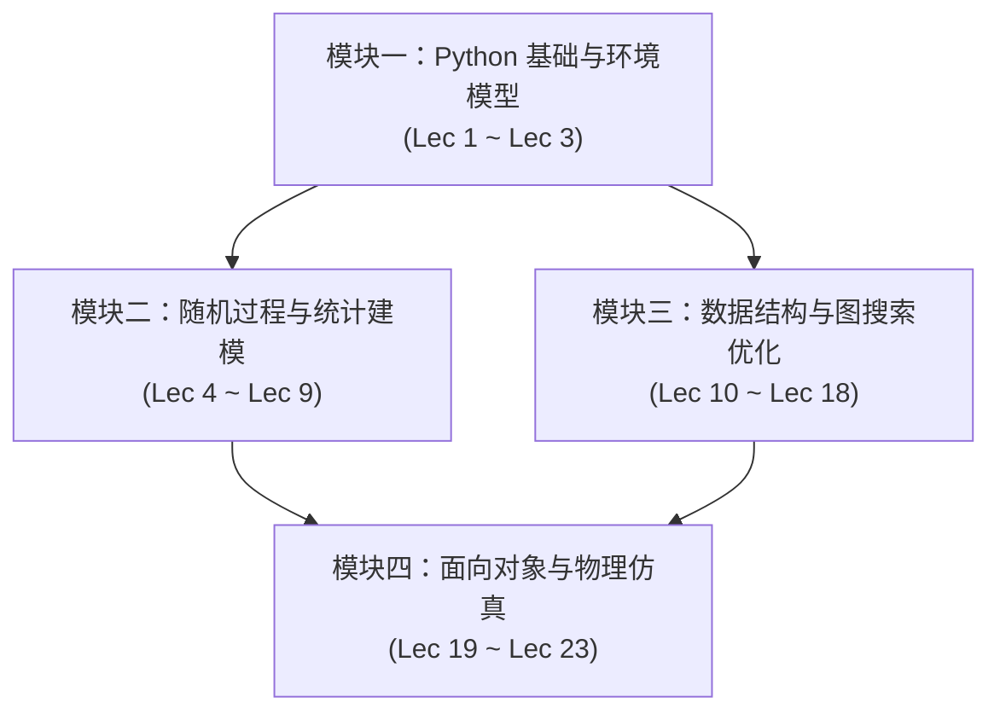

# 6.100 计算机科学与 Python 编程导论（Fall 26）

> MIT 6.100 · Introduction to Computer Science and Programming · 官方主页：[introcomp.mit.edu/fall26](https://introcomp.mit.edu/fall26)

## TL;DR

- **课程定位**：传授 Python 编程基础技能，并系统建立计算建模与数据理解的核心思维。
- **课程内容**：计算概念、Python、简单算法和数据结构、测试和调试以及算法复杂度。
- **知识架构**：紧密围绕 23 堂主题讲义与 11 次习题课展开，贯穿随机仿真与面向对象大系统设计。

## 课程介绍

### 先修课程

（无）

### 课程内容

本课程旨在培养学生编程和计算建模的基础技能。涵盖 Python 中广泛使用的编程概念，包括可变性、函数对象和面向对象编程。介绍算法复杂度和一些常用库。课程始终演示如何运用计算来帮助理解现实世界的现象；主题包括优化问题、构建模拟和统计建模。适合至少具备一定编程基础的学生。鼓励没有编程经验的学生在两个学期内修读 6.100A 和 6.100B

### 教科书

- *约翰·古塔格 (John Guttag) 所著的《Python 计算与编程导论》（第三版，含计算建模与数据理解应用）*

## 课程知识全景

课程内容紧密围绕 23 堂主题讲义展开，逻辑层层递进，分为四大核心模块：

### 模块一：Python 基础、环境模型与函数抽象

- **[Lec 1 计算对象、变量绑定与控制分支](./lec1.md)**：Python 基本类型系统（int, float, bool, str）、表达式求值、变量作用域初探与条件分支结构。（*教材对照：Guttag 2.1–2.4*）
- **[Lec 2 循环结构、数值枚举与函数封装](./lec2.md)**：While/For 循环、数值猜测与逼近、纯函数定义、形参实参与返回值契约。（*教材对照：Guttag 2.5–2.7, 3.1, 5.2, 4.1.1*）
- **[Lec 3 列表序列、原地可变性与执行作用域](./lec3.md)**：列表切片与方法、可变对象（Mutable）与不可变对象（Immutable）在内存中的引用行为、函数局部作用域与全局绑定。（*教材对照：Guttag 5.3, 4.1–4.3*）

### 模块二：随机过程、蒙特卡洛模拟与统计推断

- **[Lec 4 随机程序设计与仿真模拟基础](./lec4.md)**：伪随机数生成原理、蒙特卡洛仿真思想、随机事件频率逼近理论概率。（*教材对照：Guttag 18, 17.1*）
- **[Lec 5 随机漫步与高阶函数](./lec5.md)**：布朗运动模型、位置坐标模拟追踪、一等公民函数作为参数传递与泛型仿真骨架。（*教材对照：Guttag 16, 4.4*）
- **[Lec 6 概率分布、方差与中心极限定理（CLT）](./lec6.md)**：伯努利试验、正态分布、方差与标准差，中心极限定理在大样本仿真中的收敛保证。（*教材对照：Guttag 17.2–17.4*）
- **[Lec 7 置信区间与统计显著性检验](./lec7.md)**：经验法则（Empirical Rule）、置信度计算、假设检验基本原理与 $p$ 值解读。（*教材对照：Guttag 19, 21.1–21.4, 22*）
- **[Lec 8 浮点数精度、二分搜索与连续优化](./lec8.md)**：IEEE 754 浮点表示陷阱、二分查找法求根、连续凸函数优化与简单线性回归。（*教材对照：Guttag 3.2–3.4*）
- **[Lec 9 曲线拟合与交叉验证](./lec9.md)**：最小二乘法多项式拟合、欠拟合与过拟合识别、训练集/验证集/测试集划分。（*教材对照：Guttag 20*）

### 模块三：数据结构、递归模式与图搜索最优化

- **[Lec 10 映射字典、不可变元组与图表示](./lec10.md)**：字典键值约束与快速检索、元组作为复合键、图的邻接字典与拓扑结构定义。
- **[Lec 11 哈希机制、集合与广度优先搜索（BFS）](./lec11.md)**：哈希碰撞与平均 $O(1)$ 查找开销、集合运算、广度优先遍历与无权图最短路径。（*教材对照：Guttag 5.7, 5.1, 5.5, 14.2.1*）
- **[Lec 12 递归求解思维与深度优先搜索（DFS）引入](./lec12.md)**：数学归纳法与递归基准条件（Base Case）、递归栈帧展开、DFS 路径探索初步。（*教材对照：Guttag 17.5, 5.6, 14.2*）
- **[Lec 13 深度优先回溯与 Dijkstra 最短路算法](./lec13.md)**：带权图最短路径、贪心策略、Dijkstra 算法松弛过程与优先队列思想。（*教材对照：Guttag 14.2, 6.1–6.2*）
- **[Lec 14 典型图论问题与拓扑约束](./lec14.md)**：连通分量划分、环路检测、有向无环图（DAG）与拓扑遍历。（*教材对照：Guttag 14.2.1*）
- **[Lec 15 匿名函数与推导式](./lec15.md)**：Lambda 单行函数、列表与字典推导式、惰性生成与代码精简最佳实践。（*教材对照：Guttag 4.4, 5.3.2, 5.8*）
- **[Lec 16 组合最优化与决策树模型](./lec16.md)**：指数级状态空间、0/1 决策树生长、穷举搜索开销与约束规约。（*教材对照：Guttag 6, 14.1*）
- **[Lec 17 状态剪枝与经典背包问题](./lec17.md)**：分数背包 vs 0/1 背包、可行域上界估计、搜索树分支剪枝提速策略。
- **[Lec 18 记忆化与动态规划（Dynamic Programming）](./lec18.md)**：重叠子问题、最优子结构、自顶向下 Memoization 与自底向上递推表格构建。（*教材对照：Guttag 14.1, 15*）

### 模块四：面向对象编程与系统仿真建模

- **[Lec 19 类定义、实例属性与方法调度](./lec19.md)**：封装原则、`__init__` 初始化器、实例变量与类变量区别、方法自绑定。（*教材对照：Guttag 10.1*）
- **[Lec 20 异常机制与防御性断言](./lec20.md)**：`try-except-finally` 错误捕获范式、自定义异常类定义、契约式编程与断言设计。（*教材对照：Guttag 9*）
- **[Lec 21 继承层次与面向对象多态设计](./lec21.md)**：基类与派生类、方法覆写（Override）、`super()` 调用机制、Liskov 替换原则在 Python 中的实践。（*教材对照：Guttag 10.2*）
- **[Lec 22 基于面向对象的物理仿真：理想气体定律](./lec22.md)**：粒子类（Particle）设计、二维容器边界碰撞模拟、宏观热力学参数计算。
- **[Lec 23 基于面向对象的复杂图系统：OpenStreetMap 路径规划](./lec23.md)**：地理坐标节点与路网边抽象、真实地图路径解析与跨模块综合架构。

---

## 习题课与实验体系

6.100 配备了紧密的实践支撑系统，包含 11 次 Recitations 习题辅导与 8 套大作业（Problem Sets）：

### 专题习题课（Recitations）

| 讲次 | 主题内容 | 核心技能与练习 |
| :--- | :--- | :--- |
| **R1** | 字符串操作、f-strings 与开发工具链 | VS Code 调试技巧、Python REPL 快捷交互与格式化输出 |
| **R2** | 执行环境模型图推演与列表变异 | 堆栈引用绘制、原地修改陷阱排查与代码重构策略 |
| **R3** | 随机漫步模拟与列车调度问题 | 状态量跟踪、随机数发生器接入与模拟结果可视化 |
| **R4** | 中心极限定理在随机漫步中的应用 | 仿真试验统计方差、置信区间经验检验与蒙特卡洛误差评估 |
| **R5** | 双侧假设检验与非多项式数据拟合 | 统计显著性测试、模型交叉验证与泛化误差控制 |
| **R6** | 嵌套字典操作与 BFS 迷宫求解 | 广度优先搜索队列状态管理与路径回溯重构 |
| **R7** | 递归 DFS 与非正权边最短路分析 | 递归终止条件设计、负权边对贪心选择的破坏与防范 |
| **R8** | 最短路径深入与迭代加深搜索 | Dijkstra 堆优化推演与深度受限迭代加深（IDDFS）实现 |
| **R9** | 递归子集生成算法 | 状态树递归二分、幂集（Power Set）生成与时空开销分析 |
| **R10** | 互补背包问题变种 | 动态规划状态转移方程推导与边界条件处理 |
| **R11** | 类内异常处理与健壮类设计 | 面向对象异常防护边界、自定义异常传递与错误恢复机制 |

### 实验与编程大作业（Problem Sets）

- **PS 0 环境安装与基础交互**：配置 VS Code、Python 解释器环境，熟悉自动化判题流水线与脚本执行。
- **PS 1 循环分支与数值逼近算法**：编写数值解法算法（如双工投资计算与二分搜索逼近存钱策略）。
- **PS 2 随机过程仿真模拟**：设计多代理随机漫步仿真实验，通过大样本统计分析平均扩散距离与场域分布。
- **PS 3 实验数据拟合与统计检验**：对环境传感器真实噪声数据执行清洗、多项式拟合以及假设检验。
- **PS 4 图模型构建与迷宫寻路**：构建校园建筑连接图，运用 BFS 与 DFS 实现最短步行路径规划。
- **PS 5 动态规划与组合优化**：实现背包问题决策树分支限界法与带记忆化的动态规划最优解。
- **PS 6 面向对象系统仿真**：面向对象封装粒子运动学规则，实现多物体碰撞仿真的面向对象物理模拟器。
- **PS 7 综合地图导航系统**：读取 OpenStreetMap 真实地理拓扑数据，结合继承设计与 Dijkstra 算法完成城市级导航寻路。

### 代码工程规范（Style Guide 要点）

1. **接口文档契约**：所有函数必须配备结构化文档字符串（Docstrings），明确参数类型、返回值说明与前置断言。
2. **自解释命名与适度注释**：以块状注释描述算法意图，严禁逐行翻译语法的冗余注释，变量命名遵循 PEP 8 `snake_case`。
3. **圈复杂度与模块解耦**：单个函数代码行数保持在 30 行以内，复杂条件逻辑提前返回（Early Return），消除深层嵌套。
