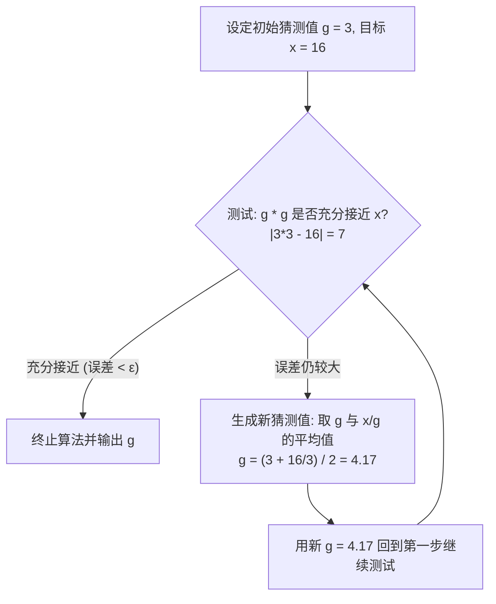
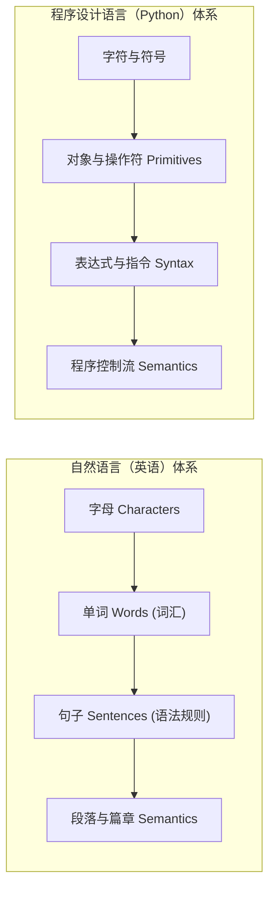

# Lec 1 课程导论、计算概念与程序设计哲学

## TL;DR

- **程序的核心逻辑**：创建对象并操纵对象。每个对象拥有唯一的类型和值，类型界定了所有合法操作的边界；
- **表达式的瞬时求值**：表达式由对象和操作符构成，Python 会在运行时将其归约为单一值并存入内存，绝不保存表达式源码本身；
- **赋值的单向引用绑定**：等号 `=` 是单向赋值绑定而非数学对称方程。等号右侧先求值，求值结果再绑定到左侧变量名；
- **计算机的线性执行**：截至目前，我们写的程序都是从第一行到最后一行严格顺次向下执行的。

---

## 1. 课程导入与教学哲学：如何真正学会编程？

**Ana Bell 博士**：大家下午好！欢迎来到 6.100L 的第一堂讲义。我在麻省理工学院电气工程与计算机科学系（EECS）担任讲师已经快十年了，长期负责讲授计算机科学入门课程。我非常高兴能在本学期为大家带来这门全学期版的课程（即 6.100A 的完整学期延伸版）。

今天我们首先会交代一点点课程组织管理信息，然后直接切入核心：从高层视角思考计算机究竟是如何工作的，随后立刻上手 Python 基础。我们将立即开始编写代码！

我强烈建议大家在课前下载好幻灯片，上课时一边听讲一边做笔记；当我运行代码时，你们也跟着在自己的电脑上运行。我们的许多讲义都设计了课堂互动环节，我们会有专门的“停顿”，让大家在现场动手敲代码——我把这叫做 **“轮到你试一试（You Try It）”** 停顿。这非常关键，它能确保大家在刚刚学到一个概念的当下，立刻通过代码验证自己的理解。

在讲课过程中，除了我的讲授，课堂始终向提问开放，并且会给大家提供大量当场编程的机会。哪怕有时候我提出的编程练习你没能当场写完也没关系，我会带领大家一起完成，并向大家展示常见的代码陷阱（Pitfalls）。

在整个学期中，大家将通过各种不同粒度的环节获得大量实操练习。不仅课堂上有，配套的讲义手册、手指练习（Finger Exercises）和大作业中也准备了丰富的课后练习资源。

我之所以如此强调“参与”和“动手实践”，是因为大家坐在这里的核心目的：**你们想要学会编程**。

而编程这项能力，本质上是一门**工程手艺（Skill）**。它和数学计算、阅读理解或者学习乐器完全一样——必须通过海量、高频的重复练习才能掌握。你绝对不可能仅仅坐在下面看我在屏幕上敲出一行行代码，然后等到期中考试或大作业截止时，就能凭空无师自通地写出正确的程序。你必须亲自一行行敲代码、调试报错、排查陷阱，直到它变成你的第二本能。

在本门课程中，你将获得三大核心收获：

1. **计算机科学基础概念（Concepts）**：通过讲义听讲与期末考核，系统建立计算机科学的核心底层模型；
2. **编程实现技巧（Programming Skills）**：通过每周的**手指练习（Finger Exercises）**，熟练掌握语法与代码构造肌肉记忆；
3. **工程问题求解思维（Problem Solving）**：通过 8 套**大作业（Problem Sets）**，训练将自然语言描述的现实复杂问题转化为计算机科学概念并落实在代码中的完整工程能力。

我们在核心层面要培养的是**计算思维（Computational Thinking）**。在未来，当你面临一个复杂问题时，你的第一反应不再只是：“我如何用纯数学纸笔解析推导？”或者“我如何手工暴力枚举？”而是会主动思考：**“我如何运用计算（Computation）构建算法模型来帮助我高效解决这个问题？”** 在后续的课程中，你将看到大量我们用计算思维破解现实数学与物理难题的精彩案例。

---

## 2. 什么是计算？陈述式知识 vs 指令式知识

**Ana Bell 博士**：让我们从一个本质问题开始：到底什么是“知识”？

在认识论和数学中，知识通常被划分为两种完全不同的形态：

::: definition 陈述式知识与指令式知识
1. **陈述式知识（Declarative Knowledge）**：对事实或客观真理的静态陈述。它描述了事物“是什么（What is）”。
2. **指令式知识（Imperative Knowledge）**：达成特定目标的一系列具体行动规约或步骤。它描述了“如何做（How-to）”。
:::

我们在过去的数学课上接触的绝大多数都是**陈述式知识**。例如这样一个数学陈述：

> “对于一个非负实数 $x$，$x$ 的平方根是满足 $y \times y = x$ 的数值 $y$。”

对于满足这个等式的很多 $x$ 和 $y$，这个命题无疑是完全正确的。但是，**如果你把这句话直接扔给计算机，计算机根本不知道该怎么做！**

计算机无法直接从“存在一个 $y$ 使得 $y^2 = x$”这个静态真理中，凭空找出数值来。为了让计算机工作，我们必须提供**指令式知识**——也就是一份详尽的、可机械化执行的**操作配方（Recipe）**，明确指导计算机“第一步干什么、第二步干什么”，最终把数字计算出来。

### 经典实例：逐步逼近求平方根

假设我们要让计算机求 $\sqrt{16}$。作为人类，我们一眼就知道答案是 $4$，但计算机并不知道。计算机需要这样一份配方（以初始猜测值 $g = 3$ 为例）：



让我们顺着这个配方推演一遍：

1. **第一轮测试**：当前猜测 $g = 3$。计算 $3 \times 3 = 9$。$9$ 与 $16$ 相差巨大，误差无法接受。
2. **迭代计算**：计算新猜测值：
   $$g_{\text{new}} = \frac{g + \frac{x}{g}}{2} = \frac{3 + \frac{16}{3}}{2} = \frac{3 + 5.333}{2} \approx 4.17$$
3. **第二轮测试**：当前猜测 $g = 4.17$。计算 $4.17^2 = 17.36$。$17.36$ 相比于 $16$ 依然不够精确。
4. **再次迭代**：计算新猜测值：
   $$g_{\text{new}} = \frac{4.17 + \frac{16}{4.17}}{2} = \frac{4.17 + 3.837}{2} \approx 4.0035$$
5. **第三轮测试**：当前猜测 $g = 4.0035$。计算 $4.0035^2 = 16.028$。如果我们设定的允许误差容限是 $\pm 0.1$，那么此时已经完全满足要求，算法可以停机并输出 $4.0035$！如果你需要更高精度（例如 $\pm 10^{-7}$），只需让这个过程多循环几次。

这个具体的配方，在计算机科学中就被称为**算法（Algorithm）**。

::: insight 算法的核心结构三大要素
任何算法都必须具备以下三个基本构件：
1. **有序执行序列（Sequence of steps）**：一步接一步严格定义的明确指令序列；
2. **控制流分支与循环（Flow of control）**：根据当前条件选择不同路径的逻辑转移（如“若误差在范围内则停止，否则继续循环”）；
3. **终止机制（A way to stop）**：必须保证算法在有限步骤内收敛并停止，绝不能无休止无限运行。
:::

**Ana Bell 博士**：大家可以发现，这和我祖母教我烤蛋糕的食谱没有任何本质区别！祖母教我：“按顺序加入面粉、打入鸡蛋（序列）；如果家里没有鸡蛋就改用替代品（分支）；用牙签扎进蛋糕看是否粘连，若粘连则每隔一分钟重复检测（循环）；直到牙签拔出来完全干净时关火出炉（终止机制）。”

计算机就是专门用来不知疲倦地执行这些算法的机器。

请大家务必牢记一件事：**计算机其实非常“愚蠢”**。计算机没有任何自我意识，不能自主做决策。它仅仅具备两个极其突出的物理特长：
1. **拥有海量的精确存储空间**（能够稳定存储 GB 甚至 TB 级别的数据）；
2. **拥有令人惊叹的极速运算能力**（每秒执行数十亿次简单运算）。

除了这两点，在思考和判断力上，计算机完全为零。**计算机唯一能做的事情，就是完全不折不扣地执行人类写给它的指令序列。**

---

## 3. 计算机底层执行机理与图灵等价性

**Ana Bell 博士**：为了让大家对现代编程语言心怀敬畏与感激，我们需要简单回顾一下计算机系统的硬件底层与架构演进。

在 1940 年代之前，人类制造的计算机是**固定程序计算机（Fixed-program Computers）**。一个典型的例子就是老式袖珍计算器。计算器上的每个按键都对应着电路写死的一种固定运算。你可以在屏幕上按括号组合几个算式，但你绝对无法把一组运算过程像数据一样保存下来，以便明天换一组输入继续自动执行。每次要算，你都必须重新手动按一遍所有键。

1940 年代之后，由冯·诺依曼等人奠定的**存储程序计算机（Stored-program Computers）** 诞生了。其革命性突破在于：**指令本身也被视为普通数据存储在内存中！**


计算机内部包含三大核心部件：
- **内存（Memory）**：存放数据与程序指令的物理单元；
- **控制单元（Control Unit）**：包含程序计数器（Program Counter），按顺序读取指令并调度硬件；
- **算术逻辑单元（ALU, Arithmetic Logic Unit）**：执行加减乘除与布尔比较等基础硬件运算。

一个专门称为**解释器（Interpreter）**的程序负责执行这些内存中的指令。假设我们要让计算机执行 `(3 + 4) == (5 + 2)` 并打印结果：

1. 解释器从内存中取出指令：将地址 `3456`（存有 `3`）和地址 `3457`（存有 `4`）的数据读入 ALU；
2. ALU 算出加法结果 `7`，解释器再发出指令将 `7` 存回内存地址 `3458`；
3. 接着读取下一条指令：将地址 `7889`（存有 `5`）和地址 `7890`（存有 `2`）读入 ALU，算出 `7`，再存回地址 `7891`；
4. 随后读取比较指令：令 ALU 比较地址 `3458` 与 `7891` 的两个数值，ALU 输出真值 `True`；
5. 最后调度屏幕驱动打印 `True`。

大家可以看到，仅仅是做两次加法和一个判断，底层的硬件交互就如此繁琐冗长！如果今天每一个软件工程师都必须以这种机器码方式写程序，现代软件工业根本不可能存在。

### 图灵完备性（Turing Completeness）与编程语言的通用性

早在现代电子计算机诞生之前，数学家阿兰·图灵（Alan Turing）就在理论上证明了一个惊人的结论：

::: theorem 图灵机的六大基本原语
只需定义一条无限长的纸带和一个读写头，配备以下 6 种最基本的原子操作：
1. 读写头向左移动一格（Move Left）
2. 读写头向右移动一格（Move Right）
3. 读取当前纸带格子中的符号（Read）
4. 在当前纸带格子中写入符号（Write）
5. 擦除当前格子中的符号（Erase）
6. 什么都不做（No-op / 空操作）

只要一台机器能够支持这 6 种原语并实现状态转移，它就能够模拟任何通用计算机的计算能力！
:::

这一理论引申出了一个极具威力的结论：**任何图灵完备语言之间在计算能力上是完全等价的**。

无论是 Java、C++、Rust 还是 Python，凡是能在 Java 中算出的东西，在 Python 中也一定能算出来；反之亦然。因为任何高级语言的代码最终都可以被降解为这几条基础原语。我们之所以选择 Python，绝不是因为“它能做别的语言做不了的运算”，而是因为 **Python 为开发者提供了极其优雅、简洁的高级原语抽象，能让我们用极少的时间写出清晰、安全、可读性强的工程代码。**

---

## 4. 语言的构成：语法、静态语义与语义

**Ana Bell 博士**：为了理解 Python，我们可以将其与自然语言（如英语）进行类比：



在编程语言中，代码的正确性分为三个层次：

### 1. 语法（Syntax）
语法规则定义了符号的排列形式是否合法。
- 英语中，“名词 名词 名词”（如 `cat dog boy`）在语法上是不合法的句子；“名词 动词 名词”（如 `cat drinks milk`）则是语法合法的。
- 在 Python 中，把两个对象直接挨在一起（如 `"hi" 5`）是**语法错误（SyntaxError）**，Python 根本无法解析这是什么意思；但如果你在它们中间加上合法的操作符（如 `"hi" * 5`），语法便完全合法，其含义是把字符串 `"hi"` 重复打印 5 次：`hihihihihi`。

### 2. 静态语义（Static Semantics）
静态语义关注的是：虽然句法结构符合规则，但上下文和类型组合是否有意义。
- 英语中，“`I are hungry`”在词序语法上是符合“代词 动词 形容词”的，但由于第一人称单数 `I` 不能搭配复数系动词 `are`，因此存在静态语义缺陷。
- 在 Python 中，表达式 `"hi" + 5` 在结构上是完全符合 `对象 操作符 对象` 的语法规则的，但由于 Python 的静态语义规定“字符串不能与整数直接相加”，因此运行时会直接抛出类型异常：
  ```python
  TypeError: can only concatenate str (not "int") to str
  ```

### 3. 动态语义（Semantics）
这是编程语言与自然语言分道扬镳的地方。自然语言往往充斥着一词多义与歧义。例如英语句子：

> *“The chicken is ready to eat.”*

这个句子有两种截然不同的语义：它可以表示“烤鸡已经做熟了，大家可以开吃了”；也可以表示“小鸡肚子饿了，准备去啄米吃”。人类可以通过上下文轻松消除歧义。

但在计算机世界中：**你所编写的任何程序代码，在运行机制上都只有一种绝对唯一、毫无歧义的含义！** 计算机绝对不会去“猜”你的弦外之音。它只会机械地执行你白纸黑字写下的指令。

::: pitfall 程序员最深重的痛苦：语义缺陷（Logic Bugs）
语法错误（Syntax Errors）和静态语义错误（Type Errors）是极易被捕获的，解释器会在第一时间高亮报错并拒绝运行。

然而，**语义缺陷（Semantic Errors / Logic Bugs）** 才是所有软件工程师噩梦的根源——你的程序语法完全正确，没有任何系统崩溃，但**它执行出来的逻辑，根本不是你心里预期它做的事情！**
- 它可能陷入无限死循环永远不退出；
- 它可能默默算出一个完全错误的荒谬数值。
这就是为什么写代码需要极高的严谨性。
:::

---

## 5. Python 对象模型与基础标量类型

**Ana Bell 博士**：从现在开始，请大家打开终端或 IDE。今天我们主要使用交互式命令行（**Python Shell / REPL**）。在 Shell 中，我们敲入一条命令，Python 就会立刻给出一行反馈。这对于快速检验某个操作符的执行行为极为高效。

**编程的核心到底在做什么？本质上只有两件事：创建对象（Create Objects）与操纵对象（Manipulate Objects）。**

在 Python 运行时中，创建出来的每一个实体都是一个**对象（Object）**。每一个对象都拥有一个明确的**类型（Type）**。

对象的类型决定了：**Python 允许你对这个对象执行哪些合法的操作。**

例如：
- 整数 `30` 的类型是 `int`，你可以对它进行加减乘除、乘方运算；
- 字符串 `"Ana"` 的类型是 `str`，由字符序列构成。你可以询问“第 1 个字符是什么”、“一共包含几个字符”；但如果你尝试执行 `"Ana" / "Bob"` 或者将 `"Ana"` 进行乘方，Python 会立刻报错，因为除法与乘方操作在字符串类型上毫无定义。

### 标量对象（Scalar Objects）

Python 中的基础类型可以划分为**标量（Scalar）**与**非标量（Non-scalar）**：
- **标量对象**是原子性的，内部不存在子结构，无法进一步细分；
- **非标量对象**具备内部结构（例如包含一系列数字的列表 `[1, 2, 3]`，我们后续章节会深入讲授）。

Python 的核心原子标量类型包括以下 4 种：

| 标量类型 | 英文全称 | 核心含义与示例 |
| :--- | :--- | :--- |
| **`int`** | Integer（整数） | 表示任意精度的离散整数，如 `5`、`0`、`-100`、`1000000` |
| **`float`** | Floating-point（浮点数） | 表示实数与带小数点的连续数值，如 `3.14159`、`2.0`、`-0.001` |
| **`bool`** | Boolean（布尔真值） | 仅包含逻辑真值 `True` 与 `False`，用于逻辑判定 |
| **`NoneType`** | None | 仅包含单例对象 `None`，通常作为未初始化的哨兵占位符 |

我们可以通过内置函数 `type()` 来查看任何对象的运行时类型：

```python
>>> type(5)
<class 'int'>

>>> type(3.14)
<class 'float'>

>>> type(True)
<class 'bool'>

>>> type(None)
<class 'NoneType'>
```

### 类型转换（Type Casting）与截断陷阱

我们可以显式将对象转换为另一种类型，这被称为**类型转换（Type Casting）**。

请注意：**类型转换绝不是在原内存地址上就地修改原来的对象！原来的对象依然保持原样，类型转换是在堆内存中开辟空间创建了一个全新的对象。**

```python
>>> float(3)
3.0

>>> int(5.2)
5

>>> int(5.9)
5
```

::: pitfall `int()` 转换的截断特性
请特别注意：`int(5.9)` 的结果是 `5` 而不是 `6`！
`int()` 对浮点数执行的是**直接截断（Truncation）**——简单粗暴地丢弃小数点后的所有数字，绝对不会进行四舍五入！如果你需要四舍五入，必须使用 `round()` 函数：
```python
>>> round(5.9)
6
```
注意 `round(5.9)` 在执行完四舍五入后，会自动将结果转换为 `int` 类型输出整型 `6`。
:::

### 【课堂小测 · You Try It】类型辨析

**Ana Bell 博士**：现在轮到大家试一试了！请在不运行代码的前提下，回答下列各个表达式返回结果的**数据类型（Type）**是什么：

1. `type(float(123))`
2. `round(7.9)` 返回结果的类型
3. `float(round(7.2))`
4. `int(7.2)` 与 `int(7.9)`

**学生现场回答**：
- 第 1 题结果是 `float`；
- 第 2 题 `round(7.9)` 会得到整数 `8`，类型是 `int`；
- 第 3 题 `round(7.2)` 得到 `7`，再被 `float()` 包裹得到 `7.0`，因此类型是 `float`；
- 第 4 题两者的值都是 `7`，类型均为 `int`！

完全正确！

---

## 6. 表达式求值与算术运算规则

**Ana Bell 博士**：有了对象，我们就可以通过**操作符（Operators）** 将它们组合成**表达式（Expressions）**：

```text
对象 (Object)  ───►  操作符 (Operator)  ───►  对象 (Object)
    3                      +                      2
```

当 Python 遇到表达式时，它会进行**求值（Evaluation）**。

::: insight 核心机制：Python 从不存储表达式本身
**Python 会立即计算求值表达式，将其归约为一个单一的值对象，并且在内存中只存储这个最终值，绝对不会存储表达式公式本身！**
:::

无论表达式多么复杂、套了多少层括号，Python 运行时都会逐层化简，最终替换为一个单一的对象。

### 常用算术操作符与类型衍生规则

```python
>>> 3 + 2     # 加法 -> 5 (int)
>>> 4.0 * 3   # 浮点数相乘 -> 12.0 (float)
>>> 5 / 3     # 浮点除法 -> 1.6666666666666667 (float)
>>> 5 // 3    # 地板除/整除 -> 1 (int)
>>> 5 % 3     # 取余数 (模运算) -> 2 (int)
>>> 2 ** 3    # 幂运算 (2的3次方) -> 8 (int)
```

**Ana Bell 博士**：大家需要注意操作符在类型衍生上的铁律：
1. **加减乘（`+`, `-`, `*`）**：如果两个操作数都是 `int`，结果必然是 `int`；只要其中有一个操作数是 `float`，结果立刻被提升为 `float`；
2. **真除法（`/`）**：在 Python 3 中，**除法运算的结果永远是 `float`**！哪怕你计算 `9 / 3`，得到的结果也是 `3.0`，绝不会是整数 `3`。

**学生提问**：为什么 `9 / 3` 这种能整除的情况，Python 也非要返回 `3.0` 浮点数呢？

**Ana Bell 博士**：这是一个非常深刻的语言设计哲学问题！在老版本 Python（Python 2）中，`/` 针对两个整数执行的是整除操作（类似现今的 `//`），这就导致如果初学者写 `1 / 2`，老版本 Python 会悄无声息地返回 `0`，从而在科学计算和日常开发中引发海量的隐蔽 Bug。因此在 Python 3 设计时，核心团队做出明确决策：让 `/` 永远代表严格的数学真除法，统一返回浮点数 `float`；如果开发者需要求整除，必须显式使用 `//`。显式优于隐式（Explicit is better than implicit）。

---

## 7. 变量定义、赋值语句与内存绑定机制

**Ana Bell 博士**：如果我们想要计算圆的面积和周长，圆周率 $\pi \approx 3.1415926535...$，如果在整个程序中几十个地方每一次都手动复制粘贴这一长串数字，代码不仅丑陋冗长，而且一旦需要调整精度就必须全局改动几十次。

为了让代码整洁、模块化并具备可维护性，我们引入了**变量（Variables）**。

在计算机科学中，“变量”的含义与传统代数中的变量有着根本性的差别：

::: definition 数学变量 vs 计算机科学变量
- **数学中的变量**：属于陈述式知识。等式 $x^2 = y$ 表达的是变量之间永恒成立的约束关系；等号两边可以任意移动项（如 $x + 1 = y \implies x - y = -1$）。
- **计算机科学中的变量**：属于指令式状态绑定。等号 `=` 是**单向赋值操作符（Assignment Operator）**，绝不是数学中的等于！等号左边**必须且只能有一个单一变量名**，等号右边是一个表达式。
:::

赋值语句的执行流程遵循严格的**两步法则**：
1. **第一步（右侧求值）**：首先对等号右边的表达式进行完整求值，归约为一个单一的对象；
2. **第二步（左侧绑定）**：将等号左边的变量名，**绑定（Bind）** 到这个右侧计算出的对象上。

```python
pi = 355 / 113
radius = 2.2
area = pi * (radius ** 2)
circumference = 2 * pi * radius
```

### 变量命名合法性与代码可读性艺术

在 Python 中定义变量名需要遵守语法规则：
- 只能包含大小写英文字母、数字和下划线 `_`；
- 不能以数字开头；
- 不能包含任何算术操作符或特殊符号（如 `x*y = 7` 是绝对非法的语法错误）；
- 区分大小写（`Area` 与 `area` 是两个完全不同的独立变量）。

更重要的是**工程代码风格（Code Style）**。请看下面三段实现完全相同功能的代码对比：

```python
# -------------------- 糟糕的代码风格 (Terrible) --------------------
# do calculations
a = 355 / 113 * 2.2 * 2.2
c = 2 * 355 / 113 * 2.2

# -------------------- 勉强及格的代码风格 (Meh) --------------------
# calculate area and circumference
p = 355 / 113
r = 2.2
a = p * r * r
c = 2 * p * r

# -------------------- 优秀的工程级代码风格 (Clean & Pythonic) --------------------
# 使用祖冲之密率近似值估算特定圆半径下的面积与周长
pi = 355 / 113
radius = 2.2
area = pi * (radius ** 2)
circumference = 2 * pi * radius
```

注释应当解释**为什么这么做（Why）**以及整体的工程业务意图，而不是像流水账一样去复述代码本身已经表达的内容！

---

## 8. 变量重新绑定与经典“变量交换”陷阱

**Ana Bell 博士**：变量绑定并不是一成不变的。我们可以随时对同一个变量名赋予全新的值，这被称为**重新绑定（Rebinding）**。

我喜欢用**“云朵图（Memory Cloud Diagram）”**来向大家展示内存中发生的真实物理过程：

```python
x = 1
x = x + 1
```

```text
步骤 1: x = 1                        步骤 2: x = x + 1
堆内存 (Memory Cloud)                 堆内存 (Memory Cloud)
  ┌────────┐                            ┌────────┐
  │   1    │◄─────[ x ]                 │   1    │ (失去引用，等待GC)
  └────────┘                            └────────┘
                                        ┌────────┐
                                        │   2    │◄─────[ x ] (重新绑定至新对象)
                                        └────────┘
```

1. 执行 `x = 1` 时：在堆内存中开辟一个整型对象 `1`，将标签名 `x` 贴在该对象上；
2. 执行 `x = x + 1` 时：
   - 首先看等号右侧：取当前 `x` 所指向的对象 `1`，与 `1` 相加，在堆内存中生成一个**全新的整型对象 `2`**；
   - 随后撕下标签名 `x`，重新贴到新对象 `2` 上；
   - 原来的对象 `1` 失去了名字绑定，随后会被 Python 的垃圾回收器自动回收。

### 经典陷阱：两个变量数值交换

现在，让我们来看一个在初学者中极其高频出现的现场 Bug。

假设最初有两个变量：`x = 1`，`y = 2`。我们希望编写一段代码，使得两者存储的数值发生对调，即最终让 `x` 变成 `2`，`y` 变成 `1`。

很多初学者脑海中的直觉写法是这样的：

```python
# 错误示范：致命的覆盖覆灭
x = 1
y = 2

y = x
x = y
```

让我们在黑板上追踪这个过程：
1. 初始状态：`x` 绑定到 `1`，`y` 绑定到 `2`；
2. 执行第 1 行 `y = x`：右侧是 `x`，其值为 `1`。于是标签 `y` 被撕下，重新贴到了对象 `1` 上。此时，**内存中对数值 `2` 的唯一引用被彻底丢失了！**
3. 执行第 2 行 `x = y`：此时 `y` 指向的是 `1`，因此 `x` 也继续指向 `1`。
4. 结果：`x = 1`, `y = 1`。数据彻底被破坏，交换惨烈失败！

```text
错误交换执行时序：
[初始]       x ──► 1        y ──► 2
[y = x]     x ──► 1 ◄── y   (对象 2 失去所有引用，丢失！)
[x = y]     x ──► 1 ◄── y   (两者最终都变成 1)
```

**Ana Bell 博士**：面对这种“标签丢失”问题，我们该如何修复？

**学生现场回答**：我们需要引入第三个临时变量（Temporary Variable），先把原来的值保护起来！

**Ana Bell 博士**：太棒了！我们引入一个名为 `temp` 的中间变量：

```python
# 正确工程解法：通过中间变量实现安全三步轮换
x = 1
y = 2

temp = y   # 1. 创建安全备份：temp 暂存 y 的引用 (对象 2)
y = x      # 2. 将 y 安全覆盖：y 重新绑定到 x (对象 1)
x = temp   # 3. 将备份赋予 x：x 重新绑定到 temp (对象 2)
```

```text
正确交换推导：
第 1 步: temp = y   ===>  temp ──► 2, y ──► 2, x ──► 1
第 2 步: y = x      ===>  temp ──► 2, y ──► 1, x ──► 1
第 3 步: x = temp   ===>  x ──► 2,    y ──► 1, temp ──► 2
```

此时我们打印 `x` 和 `y`：`x` 成功变为 `2`，`y` 成功变为 `1`！

*(补充说明：在后续的高级 Python 特性中，我们还可以利用元组打包与解包语法写出极致优雅的 `x, y = y, x`，其底层机制同样在虚拟机栈帧层面保证了求值顺序的安全隔离。)*

在下一讲（**Lecture 2**）中，我们将正式引入**条件分支控制流（Branching: `if-elif-else`）** 与字符串的深度操作。届时，计算机将学会根据外部输入的不同状态，自主决定执行哪一段代码分支，真正展现程序逻辑分流的魔力！
