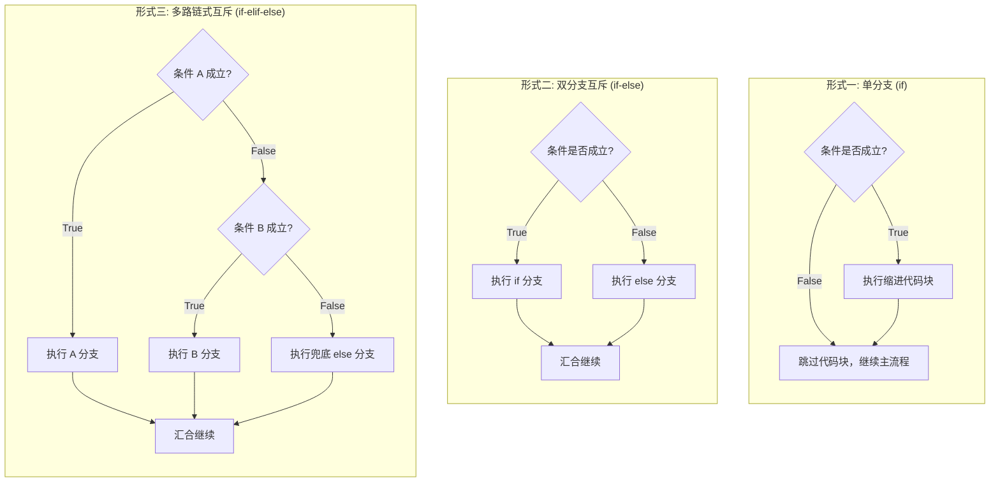

# Lec 2 字符串操作、输入输出与条件分支

## TL;DR

- **字符串对象**：区分大小写的字符序列，具备不可变性（Immutable）。通过 `len()` 获取长度，通过方括号 `[...]` 索引与切片；
- **标准 I/O 交互**：文件运行必须显式调用 `print()`；`input()` 的返回值永远是字符串，数值运算务必显式转换；
- **格式化字符串**：熟练运用 `f"{expr}"` 简化多变量复杂混排输出；
- **决策控制流**：掌握关系比较与布尔逻辑，利用 `if-elif-else` 配合严格的 4 空格缩进，使程序具备针对不同输入执行差异化路径的能力。

## 1. 字符串类型（`str`）：字符序列、拼接与重复

**Ana Bell 博士**：什么是字符串？

::: definition 字符串（String）
字符串是**区分大小写（Case-sensitive）的有序字符序列**。字符串中的字符可以是任何符号：大写字母、小写字母、数字符号、标点符号，甚至是空格、换行符（`\n`）与制表符（`\t`）。
:::

在 Python 中，告诉解释器“我要创建一个字符串对象”的方法非常简单：用一对**单引号（`'...'`）**或**双引号（`"..."`）**将字符序列包裹起来：

```python
name = "Ana Bell"
greeting = 'Hello World!'
digits = "12345"
empty = ""  # 空字符串 (长度为 0)
```

::: tip 引号匹配的最佳实践
单引号与双引号在 Python 中功能完全等价。但如果你的字符串内部包含单引号（例如英文缩写 `don't`），建议外层使用双引号：`"don't"`；反之若内部包含双引号，外层使用单引号：`'She said "Hello"'`。这能避免使用繁琐的转义斜杠 `\'`。
:::

### 字符串操作符：拼接（`+`）与重复（`*`）

我们不能对字符串进行除法或乘方，但有两个算术符号在字符串类型上被赋予了全新而直观的语义：

#### 1. 字符串拼接（Concatenation: `+`）
当 `+` 操作符的两侧都是字符串时，它代表将两个字符序列首尾相接拼接成一个全新的字符串对象：

```python
a = "me"
b = "myself"
c = a + b
print(c)  # 输出: 'memyself'
```

**Ana Bell 博士**：请大家格外注意：**拼接操作绝不会自动为你插入空格！** 如果你需要空格，必须显式把包含空格的字符串也拼进去：

```python
d = a + " " + b
print(d)  # 输出: 'me myself'
```

#### 2. 字符串重复（Repetition: `*`）
当 `*` 操作符连接一个字符串与一个整数时（无论前后顺序），它表示将该字符串序列重复指定的整数次：

```python
silly = a * 3
print(silly)  # 输出: 'mememe'
```

::: pitfall 类型不匹配陷阱：`TypeError`
`*` 操作符只能作用于 `str * int`。如果你尝试执行 `str * str` 或者 `str + int`，Python 会立刻抛出类型错误（`TypeError`）：
```python
>>> "hi" + 3
TypeError: can only concatenate str (not "int") to str

>>> "hi" * "3"
TypeError: can't multiply sequence by non-int of type 'str'
```
如果你要把数字 `3` 拼进字符串，必须先显式转换：`"hi" + str(3)`。
:::

---

## 2. 字符串索引（Indexing）与切片（Slicing）

**Ana Bell 博士**：既然字符串是一个有序序列，那么我们自然需要有能力获取其中的特定字符，或者截取其中一部分子串。

### 获取字符串长度：`len()` 内置函数

`len()` 接收一个字符串，求值并返回该字符串包含的字符总数（整型）：

```python
s = "abc"
print(len(s))  # 输出: 3
```

### 单字符索引（Indexing）

在计算机科学与绝大多数现代编程语言中，**索引计数严格从 0 开始（Zero-based indexing）**。

对于字符串 `s = "abc"`：
- 字符 `'a'` 位于第 1 个位置，其索引为 `0`；
- 字符 `'b'` 位于第 2 个位置，其索引为 `1`；
- 字符 `'c'` 位于第 3 个位置，其索引为 `2`。

在 Python 中，通过在变量名后紧跟**方括号 `[...]`** 并传入索引值来提取字符：

```text
正向索引:    0    1    2
字符串:     'a'  'b'  'c'
反向索引:   -3   -2   -1
```

```python
s = "abc"
print(s[0])   # 'a'
print(s[1])   # 'b'
print(s[2])   # 'c'
```

#### 负数反向索引
如果我们想提取字符串的**最后一个字符**，而不知道或者不想计算其具体长度时，Python 提供了极其便利的**负数索引**：从右往左计数，最右侧最后一个字符的索引严格为 `-1`！
- `s[-1]` 等价于 `s[len(s) - 1]`，直接命中末尾字符 `'c'`；
- `s[-2]` 命中倒数第二个字符 `'b'`。

::: pitfall 越界异常：`IndexError: string index out of range`
对于长度为 3 的字符串 `s = "abc"`，其有效正索引为 `0, 1, 2`，有效负索引为 `-3, -2, -1`。
如果你尝试访问 `s[3]` 或者 `s[-4]`，由于向左或向右跨度超出了实际存储范围，Python 会立刻抛出经典的 **`IndexError`**！
:::

### 提取子序列：三元切片语法（Slicing）

**Ana Bell 博士**：如果我们不仅想取一个字符，而是想截取一段连续的子串（Substring），甚至按照某种固定规律隔一个字符取一个，该怎么做？

这就是 Python 强大的**切片（Slicing）**语法。其完整规范是在方括号中传入由冒号分隔的三个参数：

$$\text{sequence}[\text{start} : \text{stop} : \text{step}]$$

::: definition 切片三要素
1. **`start`（起始索引）**：子串提取的起点（**包含该位置**）；
2. **`stop`（终止索引）**：子串提取的终点边界（**不包含该位置，左闭右开区间 $[start, stop)$**）；
3. **`step`（步长）**：提取时每次跨越的字符步长。若省略，默认为 `1`（逐个提取）；若为 `2`，表示每隔一个字符取一个；若为负数，表示从右向左逆向提取。
:::

```python
s = "abcdefgh"

# 1. 基础切片: 提取索引 1 到 4 (不含 4)
print(s[1:4])     # 输出: 'bcd'

# 2. 指定步长: 从 0 到 7，步长为 2
print(s[0:7:2])   # 索引 0, 2, 4, 6 -> 'aceg'

# 3. 省略参数的缺省行为:
print(s[:3])      # 省略 start: 默认从 0 开始 -> 'abc'
print(s[5:])      # 省略 stop: 默认一直截取到字符串末尾 -> 'fgh'
print(s[:])       # 全部省略: 复制整个字符串 -> 'abcdefgh'

# 4. 步长为负数: 逆向提取
print(s[::-1])    # 经典技巧: 翻转整个字符串 -> 'hgfedcba'
```

### 【课堂小测 · You Try It】切片实战推演

**Ana Bell 博士**：现在请大家在草稿纸上跟着我画出索引，推演下面这道题：
已知字符串 `s = "ABC d3f ghi"`（长度为 11，注意包含空格）：

```text
索引:  0   1   2   3   4   5   6   7   8   9   10
字符: 'A' 'B' 'C' ' ' 'd' '3' 'f' ' ' 'g' 'h' 'i'
```

请给出以下切片的求值结果：
1. `s[3 : len(s)-1]`
2. `s[4 : 0 : -1]`
3. `s[6 : 3]`

**现场推导演练**：
1. `len(s) - 1` 为 `10`。切片区间为 $[3, 10)$。从索引 3（空格）开始，一路取到索引 9（`'h'`，不含索引 10 的 `'i'`）。结果为：`" d3f gh"`；
2. 起点为索引 4（`'d'`），步长为 `-1`（向左倒退遍历），终止边界为索引 0（不含 0）。因此依次提取索引 4、3、2、1。结果为：`"d CB"`；
3. 起点为索引 6（`'f'`），终点为索引 3。但是**默认步长为 $+1$（向右前进）**！从索引 6 向右走永远不可能到达索引 3，因此提取不到任何字符，返回**空字符串 `""`**！

---

## 3. 字符串的不可变性（Immutability）

**Ana Bell 博士**：在这里，我必须正式引入 Python 中最重要的哲学概念之一：**不可变对象（Immutable Objects）**。

在 Python 运行时中，我们迄今为止学过的所有基础标量与字符串（`int`, `float`, `bool`, `str`）都是不可变的！

::: definition 不可变性（Immutability）
所谓不可变，指的是：**一个对象一旦在堆内存中被创建分配，其承载的物理内容就绝对不允许被修改！**
:::

如果内存中存在一个字符串 `s = "car"`，而你想把首字母替换为 `'b'` 变成 `"bar"`，你可能会本能地尝试这样写：

```python
s = "car"
s[0] = "b"  # 尝试就地修改首字符
```

Python 会毫不留情地报错并拒绝执行：
```python
TypeError: 'str' object does not support item assignment
```

如果你确实需要得到 `"bar"`，你唯一能做的事情是**利用表达式计算出一个全新的字符串对象，然后将变量 `s` 重新绑定到新对象上**：

```python
s = "car"
s = "b" + s[1:]  # 截取 'ar'，拼出全新的 'bar'
```

在内存中，原来的 `"car"` 完好无损地存在，只是变量名标签 `s` 被撕下来重新贴到了全新的 `"bar"` 对象上。

---

## 4. 标准输出（`print`）与输入（`input`）交互

**Ana Bell 博士**：迄今为止，我们在交互式命令行（Shell）中输入 `3 + 2`，屏幕立刻回显 `5`。很多初学者误以为这就是程序的“输出”。

这是完全错误的理解！在 Shell 里输入表达式，只是解释器在向你提供**交互式窥视（Peeking）**。

一旦我们离开 Shell，转而在文件编辑器（File Editor）中编写 `.py` 脚本并运行时，如果你只写：
```python
# test.py
3 + 2
len("abc")
"hello"
```
点击运行后，控制台将**一片死寂、没有任何输出**！因为计算机虽然在后台默默计算了这些表达式，但没有任何一条指令指示它将结果渲染在屏幕上。

### 显式打印：`print()` 函数

为了让终端用户看到程序的运行结果，必须使用 `print()` 函数：

```python
print(3 + 2)          # 输出: 5
print(len("abc"))      # 输出: 3
```

- 每次调用 `print()` 打印完毕后，默认会自动在末尾追加一个**换行符（Newline）**；
- 如果想在同一行打印多个不同的对象，只需在 `print()` 中用**逗号（`,`）**将它们分隔开。Python 会自动将各个对象按顺序打印，并且**默认在各个对象之间插入一个空格**：

```python
print("The", 3, "musketeers")
# 输出: The 3 musketeers (自动添加空格)
```

### 用户键盘输入：`input()` 函数

为了让程序具备交互性，我们使用 `input()` 函数从控制台接收用户键盘键入的内容。

```python
name = input("请输入你的姓名: ")
print("你好,", name)
```

当程序执行到 `input()` 时，执行引擎会**完全阻塞挂起（Block/Pause）**，光标闪烁，静静等待用户在键盘上敲击字符，直到用户敲下回车键（Enter），程序才被唤醒继续向下推进。

::: pitfall 致命陷阱：`input()` 永远返回字符串类型！
**Ana Bell 博士**：请用荧光笔在笔记本上把这句话狠狠标记三遍：
**无论用户在键盘上敲入的是数字 42、浮点数 3.14 还是字母，`input()` 捕获并返回的结果 100% 永远是字符串类型（`str`）！**
:::

看下面这个在初学者大作业中极易爆出的经典 Bug：

```python
# 危险代码：加法变成了字符串拼接！
num = input("请输入一个数字: ")   # 用户输入 5，num 得到字符串 "5"
result = num + 10                # 报错: TypeError: can only concatenate str (not "int") to str
```

或者更隐蔽的逻辑错误：
```python
num = input("请输入一个数字: ")   # 用户输入 5
result = num * 3                 # 不会报错！但结果是 "5" * 3 = "555"，而不是 15！
```

**工程铁律**：凡是期望读取数值进行数学运算的输入，必须在读取的第一时间**就地执行强制类型转换**：

```python
# 正确工程写法
age = int(input("请输入你的年龄: "))
height = float(input("请输入你的身高(米): "))
```

---

## 5. 现代字符串格式化利器：`f-string` 与数值逼近实战

**Ana Bell 博士**：在 Python 3.6 之前，如果我们想将变量值与说明文本混排打印，代码往往写得极其丑陋：要么到处是逗号导致被强加空格，要么必须层层包裹 `str()` 进行 `+` 拼接：

```python
# 传统繁琐写法
num = 100
ratio = 0.25
print("最终数值是: " + str(num * ratio) + "%，占总量的 " + str(ratio * 100) + "%")
```

为了彻底终结这种冗长反人类的语法，Python 官方推出了 **格式化字符串字面量（Formatted String Literals，简称 `f-string`）**。

### `f-string` 语法与精髓

只需在字符串前引号的外侧加上一个小写的字母 `f`（或大写 `F`），在字符串正文内部，使用一对**花括号 `{...}`** 将任意变量或合法表达式包裹起来：

```python
num = 100
ratio = 0.25

# 优雅现代的 f-string 写法
print(f"最终数值是: {num * ratio}%，占总量的 {ratio * 100}%")
```

::: insight 表达式无处不在哲学（Expressions Everywhere）
`f-string` 完美印证了 Python 的核心架构哲学：**凡是可以放置值的地方，都可以直接放置表达式！**
在 `{...}` 内部，不仅可以放变量名，还可以直接放算式、函数调用乃至切片：`f"大写字母是: {name.upper()}"`。在实际输出前，Python 运行时会自动对花括号内的表达式求值，并自动将其转换为字符串格式嵌入文本。
:::

### 科学计算综合实战：牛顿迭代法单步逼近立方根

为了让大家看到输入输出与表达式的工业级综合应用，Ana Bell 博士在现场演示了通过牛顿-拉弗森方法（Newton-Raphson Method）数值求解立方根的核心单步计算：

求 $x$ 的立方根，即求解方程 $f(g) = g^3 - x = 0$ 的根。
利用泰勒展开与切线逼近，下一次更优猜测值 $g_{\text{next}}$ 的解析递推公式为：
$$g_{\text{next}} = g - \frac{f(g)}{f'(g)} = g - \frac{g^3 - x}{3g^2}$$

```python
# newton_cube_root_step.py
# 交互式读取用户输入并执行牛顿法单步逼近
x = float(input("请输入希望求立方根的目标数值 x: "))
g = float(input("请输入初始猜测值 g: "))

print(f"当前猜测值 g 的三次方为: {g**3}")

# 根据牛顿切线公式计算下一步猜测值
next_g = g - ((g**3 - x) / (3 * (g**2)))

print(f"根据牛顿法推导，更接近理论解的下一个猜测值应为: {next_g}")
```

运行演示：
```text
请输入希望求立方根的目标数值 x: 27
请输入初始猜测值 g: 5
当前猜测值 g 的三次方为: 125.0
根据牛顿法推导，更接近理论解的下一个猜测值应为: 3.6933333333333334
```
仅仅通过单步迭代，猜测值就从粗糙的 $5.0$ 迅速收敛至 $3.69$（理论真实解为 $3.0$）！

---

## 6. 比较运算符与布尔逻辑基础

**Ana Bell 博士**：到目前为止，我们写的程序依然是绝对线性的：第 1 行执行完，执行第 2 行，直到文件结束。程序像一条无法转弯的高速公路，无法根据数据状态做出任何选择。

要打破这种线性约束，我们必须引入**决策点（Decision Points）**。而在做决策之前，程序首先需要能够进行**真假是非判定**。

### 关系比较运算符（Comparison Operators）

比较运算用于衡量两个对象之间的关系，其返回结果永远是布尔标量：`True` 或 `False`。

| 运算符 | 语义解释 | 典型示例 | 求值结果 |
| :---: | :--- | :--- | :---: |
| **`==`** | **值相等判定**（切勿与单等号 `=` 赋值混淆！） | `5 == 5.0` | `True` |
| **`!=`** | **不等判定** | `5 != 3` | `True` |
| **`>`** | 大于 | `'b' > 'a'` (按 ASCII/Unicode 字典序) | `True` |
| **`<`** | 小于 | `3 < 2` | `False` |
| **`>=`** | 大于或等于 | `4 >= 4` | `True` |
| **`<=`** | 小于或等于 | `5 <= 2` | `False` |

::: pitfall 符号陷阱：`=` vs `==`
- `=` 是**赋值语句**，表示将右侧对象绑定到左侧变量名；
- `==` 是**真值比较**，询问两边的值是否相等。在 `if` 条件判断中误写成 `=` 会直接触发语法错误 `SyntaxError: invalid syntax`！
:::

### 逻辑运算符（Logical Operators）：`and`, `or`, `not`

用于将多个简单的布尔测试组合成复合判断：

1. **`a and b`（逻辑与）**：当且仅当 `a` 与 `b` 同时为真时，结果为 `True`；只要有一个为假，结果即为 `False`；
2. **`a or b`（逻辑或）**：只要 `a` 与 `b` 中有一个为真，结果即为 `True`；两者全为假时才为 `False`；
3. **`not a`（逻辑非）**：单目取反，真变假，假变真。

```python
pset_time = 15
sleep_time = 8

# 判断日程是否超负荷
is_overloaded = (pset_time + sleep_time) > 24
print(f"日程是否爆表: {is_overloaded}")  # False
```

---

## 7. 条件分支控制流：`if`, `elif` 与 `else`

**Ana Bell 博士**：有了布尔判断，我们现在可以正式让程序拥有分支选择能力了！

在深入语法之前，我想给大家讲一个非常有意思的场景——**“MIT 免费食物迷宫寻路算法”**：

> 假设你身处 MIT 复杂的地下建筑走廊中，听说某个研讨室有活动提供免费披萨。如何仅靠一套极其简单的本地条件判断，保证在任何没有孤岛的迷宫中一定能走到食物跟前？
> 答案就是计算机科学经典的**“右手摸墙准则（Right-hand-on-wall rule）”**：
> 1. 如果（`if`）右侧无障碍物：向右转并向前跨步；
> 2. 否则如果（`elif`）右侧有墙但前方畅通：径直向前跨步；
> 3. 否则如果（`elif`）右侧与前方均被阻挡但左侧畅通：向左转并向前跨步；
> 4. 否则（`else`，三面碰壁走入死胡同）：沿原路后退。

这就是条件分支在现实生活中的生动写照：**在特定的十字路口，评估当前环境状态，从若干条互斥路径中挑选唯一一条执行。**

### Python 条件分支的三种结构



#### 形式一：独立单分支（`if`）
```python
if condition:
    # 仅当 condition 为 True 时执行的代码块
    do_something()
```

#### 形式二：双向互斥分支（`if-else`）
```python
if condition:
    do_A()
else:
    # 当 condition 为 False 时执行的代码块
    do_B()
```
`do_A()` 与 `do_B()` **严格二选一，绝不可能同时执行，也绝不可能同时跳过！**

#### 形式三：多向链式分支（`if-elif-else`）
`elif` 是 `else if` 的缩写。可以串联任意多个 `elif`：
```python
if score >= 90:
    grade = 'A'
elif score >= 80:
    grade = 'B'
elif score >= 70:
    grade = 'C'
else:
    grade = 'F'
```

::: insight 核心执行机制：自顶向下首匹配短路（First-True-Wins）
**多路 `elif` 是严格按照代码的书写顺序从上往下依次评估的。一旦某个条件测试为 `True`，Python 会立刻执行其所属的代码块，然后彻底跳过其后所有的 `elif` 与 `else` 分支，直接跳出分支结构！**
哪怕后续某个 `elif` 的条件同样能够满足，它也永远得不到执行的机会。
:::

---

## 8. 缩进语法、嵌套分支与“猜数字游戏”实战

**Ana Bell 博士**：许多来自 C、C++、Java 的学习者会问：“Python 怎么界定哪些代码属于 `if` 内部，哪些代码属于外部？”

Python 区别于传统语言的一大标志性特征：**通过强制且统一的缩进（Indentation）来界定代码块层级（Block Scope）！**
- 标准 PEP 8 规范规定：**每个缩进层级严格使用 4 个空格**；
- 缩进相同的连续代码行构成一个不可分割的执行块；
- 一旦某行代码退回到了上一层级的缩进位置，即代表该分支结构结束，重回主程序执行流。

### 缩进错误引发的惨案（现场排查）

请看下面这段代码：
```python
x = 5
y = 10

if x == y:
    print("x 与 y 完全相等")
print("这两个数值完全一致！")  # 危险：缩进回到了外层！
```
如果运行这段代码，输入 $x = 5, y = 10$：
因为缩进退回到了外层，虽然第 1 个 print 被正确跳过，但第 2 个 print 却无辜地打印在了屏幕上！修复方法极其简单：将第 2 行 print 同样缩进 4 个空格，纳入 `if` 代码块内部。

### 嵌套分支（Nested Conditionals）

我们可以在一个 `if` 代码块的内部，再完整嵌套另一组独立的 `if-else` 分支，实现多维度的逻辑过滤：

```python
x = int(input("请输入数字 x: "))
y = int(input("请输入数字 y: "))

if x == y:
    print("x 与 y 相等")
    if y != 0:
        print("因此 x / y 的结果必然为 1.0")
    else:
        print("但由于它们为 0，不能作为除数！")
else:
    print("x 与 y 不相等")
```

### 【工程实战 · You Try It】猜数字分支系统设计

**Ana Bell 博士**：现在让我们在课堂上共同编写一个经典的小游戏：秘密数字预设为 `secret = 7`，读取用户的输入并判定：
- 如果猜大了，打印 `"too high"`；
- 如果猜小了，打印 `"too low"`；
- 如果猜中了，打印 `"equal"`。

**课堂现场编写与调试全记录**：

一位同学首先给出了这样一个草案：
```python
secret = 7
guess = int(input("请输入你的猜测 (1-10): "))

if guess >= secret:
    print("too high")
elif guess == secret:
    print("equal")
else:
    print("too low")
```

**Ana Bell 博士现场 Debug 提问**：请大家看第 4 行的 `if guess >= secret`，这段代码有什么严重的逻辑 Bug？

**学生现场指出**：如果用户正好输入了 `7`，因为 $7 \ge 7$ 条件成立，程序会立刻冲进第 1 个分支打印 `"too high"`，后面的 `guess == secret` 永远不可能被执行到！

**Ana Bell 博士**：太敏锐了！这就是我们前面强调的 **首匹配短路机制**。由于 `>=` 包含了等于，导致等于分支被上层严重遮蔽。

**最终重构修正版代码**：
```python
# secret_number_game.py
secret = 7
guess = int(input("请输入你猜的整数: "))

if guess > secret:
    print("too high (猜高了)")
elif guess < secret:
    print("too low (猜低了)")
else:
    # 此时在数学上只剩下 guess == secret 这一种唯一可能
    print("equal (猜中啦！)")
```

### 为什么用 `if-elif-else` 而不是连续多个独立的 `if`？

**学生提问**：老师，既然这里有三种情况，我为什么不能写成三个并列的 `if` 呢？
```python
if guess > secret: print("too high")
if guess < secret: print("too low")
if guess == secret: print("equal")
```

**Ana Bell 博士**：在这个极其简单的案例中，因为三个条件在数学上是严格互斥的，程序确实碰巧能跑通。

但是在通用的工业级软件开发中，**写连续多个独立的 `if` 与写 `if-elif-else` 在控制流语义上有着天壤之别**：
1. **执行开销不同**：链式 `if-elif-else` 只要第 1 个命中，后续判断立刻短路跳过；而连续独立的 `if` 会强制 CPU 把每一个条件全部计算一遍；
2. **逻辑安全保障不同**：如果前面的 `if` 代码块内部修改了变量的值，就可能导致原本不该命中的后续独立 `if` 意外触发！而 `if-elif` 在语法层面构筑了坚固的互斥安全防火墙，**绝对保证全套分支中至多只有一个分支生效**。

::: tip 调试黄金法则：Debug Early, Debug Often
在编码过程中，绝不要一口气写出上百行代码才第一次点运行。写出 3 到 5 行逻辑，就立刻通过不同边界条件的输入进行单步验证，发现问题当场扑灭，防止错误滚雪球式累积扩散！
:::
