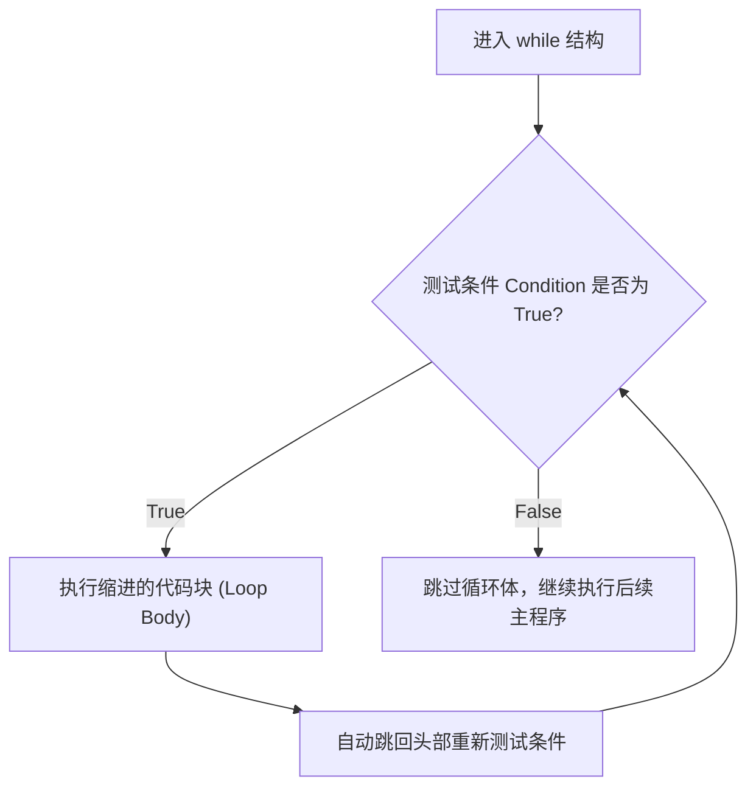
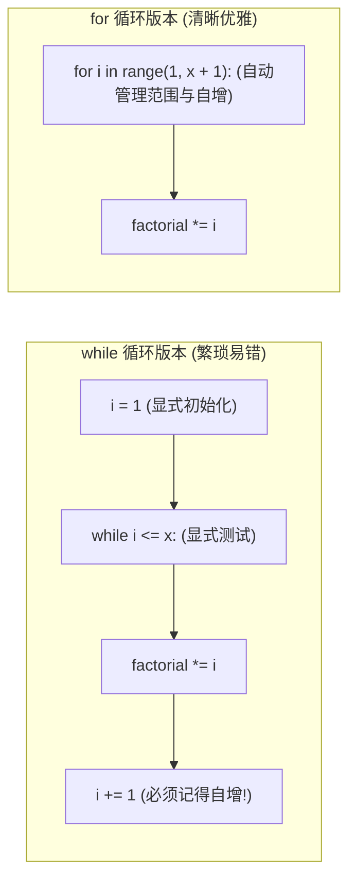

# Lec 3 循环迭代结构与循环不变量

## TL;DR

- **循环机制**：理解自动回跳与条件重测的时序本质；
- **`while` 循环**：掌握状态推进原则，学会使用 `Control-C` 强行阻断死循环；
- **`for` 循环与 `range()`**：熟练运用单参数、双参数与带步长参数的三种序列生成模式，牢记右侧边界左闭右开规则；
- **调试直觉**：遇到结果与预期偏差时，果断插入 `print(f"i = {i}")` 捕获“差一错误”。

---

## 1. `while` 循环控制流与经典“迷失之森”游戏

**Ana Bell 博士**：让我们用一个日常生活中的例子来建立关于 `while` 循环的直观心理模型。

假设你周末在 Netflix 上追一部新剧，你打算一口气把整季刷完。你的行为逻辑可以用如下伪代码表示：

```text
打开 Netflix 播放新剧
只要（while）当前剧集还有未看的一集：
    继续播放下一集
当全部剧集播放完毕：
    显示推荐界面，结束观看
```

在计算机科学中，`while` 循环的严格执行时序如下：



::: definition `while` 循环语法与执行契约

```python
while <布尔条件表达式>:
    <循环体代码块 (必须严格缩进)>
```
1. **测试条件**：Python 首先求值 `while` 后的布尔表达式；
2. **条件成立（`True`）**：进入并执行所有缩进在 `while` 下方的代码块；
3. **自动循环回跳**：当缩进代码块的最后一行执行完毕后，**Python 解释器会自动跳回到循环头部，重新求值布尔条件！**
4. **循环退出（`False`）**：一旦条件求值为 `False`，解释器立即跳过整个缩进代码块，恢复到与 `while` 相同缩进层级的主程序继续向下执行。
:::

### 经典实战：塞尔达传说之“迷失之森”

**Ana Bell 博士**：现在让我们用刚学到的 `while` 循环，写一个文字冒险游戏——我把它叫做极简版《塞尔达传说：迷失之森》。

在这个关卡中，林克被困在一个神秘的森林迷宫中。每一轮我们都询问玩家：“你想向左走（left）还是向右走（right）？”
- 如果玩家选择向右走（`"right"`），迷宫会施展空间法术，让他回到原点，陷入无尽的循环提问；
- 只有当玩家选择向左走（`"left"`）时，才能打破结界，成功走出迷宫！

```python
# lost_woods.py
where = input("你进入了迷失之森，该向哪边走？(left/right): ")

# 只要玩家输入的是 "right"，就不断重新询问
while where == "right":
    where = input("四周升起大雾，你回到了原点！该向哪边走？(left/right): ")

print("恭喜你！成功逃出了迷失之森！")
```

让我们在“内存云朵图”中推演这个变量绑定的物理过程：
1. 初始输入：玩家敲入 `right`，变量 `where` 绑定到字符串对象 `'right'`；
2. 循环条件判定：测试 `where == "right"`，结果为 `True`，进入循环体；
3. 循环体内更新：再次调用 `input()`。如果玩家又输了 `right`，标签 `where` 重新绑定到新的 `'right'` 对象；
4. 自动回跳检测：再次判定条件，依然为 `True`，继续循环；
5. 退出循环：直到玩家敲入 `left`，标签 `where` 绑定到 `'left'`。此时条件 `where == "right"` 求值为 `False`！解释器立刻跳过循环体，打印出逃脱成功的祝贺语。

**Ana Bell 博士提问**：请大家思考一个细节：如果玩家输入了大写的 `"RIGHT"` 或者首字母大写的 `"Right"`，会发生什么？

**学生回答**：玩家会直接走出森林！

**Ana Bell 博士**：太对了！为什么？因为我们在第 2 讲中反复强调过：**字符串的比较是严格区分大小写（Case-sensitive）的！** `"RIGHT" == "right"` 求值为 `False`，因此循环判定直接不通过。在真实工业工程中，为了防御这种输入差异，我们通常会配合字符串方法统一转为小写：`where.lower() == "right"`。

---

## 2. 循环推进与“死循环（Infinite Loop）”排查哲学

**Ana Bell 博士**：现在让我们看一个使用数字控制循环的例子。

假设我们要让程序根据用户输入的数字 $n$，在屏幕上打印出指定数量的字符 `'x'`（例如输入 $4$，打印 4 次）：

```python
n = int(input("请输入重复次数 n: "))

while n > 0:
    print("x")
    n = n - 1  # 核心：循环控制变量递减
```

推演过程极其清晰：
- 初始 $n = 4$：$4 > 0 \implies$ 打印 `'x'`，$n$ 变为 $3$；
- 重新检测 $3 > 0 \implies$ 打印 `'x'`，$n$ 变为 $2$；
- 重新检测 $2 > 0 \implies$ 打印 `'x'`，$n$ 变为 $1$；
- 重新检测 $1 > 0 \implies$ 打印 `'x'`，$n$ 变为 $0$；
- 重新检测 $0 > 0 \implies$ 判定为 `False`！循环安全终止。屏幕上精确留下了 4 行 `'x'`。

### 死循环的惨剧：当开发者忘记推进状态

**Ana Bell 博士**：现在，请看下面这个在编程初学者乃至资深工程师中都极易发生的失误——如果我们在写代码时不小心把最后一行 `n = n - 1` 注释掉，或者漏写了，会发生什么？

```python
# 致命 Bug 代码：无法终止的永动机
n = 4
while n > 0:
    print("x")
    # 忘记了推进 n 的状态！
```

让我们在终端现场运行它：
屏幕开始以惊人的速度疯狂向上滚动滚屏，成千上万个 `'x'` 瞬间填满控制台，CPU 风扇呼啸，程序永远没有终点！

::: pitfall 死循环（Infinite Loop）的根源与自救指南
**死循环的本质**：循环条件中引用的变量，在循环体内部**没有任何语句去改变它的状态**，导致测试条件永远保持为 `True`，计算机陷入无止境的重复执行。

**现场紧急中断快捷键**：
- 当你的程序在终端或 IDE 中狂奔不止时，立刻点击终端并按下 **`Control-C`**（Mac 上为 `Control-C`，部分环境亦支持 `Command-C`），向 Python 进程发送 `KeyboardInterrupt` 强制中断信号；
- 在 Jupyter 或 Spyder 等集成开发环境中，点击红色的“停止（Stop）”方块按钮，或在菜单中选择 **Interrupt Kernel**。

**工程经验法则（Rule of Thumb）**：
在入门阶段的计算机科学课程中，我们编写的所有基础程序在现代计算机上的执行时间通常都在 **1 到 2 秒以内**。如果你发现自己点击运行后，等待了超过 3 秒程序依然毫无动静或控制台疯狂刷屏，**请毫不犹豫地立刻终止程序——你 99.9% 陷入了死循环！**
:::

---

## 3. 复合赋值运算符与阶乘（Factorial）算法推导

**Ana Bell 博士**：在数值迭代中，我们几乎总是需要对某个计数器变量进行递增（`i = i + 1`）或对某个累乘器进行累乘（`fact = fact * i`）。

由于长变量名反复书写极其繁琐且易拼错，所有现代语言都引入了**复合赋值运算符（Augmented Assignment Operators）**：

| 简写语法 | 等价的标准赋值形式 | 含义解释 |
| :---: | :---: | :--- |
| `i += 1` | `i = i + 1` | 自身递增 1 |
| `i -= 1` | `i = i - 1` | 自身递减 1 |
| `fact *= i` | `fact = fact * i` | 自身乘以 `i` |
| `total /= 2` | `total = total / 2` | 自身除以 2（结果转为浮点数） |

请牢记：`i += 1` 仅仅是语法糖，其底层内存机制依然是“计算 `i + 1` 生成新整数，并将标签 `i` 重新绑定”。

### 数学算法推导：使用 `while` 循环计算阶乘 $n!$

阶乘的数学定义为：
$$x! = 1 \times 2 \times 3 \times \dots \times x \quad (0! = 1)$$

让我们用 `while` 循环来实现 $4!$ 的计算：

```python
# factorial_while.py
x = 4

# 1. 初始化循环变量与累乘累加器
i = 1
factorial = 1

# 2. 只要循环计数器 i 尚未超过目标 x，就持续迭代
while i <= x:
    factorial *= i   # 将当前 i 累乘进结果
    i += 1           # 循环变量向前递增推进

print(f"{x} 的阶乘计算结果为: {factorial}")
```

让我们结合 Python Tutor 跟踪其状态转移表：

| 循环轮次 | 当前 `i` | 进入循环前条件 `i <= 4` | 执行 `factorial *= i` 后的值 | 执行 `i += 1` 后的值 |
| :---: | :---: | :---: | :---: | :---: |
| **初始** | `1` | — | `1` | — |
| **第 1 轮** | `1` | `1 <= 4 (True)` | $1 \times 1 = 1$ | `2` |
| **第 2 轮** | `2` | `2 <= 4 (True)` | $1 \times 2 = 2$ | `3` |
| **第 3 轮** | `3` | `3 <= 4 (True)` | $2 \times 3 = 6$ | `4` |
| **第 4 轮** | `4` | `4 <= 4 (True)` | $6 \times 4 = 24$ | `5` |
| **退出** | `5` | `5 <= 4 (False)` | 终止并跳出循环 | 输出 `24` |

大家可以看到，虽然 `while` 循环能够完美完成任务，但它需要 4 行样板代码：在循环前手动初始化 `i = 1`、在循环头部显式测试 `i <= x`、在循环末尾千万不能忘记手动写 `i += 1`。

这种模式在工程中如此高频，以至于计算机科学家们发明了更加优雅、安全且防呆的结构——**`for` 循环**！

---

## 4. `for` 循环与 `range()` 数值序列生成器

**Ana Bell 博士**：回到 Netflix 的比喻。如果平台规定：“为了防止用户睡着浪费带宽，连续播放 4 集后若无交互就自动暂停”。此时系统确切地知道要迭代一个长度为 4 的序列（第 1 集、第 2 集、第 3 集、第 4 集）。

这种**在预先已知的固定序列上逐个遍历**的场景，就是 `for` 循环的主场！

```python
# for 循环极简结构
for n in range(5):
    print(n)
```

这两行清晰的代码，直接干脆利落地取代了 `while` 循环中繁重的初始化、条件测试与手动递增！

::: definition `for` 循环执行语法
```python
for <循环变量名> in <可迭代序列>:
    <循环体代码块>
```
1. 循环开始前，Python 取出序列中的第一个元素，自动绑定到指定的`<循环变量名>`上；
2. 执行一次缩进的代码块；
3. 执行完毕后，Python **自动且安全地**将循环变量重新绑定到序列中的下一个元素，再次执行代码块；
4. 当序列中的所有元素遍历完毕后，循环自然优雅退出。**你完全不需要操心递增变量，因而彻底绝杜绝了由于漏写自增而引发的死循环！**
:::

### 核心原语：`range()` 函数的三种形态

`range()` 是 Python 内置的数值序列生成器。它拥有三种灵活的参数形式，大家必须熟练掌握：

```text
形态一: range(stop)               -> 从 0 开始，步长为 1，到 stop 为止 (不含 stop)
形态二: range(start, stop)        -> 从 start 开始，步长为 1，到 stop 为止 (不含 stop)
形态三: range(start, stop, step)  -> 从 start 开始，步长为 step，到 stop 为止 (不含 stop)
```

```python
# 1. 单参数: range(stop)
for i in range(5):
    # 依次产出: 0, 1, 2, 3, 4 (共 5 个元素，左闭右开 [0, 5))
    pass

# 2. 双参数: range(start, stop)
for i in range(2, 6):
    # 依次产出: 2, 3, 4, 5 (左闭右开 [2, 6))
    pass

# 3. 三参数正步长: range(start, stop, step)
for i in range(1, 10, 2):
    # 依次产出奇数: 1, 3, 5, 7, 9
    pass

# 4. 三参数负步长（逆序倒数）:
for i in range(5, 0, -1):
    # 依次递减产出: 5, 4, 3, 2, 1 (不含 0)
    pass
```

---

## 5. 打印调试法（Print Debugging）与累加器实战

**Ana Bell 博士**：让我们用 `for` 循环写一个经典的累加器（Running Sum）：计算闭区间 $[start, end]$ 内所有整数的总和。

假设我们希望计算从 $3$ 到 $5$ 的和（即 $3 + 4 + 5 = 12$）。课堂上有位同学给出了如下代码：

```python
# 有瑕疵的代码
start = 3
end = 5
mysum = 0

for i in range(start, end):
    mysum += i

print(f"计算所得总和为: {mysum}")
```

运行这段代码，屏幕上赫然输出了：
```text
计算所得总和为: 7
```
预期是 $12$，为什么算出了 $7$ 呢？

### 调试的艺术：打印观察法（Print Debugging）

**Ana Bell 博士**：在编写复杂算法时，当你得到一个与预期不符的诡异结果，最朴素、最强大、也是工业界程序员最常用的第一招就是：**在循环内部插入打印语句（Print Debugging）！**

我们在 `for` 循环内部把循环变量 `i` 当前的真实面目打印出来：

```python
mysum = 0
for i in range(start, end):
    print(f"当前循环中的 i = {i}")
    mysum += i
```

控制台立刻真相大白：
```text
当前循环中的 i = 3
当前循环中的 i = 4
计算所得总和为: 7
```

**学生抢答**：循环根本没有把 $5$ 加进去！因为 `range(3, 5)` 是左闭右开区间，它只取到了 $3$ 和 $4$！

**Ana Bell 博士**：一语中的！这就是计算机科学中最著名的臭虫之一——**“差一错误（Off-by-one Error）”**！

如果你的数学目标是包含右端点 $end$，由于 `range()` 的非对称开区间特性，你必须在右边界上显式 **`+ 1`**：

```python
# 正确无误的工程代码
start = 3
end = 5
mysum = 0

for i in range(start, end + 1):
    mysum += i

print(f"从 {start} 到 {end} 的闭区间总和为: {mysum}")  # 输出: 12
```

---

## 7. 优雅重构：用 `for` 循环重写阶乘算法

**Ana Bell 博士**：现在，让我们回头看看刚才用 `while` 循环写出的阶乘代码，并用 `for` 循环对其进行彻底重构：



```python
# factorial_for.py
x = 4
factorial = 1

# 仅需 2 行代码，优雅终结
for i in range(1, x + 1):
    factorial *= i

print(f"{x}! = {factorial}")
```

对比两个版本：
1. 原先用于管理循环变量的 3 处分散代码（`i = 1`、`while i <= x`、`i += 1`），被浓缩为单单一行动表达意图的 `for i in range(1, x + 1)`；
2. 循环何时启动、何时终止、步长如何，在头部一目了然；
3. 彻底根除了因遗忘自增语句而造成死循环的系统风险。

---

## 8. `while` 循环 vs `for` 循环：工程选型全景权衡

**Ana Bell 博士**：有同学经常问我：“既然 `for` 循环这么漂亮安全，我们是不是可以把 `while` 循环彻底淘汰扔掉？”

答案是绝对不行！它们各自承载着完全不同的工程使命：

| 评估维度 | `for` 循环（定长/序列遍历） | `while` 循环（状态/条件守卫） |
| :--- | :--- | :--- |
| **迭代次数** | **预先已知**（固定次数，或可迭代对象长度有限） | **预先未知**（取决于动态计算收敛或外部事件） |
| **终止驱动机制** | 序列中的元素消耗完毕自然停机 | 循环条件表达式求值变为 `False` 时停机 |
| **变量管理** | Python 自动重新绑定并向前推进 | 必须由开发者在循环体内部手动编码推进状态 |
| **死循环风险** | 极低（在有限序列上遍历天然免疫死循环） | 较高（若遗漏自增或步长方向错误即陷入死循环） |
| **典型工业场景** | 遍历列表、遍历字符串、求和累加、矩阵行列扫描 | 游戏主循环、监听网络端口、用户输入反复校验、数值逼近至精度 $\epsilon$ |

::: insight 架构选型金律
- 如果你能提前明确知道代码要执行多少次，或者是在遍历一个现成的集合/范围：**毫不犹豫优先选择 `for` 循环**；
- 如果代码是否继续运行取决于一个动态演化的条件（例如“误差是否小于 $10^{-6}$”、“用户是否敲击了退出键”、“棋盘是否有解”）：**`while` 循环是唯一合理且符合直觉的选择**。

:::
