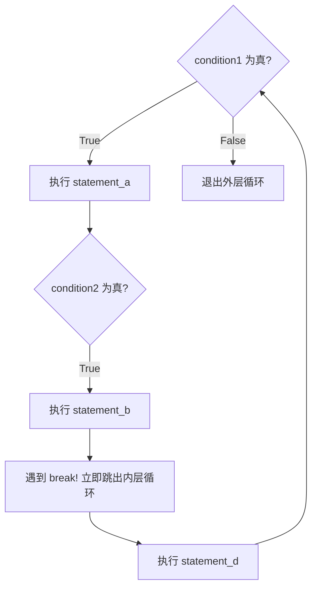
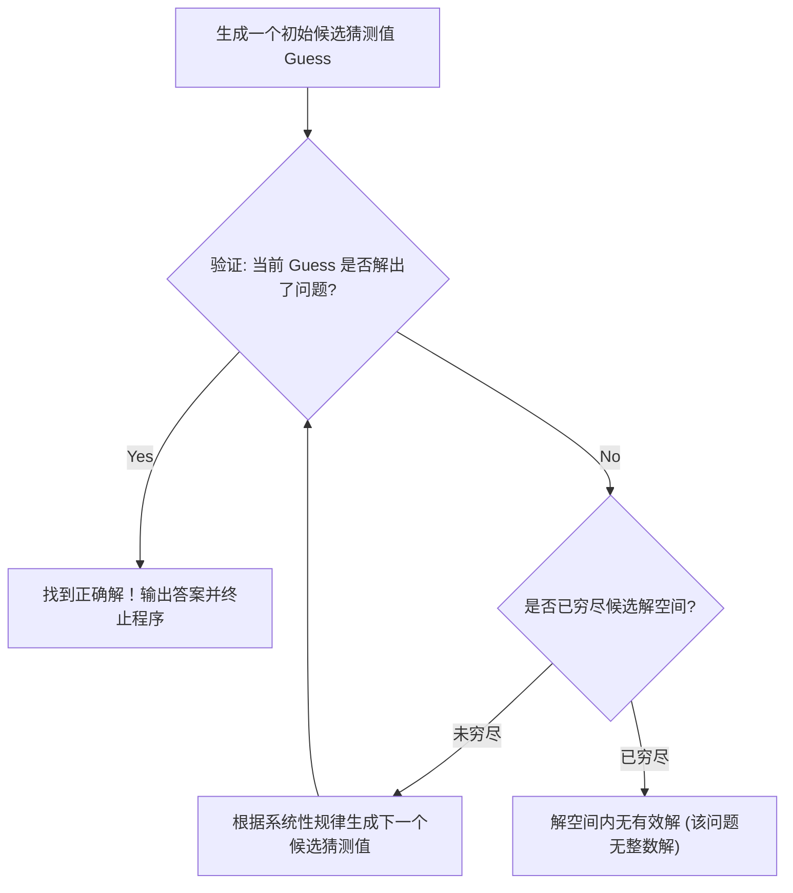
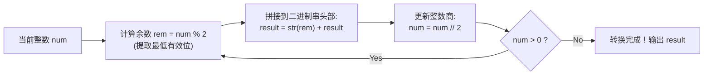
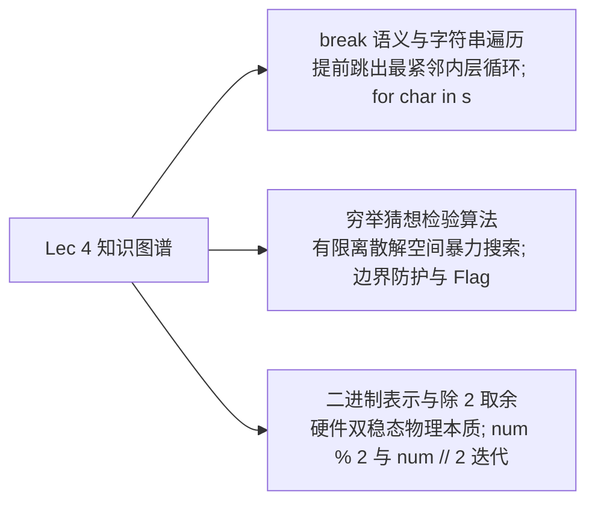

# Lec 4 字符串遍历、猜想检验算法与二进制表示

## TL;DR

- **`break` 的精准把控**：打破循环的时间线，谨记它只对紧邻的最内层循环生效；
- **字符串的优雅迭代**：拥抱 `for char in s` 和 `in` 成员运算，摒弃丑陋的数字索引中间人；
- **猜想检验算法**：确立以暴力算力换取解空间枚举的算法直觉，熟练运用布尔标志位管理全局判定；
- **二进制整数转换**：理解硬件高低电平的双稳态本质，掌握除 2 取余的逆序构造算法。


## 1. 课程导入与 `break` 语句深度辨析

**Ana Bell 博士**：大家下午好！让我们正式开始今天的第 4 讲。

在今天的讲义中，我们由浅入深安排了三个紧密递进的核心板块：
1. **循环机制的控制细节**：学习如何通过 `break` 语句在特定条件满足时提前打破循环，并将 `for` 循环推广到非数值序列（字符串遍历与成员判定）；
2. **我们的第一个核心算法——穷举猜想与检验（Guess-and-Check / Exhaustive Enumeration）**：理解如何利用计算机的暴力算力优雅地解决纯数学难以一次求出解析解的问题；
3. **计算机底层数字的本质——二进制表示法（Binary Numbers）**：解构计算机硬件为何使用二进制，并通过 Python 代码实现十进制向二进制转换的通用“配方”。

### 循环自然终止 vs 提前跳出（`break`）

在上一讲中，我们学过的两类循环都有着明确的“自然停机契约”：
- `while` 循环在布尔条件求值变为 `False` 时自然结束；
- `for` 循环在给定的序列元素被完全消耗穷尽后自然结束。

但在真实的工程业务中，我们经常需要在**自然终止条件到来之前，一旦达成某种目的就立刻终止循环**。

为了实现这种提前退出，Python 提供了关键字 **`break`**。

::: definition `break` 语句的执行法则
当 Python 解释器在执行过程中遇到 `break` 时，它会**立即无条件跳出当前循环体，并且不会再去检查循环条件，也不会再去遍历序列中剩余的元素，直接跳转到当前循环块之后的第一行代码继续执行**。
:::

请大家观察下面这组包含两层嵌套 `while` 循环的抽象结构：

```python
while condition1:
    statement_a
    while condition2:
        statement_b
        break         # 遇到 break!
        statement_c   # 永远不可能被执行到的死代码
    statement_d
```



**Ana Bell 博士**：请大家格外注意：
1. `break` 作用的范围是**最紧邻包裹它的那一个循环（Innermost Loop）**！在上面的例子中，`break` 只会终结内层的 `condition2` 循环，外层的 `condition1` 循环依然会继续向前推进；
2. 在 `break` 之后的 `statement_c` 变成了永远无法触达的死代码（Dead Code）；
3. **`if` 分支语句不是循环！** 当 `break` 嵌套在 `if` 语句内部时，它跳出的绝不是 `if`，而是包裹这个 `if` 的外层循环体！

### Python Tutor 跟踪推演

让我们用 Python Tutor 单步追踪下面这段代码：

```python
mysum = 0
for i in range(5, 11, 2):  # 序列为: 5, 7, 9
    mysum += i
    if mysum == 5:
        break
    mysum += 1

print(f"最终 mysum = {mysum}")
```

1. 初始：`mysum = 0`，`i` 取序列第 1 个值 `5`；
2. 累加：`mysum += 5`，此时 `mysum` 变为 `5`；
3. 条件判定：进入 `if mysum == 5:`，判定为 `True`；
4. 命中 `break`：解释器立即从 `for` 循环中破门而出！后面的 `mysum += 1` 被彻底跳过，序列中剩下的 `7` 和 `9` 也被永远抛弃；
5. 最终输出：`mysum = 5`。

---

## 2. 字符串直接遍历与 `in` 成员判定操作符

**Ana Bell 博士**：在上一讲中，我们见到的 `for` 循环全都是数值型的：`for i in range(...)`。

很多初学者因此形成了一个误区，以为 `for` 循环只能配合 `range` 数数字。

其实我们在第 2 讲就明确讲过：**字符串本身就是一个有序的字符序列！**

### 两种遍历风格的对照与演进

假设我们现在有一个字符串 `s = "demo review"`，我们希望统计或打印其中所有的元音字母 `'i'` 或 `'u'`。

#### 风格一：基于数字索引的“中间人遍历”（不推荐，非 Pythonic）
```python
s = "demo review"

# 通过索引遍历: 0, 1, 2, ..., len(s)-1
for index in range(len(s)):
    # 必须通过下标中间人 s[index] 重新提取字符
    if s[index] == 'i' or s[index] == 'u':
        print(f"在索引 {index} 处发现了元音: {s[index]}")
```
这种写法完全照搬了 C 语言或 Java 的老派习惯。它不仅繁琐冗长，而且我们必须手动维护 `index` 这个中间变量，再去通过 `s[index]` 查找字符，心智负担很重。

#### 风格二：优雅现代的直接字符遍历（推荐，Pythonic）
```python
s = "demo review"

# 循环变量 char 自动直接绑定为每个字符本身!
for char in s:
    if char == 'i' or char == 'u':
        print(f"发现了元音: {char}")
```
在第一轮循环中，`char` 自动绑定到 `'d'`；第二轮自动绑定到 `'e'`；第三轮自动绑定到 `'m'`……代码读起来完全符合英语直觉！

#### 风格三：引入 `in` 成员运算进一步提纯
**Ana Bell 博士**：在上面的 `if` 中，我们写了 `char == 'i' or char == 'u'`。试想一下，如果我们要判断 `char` 是否是 26 个英文字母或 10 个阿拉伯数字之一，难道我们要手写 26 个 `or` 吗？那简直是代码灾难！

Python 专门为此提供了 **`in` 成员运算符（Membership Operator）**：

```python
s = "demo review"

for char in s:
    # 只要 char 是目标字符串子集中的任意一个，立刻返回 True
    if char in "iu":
        print(f"发现了目标字符: {char}")
```

::: tip `in` 与 `not in` 成员操作符的威力
- **`char in "abc"`**：等价于 `(char == 'a' or char == 'b' or char == 'c')`；
- **`char not in seen`**：判断当前字符是否**尚未在**历史字符串 `seen` 中出现过，常用于去重统计。

:::

---

## 3. 经典工程实操：“啦啦队机器人”与“唯一字符统计”

**Ana Bell 博士**：为了让大家彻底融会贯通字符串切片、遍历与循环嵌套，让我们看两个极具代表性的课堂实战案例。

### 实战一：啦啦队机器人（Cheerleader Robot）

我们要编写一个程序：读取用户输入的一个单词（例如 `"MIT"`），然后像热情的啦啦队员一样为每个字母欢呼助威！

但这里有一个英语语法细节：
- 如果字母是元音（如 `a, e, i, o, x` 等发音以元音开头的字母），啦啦队喊：“Give me **an** A!”；
- 如果字母是辅音，啦啦队喊：“Give me **a** M!”；
- 在全部字母欢呼完毕后，再根据用户预设的热情次数，把整个单词连续大喊数次！

```python
# cheerleader.py
word = input("请输入要为之欢呼助威的单词: ")
enthusiasm = int(input("请输入欢呼热情倍数 (1-10): "))

vowels_and_special = "aeiouAEIOU"

for char in word:
    if char in vowels_and_special:
        print(f"Give me an {char}! {char}!")
    else:
        print(f"Give me a  {char}! {char}!")

print("What does that spell?!")

# 嵌套一个由热情倍数驱动的输出循环
for _ in range(enthusiasm):
    print(f"{word.upper()}!!!")
```

推演效果极其震撼：外层循环逐字符拆解判定语法，后续循环放大能量，展示了不同循环结构的自然协同。

---

### 实战二：统计字符串中唯一不重复字符的数量

**Ana Bell 博士**：现在请大家在课件第 76 行处完成这个挑战：给定任意一个字符串 `s`（例如 `s = "abca"`），请统计其中**一共有多少个互不相同的独立字符**（对于 `"abca"`，不重复的字符是 `'a'`, `'b'`, `'c'`，因此答案应当为 `3`）。

**草稿纸上的解题算法拆解（Algorithm on Paper）**：
1. 我们需要一个容器（字符串变量 `seen`）用来记录“到目前为止我已经见识过哪些字符”，初始为空串 `seen = ""`；
2. 逐一检查 `s` 中的每一个字符 `char`；
3. 如果 `char` **没有在** `seen` 中出现过（即 `char not in seen`）：
   - 说明这是个新面孔！我们把它拼接到 `seen` 中：`seen += char`；
4. 如果 `char` 已经在 `seen` 中了，说明是重复字符，我们什么都不做；
5. 最终，`seen` 的长度 `len(seen)` 就是唯一独立字符的精确总数！

```python
# unique_characters.py
s = "abca"
seen = ""

for char in s:
    if char not in seen:
        seen += char  # 记录新面孔
    else:
        pass          # pass 代表空操作 (No-op)，显式表达“什么都不做”

print(f"原始字符串为: '{s}'")
print(f"去重后的字符集合为: '{seen}'")
print(f"唯一不重复字符的总数为: {len(seen)}")  # 输出: 3
```

**Ana Bell 博士解释 `pass` 关键字**：
在 Python 语法中，每个分支下都必须至少有一行语句。如果你在某种条件下确实什么都不想做，不能留空行，而是要写一个关键字 **`pass`**。它代表计算机科学中的 **空操作（No-op）**。当然，在实际工程中，我们完全可以不写 `else`，代码会更加精简。

---

## 4. 计算机科学第一算法：穷举猜想与检验（Guess-and-Check）

**Ana Bell 博士**：掌握了对象、分支与循环之后，我们已经集齐了编写一切计算算法的核心语法拼图！

现在，让我们隆重介绍计算机科学历史上的第一位通用算法英雄——**穷举猜想与检验法（Guess-and-Check，学术全称：Exhaustive Enumeration）**！



### 算法哲学思考：为什么这种“笨办法”在计算机上如此有效？

如果让人类去算方程，我们总是绞尽脑汁试图推导闭式解（Closed-form solution），因为人类心算 100 次就会疲惫不堪且极易出错。

但计算机不同：**计算机最廉价、最泛滥的资源就是算力！** 一台普通笔记本电脑一秒钟可以轻松执行上亿次整数运算。

因此，只要一个问题的**潜在解空间是有限的、离散的**，我们就可以让计算机像一台不知疲倦的无影手，按照固定的步长或规则，将解空间内的所有可能性一个不漏地全部猜一遍！

### 实战：求任意整数的立方根（Cube Root）

假设我们要验证一个整数 `cube` 是否是完全立方数（Perfect Cube），若是则求出其立方根：

```python
# cube_root_exhaustive.py
cube = int(input("请输入一个整数: "))

# 处理负数情况: 负数的立方根等于其绝对值立方根的相反数
is_negative = cube < 0
target = abs(cube)

guess = 0

# 核心搜索空间: 候选解绝不可能超过 target 本身
# 注意: 必须是 target + 1，以防止 target 为 0 或 1 时的边界越界
for guess in range(target + 1):
    if guess ** 3 == target:
        break  # 命中了答案！立即停止无谓的搜索

# 循环结束后进行判定
if guess ** 3 == target:
    if is_negative:
        guess = -guess
    print(f"{cube} 是一个完全立方数，其立方根为: {guess}")
else:
    print(f"{cube} 不是一个完全立方数！")
```

::: pitfall 为什么搜索上限必须是 `abs(cube) + 1`？
如果用户输入的数字是 `cube = 1`：

- 若写成 `range(target)` 即 `range(1)`，循环变量 `guess` 只会测试 `0`，随后循环退出，导致程序荒谬地宣称“1 没有立方根”！
- 加上 `+ 1` 后，区间变为 `range(2)`，`guess` 会顺次测试 `0` 和 `1`，正确命中 $1^3 = 1$。
在猜想检验算法中，**边界的“差一错误”是算法逻辑成立与否的生死线**。

:::

---

## 5. 状态记录利器：布尔标志位（Boolean Flag）与避坑指南

**Ana Bell 博士**：在实现猜想检验算法时，课堂上有同学提出了一个非常经典的疑问：

> “我想在 $1$ 到 $10$ 的范围内寻找秘密数字 `secret = 7`。如果找到了，打印 `'found'`；如果整个范围找遍了都没找到，就打印 `'not found'`。为什么我不能在循环内部直接写 `else: print('not found')` 呢？”

让我们在黑板上把这位同学的代码写出来，现场跑一次看看到底会发生什么：

```python
# 灾难代码示范
secret = 7

for i in range(1, 11):
    if i == secret:
        print("found")
    else:
        print("not found")  # 致命的逻辑错误！
```

控制台的输出直接让全班笑了出来：
```text
not found
not found
not found
not found
not found
not found
found
not found
not found
not found
```

**Ana Bell 博士现场诊断**：
大家看，当 $i = 1$ 时，它不是 $7$，触发 `else` 打印了一次 `'not found'`；$i = 2$ 又打印了一次……最终屏幕上充斥着一堆 `'not found'`，中间夹着一个 `'found'`。

**为什么会出现这种惨剧？**
因为：“目标未找到（Not Found）”是一个全局性事件！你必须在把整个范围全部翻个底朝天之后，才有资格下结论说‘没找到’！你绝对不能在检查某一个单个数字失败的瞬间，就草率地宣称全局未找到！

### 优雅解决方案：引入布尔标志位

为了让程序能够“记住”在漫长的遍历过程中某个特定事件是否曾经发生过，我们使用**布尔标志位（Boolean Flag）**：

```python
# secret_search_flag.py
secret = 7
found = False  # 1. 循环前初始化旗帜为 False (假设尚未找到)

for i in range(1, 11):
    if i == secret:
        found = True  # 2. 一旦目标现身，立即升起旗帜并跳出循环
        break

# 3. 循环彻底结束后，根据旗帜的状态统一做决策
if found:
    print(f"大获全胜！在范围内成功找到了秘密数字: {secret}")
else:
    print("找遍了所有可能，未能找到该数字。")
```

::: insight 布尔标志位的工程模式
布尔标志位（Flag）本质上就是一个状态指示器。它解决的核心问题是：**如何将循环体内部发生的多步事件结果，安全地传递到循环体外部进行汇总处理**。这是编写检索、遍历与校验逻辑的标准范式。
:::

---

## 6. 计算机底层数字的本质：十进制 vs 二进制

**Ana Bell 博士**：今天讲座的最后二十分钟，我们要探讨一个极具底层深度、并且直接决定了下一讲（浮点数精度）生死的重大课题——**二进制（Binary Numbers）**。

### 为什么计算机底层只认识 0 和 1？

人类习惯使用十进制（Base 10），因为我们双手天生长着 10 根手指。

但计算机是由数十亿个微小的半导体晶体管构建的物理硬件。在物理电路中：
- 我们可以极其稳定、极其可靠地将电压区分为两个离散状态：**低电平（0V，代表 0）** 与 **高电平（例如 3.3V 或 5V，代表 1）**；
- 如果我们要让硬件支持十进制，就必须在电路中精准区分 10 种不同的电压梯度（例如 0.5V, 1.0V, 1.5V...）。外界环境的微小温度波动或电磁噪声，就会导致电压漂移，引发灾难性的计算错误！

因此，**采用二进制不是数学上的妥协，而是工程物理稳健性的唯一必然选择**。

### 权值展开对比：十进制 vs 二进制

在十进制中，数字的每个位置都代表 $10$ 的特定幂次（权值）：
$$1507_{10} = 1 \times 10^3 + 5 \times 10^2 + 0 \times 10^1 + 7 \times 10^0$$

而在二进制（Base 2）中，数位上只有两个符号 `0` 和 `1`，每个位置代表 **$2$ 的幂次**：
$$\dots, 2^4=16, \quad 2^3=8, \quad 2^2=4, \quad 2^1=2, \quad 2^0=1$$

对于二进制数 `1101`：
$$1101_2 = 1 \times 2^3 + 1 \times 2^2 + 0 \times 2^1 + 1 \times 2^0 = 8 + 4 + 0 + 1 = 13_{10}$$

---

## 7. 算法推演：除 2 取余法将十进制转换为二进制

**Ana Bell 博士**：如果我们作为人类，想要把十进制整数 $1507$ 转换成二进制，我们的大脑通常采用贪心贪婪法：寻找小于 $1507$ 的最大的 2 的幂（$2^{10} = 1024$），减去它之后再找下一个最大幂（$2^8 = 256$）……

但这种方式需要我们提前计算并反向比对幂次表，并不适合作为计算机程序执行的普适算法。

计算机需要的是一套严格的、步步推进的**指令式算法（Imperative Algorithm）——除 2 取余法（Successive Division by 2）**：



### 算法步骤详解
1. 对当前整数 `num` 执行模 2 运算：`rem = num % 2`。这个余数（非 0 即 1）精确反映了当前数字在当前权值下的**最低有效位**；
2. 将这个余数拼接到已有二进制字符串的**最左侧（头部）**；
3. 将当前整数执行整除 2：`num = num // 2`，抛弃已经记录的最低位；
4. 只要 `num > 0`，就重复上述步骤！

### 现场代码实现与极端边界防御

```python
# decimal_to_binary.py
num = int(input("请输入希望转换的十进制整数: "))

# 1. 边界防御一: 针对负数
if num < 0:
    is_neg = True
    num = abs(num)
else:
    is_neg = False

result = ""

# 2. 边界防御二: 针对 0 本身
if num == 0:
    result = "0"

# 3. 核心除 2 迭代循环
while num > 0:
    remainder = num % 2
    # 核心: 逆序拼接在头部!
    result = str(remainder) + result
    num = num // 2

if is_neg:
    result = "-" + result

print(f"对应的二进制表示为: {result}")
```

### 单步手工推演追踪：$1507_{10} \implies$ 二进制

让我们在黑板上逐步推导 $1507$ 的每轮变换：

| 轮次 | 当前商 `num` | 奇偶判断 | 余数 `num % 2` | 拼接后的二进制字符串 `result` | 下一轮商 `num // 2` |
| :---: | :---: | :---: | :---: | :---: | :---: |
| 1 | 1507 | 奇数 | **1** | `"1"` | 753 |
| 2 | 753 | 奇数 | **1** | `"11"` | 376 |
| 3 | 376 | 偶数 | **0** | `"011"` | 188 |
| 4 | 188 | 偶数 | **0** | `"0011"` | 94 |
| 5 | 94 | 偶数 | **0** | `"00011"` | 47 |
| 6 | 47 | 奇数 | **1** | `"100011"` | 23 |
| 7 | 23 | 奇数 | **1** | `"1100011"` | 11 |
| 8 | 11 | 奇数 | **1** | `"11100011"` | 5 |
| 9 | 5 | 奇数 | **1** | `"111100011"` | 2 |
| 10 | 2 | 偶数 | **0** | `"0111100011"` | 1 |
| 11 | 1 | 奇数 | **1** | `"10111100011"` | 0 (停机退出) |

推演完全闭环！$1507_{10} = 10111100011_2$。我们仅用了几行简单的 `while`、`//` 与 `%`，就构筑了一套精确完备的进制转换系统！

---

## 8. 课程总结与下讲深度预告

**Ana Bell 博士**：今天的内容容量非常宏大，我们从语言高级特性一路下潜到了计算机硬件的底层脉搏：



1. **`break` 的精准把控**：打破循环的时间线，谨记它只对紧邻的最内层循环生效；
2. **字符串的优雅迭代**：拥抱 `for char in s` 和 `in` 成员运算，摒弃丑陋的数字索引中间人；
3. **猜想检验算法**：确立以暴力算力换取解空间枚举的算法直觉，熟练运用布尔标志位管理全局判定；
4. **二进制整数转换**：理解硬件高低电平的双稳态本质，掌握除 2 取余的逆序构造算法。

### 为什么我们要在今天大费周章地推导二进制？

**Ana Bell 博士留下了本讲最引人深思的一个伏笔**：
今天我们处理的都是整数。整数在二进制下的转换是完全精确、毫无误差的。

但是，**如果我们要将一个带有小数点的浮点数（例如 $0.1$）转换成二进制呢？**

在下一讲（**Lecture 5: Floats and Approximation Methods**）中，大家将亲眼见证一个令人震惊的物理真相——在十进制中极其普通的小数 $0.1$，在二进制计算机中竟然是一个类似 $\frac{1}{3} = 0.3333...$ 的**无限循环小数**！由此引发的浮点数精度截断，将倒逼我们推导出全新的**逐步逼近法（Approximation Methods）**！

谢谢大家，我们下节课见！

---
