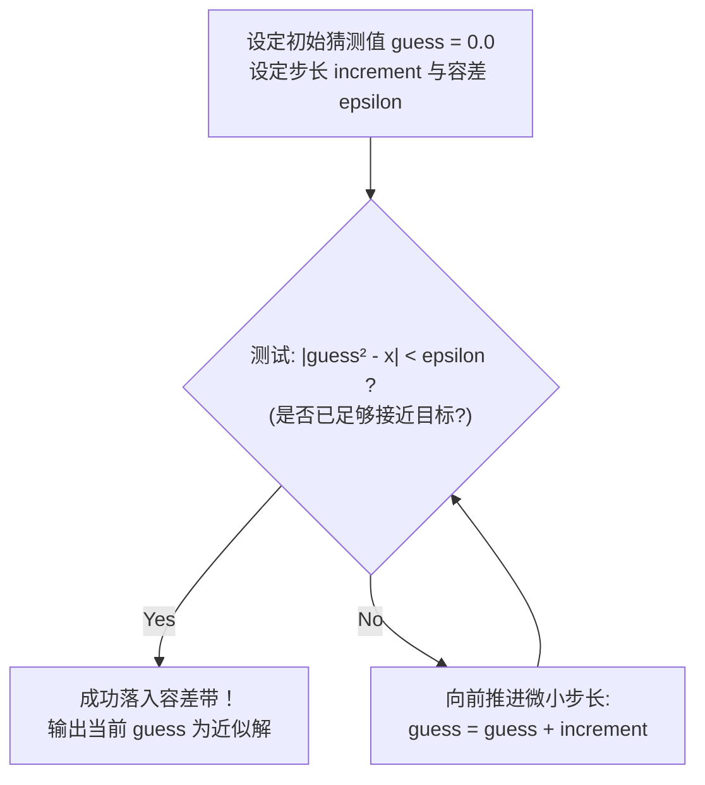
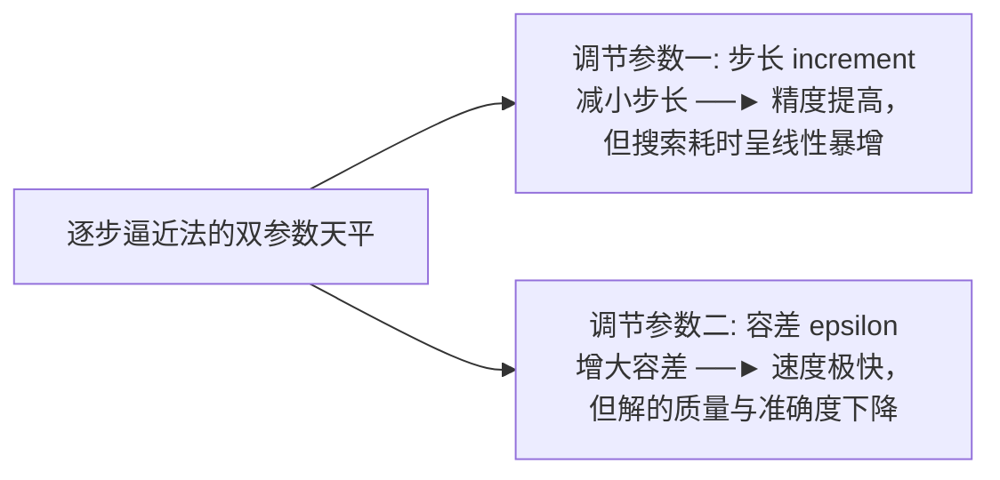

# Lec 5 浮点数精度机理与逐步逼近法

## TL;DR

- **浮点数底层机理**：理解为什么十进制小数在二进制下会变成无限循环小数，永远牢记使用 $|a - b| < \epsilon$ 代替危险的 `==`；
- **逐步逼近算法**：学会设定容差与步长，掌握解决非整数连续实数问题的计算范式；
- **步长穿透防御**：警惕非线性放大效应跳过容差带，编写具备上限熔断的安全循环。

---

## 1. 谜题引入：为什么计算机中 $0.1 \times 10 \ne 1.0$？

**Ana Bell 博士**：大家下午好！让我们正式开始第 5 讲。

在今天的讲座中，我们将解开上一讲留下的悬念，探讨计算机科学中最著名、也是在科学计算与工业软件中夺走无数程序员睡眠的底层物理谜题——**浮点数的表示缺陷与误差积累**；在此基础上，我们将正式推出本课程的第二大核心算法：**逐步逼近法（Approximation Methods）**。

让我们首先看一段极其简单、却足以颠覆许多初学者常识的代码：

```python
x = 0.0
for _ in range(10):
    x += 0.1

print(f"累加 10 次后的 x 值为: {x}")
print(f"x == 1.0 的比较结果为: {x == 1.0}")
```

在终端运行这段代码，屏幕上赫然输出了：
```text
累加 10 次后的 x 值为: 0.9999999999999999
x == 1.0 的比较结果为: False
```

任何一个受过基础数学训练的人都会惊呼：$0.1 \times 10$ 难道不严格等于 $1$ 吗？为什么在号称“绝对严谨”的计算机中，结果竟然是 `0.9999999999999999`？为什么比较判断会得出荒谬的 `False`？

如果连这种小学生都会算的简单加法计算机都会算错，我们还怎么敢用计算机去控制航天飞机轨道、设计桥梁结构或计算金融利息？

为了彻底搞清楚这个问题，我们必须下潜到数字在计算机底层的**二进制物理表示**。

---

## 2. 浮点数在计算机底层的本质：十进制 vs 二进制小数

**Ana Bell 博士**：在第 4 讲中我们讲过，整数在二进制中具有绝对精确的对应表示。

那小数（Fractions / Floats）呢？

在人类熟悉的十进制（Base 10）中，一个带有小数点的小数 $0.abc$ 展开的数学本质是：
$$0.abc_{10} = a \times 10^{-1} + b \times 10^{-2} + c \times 10^{-3} = \frac{a}{10} + \frac{b}{100} + \frac{c}{1000}$$
其中每一位系数 $a, b, c$ 只能是 $0$ 到 $9$ 之间的整数。

而在计算机底层的二进制（Base 2）中，小数点后的每一位代表的是 **$2$ 的负整数次幂**：
$$0.abc_2 = a \times 2^{-1} + b \times 2^{-2} + c \times 2^{-3} = \frac{a}{2} + \frac{b}{4} + \frac{c}{8} + \frac{d}{16} + \dots$$
其中每一位系数只能是 **$0$ 或 $1$**！

让我们把前几位 2 的负幂次换算成十进制数值看一看：
- $2^{-1} = \frac{1}{2} = 0.5$
- $2^{-2} = \frac{1}{4} = 0.25$
- $2^{-3} = \frac{1}{8} = 0.125$
- $2^{-4} = \frac{1}{16} = 0.0625$
- $2^{-5} = \frac{1}{32} = 0.03125$

::: definition 二进制可精确表示小数的充要条件
一个十进制小数能够在二进制计算机中被**完全精确、有限位数**地表示，当且仅当该小数能够被严格表达为**一组不重复的 $2^{-k}$ 的线性求和**（即该小数的分母在约分后，质因数分解只能包含 $2$）。
:::

例如：
- $0.5 = 2^{-1} \implies 0.1_2$（精确无误）；
- $0.625 = 0.5 + 0.125 = 2^{-1} + 2^{-3} \implies 0.101_2$（精确无误）；
- $0.375 = 0.25 + 0.125 = 2^{-2} + 2^{-3} \implies 0.011_2$（精确无误）。

### 灾难的核心：$0.1$ 的无限循环性

那么，十进制中的 **$0.1$（$\frac{1}{10}$）** 能否拆解为有限项的 2 的负幂次相加呢？

数学推导告诉我们：$10$ 的质因数分解为 $2 \times 5$。由于包含了质因数 $5$，$0.1$ 在二进制体系下是一个**绝对无法有限除尽的无限循环小数**！
$$0.1_{10} = 0.00011001100110011001100110011\dots_2$$

正如在十进制中你永远无法用有限位小数写出 $\frac{1}{3} = 0.333333\dots$ 一样，二进制计算机也永远无法用有限位内存写全 $0.1$！

而计算机硬件内部的寄存器与浮点数单元（IEEE 754 标准）只有有限的 64 位（53 位有效数字）物理宽度。面对无穷无尽的尾数，计算机唯一能做的就是**在某一位强行截断舍入**。

这就意味着：**只要你在 Python 中敲下 `0.1`，计算机内存中存储的真实数值就不是严格的 $0.1$，而是一个极其接近 $0.1$ 的近似值（约为 `0.100000000000000005551115123126`）！**

当你将这个自带微小截断误差的数字连续累加 10 次，误差被放大了 10 倍，最终浮现为肉眼可见的 `0.9999999999999999`！

---

## 3. 算法实现：将十进制小数转换为二进制字符串

**Ana Bell 博士**：为了让大家在算法层面亲眼看到这个转换过程，我们来编写一个程序：输入任意十进制纯小数 $x \in (0, 1)$，将其转换为二进制字符串形式。

### 算法“配方”推导（The Conversion Recipe）

如何把小数转换转化为我们上一讲学过的整数转换？
1. **整数化放大**：我们寻找最小的正整数 $p$，使得 $x \times 2^p$ 恰好变成一个整数（即没有小数部分，`remainder == 0`）；
2. **整数转二进制**：利用上一讲的除 2 取余算法，将这个放大后的整数转换成二进制字符串；
3. **小数点反向回退**：原先乘以了 $2^p$，现在我们只需在二进制字符串中，**将小数点向左移动 $p$ 位**（如果位数不足则在前面补 `0`）。

```python
# float_to_binary.py
x = float(input("请输入一个在 (0, 1) 之间的纯小数 (如 0.625 或 0.1): "))

p = 0
# 步骤 1: 寻找最小的指数 p，使得 x * (2**p) 成为整数
while ((2**p) * x) % 1 != 0:
    p += 1
    if p > 55:  # 安全熔断: 防止无限循环小数死循环
        break

num = int(x * (2**p))
result = ""

# 步骤 2: 将该整数转换为二进制
if num == 0:
    result = "0"
while num > 0:
    result = str(num % 2) + result
    num = num // 2

# 步骤 3: 补齐前导 0 并向左平移小数点 p 位
for _ in range(p - len(result)):
    result = "0" + result

result = "0." + result

print(f"{x} 的二进制表示为: {result}")
print(f"放大指数 p 为: 2 的 {p} 次方")
```

### 控制台推演对比：
- 输入 `0.625`：程序瞬间得出 $p = 3$（因为 $0.625 \times 8 = 5$），$5_{10} = 101_2$，向左移 3 位得到 `0.101`；
- 输入 `0.1`：循环狂奔不止，直到触碰我们设定的熔断阈值 $p > 55$！其输出是一长串密集交替的 `001100110011...`。这以无可辩驳的证据证明了：**在计算机底层，$0.1$ 确实是无限不循环/无限循环的截断产物！**

---

## 4. 第二核心算法：逐步逼近法（Approximation Methods）

**Ana Bell 博士**：既然浮点数在计算机中存在天然的微小舍入误差，并且现实世界中的绝大多数数学解（例如 $\sqrt{2} = 1.41421356\dots$、$\sqrt{5}$）都是包含无限不循环小数的无理数，那么在上一讲中使用的“穷举整数相等测试”就彻底失效了。

因为：**你永远不可能找到一个有限浮点数 $g$，使得 $g \times g == 2$ 严格成立！**

面对连续域中的实数求解，计算机科学给出的标准答案就是**逐步逼近法（Approximation Methods）**。



::: definition 逐步逼近法的哲学基石：“足够好（Good Enough）”
逐步逼近法不再追求虚妄的“绝对数学精确”，而是追求**“在预设容差范围内的工程足够好”**：
1. **预设容差 $\epsilon$（Epsilon）**：设定我们允许的最大绝对误差边界（例如 $\epsilon = 0.01$ 或 $10^{-6}$）；
2. **终止准则**：只要当前的候选解满足：
   $$|\text{guess}^2 - x| < \epsilon$$
   我们就宣布：**当前的猜测值已经充分落入接受窗口，求解成功并停机！**
3. **步长 $\text{increment}$**：每次迭代向前移动的微小步幅（如 $0.0001$）。
:::

---

## 5. 逼近法实战：求平方根与 Python 实现

**Ana Bell 博士**：让我们用逐步逼近法来求解平方根。

算法逻辑非常直白：
- 我们从一个确信偏小的数值开始（例如 `guess = 0.0`）；
- 只要当前的 `guess` 还没落入容差窗口（即 $|guess^2 - x| \ge \epsilon$），我们就不断给它加上一个微小的步长 `increment = 0.0001`；
- 一旦进入容差窗口，立即跳出循环。

```python
# sqrt_approximation.py
x = 36
epsilon = 0.01
step = 0.0001

guess = 0.0
num_guesses = 0

# 核心判定: 只要误差仍大于等于 epsilon，就持续逼近
while abs(guess**2 - x) >= epsilon:
    guess += step
    num_guesses += 1

print(f"总共进行了 {num_guesses} 次猜测")
print(f"{x} 的平方根近似解为: {guess}")
```

运行这段程序计算 $\sqrt{36}$：
```text
总共进行了 59992 次猜测
36 的平方根近似解为: 5.999199999994645
```
虽然理论精确解是 $6.0$，但 $5.9992^2 \approx 35.9904$，与 $36$ 的误差仅仅为 $0.0096 < 0.01$，**完全满足我们预设的工程容差要求**！

---

## 6. 致命陷阱剖析：步长穿透容差带（Overshooting Epsilon）

**Ana Bell 博士**：现在，请大家坐稳，我们将迎来本节课最震撼的一个现场 Debug 翻车时刻！

我们用同一套代码，测试一下其他数字：
- 计算 $x = 24$：耗时极短，成功输出 $\approx 4.8989$；
- 计算 $x = 2$：耗时极短，成功输出 $\approx 1.4142$；
- 计算 $x = 12345$：由于数字变大，循环猜了约 111 万次，大约暂停了 1 秒钟，成功给出 $\approx 111.108$。

看起来这套算法坚不可摧对不对？

**现在，让我们把目标输入换成：$x = 54321$。**

点击运行！

……1 秒过去了。
……5 秒过去了。
……15 秒过去了。控制台依旧悄无声息，风扇狂转，程序彻底卡死！

Ana Bell 博士不得不按下 `Control-C` 强行终止程序。

### 现场侦探调查：到底发生了什么？

为什么求解 $12345$ 只需要 1 秒，而仅仅大了一点的 $54321$ 就会导致程序**永远无法终止**？

让我们使用上一讲教给大家的独门绝技——**打印调试法（Print Debugging）**！我们在循环内部每隔 100,000 次猜测打印一行当前的 `guess` 以及与目标的绝对距离 $|guess^2 - x|$：

```text
第 100,000 次: guess = 10.00,  距离目标: 54221.0
第 1,000,000 次: guess = 100.00, 距离目标: 44321.0
第 2,000,000 次: guess = 200.00, 距离目标: 14321.0
第 2,300,000 次: guess = 230.00, 距离目标: 1421.0  (飞速逼近中!)
第 2,330,000 次: guess = 233.00, 距离目标: 32.1    (胜利在望!)
第 2,340,000 次: guess = 234.00, 距离目标: 435.0   (等等! 距离怎么开始变大了?!)
第 3,000,000 次: guess = 300.00, 距离目标: 35679.0 (越跑越远!)
第 5,000,000 次: guess = 500.00, 距离目标: 195679.0 (彻底失控奔向无穷大!)
```

### 图像化几何揭秘：步长穿透（Overshooting）

请大家看下面这幅现场黑板图解：

```text
                               目标 x = 54321
                                     ▼
                     [ x - ε ]       |       [ x + ε ]
─────────────────────────┬───────────┼───────────┬────────────────────────► guess²
                         │◄── 容差窗口 2ε ──────►│
                                     |
 猜测点 n:   guess² = 54320.985 ──────| (在容差带左侧边缘)
                             \       |
                              \ (单步跨度 Δ(guess²) = 0.046 > 2ε = 0.02)
                               \     |
 猜测点 n+1:                    ──────┼────────► guess² = 54321.031 (一脚直接跨过了容差带!)
```

**Ana Bell 博士**：真相大白了！
当 `guess` 逼近到理论解 $\sqrt{54321} \approx 233.06866$ 附近时：
- 由于平方运算的非线性放大效应：
  $$\Delta(g^2) \approx 2g \cdot \Delta g \approx 2 \times 233 \times 0.0001 \approx 0.0466$$
- 也就是说，当 `guess` 每次只增加微不足道的 $0.0001$ 时，它的**平方值 $guess^2$ 每次却会跨越近 $0.0466$ 的距离！**
- 而我们设定的容差窗口 $[x - 0.01, x + 0.01]$ 的总物理宽度只有 **$0.02$**！
- 步长的跨度（$0.0466$）竟然**远远大于容差窗口自身的总宽度（$0.02$）**！
- 结果就是：**上一轮迭代时还在容差带的左侧，仅仅走了一步，下一轮就直接跨到了容差带的右侧！它直接从容差带的正上方“凌空飞跃”了过去！**
- 一旦跳过容差带，由于 `guess` 依然在不断单调递增，$guess^2$ 离目标越来越远，误差永远大于 $\epsilon$，循环直接化身永动机，陷入不可逆转的死循环！

---

## 7. 防御性工程重构：步长缩小与上限守卫

**Ana Bell 博士**：面对这种“步长穿透”的恶疾，我们在软件工程中有两种对症下药的解法：

### 解法一：调小步长（Shrink the Step）
既然跨度太大跳过了窗口，那我们把步长缩小 10 倍，改为 `step = 0.00001`。
- 优点：单步跨度变小，能够稳稳落进容差带；
- 缺点：总循环次数直接暴增 10 倍（从 230 万次狂飙到 2300 万次），程序运行耗时从 1 秒变成 10 秒以上！

### 解法二：架构加固——增加单调性上限守卫（Fail-Safe Guard）
在工业级代码中，我们绝不能允许程序在参数不匹配时直接以死循环崩盘。我们必须让循环在“一旦发现已经越界跑偏”时，能够**安全脱出并诚实报告失败**！

因为在平方根问题中，$guess^2$ 随着迭代严格单调递增。一旦 $guess^2 > x$，就意味着已经彻底越过了目标，不可能再有任何机会进入误差带。

```python
# sqrt_approximation_robust.py
x = 54321
epsilon = 0.01
step = 0.0001

guess = 0.0
num_guesses = 0

# 增加安全守卫: guess**2 <= x
# 只要没进容差带，且尚未越界超过 x，才允许继续寻找
while abs(guess**2 - x) >= epsilon and (guess**2) <= x:
    guess += step
    num_guesses += 1

print(f"总计尝试次数: {num_guesses}")

# 退出循环后做诚实结算
if abs(guess**2 - x) >= epsilon:
    print(f"求解失败！在当前步长 ({step}) 与容差 ({epsilon}) 下，算法跳过了目标容差带。")
    print(f"最后的越界猜测值为: {guess}，其平方为: {guess**2}")
else:
    print(f"成功找到近似解: {guess}")
```

运行加固版代码，程序会在 $0.5$ 秒内从容退出，并清晰提示越界失败。**宁可快速报告失败，也绝不容忍无响应的死循环！**

---

## 8. 逼近算法的核心权衡：速度 vs 精度（Speed vs. Accuracy）

**Ana Bell 博士**：通过逐步逼近法，我们触碰到了算法工程中最深刻的永恒主题——**权衡（Trade-offs）**。



在工程实践中：
- 如果你需要更高的精度：必须缩小 `increment`，代价是付出成倍的算力与等待时间；
- 如果你需要毫秒级的快速响应：可以适当放大 `epsilon` 容差带，代价是接受稍显粗糙的近似解。

没有放之四海而皆准的完美参数，唯有根据实际应用场景做出的清醒权衡。

---

## 9. 课程总结

### 算法演进的终极叩问

**Ana Bell 博士在黑板前留下了本讲最震撼的一个思考题**：
大家看到，哪怕我们把参数调对，为了求一个 $\sqrt{54321}$，逐步逼近法依然要像蚂蚁爬树一样，从 $0.0$ 开始每次迈出 $0.00001$ 的微小步子，足足循环了 **2300 万次**，耗时近 10 秒！

对于人类常识而言，我们一眼就知道 $\sqrt{54321}$ 绝不可能在 $0$ 到 $100$ 之间，它的真实解必然在 $200$ 多附近。让计算机从 $0$ 慢慢爬过去，简直是极大的算力浪费！

**在计算机科学中，是否存在一种算法，能够不必像蚂蚁一样爬行，而是每一轮直接将搜索范围砍掉整整一半？**

答案是：**必须有！**

在下一讲（**Lecture 6: Bisection Search**）中，我们将正式迎来算法历史上最壮丽的里程碑——**二分查找法（Bisection Search）**！我们将亲眼见证它如何将 2300 万次的漫长等待，瞬间压缩到不可思议的 **30 次对数级计算**！
