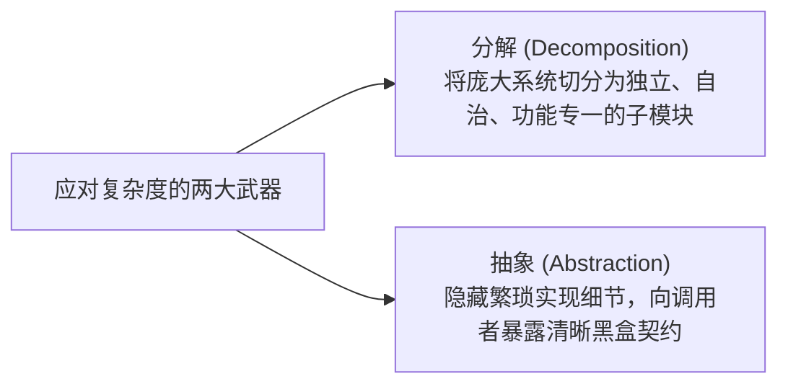

# Lec 6 二分查找法与对数复杂度收敛

> MIT 6.100 · 计算机科学与 Python 编程导论 · Fall 2026 · 教材参考：Guttag 17.2–17.4

## TL;DR

- **二分查找法（Bisection Search）的前提与精髓**：二分查找法能够生效的**唯一数学前提是搜索空间具备严格的单调有序性（Monotonicity）**。每一轮通过取当前搜索区间的几何中点（Midpoint），结合问题的单调反馈，**直接剔除整整一半的无效候选解空间**。
- **对数级复杂度（Logarithmic Growth: $O(\log n)$）的威力**：在大小为 $n$ 的搜索空间中，经过 $k$ 轮二分，剩余空间压缩为 $\frac{n}{2^k}$。当收敛至单一解时，所需步数仅为 $k = \log_2 n$。搜索空间扩大一倍，二分法仅仅增加 **1 次** 猜测；将搜索空间从百万扩大到十亿，仅仅需要增加约 10 次判断！
- **震撼工程实测（降维打击）**：在求解 $\sqrt{54321}$（容差 $\epsilon = 0.01$）时，上一讲的逐步逼近法（步长 $10^{-5}$）耗费了 **23,000,000 次循环（近 20 秒）**；而二分查找法**仅仅用了 30 次运算（耗时不到 0.001 秒）**便精确命中了完全相同的答案！
- **经典边界陷阱：当 $0 < x < 1$ 时的区间反转**：对于大于 1 的正数，$\sqrt{x} < x$，初始搜索区间设为 $[0, x]$ 是成立的；但当 $0 < x < 1$ 时（如 $x = 0.5$），其平方根 $\sqrt{0.5} \approx 0.707 > 0.5$，真实解落在了 $[0, x]$ 的外部！若盲目设定 `high = x` 会导致死循环。必须做分支防御：当 $x < 1$ 时，搜索区间必须设定为 $[x, 1.0]$。

---

## 1. 课程复习与引入：从逐步逼近到对数级飞跃

**Ana Bell 博士**：大家下午好！欢迎来到第 6 讲。

在上一堂讲义的结尾，我曾向大家许下一个承诺：我们将告别像蚂蚁一样缓慢爬行的穷举与逐步逼近，迎来一个更加宏大、威力无与伦比的全新算法——**二分查找法（Bisection Search）**。

让我们快速回顾一下，我们为什么需要二分法：
- 在第 4 讲的**穷举猜想检验法（Guess-and-Check）**中，我们只能处理有限的整数，一旦面对连续实数或无理数便无能为力；
- 在第 5 讲的**逐步逼近法（Approximation Methods）**中，我们引入了容差窗口 $\epsilon$（Epsilon），从 $0.0$ 开始以微小步长（例如 $0.0001$ 或 $0.00001$）一步步向前挪动。

我们在上一讲看到，为了求解 $\sqrt{54321}$，逐步逼近法为了不穿透容差带，被迫将步长缩小到 $0.00001$，足足在内存中循环迭代了 **2300 万次**，整整跑了近 20 秒！

对于现代计算机和追求高效的工程师而言，为了求一个并不算大的数字的平方根，等待 20 秒是绝对无法接受的。

计算机在执行计算时，难道只能像盲人摸象一样，一步一步单调向前试探吗？

答案当然是否定的。今天，我们就将揭开二分查找法的神秘面纱！

---

## 2. 算法直觉：448 页教材藏 100 美元纸钞实战

**Ana Bell 博士**：为了让大家在脑海中建立起二分法最深刻的直觉模型，在看任何一行代码之前，我想在现场和大家玩一个真实的游戏。

我手里拿的这本教材（John Guttag 教授著《Python 计算与编程导论》）一共有 **448 页**。

> **游戏规则**：我在整本书的某一页中悄悄夹入了一张 **100 美元**的崭新钞票。如果现场有同学能在 **8 次以内的猜测中**猜出钞票具体夹在第几页，这 100 美元当场归你！如果超过 8 次没猜中，你挂科——开个玩笑，不会挂科。

有人愿意上来玩这个游戏吗？

大家一开始都在摇头。因为如果纯靠盲猜（Guess-and-Check），在 448 页中猜 8 次，获胜的概率只有可怜的 $\frac{8}{448} = \frac{1}{56} \approx 1.7\%$。

**Ana Bell 博士**：现在，我给游戏增加一条至关重要的**反馈机制**：
> **补充规则**：对于你的每一次猜测，如果没中，我会当场诚实地告诉你：**“猜大了（Too high）”还是“猜小了（Too low）”**！

有同学举手了！一位男同学走上了讲台。

### 现场互动全实录

**Ana Bell 博士**：好的，你只有 8 次机会。全书 1 到 448 页，请给出你的第 1 次猜测！

- **学生第 1 猜**：`224`。（正好是 448 的一半！）
  - **Ana Bell 博士翻开书检查**：没在中。我给出反馈：**猜大了（Too high）！**
- **学生第 2 猜**：既然 224 大了，那在 1 到 224 之间取中点：`112`！
  - **Ana Bell 博士反馈**：依然**猜大了（Too high）！**
- **学生第 3 猜**：112 的一半：`56`！
  - **Ana Bell 博士反馈**：依然**猜大了（Too high）！**
- **学生第 4 猜**：56 的一半：`28`！
  - **Ana Bell 博士反馈**：还是**猜大了（Too high）！**
- **学生第 5 猜**：28 的一半：`14`！
  - **Ana Bell 博士仔细核对**：啊！这次**猜小了（Too low）！**
- **学生第 6 猜**：此时区间被精准锁定在 14 到 28 之间，取中点：$(14 + 28) // 2 = 21$！
  - **Ana Bell 博士翻开第 21 页**：……天哪！全班掌声雷动！钞票真的就夹在第 21 页！这位同学只用了 **6 次猜测**，就从 448 页的茫茫书海中锁定了答案，当场赢走了 100 美元！

---

## 3. 二分法的理论基石：单调性与对数级复杂度（$O(\log n)$）

**Ana Bell 博士**：让我们复盘这位同学为什么能够必胜。

在猜 224 时，当听到“猜大了”的一瞬间，**他相当于把整本 448 页的书当场撕成了两半，把后面 224 页直接扔进了垃圾桶！**

这就是二分法（Bisection Search）的核心本质：


::: definition 二分查找法生效的前提约束：单调性（Monotonicity）
二分查找法之所以能够无情地抛弃另一半搜索空间，其唯一且不可动摇的数学前提是：**整个解空间必须具备严格的单调有序性（Monotonic Property）！**  
书本的页码是从小到大严格递增排列的。正因如此，当你知道第 224 页偏大时，你拥有绝对的数学底气断定：第 225 页到第 448 页当中的任何一页都必然偏大，根本连看都不用看！  
如果这本书的页码是被恶意打乱、随机装订的，二分法将瞬间彻底失效。
:::

### 复杂度飞跃：线性增长 vs 对数增长

让我们对比两种算法在搜索空间扩大时的性能表现：

- **线性增长（Linear Growth: $O(n)$，如逐步逼近）**：
  若把书本厚度扩大一倍（从 448 页变成 896 页），在最坏情况下，人类或计算机需要多问 **448 次**！
- **对数增长（Logarithmic Growth: $O(\log n)$，二分查找）**：
  每走一步，搜索空间减半：$\frac{n}{2} \to \frac{n}{4} \to \frac{n}{8} \to \dots \to \frac{n}{2^k}$。
  当空间压缩到只剩最后 1 个元素时，算法收敛停机：
  $$\frac{n}{2^k} = 1 \implies 2^k = n \implies k = \log_2 n$$
  **如果把书本厚度翻倍变成 896 页，二分查找仅仅需要多猜 1 次！**

| 搜索空间大小 $n$ | 线性遍历最大步数（$O(n)$） | 二分查找最大步数（$\lceil \log_2 n \rceil$） |
| :---: | :---: | :---: |
| 10 | 10 | 4 |
| 1,000 | 1,000 | 10 |
| 1,000,000（一百万） | 1,000,000 | 20 |
| 1,000,000,000（十亿） | 1,000,000,000 | 30 |

从一百万到十亿，解空间暴增了 1000 倍，而二分法消耗的步数**仅仅从 20 步增加到 30 步**！这就是对数算法的魔力。

---

## 4. 二分查找求平方根：状态模型与边界更迭

**Ana Bell 博士**：现在，我们把这套高超的思想落实到求平方根的代码中。

我们要寻找一个浮点数 $g$，使得 $|g^2 - x| < \epsilon$。

因为对于 $x \ge 1$，函数 $f(g) = g^2$ 在区间 $[0, x]$ 上是**严格单调递增**的，这完美满足二分法的单调性要求！

### 状态变量与更新规则
1. **区间维护**：我们维护两个游标：下界 `low = 0.0`，上界 `high = x`；
2. **取中点猜测**：`guess = (low + high) / 2.0`；
3. **计算误差与反馈决策**：
   - 如果 $guess^2 < x$：说明当前猜测**偏小了（Too low）**！根据单调性，任何小于等于 `guess` 的数值都必然偏小。因此，我们果断**将下界右移：`low = guess`**，剔除整个左半区间；
   - 如果 $guess^2 > x$：说明当前猜测**偏大了（Too high）**！我们果断**将上界左移：`high = guess`**，剔除整个右半区间；
4. **重新计算中点**：用更新后的边界再次计算 `guess = (low + high) / 2.0`，并重复上述循环，直至满足容差 $|guess^2 - x| < \epsilon$。

```python
# sqrt_bisection.py
x = 54321
epsilon = 0.01

num_guesses = 0
low = 0.0
high = x
guess = (low + high) / 2.0

# 只要误差尚未落入容差窗口，就持续对半收敛
while abs(guess**2 - x) >= epsilon:
    if guess**2 < x:
        low = guess   # 偏小: 下界抬高至中点
    else:
        high = guess  # 偏大: 上界压低至中点
    
    guess = (low + high) / 2.0
    num_guesses += 1

print(f"总计尝试次数: {num_guesses}")
print(f"{x} 的平方根近似解为: {guess}")
```

---

## 5. 震撼实测对比：2300 万次 vs 30 次的降维打击

**Ana Bell 博士**：现在，见证奇迹的时刻到了。

我们让二分法去求解在上一讲中把逐步逼近法折磨得痛不欲生的数字：$x = 54321$，容差设定为极为严苛的 $\epsilon = 0.01$。

点击运行！

**一瞬间——连眨眼的时间都不到，控制台立刻输出了结果！**

```text
总计尝试次数: 30
54321 的平方根近似解为: 233.06868612766266
```

请大家屏住呼吸对比这两组数据：

| 算法名称 | 求解 $x = 54321, \epsilon = 0.01$ 耗费循环次数 | 实际运行耗时 |
| :--- | :---: | :---: |
| **逐步逼近法（Approximation）** | **23,000,000 次**（两千三百万次！） | **约 20 秒**（CPU 满载狂转） |
| **二分查找法（Bisection Search）** | **30 次**（整整 30 次！） | **< 0.001 秒**（瞬间完成） |

**Ana Bell 博士**：大家看，这不是从 2300 万次减少到 500 万次，而是**直接从千万量级暴降到了两位数——30 次！**

这就是算法设计的终极魅力。在面对大规模计算问题时，优秀的算法能够跨越硬件物理极限，形成降维打击。

---

## 6. 经典陷阱与边界防御：当 $0 < x < 1$ 时的区间反转

**Ana Bell 博士**：二分查找虽然无比强大，但如果盲目套用，同样会掉进极其隐蔽的数学陷阱中。

请大家思考一个场景：**如果我们要求 $x = 0.5$ 的平方根，刚才那段代码会怎样？**

让我们在终端运行 `x = 0.5`：
程序瞬间失去响应，再次陷入**死循环**！

### 为什么 $x = 0.5$ 会导致死循环？

让我们单步跟踪边界：
- 我们的初始区间设定为 `low = 0.0, high = x = 0.5`；
- 这意味着我们是在 $[0.0, 0.5]$ 的闭区间内寻找平方根！

然而，**对于任何在 $(0, 1)$ 之间的小数，其平方根必然大于它本身！**
$$\sqrt{0.5} \approx 0.7071 > 0.5$$

真实解 $0.7071$ **从一开始就被我们关在了搜索区间 $[0, 0.5]$ 的大门之外！**

在二分法内部，`guess` 只能在 $[0, 0.5]$ 之间不断震荡逼近到 $0.5$，但 $0.5^2 = 0.25$ 离 $0.5$ 的距离永远是 $0.25 > 0.01$，导致 `abs(guess**2 - x) >= epsilon` 永远为真，算法陷入无解死循环！

### 防御性区间自适应构建

面对不同范围的输入，我们必须根据数学性质自适应调整初始边界：

```mermaid
flowchart TD
    Check{"目标 x 的取值范围?"}
    Check --"x >= 1.0"--> Case1["正常情况 (√x <= x):<br/>low = 1.0, high = x"]
    Check --"0 < x < 1.0"--> Case2["小数倒置 (√x > x):<br/>low = x, high = 1.0"]
# 健壮自适应二分查找
x = 0.5
epsilon = 0.01

if x >= 1.0:
    low = 1.0
    high = x
else:
    # 针对 (0, 1) 之间的小数，其平方根必然位于 [x, 1.0] 之间！
    low = x
    high = 1.0

guess = (low + high) / 2.0
num_guesses = 0

while abs(guess**2 - x) >= epsilon:
    if guess**2 < x:
        low = guess
    else:
        high = guess
    guess = (low + high) / 2.0
    num_guesses += 1

print(f"总计猜测次数: {num_guesses}")
print(f"{x} 的平方根近似解为: {guess}")  # 精准输出: 0.70703125
```

---

## 7. 算法推广：立方根与全数域二分架构

**Ana Bell 博士**：二分查找绝不仅限于求平方根。因为立方函数 $f(g) = g^3$ 在整个实数域 $(-\infty, +\infty)$ 上都是**严格单调递增**的，它同样完美适配二分查找！

面对立方根问题，甚至连负数都能优雅处理：
- 当 $x \ge 1$ 时：区间为 $[1, x]$；
- 当 $0 < x < 1$ 时：区间为 $[x, 1]$；
- 当 $-1 < x < 0$ 时：区间为 $[-1, x]$；
- 当 $x \le -1$ 时：区间为 $[x, -1]$。

只需根据单调方向更新边界，二分法就能在几十步内征服任何单调连续方程的求根问题。

---

## 8. 模块一结语与模块二序幕：分解与抽象的召唤

**Ana Bell 博士**：到今天为止，我们正式完成了 **MIT 6.100L 的第一大模块（Lec 01–06：计算思维、标量类型、控制流与经典算法）**。

请大家回头审视一下我们这几周写出来的代码：
我们写了复杂的猜数字、写了啦啦队助威、写了二进制转换、写了牛顿法、写了二分查找……

但是，大家有没有感觉到一种深深的疲惫与混乱？

我们所有的代码都是**平铺直叙的“面条式代码（Spaghetti Code）”**：
- 如果我们需要在一个大系统中求 5 次不同数字的平方根，难道我们要把那段二分查找的代码原样复制粘贴 5 次吗？
- 一旦某处变量名（如 `x`、`guess`）写串，或者修改了容差却漏改了其中一处，整个程序就会瞬间崩溃；
- 别人阅读你的代码时，必须把 30 行二分查找细节从头读到尾，才能看懂你到底在算什么。

为了解决软件工程的复杂度危机，计算机科学确立了两大立身基石：



1. **模块分解（Decomposition）**：将复杂的大任务分解为一个个自给自足、相互协作的小构件；
2. **黑盒抽象（Abstraction）**：一旦某个构件被正确编写并测试通过，其他人在使用它时，**根本不需要关心它是怎么实现的！只需要知道给它什么输入、它会吐出什么输出即可！**

在下一讲（**Lecture 7**）中，我们将正式推开现代软件工程的大门，学习如何利用 **函数（Functions）** 实现代码的模块分解与黑盒抽象！

---

## 9. 课程小结与课后指引

- **二分法本质**：依托解空间的严格单调性，以对数级步数（$\log_2 n$）闪电收敛；
- **自适应边界**：牢记 $0 < x < 1$ 时平方根大于原数的数学边界倒置；
- **算法演进阶梯**：从暴力穷举 $O(n)$ 到对数二分 $O(\log n)$，深刻体会算法结构对计算性能的决定性意义。

谢谢大家，我们下周一正式开启模块二的大门！
