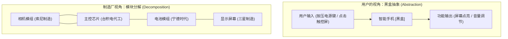
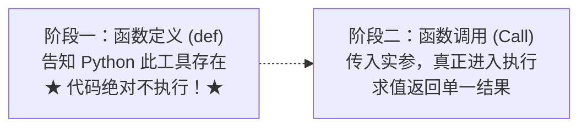
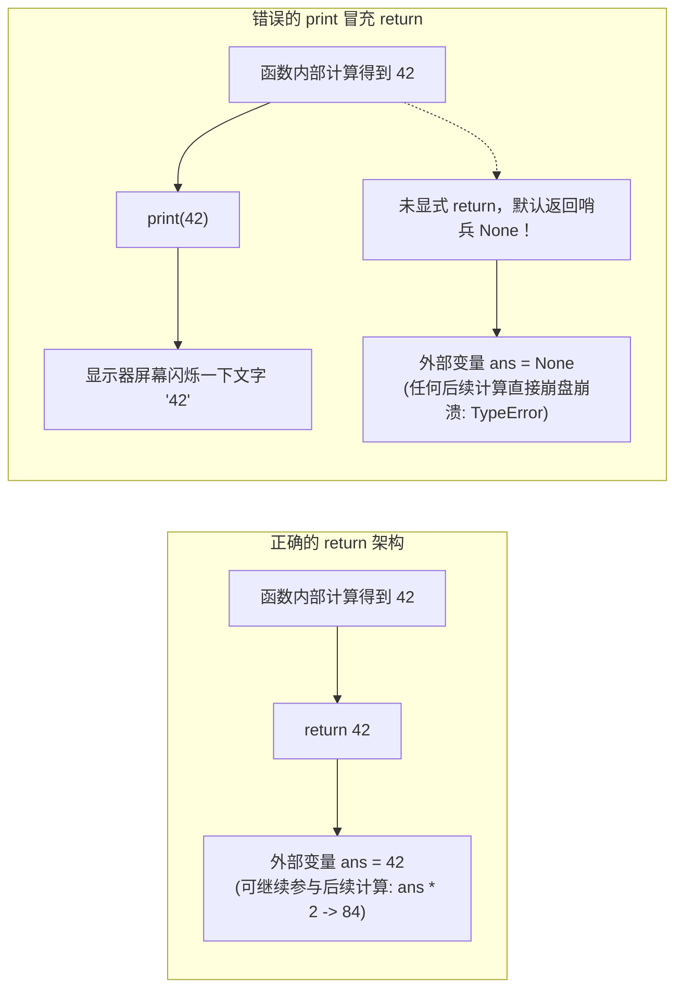
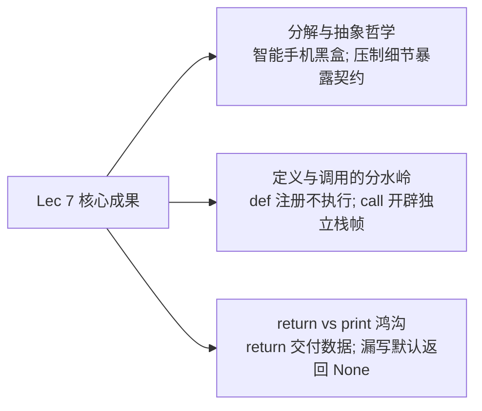

# Lec 7 模块分解、抽象封装与函数机制

> MIT 6.100 · 计算机科学与 Python 编程导论 · Fall 2026 · 教材参考：Guttag 19, 21.1–21.4, 22

## TL;DR

- **软件复杂度的双重护甲：分解与抽象**：**模块分解（Decomposition）**将庞大臃肿的面条式代码（Spaghetti Code）拆分为功能单一、自治自洽的独立构件；**抽象封装（Abstraction）**将实现细节隐藏在黑盒内部，仅通过输入/输出契约与外界交互。
- **心智模型的根本跃迁：定义（`def`） vs 调用（`call`）**：编写 `def func(...)` **绝不会在定义时刻执行内部代码**！它仅仅是在 Python 内存中注册创建了一个函数对象。只有当解释器遇到显式的函数调用 `func(...)` 时，才会为其分配独立的栈帧并真正运行代码。一次定义，可千百次随处调用。
- **函数的四大解剖构件**：
  1. `def` 关键字与具备动词意图的函数名称；
  2. 括号内的形式参数列表（Parameters/Arguments）；
  3. 规范的三引号文档字符串（Docstring），白纸黑字定义输入前置约束与返回承诺；
  4. 缩进的函数体及将计算结果交付给调用者的 `return` 语句。
- **初学者第一混淆：`return` vs `print`**：`print()` 仅仅是将字符打印到终端屏幕供肉眼观看，其本身**没有任何返回值**；`return` 则是将计算结果作为表达式的值返回给调用它的程序上下文（支持链式计算或变量捕获）。若函数体内遗漏 `return`，Python 会默认隐式返回单例哨兵对象 **`None`**。
- **工程解题方法论：“先解决简化版问题”**：面对复杂函数需求（如累加闭区间奇数），先在纸上构造明确的输入输出样例，首先编写并调试通过最朴素的完整区间累加，随后再叠加奇数判定分支（或直接复用已有的 `is_even` 函数），步步为营杜绝差一错误。

---

## 1. 课程复习与引入：告别面条式代码的工程救赎

**Ana Bell 博士**：大家下午好！欢迎来到模块二的开篇讲义——第 7 讲。

在上一讲的结尾，我们完成了二分查找法的学习，见证了算法从 2300 万次到 30 次的震撼跨越。然而，我也向大家指出了我们在前六讲编写代码时不得不面对的一个痛点：

我们写的所有代码，都是平铺直叙地写在一个巨大的文件里——所有的变量直接暴露在同一个全局环境里，如果某段复杂的计算（例如求平方根或判断素数）在程序的不同地方需要用到五次，我们过去的唯一办法就是**复制粘贴五次**！

这种代码在软件工程界被形象地称为**面条式代码（Spaghetti Code）**：
- 极其难读：几百行代码纠缠在一起，缺乏清晰的层次边界；
- 极其难改：复制粘贴五次意味着只要算法需要微调一步，你就必须在五个地方同步修改，遗漏任何一处就会引发极其隐蔽的 Bug；
- 毫无复用性：你辛苦写出的优雅算法，无法打包交付给别人，甚至无法在自己的下一个程序中直接引用。

要拯救我们的大型程序，计算机科学确立了面向软件工程的两大立身武器：**模块分解（Decomposition）** 与 **黑盒抽象（Abstraction）**！

---

## 2. 现实隐喻：智能手机的黑盒抽象与工业模块分解

**Ana Bell 博士**：为了让大家在感性上真正理解这两个概念，让我们看看现代工业文明的奇迹——我们口袋里的**智能手机**。



### 1. 抽象封装（Abstraction）：压制无关细节的艺术
对于全世界数十亿手机用户而言，智能手机本质上就是一个**黑盒（Black Box）**。

作为用户，你完全不需要知道屏幕背后的 OLED 发光二极管物理分子结构，也不需要了解高通芯片内部数十亿个晶体管的微架构与电平翻转时序。

你能够从容使用手机，仅仅是因为你掌握了手机暴露给你的**接口（Interface）**：
- 当我按下右侧按键，屏幕关闭锁定；
- 当我在屏幕边缘上滑，后台多任务呼出；
- 当我按下音量键，扬声器分贝提升。

**抽象的本质，就是向使用者刻意压制、隐蔽所有的底层实现细节，只暴露干净清晰的输入输出接口。**

### 2. 模块分解（Decomposition）：大型系统的协同基石
正是因为有了抽象，才使得**模块分解（Decomposition）** 成为可能。

一部 iPhone 包含数百个极其精密的子系统：屏幕、摄像头、基带、电池、扬声器。苹果公司绝对不可能让同一个研发小组同时手搓这数百个部件。

现实世界的分工是：
- 索尼专门负责研发制造摄像头模组；
- 三星专门负责研发制造显示屏幕；
- 台积电专门负责代工光刻主处理器芯片。

这些分布在地球各地的独立制造商，是如何保证生产出来的零件在组装到一起时能够完美协同工作的？

答案是：**他们严格服从一套标准化、白纸黑字的输入输出契约规格说明书（Specifications / Contracts）！**  
索尼只需要确保摄像头模组在接收特定电压和时钟信号时输出标准格式的图像数据帧，它根本不需要关心三星的屏幕驱动电路是怎么写的。

**在软件工程中，我们要对代码做完全一样的事情！** 我们将复杂的系统拆解为一系列自治自洽的功能块，把每个功能块包装成黑盒，这个黑盒在 Python 中就叫作——**函数（Functions）**。

---

## 3. 心智模型的关键跃迁：定义函数（`def`） vs 调用函数（`call`）

**Ana Bell 博士**：进入函数世界后，大家必须在脑海中完成一次极其重要的**心智模型思维跃迁**。

在此之前，我们在 `.py` 文件中敲下代码并点击运行，我们的思维定势是：代码从第 1 行顺序执行到最后一行。

但从今天开始，代码将严格划分为两个阶段：



::: pitfall 核心心理表征：定义函数绝不等于运行函数！
**当 Python 遇到 `def` 关键字时，它仅仅是在做一件事情：在内存中注册并创建一个名为该函数名的函数对象，将后续缩进的代码块当成备用说明书保存起来！**

**缩进体内部的代码行，在定义时刻哪怕一行都不会被执行！**

定义函数就像你在厨房里写下了一张“烤披萨说明书”贴在墙上。写下说明书的瞬间，烤箱并不会发热，面粉也不会凭空混合。只有当未来某个时刻，有人下达指令“请按照说明书烤一份披萨（函数调用）”时，厨房才会真正开始动手干活！
:::

---

## 4. 函数的生理构造：命名、形参、文档字符串与 `return`

**Ana Bell 博士**：让我们解剖一个标准 Python 函数的完整生理构造。

以下是一个判定整数是否为偶数的标准函数：

```python
def is_even(i):
    """
    输入参数: i，一个正整数
    功能行为: 判断该正整数是否为偶数
    返回结果: 如果 i 是偶数返回 True，否则返回 False
    """
    remainder = i % 2
    if remainder == 0:
        return True
    else:
        return False
def  is_even  (     i     )  :
 │      │           │        │
 │      │           │        └─ 冒号: 开启缩进函数体
 │      │           └────────── 形式参数列表 (Parameters/Arguments)
 │      └────────────────────── 函数名 (具备动词意图的动作标识符)
 └───────────────────────────── 定义关键字 (Define)
```

### 1. `def` 关键字与函数命名
- `def`（Define 的缩写）：告诉解释器开启新函数定义；
- 函数名：**应该遵循 PEP 8 命名规范（小写字母与下划线 `snake_case`）**，且**强烈推荐使用具有动词性或判定性的词汇**（如 `is_even`、`calculate_area`、`find_root`），让阅读者一眼明白它的动作功能。

### 2. 形式参数列表（Parameters）
圆括号内声明了该函数在工作时**所必须依赖的外部输入输入原料**：
- 可以接收零个参数：`def get_pi():`
- 可以接收一个参数：`def is_even(i):`
- 可以接收多个参数，用逗号隔开：`def div_by(n, d):`

### 3. 文档字符串契约（Docstring）
紧跟在冒号之后的**三引号多行注释（`"""..."""`）**。在工业级工程中，这**绝不是可有可无的装饰，而是神圣的黑盒契约**！
它必须白纸黑字阐明三件事：
1. **前置约束（Preconditions）**：传入参数的数据类型与合理范围约束（如“$i$ 必须是一个正整数”）；
2. **计算功能（Description）**：该函数的核心物理目标；
3. **返回承诺（Postconditions / Returns）**：函数结束时保证交还给调用者的数据类型与语义。

### 4. 函数体与 `return` 语句
缩进在 `def` 下方的代码块构成了函数的内部实现。

当函数完成计算后，它必须使用关键字 **`return`** 将最终结果“交还”给外界。

---

## 5. 核心辨析：`return` 返回值 vs `print` 屏幕输出

**Ana Bell 博士**：在初学者阶段，有超过 80% 的同学会被 `return` 和 `print` 彻底搞糊涂。很多同学在写函数时喜欢这样写：

```python
# 混淆概念的初学者写法
def is_even(i):
    if i % 2 == 0:
        print(True)
    else:
        print(False)
```

在终端跑一下 `is_even(4)`，屏幕上确实跳出了 `True`。大家便误以为函数已经大功告成了。

**这是一种极其危险的误解！**

请观察下面这行代码：
```python
ans = is_even(4)
print(f"ans 的数值是: {ans}")
```
控制台的真实输出会瞬间把所有人看懵：
```text
True
ans 的数值是: None
```

为什么明明打印了 `True`，变量 `ans` 捕获到的值竟然是 **`None`**？！

::: definition 计算机科学本质鸿沟：`return` vs `print`
- **`print()`**：只是由 Python 运行时向操作系统的标准输出设备（屏幕显示器）抛出一段可见的像素字符，仅供人类肉眼读取。**`print` 产生的是“界面副作用（Side Effect）”，它在程序内部没有任何可以被后续代码利用的数据价值！**
- **`return`**：是函数计算的**“产物交接通道”**！`return` 会立即终止函数的执行，将后面的表达式求值并作为该函数调用的真实值，交接给外部调用方。外部调用方可以用变量接收它，可以在 `if` 条件中判定它，可以把它当作数学公式的一部分继续参与加减乘除！
:::



::: pitfall 隐式默认返回：`None`
在 Python 中，如果一个函数内部执行完毕后，**没有任何一条 `return` 语句被触碰**，Python 解释器会自动在末尾隐式补上一句：**`return None`**！  
`None` 是 Python 的专属哨兵单例对象，代表“空与无”。如果你把一个只有 `print` 没有 `return` 的函数结果拿去参与算式运算（例如 `ans + 1`），程序会当场抛出：`TypeError: unsupported operand type(s) for +: 'NoneType' and 'int'`！
:::

---

## 6. 内存模型视角：函数对象与调用求值

**Ana Bell 博士**：让我们把视角切回大家已经极其熟悉的“内存云朵图”。

当我们在脚本中敲下以下完整代码时，内存中到底发生了什么？

```python
def is_even(i):
    return (i % 2) == 0

a = is_even(3)
b = is_even(4)
全局作用域 (Global Scope) 堆内存 (Heap Memory)
┌────────────────┐          ┌──────────────────────────────────┐
│    is_even     ├─────────►│  函数对象: <function is_even>    │
│                │          │  (内部包含完整的参数契约与字节码)   │
├────────────────┤          └──────────────────────────────────┘
│       a        ├─────────► False
├────────────────┤
│       b        ├─────────► True
└────────────────┘
```

1. **定义阶段（Line 1–2）**：
   解释器读取 `def is_even(i):`，在堆内存中开辟空间存储该函数的说明书对象，并在当前全局作用域内创建名称标签 `is_even`，指向该函数对象。函数体内部完全静止，没有任何代码执行；
2. **第 1 次调用阶段（Line 4: `a = is_even(3)`）**：
   - 解释器看到圆括号调用运算符 `(...)`，在栈内存中为 `is_even` 紧急开辟一个**专属的临时局部栈帧（Local Frame）**；
   - 将实参 `3` 绑定至形参 `i`；
   - 运行函数体：计算 `(3 % 2) == 0`，得出布尔值 `False`；
   - 命中 `return False`，将 `False` 抛出给外部，**临时局部栈帧当场销毁抹除**；
   - 外部等号赋值生效：变量 `a` 绑定到返回的 `False`；
3. **第 2 次调用阶段（Line 5: `b = is_even(4)`）**：
   - 再次开辟全新的临时局部栈帧，传入实参 `4`；
   - 算出 `True` 并抛出，栈帧销毁；
   - 变量 `b` 绑定到 `True`。

你看！同一份函数逻辑，我们编写并调试了一次，却可以干净自如地多次调用，每一次调用都拥有独立干净的数据环境！

---

## 7. 课堂互动与实战演练：`div_by` 与除数余数陷阱

**Ana Bell 博士**：现在轮到大家在课件第 28 行动手试一试了！

请大家编写一个名为 **`div_by(n, d)`** 的函数：
- **输入约束**：`n` 和 `d` 均为大于 0 的正整数；
- **功能契约**：如果 `d` 能够整除 `n`（即 `n` 是 `d` 的倍数），返回 `True`；否则返回 `False`；
- **测试用例**：
  - `div_by(10, 3)` 应当返回 `False`；
  - `div_by(195, 13)` 应当返回 `True`（因为 $13 \times 15 = 195$）。

### 现场代码编写与学生现场 Debug 实录

一位同学在现场给出了他的实现方案：
```python
def div_by(n, d):
    """
    n and d are ints > 0
    Returns True if d divides n evenly, False otherwise
    """
    if d % n == 0:
        return True
    else:
        return False
```

在测试用例下运行：
- 测试 `div_by(10, 3)`：输出了 `False`（符合预期）；
- 测试 `div_by(195, 13)`：输出了 `False`（**错误！预期应为 `True`！**）。

**Ana Bell 博士现场提问**：为什么 $195$ 明明能被 $13$ 整除，程序却判定为 `False`？

**学生当场指出**：看第 6 行的取模表达式！写成了 `d % n`（即 $13 \% 195$），由于 $13 < 195$，余数永远是 $13 \ne 0$！**除数与被除数的顺序完全搞颠倒了！**

**Ana Bell 博士**：太精准了！正确的数学被除数是 `n`，除数是 `d`，必须写成 `n % d == 0`！

### 代码提纯（Pythonic 重构）

在纠正了除数顺序后，我们再看这四行：
```python
if n % d == 0:
    return True
else:
    return False
```
大家注意到没有：`n % d == 0` 本身就是一个布尔表达式！如果成立它自己就是 `True`，如果不成立它自己就是 `False`！

写成 `if True return True else return False` 是非常冗余的套话。我们可以将其彻底提纯为一行极具 Python 美感的高质量代码：

```python
def div_by(n, d):
    """
    n and d are ints > 0
    Returns True if d divides n evenly, False otherwise
    """
    return (n % d) == 0
```
干净、优雅、毫无歧义！

---

## 8. 算法工程方法论：“由简入繁”与函数复用实战

**Ana Bell 博士**：在讲座的最后，我想借由一个更具综合性的题目，向大家传授麻省理工高年级工程师在面对复杂问题时的核心工程解题方法论——**由简入繁（Incremental Development）**。

> **任务目标**：编写一个名为 `sum_odds(a, b)` 的函数，计算闭区间 $[a, b]$ 内所有**奇数整数的累加和**（包含边界 $a$ 和 $b$ 本身）。

### 步骤一：在草稿纸上手写小样本算例（Truth on Paper）
在键盘上敲代码之前，先在草稿纸上人脑手算两组微型测试用例：
1. **测试用例 1**：$a = 2, b = 4$。区间内数字为 $2, 3, 4$，其中奇数只有 $3$，理论答案必须为 **$3$**；
2. **测试用例 2**：$a = 2, b = 7$。区间内数字为 $2, 3, 4, 5, 6, 7$，奇数为 $3 + 5 + 7 = 15$，理论答案必须为 **$15$**。

### 步骤二：先解决更简单的降维问题（Solve a Simpler Problem First）
不要试图一步到位把奇数判定、累加和区间一次性写完。

我们先退一步：**先不考虑奇数，我们能不能先写出一个能够正确计算 $[a, b]$ 闭区间内“所有整数”累加和的原型？**

```python
# 第一阶段原型: 累加区间内所有整数
def sum_odds(a, b):
    total = 0
    for i in range(a, b + 1):  # 牢记 + 1 包含右边界
        total += i
    return total
```
用纸上的算例单步验证：$2 + 3 + 4 = 9$，原型逻辑完全正确无误！

### 步骤三：叠加业务特性与函数复用（Adding the Nuance）
现在，我们把奇数过滤逻辑无缝嵌入进去。

而判断一个数字是不是奇数，我们甚至不需要手写 `i % 2 == 1`，因为我们在几分钟前刚刚写好并严格测试过一个黑盒——`is_even(i)`！

一个数字是奇数，等价于它“不是偶数（`not is_even(i)`）”！

```python
# sum_odds_complete.py

def is_even(i):
    """判定正整数 i 是否为偶数"""
    return (i % 2) == 0

def sum_odds(a, b):
    """
    输入: a, b 两个正整数 (满足 a <= b)
    返回: 闭区间 [a, b] 内所有奇数整数之和
    """
    total = 0
    for i in range(a, b + 1):
        # 巧妙复用已有黑盒函数
        if not is_even(i):
            total += i
    return total

# 运行草稿纸上的断言测试
print(sum_odds(2, 4))  # 精确输出: 3
print(sum_odds(2, 7))  # 精确输出: 15
```

测试完全吻合！这种**“纸上算例 $\to$ 简化原型 $\to$ 叠加功能 $\to$ 黑盒复用”**的递进开发模式，能让你在未来的大作业与复杂工程中永远立于不败之地。

---

## 9. 课程总结与下讲预告：作用域与一等公民对象

**Ana Bell 博士**：让我们对今天的内容做一次全景归纳：



1. **软件工程两翼**：利用模块分解降低系统复杂度，利用黑盒抽象隔离实现细节；
2. **函数生命周期**：区分函数的“定义时刻（建立模型）”与“调用时刻（开辟栈帧计算）”；
3. **函数设计契约**：坚持书写 Docstring 规范输入输出，掌握 `return` 数据交付本质；
4. **渐进式开发**：手算基准用例，从简易版本演进到完整功能，通过小函数的相互协作（Function Reuse）构建稳定大系统。

### 思考题与下讲深度预告

今天我们见证了函数的诞生。但在函数内部定义的变量（例如 `sum_odds` 里的 `total`），在函数外部能直接打印访问吗？如果外部有一个同名变量，它们会打架吗？

更神奇的是：**在 Python 中，函数本身其实也是一种对象！** 你可以把函数像整数一样存进变量、当成参数传给另一个函数，甚至让一个函数返回另一个函数！

在下一讲（**Lecture 8: Functions as Objects**）中，我们将彻底揭开 **作用域（Scope）**、**局部栈帧变量屏蔽**，以及 **函数作为一等公民对象（First-Class Citizens）** 的神奇魔力！
