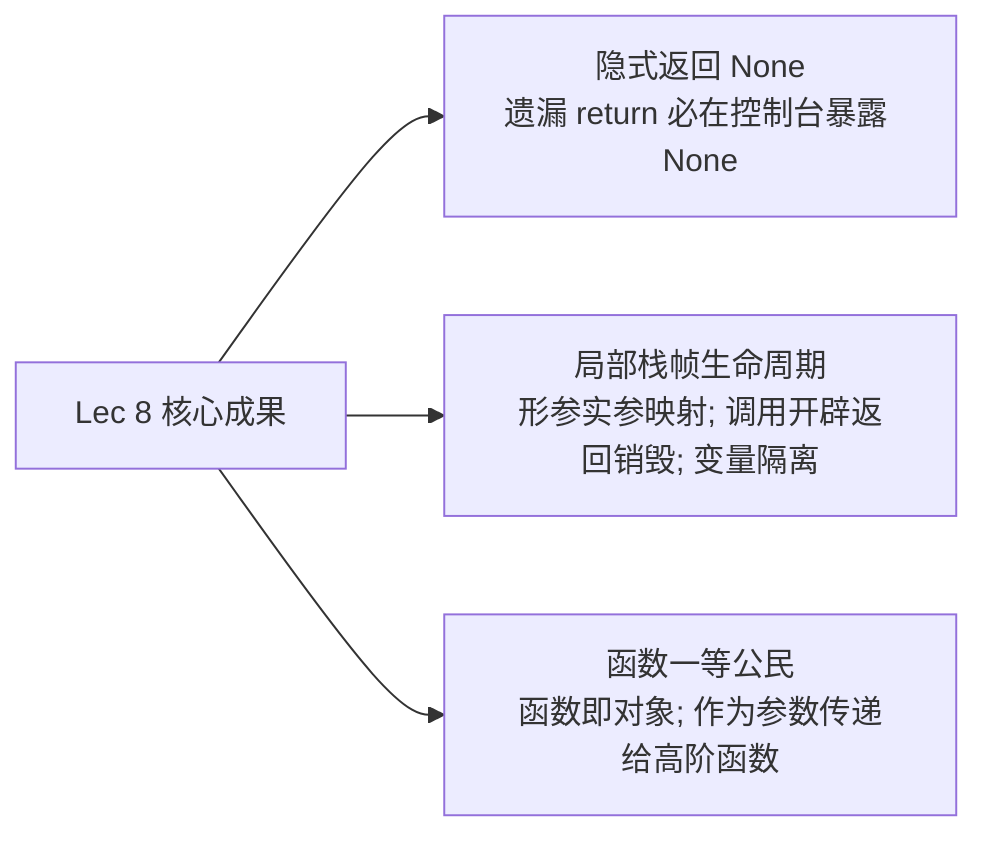

# Lec 8 **函数作为一等公民对象与作用域**

## TL;DR

- **函数隐式返回 `None` 机制**：Python 中**任何函数都必然有返回值**。如果函数执行完毕而没有触碰任何显式的 `return` 语句，解释器会自动在末尾执行隐式的 `return None`。在函数内部写 `print` 并不能代替返回值；若在外层用 `print(func())` 打印该函数的调用，控制台就会在正常内容后多打印出一行诡异的 `None`。
- **形参（Formal Parameter）与实参（Actual Argument）**：形参是函数定义头部的抽象占位符变量（在定义时没有具体数值）；实参是函数调用时传入的真实对象或表达式。在函数被调用的瞬间，解释器会自动完成“形参标签绑定到实参对象”的操作。
- **作用域模型（Scope & Environments）与栈帧生命周期**：每次发生函数调用，Python 都会在内存中开辟一个独立的**局部作用域（Local Scope / 局部栈帧）**。函数内部创建的变量仅在该局部环境中有效，与全局环境中的同名变量**完全隔离、互不碰撞**；一旦函数执行命中 `return` 并交出结果，**该局部栈帧及其包含的所有局部变量会被立即彻底销毁抹除**。
- **逐层向外查找规则与 `UnboundLocalError` 陷阱**：函数内部若只读访问某变量，局部找不到时会逐层向外（全局）搜索；但如果函数内部**存在对该变量的赋值语句**（哪怕在函数后半部分），Python 会在预编译期将该变量无情判定为局部变量，若在赋值前尝试读取它，会当场抛出经典的 `UnboundLocalError: local variable referenced before assignment`。
- **函数作为一等公民对象（First-Class Citizens）**：在 Python 中，函数本身就是一种普通的对象（属于 `<class 'function'>`）。函数名（如 `is_even`，不带括号）本质上就是指向该函数对象的命名标签。因此，函数可以被赋值给其他变量、可以存入数据结构、更可以**作为参数传递给其他高阶函数（Higher-Order Functions）**，从而实现极其强大的通用算法抽象（如 `apply(criteria, n)`）。

---

## 1. 复习与引入：从代码封装到“函数即对象”

**Ana Bell 博士**：大家下午好！让我们正式开始第 8 讲。

在上一讲中，我们完成了函数机制的基础搭建，认识到编写函数的本质是为了实现模块分解（Decomposition）与黑盒抽象（Abstraction），使代码具备极高的可读性、可维护性与复用性。

今天，我们将继续深化对函数底层物理机制的认知：
1. 彻底澄清 `return` 与 `print` 在各种极端嵌套情况下的控制台输出；
2. 揭秘变量在全局作用域与函数局部栈帧之间的隔离、遮蔽与生命周期；
3. 解构 Python 中最迷人、最强大的高阶特性之一——**函数作为一等公民对象（Functions as First-Class Objects）**。

让我们首先从大家在做大作业时经常遇到的一个困惑讲起。

---

## 2. 隐式返回的真相：为什么控制台总会出现神秘的 `None`？

**Ana Bell 博士**：在上一堂讲义的课后答疑中，有多位同学向我展示了他们的屏幕：他们在终端运行自己的代码时，发现程序总会在正确输出的下方，莫名其妙多打印出一行单独的 **`None`**。

这个 `None` 到底是从哪里冒出来的？

在 Python 中，关于函数返回值有一条绝对铁律：

::: definition 函数返回值的普适性铁律
**在 Python 运行时中，任何一个函数的执行都必然向调用方交回一个返回值，不存在没有返回值的函数！**
:::

观察下面两个做相同数学计算的函数对比：

```python
# 版本 A: 具备显式 return
def is_even_with_return(i):
    return (i % 2) == 0

# 版本 B: 遗漏了 return 语句
def is_even_without_return(i):
    has_rem = (i % 2) == 0
    print(has_rem)
    # 没有写 return!
```

对于版本 B，当 Python 解释器执行完最后一行缩进代码 `print(has_rem)` 时，它发现函数体已经走到了尽头，但**没有触碰到任何一条 `return` 语句**。

此时，Python 会在幕后自动为函数执行一句**隐式保底指令**：

```python
    # 解释器在幕后自动补上:
    return None
```

`None` 是 Python 内置标量类型 `NoneType` 的唯一单例对象。它在计算机科学中被用来**显式表达“值的缺失（Absence of a Value）”**。

### 现场时序推导：`None` 是如何被打印出来的？

现在，让我们看看在主程序中调用它们时会发生什么：

```python
# 观察 1: 调用有 return 的函数
is_even_with_return(3)
# 解释器求值返回 False，但外部没有任何 print，控制台空空如也。

# 观察 2: 外层包裹 print 打印它的返回值
print(is_even_with_return(3))
# is_even_with_return(3) 求值替换为 False，外层 print(False) 输出:
# 控制台输出: False

# 观察 3: 调用没有 return 的函数 (仅函数体内有 print)
is_even_without_return(3)
# 进入函数体，内部的 print(has_rem) 打印了 False。
# 函数执行结束隐式返回 None，但外层没有接收或打印该 None。
# 控制台输出: False

# 观察 4: 外层包裹 print 打印没有 return 的函数 (灾难现场!)
print(is_even_without_return(3))
```

在第四种情况下，控制台的真实输出是：
```text
False
None
```

**Ana Bell 博士现场诊断**：
大家看清楚这两行输出的时序了吗？
1. 第一行 `False`：是进入函数内部时，函数体自身的 `print(has_rem)` 向屏幕打出的；
2. 第二行 `None`：函数内部执行完毕，隐式交出了返回值 `None`，这使得外部语句变成了：`print(None)`！于是，外部的 `print` 忠实地在屏幕上打出了第二个词：`None`！

::: tip 避坑口诀：终端见 None，必查 return
在完成后续的实验大作业（Problem Sets）时，如果你的控制台输出中总是莫名其妙拖着一个尾巴 `None`，**请立刻检查你所调用的那个函数——你 100% 忘记在函数末尾写 `return`，而只是在函数内部 `print` 了一下！**
:::

---

## 3. 四行代码现场辨析：`add` 与 `mult` 的返回值穿透

**Ana Bell 博士**：为了让大家彻底形成条件反射，请在不运行代码的前提下，在草稿纸上写出以下 4 条独立语句在屏幕上的**确切输出行数与内容**：

```python
def add(x, y):
    return x + y

def mult(x, y):
    print(x * y)

# ----------------- 测试四行执行流 -----------------
# 语句 1:
add(1, 2)

# 语句 2:
print(add(2, 3))

# 语句 3:
mult(3, 4)

# 语句 4:
print(mult(4, 5))
```

### 现场推演与公布答案：

- **语句 1（`add(1, 2)`）**：
  - **屏幕输出**：**（空！没有任何输出）**
  - **原因**：函数计算出 $1 + 2 = 3$ 并通过 `return 3` 抛出，但主程序既没有用变量接收它，也没有调用 `print()`，返回值在内存中瞬间消散。
- **语句 2（`print(add(2, 3))`）**：
  - **屏幕输出**：`5`
  - **原因**：函数返回整数 `5`，外层 `print(5)` 正常打印。
- **语句 3（`mult(3, 4)`）**：
  - **屏幕输出**：`12`
  - **原因**：函数体内部显式执行了 `print(3 * 4)`，打印出 `12`；函数隐式返回 `None` 被主程序丢弃。
- **语句 4（`print(mult(4, 5))`）**：
  - **屏幕输出**：
    ```text
    20
    None
    ```
  - **原因**：第一行 `20` 由函数体内的 `print(4 * 5)` 输出；随后函数隐式返回 `None` 替换了调用表达式，外层执行 `print(None)` 输出第二行 `None`！

---

## 4. 形参与实参的绑定契约：Formal vs. Actual Parameters

**Ana Bell 博士**：在深入作用域之前，我们需要规范两个计算机科学专业术语：

::: definition 形式参数 vs 实际参数
1. **形式参数（Formal Parameters，简称“形参”）**：
   位于 `def` 函数定义头部的变量占位符（例如 `def f(x):` 中的 `x`）。在写下函数定义的当下，形参没有任何具体的物理值，它只是一个抽象的代号，代表“未来某个时刻调用我时会传入的原料”。
2. **实际参数（Actual Arguments，简称“实参”）**：
   在函数调用表达式中传入的真实对象或表达式（例如 `f(3)` 中的 `3`，或 `f(a + b)` 中求值后的结果）。
   :::

在函数被调用的瞬间，解释器会执行严格的**位置映射绑定（Parameter Mapping）**：把调用时传入的“实参对象”，单向绑定到函数头部的“形参标签”上。

形参的名字叫什么完全是函数的内部自由，它与外部调用方传入的变量名**没有任何半点关联**！
外部哪怕传入一个名为 `y` 的变量 `f(y)`，内部依然只会将值绑定至形参名 `x`。

---

## 5. 核心图解：执行环境与作用域模型（Local vs. Global Scope）

**Ana Bell 博士**：现在，我们迎来了整门课程中最关键的内存心智模型——**作用域（Scope）与栈帧环境（Environments）**。

请大家跟随我逐行推演下面这段极具代表性的代码：

```python
def f(x):
    x = x + 1
    print(f"在局部函数 f 内部: x = {x}")
    return x

x = 3
z = f(x)
print(f"在全局作用域外部: x = {x}")
print(f"z 的数值为: {z}")
全局作用域 (Global Frame)                        局部作用域 (Local Frame: f)
┌────────────┬────────────────────────┐          ┌────────────┬─────────────┐
│     f      │ <function f at 0x...>  │          │     x      │  3 -> 4     │
│     x      │ 3 (始终保持为 3，未受影响!) │          └────────────┴─────────────┘
│     z      │ 4 (接收返回值)           │                        ▲
└────────────┴────────────────────────┘                        │
                   │                                           │
                   └─────── 发生函数调用 f(x) ──────────────────┘
                            (开辟独立栈帧，执行完毕立即彻底销毁)
```

### 完整执行生命周期四步法：

1. **第一步（全局定义与赋值）**：
   - 解释器首先创建全局环境（Global Scope）；
   - 执行 `def f(x)`：在堆内存中创建函数对象，全局变量 `f` 指向该对象；
   - 执行 `x = 3`：全局环境中创建变量名 `x`，绑定到整数 `3`。
2. **第二步（函数调用发起，全局挂起）**：
   - 执行到 `z = f(x)`：解释器暂停全局环境的推进，**为本次调用开辟一个全新的局部执行栈帧（Local Frame of `f`）**；
   - 将全局实参 `x` 的值（`3`）复制传递并绑定给局部形参 `x`。此时内存中同时存在两个独立的标签 `x`，但它们分属不同的世界！
3. **第三步（局部运行与输出）**：
   - 局部环境执行 `x = x + 1`：局部变量 `x` 从 `3` 重新绑定为 `4`；全局的 `x` 受到任何破坏了吗？**完全没有！全局的 `x` 依然安然无恙地等于 `3`！**
   - 局部环境打印输出：`在局部函数 f 内部: x = 4`；
   - 局部环境命中 `return x`，交出数值 `4`。
4. **第四步（局部销毁，全局恢复）**：
   - **一旦命中 `return`，局部环境的使命彻底终结，整个局部栈帧连同其中的所有局部变量被内存管理器当场销毁抹除！**
   - 全局环境恢复运行，调用表达式 `f(x)` 被返回值 `4` 替换，赋值生效：全局变量 `z = 4`；
   - 执行全局打印：`在全局作用域外部: x = 3`，`z 的数值为: 4`。

::: insight 作用域隔离的伟大工程价值
**局部栈帧的隔离机制是现代大型软件能够协同构建的基石！**  
无论你在自己的函数内部定义了多么通俗的变量名（如 `x`, `temp`, `i`, `result`），你都可以百分之百放心——你的变量绝对不会污染外部主程序的变量，外部的变量也绝不会轻易篡改你的内部状态。每个函数都是一座独立自治的安全城堡。
:::

---

## 6. 变量查找规则与经典踩坑：`UnboundLocalError`

**Ana Bell 博士**：那么，如果在函数内部，我们需要使用一个在函数内部**并没有被定义**的变量，Python 会怎么做？

让我们对比以下两组微妙的代码：

### 案例 A：合法的向外只读查找（Read-only Lookup）
```python
x = 5

def g(y):
    # 局部环境中只有 y，并没有定义 x
    print(x)      # 打印: 5
    print(x + 1)  # 打印: 6

g(10)
```
当执行到 `print(x)` 时，Python 首先检查当前 `g` 的局部栈帧，发现没有 `x`。此时，Python 会执行**逐层向外查找规则（LEGB: Local $\to$ Enclosing $\to$ Global）**。它在外部的全局环境中找到了 `x = 5`，因此安全打印出 `5` 和 `6`。

### 案例 B：致命的“未分配即引用”陷阱（`UnboundLocalError`）
```python
x = 5

def h(y):
    print(x)      # 试图先读全局 x ?
    x = x + 1     # 局部试图修改 x !

h(10)
```
点击运行案例 B，控制台**瞬间崩溃报错**：
```text
UnboundLocalError: local variable 'x' referenced before assignment
```

**Ana Bell 博士深度解密**：
很多同学抓破头皮也想不通：在 `x = x + 1` 之前，我不是明明写了 `print(x)` 吗？全局不是明明有 `x = 5` 吗？为什么第一行 `print(x)` 就直接报错崩溃了？

**这是 Python 编译器极其关键的一个底层设计哲学**：
当 Python 解释器编译一个函数时，它会扫描整个函数体内部的所有语句。**只要发现函数内部任何一个地方存在针对变量名 `x` 的赋值操作（`x = ...`），Python 就会将 `x` 盖章定性为该函数的“局部变量”！**

既然 `x` 是局部变量，那么在执行第 1 行 `print(x)` 时，Python 就**坚决不再向外去全局环境查找**，而是严格在局部查找。但此时局部的 `x` 根本还没有完成赋值初始化！这就构成了“在变量被赋值之前引用了它”，当场触发致命的 **`UnboundLocalError`**！

---

## 7. 函数作为一等公民（First-Class Citizens）

**Ana Bell 博士**：现在，请大家深吸一口气，我们进入本讲最迷人、最体现 Python 抽象力量的高光时刻——**函数作为一等公民对象（First-Class Citizens）**。

在许多传统老旧语言中，函数只是一段死板的代码指令指针，你只能调用它。

但在 Python 中：**函数与整数 `42`、浮点数 `3.14`、字符串 `"hello"` 完全平起平坐，它本身就是一个货真价实的对象！**

::: definition 一等公民对象（First-Class Object）的四大特权
1. 可以被赋值给一个变量标签；
2. 可以作为元素存入列表、字典等容器；
3. **可以作为实际参数，传递给另一个函数！**
4. 可以作为另一个函数的计算产物被 `return` 返回。
:::

### 1. 将函数名赋值给新标签
请牢记：**加括号代表“执行调用”，不加括号代表“指代函数对象本身”！**

```python
def is_even(i):
    return (i % 2) == 0

# 不加括号: 将函数对象绑定给新名字 b
b = is_even

# 现在变量 b 完全继承了该函数的能力!
print(b(4))  # 输出: True
print(b(5))  # 输出: False
```

### 2. 高阶函数（Higher-Order Functions）：接受函数作为参数
既然函数是对象，我们就可以编写一个“通用调度函数”，将具体的业务策略（即具体的子函数）作为参数传进去！

观察下面这组代码：
```python
def func_a():
    return "来自 func_a 的问候"

def func_b(y):
    return y * 2

def run_any_function(f, arg):
    """
    f: 一个函数对象
    arg: 传递给该函数的实参
    """
    print("准备开始调度执行传入的函数...")
    result = f(arg)
    print("调度完成！")
    return result

print(run_any_function(func_b, 10))  # 输出: 20
```

---

## 8. 课堂综合实战：通用谓词统计器 `apply(criteria, n)`

**Ana Bell 博士**：为了让大家在真刀真枪的工程实践中感受高阶函数的统治力，请大家在课件第 96 行实现这样一个强大的泛型统计器：

> **需求规格**：编写一个名为 **`apply(criteria, n)`** 的高阶函数：
> - `criteria`：一个**函数对象**，该函数接收一个整数作为输入，返回一个布尔值（`True` 或 `False`）；
> - `n`：一个非负整数；
> - **目标**：统计在闭区间 $[0, n]$ 之间的所有整数中，**一共有多少个整数能够让 `criteria` 函数返回 `True`**！

```python
# apply_higher_order.py

def apply(criteria, n):
    """
    criteria: 一个接收单一整数并返回布尔值的函数对象
    n: 一个非负整数
    返回: 使得 criteria(i) 为 True 的整数 i 的总数量 (0 <= i <= n)
    """
    count = 0
    for i in range(n + 1):
        # 核心高阶调用: 动态执行外部传入的策略函数
        if criteria(i):
            count += 1
    return count
```

### 见证泛型抽象的威力：即插即用的策略模式

现在，我们有了这个通用的统计框架，我们可以随意编写不同的判定小函数，像搭积木一样塞给 `apply`：

#### 场景 A：统计 0 到 10 之间有多少个偶数
```python
def is_even(i):
    return (i % 2) == 0

# 把 is_even 函数对象作为参数塞给 apply
even_count = apply(is_even, 10)
print(f"0 到 10 之间的偶数数量为: {even_count}")  # 输出: 6 (0, 2, 4, 6, 8, 10)
```

#### 场景 B：统计 0 到 10 之间有多少个数字恰好等于 5
```python
def is_five(i):
    return i == 5

# 无需修改 apply 的任何一行代码，直接切换策略!
five_count = apply(is_five, 10)
print(f"0 到 10 之间等于 5 的数量为: {five_count}")  # 输出: 1
```

这就是高阶函数的震撼之处：**算法的结构骨架（遍历 0 到 n、累加计数）被固定在 `apply` 中，而具体的判定业务逻辑（是偶数？是 5？是素数？）被完全参数化为一个个独立的函数对象！**

---

## 9. 课程总结与下讲预告：从标量到序列

**Ana Bell 博士**：今天的内容信息密度极高，让我们对核心要点进行全面收拢：



1. **返回值严谨性**：透彻理解隐式 `return None` 的底层时序，杜绝将 `print` 误当返回值的恶习；
2. **作用域与局部栈帧**：建立“调用创建独立小环境、返回当场抹除”的栈帧模型，掌握内部读外部与 `UnboundLocalError` 变量遮蔽防范；
3. **高阶函数设计**：跨越语法层级，将函数作为一等公民对象作为参数传递，实现通用算法骨架与具体判定策略的彻底解耦。

### 下讲预告

在接下来的讲座中，我们将告别孤独的单个标量数字，正式迎来 Python 中强大而灵活的**复合复合数据结构家族**！

在下一讲（**Lecture 9: Lambda Functions, Tuples, and Lists**）中，我们将学习单行匿名函数 **Lambda 表达式**，并正式解构两大序列支柱——**不可变元组（Tuples）** 与 **可变列表（Lists）**！

谢谢大家，我们下节课见！
