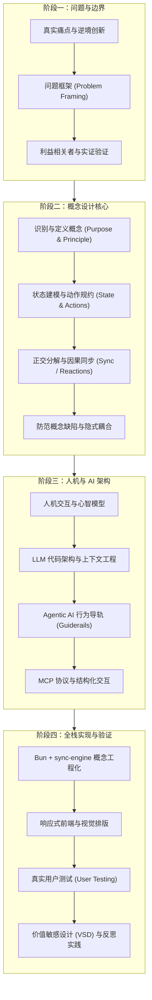
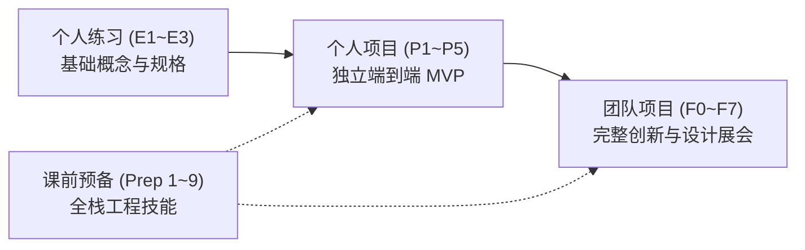

# 6.1040 软件设计（Fall 2026）

## TL;DR

- 课程从真实需求与问题框架出发，以概念（*Concept*：purpose、principle、state、actions）刻画用户心智模型与底层行为契约，而非单纯拼接数据表或 UI。
- 概念严格正交独立；通过外部显式因果反应（*Reactions* / Sync）编排行为流，杜绝隐式状态依赖，从根本上遏制软件复杂度蔓延。
- 将概念设计作为 Agentic AI 的行为导轨（*Guiderails*），清晰分离概率性推理与确定性机器执行，借助 MCP 协议与结构化交互实现人机协同闭环。

## 课程介绍

| 项目 | 信息 |
| --- | --- |
| 学期 | Fall 2026 |
| 先修 | 6.1020 Software Construction；6.1200[J] Mathematics for Computer Science |
| Lecturer | Daniel Jackson、Mitchell Gordon |
| 教材 | Daniel Jackson, *The Essence of Software: Why Concepts Matter for Great Design* |
| 官网 | [6.1040 Fall 2026 官方主页](https://61040.github.io/fa26/) · [官方资源中心 (Resources)](https://61040.github.io/fa26/resources/) |

### 先修课程

- **6.1020 软件构造**（*Software Construction*，原 6.031）：要求具备脱离底层代码进行抽象思考的能力（规格、接口、表示独立性、抽象函数与表示不变量），具备 JavaScript 编程成熟度与处理复杂工程框架的能力。
- **6.1200[J] 计算机科学数学**（*Mathematics for Computer Science*，原 6.042）：要求熟练运用集合论、二元关系、图论以及状态转移模型分析软件结构。

### 课程描述

本课程聚焦于**软件设计**（*Software Design*）。你将超越代码编写本身，学习如何设计和构建符合目的、优雅、强大且灵活的软件系统：既能精准满足用户真实需求，又具备卓越的可维护性与适应性。

设计发生在技术与人类的交汇点。然而，设计绝不仅仅关乎图形用户界面；本课程的核心在于**如何塑造用户所体验的底层功能**。除了经典的用户界面设计（如以用户为中心的计算、心智模型）、状态与动作建模、以及关注点分离等模块化技术外，本课程重点讲授源自 MIT 科研沉淀的**概念设计**（*Concept Design*）——一种更有效地构建软件功能的新方法。

随着大语言模型与智能体技术的快速演进，课程还将深入探讨如何在软件设计与代码编写中发挥 LLM 的效能，以及如何将 AI 智能体（*AI Agents*）作为系统组件安全可控地融入软件架构中。

### 技术工具栈与实验环境

虽然本课程核心探讨设计思想而非单纯工具训练，但学员将在全栈工程实践中全面掌握一套现代云原生开发流：

- **运行与包管理环境（Runtime）**：全面采用 [Bun](https://bun.com)。Bun 直接原生运行 TypeScript，兼具超快包管理、测试运行与前端打包能力，取代传统的 Node/npm 复杂度。
- **后端与同步引擎（Backend & Sync-Engine）**：采用 MIT SDG 官方开发的 [@mit-sdg/sync-engine-http](https://github.com/mit-sdg/)。sync-engine 依据概念动作的显式因果反应（*Reactions*）自动编排接口与端点（如 `/api/reservations/reserve`），在保证概念完全独立的前提下完成因果组合。
- **数据持久化（Database）**：采用容器化 **MongoDB**（通过 Podman / Docker Compose，一键脚本自动拉起并支持健康检查）。每个概念内部独立管理存储，不强制全局共享单一表结构；亦支持 SQLite（`bun:sqlite`）与 Postgres（`Bun.sql`）。
- **云端应用托管（Deployment）**：使用官方自研托管平台 [6.1040 Apps](https://mit-sdg.dev)（替代旧版 Heroku）。绑定 GitHub 提交哈希（commit hash）后，平台自动完成容器构建、环境变量注入、数据库配置与独立域名访问（`https://<name>.mit-sdg.dev`）。
- **参考架构范例（Reference App）**：官方提供 [ConceptBox](https://github.com/mit-sdg/conceptbox) 开箱即用范例库，展示了概念规格代码化、TypeScript 类型安全客户端与本地存储配置的最佳实践。
- **前端框架（Frontend）**：采用响应式框架（Vue 3 单文件组件或 React），结合后端自动生成的强类型客户端（Typed Client），在编译期捕获端点拼写错误与字段缺失。
- **前沿实践扩展**：在技术实践环节深入整合 **LLM APIs**、**MCP（Model Context Protocol）** 智能体标准协议，以及对 Prompt 注入与 SQL 注入的系统防御。

### 行业标准与教学理念

学生们经常提问：课上讲授的设计方法是否是目前行业通用的标准方法？**当然不是！** 如果它早已是平庸的行业现成套路，你在日常工作中就能学到，也就不需要 MIT 的专业教育了。**教育的职责是塑造未来，而不是复述过去。**

MIT 的计算机教学有着讲授科研原创方法的悠久传统，而这些方法往往在数十年后才被工业界广泛采纳。例如初代 6.170 讲授 Barbara Liskov 发明的 CLU 语言时，极少有程序员懂得面向对象，直到几十年后各主流语言才补齐 CLU 早已具备的特性；6.001 早期坚持讲授函数式语言 Scheme，而在半个世纪后的今天，函数式设计原则已成为所有优秀工程师的必修功底。

概念设计诞生于对数百款工业级应用成败经验的深度提炼。虽然普通团队尚未系统建立概念思维，但最顶尖的系统架构师早已在直觉中运用这些设计原则。通过将隐性经验显性化，你将建立起远超一般 UX 训练营或在岗试错的设计判断力。

### 参考书

- **《Software Abstractions: Logic, Language, and Analysis》**
  - **作者**：Daniel Jackson
  - **核心主题**：介绍其开发的轻量级形式化建模语言与分析工具 **Alloy**，探讨如何利用逻辑与自动分析工具对软件设计与抽象模型进行严谨的机械化验证（mechanizing analysis of software designs）。
  - **出版信息**：由 MIT Press 出版（初版于 2006 年，修订版于 2012 年）。
- **《Software for Dependable Systems: Sufficient Evidence?》**
  - **编者/委员会主席**：Daniel Jackson（担任美国国家研究委员会 National Research Council 可靠软件系统证据委员会主席）
  - **核心主题**：探讨**高可信度与关键系统**（Dependable Systems）的软件构建原则，聚焦如何提供充分证据确保系统在关键场景下不发生灾难性故障（ensuring catastrophes don't happen）。
  - **出版信息**：由 National Academies Press 于 2007 年出版。
- **《The Essence of Software: Why Concepts Matter for Great Design》**
  - **作者**：Daniel Jackson
  - **核心主题**：阐述**概念设计**（Concept Design）理论，系统探讨软件功能设计的本质——如何通过解耦、重用和清晰定义“概念”来消除软件中让人费解的交互缺陷，也是 6.104 课程核心设计思想的理论基石。
  - **出版信息**：由 Princeton University Press 于 2021 年出版。

## 课程知识体系

### 概念设计方法论体系

课程在官方资源中心梳理了 12 篇核心方法论文献，系统构建了从概念界定、规格书写到架构防错的完整理论基石：

| 领域 | 官方文献 | 核心导读与设计启示 |
| --- | --- | --- |
| **基础定位** | [What concept design is](https://61040.github.io/fa26/background/what-concept-design-is/) | 概念设计是一门刻画“行为路线”的语言，跨越软件、AI 智能体与业务组织，提供跨背景团队的对齐词汇。 |
| **工程协同** | [Concept design and software dev](https://61040.github.io/fa26/background/concept-design-and-software-dev/) | 阐明概念设计如何弥合需求（PRD）、系统架构与敏捷开发之间的语义鸿沟，使行为变更具备模块化隔离能力。 |
| **智能体导轨** | [Concept design and agentic AI](https://61040.github.io/fa26/background/concept-design-and-agentic-ai/) | 概念为 AI Agent 提供天然的行为导轨（*Guiderails*），将推理委托与确定性机器行为清晰分离，避免失控。 |
| **概念边界** | [What a concept is and is not](https://61040.github.io/fa26/background/what-a-concept-is/) | 明确概念的判定边界：概念不是数据库表、不是 UI 控件、也不是代码类，而是用户可理解的独立行为闭环。 |
| **需求创新** | [How to innovate from bad situations](https://61040.github.io/fa26/background/innovating-from-bad-situations/) | 学习从用户在现有应用中遭遇的挫败、摩擦与怪异绕行中提炼出创新概念的系统方法。 |
| **概念识别** | [How to identify concepts](https://61040.github.io/fa26/background/identifying-concepts/) | 训练从功能愿景中抽离出通用行为单元的洞察力，辨别哪些是已知通用模式，哪些是独创业务概念。 |
| **定义要素** | [Defining concepts](https://61040.github.io/fa26/background/defining-concepts/) | 深入讲解概念的两大灵魂：存在目的（*Purpose*）与运行原理（*Operational Principle*，以典型因果故事串联）。 |
| **规格编写** | [How to write concept specifications](https://61040.github.io/fa26/background/specifying-concepts/) | 掌握前置条件（*requires*）与后置效果（*effects*）的形式化描述，确保规格精确且无隐式假设。 |
| **状态声明** | [Specifying concept state](https://61040.github.io/fa26/background/specifying-concept-state/) | 使用集合、二元关系与映射记法声明概念必须记住的最小内部状态，杜绝冗余存储与未受控副作用。 |
| **概念分解** | [How to decompose into concepts](https://61040.github.io/fa26/background/decomposing-into-concepts/) | 将复杂应用解耦为正交概念集的标准技巧：避免全局大状态、消除双向依赖、借助参数化类型解耦。 |
| **定义缺陷** | [Flaws in concept definitions](https://61040.github.io/fa26/background/flaws-in-concept-definitions/) | 识别无目的数据结构、命名含混、职责混杂等概念定义坏味道，提升概念的独立自洽性。 |
| **分解缺陷** | [Flaws in concept decompositions](https://61040.github.io/fa26/background/flaws-in-concept-decompositions/) | 诊断隐式依赖、用命令式脚本替代同步因果、职责泄露等常见分解反模式。 |

### 技能模型与评估标准（11 项 Rubrics）

Fall 2026 建立了以能力为导向（*Competency-based*）的四级评估标准（**Deficient 欠缺 / Emergent 起步 / Competent 胜任 / Expert 专家洞见**）。学生可利用这些标准自我检验，亦可将其作为 Prompt 背景输入给 LLM 进行针对性审查：

| 能力维度 | 评估重点与成功标准 | 常见失败模式 |
| --- | --- | --- |
| [问题框架](https://61040.github.io/fa26/rubrics/problem-framing/) | 聚焦真实人类困境，利益相关者多维完整，有可追溯的定量实证支撑。 | 把解决方案伪装成问题；仅考虑终端用户；依赖主观想象。 |
| [方案沟通](https://61040.github.io/fa26/rubrics/communicating-a-proposed-solution/) | 清晰阐述核心价值主张与使用场景，以引人入胜的故事解释因果闭环。 | 罗列功能清单；专业术语堆砌但无法解释解决了什么现实痛苦。 |
| [概念设计](https://61040.github.io/fa26/rubrics/concept-design/) | 概念正交独立，规格精确完备，组合因果明确，展现优雅的分解洞见。 | 概念间隐式交叉读写；将纯数据表误当概念；遗漏关键行为。 |
| [交互设计](https://61040.github.io/fa26/rubrics/interaction-design/) | 心智模型贴合预期，状态反馈即时透明，支持局部修改、确认与撤销。 | 状态不透明导致用户困惑；AI 生成直接不可逆执行；缺少容错路径。 |
| [交互视觉设计](https://61040.github.io/fa26/rubrics/interaction-visual-design/) | 控件层级与Affordance清晰，微交互自然流畅，键盘与无障碍支持良好。 | 关键交互入口隐蔽；缺乏焦点与禁用状态反馈；动效过度干扰阅读。 |
| [视觉设计](https://61040.github.io/fa26/rubrics/visual-design/) | 排版对齐克制，字体阶梯清晰，色彩承担功能语义，留白适度呼吸。 | 随意无序的色彩渐变；字号层级混乱；信息密度失衡造成认知疲劳。 |
| [概念实现](https://61040.github.io/fa26/rubrics/implementing-concepts/) | 概念状态封装严密，因果同步逻辑清晰，强类型接口无污染，异常处理稳健。 | 概念间私自交叉引用底层数据库；同步逻辑写死在 UI 事件回调中。 |
| [测试与验证](https://61040.github.io/fa26/rubrics/testing-validating/) | 围绕预先假设设计测试任务，忠实记录用户真实困惑与受阻点并驱动迭代。 | 引导甚至替测试者操作；只验证快乐路径；忽视用户理解偏差。 |
| [反思实践](https://61040.github.io/fa26/rubrics/reflective-practice/) | 批判性审视自我思维盲区与技术决策得失，审慎使用 AI 保持元认知警觉。 | 敷衍完成反思总结；盲目采纳 AI 代码与观点而不加深入甄别。 |
| [专业素养](https://61040.github.io/fa26/rubrics/professionalism/) | 团队契约守信，分工协作透明，版本控制小步提交，对评审反馈开放诚实。 | 最后一刻突击提交；代码冲突随意覆盖；缺席团队辅导与交流。 |
| [技术写作](https://61040.github.io/fa26/rubrics/technical-writing/) | 术语规范严谨，文档逻辑紧凑自洽，结构清晰，排版与相对链接无误。 | 语法散漫冗余；标题与内容脱节；排版混乱且含未渲染坏链。 |

### 核心理论大课（Lectures）

周一与周三为核心设计理论大课，系统讲授概念设计思维、因果同步编排、全栈架构与 AI 智能体协同：

| 讲次 | 日期 | 官方主题与课件 | 核心内容导读 | 配套提交节点 |
| --- | --- | --- | --- | --- |
| [Lec 1](./lec1.md) | 09-09 | [How to innovate](https://61040.github.io/fa26/lectures/how-to-innovate-no-builds.pdf) | **创新与问题框架**：真实需求发掘、失败模式与痛点分析 | — |
| [Lec 2](./lec2.md) | 09-14 | [Intro to concepts](https://61040.github.io/fa26/lectures/intro-to-concepts.pdf) | **概念设计导论**：心智模型、四要素模型（Purpose, Principle, State, Actions） | E1: Problem Framing |
| [Lec 3](./lec3.md) | 09-16 | [Designing a concept](https://61040.github.io/fa26/lectures/designing-a-concept.pdf) | **设计概念行为**：动作规约、前后条件约束与行为迹（Trace） | — |
| [Lec 4](./lec4.md) | 09-21 | [Designing coordination](https://61040.github.io/fa26/lectures/designing-coordination.pdf) | **设计因果同步**：显式 Reactions 编排、消除概念间双向耦合 | E2: Understanding Concepts |
| [Lec 5](./lec5.md) | 09-23 | [Modularity](https://61040.github.io/fa26/lectures/modularity.pdf) | **模块化设计**：关注点分离（SoC）、完整性与独立性约束 | — |
| [Lec 6](./lec6.md) | 09-28 | [Designing state](https://61040.github.io/fa26/lectures/designing-state.pdf) | **设计概念状态**：Simple State Form (SSF) 记法、集合与映射 | E3: Understanding Composition |
| [Lec 7](./lec7.md) | 09-30 | [Design case studies](https://61040.github.io/fa26/lectures/design-case-studies.pdf) | **模块化案例研究**：Zoom、Spotify 架构对比与横切关注点 | — |
| [Lec 8](./lec8.md) | 10-05 | [Client server](https://61040.github.io/fa26/lectures/everything.pdf) | **客户端与服务器全景**：Web 架构、网络拓扑与安全信任边界 | P1: Design |
| [Lec 9](./lec9.md) | 10-07 | [Coding concept design](https://61040.github.io/fa26/lectures/coding-a-concept-design.pdf) | **对概念设计编码**：TypeScript 概念落地、上下文工程与 Coding Agent | — |
| [Lec 10](./lec10.md) | 10-13 | [Interaction design](https://61040.github.io/fa26/lectures/interaction-design.pdf) | **交互设计与心智模型**：用户旅程、低保真线框图与状态反馈 | P2: Alpha (MVP) |
| [Lec 11](./lec11.md) | 10-14 | [Visual design](https://61040.github.io/fa26/lectures/visual-design.pdf) | **视觉设计**：排版阶梯、网格系统、功能色彩与视觉批评 | — |
| [Lec 12](./lec12.md) | 10-19 | Engaging users: problem, design | **接触用户：问题与设计**：形成性探索、共同设计与认知走查 | P3: Beta |
| [Lec 13](./lec13.md) | 10-21 | [User testing](https://61040.github.io/fa26/lectures/user-testing.pdf) | **接触用户：评估与信号**：走查观察协议、可用性度量与设计修订 | — |
| [Lec 14](./lec14.md) | 10-26 | [Value-sensitive design](https://61040.github.io/fa26/lectures/vsd.pdf) | **价值敏感设计**：多方利益相关者分析、长期社会扩散与伦理权衡 | P4: Deploy |
| [Lec 15](./lec15.md) | 10-28 | [Human-AI interaction](https://61040.github.io/fa26/lectures/human_ai_interaction_fundamentals.pdf) | **人机 AI 交互基础**：能力锐钝边、心智校准、增强而非替代 | — |
| [Lec 16](./lec16.md) | 11-02 | UI design for AI features | **AI 功能界面设计**：超越自由聊天、结构化生成与可逆纠错 | P5: User Testing |
| [Lec 17](./lec17.md) | 11-04 | Team pitches | **团队提案与设计总结**：大项目 Pitch、架构模式映射与反腐层 | F1 / C1 |
| [Lec 18](./lec18.md) | 12-09 | Project Fair | **项目展示与全流程方法论**：独立开发者方法论、成果展会与交付闭环 | F7: Final Demo & Report |

### 全栈工程实验课（Recitations）

周四为全栈动手实验课，由课前预备练习（Prep）驱动，打通从环境配置、数据持久化到智能体协议落地的工程闭环：

| 实验 | 日期 | 官方主题与课件 | 核心工程技能 | 配套预备练习 (Prep) |
| --- | --- | --- | --- | --- |
| [Rec 1](./rec1.md) | 09-10 | [Markdown](https://61040.github.io/fa26/recitations/recitation-1.pdf) | **Markdown 与作品集搭建**：结构化纯文本排版与 Git commit hash 流水线 | [Prep 1: Markdown](./assignment/markdown.md) |
| [Rec 2](./rec2.md) | 09-17 | [HTML, CSS](https://61040.github.io/fa26/recitations/recitation-2.pdf) | **HTML 与 CSS 基础**：语义化标签树、标准盒模型与 Flexbox/Grid 布局 | [Prep 2: HTML & CSS](https://61040.github.io/fa26/preps/html-css/) |
| [Rec 3](./rec3.md) | 09-24 | HTTP and REST | **HTTP 与 REST API 实践**：请求报文、状态码语义、内容协商与端点调试 | [Prep 3: HTTP & REST](https://61040.github.io/fa26/preps/http-rest/) |
| [Rec 4](./rec4.md) | 10-01 | [Mongo](https://61040.github.io/fa26/recitations/recitation-4.pdf) | **MongoDB 容器化与数据持久化**：Podman/Compose 本地部署与概念级集合隔离 | [Prep 4: MongoDB](https://61040.github.io/fa26/preps/mongodb/) |
| [Rec 5](./rec5.md) | 10-08 | Vue | **响应式前端与 Vue SFC**：组合式 API、单文件组件与强类型客户端调用 | [Prep 5: Vue](https://61040.github.io/fa26/preps/vue/) |
| [Rec 6](./rec6.md) | 10-15 | Cookies and sessions | **Cookies、Sessions 与认证状态**：安全 Cookie 属性、服务端 Session 与 JWT | [Prep 6: Cookies](https://61040.github.io/fa26/preps/cookies/) |
| [Rec 7](./rec7.md) | 10-22 | LLM APIs, MCP | **LLM APIs 与 MCP 协议实践**：结构化输出与 Anthropic Model Context Protocol | [Prep 7: LLM & MCP](https://61040.github.io/fa26/preps/llm-apis-and-mcp/) |
| [Rec 8](./rec8.md) | 10-29 | Injection attacks | **系统安全与注入防御**：NoSQL 操作符注入防御与 Prompt 提示词注入攻防 | [Prep 8: Injection](https://61040.github.io/fa26/preps/injection-attacks/) |
| [Rec 9](./rec9.md) | 11-05 | GitHub | **GitHub 团队高级协作流**：特性分支管理、Pull Request 审查与合并冲突排解 | [Prep 9: GitHub](https://61040.github.io/fa26/preps/github/) |

## 配套作业与实战项目

Fall 2026 采用阶梯式能力训练体系，涵盖个人独立练习（E 系列）、个人 MVP 项目（P 系列）、团队大作业（F 系列）以及上机预备练习（Preps）：

### 个人练习

- **[E1: 问题框架](./assignment/problem-framing.md)**：通过领域发散、多方利益相关者分析与 5+ 真实证据链，完成真实需求的严密论证。
- **[E2: 理解与编写概念规格](./assignment/concept.md)**：精读 `GiftRegistration` 与 `PasswordAuthentication`，辨析 PAT 机制，并自主设计三个完整概念规格。
- **E3: 模块化设计与概念组合**：练习概念正交拆分与状态同步（Reactions）组合，杜绝隐式状态依赖。

### 个人项目

每位同学需独立构思并交付一款具备完整概念闭环的 Web 应用：

- **P1: Design**：问题陈述、概念规格与因果同步草案。
- **P2: Alpha (MVP)**：最小可用产品，跑通核心概念动作流。
- **P3: Beta**：功能完整版，打通前后端同步与响应式视图。
- **P4: Deploy & Code Complete**：完成 6.1040 Apps 线上容器化部署，包含数据库持久化与日志。
- **P5: User Testing**：设计走查任务并招募真实用户实测，根据反馈沉淀设计修订方案。

### 团队终期项目

团队协同（3~4 人）打造一款兼具概念创新与 AI 赋能的标志性产品：

- **F0 / F1**: 团队契约与项目 Pitch 提案（含同行评议 C1）。
- **F2 / F3**: 团队问题框架与概念设计深度规格（含同行评议 C2、C3 与助教导师会面）。
- **F4 / F5**: 团队 Alpha 与 Beta 里程碑发布。
- **F6 / F7**: 焦点小组（Focus Groups）、真实用户测试、完整项目报告与 **Project Fair 展会公开演示**。

### 预备动手练习

- **[Prep 1: Markdown 与作品集](./assignment/markdown.md)**：纯文本结构化排版与 GitHub 版本化交付。
- **Prep 2 ~ Prep 9**：涵盖 HTML/CSS、HTTP/REST、MongoDB 容器化、Vue 组合式 API、Cookie/Session 状态维护、LLM API 与 MCP 智能体协议接入、Prompt 注入安全攻防、以及 GitHub 高级协作流。

## 官方资源

- [6.1040 Fall 2026 课程官网](https://61040.github.io/fa26/)
- [官方资源中心 (Resources)](https://61040.github.io/fa26/resources/)
- [官方全学期课表 (Schedule)](https://61040.github.io/fa26/schedule/)
- [课程修读指南 (Class Guide)](https://61040.github.io/fa26/guide/)
- [技术参考中心 (Technical Resources)](https://61040.github.io/fa26/resources/technical/)
- [官方概念设计文献库 (Background Docs)](https://61040.github.io/fa26/resources/#background)
- [官方技能评估标准 (Rubrics)](https://61040.github.io/fa26/resources/#rubrics)
- [sync-engine 本地开发指引](https://61040.github.io/fa26/resources/sync-engine-local-dev/)
- [6.1040 Apps 部署指南](https://61040.github.io/fa26/resources/deploying-apps/)
- [ConceptBox 官方范例代码库](https://github.com/mit-sdg/conceptbox)
