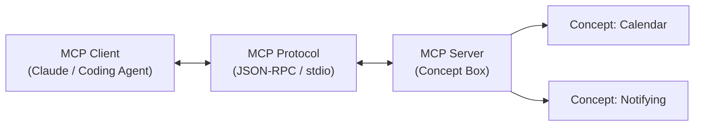

# Rec 7 LLM APIs 与 MCP 协议实践

配套练习：[Prep 7: LLM APIs and MCP](https://61040.github.io/fa26/preps/llm-apis-and-mcp/)。本实验带练如何在应用中集成大语言模型 API，掌握结构化输出与工具调用（Tool Calling），并实践由 Anthropic 提出的开放标准——**模型上下文协议（Model Context Protocol, MCP）**。

## TL;DR

- LLM API 是现代 AI 增强功能的核心接口，通过参数（Temperature, Top-P）与系统提示词（System Prompt）调控生成行为。
- 使用结构化输出（Structured Outputs / JSON Schema）强制模型按确定性数据结构返回，彻底杜绝正则提取的脆弱性。
- MCP 协议为 AI 智能体与外部数据源/工具之间建立了开放、标准化的通信总线。
- 概念（Concept）为 MCP Tools 提供了最天然的语义边界：每个 Concept Action 直接映射为一个具名、受控的 MCP Tool。

## 实验核心技能

### 1. 结构化 API 调用（以 TypeScript 为例）

传统的大模型 API 调用往往依赖自然语言 Prompt 并返回自由文本，前端或后端编写正则或文本切分算法试图提取字段。这种方法极其脆弱，模型一旦输出细微的标点或格式波动，就会导致系统解析崩溃。现代 LLM API 普遍支持由 Schema 强约束的结构化输出（Structured Outputs），模型在推理生成时，底层采样器会被直接限制在合法 JSON 状态机中，从而 100% 保证输出格式严格符合类型定义。

```ts
import { GoogleGenAI, Type } from "@google/genai";

const ai = new GoogleGenAI({});
const response = await ai.models.generateContent({
  model: "gemini-2.5-flash",
  contents: "从用户输入中提取日历事件：明天下午两点在 32-123 开会",
  config: {
    responseMimeType: "application/json",
    responseSchema: {
      type: Type.OBJECT,
      properties: {
        title: { type: Type.STRING },
        location: { type: Type.STRING },
        time: { type: Type.STRING },
      },
      required: ["title", "location", "time"],
    },
  },
});
```

### 2. MCP 协议架构与工具编排



MCP 核心三大原语：
- **Resources**：向模型提供只读的上下文数据（类似文件或数据库记录）；
- **Prompts**：预设的提示词模版；
- **Tools**：模型可调用的具名函数，能够引起环境状态改变。

::: insight
MCP 的真正价值在于解耦了“智能体决策”与“工具实现”。当每个工具都严格映射为一个遵循前置条件与效果的概念动作时，AI 智能体就获得了清晰的探索边界，既不会漫无目的地越权调用，也不会在缺乏必要上下文时随意猜测。
:::
