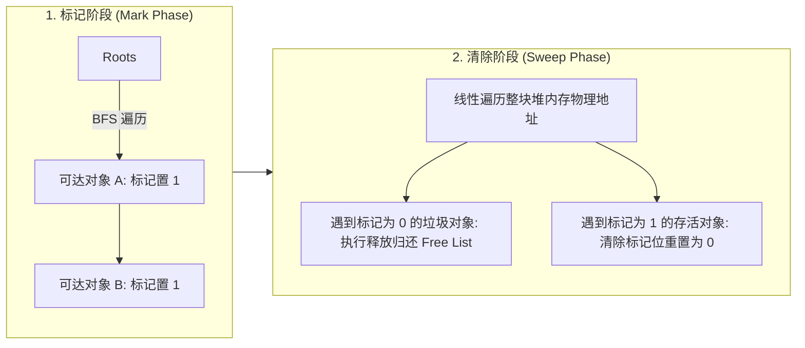
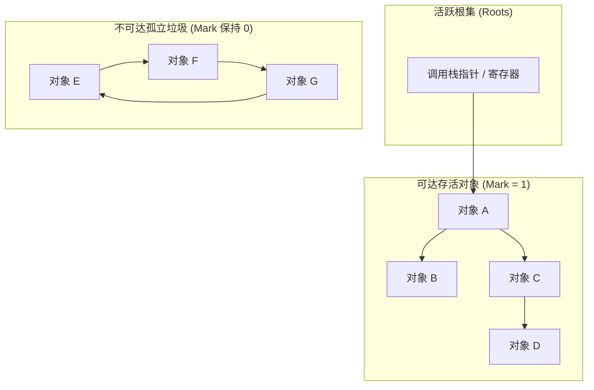

# Lec 11 存储分配

## TL;DR

- 栈分配依托栈指针 `sp` 实现 $O(1)$ 的极致分配与释放，但受制于后进先出纪律与调用栈帧生命周期。
- 堆分配器（如 BFL 分箱空闲链表、伙伴系统）通过离散空闲块管理通用动态存储，但必须在内部碎片与外部碎片之间权衡。
- 引用计数机制直观且延迟低，但无法回收孤立环形引用；标记-清除法（Mark-and-Sweep）通过根集可达性分析根治环路泄漏，但全堆扫描与原地释放会留下严重的外部碎片。
- 停止-复制法（Stop-and-Copy / Cheney 算法）将堆划分为 FROM 与 TO 两个半区，仅复制存活对象并在原位置留下转发指针，彻底消除外部碎片并实现常数时间的顺序追加分配。

这节课关于内存的分配和释放。

> 阅读资料
>
> - 《On-the-fly garbage collection: an exercise in cooperation》

## 本讲导览
在计算机系统文献中，“存储分配（Storage Allocation）”是一个统称，它既包含**向系统申请分配内存（Allocation / `malloc`）**，也同等重要地包含**将内存归还给系统（Deallocation / `free`）**。

- 栈分配
- 堆分配
- 程序的虚拟内存布局
- 垃圾回收
  - 引用计数法
  - 标记清除法
  - 停止-清除法

## 栈分配

计算机中最简单、最纯粹的存储形式就是***\*栈（Stack）\****。在物理实现上，栈仅仅是一段连续的内存数组 $A$ 和一个指向当前已使用区域末端的栈指针 `sp`（Stack Pointer）：


```python
# 分配x字节
def alloc(x):
	sp += x # 需要检查是否栈溢出
	return sp - x # 返回起始地址

# 释放x字节
def free(x):
  sp -= x
```

::: insight 为什么编译后的栈操作快到极致？
栈的分配与释放耗时严格为**$O(1)$​ 常数时间**，其底层仅仅是一条汇编指令（如 `addq $32, %rsp` 或 `subq $32, %rsp`）。
编译器在生成机器代码时，能够将所有的栈操作**100% 完全内联**，没有任何函数调用跳转开销，也没有任何锁与元数据链表遍历！现代编译器出于性能考虑，在常态下甚至不会插入栈溢出检查指令，全权依赖操作系统 MMU 硬件保护页来触发段错误（Segfault）。
:::

> 既然栈这么快，为什么我们不能用栈来解决程序中的所有动态内存需求？

栈存在两大不可妥协的局限：

1. ***\*严格的后进先出释放纪律\****：你永远只能释放最后分配的那个对象，***\*绝对无法提前释放已使用区域中间的任何对象\****；
2. ***\*生命周期必须受限于函数调用作用域\****：一旦函数退出，栈帧被弹出，栈内数据立刻失效，无法向外部逃逸传递长期存活的复杂对象。

在 C 语言中，曾有一个非标准的系统原语 **`alloca(size)`**允许程序员在调用栈上动态开辟空间，但今天该原语已被主流标准废弃（Deprecated）——因为当分配尺寸过大时，极易无声无息地打爆栈空间引发灾难性的栈溢出崩溃。

## 通用堆存储

为了支持任意时刻分配、任意时刻释放、以及跨作用域长久存活的动态数据，我们必须依赖更加通用的空间——***\*堆（Heap）\****。


::: important 概念澄清：内存堆 vs 数据结构堆
不要将操作系统中的**内存堆（Heap Storage）**与算法课上的**二叉优先队列堆（Heap Data Structure）**混为一谈！二者完全是同名异义。算法课的堆是一种维护极值的完全二叉树结构；而系统中的堆是一块庞大、自由、但也极度碎片化和杂乱无章的虚拟内存空间。
:::

### C/C++ 无自动垃圾回收的代价

与 Java、Python 等配备全自动垃圾收集器的语言不同，C 和 C++ 赋予了性能工程师完全掌控物理内存的绝对自由，但这带来了一系列臭名昭著的内存错误。C/C++ 动态内存三大隐形杀手：

1. 内存泄漏（*Memory Leak*）：申请后遗忘释放，物理内存耗尽 OOM 崩溃
2. 悬垂指针 （*Dangling Pointer*）：指向已释放内存，读取引发未定义行为 (UB) 或脏读
3. 重复释放（*DoubleFree*）：同一指针 free 两次，彻底破坏分配器内部链表元数据

强烈要求大家熟练运用两套内存诊断工具，Memory Checkers(e.g.，AddressSanitizer，Valgrind)能够提供帮助。

- **AddressSanitizer (ASan)**：
  - 机制：**编译器插桩工具（Compiler Instrumentation）**，在代码编译阶段插入指针越界与影子内存（Shadow Memory）校验；
  - 优势：运行开销低（仅约 2 倍慢速），能精准定位栈、全局区及堆内存越界行号；
  - 局限：需要拿到源码，无法对第三方库进行插桩
- **Valgrind (Memcheck)**：
  - 如果拿到的是没有源码、无法重新带 `-fsanitize=address` 编译的闭源二进制呢？此时使用 Valgrind；
  - 机制：**二进制动态模拟器（Binary Translation）**，直接在 JIT 虚拟机中监控未经修改的机器指令；
  - 局限：运行极其缓慢（通常比原生慢 20~50 倍），因缺乏源码类型信息，部分细微栈越界易被遗漏。

> malloc() 是怎么实现的？

glibc 的 `malloc()` 取决于两个核心系统调用：

- `sbrk()`：预先分配一块连续内存区域（一般是 < 128KB）。在该区域内采用基于内存块（chunk）的管理策略：将内存分割为不同大小的 chunk，通过链表管理空闲块。
- `mmap()`（通常用于大内存申请 $\ge 128\text{KB}$）：
  - 直接使用 `mmap()` 系统调用**匿名映射（anonymous mapping）**一块独立内存。
  - 该内存与堆隔离，释放时通过 `munmap()` 立即归还给操作系统。


> malloc() vs. mmap(), 为什么不能统一绝对使用 malloc()？

`malloc()` 中的堆管理代码会尽可能地重用已释放的内存，以满足用户对堆存储的请求。必要时，`malloc()` 实现会调用 `mmap()` 和其他系统调用来扩展用户堆存储的大小。

### 定长堆分配（Fixed-Size Allocation）与空闲链表

我们从最简单的模型切入：假定程序中所有动态申请的对象具有完全相同的固定字节大小（例如固定大小的图节点或网络数据包）。

#### 零元数据开销的空闲链表

空闲块列表，块中有代表存储的固定大小的区域以及指向下一个空闲块指针。对于固定大小块的的维护，也可以用位图（bitmap）来实现。free 是第一个空闲块的地址。


**分配一块空闲块**

```c
// Allocate 1 object
x = free;
free = free->next;
return x; // should check free != NULL:
```


**释放一块空闲块**


- 原本 free 指向的是 x->next;

```c
// free object x
x->next = free;
free = x;
```

总结

- 分配和释放需要 $\Theta(1)$ 时间。
- 良好的时间局部性——你可以释放你需要的块。
- 由于 **外部碎片**，空间局部性较差——已使用内存的块分散在各处（分布在虚拟内存中）——这可能会增加页表的大小并导致 **磁盘抖动**（因为你需要在磁盘中移动页）。
- 快表（TLB）也可能是一个问题。因为你的数据分配到虚拟页太分散了

#### 减少外部碎片方法

- 每个磁盘页面维护一个空闲列表（或位图）
- 在分配内存时，优先选择那些已用内存最多的页面
- 释放一个内存块时，将其释放到它所在的页面的空闲列表中
- 如果一个页面变为空（所有块都是空闲的），虚拟内存系统可以将整个页面“换出”。

- 90-10 比 50-50 更好


如果 90% 的内存使用在某些页面上，而 10% 在其他页面上（集中访问），相比于 50% 和 50% 的均匀分布，性能会更好

#### 合并内存块（Coalescing）

在使用**分区空闲列表（Binned Free Lists, BFL）**时，有时可以通过将相邻的小内存块拼接成一个更大的内存块来进行启发式优化。

- 存在一些巧妙的方案可以高效地找到相邻的内存块，例如“**伙伴系统（buddy system）**”，但其开销仍然大于简单的 BFL。
- 没有好的理论界限能够证明合并的有效性。
- 在实践中，合并内存块似乎可以减少碎片化，因为堆存储的释放通常是以堆栈（**后进先出，LIFO**）或批量方式进行的。

### 可变大小的堆分配

Binned free lists，分箱空闲列表

- 提高内存效率
- 接受一定的内部碎片


第 k 个分箱维持着$2^k$字节大小内存块。

> **如果我需要分配 x 字节内存怎么办？**

Solution:

1. 如果分箱 $ k = \lceil \lg x \rceil$ 不是空，那么就返回分箱的一块内存渔区
2. 否则，找到下一个比他大的分箱$k'$，将其拆分成块$2^{k'-1}, 2^{k'-2},...,2^k$，然后分配到各个分箱上。

> 如果没有更大的内存块存在，怎么办？

找 OS 申请。区分 sbrk 和 malloc，mmap

实际运用当中，会用一些变体，对于小块的内存分配尤其重要，比如最小块的区域是 8bytes，否则小块的分配，会有一些性能瓶颈。

分配器的实现。

## 程序的虚拟内存布局


> Q.由于 64 位地址空间在以每秒 40 亿字节的速率写入的情况下需要一个多世纪才能填满，因此我们实际上永远不会耗尽虚拟内存。为什么不直接从虚拟内存中分配并且从不释放呢？

A. 外部碎片会非常严重！页表的性能将会显著下降，导致磁盘颠簸，因为所有非零内存都必须以页大小的块备份到磁盘上。（外部碎片是指在内存中出现的小块未使用空间，尽管总的可用内存可能足够，但由于这些小块的分散，无法满足特定大小的内存请求）

分配器的目标是尽量少使用虚拟内存，并且尽量保持已使用的部分相对紧凑。

> [!NOTE]
>
> 【定理】假设一个程序在任何时候使用的堆内存的最大量是 M，如果由 BFL 分配器管理，那么需要的虚拟内存量是$O(M\lg M)$
>
> Proof： 一个大小为 x 字节的块分配请求会消耗$2^{\lceil \lg k \rceil } \le 2x$，其中 k 是满足$2^k \ge x$的最小整数，也就是说，分配内存的大小为$2^{\lceil \lg k \rceil }$， 即比 x 大的最小的 2 的幂，最终得到分配各大小$2^k$的块的虚拟容量最多为 2x。由于至多有$\lg x$的空闲列表，因此答案得证。

BFL 分配器有时可以通过启发式的方法将相邻的小块合并成一个更大的块，从而改进其性能。这种方法通过减少碎片来提高内存利用率。

- 有一些聪明的方案可以高效地找到相邻的块，例如“伙伴系统”（buddy system）。伙伴系统通过将内存划分为大小为二的幂的块并按特定规则管理这些块，使得查找相邻块变得容易。然而，这种方法的开销仍然比简单的 BFL 更大。
- 没有好的理论界限来证明合并相邻块的有效性。
- 实践中，合并似乎可以减少碎片，这是因为堆内存通常以栈的方式（后进先出，LIFO）或成批地释放。这种释放模式有利于相邻内存块的合并，从而减少碎片化，提高内存利用率

## 自动垃圾回收的核心机制

**自动垃圾回收**，Garbage Collection（GC），旨在将程序员从手动的 `free` 苦役与悬垂指针噩梦中解救出来。

### GC 的图论抽象
- **Roots（根对象集合）**：程序当前可直接访问的物理对象（CPU 通用寄存器、栈帧局部变量、全局/静态变量）；
- **Live Objects（存活对象）**：从 Roots 出发，沿指针有向边遍历**可达（Reachable）**的所有对象；
- **Dead Objects（垃圾对象）**：从 Roots 出发**不可达（Unreachable）**的所有孤岛对象，其物理内存必须被安全回收。

::: warning 为什么 C 语言无法原生实现精准垃圾回收？
垃圾回收的绝对前提是**强类型系统（Strong Typing）**——运行时必须能 100% 确证内存中的某个 8 字节究竟是一个指针还是一个普通整数！
C 语言允许任意的 `void*` 强转与随意指针算术运算（`p = p + 16`），编译器无法准确判定内存指向何方，因此 C 语言不可能实现高效、无副作用的通用精准垃圾回收器。
:::

### 引用计数法（Reference Counting）

每个堆对象内部维护一个无符号计数器 `rc`，记录指向该对象的入度指针总数：

- 指针赋值指向它：`rc++`；
- 原有指针离开作用域或被改写：`rc--`；
- 若 `rc == 0`：对象立刻死亡，将其释放，并递归使其引用的子对象 `rc--`。

```text
引用计数的阿喀琉斯之踵 —— 环形引用死锁 (Cyclic References):
[ Root ]
          [ Object A (rc=1) ] <======> [ Object B (rc=1) ]
```

::: pitfall 致命死穴：循环引用内存泄漏
如图所示，对象 A 和 B 互相持有对方的指针。当断开来自外部 Root 的连线后，A 和 B 已经彻底不可达，理应被回收；但因为它们彼此互指，**各自的引用计数永远停留在 1**！引用计数法在此彻底失效，造成永久性的内存泄漏！Objective-C 与 Swift 必须通过引入“弱引用（Weak References）”等复杂概念来由程序员手动打断环路。
:::


### 标记-清除法（Mark-and-Sweep）

为了根治引用计数无法回收环形引用的致命缺陷，现代 GC 引入了基于图遍历的可达性分析（Reachability Analysis）。经典的标记-清除法分为两个截然不同的阶段：



#### 1. 核心抽象与标记算法（BFS）

在图遍历视角下，堆内存被形式化为一个动态有向图：
- **图论抽象**：堆内存中的每个分配对象作为一个顶点 $v \in V$，对象内部包含的指针字段作为有向边 $(u, v) \in E$；
- **根集（Roots）**：当前活跃执行环境直接持有的物理基准指针，包括 CPU 通用寄存器、当前所有线程的调用栈帧局部变量、以及全局/静态变量表；
- **存活判定准则**：凡是从根集出发沿指针边能够**可达（Reachable）**的对象均判定为存活；凡是不可达的孤岛对象，哪怕内部彼此紧密互指，也必定为死对象。

在工程实现上，标记阶段通常使用基于显式工作队列 $Q$ 的广度优先搜索（BFS）算法。相比递归式的深度优先搜索（DFS），显式队列避免了在极端深度的对象引用链上打爆系统调用栈：

```c
// 标记阶段算法实现 (BFS)
for (∀ v ∊ V) {
  if (is_root(v)) {
    v.mark = 1;
    enqueue(Q, v);
  } else {
    v.mark = 0;
  }
}

while (!is_empty(Q)) {
  u = dequeue(Q);
  for (∀ v ∊ V such that (u, v) ∊ E) {
    if (v.mark == 0) {
      v.mark = 1;
      enqueue(Q, v);
    }
  }
}
```

在该算法中，时间复杂度严格正比于存活对象及其出边的数量：$O(|V_{\text{live}}| + |E_{\text{live}}|)$。这意味着**垃圾对象越多，标记阶段反而跑得越快**——因为不可达的垃圾节点根本不会被加入队列，也绝不会触发任何指针解引用访存。下图展示了由活跃根集可达的连通分支与不可达闭环垃圾在拓扑上的鲜明对比：



#### 2. 算法单步执行追踪（课件状态全流程推演）

下表完整还原了算法在上述对象拓扑图上的单步状态转移：

| 执行阶段 | 操作指令 | 队列 $Q$ 状态 | 标记变化（Mark=1） | 状态机推演与认知要点 |
| :---: | :--- | :---: | :--- | :--- |
| **Init** | 全堆扫描初始化 | `[ ]` | 全员 `mark = 0` | 假设所有对象预设为垃圾待清理 |
| **Step 1**| 扫描 Root 集合 | `[ A ]` | **`A = 1`** | Root 直接持有 $A$，$A$ 标记为活跃并入队 |
| **Step 2**| `dequeue(A)`，遍历出边 $(A,B), (A,C)$ | `[ B, C ]` | **`B = 1, C = 1`** | 发现未标记邻接点 $B$ 与 $C$，置 1 并排队 |
| **Step 3**| `dequeue(B)`，遍历出边 | `[ C ]` | 无变化 | $B$ 无未标记出边，继续处理队列 |
| **Step 4**| `dequeue(C)`，遍历出边 $(C,D)$ | `[ D ]` | **`D = 1`** | 发现未标记子节点 $D$，置 1 并入队 |
| **Step 5**| `dequeue(D)`，遍历出边 | `[ ]` | 无变化 | $D$ 无出边；队列排空，**标记阶段结束** |
| **判定** | **环形孤岛判定** | `[ ]` | **$E, F, G$ 仍为 0** | **环形引用 $E \to F \to G$ 因从根集不可达，未被遍历，安全判定为垃圾！** |

#### 3. 清除阶段（Sweep Phase）与物理内存碎片危机

标记完成后，收集器对**整块连续物理堆内存进行从低地址到高地址的线性扫描（Linear Scan）**：
- 遇到 `mark == 1`：重置为 `0`（为下次 GC 做准备），对象原地保留；
- 遇到 `mark == 0`：将该内存块就地释放，归还给空闲链表（Free List）。

```text
物理堆内存地址空间:
[ 对象 A (存活) ] [ 垃圾 E (释放) ] [ 对象 B (存活) ] [ 垃圾 F (释放) ] [ 垃圾 G (释放) ] [ 对象 C (存活) ]
                     ↓                                    ↓                  ↓
              归还 Free List                       归还 Free List     归还 Free List
```

::: pitfall 致命缺陷：不紧凑带来的外部碎片
标记-清除法最严峻的性能瓶颈在于**它完全不执行内存重排与紧凑化（Compaction）**！
垃圾在物理内存中被就地释放后，留下了犬牙交错的大小空洞（外部碎片）。这直接导致随后的连续大块内存申请频繁失败，迫使分配器花费大量时间遍历空闲链表；更严重的是，散落在各处的存活对象严重破坏了 CPU Cache 的空间局部性，导致 TLB 与 Cache 缺失率大幅飙升。

这正是后续**停止-复制法（Stop-and-Copy）**诞生的最直接动力。
:::

| 指标 | 手动管理 | 引用计数 | 标记-清除（Mark-and-Sweep） | 停止-复制（Stop-and-Copy） |
| :--- | :--- | :--- | :--- | :--- |
| **易用性** | Bad（繁重人工心智） | Medium（需手动弱引用打断环） | **Good（全自动图遍历）** | Good（全自动图遍历） |
| **吞吐量** | Good（无额外 GC 负担） | Medium（频繁增减原子计数器） | **Medium（全堆线性扫描开销）** | High（仅遍历存活对象） |
| **延迟** | Good（就地释放） | Good（析构即释放，均摊微小） | **Bad（STW 全局停顿）** | Bad（STW 全局停顿并移动数据） |
| **外部碎片** | Bad（取决于分配算法） | Bad（原地回收产生空洞） | **Bad（原地回收，无紧凑化）** | **None（复制后连续紧凑）** |
| **典型案例** | C `malloc` / `free` | C++ `std::shared_ptr`, Swift | Java (CMS/老年代), Go (早期) | JVM 新生代 (Eden/Survivor) |

### 停止-复制法（Stop-and-Copy / Cheney 算法）

这是现代高性能托管语言（如 Java JVM、Go、V8）堆垃圾收集的真正基石！它彻底消除了外部碎片。

停止-复制法（Stop-and-Copy）是分代垃圾回收算法的早期形式，核心思想是把堆内存分成两个区域，一边运行，一边回收；当触发回收时，把仍然活着的对象从当前区复制到另一边，剩下的直接丢弃。


在标记-清除法中， 一个很重要的发现，在所有的存活对象在 Q 中是连续存储的。如果能将实际对象存放在队列中（连续的内存区域），把其他隐式删除掉，这样能够处理外部碎片的问题。


如果我们 **FROM** 空间满了， 触发 GC，从 Root 开始存活对象复制到 **TO** 空间（FIFO)，每复制一个对象，更新所有引用它的指针


如何更新？

- 当对象被复制到 TO 空间时，在 FROM 对象中存储一个转发指针（forwarding pointer），这隐含地将其标记为已移动
- 当一个对象从 TO 空间的 FIFO 队列中移除时，更新该对象的所有指针。

**示例**

> 注意： 蓝色的箭头表示转发指针


> 什么情况下判断 FROM 空间满了？


- 请求一块新的堆空间时，其大小等于已经使用的空间（即加倍）
- 垃圾回收的成本与新堆空间的大小成正比，并且摊销后的额外开销为 O(1)，假设用户程序访问了所有已分配的内存。

此外，通过将 **FROM** 和 **TO** 空间定位在虚拟内存（VM）的不同区域，使它们互不干扰，因此所需的虚拟内存空间是 O(1) 倍的最优空间。

内存被对半划分为两大独立半区：`FROM` 空间与 `TO` 空间。日常只在 `FROM` 空间线性单调递增分配。

当 `FROM` 空间耗尽时，触发 GC：
1. **停止用户线程（Stop-the-World）**；
2. **巧妙设计**：直接将**整个 `TO` 空间作为广度优先搜索（BFS）的物理 FIFO 队列**！
3. **复制与转发指针（Forwarding Pointers）**：
   - 将 Roots 引用的存活对象整块无缝拷贝到 `TO` 空间头部（连续排列！）；
   - 在 `FROM` 空间的旧对象原地址留下一个**转发指针（Forwarding Pointer）**，记录其在新 `TO` 空间的新居物理地址；
   - 遍历 `TO` 队列出队时，顺着旧指针找到转发指针，将所有指针原子更新为指向 `TO` 空间的新地址；
4. **瞬间清空**：当 BFS 遍历结束，所有存活对象在 `TO` 空间中**绝对物理连续无碎片排列**！而整个旧 `FROM` 空间内残留的所有死对象与循环引用垃圾，**无需耗时扫描，直接整区全量丢弃**！
5. **角色互换**：对调 `FROM` 与 `TO` 指针，恢复用户程序执行。

```
停止-复制算法状态转移:
FROM 空间: [ 活 A ] [ 垃圾 X ] [ 活 B ] [ 垃圾 Y ] [ 活 C ]  (碎片严重)
               |                  |                  |
               V (BFS 拷贝并留下转发指针)
TO 空间:   [ 活 A' ] [ 活 B' ] [ 活 C' ] [ 剩余全为空闲连续空间 ... ] (完美紧凑!)
```

::: theorem 停止-复制算法的四大神级优势
1. **彻底根除外部碎片**：存活对象被紧致压缩排布在堆底，空间局部性完美无瑕；
2. **$O(1)$ 极速分配**：在 TO 空间分配新内存只需单调移动指针（Bump-pointer Allocation），堪比栈分配；
3. **复杂度与垃圾数量彻底脱钩**：执行时间仅与**存活对象的总量（Live Data）成正比**，对垃圾对象零开销；
4. **均摊常数级开销**：通过结合堆空间动态翻倍（Doubling），单字节内存的均摊 GC 开销仅为 $O(1)$。
:::


| 存储管理机制 | 分配复杂度 | 释放复杂度 | 内部碎片 | 外部碎片 | 循环引用回收 | 适用场景 |
| :--- | :---: | :---: | :---: | :---: | :---: | :--- |
| **栈分配（Call Stack）** | $O(1)$ | $O(1)$ | 无 | 无 | 自动随栈帧销毁 | 局部临时变量、短生命周期计算 |
| **定长空闲链表（Free List）**| $O(1)$ | $O(1)$ | 零 | 严重 | 需手动 `free` | 统一尺寸池化（如网络包、图节点） |
| **分桶变长分配（Binned List）**| $O(1)$ 期望 | $O(1)$ | 较小（$< 2\times$）| 较轻（页偏置）| 需手动 `free` | 通用 C/C++ 堆（`malloc/free`） |
| **引用计数（Ref Counting）** | 略有开销 | 即时级联释放 | 视底层而定 | 视底层而定 | **无法回收环形引用** | 强所有权模型、Swift/COM 组件 |
| **标记-清除（Mark & Sweep）** | 较慢 | 周期性暂停 | 视底层而定 | 严重（不紧凑）| **完美回收** | 传统 GC、内存无法移动的环境 |
| **停止-复制（Stop & Copy）** | 指针自增 $O(1)$ | 周期性批量复制| 零 | **零（物理紧凑）** | **完美回收** | 现代分代 GC 新生代核心引擎 |


## 思考题

1. **TLB 页面命中概率推演**：假设某图像处理算子分配了两个物理内存页面 $P_A$ 与 $P_B$。策略 1 将活跃数据均匀分散在两页上（各占 50%）；策略 2 将数据高度倾斜，使 95% 的数据集中在 $P_A$，5% 集中在 $P_B$。若程序连续发起 3 次独立的随机数据访存，请分别计算两种策略下“3 次访问全部精准命中同一个页面”的理论概率，并分析其对 TLB 命中率的影响。
2. **分桶空闲链表二分分裂**：在一个以 2 的幂分桶（最小桶 8 字节，最大桶 64 字节）的分配器中，当前除 64 字节桶内拥有 1 个空闲块外，其余小桶全空。此时程序发起一次 12 字节的分配请求：
   - 该请求将被对齐到多大尺寸的桶？
   - 64 字节块被二分切分后，各桶中最终留下的空闲块尺寸与数量分别是多少？
3. **Cheney 复制算法指针追溯**：在 Stop-and-Copy 垃圾回收过程中，为什么对象被拷贝到 `TO` 空间后，必须在 `FROM` 空间的原对象头部留下一个“转发指针（Forwarding Pointer）”？如果取消转发指针，当多个存活对象同时引用同一个子对象时，复制过程会引发怎样的灾难性后果？
